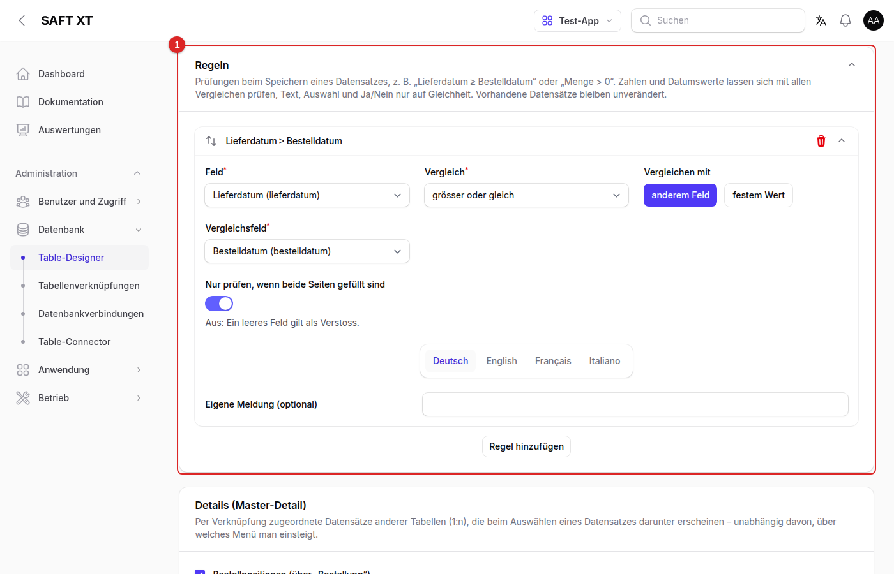
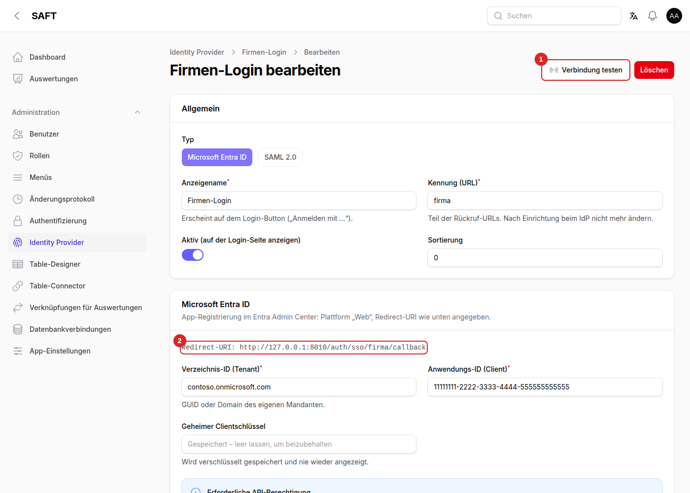
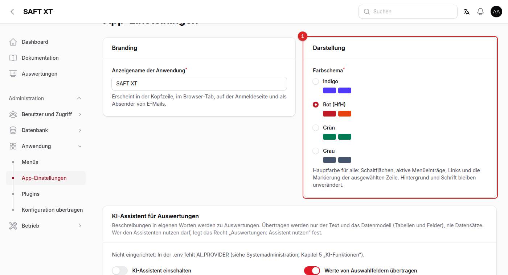
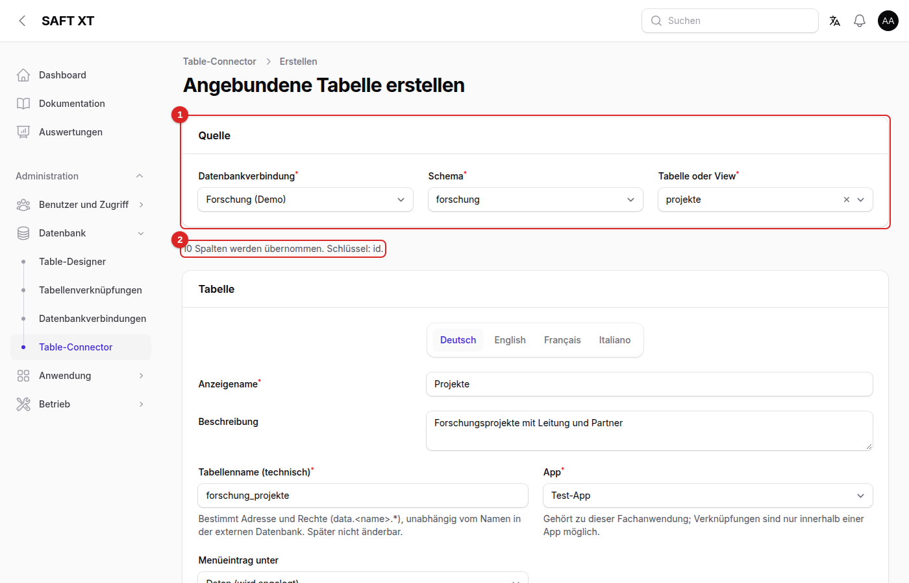
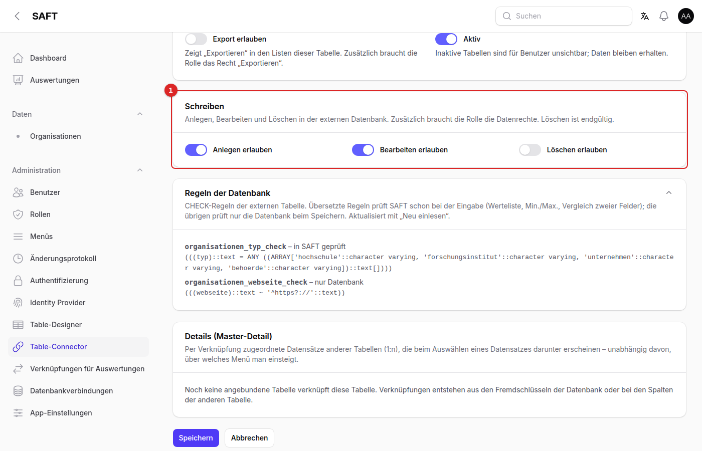

# SAFT XT – Administratorhandbuch

**Deutsch** · [English](ADMIN_GUIDE.md) · [Français](ADMIN_GUIDE.fr.md) · [Italiano](ADMIN_GUIDE.it.md)

**Stand:** Version 0.1 · **Zielgruppe:** Administratorinnen und Administratoren in SAFT

**Weitere Handbücher:** [Anwenderhandbuch](USER_GUIDE.de.md) · [Häufige Fragen](FAQ.de.md) · [Systemadministration](SYSADMIN_GUIDE.de.md)

> **Zu den Abbildungen:** Die Bilder sind Screenshots der Anwendung mit den Demo-Daten. Die roten Ziffern in den
> Bildern verweisen auf die Erläuterungen im Text.

---

## Inhalt

- [1. Benutzer](#1-benutzer)
- [2. Rollen und Rechte](#2-rollen-und-rechte)
- [3. Menüs](#3-menüs)
- [4. Table-Designer](#4-table-designer)
- [5. Authentifizierung](#5-authentifizierung)
- [6. Identity Provider (Single Sign-On)](#6-identity-provider-single-sign-on)
- [7. App-Einstellungen](#7-app-einstellungen)
- [8. Änderungsprotokoll](#8-änderungsprotokoll)
- [9. Datenbankverbindungen](#9-datenbankverbindungen)
- [10. Table-Connector](#10-table-connector)
- [11. Tabellenverknüpfungen](#11-tabellenverknüpfungen)
- [12. Geplante Aufgaben](#12-geplante-aufgaben)
- [13. KI-Funktionen](#13-ki-funktionen)
- [14. Plugins](#14-plugins)
- [15. Konfiguration übertragen](#15-konfiguration-übertragen)
- [Anhang A – Rechte im Überblick](#anhang-a--rechte-im-überblick)

---

Die folgenden Funktionen finden Sie im Menü unter **Administration**. Sie sind nur mit den entsprechenden
Rechten sichtbar. Auch hier sind Listen und Tabellen nur so breit wie ihre Spalten (siehe [Anwenderhandbuch 4.1](USER_GUIDE.de.md#41-die-tabellenansicht)).

## 1. Benutzer

**Administration → Benutzer und Zugriff → Benutzer**

- **Liste** mit Name, E-Mail, Rollen, aktiv, letzter Anmeldung. Filter: aktiv, Rolle, **ohne Rolle**,
  **SSO-Verknüpfung**, gelöschte Benutzer.
- **Anlegen / Bearbeiten:** Name, E-Mail, Passwort (beim Anlegen Pflicht, ausser im reinen SSO-Modus), aktiv,
  Rollen. Die **Standardrolle** (siehe [Kapitel 5](#5-authentifizierung)) ist beim Anlegen vorausgewählt.
- **Passwortregel:** Neue Passwörter brauchen mindestens 12 Zeichen. Passwörter aus bekannten Datenlecks lehnt SAFT
  ab (Abgleich ohne Übermittlung des Passworts). Bestehende Passwörter bleiben gültig, bis sie geändert werden.
- **Zwei-Faktor zurücksetzen:** Hat jemand Handy und Wiederherstellungscodes verloren, löscht diese Aktion oben in
  der Bearbeitungsmaske die eingerichtete Authenticator-App. Die Person meldet sich danach mit dem Passwort an und
  richtet den zweiten Faktor neu ein. Einrichten, Ausschalten und Zurücksetzen stehen im Änderungsprotokoll.
- **Inaktive Benutzer** können sich nicht anmelden – weder per Passwort noch per SSO.
- **SSO-Verknüpfungen:** Im Benutzer sehen Sie, mit welchen Single-Sign-On-Konten er verbunden ist, und können
  eine Verknüpfung trennen.
- **Änderungshistorie:** Jede Änderung am Benutzer ist unten auf der Seite nachvollziehbar.
- **Sprache:** Jeder Benutzer wählt seine Sprache selbst über das Sprach-Symbol; sie wird an seinem Konto
  gespeichert und gilt auch für E-Mails an ihn, etwa zum Zurücksetzen des Passworts.
- **Gelöschte Benutzer** lassen sich über den Filter anzeigen, wiederherstellen oder endgültig löschen. Ihre
  Einträge im Änderungsprotokoll bleiben erhalten (siehe [Kapitel 8](#8-änderungsprotokoll)).
- **Inaktiv, gelöscht oder endgültig gelöscht?**

  | | Inaktiv | Gelöscht (Papierkorb) | Endgültig gelöscht |
  |---|---|---|---|
  | Anmeldung | gesperrt | gesperrt | – |
  | In der Liste | sichtbar | nur über den Filter „Gelöschte Datensätze“ | nicht mehr vorhanden |
  | Rückgängig | Schalter „Aktiv“ | „Wiederherstellen“ | nicht möglich |
  | Name im Änderungsprotokoll | ja | ja, als „gelöscht“ gekennzeichnet | nein, nur die Benutzer-Nummer |
  | Erneute SSO-Anmeldung | abgewiesen | abgewiesen („Ihr Benutzerkonto wurde entfernt“) | kann ein **neues** Konto anlegen |

  „Inaktiv“ eignet sich für vorübergehende Sperren. Ein gelöschtes Konto bleibt bewusst gesperrt: Sonst bekäme eine
  Person, die beim Identity Provider weiter existiert, mit der Auto-Provisionierung bei der nächsten Anmeldung sofort
  ein neues Konto. **Endgültig löschen** (Zeilenaktion bei gelöschten Konten, auch als Mehrfachaktion) ist für
  Datenschutz-Löschungen gedacht – oder wenn eine Person per SSO bewusst ein neues Konto erhalten soll.

Schutzregeln: Niemand kann sich selbst löschen oder deaktivieren. Super-Admin-Konten können nur von
Super-Admins bearbeitet werden, und anderen Benutzern wird die Rolle `super-admin` gar nicht erst angeboten.

## 2. Rollen und Rechte

**Administration → Benutzer und Zugriff → Rollen**

Eine Rolle bündelt Rechte. Benutzer erhalten Rechte ausschliesslich über Rollen.

- **Berechtigungen** – Rechte auf Funktionen der Anwendung, z. B. „Benutzer: bearbeiten“,
  „Table-Designer: anzeigen“ oder **Dashboard-Widgets**.
- **Datenrechte** – eine Matrix mit allen Tabellen des Table-Designers und den Spalten **Anzeigen, Anlegen,
  Bearbeiten, Löschen, Exportieren, Importieren**. Neue Tabellen erscheinen hier automatisch. **Importieren** wirkt
  nur zusammen mit **Anlegen** und wenn der Import für die Tabelle freigegeben ist. **Exportieren** wirkt nur, wenn
  der Export für die Tabelle freigegeben ist (siehe [Kapitel 4](#4-table-designer)) und die Rolle die Tabelle auch
  anzeigen darf. Angebundene externe Tabellen (siehe [Kapitel 10](#10-table-connector)) bieten **Anlegen, Bearbeiten**
  und **Löschen** nur, wenn das für die Tabelle freigeschaltet ist; sonst steht dort „–“.
  Die Matrix hat die Reiter **Eigene Tabellen** (nach Menügruppe gegliedert, technischer Name dezent daneben) und
  **Verknüpfte Tabellen** (nach Datenbankverbindung). **Alle** in einer Zeile setzt alle Rechte der Tabelle, das
  Kästchen über einer Spalte („ganze Spalte“) setzt das Recht für alle sichtbaren Tabellen. Das **Suchfeld** filtert
  die Zeilen nach Bezeichnung oder technischem Namen.

- **Menüeinträge** – alle Menüeinträge vom Typ „Datentabelle“, z. B. „Daten › Kunden“. Ohne Haken sieht die Rolle den
  Eintrag nicht im Menü. Neue Einträge und neue Rollen sind angehakt, also sichtbar. Das ist nur Darstellung: Ob die
  Tabelle angezeigt werden darf, legen die Datenrechte fest. Ein ausgeblendeter Eintrag bleibt über Links, die
  Master-Detail-Ansicht und die Vorschau erreichbar. Bei mehreren Rollen genügt eine Rolle mit Leserecht, die den
  Eintrag zeigt; `super-admin` sieht immer alle Einträge.

Die Bereiche werden unabhängig gespeichert – eine Änderung im einen verändert nichts im anderen.

Geänderte Rechte gelten sofort, auch für bereits angemeldete Benutzer. Wer ein Recht verloren hat, erhält beim
nächsten Klick „Keine Berechtigung“; das Menü ist nach dem Neuladen der Seite aktuell.

**Besondere Rollen:**

| Rolle | Bedeutung |
|---|---|
| `super-admin` | Hat **alle** Rechte, auch für künftige Funktionen. Kann weder gelöscht noch umbenannt werden und wird nie automatisch per SSO vergeben. |
| `benutzer` | Standardrolle für neue Benutzer, ohne Admin-Rechte; sieht das Dashboard mit den persönlichen Widgets. Solange sie als Standardrolle eingestellt ist, kann sie nicht gelöscht werden. |

**Ansicht als Rolle (Rechte prüfen):** Super-Admins wählen im Benutzermenü oben rechts **„Ansicht als Rolle …“** und
eine oder mehrere Rollen – so, wie eine Person sie hat (vorausgewählt ist die Standardrolle, meist kommt eine
Fachrolle dazu). Danach sehen sie SAFT ausschliesslich mit deren Rechten – Menü, Seiten, Datenrechte, Auswertungen und
Widgets –, wie eine andere Person mit genau diesen Rollen: Eigene Auswertungen gelten dabei nicht als die eigenen. Ein gelbes Band oben nennt die Rolle; **Beenden** im Band stellt die
eigenen Rechte wieder her (auch die Abmeldung beendet die Ansicht). Die Datenbank bleibt unverändert, Start und Ende
stehen im Änderungsprotokoll. Achtung: Was die Rolle darf, wird während der Ansicht wirklich gespeichert – mit Ihnen
als Verursacher.

## 3. Menüs

**Administration → Anwendung → Menüs**

Das Menü auf der linken Seite wird hier gepflegt. Jeder Eintrag hat einen **Typ**:

| Typ | Verwendung |
|---|---|
| **Gruppe** | Überschrift für untergeordnete Einträge (z. B. „Daten“) |
| **Interne Seite** | eine Seite der Anwendung (z. B. Dashboard, Benutzer) |
| **Externe URL** | ein Link nach aussen; öffnet in einem neuen Tab |
| **Datentabelle** | eine Tabelle des Table-Designers mit eigener Spaltenauswahl |
| **Datenmodell** | grafische Übersicht der Datentabellen dieser Gruppe und ihrer Verknüpfungen (siehe unten) |
| **Auswertung** | eine geteilte Auswertung (siehe [Anwenderhandbuch 4.9](USER_GUIDE.de.md#49-auswertungen)); erscheint nur für Personen, die sie mit ihren Datenrechten ausführen dürfen |

**Menüeintrag vom Typ „Datentabelle“** (1):

- Wählen Sie die **Datentabelle** – es werden nur aktive Tabellen des Table-Designers angeboten.
- Wählen Sie die **weiteren angezeigten Spalten** (2). **Pflichtfelder** werden immer angezeigt und stehen
  deshalb nicht zur Auswahl.
- Das nötige Leserecht wird automatisch gesetzt: Der Eintrag ist nur für Benutzer sichtbar, die die Tabelle
  anzeigen dürfen.
- Für dieselbe Tabelle können **mehrere Einträge** mit unterschiedlichen Spalten angelegt werden.
- Wechseln Sie später den Typ, entfällt das automatisch gesetzte Leserecht wieder.
- Für einzelne Rollen lässt sich der Eintrag ausblenden, ohne das Leserecht zu entziehen (Rollen → Menüeinträge, siehe
  [Kapitel 2](#2-rollen-und-rechte)).

**Menüeintrag vom Typ „Datenmodell“:** Die Seite zeigt die Datentabellen der Gruppe, in der der Eintrag steht –
einschliesslich aller Untergruppen – als Diagramm mit ihren Verknüpfungen. Steht der Eintrag auf oberster Ebene,
erscheinen alle Datentabellen. Die Seite ist generisch: Derselbe Typ lässt sich in mehrere Gruppen einhängen, und
wird ein Eintrag verschoben, zeigt er automatisch die neue Gruppe. Es gilt:

- Gezeigt werden Tabellen mit einem Menüeintrag vom Typ „Datentabelle“ in der Gruppe, und nur solche, die der
  Benutzer sehen darf (Leserecht, für seine Rollen nicht ausgeblendet, aktiv). Tabellen ohne Menüeintrag fehlen.
- Sieht ein Benutzer in der Gruppe **keine einzige Tabelle**, erscheint der Eintrag „Datenmodell“ in seinem Menü
  nicht. Bliebe die Gruppe dadurch leer, wird auch sie ausgeblendet.
- Verknüpfte Tabellen **ausserhalb der Gruppe** erscheinen als Randknoten mit gestricheltem Rahmen, nur mit Namen.
  Verknüpfungen auf Tabellen ohne Leserecht entfallen ganz.
- **Linien:** durchgezogen, wenn die Verknüpfung im Table-Designer als Detailtabelle eingerichtet ist, sonst
  gestrichelt. Die Enden zeigen die Kardinalität: viele Datensätze verweisen auf genau einen (Pflichtfeld) bzw.
  keinen oder einen Stammsatz.
- **„Felder anzeigen“** schaltet ohne Neuladen zwischen der Übersicht mit Tabellennamen und der Ansicht mit allen
  aktiven Feldern um (Typ, technischer Name, PK/FK/UK, Bezeichnung, `*` = Pflichtfeld). Der Browser merkt sich
  die Wahl.
- Angebundene Tabellen aus dem Table-Connector haben einen orangefarbenen Rahmen und nennen ihre Verbindung.
- Wie jeder Eintrag lässt sich auch dieser über ein **Recht** einschränken. Das Diagramm passt sich dem
  Farbschema (hell/dunkel) an; breite Diagramme lassen sich seitlich verschieben.

**Bezeichnung je Sprache:** Jeder Eintrag hat ein Feld für **Deutsch** (Pflicht) und je eines für **English**,
**Français** und **Italiano**. Bleibt ein Feld leer, erscheint in dieser Sprache die deutsche Bezeichnung. Die
mitgelieferten Einträge sind bereits in allen vier Sprachen benannt. Einträge, die der Table-Designer für eine Tabelle anlegt, übernehmen deren Anzeigenamen
in allen Sprachen und folgen ihm bei jeder Änderung.

**Icons:** Die Schaltfläche rechts im Feld **Icon** öffnet einen Auswahldialog mit allen vorhandenen Icons, getrennt
nach Stil auf den Reitern **Outline**, **Solid**, **Mini** und **Micro**. Das Suchfeld filtert sofort (z. B. „user“),
die Zahl am Reiter nennt die Treffer je Stil; ein Klick übernimmt den Namen ins Feld. Das aktuelle Icon ist
hervorgehoben und erscheint links im Feld als Vorschau. Den Namen können Sie auch von Hand eingeben, z. B.
`heroicon-o-users`; das Formular nimmt nur bekannte Icons an. Denselben Dialog gibt es beim Tabellen-Icon im
Table-Designer. Ein Eintrag mit Untereinträgen, der kein gültiges Icon hat, erhält ein Ordner-Symbol.

**Weitere Regeln:** Ein Menü hat höchstens drei Ebenen: Gruppe (Überschrift), Eintrag und Untereintrag. Ein Eintrag mit
Untereinträgen ist ein **Untermenü** und erscheint mit einem Pfeil **›**; ein Klick öffnet seine erste Seite und klappt
es auf. So ist die Administration gegliedert (*Benutzer und Zugriff*, *Datenbank*, *Anwendung*, *Betrieb*) und die
Lager-Demo (*Lager führen*, *Stammdaten*, *Auswertungen*); Einträge lassen sich per Drag & Drop sortieren. Beim
Löschen eines Eintrags werden seine Untereinträge mitgelöscht.

> Die **Details** (Master-Detail) werden nicht im Menü, sondern im Table-Designer eingestellt.

## 4. Table-Designer

**Administration → Datenbank → Table-Designer**

Hier legen Sie eigene Tabellen an – ohne Programmierung.

**Mehrsprachig:** Anzeigename und Beschreibung einer Tabelle, die Bezeichnung jedes Felds und die Anzeige der
Auswahlwerte haben ein Feld je Sprache. Deutsch ist beim Anzeigenamen und bei der Bezeichnung Pflicht, die übrigen
Sprachen sind freiwillig; ohne sie erscheint der deutsche Text. Der technische Name und die gespeicherten
Auswahlwerte gelten für alle Sprachen.

**Tabelle anlegen:**

1. **Neue Tabelle** → Anzeigename eingeben. Der technische Name wird vorgeschlagen
   (z. B. „Grösse in m²“ → `groesse_in_m2`) und kann **später nicht mehr geändert** werden. Technische Namen sind
   für alle Tabellen eindeutig – eigene, importierte und angebundene. Ist der Name vergeben, meldet SAFT das schon
   beim Verlassen des Felds und nennt die Tabelle, z. B. „Der Name „personen“ ist bereits vergeben: angebundene
   Tabelle „Personen“ (Verbindung Forschung).“ Trägt eine andere Tabelle dieselbe **Bezeichnung**, erscheint nur ein
   Hinweis – erlaubt, aber in Menüs und Auswahllisten schwer zu unterscheiden. Dasselbe gilt beim Import und im
   Table-Connector.
2. Optional **Startfelder** anlegen und unter **„Menüeintrag unter“** die Gruppe im Menü wählen. Vorbelegt ist
   „Daten“; angeboten werden alle Gruppen, Untergruppen eingerückt mit ihrem Pfad (z. B. „Daten › Forschung“).
   „Kein Menüeintrag“ legt keinen an.
3. Speichern – die Tabelle ist sofort nutzbar. Für sie entstehen automatisch die **Datenrechte**
   (Anzeigen/Anlegen/Bearbeiten/Löschen) in der Rollenverwaltung.

**Export erlauben:** Dieser Schalter in den Stammdaten der Tabelle gibt den Export frei (siehe
[Anwenderhandbuch 4.7](USER_GUIDE.de.md#47-daten-exportieren)). Er ist zunächst aus. Auch Super-Admins sehen „Exportieren“ erst, wenn er an ist;
alle anderen brauchen zusätzlich das Recht **Exportieren** in ihrer Rolle.

**Import erlauben:** Dieser Schalter gibt den Datenimport frei – neue Datensätze aus einer Excel- oder CSV-Datei, etwa
aus einer heruntergeladenen Vorlage (siehe [Anwenderhandbuch 4.8](USER_GUIDE.de.md#48-daten-importieren)). Er ist
zunächst aus. Dann erscheint „Importieren“ in der Liste für Rollen mit den Rechten **Anlegen** und **Importieren**.
Vorhandene Datensätze ändert der Import nie; die Prüfung entspricht dem Erfassen von Hand, und es gilt alles oder
nichts. Höchstens 10'000 Zeilen je Datei (`APP_DATA_IMPORT_MAX_RECORD_ROWS`). Für angebundene Tabellen des
Table-Connectors gibt es den Import nicht.

**Felder bearbeiten** (Bereich *Felder*, (2)): Für jedes Feld legen Sie fest:

| Einstellung | Bedeutung |
|---|---|
| Bezeichnung / Spaltenname | Anzeige bzw. technischer Name. **Umbenennen behält die Daten.** |
| Typ | siehe [Anwenderhandbuch, Anhang A](USER_GUIDE.de.md#anhang-a--feldtypen) |
| Typ-Einstellungen | Länge (Text), Stellen (Dezimalzahl), Werte (Auswahlliste), Zieltabelle, Anzeigefelder und Trennzeichen (Verknüpfung) |
| Validierung | Mindest-/Höchstlänge, Minimum/Maximum, E-Mail, URL; **Weitere Prüfungen** aus Plugins, z. B. AHV-Nummer oder IBAN (erscheint nur, wenn ein Plugin Prüfregeln für den Feldtyp anbietet; sie gelten bei der Erfassung, beim Import und über die Schnittstelle, leere Werte werden nicht geprüft). Fehlt das Plugin später oder ruht es, wird die Prüfung übersprungen und beim Feld als „nicht verfügbar“ angezeigt |
| Vorgabe beim Anlegen (Ganzzahl) | **Fortlaufend vorschlagen:** Im Dialog „Neuer Datensatz“ steht der höchste vorhandene Wert + 1 und bleibt änderbar; bleibt das Feld leer, setzt SAFT den Wert beim Speichern. Mit **Zählen je** (eine Verknüpfung, z. B. *Bestellung*) wird je Master-Datensatz gezählt: unter einer Bestellung mit zwei Positionen wird 3 vorgeschlagen; in der Liste erscheint der Vorschlag, sobald die Bestellung gewählt ist. Gelöschte Datensätze zählen nicht. |
| Vorgabe beim Anlegen (Datum, Datum und Zeit) | **Mit dem heutigen Datum vorbelegen** bzw. **Mit aktuellem Datum und Uhrzeit vorbelegen:** Im Dialog „Neuer Datensatz“ steht beim Öffnen das aktuelle Datum (bzw. Datum und Uhrzeit auf die Minute) und bleibt änderbar. Beim Bearbeiten, beim Import und über die Schnittstelle setzt SAFT nichts. Nicht zusammen mit „Übernehmen aus“. |
| Übernehmen aus | Wert aus dem Master-Datensatz übernehmen, z. B. *Einzelpreis* aus **Artikel → Preis**: Sobald im Formular ein Artikel gewählt ist (oder unter einem Artikel als Detailtabelle sofort), steht sein Preis im Feld und bleibt änderbar. Beim Wechsel des Artikels folgt der Wert, solange er nicht von Hand geändert wurde; leer gespeicherte Felder füllt SAFT. Eine Kopie: Spätere Änderungen am Artikel ändern vorhandene Positionen nicht. Angeboten werden nur passende Felder (Zahl ← Zahl, Datum ← Datum, Text ← Text/Auswahl, Ja/Nein ← Ja/Nein). Ein Quellfeld lässt sich nicht löschen, solange ein Feld daraus übernimmt; Umbenennen wird nachgeführt. |
| Pflichtfeld | muss ausgefüllt werden; wird in Listen immer angezeigt |
| Eindeutig | darf nur einmal vorkommen (gelöschte Datensätze zählen nicht) |
| Durchsuchbar | wird von der Suche berücksichtigt |
| Index anlegen | beschleunigt Sortieren und Filtern bei grossen Tabellen |
| In Tabelle / Im Formular anzeigen | Voreinstellung für Listen und Formulare |

**Anzeigefelder einer Verknüpfung:** Statt der gespeicherten Nummer zeigt eine Verknüpfung Felder des verknüpften
Datensatzes – eines oder mehrere, in der gewählten Reihenfolge und mit einem **Trennzeichen** (Leerzeichen, Komma,
Gedankenstrich, Punkt oder Schrägstrich) verbunden, z. B. Vorname und Nachname zu „Anna Keller“ oder Name und Ort zu
„ETH Zürich, Zürich“. Leere Felder werden übersprungen. Das gilt in Listen, Details, Vorschau, Filtern, Export und in
der Auswahlliste beim Bearbeiten; dort sucht die Eingabe in allen Anzeigefeldern. Sortiert wird nach dem ersten
Anzeigefeld. Benennen Sie ein Anzeigefeld um, folgt die Verknüpfung; solange ein Feld irgendwo als Anzeigefeld dient,
lässt es sich nicht endgültig löschen.

**Regeln** (Abbildung unten, 1): Prüfungen über Felder hinweg beim Speichern eines Datensatzes, z. B. „Lieferdatum ≥ Bestelldatum“ oder
„Menge > 0“. Für jede Regel wählen Sie das **Feld**, den **Vergleich** und ob mit einem **anderen Feld** oder einem
**festen Wert** verglichen wird:

- Zahlen und Datumswerte erlauben alle Vergleiche (=, ≠, <, ≤, >, ≥) – eine Zahl nur mit einer Zahl, ein Datum nur mit
  einem Datum. Text, Auswahllisten und Ja/Nein lassen sich nur auf Gleichheit prüfen (= und ≠). Verknüpfungen und
  langer Text sind nicht möglich.
- **Nur prüfen, wenn beide Seiten gefüllt sind** (Vorgabe): Ein leeres Feld wird nicht geprüft. Ausgeschaltet gilt
  ein leeres Feld als Verstoss.
- **Eigene Meldung** (optional, je Sprache). Sonst erscheint beim Feld der Standardtext, z. B. „darf nicht vor
  „Bestelldatum“ liegen“.
- Die Regel gilt in allen Formularen der Tabelle (Liste, Detailtabellen, Details → Bearbeiten). Vorhandene Datensätze
  bleiben unverändert; verletzen schon welche eine neue Regel, zeigt ein Hinweis wie viele – sie werden beim nächsten
  Bearbeiten geprüft.
- Wird ein Feld umbenannt, ändern sich seine Regeln mit. Ein Feld, das eine Regel verwendet, lässt sich nicht löschen,
  und sein Typ nur in einen Typ ändern, der weiter zur Regel passt.

### Berechnete Felder

Ein Feld vom Typ **Berechnet** wird nicht eingegeben, sondern beim Speichern aus anderen Feldern desselben Datensatzes
oder aus den zugehörigen Kind-Datensätzen berechnet, z. B. *Betrag* aus Menge und Einzelpreis oder *Gesamtpreis* als
Summe der Beträge aller Positionen einer Bestellung. Der Wert wird gespeichert und lässt sich daher sortieren,
filtern, exportieren und in Regeln verwenden.

- **Ergebnis:** Ganzzahl oder Dezimalzahl (mit Stellen und Nachkommastellen); das Ergebnis wird darauf gerundet.
- **Formel:** Zahlenfelder der Tabelle (per Spaltenname), Zahlen, `+ - * /` und Klammern sowie die Funktionen
  `round(x, Stellen)`, `min(a, b, …)`, `max(a, b, …)`, `abs(x)` und `coalesce(a, Ersatz)`. Beispiel:
  `round(menge * einzelpreis, 2)`. Die Funktionsnamen sind in allen Sprachen gleich. Plugins können weitere
  Funktionen mitbringen, z. B. `rappen(betrag)` (Rundung auf 5 Rappen); sie stehen in der Eingabehilfe unter
  **Funktionen aus Plugins**, die Beschreibung erscheint beim Zeigen auf den Knopf. In den Ausdrücken der Auswertungen
  gibt es sie nicht. Fehlt das Plugin später, bleibt das Ergebnis leer.
- **Über Kind-Datensätze** (Tabellen, die per Verknüpfung auf diese Tabelle zeigen): `sum(tabelle.feld)`,
  `avg(tabelle.feld)`, `min(tabelle.feld)`, `max(tabelle.feld)` und `count(tabelle)`, z. B. Gesamtpreis =
  `sum(bestellpositionen.betrag)`, MWST = `round(gesamtpreis * 0.081, 2)`. Gelöschte Kind-Datensätze zählen nicht;
  ohne Kind-Datensätze ergeben Summe und Anzahl 0. Zeigt eine Kind-Tabelle mit mehreren Verknüpfungen auf diese
  Tabelle, wird die gewünschte als zweiter Wert genannt: `sum(bestellpositionen.betrag, bestellung_id)`.
- **Ausdruck je Kind-Datensatz:** Statt eines Felds darf in `sum`, `avg`, `min` und `max` auch eine Rechnung mit Feldern
  der Kind-Tabelle stehen; sie wird für jeden Kind-Datensatz ausgerechnet und dann zusammengefasst, z. B.
  `sum(bestellpositionen.einzelpreis * bestellpositionen.menge)` oder
  `sum(round(bestellpositionen.menge * bestellpositionen.einzelpreis * 0.95, 2))`. Im Ausdruck stehen nur Felder dieser
  einen Kind-Tabelle (keine Felder des Master-Datensatzes, keine verschachtelten Zusammenfassungen). Ist das Ergebnis
  für einen Kind-Datensatz leer, zählt er nicht mit – mit `coalesce(…, 0)` lässt sich das steuern.
- **Eingabehilfe:** Unter dem Formelfeld stehen die Zahlenfelder der Tabelle als Knöpfe, z. B. „Menge (menge)“; ein
  Klick fügt den technischen Namen an der Schreibmarke ein. Je Kind-Tabelle folgt eine eigene Zeile mit
  `count(tabelle)` und deren Zahlenfeldern (`tabelle.feld`), dazu Knöpfe für Rechenzeichen, Funktionen und `sum`,
  `avg`, `count`. Beim Anlegen einer neuen Tabelle erscheinen nur die Felder, die im Formular weiter oben stehen.
- **Prüfung:** Schon während der Eingabe meldet SAFT Fehler mit der Stelle (z. B. „Zeichen 9: Unbekanntes Feld
  „preis““) oder bestätigt, wovon das Ergebnis abhängt. Kreisbezüge werden abgelehnt; die Meldung nennt die Formeln der
  beteiligten Felder, z. B. „Kreisbezug: mwst → einkaufspreis → mwst. Die Formeln: mwst = …; einkaufspreis = …“.
- **Leere Werte:** Ist ein verwendetes Feld leer, ist das Ergebnis leer – ausser mit `coalesce(feld, 0)`. Eine Division
  durch 0 ergibt ebenfalls leer. Gerechnet wird exakt (keine Rundungsfehler bei Geldbeträgen).
- **Wann gerechnet wird:** beim Anlegen eines berechneten Felds für alle vorhandenen Datensätze; beim Anlegen (auch per
  Import) und Ändern eines Datensatzes (die neuen Werte stehen im Änderungsprotokoll);
  beim Anlegen, Ändern, Löschen oder Wiederherstellen eines Kind-Datensatzes für seinen Master-Datensatz – beim
  Wechsel der Bestellung für die alte und die neue – und weiter nach oben (z. B. Umsatz eines Kunden als Summe seiner
  Bestellungen); nach dem Ändern einer Formel für alle Datensätze der Tabelle und der darüberliegenden; und mit `php artisan computed:recompute`, wenn Daten an
  SAFT vorbei geändert wurden.
- Im Formular wird ein berechnetes Feld nur angezeigt („wird beim Speichern berechnet“). Regeln, die ein berechnetes
  Feld prüfen, greifen deshalb erst beim nächsten Bearbeiten.
- Wird ein verwendetes Feld umbenannt (auch in einer Kind-Tabelle), ändert sich die Formel mit; Löschen und ein Wechsel
  auf einen Nicht-Zahlentyp sind gesperrt, solange eine Formel das Feld verwendet. Eine Kind-Tabelle, über die summiert
  wird, lässt sich nicht löschen.
- Die Demo-Daten enthalten *Betrag* (Bestellpositionen) sowie *Gesamtpreis* und *MWST 8,1 %* (Bestellungen).

**Details (Master-Detail)** (1): Hier wählen Sie, welche verknüpften Tabellen unter einem ausgewählten
Datensatz erscheinen (siehe [Anwenderhandbuch 4.3](USER_GUIDE.de.md#43-verknüpfte-tabellen-die-master-detail-ansicht)). Angeboten werden alle
Verknüpfungsfelder anderer Tabellen, die auf diese Tabelle zeigen. Gibt es mehrere Verknüpfungen aus derselben
Tabelle (z. B. „Kunde“ und „Rechnung an“), sind sie einzeln wählbar.

**Weitere Schaltflächen:** *Daten öffnen* (zur Datenansicht) und *Menüeintrag anlegen*. Diese fragt nach der
Gruppe und legt auch einen weiteren Eintrag an, wenn die Tabelle an einer zweiten Stelle im Menü erscheinen soll.

**Was geht – und was nicht:**

| Änderung | Regel |
|---|---|
| Feld umbenennen | jederzeit, Daten bleiben erhalten |
| Typ ändern | verlustfrei jederzeit (z. B. Ganzzahl → Dezimalzahl, Text → mehrzeiliger Text, Datum → Datum und Uhrzeit); sonst nur, wenn die Spalte leer ist |
| Textlänge | vergrössern jederzeit, verkleinern nur bei leerer Spalte |
| „Eindeutig“ einschalten | nur, wenn die vorhandenen Daten keine Duplikate enthalten |
| Wert aus einer Auswahlliste entfernen | jederzeit; ist der Wert in Gebrauch, erscheint eine Warnung mit der Anzahl der Datensätze. Sie behalten ihren Wert, beim nächsten Bearbeiten muss aber ein gültiger gewählt werden. |
| Feld löschen | erst **deaktivieren**, dann „Endgültig löschen“ mit Eingabe des Spaltennamens |
| Tabelle löschen | erst **deaktivieren**, dann „Endgültig löschen“ mit Eingabe des Tabellennamens; nicht möglich, solange andere Tabellen darauf verweisen |
| Verknüpfung | nur zu anderen Tabellen des Table-Designers, nie zu Systemtabellen |

> **Deaktivieren statt löschen:** Ein deaktiviertes Feld oder eine deaktivierte Tabelle ist für Benutzer
> unsichtbar, die Daten bleiben aber vollständig erhalten. Ein Feld holen Sie mit „Aktivieren“ ohne Rückfrage
> zurück. Endgültiges Löschen kann nicht rückgängig gemacht werden.

Unter **Physische Tabelle** sehen Sie den Speicherort, die Anzahl Datensätze und eventuelle Abweichungen
zwischen Einstellungen und Datenbank.

### Verwendet in

Der Reiter **Verwendet in** (neben *Felder* und *Änderungsprotokoll*) zeigt, wo die Tabelle vorkommt; die Zahl am
Reiter nennt die Anzahl. Er dient nur der Information, z. B. vor dem Umbenennen oder Löschen:

| Bereich | Was erscheint |
|---|---|
| Plugin | Plugins, die die Tabelle brauchen, Änderungen daran prüfen oder Knöpfe in ihrer Datenansicht zeigen |
| Auswertung | Auswertungen mit der Tabelle als Grundtabelle oder über eine Verknüpfung |
| Verknüpfung (Auswertung) | Verknüpfungen zwischen Auswertungen mit der Tabelle als Quelle oder Ziel |
| Menü | Menüeinträge, die die Datenansicht öffnen (mit Pfad im Menü) |
| Verknüpfung | Felder anderer Tabellen, die auf diese Tabelle verweisen |
| Formel | berechnete Felder anderer Tabellen, die über diese Tabelle zusammenfassen, z. B. `sum(bestellungen.betrag)` |
| Übernahme | Felder anderer Tabellen, die einen Wert aus dieser Tabelle übernehmen |
| Rolle | Rollen mit Datenrechten auf die Tabelle, mit den Rechten |
| Geplante Aufgabe | Aufgaben „Datenstand aktualisieren“ für die Tabelle |

Der Name ist ein Link, wenn Sie die Seite dazu öffnen dürfen; der Filter **Bereich** schränkt die Liste ein.

### Tabelle oder Feld endgültig löschen

Endgültiges Löschen entfernt die Spalte bzw. Tabelle **samt Daten** aus der Datenbank. Damit das nicht
versehentlich geschieht, geht es in zwei Schritten; der Knopf **„Endgültig löschen“** ist bis dahin zu sehen,
aber gesperrt (der Hinweis erscheint beim Darüberfahren):

| | Tabelle | Feld |
|---|---|---|
| 1. Deaktivieren | Tabelle bearbeiten, Schalter **„Aktiv“** aus, **Speichern** | in der Feldliste **„Deaktivieren“** |
| 2. Löschen | oben **„Endgültig löschen“** | in der Zeile das **Papierkorb-Symbol** („Endgültig löschen“) |
| 3. Bestätigen | technischen Tabellennamen eingeben | Spaltennamen eingeben |

Beim Löschen einer Tabelle entfernt SAFT auch ihre Datenrechte und Menüeinträge; das Änderungsprotokoll bleibt
erhalten. Nötig ist das Recht **Table-Designer: löschen**. Verweist eine andere Tabelle über ein
Verknüpfungsfeld auf die Tabelle, nennt die Meldung dieses Feld – es muss zuerst entfernt werden. Wird die Tabelle
anderswo verwendet (Auswertungen, Menüs, Rollen …), zeigt der Dialog eine Warnung mit der Anzahl je Bereich; das Löschen
bleibt möglich, Einzelheiten stehen im Reiter **Verwendet in**.

### Tabelle aus Datei importieren

**Table-Designer → Importieren** legt aus einer CSV- oder Excel-Datei eine neue Tabelle an und übernimmt die Daten.
Nötig ist das Recht **Table-Designer: importieren**. Der Assistent hat vier Schritte:

1. **Datei:** CSV (`.csv`, `.txt`, `.tsv`) oder Excel (`.xlsx`), höchstens 20 MB bzw. 50'000 Datenzeilen. Bei
   Excel-Dateien mit mehreren Blättern wählen Sie das Blatt. SAFT prüft die Datei; hat sie Fehler, bleibt der
   Assistent hier stehen und zeigt **alle** gefundenen Probleme mit Zeile und Spalte.
2. **Prüfung:** Zusammenfassung (Zeilen, Spalten, bei CSV Trennzeichen und Zeichensatz) und Hinweise, z. B. auf
   eine vermutete Summenzeile.
3. **Spalten:** je Spalte „Übernehmen“, Feldname, Bezeichnung und Typ. Zur Wahl stehen nur Typen, die zu den
   Daten passen (Text geht immer).
4. **Tabelle und Menü:** Bezeichnung, technischer Tabellenname und die Menügruppe für den Eintrag der Tabelle.

**Eine importierbare Liste** hat die Spaltentitel in Zeile 1 und darunter nur Datenzeilen:

| Erlaubt | Führt zum Abbruch |
|---|---|
| Titel mit Leer- und Sonderzeichen („Kunden-Nr.“, „Strasse“) | Spalte ohne Titel, doppelte Titel |
| leere Zellen | Titel oder Leerzeile über der Liste, Leerzeilen mitten in der Liste |
| Leerzeilen am Ende | Werte in Spalten ohne Titel, CSV-Zeilen mit abweichender Spaltenzahl |
| Formeln (es zählt das gespeicherte Ergebnis) | verbundene Zellen, Fehlerzellen wie `#DIV/0!` |

**Feldnamen** entstehen aus den Titeln: „Strasse & Nr.“ → `strasse_nr`, „2024“ → `f_2024`. Der Titel selbst wird
die Bezeichnung. Systemnamen und reservierte Wörter („ID“, „Order“) erhalten die Endung `_import`. Ergeben zwei
Titel denselben Namen („Kunden Nr“ und „Kunden-Nr.“), nennt die Prüfung beide Spalten.

**Typen** erkennt SAFT nur, wenn **alle** Werte einer Spalte passen:

| Werte | Typ |
|---|---|
| ganze Zahlen | Ganzzahl |
| Zahlen mit Nachkommastellen (`1.234,50` oder `1,234.50`) | Dezimalzahl |
| `TT.MM.JJJJ` oder `JJJJ-MM-TT`, optional mit Uhrzeit | Datum bzw. Datum und Uhrzeit |
| ja/nein, true/false, wahr/falsch | Ja/Nein |
| Zahlen mit führender Null (PLZ `01067`) | Text – die Null bleibt erhalten |
| alles andere | Text; über 255 Zeichen oder mehrzeilig: Langtext |

Ob `1.234` als 1234 oder als 1,234 gelesen wird, entscheidet bei CSV das Trennzeichen (Semikolon: deutsches
Format, Komma: englisches); die Spaltenvorschau nennt das gewählte Format. Schlüssel errät SAFT nicht: Jede Tabelle erhält wie immer ihre eigene
Datensatz-Nummer; eine Spalte „ID“ der Datei wird als normales Feld `id_import` übernommen.

Der Import gilt ganz oder gar nicht: Passt ein Wert nicht, wird nichts angelegt, und die Meldung nennt die
Zelle. Im **Änderungsprotokoll** steht ein Eintrag „importiert“ mit Datei, Zeilen- und Spaltenzahl, nicht ein
Eintrag je Datensatz. Höchstens zehn Spalten werden sortierbar angelegt; weitere schalten Sie im Table-Designer
frei.

**Falsch importiert?** Die Tabelle im Table-Designer öffnen, „Aktiv“ ausschalten und speichern, dann
„Endgültig löschen“ mit dem Tabellennamen bestätigen (siehe [Tabelle oder Feld endgültig
löschen](#tabelle-oder-feld-endgültig-löschen)). Danach lässt sich die Datei erneut importieren.

## 5. Authentifizierung

**Administration → Benutzer und Zugriff → Authentifizierung**

| Einstellung | Bedeutung |
|---|---|
| **Anmeldemodus** | **Lokal** (nur Passwort), **Single Sign-On** (nur Identity Provider) oder **Hybrid** (beides) |
| **Notfall-Anmeldung für Super-Admins** | Erlaubt Super-Admins im SSO-Modus die Anmeldung per Passwort über `…/admin/login?local=1` – für den Fall, dass der Identity Provider ausfällt |
| **„Passwort vergessen“ anbieten** | E-Mail zum Zurücksetzen des Passworts (nur bei Modus Lokal oder Hybrid; erfordert konfigurierten Mailversand) |
| **Standardrolle für neue Benutzer** | wird beim Anlegen vorausgewählt und bei automatisch angelegten SSO-Benutzern vergeben |
| **Zwei-Faktor-Anmeldung** | **Freiwillig**, **Pflicht für Administration** (Vorgabe) oder **Pflicht für alle**. Als Administration gilt: Super-Admin oder ein beliebiges Recht auf Benutzer, Rollen, Menüs, Identity Provider, Einstellungen, Table-Designer, Datenbankverbindungen, Table-Connector, Tabellenverknüpfungen, geplante Aufgaben, Plugins oder Konfiguration übertragen. Wer unter die Pflicht fällt, wird nach der Anmeldung zur Einrichtung geführt. Ausgenommen sind Anmeldungen per SSO und Konten ohne Passwort (zweiter Faktor beim Identity Provider) sowie *Ansicht als Rolle*. |

Schutz vor Aussperren: Der Modus **Single Sign-On** lässt sich nur speichern, wenn mindestens ein aktiver
Identity Provider einen **erfolgreichen Verbindungstest** hat. Zusätzliche Notausgänge für den Betrieb siehe
[Systemadministration, Kapitel 1](SYSADMIN_GUIDE.de.md#1-für-den-betrieb).

## 6. Identity Provider (Single Sign-On)

**Administration → Benutzer und Zugriff → Identity Provider**

Unterstützt werden **Microsoft Entra ID** und **SAML 2.0** (z. B. ADFS, Keycloak). Mehrere Anbieter sind
möglich; jeder erscheint als eigene Schaltfläche auf der Anmeldeseite. Eine Schritt-für-Schritt-Anleitung für Entra ID
mit App-Registrierung bei Microsoft und Fehlersuche steht in der Systemadministration, [Anhang D](SSO_ENTRA.de.md). Die Adressen eines SAML-Anbieters müssen
mit `https://` beginnen; ein Anbieter, der nur über http erreichbar ist, kann nicht eingebunden werden.

**Einrichten – Ablauf:**

1. Anbieter anlegen, Typ wählen, Anzeigename und Kennung vergeben.
2. Die angezeigten **Werte für den Identity Provider** (2) – z. B. Redirect-URI bzw. ACS-URL und
   SP-Metadaten-URL – beim Anbieter eintragen. Ein Klick auf einen Wert kopiert die Adresse.
3. Die Angaben des Anbieters eintragen:
   - **Entra ID:** Verzeichnis-ID (Tenant), Anwendungs-ID (Client), geheimer Clientschlüssel. Nur der eigene
     Mandant ist erlaubt (nicht `common`/`organizations`).
   - **SAML:** IdP-Metadaten-URL *oder* Entity-ID, SSO-URL und Zertifikat. Für signierte Anfragen ein
     SP-Zertifikat per Klick erzeugen.
4. Speichern und **„Verbindung testen“** (1). Geheimnisse werden verschlüsselt gespeichert und nie wieder
   angezeigt.
5. Unter *Authentifizierung* den Modus **Hybrid** oder **Single Sign-On** wählen.

**Benutzerzuordnung:**

| Einstellung | Wirkung |
|---|---|
| Vorhandene Benutzer per E-Mail verknüpfen | Ein bekannter Benutzer wird beim ersten SSO-Login anhand der E-Mail zugeordnet |
| Unbekannte Benutzer automatisch anlegen | Neue Personen erhalten ein Konto (mit Standardrolle) |
| Standardrolle für neue Benutzer | Wird nur beim automatischen Anlegen vergeben und bleibt danach erhalten. Leer = globale Standardrolle aus [Kapitel 5](#5-authentifizierung) (das Feld zeigt sie an); zugeordnete Rollen kommen zusätzlich dazu |
| Erlaubte E-Mail-Domains | Nur diese Domains dürfen sich anmelden (leer = alle) |

**Rollen-Zuordnung:** Rollen können aus dem Identity Provider übernommen werden – bei Entra aus **App-Rollen**
(empfohlen) oder **Gruppen**, bei SAML aus einem Attribut. Zuordnungen lauten „externer Wert → Rolle“. Bei jeder
Anmeldung werden die zugeordneten Rollen vergeben bzw. entzogen; andere Rollen bleiben unberührt.
`super-admin` ist nie zuordenbar. Optional: „Anmeldung nur mit zutreffender Zuordnung erlauben“.

**Abmeldung (Single Logout):** Auf Wunsch meldet die Abmeldung in SAFT auch beim Anbieter ab. Bei Entra
betrifft das alle Microsoft-Dienste im Browser (Outlook, Teams …) – daher standardmässig aus.

## 7. App-Einstellungen

**Administration → Anwendung → App-Einstellungen**

| Einstellung | Bedeutung |
|---|---|
| **Anzeigename der Anwendung** | Höchstens 60 Zeichen. Erscheint in der Kopfzeile, im Browser-Tab, auf der Anmeldeseite und als Absender von E-Mails |
| **Farbschema** | Hauptfarbe für alle: **Indigo** (Vorgabe), **Rot (HfH)**, **Grün** oder **Grau**. Färbt Schaltflächen, aktive Menüeinträge, Links und die Markierung der ausgewählten Zeile; Hintergrund, Schrift und Layout bleiben. Gilt sofort nach dem Speichern |

Im Abschnitt **Darstellung** (1) zeigt jedes Schema zwei Muster: Schaltflächen und die Markierung der ausgewählten
Zeile. Alle Farbschemata erreichen im hellen und dunklen Modus WCAG AA (4,5:1). **Rot (HfH)** folgt dem Web-Styleguide der
HfH: Schaltflächen in #BE1925, die ausgewählte Zeile in der Grundfarbe #E74011 markiert (als Hintergrund von
Schaltflächen ungeeignet, weisse Schrift erreicht darauf nur 4,1:1). Hoher Kontrast ist eine persönliche Einstellung
(siehe [Anwenderhandbuch, Kapitel 3](USER_GUIDE.de.md#3-oberfläche-und-dashboard)).

Der Abschnitt **KI-Assistent für Auswertungen** richtet Anbieter, Modell und Schlüssel der KI-Funktionen ein (siehe
[Kapitel 13](#13-ki-funktionen)).

## 8. Änderungsprotokoll

**Administration → Betrieb → Änderungsprotokoll**

Jede Änderung in der Anwendung wird protokolliert: wer, wann, was, mit **vorher/nachher**. Dazu gehören
Datensätze, Benutzer, Rollen und Rechte, Menüs, Tabellenstrukturen, Einstellungen sowie An- und Abmeldungen
und fehlgeschlagene Anmeldeversuche. Geheimnisse (Passwörter, Schlüssel) werden nie protokolliert.

- **Filter:** Benutzer, Ereignis, Objekttyp, Zeitraum. Ereignisse sind: angelegt, geändert, gelöscht,
  wiederhergestellt, Anmeldung, Anmeldung fehlgeschlagen, Abmeldung und exportiert.
- **Exporte:** Festgehalten werden Tabelle, Format, Zeilenzahl, Filter und Suche, nie die exportierten Daten.
- **Benutzer:** „System“ steht nur dort, wo wirklich kein Benutzer beteiligt war. Gelöschte Benutzer erscheinen
  mit Namen und „(gelöscht)“, endgültig gelöschte als „Gelöschter Benutzer #12“.
- **Detailansicht:** in Formularbreite; bei Änderungen eine Tabelle mit allen geänderten Feldern (vorher → nachher),
  beim Anlegen und Löschen die Felder kompakt in Blöcken (Feld und Wert nebeneinander). Lange Werte werden umbrochen.
  Bezeichnungen in mehreren Sprachen erscheinen mit allen Sprachen, z. B. `{"de":"Kunden","en":"Customers"}`.
- **Zeitangaben** erscheinen in der Zeitzone der Anwendung (siehe [Systemadministration, Kapitel 1](SYSADMIN_GUIDE.de.md#1-für-den-betrieb)).
- Im Dashboard-Widget **„Meine letzten Änderungen“** führt ein Klick auf einen Eintrag direkt zum geänderten
  Datensatz – bei Tabellen des Table-Designers in die Datenansicht mit dem Datensatz ausgewählt.
- Das Protokoll kann nicht bearbeitet oder gelöscht werden – auch nicht von Super-Admins.

## 9. Datenbankverbindungen

**Administration → Datenbank → Datenbankverbindungen**

Hier richten Sie Verbindungen zu externen Datenbanken ein, etwa zu einem ERP- oder Forschungssystem. Der
**Table-Connector** (siehe [Kapitel 10](#10-table-connector)) bindet Tabellen dieser Datenbanken an, so dass sie wie die
Tabellen des Table-Designers gelesen werden können. Unterstützt werden **PostgreSQL**, **MySQL** (ab 8.0.16),
**MariaDB** (ab 10.11) und **Microsoft SQL Server** (ab 2019, auch Express), unabhängig davon, welche Datenbank SAFT selbst nutzt. Für SQL Server
braucht der Server von SAFT die PHP-Erweiterung `pdo_sqlsrv` und den Microsoft ODBC Driver 18; fehlen sie, ist der Typ
in der Auswahl gesperrt.

| Einstellung | Bedeutung |
|---|---|
| **Name** | Unter diesem Namen wird die Verbindung später im Table-Connector angeboten. |
| **Datenbanktyp, Server, Port, Datenbank** | Wo die Datenbank liegt, z. B. `db.example.com`, Port 5432. |
| **Vorgabeschema** (2) | Das Schema mit den gewünschten Tabellen; leer bedeutet bei PostgreSQL `public`, bei SQL Server `dbo`, bei MySQL und MariaDB die Datenbank der Verbindung (dort heissen Schemas Datenbanken). Nach einem erfolgreichen Test stehen die vorhandenen Schemas zur Auswahl. |
| **Benutzer, Passwort** | Anmeldung an der Datenbank. Das Passwort wird verschlüsselt gespeichert und nie wieder angezeigt; ein leeres Feld behält es. |
| **TLS-Verschlüsselung** | `prefer` verschlüsselt, wenn der Server es anbietet; `verify-full` prüft zusätzlich Zertifikat und Hostnamen. MySQL, MariaDB und SQL Server: `require` (Vorgabe) verschlüsselt ohne Zertifikatsprüfung (z. B. bei einem selbstsignierten Zertifikat), `verify-full` prüft das Zertifikat, `disable` verbindet unverschlüsselt. |
| **Zeitlimits** | Für den Verbindungsaufbau (Vorgabe 5 Sekunden) und je Abfrage (Vorgabe 30 Sekunden). So blockiert eine langsame oder nicht erreichbare Datenbank keine Seiten. |
| **Nur lesen** | Vorgabe für neue Verbindungen. Die Datenbank selbst lehnt dann jede Änderung über diese Verbindung ab. Zum Bearbeiten von Daten ausschalten. SQL Server kann das nicht je Verbindung durchsetzen; dort sperrt SAFT jedes Schreiben – zusätzlich empfiehlt sich ein Benutzer, der nur lesen darf (Rolle `db_datareader`). |
| **Aktiv** | Inaktive Verbindungen stehen im Table-Connector nicht zur Auswahl. |

**Einrichten:**

1. **Erstellen** wählen und die Angaben eintragen. Nach dem Speichern öffnet sich die Bearbeitung.
2. **„Verbindung testen“** (1) speichert die angezeigten Angaben und prüft sie. Bei Erfolg nennt die Meldung die
   Version des Servers, die Zahl der Tabellen und Views im Vorgabeschema und alle vorhandenen Schemas.
3. Schlägt der Test fehl, nennt die Meldung den Grund, z. B. „Anmeldung abgelehnt“, „Der Server … ist nicht
   erreichbar“ oder „Das Schema … gibt es in dieser Datenbank nicht“.

Ändern Sie später Server, Datenbank, Benutzer, Passwort, Schema oder TLS, gilt die Verbindung wieder als
„noch nicht getestet“. Jede Änderung steht in der Änderungshistorie; beim Passwort nur, dass es geändert wurde.

> **Sicherheit:** Legen Sie für SAFT einen eigenen Datenbankbenutzer an, der nur die benötigten Schemas und Tabellen
> sehen und – falls nötig – ändern darf. Die Rechte „Datenbankverbindungen: anzeigen/anlegen/bearbeiten/löschen“
> erhält niemand automatisch; wer Verbindungen anlegen darf, kann beliebige Server ansprechen.

**Löschen:** Sind über die Verbindung keine Tabellen angebunden, genügt die übliche Rückfrage. Andernfalls zeigt der
Dialog **„Verbindung und Anbindungen löschen“** alle betroffenen Tabellen (Name in SAFT, Bezeichnung, externe
Tabelle, Art). Nach Eingabe des Verbindungsnamens zur Bestätigung werden Verbindung und Anbindungen in einem Schritt
entfernt – wie bei „Anbindung entfernen“ im Table-Connector: Einstellungen, Rechte, Menüeinträge und Verknüpfungen
anderer Tabellen auf sie. Die externe Datenbank bleibt unverändert. Dafür ist zusätzlich das Recht
„Table-Connector: löschen“ nötig; ohne dieses zeigt der Dialog die Liste nur an.

**Massenverknüpfung:** Beim Bearbeiten einer Verbindung gibt es zwei Reiter: **Verbindung** mit den bisherigen
Einstellungen und **Massenverknüpfung**, um viele Tabellen auf einmal anzubinden. Der zweite Reiter zeigt seine
Tabelle erst nach einem erfolgreichen Verbindungstest; vorher steht dort ein Hinweis.

1. Schema wählen (Filter „Schema“, vorbelegt mit dem Vorgabeschema). Die Liste zeigt alle Tabellen und Views mit
   Art, Schlüssel, dem vorgeschlagenen Namen in SAFT und – falls schon angebunden – dem vorhandenen Namen. Bereits
   angebundene lassen sich nicht noch einmal wählen.
2. Gewünschte Tabellen ankreuzen (oder „Alle auswählen“) und **„Ausgewählte anbinden …“** klicken.
3. Im Dialog gelten die Vorgaben für alle gewählten Tabellen: **Präfix** für die technischen Namen (z. B. `erp_`),
   **Aktiv**, **Export erlauben**, **Anlegen/Bearbeiten/Löschen erlauben**, **Menüeintrag unter** einer Gruppe (oder
   kein Menüeintrag) und optional **Rollen**, die das Anzeigerecht und die freigeschalteten Rechte erhalten (nur
   sichtbar mit dem Recht, Rollen zu bearbeiten). **„Master-Detail aus Fremdschlüsseln einrichten“** (Vorgabe: an)
   trägt bei jeder neu angebundenen Tabelle die Tabellen derselben Verbindung als Details ein, die auf sie verweisen
   – z. B. unter einem Lagerort dessen Bestände und Bewegungen (siehe [Anwenderhandbuch 4.3](USER_GUIDE.de.md#43-verknüpfte-tabellen-die-master-detail-ansicht)).
   Höchstens 5 je Tabelle: Verweisen mehr Tabellen auf sie (typisch für Nachschlagetabellen wie „Länder“), wird dort
   nichts eingerichtet und das Ergebnis nennt sie. Tabellen mit bereits gewählten Details bleiben unverändert.
4. Ein Fortschrittsbalken zeigt den Stand; die Tabellen werden in Portionen angebunden. Danach nennt das
   **Ergebnis** je Tabelle: angebunden, nur lesbar (mit Grund), übersprungen (z. B. Name schon vergeben) oder Fehler.

Je Tabelle gilt dasselbe wie beim Anbinden einer einzelnen Tabelle: Schlüssel, Spaltentypen, Regeln der Datenbank
und Wertelisten werden übernommen. **Verknüpfungen** über Fremdschlüssel werden einmal am Ende für alle Tabellen der
Verbindung ermittelt, also auch zwischen den neu angebundenen. Der **Name in SAFT** entsteht aus dem Tabellennamen:
Präfix, Kleinbuchstaben, CamelCase und Sonderzeichen werden zu `_` (`tblOrder` → `tbl_order`); die Bezeichnung
lässt sich danach im Table-Connector ändern. Schreiben gilt nur, wo es möglich ist: Views, Tabellen ohne
eindeutigen Schlüssel und Verbindungen mit „Nur lesen“ bleiben nur lesbar. Sehr grosse Datenbanken bindet der
Befehl `php artisan table-connector:connect` an (siehe [Systemadministration, Kapitel 1](SYSADMIN_GUIDE.de.md#1-für-den-betrieb)); dort richtet er die Details ebenso
ein, mit `--no-details` nicht.

## 10. Table-Connector

**Administration → Datenbank → Table-Connector**

Der Table-Connector bindet Tabellen und Views einer Datenbankverbindung an. Danach erscheinen sie wie die Tabellen
des Table-Designers unter **Daten**: mit Menüeintrag, Rechten, Liste, Suche, Filtern, Sortierung, „Details“ und
Export. Angebundene Tabellen sind zunächst **nur lesbar**; Anlegen, Bearbeiten und Löschen lassen sich je Tabelle
freischalten (siehe *Schreiben* unten). Die Struktur der externen Datenbank ändert der Table-Connector nie.

**Tabelle anbinden:**

1. **„Tabelle anbinden“** wählen, dann **Datenbankverbindung**, **Schema** und **Tabelle oder View** (1). Views und
   Tabellen ohne Schlüssel sind in der Liste gekennzeichnet.
2. Darunter steht, was übernommen wird (2): Zahl der Spalten, der Schlüssel und Spalten, die SAFT nicht anzeigen
   kann (z. B. Binärdaten).
3. **Anzeigename** und **Beschreibung** sind vorbelegt (Beschreibung aus dem Kommentar der Tabelle, falls
   vorhanden) und je Sprache änderbar.
4. Der **technische Name** (Vorschlag z. B. `forschung_projekte`) bestimmt Adresse und Rechte. Er ist unabhängig vom
   Namen in der externen Datenbank und kann später nicht geändert werden.
5. Unter **„Menüeintrag unter“** die Gruppe im Menü wählen (vorbelegt „Daten“, Untergruppen eingerückt) oder
   „Kein Menüeintrag“. Später fügt die Schaltfläche **„Menüeintrag anlegen“** weitere Einträge hinzu.
6. Speichern. Die Tabelle ist sofort im Menü nutzbar; die Rechte **Anzeigen** und **Exportieren** erscheinen in den
   Rollen.

**Spalten** (1): Typ und Originaltyp kommen aus der Datenbank und sind fest. Je Spalte wählbar sind die
**Bezeichnung** (je Sprache), **In Tabelle** (Liste), **Durchsuchbar** und **Sichtbar** (ausgeblendete Spalten
erscheinen nirgends, auch nicht in Details und Export); die Reihenfolge lässt sich verschieben. Markiert sind der
**Schlüssel** und **generierte** Spalten (2), die die Datenbank selbst füllt (Sequenz, Identity, berechnete Spalte).

| Spaltentyp in der Datenbank | Darstellung in SAFT |
|---|---|
| Text (`varchar`, `char`, `text`, SQL Server auch `nvarchar`, `nchar`, `ntext`) | Text |
| Ganzzahl, `numeric(p,s)` (SQL Server auch `money`) | Zahl bzw. Dezimalzahl |
| `boolean` (SQL Server `bit`), `date`, `timestamp` (SQL Server `datetime2`) | Ja/Nein, Datum, Datum und Uhrzeit |
| `uuid`, `json`, `time`, `interval` und ähnliche (SQL Server `datetimeoffset`, `float`, `xml`; MariaDB `inet4`/`inet6`) | nur als Text; zunächst nicht in der Liste, aber einblendbar |
| Binärdaten, Arrays, Geometrie (SQL Server auch `rowversion`, `hierarchyid`) | nicht angeboten |

**Schlüssel:** Über den Schlüssel findet SAFT einen einzelnen Datensatz. Er wird aus dem Primärschlüssel übernommen und
kann aus mehreren Spalten bestehen, z. B. `publikation_id` und `person_id` in einer Zuordnungstabelle für
n:m-Beziehungen. Mit Schlüssel gibt es Details und Bearbeiten, mit einer einzelnen Schlüsselspalte auch die Auswahl
einer Zeile (Master-Detail) und Verknüpfungen auf die Tabelle. Unter **Schlüssel** können Sie selbst eine oder mehrere
Spalten wählen, z. B. bei Views. Ohne Schlüssel gibt es nur Liste und Export.

**Verknüpfungen:** Eine Spalte wie `projektleiter_id` kann auf eine andere angebundene Tabelle **derselben
Datenbankverbindung** zeigen. Dann erscheint in Listen und Details statt der Zahl ein Feld des verknüpften
Datensatzes, z. B. der Name; ein Klick darauf öffnet die Vorschau (siehe [Anwenderhandbuch 4.5](USER_GUIDE.de.md#45-verknüpften-datensatz-kurz-ansehen-vorschau)).

- **Automatisch:** Fremdschlüssel der Datenbank werden als Verknüpfung übernommen, sobald beide Tabellen angebunden
  sind – egal in welcher Reihenfolge. Als Anzeigefeld wird ein benennendes Feld vorgeschlagen (Name, Titel,
  Bezeichnung …).
- **Von Hand:** In den Spalten über *Bearbeiten* im Bereich **Verknüpfung** Zieltabelle, ein oder mehrere
  **Anzeigefelder** und bei mehreren das **Trennzeichen** wählen (wie im Table-Designer, siehe [Kapitel 4](#4-table-designer)),
  oder „Keine Verknüpfung“. Eine von Hand entfernte Verknüpfung wird nicht wieder automatisch gesetzt. Möglich bei
  Spalten mit Ganzzahl oder Text, auch UUID.
- Wird die Anbindung einer Zieltabelle entfernt, zeigen Spalten, die auf sie verwiesen, wieder ihren Wert.

**Details (Master-Detail):** Wie im Table-Designer wählen Sie in der Bearbeitung der angebundenen Tabelle, welche
verknüpften Tabellen unter einem ausgewählten Datensatz erscheinen (siehe [Anwenderhandbuch 4.3](USER_GUIDE.de.md#43-verknüpfte-tabellen-die-master-detail-ansicht)),
z. B. unter einem Projekt seine Publikationen und darunter deren Autorenzuordnungen. Das funktioniert auch mit
UUID-Schlüsseln; Tabellen ohne einzelnen Schlüssel (z. B. Zuordnungstabellen) erscheinen als Detailtabelle mit Details und
Bearbeiten, ihre Zeilen sind aber nicht weiter auswählbar. Verknüpfungen zwischen Designer- und angebundenen Tabellen gibt es nicht.

**Ist die externe Datenbank nicht erreichbar** oder die Verbindung inaktiv, zeigt die Datenansicht „Daten nicht
verfügbar“ statt der Liste.

**Schreiben:** Im Abschnitt **Schreiben** (1) der angebundenen Tabelle schalten Sie **Anlegen, Bearbeiten** und
**Löschen** einzeln frei. Das geht nur, wenn die Datenbankverbindung nicht auf „Nur lesen“ steht, die Tabelle eine
echte Tabelle ist (keine View) und die Datenbank die Eindeutigkeit ihres Schlüssels garantiert (Primärschlüssel oder
eindeutiger Index genau auf diesen Spalten). Ein von Hand gewählter Schlüssel ohne diese Garantie genügt zum Lesen,
nicht zum Schreiben. Zusätzlich braucht die Rolle die Datenrechte.

- **Zuordnungstabellen (n:m):** Unter einer Publikation legt „Neuer Datensatz“ eine Zuordnung an; die Publikation ist
  vorbelegt, die Person wählen Sie aus. Schlüsselspalten, die die Datenbank nicht selbst füllt, sind beim Anlegen
  immer eingebbar, auch wenn sie auf „Nur lesen“ stehen. Die Schlüsselspalten sind danach fest: Für eine andere Person die Zuordnung
  löschen und neu anlegen. Bearbeiten ändert nur die übrigen Spalten (z. B. die Reihenfolge). Verknüpfungsspalten mit
  UUID sind über die Auswahl beschreibbar.

- **Formular:** Es enthält die beschreibbaren Spalten. Spalten, die die Datenbank füllt (Sequenz, Identity,
  berechnet), reine Textanzeigen (uuid, json …; ausser Verknüpfungen) und Spalten mit **„Nur lesen“** fehlen; „Nur lesen“ setzen Sie je
  Spalte, z. B. wenn ein Trigger den Wert schreibt, ebenso **„Im Formular anzeigen“**.
- **Schlüssel:** Vergibt die Datenbank den Schlüssel selbst, liest SAFT ihn nach dem Speichern zurück. Einen
  natürlichen Schlüssel (z. B. einen Ländercode) geben Sie beim Anlegen ein; danach ist er fest.
- **Prüfungen** kommen aus dem Datenbankschema: Pflicht (`NOT NULL` ohne Vorgabewert), Länge, Stellen, eindeutige
  Werte und gültige Verknüpfungen. Bleibt eine Spalte mit Vorgabewert leer, setzt die Datenbank ihren Vorgabewert.
  Regeln wie CHECK-Bedingungen, Trigger und Fremdschlüssel prüft die Datenbank; Verstösse erscheinen als Meldung,
  z. B. „Ein Wert verletzt eine Datenbankregel.“
- **Löschen ist endgültig** – es gibt kein Wiederherstellen; die Bestätigung sagt das ausdrücklich. Verweisen
  angebundene Tabellen noch auf den Datensatz, sperrt SAFT das Löschen mit Begründung.
- **Änderungsprotokoll und Verlauf** halten jede Änderung über SAFT fest. Änderungen anderer Programme an der
  externen Datenbank sieht SAFT nicht.
- Bearbeiten zwei Personen denselben Datensatz gleichzeitig, gilt die zuletzt gespeicherte Änderung.

**Wenn sich die externe Tabelle ändert** (z. B. eine Spalte ergänzt, entfernt oder geändert wurde), bemerkt SAFT das:
Die Liste der angebundenen Tabellen zeigt unter **„Abgleich“** die Zahl der Abweichungen („aktuell“, wenn es keine gibt),
die angebundene Tabelle den Hinweis **„Die externe Tabelle hat sich geändert“** mit der Liste der Abweichungen.
**„Neu einlesen“** zeigt die Abweichungen nochmals und übernimmt sie nach **„Übernehmen“**:

- **Neue Spalten** werden sichtbar angelegt und in der Spaltenliste als **„neu“** markiert; die Markierung verschwindet,
  sobald Sie die Spalte bearbeiten.
- **Fehlende Spalten** werden ausgeblendet und als **„fehlt“** markiert, aber nicht gelöscht: Kommt die Spalte zurück,
  bleiben Bezeichnung und Einstellungen erhalten. **„Endgültig entfernen“** löscht nur die Einstellung in SAFT.
  Verknüpfungen, die eine fehlende Spalte als Anzeigefeld nutzen, werden angepasst.
- **Geänderte Spalten** (Typ, Länge, Pflicht, Vorgabewert, eindeutig, generiert) werden nachgeführt; eine Verknüpfung,
  die zum neuen Typ nicht mehr passt, wird entfernt. Ändert sich der Primärschlüssel, wird er übernommen; garantiert
  die Datenbank den Schlüssel nicht mehr als eindeutig, wird das Schreiben gesperrt. Neue Fremdschlüssel werden wie beim Anbinden zu Verknüpfungen.
- Eine **umbenannte Spalte** erscheint als fehlend und neu; die Bezeichnung der neuen Spalte bitte neu setzen.
- **Fehlt die Tabelle selbst**, wird nichts geändert.

Bis zum Übernehmen zeigt die Datenansicht bei fehlenden Spalten „Die externe Tabelle … hat sich geändert. Bitte im
Table-Connector neu einlesen.“ statt eines Datenbankfehlers. `php artisan table-connector:verify` prüft alle angebundenen
Tabellen (Exit-Code 1 bei Abweichungen, z. B. für die Überwachung); mit `--apply` übernimmt er die Abweichungen wie
„Neu einlesen“.

**Regeln der Datenbank (CHECK-Regeln):** SAFT liest beim Anbinden und beim Neu einlesen die CHECK-Regeln der externen
Tabelle. Der Abschnitt **Regeln der Datenbank** der angebundenen Tabelle listet sie auf, jeweils mit **in SAFT
geprüft** oder **nur Datenbank**:

| Regel in der Datenbank | In SAFT | Beispiel |
|---|---|---|
| Spalte auf eine Werteliste beschränkt (`IN (…)`) | Auswahl statt Freitext, auch als Filter der Liste; die Spaltenliste zeigt „Werteliste (n)“, die Werte als Tooltip | Status: geplant, laufend … |
| Spalte gegen eine feste Zahl (`>=`, `<=`, `BETWEEN`) | Min./Max. des Felds | Jahr 1900–2100, Budget ≥ 0 |
| Zwei Spalten verglichen, auch mit „ist leer oder“ | Prüfung beim Feld, z. B. „darf nicht vor „Beginn“ liegen“ | Ende ≥ Beginn |
| Alles andere (Muster, Funktionen, verschachtelte Bedingungen) | nur die Datenbank prüft beim Speichern | Webseite muss mit http(s):// beginnen |

Wie in der Datenbank werden leere Werte nicht geprüft. Wird eine Regel verletzt, die nur die Datenbank prüft, nennt
die Meldung Feld und Regel, z. B. „Ein Wert in „Webseite“ verletzt die Datenbankregel „organisationen_webseite_check““.
Geänderte oder entfallene Regeln erscheinen unter „Abgleich“ als Abweichung und werden mit „Neu einlesen“ übernommen.
Tabellen, die vor dieser Version angebunden wurden, zeigen ihre Regeln einmalig als Abweichung; „Neu einlesen“ oder
`php artisan table-connector:verify --apply` übernimmt sie. Übersetzt werden die Regeln für PostgreSQL, MySQL, MariaDB
und SQL Server. Bei MySQL und MariaDB kommen die Werte einer `enum`-Spalte als Werteliste hinzu; sie erscheinen als
Regel „<Spalte> (enum)“. JSON-Spalten von MariaDB (intern Text mit der Regel `json_valid`) erscheinen als JSON; diese
Regel wird nicht eigens aufgeführt.
SQL Server vergleicht Texte meist ohne Unterscheidung von Gross- und Kleinschreibung (wie MySQL); das gilt dann auch
für eindeutige Werte.

### Datenstände für Auswertungen

Der Reiter **Datenstände** einer angebundenen Tabelle verwaltet die Kopien, mit denen
[Auswertungen](USER_GUIDE.de.md#49-auswertungen) rechnen:

- **Jetzt aktualisieren** liest die externe Tabelle vollständig und legt einen neuen Stand an. Scheitert das (Verbindung
  weg, Tabelle zu gross – Grenze `REPORTS_SNAPSHOT_MAX_ROWS`, Vorgabe 200 000 Zeilen), bleibt der vorherige Stand gültig;
  der Fehlversuch steht mit Meldung in der Liste, bis der nächste Stand gelingt.
- **Aufbewahrung:** wie viele Stände bleiben (Vorgabe 5) und optional höchstens wie viele Tage. Der neueste Stand
  bleibt immer. Die Frist in Tagen setzt zusätzlich die tägliche System-Aufgabe „Datenstände bereinigen“ durch.
- **Zeitplan:** Über dem Reiter steht, welche [geplanten Aufgaben](#12-geplante-aufgaben) die Tabelle aktualisieren –
  für sie allein oder für ihre ganze Verbindung –, mit nächstem Termin und Link. **Zeitplan einrichten** legt eine
  vorbelegte Aufgabe an (Recht „Geplante Aufgaben: anlegen“). Automatisch gezogene Stände zeigen bei „Ausgelöst von“
  **automatisch**. Mit Zeitplan fragt der Auswertungs-Editor erst nach, wenn ein Stand älter als zwei Intervalle ist.
- **Löschen** entfernt einen Stand, **Alle Stände löschen** alle; Auswertungen darauf laufen dann erst nach dem nächsten
  Aktualisieren wieder.

Ein Stand ändert sich nie: Änderungen und Löschungen in der Quelle wirken erst mit dem nächsten Stand. Neue Spalten
kommen beim nächsten Stand dazu (vorher „Neu einlesen“). Aktualisieren und Löschen stehen im Änderungsprotokoll der
Tabelle. Den Reiter bedienen Rollen mit „Table-Connector: bearbeiten“. Einen Stand erzeugen kann ausserdem jede
Person mit Leserecht auf die Tabelle, indem sie sie im Auswertungs-Editor wählt; Löschen und Aufbewahrung bleiben dem
Table-Connector vorbehalten.

**„Anbindung entfernen“** entfernt die Tabelle aus SAFT – Einstellungen, Rechte, Menüeinträge und Datenstände. Die
Daten in der externen Datenbank bleiben unverändert.

> **Rechte:** Den Table-Connector bedienen nur Rollen mit „Table-Connector: anzeigen/anlegen/bearbeiten/löschen“,
> unabhängig vom Table-Designer. Wer die Daten sehen darf, legen die Datenrechte der jeweiligen Tabelle fest.

## 11. Tabellenverknüpfungen

**Administration › Datenbank › Tabellenverknüpfungen** verbindet Tabellen **ohne Fremdschlüssel** – auch dort, wo es kein
Verknüpfungsfeld geben kann: eine SAFT-Tabelle mit einer angebundenen Tabelle, zwei angebundene Tabellen
verschiedener Verbindungen oder zwei SAFT-Tabellen, deren Zusammenhang nur in einer Nummer steckt (z. B. nach einem
Import). Nutzbar in **Auswertungen** und als **Details in der Master-Detail-Ansicht**. In den Quelldatenbanken
entsteht nichts: Auswertungen rechnen in SAFTs Datenbank, angebundene Tabellen über ihren
[Datenstand](#datenstände-für-auswertungen); die Master-Detail-Ansicht liest live.

Eine Verknüpfung zeigt wie ein Verknüpfungsfeld von **vielen auf einen**:

| Angabe | Bedeutung |
|---|---|
| Bezeichnung | erscheint im Feldbaum des Auswertungs-Editors und in der Überschrift der Details, z. B. „Person (Forschung)“ (je Sprache) |
| Quelle: Tabelle, Feld | das Feld mit dem gesuchten Wert – Ganzzahl, Text oder Auswahl |
| Ziel: Tabelle, eindeutiges Feld | SAFT-Tabelle: `id` oder ein Feld mit „eindeutig“; angebundene Tabelle: ihr Schlüssel. Nur so kann sich keine Zeile vervielfachen. Angeboten werden nur Felder, die zum Quellfeld passen (Ganzzahl zu Ganzzahl, Text zu Text). |
| Treffer | zeigt beim Anlegen, wie viele Zeilen der Quelle mit Wert ein Ziel finden, z. B. „1 840 von 1 900 (97 %)“ – ein niedriger Wert deutet auf ein falsch gewähltes Feld hin. Bei angebundenen Tabellen zählt der Datenstand. |

Im Auswertungs-Editor erscheinen die Felder der Zieltabelle unter der Bezeichnung der Verknüpfung, bis zu drei Stufen
weit und gemischt mit gewöhnlichen Verknüpfungen (z. B. „Kontakte › Person (Forschung) › Arbeitgeber › Land“). Die
Tabellenauswahl zählt die Verknüpfung als Verbindung; beim Wählen entstehen fehlende Datenstände wie gewohnt.
Werte ohne Treffer ergeben leere Zielfelder. Für die Auswertung braucht die Person wie immer das Leserecht auf jede
beteiligte Tabelle. Wird eine Verknüpfung gelöscht, nennt jede Auswertung darüber die fehlende Verknüpfung; werden
Quell- oder Zieltabelle bzw. -feld gelöscht, verschwindet die Verknüpfung mit. Änderungen stehen im
Änderungsprotokoll.

**Als Details (Master-Detail):** Unter „Details (Master-Detail)“ der **Zieltabelle** (Table-Designer bzw.
Table-Connector) stehen die Tabellenverknüpfungen zur Wahl, z. B. „Kontakte (über Tabellenverknüpfung „Person
(Forschung)“)“. Wählt man dann einen Datensatz der Zieltabelle, erscheinen darunter alle Zeilen der Quelltabelle mit
demselben Wert – live, auch zwischen SAFT-Tabelle und angebundener Tabelle oder zwei Verbindungen. **Neuer
Datensatz** in dieser Detailtabelle belegt das Quellfeld mit dem Wert vor. Anders als bei Verknüpfungsfeldern schützt
eine Tabellenverknüpfung den Zieldatensatz **nicht vor dem Löschen** (es gibt keinen Fremdschlüssel). Bei grossen
angebundenen Tabellen sollte das Quellfeld in der Quelldatenbank einen Index haben. Im
[Datenmodell](#3-menüs) erscheinen Tabellenverknüpfungen mit „⇄“ vor der Bezeichnung.

> **Rechte:** „Tabellenverknüpfungen: anzeigen/anlegen/bearbeiten/löschen“.

## 12. Geplante Aufgaben

**Administration › Betrieb › Geplante Aufgaben** listet, was SAFT nach Zeitplan selbst ausführt. Jede Aufgabe hat eine **Art**,
deren **Parameter** und einen **Zeitplan**:

| Art | Parameter | Wirkung |
|---|---|---|
| Datenstand aktualisieren | angebundene Tabelle | neuer [Datenstand](#datenstände-für-auswertungen) dieser Tabelle |
| Datenstände einer Verbindung aktualisieren | Datenbankverbindung; „Nur Tabellen, die schon einen Datenstand haben“ (Vorgabe an) | neue Stände aller (bzw. der schon genutzten) angebundenen Tabellen der Verbindung, nacheinander. Scheitert eine Tabelle, laufen die übrigen weiter; der Lauf gilt dann als fehlgeschlagen und nennt die Tabellen |
| Datenstände bereinigen (System) | – | setzt die Aufbewahrung aller Datenstände durch, auch ohne neue Aktualisierung, und räumt abgebrochene Läufe auf; Vorgabe täglich 03:15 |
| Laufprotokoll bereinigen (System) | Läufe aufbewahren (Tage, Vorgabe 90) | löscht ältere Einträge im Laufprotokoll; Vorgabe täglich 03:30 |
| Datenbank sichern (System) | – | Sicherung wie `php artisan db:backup` nach `storage/backups`; scheitert sie, nennt der Lauf den Grund und die Glocke meldet es den Super-Admins; Vorgabe täglich 02:30 |
| Sicherungen aufräumen (System) | Sicherungen aufbewahren (Tage, Vorgabe 14); mindestens behalten (Vorgabe 3) | löscht ältere Sicherungen in `storage/backups`, die neuesten bleiben immer; Vorgabe täglich 02:45 |
| Demo-Daten zurücksetzen (System) | Demos (Shop, Lager, Forschung); vorher sichern (Vorgabe an) | löscht die **Daten** der gewählten Demos und lädt den Auslieferungsstand neu – Tabellen, Menüs, Auswertungen und Rechte bleiben. Für öffentliche Demos; ausgeliefert ausgeschaltet und nur wirksam, wenn der Server es mit `DEMO_RESET=true` erlaubt (sonst „übersprungen“); Vorgabe täglich 04:00 |

Plugins können weitere Arten mitbringen; sie erscheinen unter **Neu** bei „Art“. Das Beispiel-Plugin *Lager-Tafel* bringt
**Lager: Inventur-Erinnerung** (meldet Bestände, die seit einer einstellbaren Zahl von Tagen nicht gezählt wurden, im
Laufprotokoll) und **Lager: Mindestbestand melden** (Meldung in die Glocke an alle Personen mit dem Recht
*Lager-Tafel: Lagerspiegel anzeigen*, wenn Artikel unter dem Mindestbestand liegen). Aufgaben eines ausgeschalteten oder
ruhenden Plugins werden übersprungen.

Für dieselbe Tabelle oder Verbindung sind mehrere Aufgaben möglich, z. B. werktags 06:00 und zusätzlich sonntags.
**System-Aufgaben** lassen sich anpassen und abschalten, aber nicht löschen; fehlen sie, legt `php artisan db:seed` sie
wieder an.

**Zeitplan:** stündlich (zur Minute …), alle N Stunden (2, 3, 4, 6, 8 oder 12, ab Uhrzeit – z. B. ab 06:00 alle
4 Stunden: 06, 10, 14, 18, 22, 02 Uhr), täglich, werktags (Mo–Fr) oder wöchentlich (Tag und Uhrzeit), in der Zeitzone
der Anwendung. Bei der Zeitumstellung gilt die Uhrzeit der Wanduhr; eine Uhrzeit, die es nicht gibt (02:30 im März),
läuft eine Stunde später. War der Server aus, wird ein verpasster Termin **einmal** nachgeholt. „Aktiv“ aus: Die
Aufgabe läuft nicht mehr nach Zeitplan.

**Jetzt ausführen** (Liste oder Bearbeiten) startet eine Aufgabe sofort, der Zeitplan bleibt. Der Reiter **Läufe** zeigt
jede Ausführung mit Zeit, Auslöser (Zeitplan, von Hand, Konsole), Status, Dauer und Meldung. Eine Aufgabe läuft nie
doppelt: Läuft sie noch, wird der neue Lauf „übersprungen“; ebenso, wenn dieselbe Tabelle gerade von Hand aktualisiert
wird.

**Fehlschlag untersuchen:** Bei einem unerwarteten Fehler nennt die Meldung nur eine **Referenz**, z. B. „Die Aufgabe
ist fehlgeschlagen (Referenz K7Q2M9XA)“ – technische Einzelheiten können Pfade, Tabellennamen und Werte enthalten. Wer
das Recht *Geplante Aufgaben: technische Details sehen* hat (Super-Admins immer), öffnet sie beim Lauf mit **Details**:
Fehler, Meldung, Ort im Programm, Ursachen und Ablauf. Ausführlicher steht derselbe Fehler unter der Referenz in der
Logdatei auf dem Server (`storage/logs/laravel.log`).

**Systemprotokoll:** *Administration › Betrieb › Systemprotokoll* (Recht *Systemprotokoll: anzeigen*; Super-Admins immer) zeigt
die neuesten Einträge dieser Logdatei, höchstens 500 und bei grossen Dateien nur deren Ende: Zeit, Stufe (Fehler,
Warnung, Info …), Meldung und Referenz. Suche (auch nach einer Referenz) und Filter nach Stufe grenzen ein,
**Anzeigen** öffnet einen Eintrag vollständig, **Ausschnitt herunterladen** speichert den gelesenen Teil. Aus den
Details eines Laufs führt **Im Systemprotokoll anzeigen** direkt dorthin. Die Einträge können Pfade, SQL mit Werten,
E-Mail- und IP-Adressen enthalten; jeder Aufruf steht im Änderungsprotokoll.

**Benachrichtigung:** Schlägt eine Aufgabe fehl, erhalten **alle Super-Admins** eine Benachrichtigung (Glocke, in ihrer
Sprache) – beim ersten Fehlschlag und wieder, wenn sie danach erstmals gelingt; wiederholte Fehlschläge dazwischen
zählt die Spalte „Fehlschläge in Folge“. Das Dashboard-Widget **Geplante Aufgaben** zeigt eine Ampel (alles in
Ordnung, fehlgeschlagene Aufgaben, Scheduler läuft nicht) und die letzten Läufe.

**Voraussetzung:** Ausgeführt werden die Aufgaben vom Laufzeitplaner (Scheduler) über einen Cron-Eintrag auf dem
Server (siehe [Systemadministration](SYSADMIN_GUIDE.de.md#4-geplante-aufgaben-und-cron)). Fehlt er, steht über der Liste
„Geplante Aufgaben werden zurzeit nicht ausgeführt“.

> **Rechte:** „Geplante Aufgaben: anzeigen/anlegen/bearbeiten/löschen“; „Jetzt ausführen“ mit „bearbeiten“. Für das
> Widget zusätzlich „Dashboard-Widget: Geplante Aufgaben (Status)“. Änderungen an Aufgaben stehen im
> Änderungsprotokoll.

---

## 13. KI-Funktionen

SAFT hat zwei Assistenten, die Beschreibungen in eigenen Worten umsetzen. Beide schlagen nur vor: Das Ergebnis
landet im Editor bzw. Formular, wird dort geprüft und erst mit **Speichern** bzw. **Erstellen** wirksam.

| Assistent | Wo | Recht | Kann |
|---|---|---|---|
| **Auswertungen** | Auswertungs-Editor, Feld „Auswertung beschreiben“ | Auswertungen: Assistent nutzen | Grundtabelle, Zeilen, Spalten, Werte, Filter, Sortierung, Anzahl Zeilen und Darstellung wählen; berechnete Werte und Spalten sowie Kennzahlen aus Werten mit Formeln bilden; Rückfragen stellen; einen Vorschlag auf Zuruf ändern |
| **Tabellen** | Table-Designer: beim Anlegen „Tabelle beschreiben“, bei bestehenden Tabellen **Mit KI anpassen** | Table-Designer: Assistent nutzen | Neue Tabelle mit Feldern, Typen, Auswahloptionen, Verknüpfungen zu bestehenden Tabellen und Bezeichnungen in allen vier Sprachen; bei bestehenden Tabellen neue Felder, Bezeichnungen, Pflicht/eindeutig/durchsuchbar/sortierbar, weitere Auswahloptionen und Anzeigefelder von Verknüpfungen (Vorschau in Worten, dann **Übernehmen**). Typ ändern, umbenennen und löschen bleibt Handarbeit |
| **Hilfe** | Knopf **?** in der Kopfzeile; **Dokumentation** › Reiter **KI-Assistent** | Hilfe: Assistent nutzen | Beantwortet Fragen zur Bedienung aus den Handbüchern, die die Person sehen darf, mit Verweisen auf die Abschnitte; schlägt nichts vor und ändert nichts |

### Einrichten

1. **Anbieter vorbereiten:** Für Anthropic einen API-Schlüssel in der Claude Console (*API Keys*) anlegen; ein
   Claude-Abo (Pro/Max) allein genügt nicht, die API wird getrennt nach Verbrauch abgerechnet. Alternativ Amazon
   Bedrock oder Google Vertex AI (Einrichtung siehe [Systemadministration](SYSADMIN_GUIDE.de.md#5-ki-funktionen)).
2. **Administration → Anwendung → App-Einstellungen → KI-Assistent für Auswertungen:**

   | Einstellung | Bedeutung |
   |---|---|
   | **KI-Assistent einschalten** | Hauptschalter für die Assistenten für Auswertungen und Tabellen |
   | **Anbieter, Modell** | Anthropic, Amazon Bedrock oder Google Vertex AI; Modell-ID, z. B. `claude-opus-5-5` (bei Bedrock mit Präfix `anthropic.`). Ohne Eintrag gilt die `.env` |
   | **Denktiefe** | Niedrig, Mittel (Vorgabe), Hoch – höher ist gründlicher, aber langsamer und teurer |
   | **API-Schlüssel** | Wird verschlüsselt gespeichert und nie wieder angezeigt; leer lassen behält ihn, „Gespeicherten Schlüssel löschen“ entfernt ihn. Im Änderungsprotokoll erscheint er maskiert |
   | **Region der Verarbeitung** | Optional (Anthropic), z. B. `us`; leer = Vorgabe des Workspace |
   | **Anfragen pro Person und Tag** | Standard für alle (Vorgabe 50) |
   | **Werte von Auswahlfeldern übertragen** | Verbessert Filter wie „nur Stammkunden“, gibt aber die Einträge der Auswahllisten an den Anbieter weiter |
   | **Hilfe-Assistent einschalten** | Eigener Schalter für den Hilfe-Assistenten, unabhängig vom Hauptschalter oben |
   | **Hilfe-Assistent kennt das Datenmodell** | Schickt zusätzlich die Tabellen und Felder mit, die die Person sehen darf (für Fragen wie „Wo erfasse ich Lieferanten?“); Vorgabe aus |

3. **Verbindung testen** prüft Schlüssel und Modell über die kostenlose Modell-Abfrage des Anbieters, ohne zu speichern.
4. **Rechte vergeben:** *Auswertungen: Assistent nutzen* bzw. *Table-Designer: Assistent nutzen* an die gewünschten Rollen.
   Für den Hilfe-Assistenten: *Hilfe: Assistent nutzen*.
5. **Limit je Person** (optional): unter **Benutzer** im Feld **KI-Anfragen pro Tag** – leer = Standard, 0 = gesperrt.
   Das Limit gilt gemeinsam für alle Assistenten.

### Was übertragen wird – Datenschutz

- **Übertragen** werden der eingegebene Text, die letzten Gesprächsrunden (für Nachfragen wie „nur 2026“) und das
  **Datenmodell**: beim Auswertungs-Assistenten die Tabellen und Felder, die die Person auswerten darf (Bezeichnungen,
  technische Namen, Typen, Verknüpfungen; Werte von Auswahlfeldern nur mit der Einstellung oben), beim
  Tabellen-Assistenten der Aufbau der Tabellen des Table-Designers.
- **Hilfe-Assistent:** die Frage, die letzten sechs Nachrichten der Unterhaltung, Titel und Adresse der Seite, auf
  der die Person gerade ist, und die Handbücher, die sie in der Online-Hilfe sieht (Anwenderhandbuch, Häufige Fragen,
  mit einem Administrationsrecht das Administratorhandbuch), ihre **eigenen Rollen und Rechte** (damit der Assistent
  sagen kann, welches Recht für etwas fehlt – in der Rollen-Simulation die der simulierten Rolle) und ihr **Menü** (Pfade
  und Adressen der Einträge, die sie sieht); mit dem Schalter oben
  zusätzlich das Datenmodell wie beim Auswertungs-Assistenten.
- **Nie übertragen** werden Datensätze, Ergebnisse von Auswertungen, Benutzerdaten oder Zugangsdaten.
- Über dem Eingabefeld sehen die Personen, an welchen Anbieter ihre Beschreibung geht.
- Für den Vertrag mit dem Anbieter (Auftragsverarbeitung, Speicherort) ist die Organisation zuständig; die **Region der
  Verarbeitung** bzw. die Wahl von Bedrock oder Vertex in einer bestimmten Region helfen dabei.

### Wie ein Vorschlag entsteht

Der Assistent schickt dem Modell drei Dinge:

1. **Feste Anweisungen** (Systemanweisung, im Quellcode hinterlegt). Sie erklären den Aufbau einer Auswertung bzw.
   Tabelle, die Schreibweise der Feldreferenzen, die erlaubten Filter, Formeln und Darstellungen sowie Regeln wie
   „nur Tabellen und Felder aus dem Datenmodell verwenden“, „bei Unklarheit eine kurze Rückfrage stellen“ oder
   „gespeicherte Felder wie *Einkaufswert* einer Formel vorziehen“.
2. **Das Datenmodell** (siehe oben). Es wird beim Anbieter einige Minuten zwischengespeichert; Folgeanfragen sind
   dadurch schneller und günstiger.
3. **Die Anfrage** mit Datum, Sprache und dem aktuellen Stand des Editors – so ändert „als Linie“ den bestehenden
   Vorschlag, statt neu zu beginnen.

Das Modell antwortet in einem **festen JSON-Schema** (keine freie Antwort). SAFT prüft den Vorschlag wie jede Eingabe
von Hand: Gibt es Tabellen und Felder, darf die Person sie verwenden, passen Filter, Formeln und Darstellung? Fehler
gehen **einmal** zur Korrektur an das Modell zurück; ist der Vorschlag danach noch ungültig, meldet SAFT „Kein gültiger
Vorschlag“ und ändert nichts. Das Modell kann also nichts anlegen, was die Person nicht auch von Hand dürfte.

**Gute Beschreibungen** nennen, was gezählt oder summiert wird, wonach gruppiert und gefiltert wird und wie das Ergebnis
aussehen soll: „Einkaufsvolumen je Lieferant für 2026, absteigend, als Balken“. Mehrdeutige Begriffe („Umsatz“ in
einem Lager) beantwortet der Assistent mit einer Rückfrage. Was im Datenmodell fehlt, kann er nicht erfinden – dann
hilft ein zusätzliches (berechnetes) Feld im Table-Designer, z. B. *Einkaufswert* = `round(menge * einkaufspreis, 2)`.

### Hilfe-Assistent

Der Hilfe-Assistent beantwortet Fragen zur Bedienung, z. B. „Wie exportiere ich eine Tabelle nach Excel?“. Er antwortet
nur aus den Handbüchern, die die Person in der Online-Hilfe sieht, in der Sprache der Oberfläche, und verweist auf die
Abschnitte; ein Klick öffnet den Abschnitt in der Dokumentation. Bei Fragen wie „Wo kann ich …?“ verlinkt er die
Seite aus dem Menü der Person. Verweise auf Abschnitte oder Seiten, die es nicht gibt oder die die Person nicht sieht,
entfernt SAFT, ebenso Links nach aussen. Steht etwas nicht in den Handbüchern, sagt er das und verweist an die Administration.

- **Unterhaltungen** werden gespeichert und lassen sich wieder öffnen, fortsetzen und löschen; jede Person sieht nur
  ihre eigenen. Ans Modell gehen jeweils nur die letzten sechs Nachrichten, die Handbücher werden zwischengespeichert.
- **Rechte:** Es gelten die Rechte der Person – auch in der **Rollen-Simulation**: Hat die simulierte Rolle das Recht
  *Hilfe: Assistent nutzen* nicht, fehlt der Knopf; sonst sieht der Assistent die Handbücher und Tabellen dieser Rolle.
  Die Unterhaltungen und das Tageslimit gehören der echten Person.
- **Plugins:** Prüfregeln und Felder aus Plugins kennt der Assistent über das Datenmodell nur mit Namen, nicht ihre
  genaue Regel.

### Protokoll und Kosten

- Jede Anfrage steht im **Änderungsprotokoll** (Ereignis **KI-Assistent**) mit Person, Text der Anfrage, Ergebnis
  (Vorschlag, Rückfrage, Fehler), Modell und verbrauchten **Tokens** (Eingabe, Ausgabe, aus dem Zwischenspeicher).
- **Kosten** berechnet der Anbieter nach Tokens; die aktuellen Preise stehen auf seiner Website. Den grössten Teil der
  Eingabe macht das Datenmodell aus, das durch den Zwischenspeicher bei Folgeanfragen günstiger wird. Steuern lassen
  sich die Kosten über Modell, Denktiefe und das Tageslimit; ein Ausgabenlimit im Konto des Anbieters begrenzt sie
  zusätzlich.

> **Ausblick:** Organisationsspezifische Begriffe (z. B. „Umsatz meint bei uns den Einkaufswert der Eingänge“) könnten
> künftig als **Hinweise für den KI-Assistenten** in den App-Einstellungen hinterlegt und mit den festen Anweisungen
> mitgeschickt werden. Bis dahin helfen sprechende Bezeichnungen und Beschreibungen der Tabellen und Felder.

## 14. Plugins

Plugins erweitern SAFT um eigene Seiten und Funktionen, z. B. eine spezialisierte Erfassungsmaske. Installiert werden
sie von der Systemadministration (siehe [Systemadministration, Kapitel 7](SYSADMIN_GUIDE.de.md#7-plugins)); wie man
ein Plugin schreibt, beschreibt das [Entwicklerhandbuch](DEVELOPER_GUIDE.de.md). Plugins sind Programmcode mit vollen
Rechten – lassen Sie nur Plugins aus vertrauenswürdiger Quelle installieren.

**Woran man Teile aus Plugins erkennt:** Seiten eines Plugins tragen unter dem Titel das Etikett **„Plugin: …“** (mit
Puzzle-Symbol; wer diese Seite sehen darf, gelangt mit einem Klick hierher), ebenso Dashboard-Kacheln darunter. Knöpfe
in Datentabellen nennen das Plugin im Tooltip, Arten geplanter Aufgaben tragen den Zusatz „(Plugin …)“, Prüfregeln
unter *Weitere Prüfungen* zeigen Symbol und Plugin, Formelfunktionen im Formel-Editor das Plugin im Tooltip.

Die Seite **Administration › Anwendung › Plugins** (Recht *Plugins: anzeigen*) listet die installierten Plugins:

| Spalte | Bedeutung |
|---|---|
| **Name**, **Kennung** | Name und eindeutige Kennung; darunter Beschreibung, Installationsort (Datei der Plugin-Klasse, z. B. `plugins/lager-umbuchung/src/LagerUmbuchungPlugin.php`) und Composer-Paket. Rechte des Plugins beginnen mit der Kennung |
| **Version** | installierte Version |
| **Status** | *aktiv*; *ruht*, wenn dem Plugin etwas fehlt, das es braucht (siehe **Abhängigkeiten**); *ausgeschaltet*, wenn es die Administration ausgeschaltet hat (siehe unten) |
| **Kompatibel** | *Ja*, wenn das Plugin zur Plugin-Schnittstelle (API) dieser Installation passt (bzw. zur SAFT-Version, falls es eine verlangt); darunter seine Angabe, z. B. „API ^1.0“; *Nein* mit Hinweis, was es verlangt und was bereitsteht; *nicht angegeben*, wenn das Plugin nichts angibt. Die bereitgestellte API-Version steht auch unter **Dokumentation › Über SAFT XT** |
| **Rechte** | Rechte, die das Plugin mitbringt |
| **Erweiterungen** | an welchen Tabellen das Plugin Änderungen prüft, wo es Knöpfe in Datenansichten einblendet sowie seine Kacheln fürs Dashboard, Formelfunktionen und Prüfregeln |
| **Abhängigkeiten** | ob die Tabellen und Felder des Table-Designers vorhanden sind, die das Plugin braucht (z. B. „4 Tabellen vorhanden“), sonst was fehlt; der Knopf daneben öffnet die vollständige Aufstellung mit Bezeichnungen und Zustand (vorhanden, fehlt, deaktiviert). Braucht das Plugin ein anderes Plugin (z. B. „Braucht Plugin: Lager-Umbuchung“), steht es ebenfalls hier – ist jenes ausgeschaltet oder ruht es, ruht dieses mit |
| **Menüeinträge** | wie viele der vorgeschlagenen Einträge schon im Menü sind |

**Ein neues Plugin in Betrieb nehmen** (Recht *Plugins: verwalten*):

1. **Menüeinträge anlegen** übernimmt die Vorschläge des Plugins ins Menü, bei Bedarf mit einer neuen Gruppe. Danach
   sind es gewöhnliche Menüeinträge, die Sie unter **Menüs** verschieben und umbenennen können.
2. Unter **Rollen** die Rechte des Plugins vergeben; sie stehen bei den allgemeinen Rechten als
   „<Name des Plugins>: <Recht>“. Arbeitet das Plugin mit Tabellen des Table-Designers, braucht die Rolle zusätzlich die
   passenden Datenrechte – welche, steht in der Beschreibung des Plugins.

**Abhängigkeiten und Schutz im Table-Designer:** Tabellen und Felder, die ein installiertes Plugin braucht, lassen sich
im Table-Designer nicht löschen, deaktivieren oder umbenennen; bei Feldern ist auch der Typ fest. Die Feldliste zeigt
sie mit einem Puzzle-Symbol, *Deaktivieren* und *Löschen* sind ausgegraut, und der Hinweis nennt das Plugin.
Bezeichnungen, Pflicht, Anzeige und Regeln bleiben änderbar. Fehlt einem Plugin etwas – etwa weil es vor der Lager-Demo
installiert wurde –, meldet die Seite **Plugins ruhen**: Knöpfe und Prüfungen des Plugins wirken dann nicht, und seine
Seiten zeigen, was fehlt.

**Handbücher aus Plugins:** Ein Plugin kann ein eigenes Benutzerhandbuch mitbringen. Es erscheint unter
**Dokumentation** als weiterer Reiter – für Personen mit einem der Rechte, die das Plugin dafür nennt – und ist Wissen
für den Hilfe-Assistenten. Ruht das Plugin oder ist es ausgeschaltet, verschwindet das Handbuch. Die Beispiel-Plugins
*Lager-Umbuchung* und *Lager-Tafel* bringen je eines in vier Sprachen mit. Prüfregeln aus Plugins zeigen im
Table-Designer unter **Weitere Prüfungen** zusätzlich, was sie verlangen.

**Plugins ausschalten** (Recht *Plugins: verwalten*): **Ausschalten** in der Zeile des Plugins legt es still, ohne es
zu entfernen – etwa für Tests oder wenn sich zwei Plugins in ihrer Funktion überschneiden. Der Dialog zeigt vorher, was
wegfällt. Solange ein Plugin ausgeschaltet ist,

- sind seine Seiten nicht erreichbar (auch nicht über eine gespeicherte Adresse), seine Kacheln verschwinden vom
  Dashboard und seine Menüeinträge werden ausgeblendet;
- wirken seine Prüfungen von Änderungen, seine Knöpfe in Datenansichten, Prüfregeln und Formelfunktionen nicht, und
  geplante Aufgaben seiner Arten werden übersprungen;
- ruhen Plugins, die es brauchen (der Dialog nennt sie);
- bleiben Rechte, Menüeinträge und Daten erhalten.

**Einschalten** stellt alles sofort wieder her. Vorsicht bei Plugins, die Änderungen prüfen oder ergänzen (Spalte
**Erweiterungen**, „Prüft Änderungen“): Was in der Zwischenzeit erfasst wird, prüft und ergänzt das Plugin auch später
nicht – beim Beispiel *Lager-Umbuchung* buchen Lagerbewegungen in dieser Zeit keinen Bestand. Jedes Aus- und
Einschalten steht im Änderungsprotokoll. Die Systemadministration kann Plugins auch auf der Konsole schalten
([Systemadministration, Kapitel 7](SYSADMIN_GUIDE.de.md#7-plugins)).

**Was Plugins in Datenansichten bewirken:** Ein Plugin kann zusätzliche Knöpfe über einer Tabelle oder in ihren Zeilen
einblenden und Änderungen prüfen. Lehnt es eine Änderung ab, erscheint „Aktion nicht möglich“ mit der Begründung des
Plugins, und es wird nichts gespeichert – in der Datenansicht ebenso wie beim Import. Beim Einspielen der Demo-Daten
wirken diese Prüfungen nicht.

**Entwickler-Kontext herunterladen** (Recht *Plugins: verwalten*): eine ZIP-Datei für externe Entwickler oder
KI-Agenten, die ein Plugin für diese Installation schreiben – Regeln, Beschreibung der Plugin-Schnittstelle und das Schema
der gewählten Tabellen (Felder, Typen, Auswahlwerte, Verknüpfungen, Formeln, Regeln), in Englisch. Datensätze,
Benutzer und Zugangsdaten sind nie enthalten, angebundene Tabellen nur mit ihren Feldern. Tabellen- und Feldnamen
können trotzdem Geschäftsgeheimnisse verraten – geben Sie die Datei nur an Berechtigte weiter. Jeder Download steht im
Änderungsprotokoll.

**Nach dem Entfernen eines Plugins** bleiben dessen Menüeinträge (ausgeblendet) und Rechte zurück. Die Seite meldet
sie dann als **Überbleibsel entfernter Plugins**; **Aufräumen** löscht die ausgewählten Einträge. Menüeinträge sind
vorausgewählt, Rechte nicht: Rollen verlieren gelöschte Rechte endgültig, auch wenn das Plugin später wieder
installiert wird. Der Dialog nennt bei jedem Recht die Rollen, die es noch haben. Fehlen Plugins nur vorübergehend –
etwa nach einem Update ohne die Entwicklungspakete –, installieren Sie sie zuerst wieder, statt aufzuräumen.

> **Beispiel:** Das Plugin *Lager-Umbuchung* (in Entwicklungs- und Demo-Installationen) erweitert die Lager-Demo:
> Lagerbewegungen buchen den Bestand am Lagerort (Ausgang immer negativ, Eingang positiv; eine Inventur setzt die letzte
> Zählung), Bestände lassen sich nur noch über Lagerbewegungen ändern, die Maske *Umbuchung* und der Knopf „Umbuchen“ in
> *Bestände* buchen Ware zwischen Lagerorten um, und sinkt der Gesamtbestand eines Artikels unter seinen Mindestbestand,
> erscheint eine Meldung in der Glocke. Die Kachel *Lager: Mindestbestand* auf dem Dashboard zeigt die betroffenen
> Artikel. Das Plugin *Lager-Tafel* braucht *Lager-Umbuchung* und zeigt den *Lagerspiegel* (Bestand je Artikel und Lagerort), die *Lagertafel* (Bestand per Ziehen umbuchen) und die Kachel *Lager: Bestand je Lagerort* sowie zwei Arten geplanter Aufgaben (siehe [Kapitel 12](#12-geplante-aufgaben)). Das Plugin *CH-Prüfungen* bringt die Prüfregeln AHV-Nummer, IBAN, UID und Postleitzahl sowie die
> Formelfunktion `rappen()` mit.

## 15. Konfiguration übertragen

**Administration › Anwendung › Konfiguration übertragen** bringt Tabellen, Auswertungen, Menüeinträge und Rollen von einer
Installation in eine andere – typisch von der Test- in die Produktionsinstallation. Statt alles von Hand nachzubauen,
exportieren Sie ein **Paket** (eine JSON-Datei) und spielen es in der anderen Installation ein.

**Was ins Paket kommt** und was nicht:

| Im Paket | Nicht im Paket |
|---|---|
| Tabellen des Table-Designers mit Feldern, Prüfungen, Formeln, Tabellenregeln und Detailtabellen | Datensätze |
| Verknüpfungen für Auswertungen | Benutzer und ihre Dashboard-Anordnung |
| Auswertungen – freigegebene und Ihre eigenen | private Auswertungen anderer |
| Menüeinträge (mit den übergeordneten Gruppen) | Datenbankverbindungen und Zugangsdaten |
| Rollen mit ihren Rechten und ausgeblendeten Menüeinträgen | App-Einstellungen, geplante Aufgaben |

Alle Verweise stehen im Paket als **Namen**, nicht als interne Nummern – Tabellen und Felder mit ihrem technischen
Namen, Menüeinträge mit ihrem Pfad (z. B. „Lager (Demo) › Lager führen › Bestände“), Auswertungen mit ihrem Namen. So passt das Paket
in jede Installation.

**Exportieren** (Rechte *Konfiguration: anzeigen* und *exportieren*), Reiter *Exportieren*:

1. Tabellen, Auswertungen, Menüeinträge und Rollen auf den gleichnamigen Reitern auswählen; die Zahl am Reiter nennt die
   gewählten Einträge. Tabellen und Auswertungen sind nach Menügruppe gegliedert
   (Auswertungen nach der Gruppe ihrer Grundtabelle), Menüeinträge nach dem übergeordneten Eintrag; unter jeder
   Auswertung steht, welche Tabellen sie braucht, unter jedem Menüeintrag sein Ziel.
2. **Abhängigkeiten mitnehmen** (Standard): Eine Auswertung bringt ihre Tabellen mit, ein Menüeintrag seine Tabelle oder
   Auswertung und die übergeordneten Gruppen, eine Tabelle die Tabellen ihrer Verknüpfungen und Formeln. Ist der
   Schalter aus, sind Auswertungen ausgegraut, solange nicht alle ihre Tabellen gewählt sind, und Menüeinträge, solange ihre
   Tabelle bzw. Auswertung fehlt (darunter steht jeweils das Ziel und was fehlt); schon angehakte nennt ein Hinweis – sie
   kommen nicht ins Paket.
3. Eine Bezeichnung angeben (z. B. „Verkauf Version 3“) und **Paket herunterladen**. Der Export steht im
   Änderungsprotokoll.

**Einspielen** (Rechte *Konfiguration: anzeigen* und *einspielen*), Reiter *Einspielen*:

1. Paketdatei hochladen. Die **Vorschau** zeigt jeden Eintrag mit seinem Zustand:

   | Zustand | Bedeutung |
   |---|---|
   | **neu** | wird angelegt |
   | **identisch** | gibt es schon genau so – nichts zu tun |
   | **abweichend – wird übersprungen** | gibt es schon, aber anders; bleibt unverändert |
   | **Voraussetzung fehlt** | z. B. eine Tabelle, ein übergeordneter Menüeintrag oder die Seite eines Plugins fehlt; die Spalte *Hinweise* nennt was |

   Fehlende Plugins und Datenbankverbindungen stehen oben unter **Fehlende Voraussetzungen**. Rechte, die es in der
   Installation nicht gibt (etwa eines fehlenden Plugins), werden bei Rollen übergangen und als Hinweis genannt.
2. **Neue Einträge anlegen** legt alle Einträge mit Zustand *neu* an – Tabellen, Verknüpfungen, Auswertungen, Menüs und
   Rollen in dieser Reihenfolge. Eingespielte Auswertungen gehören Ihnen; ob sie freigegeben sind, kommt aus dem Paket.
3. Danach zeigt die Vorschau die angelegten Einträge als *identisch*. Das Einspielen steht im Änderungsprotokoll.

Vorhandene Einträge werden **nie verändert** – auch nicht, wenn sie abweichen. Wer eine Tabelle in der Zielinstallation
ändern will, passt sie dort im Table-Designer an. Angebundene Tabellen (Table-Connector) müssen in der
Zielinstallation bereits angelegt sein; das Paket nennt sie als Voraussetzung.

> **Tipp:** Spielen Sie ein Paket zuerst in einer Testinstallation ein und prüfen Sie die Vorschau. Für wiederkehrende
> Übertragungen gibt es die Befehle `saft:config-export` und `saft:config-import` (siehe
> [Systemadministration](SYSADMIN_GUIDE.de.md)).

## Anhang A – Rechte im Überblick

| Bereich | Rechte |
|---|---|
| Benutzer, Rollen, Menüs, Identity Provider, Table-Designer, Table-Connector, Datenbankverbindungen | anzeigen, anlegen, bearbeiten, löschen; Table-Designer zusätzlich importieren und Assistent nutzen (KI) |
| Änderungsprotokoll | anzeigen |
| Einstellungen Authentifizierung, App-Einstellungen | anzeigen, bearbeiten |
| Dashboard-Widgets | je Widget |
| Auswertungen | anzeigen, anlegen (eigene), bearbeiten und löschen (auch fremde), Assistent nutzen (KI) |
| Tabellenverknüpfungen | anzeigen, anlegen, bearbeiten, löschen |
| Geplante Aufgaben | anzeigen, anlegen, bearbeiten (auch „Jetzt ausführen“), löschen, technische Details sehen (Fehlerdetails fehlgeschlagener Läufe) |
| Systemprotokoll | anzeigen (Logdatei des Servers, nur lesen) |
| Plugins | anzeigen; verwalten (Menüeinträge anlegen, Aufräumen); die Rechte der Plugins selbst stehen unter ihrem Namen |
| Konfiguration | anzeigen (Seite und Menüeintrag); exportieren; einspielen |
| Hilfe | Assistent nutzen (Hilfe-Assistent) |
| Daten je Tabelle (Datenrechte-Matrix) | anzeigen, anlegen, bearbeiten, löschen, exportieren, importieren; bei angebundenen externen Tabellen Schreibrechte nur, wenn freigeschaltet |
