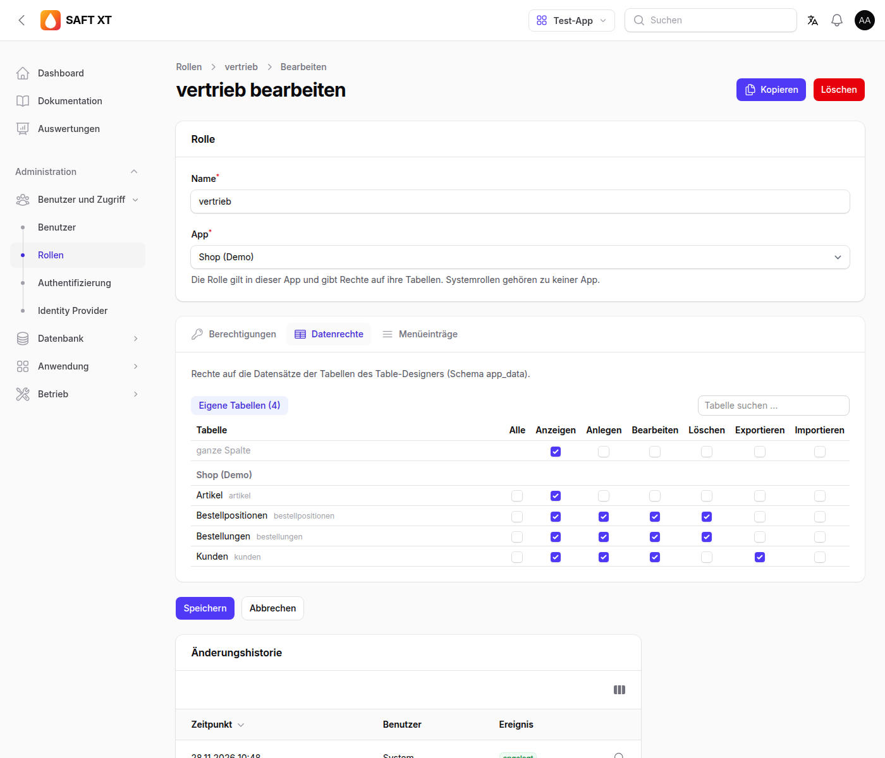
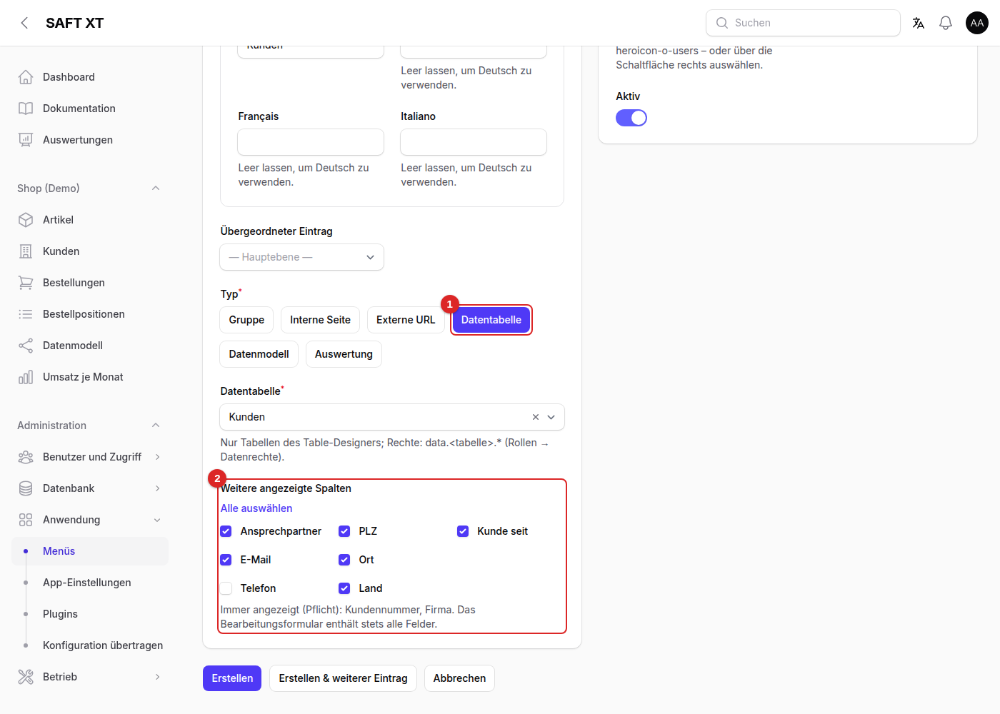
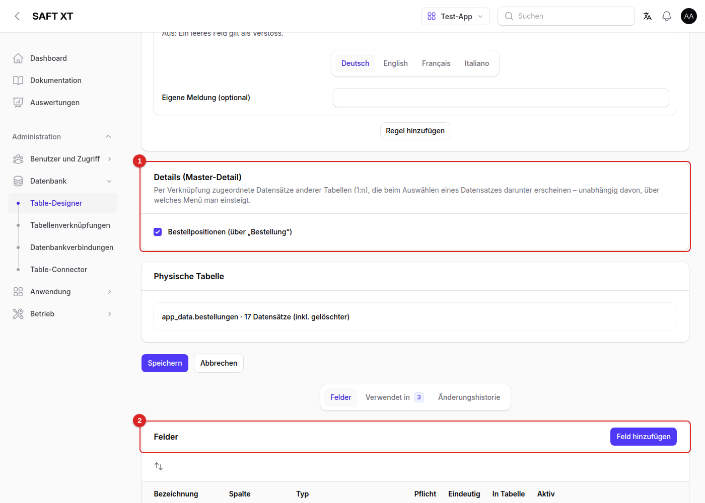
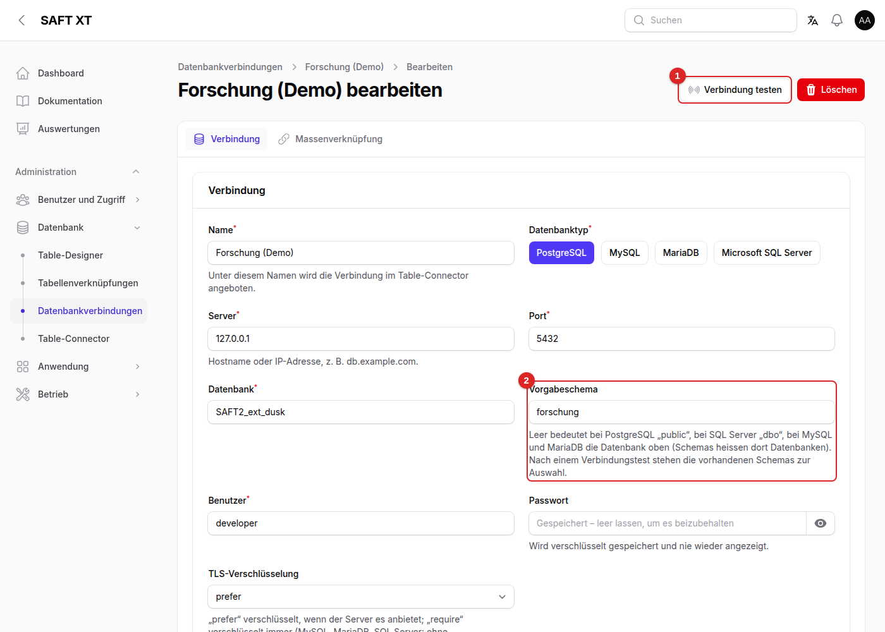
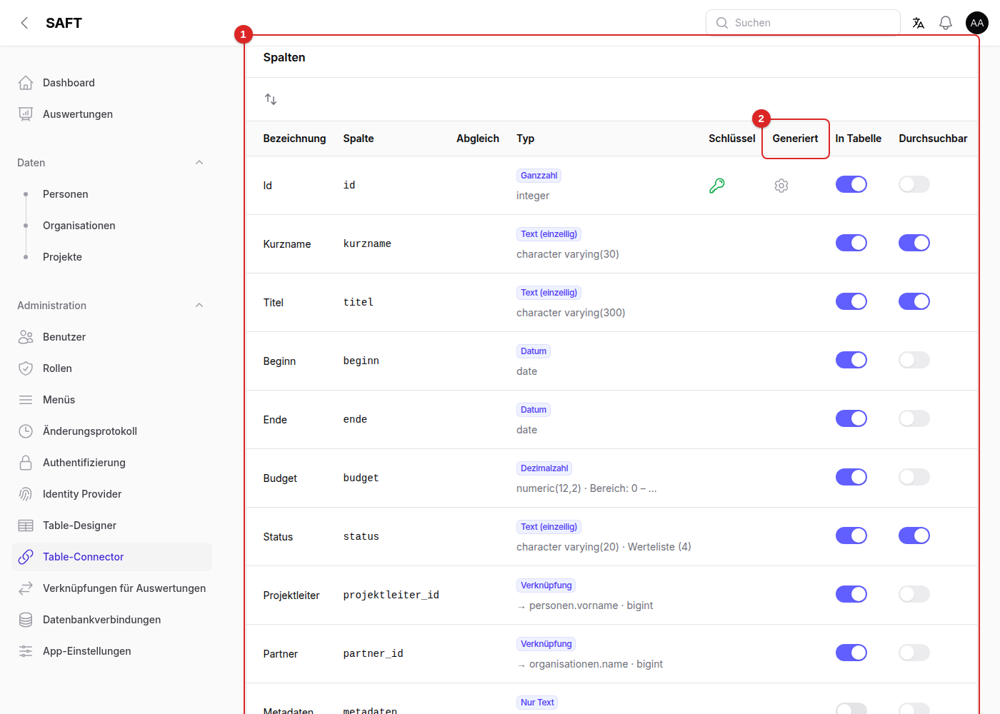

# SAFT XT – Administratorhandbuch

**Deutsch** · [English](ADMIN_GUIDE.md) · [Français](ADMIN_GUIDE.fr.md) · [Italiano](ADMIN_GUIDE.it.md)

**Stand:** Version 0.1 · **Zielgruppe:** Administratorinnen und Administratoren in SAFT

**Weitere Handbücher:** [Anwenderhandbuch](USER_GUIDE.de.md) · [Häufige Fragen](FAQ.de.md) · [Systemadministration](SYSADMIN_GUIDE.de.md)

> **Zu den Abbildungen:** Die Bilder sind Screenshots der Anwendung mit den Demo-Daten. Die roten Ziffern in den
> Bildern verweisen auf die Erläuterungen im Text.

---

## Inhalt

- [1. Benutzer](#1-benutzer)
- [2. Rollen und Rechte](#2-rollen-und-rechte)
- [3. Menüs](#3-menüs)
- [4. Table-Designer](#4-table-designer)
- [5. Authentifizierung](#5-authentifizierung)
- [6. Identity Provider (Single Sign-On)](#6-identity-provider-single-sign-on)
- [7. Globale Einstellungen](#7-globale-einstellungen)
- [8. Änderungsprotokoll](#8-änderungsprotokoll)
- [9. Datenbankverbindungen](#9-datenbankverbindungen)
- [10. Table-Connector](#10-table-connector)
- [11. Tabellenverknüpfungen](#11-tabellenverknüpfungen)
- [12. Geplante Aufgaben](#12-geplante-aufgaben)
- [13. KI-Funktionen](#13-ki-funktionen)
- [14. Plugins](#14-plugins)
- [15. Apps (Fachanwendungen)](#15-apps-fachanwendungen)
- [16. Dokumente](#16-dokumente)
- [Anhang A – Rechte im Überblick](#anhang-a--rechte-im-überblick)

---

Die folgenden Funktionen finden Sie im Menü unter **Administration**. Sie sind nur mit den entsprechenden
Rechten sichtbar. Auch hier sind Listen und Tabellen nur so breit wie ihre Spalten (siehe [Anwenderhandbuch 4.1](USER_GUIDE.de.md#41-die-tabellenansicht)).

## 1. Benutzer

**Administration → Benutzer und Zugriff → Benutzer**

- **Liste** mit Name, E-Mail, Rollen, aktiv, letzter Anmeldung. Filter: aktiv, Rolle, **ohne Rolle**,
  **SSO-Verknüpfung**, gelöschte Benutzer.
- **Anlegen / Bearbeiten:** Name, E-Mail, Passwort (beim Anlegen Pflicht, ausser im reinen SSO-Modus), aktiv,
  Rollen. Die **Standardrolle** (siehe [Kapitel 5](#5-authentifizierung)) ist beim Anlegen vorausgewählt.
- **Passwortregel:** Neue Passwörter brauchen mindestens 12 Zeichen. Passwörter aus bekannten Datenlecks lehnt SAFT
  ab (Abgleich ohne Übermittlung des Passworts). Bestehende Passwörter bleiben gültig, bis sie geändert werden.
- **Zwei-Faktor zurücksetzen:** Hat jemand Handy und Wiederherstellungscodes verloren, löscht diese Aktion oben in
  der Bearbeitungsmaske die eingerichtete Authenticator-App. Die Person meldet sich danach mit dem Passwort an und
  richtet den zweiten Faktor neu ein. Einrichten, Ausschalten und Zurücksetzen stehen im Änderungsprotokoll.
- **Inaktive Benutzer** können sich nicht anmelden – weder per Passwort noch per SSO.
- **SSO-Verknüpfungen:** Im Benutzer sehen Sie, mit welchen Single-Sign-On-Konten er verbunden ist, und können
  eine Verknüpfung trennen.
- **Änderungshistorie:** Jede Änderung am Benutzer ist unten auf der Seite nachvollziehbar.
- **Sprache:** Jeder Benutzer wählt seine Sprache selbst über das Sprach-Symbol; sie wird an seinem Konto
  gespeichert und gilt auch für E-Mails an ihn, etwa zum Zurücksetzen des Passworts.
- **Gelöschte Benutzer** lassen sich über den Filter anzeigen, wiederherstellen oder endgültig löschen. Ihre
  Einträge im Änderungsprotokoll bleiben erhalten (siehe [Kapitel 8](#8-änderungsprotokoll)).
- **Inaktiv, gelöscht oder endgültig gelöscht?**

  | | Inaktiv | Gelöscht (Papierkorb) | Endgültig gelöscht |
  |---|---|---|---|
  | Anmeldung | gesperrt | gesperrt | – |
  | In der Liste | sichtbar | nur über den Filter „Gelöschte Datensätze“ | nicht mehr vorhanden |
  | Rückgängig | Schalter „Aktiv“ | „Wiederherstellen“ | nicht möglich |
  | Name im Änderungsprotokoll | ja | ja, als „gelöscht“ gekennzeichnet | nein, nur die Benutzer-Nummer |
  | Erneute SSO-Anmeldung | abgewiesen | abgewiesen („Ihr Benutzerkonto wurde entfernt“) | kann ein **neues** Konto anlegen |

  „Inaktiv“ eignet sich für vorübergehende Sperren. Ein gelöschtes Konto bleibt bewusst gesperrt: Sonst bekäme eine
  Person, die beim Identity Provider weiter existiert, mit der Auto-Provisionierung bei der nächsten Anmeldung sofort
  ein neues Konto. **Endgültig löschen** (Zeilenaktion bei gelöschten Konten, auch als Mehrfachaktion) ist für
  Datenschutz-Löschungen gedacht – oder wenn eine Person per SSO bewusst ein neues Konto erhalten soll.

Schutzregeln: Niemand kann sich selbst löschen oder deaktivieren. Super-Admin-Konten können nur von
Super-Admins bearbeitet werden, und anderen Benutzern wird die Rolle `super-admin` gar nicht erst angeboten.

## 2. Rollen und Rechte

**Administration → Benutzer und Zugriff → Rollen**



Eine Rolle bündelt Rechte. Benutzer erhalten Rechte ausschliesslich über Rollen.

- **Berechtigungen** – Rechte auf Funktionen der Anwendung, z. B. „Benutzer: bearbeiten“,
  „Table-Designer: anzeigen“ oder **Dashboard-Widgets**.
- **Datenrechte** – eine Matrix mit allen Tabellen des Table-Designers und den Spalten **Anzeigen, Anlegen,
  Bearbeiten, Löschen, Exportieren, Importieren**. Neue Tabellen erscheinen hier automatisch. **Importieren** wirkt
  nur zusammen mit **Anlegen** und wenn der Import für die Tabelle freigegeben ist. **Exportieren** wirkt nur, wenn
  der Export für die Tabelle freigegeben ist (siehe [Kapitel 4](#4-table-designer)) und die Rolle die Tabelle auch
  anzeigen darf. Angebundene externe Tabellen (siehe [Kapitel 10](#10-table-connector)) bieten **Anlegen, Bearbeiten**
  und **Löschen** nur, wenn das für die Tabelle freigeschaltet ist; sonst steht dort „–“.
  Die Matrix hat die Reiter **Eigene Tabellen** (nach Menügruppe gegliedert, technischer Name dezent daneben) und
  **Verknüpfte Tabellen** (nach Datenbankverbindung). **Alle** in einer Zeile setzt alle Rechte der Tabelle, das
  Kästchen über einer Spalte („ganze Spalte“) setzt das Recht für alle sichtbaren Tabellen. Das **Suchfeld** filtert
  die Zeilen nach Bezeichnung oder technischem Namen.

- **Menüeinträge** – alle Menüeinträge der App mit eigenem Ziel, z. B. „Daten › Kunden“, ein Datenmodell oder eine
  Auswertung, auch auf der Hauptebene. Ohne Haken sieht die Rolle den
  Eintrag nicht im Menü. Neue Einträge und neue Rollen sind angehakt, also sichtbar. Das ist nur Darstellung: Ob die
  Tabelle angezeigt werden darf, legen die Datenrechte fest. Ein ausgeblendeter Eintrag bleibt über Links, die
  Master-Detail-Ansicht und die Vorschau erreichbar. Bei mehreren Rollen genügt bei Datentabellen eine Rolle mit Leserecht, die den Eintrag zeigt, bei anderen Einträgen
  eine Rolle der App; `super-admin` sieht immer alle Einträge.

Die Bereiche werden unabhängig gespeichert – eine Änderung im einen verändert nichts im anderen.

Geänderte Rechte gelten sofort, auch für bereits angemeldete Benutzer. Wer ein Recht verloren hat, erhält beim
nächsten Klick „Keine Berechtigung“; das Menü ist nach dem Neuladen der Seite aktuell.

**Besondere Rollen:**

| Rolle | Bedeutung |
|---|---|
| `super-admin` | Hat **alle** Rechte, auch für künftige Funktionen. Kann weder gelöscht noch umbenannt werden und wird nie automatisch per SSO vergeben. |
| `benutzer` | Standardrolle für neue Benutzer, ohne Admin-Rechte; sieht das Dashboard mit den persönlichen Widgets. Solange sie als Standardrolle eingestellt ist, kann sie nicht gelöscht werden. |

**Ansicht als Rolle (Rechte prüfen):** Super-Admins wählen im Benutzermenü oben rechts **„Ansicht als Rolle …“** und
eine oder mehrere Rollen – so, wie eine Person sie hat (vorausgewählt ist die Standardrolle, meist kommt eine
Fachrolle dazu). Danach sehen sie SAFT ausschliesslich mit deren Rechten – Menü, Seiten, Datenrechte, Auswertungen und
Widgets –, wie eine andere Person mit genau diesen Rollen: Eigene Auswertungen gelten dabei nicht als die eigenen. Ein gelbes Band oben nennt die Rolle; **Beenden** im Band stellt die
eigenen Rechte wieder her (auch die Abmeldung beendet die Ansicht). Die Datenbank bleibt unverändert, Start und Ende
stehen im Änderungsprotokoll. Achtung: Was die Rolle darf, wird während der Ansicht wirklich gespeichert – mit Ihnen
als Verursacher.

**App und Kopie** (B-107): Jede Rolle gehört zu einer [App](#15-apps-fachanwendungen); Datenrechte, Menüeinträge und
die Rechte von Plugins zeigt das Formular nur für diese App (die allgemeinen Rechte von SAFT immer). Ohne gewählte App
erscheint statt der Datenrechte der Hinweis, zuerst die App zu wählen. Hat die Rolle noch Rechte **ausserhalb** ihrer
App – auf Tabellen oder Plugins anderer Apps, etwa nach einem Wechsel der App oder aus der Zeit vor den Apps, oder auf
gelöschte Tabellen –, stehen sie zuunterst im Abschnitt **„Rechte ausserhalb dieser App“**: Tabellen als Matrix nach
App gegliedert, nur mit den vorhandenen Rechten (angehakt), Plugin-Rechte und gelöschte Tabellen als Liste. Dort lassen
sie sich nur entfernen (Haken weg, speichern), nicht hinzufügen. Wechseln Sie die App einer Rolle, bleiben alle Rechte
erhalten, bis Sie sie dort abwählen. Leserechte auf **freigegebene Tabellen anderer Apps** (Schnittstellen,
[Kapitel 15](#15-apps-fachanwendungen)) vergeben Sie im eigenen Abschnitt „Freigegebene Tabellen anderer Apps“ – nur
*Anzeigen*, zum Öffnen der fremden Tabelle; die freigegebenen Felder in Verknüpfungen sehen alle auch ohne dieses Recht. Die Systemrollen *super-admin* und *benutzer* gehören zu keiner App und
enthalten nur app-übergreifende Rechte (z. B. Dashboard, Hilfe); Datenrechte vergeben Sie über die Rollen der Apps.
**Kopieren** (in der Liste und beim Bearbeiten) legt eine neue Rolle mit Namen und Ziel-App an – mit denselben Rechten
(Datenrechte nur für Tabellen der Ziel-App) und ausgeblendeten Menüeinträgen, ohne Mitglieder.

## 3. Menüs

**Administration → Anwendung → Menüs**

Das Menü auf der linken Seite wird hier gepflegt. Jeder Eintrag hat einen **Typ**:

| Typ | Verwendung |
|---|---|
| **Gruppe** | Überschrift für untergeordnete Einträge (z. B. „Daten“) |
| **Interne Seite** | eine Seite der Anwendung (z. B. Dashboard, Benutzer) |
| **Externe URL** | ein Link nach aussen; öffnet in einem neuen Tab |
| **Datentabelle** | eine Tabelle des Table-Designers mit eigener Spaltenauswahl |
| **Datenmodell** | grafische Übersicht der Datentabellen dieser Gruppe und ihrer Verknüpfungen (siehe unten) |
| **Auswertung** | eine geteilte Auswertung (siehe [Anwenderhandbuch 4.9](USER_GUIDE.de.md#49-auswertungen)); erscheint nur für Personen, die sie mit ihren Datenrechten ausführen dürfen |



**Menüeintrag vom Typ „Datentabelle“** (1):

- Wählen Sie die **Datentabelle** – es werden nur aktive Tabellen des Table-Designers angeboten.
- Wählen Sie die **weiteren angezeigten Spalten** (2). **Pflichtfelder** werden immer angezeigt und stehen
  deshalb nicht zur Auswahl.
- Das nötige Leserecht wird automatisch gesetzt: Der Eintrag ist nur für Benutzer sichtbar, die die Tabelle
  anzeigen dürfen.
- Für dieselbe Tabelle können **mehrere Einträge** mit unterschiedlichen Spalten angelegt werden.
- Wechseln Sie später den Typ, entfällt das automatisch gesetzte Leserecht wieder.
- Für einzelne Rollen lässt sich der Eintrag ausblenden, ohne das Leserecht zu entziehen (Rollen → Menüeinträge, siehe
  [Kapitel 2](#2-rollen-und-rechte)).

**Menüeintrag vom Typ „Datenmodell“:** Die Seite zeigt die Datentabellen der Gruppe, in der der Eintrag steht –
einschliesslich aller Untergruppen – als Diagramm mit ihren Verknüpfungen. Steht der Eintrag auf oberster Ebene, erscheinen alle Datentabellen seiner App (ohne App: alle). Die Seite ist generisch: Derselbe Typ lässt sich in mehrere Gruppen einhängen, und
wird ein Eintrag verschoben, zeigt er automatisch die neue Gruppe. Es gilt:

- Gezeigt werden Tabellen mit einem Menüeintrag vom Typ „Datentabelle“ in der Gruppe, und nur solche, die der
  Benutzer sehen darf (Leserecht, für seine Rollen nicht ausgeblendet, aktiv). Tabellen ohne Menüeintrag fehlen.
- Sieht ein Benutzer in der Gruppe **keine einzige Tabelle**, erscheint der Eintrag „Datenmodell“ in seinem Menü
  nicht. Bliebe die Gruppe dadurch leer, wird auch sie ausgeblendet.
- Verknüpfte Tabellen **ausserhalb der Gruppe** erscheinen als Randknoten mit gestricheltem Rahmen, nur mit Namen.
  Verknüpfungen auf Tabellen ohne Leserecht entfallen ganz.
- **Linien:** durchgezogen, wenn die Verknüpfung im Table-Designer als Detailtabelle eingerichtet ist, sonst
  gestrichelt. Die Enden zeigen die Kardinalität: viele Datensätze verweisen auf genau einen (Pflichtfeld) bzw.
  keinen oder einen Stammsatz.
- **„Felder anzeigen“** schaltet ohne Neuladen zwischen der Übersicht mit Tabellennamen und der Ansicht mit allen
  aktiven Feldern um (Typ, technischer Name, PK/FK/UK, Bezeichnung, `*` = Pflichtfeld). Der Browser merkt sich
  die Wahl.
- Angebundene Tabellen aus dem Table-Connector haben einen orangefarbenen Rahmen und nennen ihre Verbindung.
- Wie jeder Eintrag lässt sich auch dieser über ein **Recht** einschränken. Das Diagramm passt sich dem
  Farbschema (hell/dunkel) an; breite Diagramme lassen sich seitlich verschieben.

**Bezeichnung je Sprache:** Die Bezeichnung hat einen Reiter je Sprache: **Deutsch** (Pflicht), **English**,
**Français** und **Italiano**. Bleibt ein Feld leer, erscheint in dieser Sprache die deutsche Bezeichnung; darauf
weist ein grauer Platzhalter im leeren Feld hin („Leer lassen, um Deutsch zu verwenden.“). Die
mitgelieferten Einträge sind bereits in allen vier Sprachen benannt. Einträge, die der Table-Designer für eine Tabelle anlegt, übernehmen deren Anzeigenamen
in allen Sprachen und folgen ihm bei jeder Änderung.

**Icons:** Die Schaltfläche rechts im Feld **Icon** öffnet einen Auswahldialog mit allen vorhandenen Icons, getrennt
nach Stil auf den Reitern **Outline**, **Solid**, **Mini** und **Micro**. Das Suchfeld filtert sofort (z. B. „user“),
die Zahl am Reiter nennt die Treffer je Stil; ein Klick übernimmt den Namen ins Feld. Das aktuelle Icon ist
hervorgehoben und erscheint links im Feld als Vorschau. Den Namen können Sie auch von Hand eingeben, z. B.
`heroicon-o-users`; das Formular nimmt nur bekannte Icons an. Denselben Dialog gibt es beim Tabellen-Icon im
Table-Designer. Ein Eintrag mit Untereinträgen, der kein gültiges Icon hat, erhält ein Ordner-Symbol.

**Weitere Regeln:** Ein Menü hat höchstens drei Ebenen: Gruppe (Überschrift), Eintrag und Untereintrag. Ein Eintrag mit
Untereinträgen ist ein **Untermenü** und erscheint mit einem Pfeil **›**; ein Klick öffnet seine erste Seite und klappt
es auf. So ist die Administration gegliedert (*Benutzer und Zugriff*, *Datenbank*, *Anwendung*, *Betrieb*) und die
Lager-Demo (*Lager führen*, *Stammdaten*, *Auswertungen*); Einträge lassen sich per Drag & Drop sortieren. Beim
Löschen eines Eintrags werden seine Untereinträge mitgelöscht.

> Die **Details** (Master-Detail) werden nicht im Menü, sondern im Table-Designer eingestellt.

**App:** Oberste Einträge und Gruppen gehören zu einer [App](#15-apps-fachanwendungen) oder – ohne Angabe – zum
System; Einträge in einer Gruppe übernehmen deren App. Für Dateneinträge bietet das Formular nur Tabellen dieser App an.

## 4. Table-Designer

**Administration → Datenbank → Table-Designer**

Hier legen Sie eigene Tabellen an – ohne Programmierung.



**Mehrsprachig:** Anzeigename und Beschreibung einer Tabelle, die Bezeichnung jedes Felds und die Anzeige der
Auswahlwerte haben je Sprache einen Reiter (Deutsch, English, Français, Italiano); Anzeigename und Beschreibung stehen
unter denselben Reitern untereinander. Das gilt ebenso für alle anderen übersetzbaren Texte der Administration
(Menüeinträge, Apps, Tabellenverknüpfungen, Regelmeldungen, Table-Connector). Deutsch ist beim Anzeigenamen und bei
der Bezeichnung Pflicht, die übrigen Sprachen sind freiwillig; ohne sie erscheint der deutsche Text – der graue
Platzhalter im leeren Feld erinnert daran. Der technische Name und die gespeicherten
Auswahlwerte gelten für alle Sprachen.

**Tabelle anlegen:**

1. **Neue Tabelle** → Anzeigename eingeben. Der technische Name wird vorgeschlagen
   (z. B. „Grösse in m²“ → `groesse_in_m2`) und kann **später nicht mehr geändert** werden. Technische Namen sind
   für alle Tabellen eindeutig – eigene, importierte und angebundene. Ist der Name vergeben, meldet SAFT das schon
   beim Verlassen des Felds und nennt die Tabelle, z. B. „Der Name „personen“ ist bereits vergeben: angebundene
   Tabelle „Personen“ (Verbindung Forschung).“ Trägt eine andere Tabelle dieselbe **Bezeichnung**, erscheint nur ein
   Hinweis – erlaubt, aber in Menüs und Auswahllisten schwer zu unterscheiden. Dasselbe gilt beim Import und im
   Table-Connector.
2. Optional **Startfelder** anlegen und unter **„Menüeintrag unter“** die Gruppe im Menü wählen. Vorbelegt ist
   „Daten“; angeboten werden alle Gruppen, Untergruppen eingerückt mit ihrem Pfad (z. B. „Daten › Forschung“).
   „Kein Menüeintrag“ legt keinen an.
3. Speichern – die Tabelle ist sofort nutzbar. Für sie entstehen automatisch die **Datenrechte**
   (Anzeigen/Anlegen/Bearbeiten/Löschen) in der Rollenverwaltung.

**Export erlauben:** Dieser Schalter in den Stammdaten der Tabelle gibt den Export frei (siehe
[Anwenderhandbuch 4.7](USER_GUIDE.de.md#47-daten-exportieren)). Er ist zunächst aus. Auch Super-Admins sehen „Exportieren“ erst, wenn er an ist;
alle anderen brauchen zusätzlich das Recht **Exportieren** in ihrer Rolle.

**Import erlauben:** Dieser Schalter gibt den Datenimport frei – neue Datensätze aus einer Excel- oder CSV-Datei, etwa
aus einer heruntergeladenen Vorlage (siehe [Anwenderhandbuch 4.8](USER_GUIDE.de.md#48-daten-importieren)). Er ist
zunächst aus. Dann erscheint „Importieren“ in der Liste für Rollen mit den Rechten **Anlegen** und **Importieren**.
Vorhandene Datensätze ändert der Import nie; die Prüfung entspricht dem Erfassen von Hand, und es gilt alles oder
nichts – auch bei Abbruch oder Fehler mitten im Einspielen werden angelegte Datensätze zurückgenommen. Der Import läuft
als [Arbeit](#arbeiten) in zwei Phasen (prüfen, einspielen); der Assistent prüft bis 2'000 Zeilen schon im Dialog
(`APP_DATA_IMPORT_CHECK_ROWS`). Höchstens 100'000 Zeilen je Datei (`APP_DATA_IMPORT_MAX_RECORD_ROWS`, `0` = ohne
Grenze). Für angebundene Tabellen des Table-Connectors gibt es den Import nicht.

**Felder bearbeiten** (Bereich *Felder*, (2)): Für jedes Feld legen Sie fest:

| Einstellung | Bedeutung |
|---|---|
| Bezeichnung / Spaltenname | Anzeige bzw. technischer Name. **Umbenennen behält die Daten.** |
| Typ | siehe [Anwenderhandbuch, Anhang A](USER_GUIDE.de.md#anhang-a--feldtypen) |
| Typ-Einstellungen | Länge (Text), Stellen (Dezimalzahl), Werte (Auswahlliste), Zieltabelle, Anzeigefelder und Trennzeichen (Verknüpfung), Dateiarten, Höchstgrösse und Anzahl (Datei, siehe unten) |
| Validierung | Mindest-/Höchstlänge, Minimum/Maximum, E-Mail, URL; **Weitere Prüfungen** aus Plugins, z. B. AHV-Nummer oder IBAN (erscheint nur, wenn ein Plugin Prüfregeln für den Feldtyp anbietet; sie gelten bei der Erfassung, beim Import und über die Schnittstelle, leere Werte werden nicht geprüft). Fehlt das Plugin später oder ruht es, wird die Prüfung übersprungen und beim Feld als „nicht verfügbar“ angezeigt |
| Vorgabe beim Anlegen (Ganzzahl) | **Fortlaufend vorschlagen:** Im Dialog „Neuer Datensatz“ steht der höchste vorhandene Wert + 1 und bleibt änderbar; bleibt das Feld leer, setzt SAFT den Wert beim Speichern. Mit **Zählen je** (eine Verknüpfung, z. B. *Bestellung*) wird je Master-Datensatz gezählt: unter einer Bestellung mit zwei Positionen wird 3 vorgeschlagen; in der Liste erscheint der Vorschlag, sobald die Bestellung gewählt ist. Gelöschte Datensätze zählen nicht. |
| Vorgabe beim Anlegen (Datum, Datum und Zeit) | **Mit dem heutigen Datum vorbelegen** bzw. **Mit aktuellem Datum und Uhrzeit vorbelegen:** Im Dialog „Neuer Datensatz“ steht beim Öffnen das aktuelle Datum (bzw. Datum und Uhrzeit auf die Minute) und bleibt änderbar. Beim Bearbeiten, beim Import und über die Schnittstelle setzt SAFT nichts. Nicht zusammen mit „Übernehmen aus“. |
| Übernehmen aus | Wert aus dem Master-Datensatz übernehmen, z. B. *Einzelpreis* aus **Artikel → Preis**: Sobald im Formular ein Artikel gewählt ist (oder unter einem Artikel als Detailtabelle sofort), steht sein Preis im Feld und bleibt änderbar. Beim Wechsel des Artikels folgt der Wert, solange er nicht von Hand geändert wurde; leer gespeicherte Felder füllt SAFT. Eine Kopie: Spätere Änderungen am Artikel ändern vorhandene Positionen nicht. Angeboten werden nur passende Felder (Zahl ← Zahl, Datum ← Datum, Text ← Text/Auswahl, Ja/Nein ← Ja/Nein). Ein Quellfeld lässt sich nicht löschen, solange ein Feld daraus übernimmt; Umbenennen wird nachgeführt. |
| Pflichtfeld | muss ausgefüllt werden; wird in Listen immer angezeigt |
| Eindeutig | darf nur einmal vorkommen (gelöschte Datensätze zählen nicht) |
| Durchsuchbar | wird von der Suche berücksichtigt |
| Index anlegen | beschleunigt Sortieren und Filtern bei grossen Tabellen |
| In Tabelle / Im Formular anzeigen | Voreinstellung für Listen und Formulare |

**Anzeigefelder einer Verknüpfung:** Statt der gespeicherten Nummer zeigt eine Verknüpfung Felder des verknüpften
Datensatzes – eines oder mehrere, in der gewählten Reihenfolge und mit einem **Trennzeichen** (Leerzeichen, Komma,
Gedankenstrich, Punkt oder Schrägstrich) verbunden, z. B. Vorname und Nachname zu „Anna Keller“ oder Name und Ort zu
„ETH Zürich, Zürich“. Leere Felder werden übersprungen. Das gilt in Listen, Details, Vorschau, Filtern, Export und in
der Auswahlliste beim Bearbeiten; dort sucht die Eingabe in allen Anzeigefeldern. Sortiert wird nach dem ersten
Anzeigefeld. Benennen Sie ein Anzeigefeld um, folgt die Verknüpfung; solange ein Feld irgendwo als Anzeigefeld dient,
lässt es sich nicht endgültig löschen.

**Kind-Datensätze mitkopieren:** Mit dem Schalter **„Beim Kopieren des übergeordneten Datensatzes mitkopieren“** am
Verknüpfungsfeld legen Sie fest, welche Datensätze zum übergeordneten gehören, z. B. bei `bestellpositionen.bestellung_id`:
Wer eine Bestellung kopiert, kann deren Positionen mitkopieren – im Kopier-Dialog als vorgewähltes Häkchen
„Mitkopieren“, abwählbar. Haben die Positionen selbst wieder solche Kinder, kommen sie mit. Die Verknüpfung zeigt danach
auf die Kopie, andere Verknüpfungen bleiben; Dateien werden kopiert, eindeutige Felder geleert, berechnete Felder neu
gerechnet. Bei Verknüpfungen auf die eigene Tabelle (Hierarchie) und auf Tabellen anderer Apps gibt es den Schalter
nicht. Ist ein Feld einer mitkopierten Tabelle eindeutig und Pflicht, bricht das Kopieren mit einer Meldung ab; mehr als
1000 Datensätze je Kopie sind nicht möglich (`APP_DATA_COPY_MAX_RECORDS`).

**Dateifelder:** Ein Feld vom Typ **Datei** nimmt Anhänge auf. Einstellungen:

- **Erlaubte Dateien:** Bilder (JPEG, PNG, GIF, WebP), PDF, Office-Dokumente (Word, Excel, PowerPoint,
  OpenDocument), Text und CSV oder **Beliebige Dateien**. Geprüft wird der tatsächliche Inhalt, nicht nur die Endung. Eine
  bestimmte Art anzuhaken entfernt „Beliebige Dateien“ und umgekehrt. SVG-Bilder sind nicht vorgesehen (sie können Skripte
  enthalten).
- **Höchstgrösse je Datei** in MB (Vorgabe 10, höchstens 200). Liegt die Grenze des Servers (PHP) darunter, zeigt das
  Feld einen Hinweis; dann gilt die kleinere.
- **Anzahl Dateien** (Vorgabe 1, höchstens 50).

Die Dateien liegen nicht in der Datenbank, sondern im Dateispeicher des Servers (oder in S3, siehe
[Systemadministration](SYSADMIN_GUIDE.de.md#1-für-den-betrieb)); der Datensatz speichert nur Kennung und Namen.
Ersetzte oder entfernte Dateien werden beim Speichern gelöscht, ebenso beim endgültigen Löschen eines Datensatzes,
beim Löschen des Felds oder der Tabelle. Gelöschte Datensätze im Papierkorb behalten ihre Dateien (sichtbar nur mit
Löschrecht). Dateifelder sind nicht eindeutig, nicht sortierbar und haben keinen Index; sie fehlen im Datenimport,
in Auswertungen und als Quelle für „Übernehmen aus“. Der Export enthält die Dateinamen, der Verlauf zeigt, welche
Dateien hinzukamen oder entfernt wurden.

**Regeln** (Abbildung unten, 1): Prüfungen über Felder hinweg beim Speichern eines Datensatzes, z. B. „Lieferdatum ≥ Bestelldatum“ oder
„Menge > 0“. Für jede Regel wählen Sie das **Feld**, den **Vergleich** und ob mit einem **anderen Feld** oder einem
**festen Wert** verglichen wird:


- Zahlen und Datumswerte erlauben alle Vergleiche (=, ≠, <, ≤, >, ≥) – eine Zahl nur mit einer Zahl, ein Datum nur mit
  einem Datum. Text, Auswahllisten und Ja/Nein lassen sich nur auf Gleichheit prüfen (= und ≠). Verknüpfungen und
  langer Text sind nicht möglich.
- **Nur prüfen, wenn beide Seiten gefüllt sind** (Vorgabe): Ein leeres Feld wird nicht geprüft. Ausgeschaltet gilt
  ein leeres Feld als Verstoss.
- **Eigene Meldung** (optional, je Sprache). Sonst erscheint beim Feld der Standardtext, z. B. „darf nicht vor
  „Bestelldatum“ liegen“.
- Die Regel gilt in allen Formularen der Tabelle (Liste, Detailtabellen, Details → Bearbeiten). Vorhandene Datensätze
  bleiben unverändert; verletzen schon welche eine neue Regel, zeigt ein Hinweis wie viele – sie werden beim nächsten
  Bearbeiten geprüft.
- Wird ein Feld umbenannt, ändern sich seine Regeln mit. Ein Feld, das eine Regel verwendet, lässt sich nicht löschen,
  und sein Typ nur in einen Typ ändern, der weiter zur Regel passt.

**App und Präfix:** Beim Anlegen wählen Sie die [App](#15-apps-fachanwendungen) der Tabelle (bei mehreren Apps
Pflicht). Hat die App ein Präfix, steht es vor dem vorgeschlagenen technischen Namen; ein Wechsel der App ersetzt es.
Verknüpfungen sind zu Tabellen derselben App möglich und zu freigegebenen Tabellen anderer Apps
([Schnittstellen](#15-apps-fachanwendungen)).

### Berechnete Felder

Ein Feld vom Typ **Berechnet** wird nicht eingegeben, sondern beim Speichern aus anderen Feldern desselben Datensatzes
oder aus den zugehörigen Kind-Datensätzen berechnet, z. B. *Betrag* aus Menge und Einzelpreis oder *Gesamtpreis* als
Summe der Beträge aller Positionen einer Bestellung. Der Wert wird gespeichert und lässt sich daher sortieren,
filtern, exportieren und in Regeln verwenden.

- **Ergebnis:** Ganzzahl oder Dezimalzahl (mit Stellen und Nachkommastellen); das Ergebnis wird darauf gerundet.
- **Formel:** Zahlenfelder der Tabelle (per Spaltenname), Zahlen, `+ - * /` und Klammern sowie die Funktionen
  `round(x, Stellen)`, `min(a, b, …)`, `max(a, b, …)`, `abs(x)` und `coalesce(a, Ersatz)`. Beispiel:
  `round(menge * einzelpreis, 2)`. Die Funktionsnamen sind in allen Sprachen gleich. Plugins können weitere
  Funktionen mitbringen, z. B. `rappen(betrag)` (Rundung auf 5 Rappen); sie stehen in der Eingabehilfe unter
  **Funktionen aus Plugins**, die Beschreibung erscheint beim Zeigen auf den Knopf. In den Ausdrücken der Auswertungen
  gibt es sie nicht. Fehlt das Plugin später, bleibt das Ergebnis leer.
- **Über Kind-Datensätze** (Tabellen, die per Verknüpfung auf diese Tabelle zeigen): `sum(tabelle.feld)`,
  `avg(tabelle.feld)`, `min(tabelle.feld)`, `max(tabelle.feld)` und `count(tabelle)`, z. B. Gesamtpreis =
  `sum(bestellpositionen.betrag)`, MWST = `round(gesamtpreis * 0.081, 2)`. Gelöschte Kind-Datensätze zählen nicht;
  ohne Kind-Datensätze ergeben Summe und Anzahl 0. Zeigt eine Kind-Tabelle mit mehreren Verknüpfungen auf diese
  Tabelle, wird die gewünschte als zweiter Wert genannt: `sum(bestellpositionen.betrag, bestellung_id)`.
- **Ausdruck je Kind-Datensatz:** Statt eines Felds darf in `sum`, `avg`, `min` und `max` auch eine Rechnung mit Feldern
  der Kind-Tabelle stehen; sie wird für jeden Kind-Datensatz ausgerechnet und dann zusammengefasst, z. B.
  `sum(bestellpositionen.einzelpreis * bestellpositionen.menge)` oder
  `sum(round(bestellpositionen.menge * bestellpositionen.einzelpreis * 0.95, 2))`. Im Ausdruck stehen nur Felder dieser
  einen Kind-Tabelle (keine Felder des Master-Datensatzes, keine verschachtelten Zusammenfassungen). Ist das Ergebnis
  für einen Kind-Datensatz leer, zählt er nicht mit – mit `coalesce(…, 0)` lässt sich das steuern.
- **Bedingungen:** `if(bedingung, dann, sonst)` rechnet je nach Bedingung den einen oder den anderen Wert; ohne
  `sonst` ist das Ergebnis leer, wenn die Bedingung nicht erfüllt ist. Bedingungen vergleichen mit `=`, `<>`, `<`, `<=`,
  `>`, `>=` und lassen sich mit `and` und `or` verknüpfen. In Vergleichen sind auch Text-, Auswahl-, Datums- und
  Ja/Nein-Felder erlaubt; Text steht in einfachen Anführungszeichen (ein Anführungszeichen im Text wird verdoppelt).
  Auswahlfelder vergleichen den gespeicherten Wert, nicht die übersetzte Bezeichnung; ein Datum schreibt man
  `'2026-12-31'`. Ja/Nein-Felder zählen als 1 oder 0, also auch direkt als Bedingung: `if(bezahlt, betrag, 0)`. Beispiele: Betrag mit Vorzeichen = `if(typ = 'Ausgabe', -betrag, betrag)`, Zollkosten eines Belegs =
  `sum(if(positionen.art = 'Zoll', positionen.betrag, 0))`, Anzahl Positionen über 10 Stück =
  `sum(positionen.menge > 10)` (ein Vergleich ergibt 1 oder 0). Ist eine Seite eines Vergleichs leer, ist er nicht
  erfüllt – auch bei `<>`. **Text unscharf vergleichen:** `contains(feld, 'teil')`, `startswith(feld, 'anfang')` und
  `endswith(feld, 'ende')` prüfen ohne Gross-/Kleinschreibung, ob der Text den Teil enthält bzw. damit beginnt oder
  endet, und ergeben ebenfalls 1 oder 0, z. B. `sum(contains(positionen.bezeichnung, 'gitarre'))`. Werte in Funktionen dürfen auch mit `;` getrennt werden; SAFT schreibt sie mit Komma. In den
  Ausdrücken der Auswertungen gibt es `if()` (noch) nicht.
- **Eingabehilfe:** Unter dem Formelfeld stehen die Felder der Tabelle als Knöpfe, z. B. „Menge (menge)“; ein
  Klick fügt den technischen Namen an der Schreibmarke ein. Zahlenfelder dienen zum Rechnen, Text-, Auswahl-, Datums-
  und Ja/Nein-Felder für Vergleiche; der Tooltip nennt den Datentyp, bei Auswahlfeldern auch die gespeicherten Werte. Je
  Kind-Tabelle folgt eine eigene Zeile mit `count(tabelle)` und deren Feldern (`tabelle.feld`), dazu Knöpfe für Rechenzeichen, Funktionen und `sum`,
  `avg`, `count`; jeder dieser Knöpfe erklärt im Tooltip Syntax und Beispiel, der Hilfetext öffnet
  sich mit „Hilfe zu den Formeln“; die Funktionen aus Plugins
  stehen ganz unten. Ergebnis, Stellen und Nachkommastellen stehen oben in
  einer Zeile. Beim Anlegen einer neuen Tabelle erscheinen nur die Felder, die im Formular weiter oben stehen.
- **Prüfung:** Schon während der Eingabe meldet SAFT Fehler mit der Stelle (z. B. „Zeichen 9: Unbekanntes Feld
  „preis““) oder bestätigt, wovon das Ergebnis abhängt. Kreisbezüge werden abgelehnt; die Meldung nennt die Formeln der
  beteiligten Felder, z. B. „Kreisbezug: mwst → einkaufspreis → mwst. Die Formeln: mwst = …; einkaufspreis = …“.
- **Leere Werte:** Ist ein verwendetes Feld leer, ist das Ergebnis leer – ausser mit `coalesce(feld, 0)`. Eine Division
  durch 0 ergibt ebenfalls leer. Gerechnet wird exakt (keine Rundungsfehler bei Geldbeträgen).
- **Wann gerechnet wird:** beim Anlegen eines berechneten Felds für alle vorhandenen Datensätze; beim Anlegen (auch per
  Import) und Ändern eines Datensatzes (die neuen Werte stehen im Änderungsprotokoll);
  beim Anlegen, Ändern, Löschen oder Wiederherstellen eines Kind-Datensatzes für seinen Master-Datensatz – beim
  Wechsel der Bestellung für die alte und die neue – und weiter nach oben (z. B. Umsatz eines Kunden als Summe seiner
  Bestellungen); nach dem Ändern einer Formel für alle Datensätze der Tabelle und der darüberliegenden; und mit `php artisan computed:recompute`, wenn Daten an
  SAFT vorbei geändert wurden.
- Im Formular wird ein berechnetes Feld nur angezeigt („wird beim Speichern berechnet“). Regeln, die ein berechnetes
  Feld prüfen, greifen deshalb erst beim nächsten Bearbeiten.
- Wird ein verwendetes Feld umbenannt (auch in einer Kind-Tabelle), ändert sich die Formel mit; Löschen und ein Wechsel
  auf einen Nicht-Zahlentyp sind gesperrt, solange eine Formel das Feld verwendet. Eine Kind-Tabelle, über die summiert
  wird, lässt sich nicht löschen.
- Die Demo-Daten enthalten *Betrag* (Bestellpositionen) sowie *Gesamtpreis* und *MWST 8,1 %* (Bestellungen).

**Details (Master-Detail)** (1): Hier wählen Sie, welche verknüpften Tabellen unter einem ausgewählten
Datensatz erscheinen (siehe [Anwenderhandbuch 4.3](USER_GUIDE.de.md#43-verknüpfte-tabellen-die-master-detail-ansicht)). Angeboten werden alle
Verknüpfungsfelder anderer Tabellen, die auf diese Tabelle zeigen. Gibt es mehrere Verknüpfungen aus derselben
Tabelle (z. B. „Kunde“ und „Rechnung an“), sind sie einzeln wählbar.

**Weitere Schaltflächen:** *Daten öffnen* (zur Datenansicht) und *Menüeintrag anlegen*. Diese fragt nach der
Gruppe und legt auch einen weiteren Eintrag an, wenn die Tabelle an einer zweiten Stelle im Menü erscheinen soll.

**Was geht – und was nicht:**

| Änderung | Regel |
|---|---|
| Feld umbenennen | jederzeit, Daten bleiben erhalten |
| Typ ändern | verlustfrei jederzeit (z. B. Ganzzahl → Dezimalzahl, Text → mehrzeiliger Text, Datum → Datum und Uhrzeit); mehrzeiliger → einzeiliger Text, wenn alle Werte in die Länge passen; sonst nur, wenn die Spalte leer ist |
| Typ ändern zu oder von Nummernkreis | nur, wenn das Feld in keinem Datensatz einen Wert hat (auch nicht im Papierkorb); siehe [Nummernkreise](#nummernkreise) |
| Textlänge | vergrössern jederzeit, verkleinern nur, wenn alle vorhandenen Werte in die neue Länge passen (sonst nennt die Meldung, wie viele zu lang sind) |
| „Eindeutig“ einschalten | nur, wenn die vorhandenen Daten keine Duplikate enthalten |
| Wert aus einer Auswahlliste entfernen | jederzeit; ist der Wert in Gebrauch, erscheint eine Warnung mit der Anzahl der Datensätze. Sie behalten ihren Wert, beim nächsten Bearbeiten muss aber ein gültiger gewählt werden. |
| Feld löschen | erst **deaktivieren**, dann „Endgültig löschen“ mit Eingabe des Spaltennamens |
| Tabelle löschen | erst **deaktivieren**, dann „Endgültig löschen“ mit Eingabe des Tabellennamens; nicht möglich, solange andere Tabellen darauf verweisen |
| Verknüpfung | nur zu anderen Tabellen des Table-Designers, nie zu Systemtabellen |

> **Deaktivieren statt löschen:** Ein deaktiviertes Feld oder eine deaktivierte Tabelle ist für Benutzer
> unsichtbar, die Daten bleiben aber vollständig erhalten. Ein Feld holen Sie mit „Aktivieren“ ohne Rückfrage zurück. Endgültiges Löschen kann nicht rückgängig gemacht werden.
>
> **Feldliste:** Die Aktionen stehen als Symbole mit Tooltip in der Zeile – Bearbeiten, **Verlauf** (Uhr: wer wann
> was am Feld geändert hat), Ein-/Ausblenden und Löschen. Das Auge zeigt den Zustand: offen bei aktivem, durchgestrichen
> bei deaktiviertem Feld. Braucht ein Plugin das Feld oder nutzt eine andere App es über die Schnittstelle, ist das
> Symbol gesperrt (blass); der Tooltip nennt den Grund. Wie hier zeigen alle Listen der Administration ihre
> Zeilenaktionen als Symbole mit Tooltip; **Anzeigen** ist die Lupe.

Unter **Physische Tabelle** sehen Sie den Speicherort, die Anzahl Datensätze und eventuelle Abweichungen
zwischen Einstellungen und Datenbank.

### Nummernkreise

Ein Feld vom Typ **Nummernkreis** bekommt seine Nummer von SAFT, z. B. Rechnungs-, Bestell- oder Vertragsnummern wie
`R-2026-0042`. Die Nummer wird beim Anlegen eines Datensatzes vergeben, kommt nie doppelt vor (auch wenn mehrere
Personen gleichzeitig anlegen), wird nach dem Löschen nicht wieder vergeben und lässt sich danach nicht mehr ändern –
weder im Formular noch über Import, Plugins oder Schnittstellen.

- **Muster:** fester Text (Buchstaben, Ziffern, Leerzeichen und `- / . _`) und Platzhalter: `{YYYY}` bzw. `{YY}` für
  das Jahr, `{MM}` für den Monat und genau eine laufende Nummer, `{0000}` mit so vielen Stellen wie Nullen oder `{#}`
  ohne führende Nullen. Mit **Baustein einfügen** hängen Sie einen Platzhalter an. Wird die laufende Nummer länger als
  ihre Stellen, wird sie nicht abgeschnitten (`R-2026-10000`). Höchstens 50 Zeichen.
- **Neubeginn:** nie, jährlich oder monatlich. Jährlich braucht ein Jahr im Muster, monatlich Jahr und Monat – sonst
  entstünden doppelte Nummern.
- **Geschäftsjahr beginnt im** (nur jährlich): z. B. Juli; dann gehört der März 2027 noch zum Geschäftsjahr 2026, und
  `{YYYY}` zeigt 2026.
- **Bezugsdatum:** bestimmt Jahr und Monat in der Nummer und den Neubeginn. Leer gilt das Anlegedatum; wählbar sind
  aktive Pflichtfelder vom Typ Datum, z. B. das Rechnungsdatum. Ein solches Feld bleibt dann ein Pflichtfeld vom Typ
  Datum; Umbenennen wird nachgeführt.
- **Startwert:** erste Nummer je Zeitraum (Vorgabe 1), z. B. 1000.
- Unter den Einstellungen steht die **nächste Nummer**, bei einem ungültigen Muster der Grund.

Ein Nummernkreis ist immer eindeutig und nie Pflicht. Im Formular steht vor dem ersten Speichern „wird beim Speichern
vergeben“. Abgebrochenes Speichern hinterlässt keine Lücke; ein endgültig gelöschter Datensatz schon (sie ist im
Änderungsprotokoll nachvollziehbar). Eine **Kopie** bekommt eine neue Nummer. Beim **Import** werden fehlende Nummern
vergeben; mitgebrachte (z. B. aus einem Altsystem) werden übernommen, wenn sie eindeutig sind, und passen sie zum Muster,
zählt SAFT danach weiter. Die [App-Definition](#15-apps-fachanwendungen) enthält die Einstellungen, nicht die
Zählerstände: Eine neue Installation beginnt beim Startwert; ein geändertes Muster beim Aktualisieren gilt als heikel.
„App-Daten zurücksetzen“ setzt auch die Zähler zurück.

Ein bestehendes Feld lässt sich auf „Nummernkreis“ umstellen und zurück, solange es in keinem Datensatz einen Wert hat
(auch nicht im Papierkorb). Vorhandene Nummern in einen Nummernkreis zu übernehmen, ist noch nicht möglich. Für
Positionsnummern, die änderbar bleiben sollen, gibt es weiterhin **Fortlaufend vorschlagen** bei Ganzzahlen.

### Verwendet in

Der Reiter **Verwendet in** (neben *Felder* und *Änderungsprotokoll*) zeigt, wo die Tabelle vorkommt; die Zahl am
Reiter nennt die Anzahl. Er dient nur der Information, z. B. vor dem Umbenennen oder Löschen:

| Bereich | Was erscheint |
|---|---|
| Plugin | Plugins, die die Tabelle brauchen, Änderungen daran prüfen oder Knöpfe in ihrer Datenansicht zeigen |
| Auswertung | Auswertungen mit der Tabelle als Grundtabelle oder über eine Verknüpfung |
| Verknüpfung (Auswertung) | Verknüpfungen zwischen Auswertungen mit der Tabelle als Quelle oder Ziel |
| Menü | Menüeinträge, die die Datenansicht öffnen (mit Pfad im Menü) |
| Verknüpfung | Felder anderer Tabellen, die auf diese Tabelle verweisen |
| Formel | berechnete Felder anderer Tabellen, die über diese Tabelle zusammenfassen, z. B. `sum(bestellungen.betrag)` |
| Übernahme | Felder anderer Tabellen, die einen Wert aus dieser Tabelle übernehmen |
| Rolle | Rollen mit Datenrechten auf die Tabelle, mit den Rechten |
| Geplante Aufgabe | Aufgaben „Datenstand aktualisieren“ für die Tabelle |

Der Name ist ein Link, wenn Sie die Seite dazu öffnen dürfen; der Filter **Bereich** schränkt die Liste ein.

### Tabelle oder Feld endgültig löschen

Endgültiges Löschen entfernt die Spalte bzw. Tabelle **samt Daten** aus der Datenbank. Damit das nicht
versehentlich geschieht, geht es in zwei Schritten; der Knopf **„Endgültig löschen“** ist bis dahin zu sehen,
aber gesperrt (der Hinweis erscheint beim Darüberfahren):

| | Tabelle | Feld |
|---|---|---|
| 1. Deaktivieren | Tabelle bearbeiten, Schalter **„Aktiv“** aus, **Speichern** | in der Feldliste **„Deaktivieren“** |
| 2. Löschen | oben **„Endgültig löschen“** | in der Zeile das **Papierkorb-Symbol** („Endgültig löschen“) |
| 3. Bestätigen | technischen Tabellennamen eingeben | Spaltennamen eingeben |

Beim Löschen einer Tabelle entfernt SAFT auch ihre Datenrechte und Menüeinträge; das Änderungsprotokoll bleibt
erhalten. Nötig ist das Recht **Table-Designer: löschen**. Verweist eine andere Tabelle über ein
Verknüpfungsfeld auf die Tabelle, nennt die Meldung dieses Feld – es muss zuerst entfernt werden. Wird die Tabelle
anderswo verwendet (Auswertungen, Menüs, Rollen …), zeigt der Dialog eine Warnung mit der Anzahl je Bereich; das Löschen
bleibt möglich, Einzelheiten stehen im Reiter **Verwendet in**. Enthält die Tabelle bzw. das Feld Dateien (Typ
*Datei*), nennt der Dialog ihre Anzahl und Grösse; sie werden mitgelöscht, auch die von Datensätzen im Papierkorb.

### Tabelle aus Datei importieren

**Table-Designer → Importieren** legt aus einer CSV- oder Excel-Datei eine neue Tabelle an und übernimmt die Daten.
Nötig ist das Recht **Table-Designer: importieren**. Der Assistent hat vier Schritte:

1. **Datei:** CSV (`.csv`, `.txt`, `.tsv`) oder Excel (`.xlsx`), höchstens 20 MB bzw. 50'000 Datenzeilen. Bei
   Excel-Dateien mit mehreren Blättern wählen Sie das Blatt. SAFT prüft die Datei; hat sie Fehler, bleibt der
   Assistent hier stehen und zeigt **alle** gefundenen Probleme mit Zeile und Spalte.
2. **Prüfung:** Zusammenfassung (Zeilen, Spalten, bei CSV Trennzeichen und Zeichensatz) und Hinweise, z. B. auf
   eine vermutete Summenzeile.
3. **Spalten:** je Spalte „Übernehmen“, Feldname, Bezeichnung und Typ. Zur Wahl stehen nur Typen, die zu den
   Daten passen (Text geht immer).
4. **Tabelle und Menü:** Bezeichnung, technischer Tabellenname und die Menügruppe für den Eintrag der Tabelle.

**Eine importierbare Liste** hat die Spaltentitel in Zeile 1 und darunter nur Datenzeilen:

| Erlaubt | Führt zum Abbruch |
|---|---|
| Titel mit Leer- und Sonderzeichen („Kunden-Nr.“, „Strasse“) | Spalte ohne Titel, doppelte Titel |
| leere Zellen | Titel oder Leerzeile über der Liste, Leerzeilen mitten in der Liste |
| Leerzeilen am Ende | Werte in Spalten ohne Titel, CSV-Zeilen mit abweichender Spaltenzahl |
| Formeln (es zählt das gespeicherte Ergebnis) | verbundene Zellen, Fehlerzellen wie `#DIV/0!` |

**Feldnamen** entstehen aus den Titeln: „Strasse & Nr.“ → `strasse_nr`, „2024“ → `f_2024`. Der Titel selbst wird
die Bezeichnung. Systemnamen und reservierte Wörter („ID“, „Order“) erhalten die Endung `_import`. Ergeben zwei
Titel denselben Namen („Kunden Nr“ und „Kunden-Nr.“), nennt die Prüfung beide Spalten.

**Typen** erkennt SAFT nur, wenn **alle** Werte einer Spalte passen:

| Werte | Typ |
|---|---|
| ganze Zahlen | Ganzzahl |
| Zahlen mit Nachkommastellen (`1.234,50` oder `1,234.50`) | Dezimalzahl |
| `TT.MM.JJJJ` oder `JJJJ-MM-TT`, optional mit Uhrzeit | Datum bzw. Datum und Uhrzeit |
| ja/nein, true/false, wahr/falsch | Ja/Nein |
| Zahlen mit führender Null (PLZ `01067`) | Text – die Null bleibt erhalten |
| alles andere | Text; über 255 Zeichen oder mehrzeilig: Langtext |

Ob `1.234` als 1234 oder als 1,234 gelesen wird, entscheidet bei CSV das Trennzeichen (Semikolon: deutsches
Format, Komma: englisches); die Spaltenvorschau nennt das gewählte Format. Schlüssel errät SAFT nicht: Jede Tabelle erhält wie immer ihre eigene
Datensatz-Nummer; eine Spalte „ID“ der Datei wird als normales Feld `id_import` übernommen.

Der Import gilt ganz oder gar nicht: Passt ein Wert nicht, wird nichts angelegt, und die Meldung nennt die
Zelle. Im **Änderungsprotokoll** steht ein Eintrag „importiert“ mit Datei, Zeilen- und Spaltenzahl, nicht ein
Eintrag je Datensatz. Höchstens zehn Spalten werden sortierbar angelegt; weitere schalten Sie im Table-Designer
frei.

**Falsch importiert?** Die Tabelle im Table-Designer öffnen, „Aktiv“ ausschalten und speichern, dann
„Endgültig löschen“ mit dem Tabellennamen bestätigen (siehe [Tabelle oder Feld endgültig
löschen](#tabelle-oder-feld-endgültig-löschen)). Danach lässt sich die Datei erneut importieren.

## 5. Authentifizierung

**Administration → Benutzer und Zugriff → Authentifizierung**

| Einstellung | Bedeutung |
|---|---|
| **Anmeldemodus** | **Lokal** (nur Passwort), **Single Sign-On** (nur Identity Provider) oder **Hybrid** (beides) |
| **Notfall-Anmeldung für Super-Admins** | Erlaubt Super-Admins im SSO-Modus die Anmeldung per Passwort über `…/admin/login?local=1` – für den Fall, dass der Identity Provider ausfällt |
| **„Passwort vergessen“ anbieten** | E-Mail zum Zurücksetzen des Passworts (nur bei Modus Lokal oder Hybrid; erfordert konfigurierten Mailversand) |
| **Standardrolle für neue Benutzer** | wird beim Anlegen vorausgewählt und bei automatisch angelegten SSO-Benutzern vergeben |
| **Zwei-Faktor-Anmeldung** | **Freiwillig**, **Pflicht für Administration** (Vorgabe) oder **Pflicht für alle**. Als Administration gilt: Super-Admin oder ein beliebiges Recht auf Benutzer, Rollen, Menüs, Identity Provider, Einstellungen, Table-Designer, Datenbankverbindungen, Table-Connector, Tabellenverknüpfungen, geplante Aufgaben, Plugins oder Apps. Wer unter die Pflicht fällt, wird nach der Anmeldung zur Einrichtung geführt. Ausgenommen sind Anmeldungen per SSO und Konten ohne Passwort (zweiter Faktor beim Identity Provider) sowie *Ansicht als Rolle*. |

Schutz vor Aussperren: Der Modus **Single Sign-On** lässt sich nur speichern, wenn mindestens ein aktiver
Identity Provider einen **erfolgreichen Verbindungstest** hat. Zusätzliche Notausgänge für den Betrieb siehe
[Systemadministration, Kapitel 1](SYSADMIN_GUIDE.de.md#1-für-den-betrieb).

## 6. Identity Provider (Single Sign-On)

**Administration → Benutzer und Zugriff → Identity Provider**


Unterstützt werden **Microsoft Entra ID** und **SAML 2.0** (z. B. ADFS, Keycloak). Mehrere Anbieter sind
möglich; jeder erscheint als eigene Schaltfläche auf der Anmeldeseite. Eine Schritt-für-Schritt-Anleitung für Entra ID
mit App-Registrierung bei Microsoft und Fehlersuche steht in der Systemadministration, [Anhang D](SSO_ENTRA.de.md). Die Adressen eines SAML-Anbieters müssen
mit `https://` beginnen; ein Anbieter, der nur über http erreichbar ist, kann nicht eingebunden werden.

**Einrichten – Ablauf:**

1. Anbieter anlegen, Typ wählen, Anzeigename und Kennung vergeben.
2. Die angezeigten **Werte für den Identity Provider** (2) – z. B. Redirect-URI bzw. ACS-URL und
   SP-Metadaten-URL – beim Anbieter eintragen. Ein Klick auf einen Wert kopiert die Adresse.
3. Die Angaben des Anbieters eintragen:
   - **Entra ID:** Verzeichnis-ID (Tenant), Anwendungs-ID (Client), geheimer Clientschlüssel. Nur der eigene
     Mandant ist erlaubt (nicht `common`/`organizations`).
   - **SAML:** IdP-Metadaten-URL *oder* Entity-ID, SSO-URL und Zertifikat. Für signierte Anfragen ein
     SP-Zertifikat per Klick erzeugen.
4. Speichern und **„Verbindung testen“** (1). Geheimnisse werden verschlüsselt gespeichert und nie wieder
   angezeigt.
5. Unter *Authentifizierung* den Modus **Hybrid** oder **Single Sign-On** wählen.

**Benutzerzuordnung:**

| Einstellung | Wirkung |
|---|---|
| Vorhandene Benutzer per E-Mail verknüpfen | Ein bekannter Benutzer wird beim ersten SSO-Login anhand der E-Mail zugeordnet |
| Unbekannte Benutzer automatisch anlegen | Neue Personen erhalten ein Konto (mit Standardrolle) |
| Standardrolle für neue Benutzer | Wird nur beim automatischen Anlegen vergeben und bleibt danach erhalten. Leer = globale Standardrolle aus [Kapitel 5](#5-authentifizierung) (das Feld zeigt sie an); zugeordnete Rollen kommen zusätzlich dazu |
| Erlaubte E-Mail-Domains | Nur diese Domains dürfen sich anmelden (leer = alle) |

**Rollen-Zuordnung:** Rollen können aus dem Identity Provider übernommen werden – bei Entra aus **App-Rollen**
(empfohlen) oder **Gruppen**, bei SAML aus einem Attribut. Zuordnungen lauten „externer Wert → Rolle“. Bei jeder
Anmeldung werden die zugeordneten Rollen vergeben bzw. entzogen; andere Rollen bleiben unberührt.
`super-admin` ist nie zuordenbar. Optional: „Anmeldung nur mit zutreffender Zuordnung erlauben“.

**Abmeldung (Single Logout):** Auf Wunsch meldet die Abmeldung in SAFT auch beim Anbieter ab. Bei Entra
betrifft das alle Microsoft-Dienste im Browser (Outlook, Teams …) – daher standardmässig aus.

## 7. Globale Einstellungen

**Administration → Anwendung → Globale Einstellungen**

| Einstellung | Bedeutung |
|---|---|
| **Anzeigename der Anwendung** | Höchstens 60 Zeichen. Erscheint in der Kopfzeile, im Browser-Tab, auf der Anmeldeseite und als Absender von E-Mails |
| **Logo** | Erscheint neben dem Namen in der Kopfzeile und auf der Anmeldeseite. PNG, JPG oder WebP, höchstens 1 MB, am besten quadratisch; SVG ist nicht erlaubt (kann Skripte enthalten). Ohne eigenes Logo zeigt SAFT den Safttropfen. Entfernen stellt den Safttropfen wieder her. Die Seite „Über SAFT XT“ zeigt immer das SAFT-Logo |
| **Logo auch als Symbol im Browser-Tab verwenden** | Vorgabe aus: Im Tab bleibt der Safttropfen |
| **Farbschema** | Hauptfarbe für alle: **Indigo** (Vorgabe), **Rot (HfH)**, **Grün** oder **Grau**. Färbt Schaltflächen, aktive Menüeinträge, Links und die Markierung der ausgewählten Zeile; Hintergrund, Schrift und Layout bleiben. Gilt sofort nach dem Speichern |


Im Abschnitt **Darstellung** (1) zeigt jedes Schema zwei Muster: Schaltflächen und die Markierung der ausgewählten
Zeile. Alle Farbschemata erreichen im hellen und dunklen Modus WCAG AA (4,5:1). **Rot (HfH)** folgt dem Web-Styleguide der
HfH: Schaltflächen in #BE1925, die ausgewählte Zeile in der Grundfarbe #E74011 markiert (als Hintergrund von
Schaltflächen ungeeignet, weisse Schrift erreicht darauf nur 4,1:1). Hoher Kontrast ist eine persönliche Einstellung
(siehe [Anwenderhandbuch, Kapitel 3](USER_GUIDE.de.md#3-oberfläche-und-dashboard)).

Der Abschnitt **KI-Assistent für Auswertungen** richtet Anbieter, Modell und Schlüssel der KI-Funktionen ein (siehe
[Kapitel 13](#13-ki-funktionen)).

**E-Mail-Versand:** Mailserver für alle E-Mails von SAFT – „Passwort zurücksetzen“ und Dokumente per E-Mail
([Kapitel 16](#16-dokumente)). Eine Zeile oben zeigt, was gerade gilt (z. B. „Aktiv: SMTP mail.example.ch, Port 587 ·
Absender rechnung@example.ch · eingestellt hier“). Leere Felder nehmen die Werte aus der `.env`; sobald hier ein
**SMTP-Server** steht, gilt er statt `MAIL_MAILER` der `.env`.

| Einstellung | Bedeutung |
|---|---|
| **SMTP-Server**, **Port** | beim Hoster bzw. Mailanbieter nachsehen; Port meist 587 (STARTTLS) oder 465 (SSL/TLS) |
| **Verschlüsselung** | Automatisch (STARTTLS, wenn angeboten), STARTTLS (Pflicht), SSL/TLS oder Keine |
| **Benutzer**, **Passwort** | Anmeldung am Server. Das Passwort wird verschlüsselt gespeichert und nie wieder angezeigt; leer lassen behält es, „Gespeichertes Passwort löschen“ entfernt es. Im Änderungsprotokoll erscheint es maskiert |
| **Absenderadresse** | muss zum Mailserver passen: Viele Anbieter (z. B. GMX, Gmail, Microsoft 365) erlauben nur die Adresse des Kontos oder dort eingerichtete Aliasse; bei eigener Domain müssen SPF/DKIM stimmen, sonst landen E-Mails im Spam |
| **Absendername** | leer: Anzeigename der Anwendung. Dokumente tragen als Namen die Firma aus dem Briefpapier |

**Verbindung prüfen** verbindet sich mit den Werten im Formular (auch ungespeichert), prüft Verschlüsselung, Anmeldung
und Absenderadresse und bricht dann ab – es wird nichts versendet. Die Meldung nennt die Ursache: Server nicht
erreichbar, Verschlüsselung fehlgeschlagen, Anmeldung abgelehnt oder Absenderadresse abgelehnt, darunter die Antwort
des Servers.

## 8. Änderungsprotokoll

**Administration → Betrieb → Änderungsprotokoll**

Jede Änderung in der Anwendung wird protokolliert: wer, wann, was, mit **vorher/nachher**. Dazu gehören
Datensätze, Benutzer, Rollen und Rechte, Menüs, Tabellenstrukturen, Einstellungen sowie An- und Abmeldungen
und fehlgeschlagene Anmeldeversuche. Geheimnisse (Passwörter, Schlüssel) werden nie protokolliert. Das Protokoll wächst, bis die System-Aufgabe
**Änderungsprotokoll kürzen** (Kapitel 12) eingeschaltet wird; ausgeliefert ist sie ausgeschaltet, und das Dashboard weist auf
Einträge hin, die älter als die eingestellte Frist sind.

- **Filter:** Benutzer, Ereignis, Objekttyp, Zeitraum. Ereignisse sind: angelegt, geändert, gelöscht,
  wiederhergestellt, Anmeldung, Anmeldung fehlgeschlagen, Abmeldung, exportiert, Dokument erzeugt (mit Vorlage,
  Dateiname und Prüfwert SHA-256) und Dokument versendet (zusätzlich mit Empfänger, Betreff und Kopie).
- **Exporte:** Festgehalten werden Tabelle, Format, Zeilenzahl, Filter und Suche, nie die exportierten Daten.
- **Benutzer:** „System“ steht nur dort, wo wirklich kein Benutzer beteiligt war. Gelöschte Benutzer erscheinen
  mit Namen und „(gelöscht)“, endgültig gelöschte als „Gelöschter Benutzer #12“.
- **Detailansicht:** in Formularbreite; bei Änderungen eine Tabelle mit allen geänderten Feldern (vorher → nachher),
  beim Anlegen und Löschen die Felder kompakt in Blöcken (Feld und Wert nebeneinander). Lange Werte werden umbrochen.
  Bezeichnungen in mehreren Sprachen erscheinen mit allen Sprachen, z. B. `{"de":"Kunden","en":"Customers"}`.
- **Zeitangaben** erscheinen in der Zeitzone der Anwendung (siehe [Systemadministration, Kapitel 1](SYSADMIN_GUIDE.de.md#1-für-den-betrieb)).
- Im Dashboard-Widget **„Meine letzten Änderungen“** führt ein Klick auf einen Eintrag direkt zum geänderten
  Datensatz – bei Tabellen des Table-Designers in die Datenansicht mit dem Datensatz ausgewählt.
- Das Protokoll kann nicht bearbeitet oder gelöscht werden – auch nicht von Super-Admins.
- **Alles oder nichts:** Scheitert das Speichern oder Löschen eines Datensatzes (Regelverstoss, Ablehnung durch ein
  Plugin, technischer Fehler), wird die ganze Änderung zurückgenommen – samt Summen in übergeordneten Datensätzen,
  Dateien und Protokolleintrag. Was im Protokoll steht, ist auch gespeichert.

## 9. Datenbankverbindungen

**Administration → Datenbank → Datenbankverbindungen**

Hier richten Sie Verbindungen zu externen Datenbanken ein, etwa zu einem ERP- oder Forschungssystem. Der
**Table-Connector** (siehe [Kapitel 10](#10-table-connector)) bindet Tabellen dieser Datenbanken an, so dass sie wie die
Tabellen des Table-Designers gelesen werden können. Unterstützt werden **PostgreSQL**, **MySQL** (ab 8.0.16),
**MariaDB** (ab 10.11) und **Microsoft SQL Server** (ab 2019, auch Express), unabhängig davon, welche Datenbank SAFT selbst nutzt. Für SQL Server
braucht der Server von SAFT die PHP-Erweiterung `pdo_sqlsrv` und den Microsoft ODBC Driver 18; fehlen sie, ist der Typ
in der Auswahl gesperrt.



| Einstellung | Bedeutung |
|---|---|
| **Name** | Unter diesem Namen wird die Verbindung später im Table-Connector angeboten. |
| **Datenbanktyp, Server, Port, Datenbank** | Wo die Datenbank liegt, z. B. `db.example.com`, Port 5432. |
| **Vorgabeschema** (2) | Das Schema mit den gewünschten Tabellen; leer bedeutet bei PostgreSQL `public`, bei SQL Server `dbo`, bei MySQL und MariaDB die Datenbank der Verbindung (dort heissen Schemas Datenbanken). Nach einem erfolgreichen Test stehen die vorhandenen Schemas zur Auswahl. |
| **Benutzer, Passwort** | Anmeldung an der Datenbank. Das Passwort wird verschlüsselt gespeichert und nie wieder angezeigt; ein leeres Feld behält es. |
| **TLS-Verschlüsselung** | `prefer` verschlüsselt, wenn der Server es anbietet; `verify-full` prüft zusätzlich Zertifikat und Hostnamen. MySQL, MariaDB und SQL Server: `require` (Vorgabe) verschlüsselt ohne Zertifikatsprüfung (z. B. bei einem selbstsignierten Zertifikat), `verify-full` prüft das Zertifikat, `disable` verbindet unverschlüsselt. |
| **Zeitlimits** | Für den Verbindungsaufbau (Vorgabe 5 Sekunden) und je Abfrage (Vorgabe 30 Sekunden). So blockiert eine langsame oder nicht erreichbare Datenbank keine Seiten. |
| **Nur lesen** | Vorgabe für neue Verbindungen. Die Datenbank selbst lehnt dann jede Änderung über diese Verbindung ab. Zum Bearbeiten von Daten ausschalten. SQL Server kann das nicht je Verbindung durchsetzen; dort sperrt SAFT jedes Schreiben – zusätzlich empfiehlt sich ein Benutzer, der nur lesen darf (Rolle `db_datareader`). |
| **Aktiv** | Inaktive Verbindungen stehen im Table-Connector nicht zur Auswahl. |

**Einrichten:**

1. **Erstellen** wählen und die Angaben eintragen. Nach dem Speichern öffnet sich die Bearbeitung.
2. **„Verbindung testen“** (1) speichert die angezeigten Angaben und prüft sie. Bei Erfolg nennt die Meldung die
   Version des Servers, die Zahl der Tabellen und Views im Vorgabeschema und alle vorhandenen Schemas.
3. Schlägt der Test fehl, nennt die Meldung den Grund, z. B. „Anmeldung abgelehnt“, „Der Server … ist nicht
   erreichbar“ oder „Das Schema … gibt es in dieser Datenbank nicht“.

Ändern Sie später Server, Datenbank, Benutzer, Passwort, Schema oder TLS, gilt die Verbindung wieder als
„noch nicht getestet“. Jede Änderung steht in der Änderungshistorie; beim Passwort nur, dass es geändert wurde.

> **Sicherheit:** Legen Sie für SAFT einen eigenen Datenbankbenutzer an, der nur die benötigten Schemas und Tabellen
> sehen und – falls nötig – ändern darf. Die Rechte „Datenbankverbindungen: anzeigen/anlegen/bearbeiten/löschen“
> erhält niemand automatisch; wer Verbindungen anlegen darf, kann beliebige Server ansprechen.

**Löschen:** Sind über die Verbindung keine Tabellen angebunden, genügt die übliche Rückfrage. Andernfalls zeigt der
Dialog **„Verbindung löschen“** alle betroffenen Tabellen (Name in SAFT, Bezeichnung, externe Tabelle, Art) und fragt,
was mit ihnen geschieht:

- **Anbindungen behalten (ohne Verbindung, inaktiv)** – Vorgabe; Recht „Table-Connector: bearbeiten“. Tabellen,
  Spalten, Rechte, Menüeinträge und Verknüpfungen bleiben; die Tabellen sind inaktiv und im Table-Connector mit
  „Verbindung fehlt“ gekennzeichnet. Später ordnet man sie mit „Verbindung zuordnen …“ einer (neuen) Verbindung zu.
- **Anbindungen mitlöschen** – Recht „Table-Connector: löschen“, Bestätigung mit dem Namen der Verbindung. Wie bei
  „Anbindung entfernen“ im Table-Connector: Einstellungen, Rechte, Menüeinträge und Verknüpfungen anderer Tabellen auf
  sie werden entfernt.

Die externe Datenbank bleibt in beiden Fällen unverändert.

**Massenverknüpfung:** Beim Bearbeiten einer Verbindung gibt es zwei Reiter: **Verbindung** mit den bisherigen
Einstellungen und **Massenverknüpfung**, um viele Tabellen auf einmal anzubinden. Der zweite Reiter zeigt seine
Tabelle erst nach einem erfolgreichen Verbindungstest; vorher steht dort ein Hinweis.

1. Schema wählen (Filter „Schema“, vorbelegt mit dem Vorgabeschema). Die Liste zeigt alle Tabellen und Views mit
   Art, Schlüssel, dem vorgeschlagenen Namen in SAFT und – falls schon angebunden – dem vorhandenen Namen. Bereits
   angebundene lassen sich nicht noch einmal wählen.
2. Gewünschte Tabellen ankreuzen (oder „Alle auswählen“) und **„Ausgewählte anbinden …“** klicken.
3. Im Dialog gelten die Vorgaben für alle gewählten Tabellen: **Präfix** für die technischen Namen (z. B. `erp_`),
   **Aktiv**, **Export erlauben**, **Anlegen/Bearbeiten/Löschen erlauben**, **Menüeintrag unter** einer Gruppe (oder
   kein Menüeintrag) und optional **Rollen**, die das Anzeigerecht und die freigeschalteten Rechte erhalten (nur
   sichtbar mit dem Recht, Rollen zu bearbeiten). **„Master-Detail aus Fremdschlüsseln einrichten“** (Vorgabe: an)
   trägt bei jeder neu angebundenen Tabelle die Tabellen derselben Verbindung als Details ein, die auf sie verweisen
   – z. B. unter einem Lagerort dessen Bestände und Bewegungen (siehe [Anwenderhandbuch 4.3](USER_GUIDE.de.md#43-verknüpfte-tabellen-die-master-detail-ansicht)).
   Höchstens 5 je Tabelle: Verweisen mehr Tabellen auf sie (typisch für Nachschlagetabellen wie „Länder“), wird dort
   nichts eingerichtet und das Ergebnis nennt sie. Tabellen mit bereits gewählten Details bleiben unverändert.
4. Ein Fortschrittsbalken zeigt den Stand; die Tabellen werden in Portionen angebunden. Danach nennt das
   **Ergebnis** je Tabelle: angebunden, nur lesbar (mit Grund), übersprungen (z. B. Name schon vergeben) oder Fehler.

Je Tabelle gilt dasselbe wie beim Anbinden einer einzelnen Tabelle: Schlüssel, Spaltentypen, Regeln der Datenbank
und Wertelisten werden übernommen. **Verknüpfungen** über Fremdschlüssel werden einmal am Ende für alle Tabellen der
Verbindung ermittelt, also auch zwischen den neu angebundenen. Der **Name in SAFT** entsteht aus dem Tabellennamen:
Präfix, Kleinbuchstaben, CamelCase und Sonderzeichen werden zu `_` (`tblOrder` → `tbl_order`); die Bezeichnung
lässt sich danach im Table-Connector ändern. Schreiben gilt nur, wo es möglich ist: Views, Tabellen ohne
eindeutigen Schlüssel und Verbindungen mit „Nur lesen“ bleiben nur lesbar. Sehr grosse Datenbanken bindet der
Befehl `php artisan table-connector:connect` an (siehe [Systemadministration, Kapitel 1](SYSADMIN_GUIDE.de.md#1-für-den-betrieb)); dort richtet er die Details ebenso
ein, mit `--no-details` nicht.

## 10. Table-Connector

**Administration → Datenbank → Table-Connector**

Der Table-Connector bindet Tabellen und Views einer Datenbankverbindung an. Danach erscheinen sie wie die Tabellen
des Table-Designers unter **Daten**: mit Menüeintrag, Rechten, Liste, Suche, Filtern, Sortierung, „Details“ und
Export. Angebundene Tabellen sind zunächst **nur lesbar**; Anlegen, Bearbeiten und Löschen lassen sich je Tabelle
freischalten (siehe *Schreiben* unten). Die Struktur der externen Datenbank ändert der Table-Connector nie.


**Tabelle anbinden:**

1. **„Tabelle anbinden“** wählen, dann **Datenbankverbindung**, **Schema** und **Tabelle oder View** (1). Views und
   Tabellen ohne Schlüssel sind in der Liste gekennzeichnet.
2. Darunter steht, was übernommen wird (2): Zahl der Spalten, der Schlüssel und Spalten, die SAFT nicht anzeigen
   kann (z. B. Binärdaten).
3. **Anzeigename** und **Beschreibung** sind vorbelegt (Beschreibung aus dem Kommentar der Tabelle, falls
   vorhanden) und je Sprache änderbar.
4. Der **technische Name** (Vorschlag z. B. `forschung_projekte`) bestimmt Adresse und Rechte. Er ist unabhängig vom
   Namen in der externen Datenbank und kann später nicht geändert werden.
5. Unter **„Menüeintrag unter“** die Gruppe im Menü wählen (vorbelegt „Daten“, Untergruppen eingerückt) oder
   „Kein Menüeintrag“. Später fügt die Schaltfläche **„Menüeintrag anlegen“** weitere Einträge hinzu.
6. Speichern. Die Tabelle ist sofort im Menü nutzbar; die Rechte **Anzeigen** und **Exportieren** erscheinen in den
   Rollen.



**Spalten** (1): Typ und Originaltyp kommen aus der Datenbank und sind fest. Je Spalte wählbar sind die
**Bezeichnung** (je Sprache), **In Tabelle** (Liste), **Durchsuchbar** und **Sichtbar** (ausgeblendete Spalten
erscheinen nirgends, auch nicht in Details und Export); die Reihenfolge lässt sich verschieben. Markiert sind der
**Schlüssel** und **generierte** Spalten (2), die die Datenbank selbst füllt (Sequenz, Identity, berechnete Spalte).

| Spaltentyp in der Datenbank | Darstellung in SAFT |
|---|---|
| Text (`varchar`, `char`, `text`, SQL Server auch `nvarchar`, `nchar`, `ntext`) | Text |
| Ganzzahl, `numeric(p,s)` (SQL Server auch `money`) | Zahl bzw. Dezimalzahl |
| `boolean` (SQL Server `bit`), `date`, `timestamp` (SQL Server `datetime2`) | Ja/Nein, Datum, Datum und Uhrzeit |
| `uuid`, `json`, `time`, `interval` und ähnliche (SQL Server `datetimeoffset`, `float`, `xml`; MariaDB `inet4`/`inet6`) | nur als Text; zunächst nicht in der Liste, aber einblendbar |
| Binärdaten, Arrays, Geometrie (SQL Server auch `rowversion`, `hierarchyid`) | nicht angeboten |

**Schlüssel:** Über den Schlüssel findet SAFT einen einzelnen Datensatz. Er wird aus dem Primärschlüssel übernommen und
kann aus mehreren Spalten bestehen, z. B. `publikation_id` und `person_id` in einer Zuordnungstabelle für
n:m-Beziehungen. Mit Schlüssel gibt es Details und Bearbeiten, mit einer einzelnen Schlüsselspalte auch die Auswahl
einer Zeile (Master-Detail) und Verknüpfungen auf die Tabelle. Unter **Schlüssel** können Sie selbst eine oder mehrere
Spalten wählen, z. B. bei Views. Ohne Schlüssel gibt es nur Liste und Export.

**Verknüpfungen:** Eine Spalte wie `projektleiter_id` kann auf eine andere angebundene Tabelle **derselben
Datenbankverbindung** zeigen. Dann erscheint in Listen und Details statt der Zahl ein Feld des verknüpften
Datensatzes, z. B. der Name; ein Klick darauf öffnet die Vorschau (siehe [Anwenderhandbuch 4.5](USER_GUIDE.de.md#45-verknüpften-datensatz-kurz-ansehen-vorschau)).

- **Automatisch:** Fremdschlüssel der Datenbank werden als Verknüpfung übernommen, sobald beide Tabellen angebunden
  sind – egal in welcher Reihenfolge. Als Anzeigefeld wird ein benennendes Feld vorgeschlagen (Name, Titel,
  Bezeichnung …).
- **Von Hand:** In den Spalten über *Bearbeiten* im Bereich **Verknüpfung** Zieltabelle, ein oder mehrere
  **Anzeigefelder** und bei mehreren das **Trennzeichen** wählen (wie im Table-Designer, siehe [Kapitel 4](#4-table-designer)),
  oder „Keine Verknüpfung“. Eine von Hand entfernte Verknüpfung wird nicht wieder automatisch gesetzt. Möglich bei
  Spalten mit Ganzzahl oder Text, auch UUID.
- Wird die Anbindung einer Zieltabelle entfernt, zeigen Spalten, die auf sie verwiesen, wieder ihren Wert.

**Details (Master-Detail):** Wie im Table-Designer wählen Sie in der Bearbeitung der angebundenen Tabelle, welche
verknüpften Tabellen unter einem ausgewählten Datensatz erscheinen (siehe [Anwenderhandbuch 4.3](USER_GUIDE.de.md#43-verknüpfte-tabellen-die-master-detail-ansicht)),
z. B. unter einem Projekt seine Publikationen und darunter deren Autorenzuordnungen. Das funktioniert auch mit
UUID-Schlüsseln; Tabellen ohne einzelnen Schlüssel (z. B. Zuordnungstabellen) erscheinen als Detailtabelle mit Details und
Bearbeiten, ihre Zeilen sind aber nicht weiter auswählbar. Verknüpfungen zwischen Designer- und angebundenen Tabellen gibt es nicht.

**Ist die externe Datenbank nicht erreichbar** oder die Verbindung inaktiv, zeigt die Datenansicht „Daten nicht
verfügbar“ statt der Liste.


**Schreiben:** Im Abschnitt **Schreiben** (1) der angebundenen Tabelle schalten Sie **Anlegen, Bearbeiten** und
**Löschen** einzeln frei. Das geht nur, wenn die Datenbankverbindung nicht auf „Nur lesen“ steht, die Tabelle eine
echte Tabelle ist (keine View) und die Datenbank die Eindeutigkeit ihres Schlüssels garantiert (Primärschlüssel oder
eindeutiger Index genau auf diesen Spalten). Ein von Hand gewählter Schlüssel ohne diese Garantie genügt zum Lesen,
nicht zum Schreiben. Zusätzlich braucht die Rolle die Datenrechte.

- **Zuordnungstabellen (n:m):** Unter einer Publikation legt „Neuer Datensatz“ eine Zuordnung an; die Publikation ist
  vorbelegt, die Person wählen Sie aus. Schlüsselspalten, die die Datenbank nicht selbst füllt, sind beim Anlegen
  immer eingebbar, auch wenn sie auf „Nur lesen“ stehen. Die Schlüsselspalten sind danach fest: Für eine andere Person die Zuordnung
  löschen und neu anlegen. Bearbeiten ändert nur die übrigen Spalten (z. B. die Reihenfolge). Verknüpfungsspalten mit
  UUID sind über die Auswahl beschreibbar.

- **Formular:** Es enthält die beschreibbaren Spalten. Spalten, die die Datenbank füllt (Sequenz, Identity,
  berechnet), reine Textanzeigen (uuid, json …; ausser Verknüpfungen) und Spalten mit **„Nur lesen“** fehlen; „Nur lesen“ setzen Sie je
  Spalte, z. B. wenn ein Trigger den Wert schreibt, ebenso **„Im Formular anzeigen“**.
- **Schlüssel:** Vergibt die Datenbank den Schlüssel selbst, liest SAFT ihn nach dem Speichern zurück. Einen
  natürlichen Schlüssel (z. B. einen Ländercode) geben Sie beim Anlegen ein; danach ist er fest.
- **Prüfungen** kommen aus dem Datenbankschema: Pflicht (`NOT NULL` ohne Vorgabewert), Länge, Stellen, eindeutige
  Werte und gültige Verknüpfungen. Bleibt eine Spalte mit Vorgabewert leer, setzt die Datenbank ihren Vorgabewert.
  Regeln wie CHECK-Bedingungen, Trigger und Fremdschlüssel prüft die Datenbank; Verstösse erscheinen als Meldung,
  z. B. „Ein Wert verletzt eine Datenbankregel.“
- **Löschen ist endgültig** – es gibt kein Wiederherstellen; die Bestätigung sagt das ausdrücklich. Verweisen
  angebundene Tabellen noch auf den Datensatz, sperrt SAFT das Löschen mit Begründung.
- **Änderungsprotokoll und Verlauf** halten jede Änderung über SAFT fest. Änderungen anderer Programme an der
  externen Datenbank sieht SAFT nicht.
- Bearbeiten zwei Personen denselben Datensatz gleichzeitig, gilt die zuletzt gespeicherte Änderung.

**Wenn sich die externe Tabelle ändert** (z. B. eine Spalte ergänzt, entfernt oder geändert wurde), bemerkt SAFT das:
Die Liste der angebundenen Tabellen zeigt unter **„Abgleich“** die Zahl der Abweichungen („aktuell“, wenn es keine gibt),
die angebundene Tabelle den Hinweis **„Die externe Tabelle hat sich geändert“** mit der Liste der Abweichungen.
**„Neu einlesen“** zeigt die Abweichungen nochmals und übernimmt sie nach **„Übernehmen“**:

- **Neue Spalten** werden sichtbar angelegt und in der Spaltenliste als **„neu“** markiert; die Markierung verschwindet,
  sobald Sie die Spalte bearbeiten.
- **Fehlende Spalten** werden ausgeblendet und als **„fehlt“** markiert, aber nicht gelöscht: Kommt die Spalte zurück,
  bleiben Bezeichnung und Einstellungen erhalten. **„Endgültig entfernen“** löscht nur die Einstellung in SAFT.
  Verknüpfungen, die eine fehlende Spalte als Anzeigefeld nutzen, werden angepasst.
- **Geänderte Spalten** (Typ, Länge, Pflicht, Vorgabewert, eindeutig, generiert) werden nachgeführt; eine Verknüpfung,
  die zum neuen Typ nicht mehr passt, wird entfernt. Ändert sich der Primärschlüssel, wird er übernommen; garantiert
  die Datenbank den Schlüssel nicht mehr als eindeutig, wird das Schreiben gesperrt. Neue Fremdschlüssel werden wie beim Anbinden zu Verknüpfungen.
- Eine **umbenannte Spalte** erscheint als fehlend und neu; die Bezeichnung der neuen Spalte bitte neu setzen.
- **Fehlt die Tabelle selbst**, wird nichts geändert.

Bis zum Übernehmen zeigt die Datenansicht bei fehlenden Spalten „Die externe Tabelle … hat sich geändert. Bitte im
Table-Connector neu einlesen.“ statt eines Datenbankfehlers. `php artisan table-connector:verify` prüft alle angebundenen
Tabellen (Exit-Code 1 bei Abweichungen, z. B. für die Überwachung); mit `--apply` übernimmt er die Abweichungen wie
„Neu einlesen“.

**Regeln der Datenbank (CHECK-Regeln):** SAFT liest beim Anbinden und beim Neu einlesen die CHECK-Regeln der externen
Tabelle. Der Abschnitt **Regeln der Datenbank** der angebundenen Tabelle listet sie auf, jeweils mit **in SAFT
geprüft** oder **nur Datenbank**:

| Regel in der Datenbank | In SAFT | Beispiel |
|---|---|---|
| Spalte auf eine Werteliste beschränkt (`IN (…)`) | Auswahl statt Freitext, auch als Filter der Liste; die Spaltenliste zeigt „Werteliste (n)“, die Werte als Tooltip | Status: geplant, laufend … |
| Spalte gegen eine feste Zahl (`>=`, `<=`, `BETWEEN`) | Min./Max. des Felds | Jahr 1900–2100, Budget ≥ 0 |
| Zwei Spalten verglichen, auch mit „ist leer oder“ | Prüfung beim Feld, z. B. „darf nicht vor „Beginn“ liegen“ | Ende ≥ Beginn |
| Alles andere (Muster, Funktionen, verschachtelte Bedingungen) | nur die Datenbank prüft beim Speichern | Webseite muss mit http(s):// beginnen |

Wie in der Datenbank werden leere Werte nicht geprüft. Wird eine Regel verletzt, die nur die Datenbank prüft, nennt
die Meldung Feld und Regel, z. B. „Ein Wert in „Webseite“ verletzt die Datenbankregel „organisationen_webseite_check““.
Geänderte oder entfallene Regeln erscheinen unter „Abgleich“ als Abweichung und werden mit „Neu einlesen“ übernommen.
Tabellen, die vor dieser Version angebunden wurden, zeigen ihre Regeln einmalig als Abweichung; „Neu einlesen“ oder
`php artisan table-connector:verify --apply` übernimmt sie. Übersetzt werden die Regeln für PostgreSQL, MySQL, MariaDB
und SQL Server. Bei MySQL und MariaDB kommen die Werte einer `enum`-Spalte als Werteliste hinzu; sie erscheinen als
Regel „<Spalte> (enum)“. JSON-Spalten von MariaDB (intern Text mit der Regel `json_valid`) erscheinen als JSON; diese
Regel wird nicht eigens aufgeführt.
SQL Server vergleicht Texte meist ohne Unterscheidung von Gross- und Kleinschreibung (wie MySQL); das gilt dann auch
für eindeutige Werte.

### Datenstände für Auswertungen

Der Reiter **Datenstände** einer angebundenen Tabelle verwaltet die Kopien, mit denen
[Auswertungen](USER_GUIDE.de.md#49-auswertungen) rechnen:

- **Jetzt aktualisieren** liest die externe Tabelle vollständig und legt einen neuen Stand an – als [Arbeit](#arbeiten)
  in Blöcken. Kleine Tabellen sind sofort fertig; bei grossen erscheint ein Hinweis mit Link auf die Arbeit, der Stand
  steht als **läuft** in der Liste (anklickbar: Fortschritt, Abbrechen) und wird vollständig, sobald die Arbeit endet;
  die Liste fragt derweil nach. Solange ein Stand läuft, ist ein zweites „Jetzt aktualisieren“ gesperrt („wird gerade
  aktualisiert“). Scheitert oder bricht die Arbeit ab (Verbindung weg, Tabelle zu gross – Grenze
  `REPORTS_SNAPSHOT_MAX_ROWS`, Vorgabe 1 000 000 Zeilen, `0` = ohne), verwirft SAFT den halben Stand, und der vorherige
  bleibt gültig; der Fehlversuch steht mit Meldung in der Liste, bis der nächste Stand gelingt.
- **Aufbewahrung:** wie viele Stände bleiben (Vorgabe 5) und optional höchstens wie viele Tage. Der neueste Stand
  bleibt immer. Die Frist in Tagen setzt zusätzlich die tägliche System-Aufgabe „Datenstände bereinigen“ durch.
- **Zeitplan:** Über dem Reiter steht, welche [geplanten Aufgaben](#12-geplante-aufgaben) die Tabelle aktualisieren –
  für sie allein oder für ihre ganze Verbindung –, mit nächstem Termin und Link. **Zeitplan einrichten** legt eine
  vorbelegte Aufgabe an (Recht „Geplante Aufgaben: anlegen“). Automatisch gezogene Stände zeigen bei „Ausgelöst von“
  **automatisch**. Mit Zeitplan fragt der Auswertungs-Editor erst nach, wenn ein Stand älter als zwei Intervalle ist.
- **Löschen** entfernt einen Stand, **Alle Stände löschen** alle; Auswertungen darauf laufen dann erst nach dem nächsten
  Aktualisieren wieder.

Ein Stand ändert sich nie: Änderungen und Löschungen in der Quelle wirken erst mit dem nächsten Stand. Neue Spalten
kommen beim nächsten Stand dazu (vorher „Neu einlesen“). Aktualisieren und Löschen stehen im Änderungsprotokoll der
Tabelle. Den Reiter bedienen Rollen mit „Table-Connector: bearbeiten“. Einen Stand erzeugen kann ausserdem jede
Person mit Leserecht auf die Tabelle, indem sie sie im Auswertungs-Editor wählt; Löschen und Aufbewahrung bleiben dem
Table-Connector vorbehalten.

**„Anbindung entfernen“** entfernt die Tabelle aus SAFT – Einstellungen, Rechte, Menüeinträge und Datenstände. Die
Daten in der externen Datenbank bleiben unverändert.

**Ohne Verbindung:** Eine angebundene Tabelle kann ohne Datenbankverbindung bestehen – nach dem Löschen ihrer Verbindung
mit „Anbindungen behalten“ oder aus einer installierten App, deren Verbindung es hier nicht gibt (siehe
[Kapitel 15](#15-apps-fachanwendungen)). Die Liste zeigt dann **„Verbindung fehlt“**; die Tabelle ist inaktiv.
**„Verbindung zuordnen …“** (in der Liste und beim Bearbeiten; Recht „Table-Connector: bearbeiten“) wählt eine aktive
Verbindung und gleicht die Spalten mit der externen Tabelle ab wie „Neu einlesen“. Danach prüfen Sie die Spalten und
aktivieren die Tabelle. Scheitert der Abgleich (Tabelle nicht gefunden, Verbindung nicht erreichbar), bleibt sie ohne
Verbindung.

> **Rechte:** Den Table-Connector bedienen nur Rollen mit „Table-Connector: anzeigen/anlegen/bearbeiten/löschen“,
> unabhängig vom Table-Designer. Wer die Daten sehen darf, legen die Datenrechte der jeweiligen Tabelle fest.

## 11. Tabellenverknüpfungen

**Administration › Datenbank › Tabellenverknüpfungen** verbindet Tabellen **ohne Fremdschlüssel** – auch dort, wo es kein
Verknüpfungsfeld geben kann: eine SAFT-Tabelle mit einer angebundenen Tabelle, zwei angebundene Tabellen
verschiedener Verbindungen oder zwei SAFT-Tabellen, deren Zusammenhang nur in einer Nummer steckt (z. B. nach einem
Import). Nutzbar in **Auswertungen** und als **Details in der Master-Detail-Ansicht**. In den Quelldatenbanken
entsteht nichts: Auswertungen rechnen in SAFTs Datenbank, angebundene Tabellen über ihren
[Datenstand](#datenstände-für-auswertungen); die Master-Detail-Ansicht liest live.

Eine Verknüpfung zeigt wie ein Verknüpfungsfeld von **vielen auf einen**:

| Angabe | Bedeutung |
|---|---|
| Bezeichnung | erscheint im Feldbaum des Auswertungs-Editors und in der Überschrift der Details, z. B. „Person (Forschung)“ (je Sprache) |
| Quelle: Tabelle, Feld | das Feld mit dem gesuchten Wert – Ganzzahl, Text oder Auswahl |
| Ziel: Tabelle, eindeutiges Feld | SAFT-Tabelle: `id` oder ein Feld mit „eindeutig“; angebundene Tabelle: ihr Schlüssel. Nur so kann sich keine Zeile vervielfachen. Angeboten werden nur Felder, die zum Quellfeld passen (Ganzzahl zu Ganzzahl, Text zu Text). |
| Treffer | zeigt beim Anlegen, wie viele Zeilen der Quelle mit Wert ein Ziel finden, z. B. „1 840 von 1 900 (97 %)“ – ein niedriger Wert deutet auf ein falsch gewähltes Feld hin. Bei angebundenen Tabellen zählt der Datenstand. |

Im Auswertungs-Editor erscheinen die Felder der Zieltabelle unter der Bezeichnung der Verknüpfung, bis zu drei Stufen
weit und gemischt mit gewöhnlichen Verknüpfungen (z. B. „Kontakte › Person (Forschung) › Arbeitgeber › Land“). Die
Tabellenauswahl zählt die Verknüpfung als Verbindung; beim Wählen entstehen fehlende Datenstände wie gewohnt.
Werte ohne Treffer ergeben leere Zielfelder. Für die Auswertung braucht die Person wie immer das Leserecht auf jede
beteiligte Tabelle. Wird eine Verknüpfung gelöscht, nennt jede Auswertung darüber die fehlende Verknüpfung; werden
Quell- oder Zieltabelle bzw. -feld gelöscht, verschwindet die Verknüpfung mit. Änderungen stehen im
Änderungsprotokoll.

**Als Details (Master-Detail):** Unter „Details (Master-Detail)“ der **Zieltabelle** (Table-Designer bzw.
Table-Connector) stehen die Tabellenverknüpfungen zur Wahl, z. B. „Kontakte (über Tabellenverknüpfung „Person
(Forschung)“)“. Wählt man dann einen Datensatz der Zieltabelle, erscheinen darunter alle Zeilen der Quelltabelle mit
demselben Wert – live, auch zwischen SAFT-Tabelle und angebundener Tabelle oder zwei Verbindungen. **Neuer
Datensatz** in dieser Detailtabelle belegt das Quellfeld mit dem Wert vor. Anders als bei Verknüpfungsfeldern schützt
eine Tabellenverknüpfung den Zieldatensatz **nicht vor dem Löschen** (es gibt keinen Fremdschlüssel). Bei grossen
angebundenen Tabellen sollte das Quellfeld in der Quelldatenbank einen Index haben. Im
[Datenmodell](#3-menüs) erscheinen Tabellenverknüpfungen mit „⇄“ vor der Bezeichnung.

> **Rechte:** „Tabellenverknüpfungen: anzeigen/anlegen/bearbeiten/löschen“.

## 12. Geplante Aufgaben

**Administration › Betrieb › Geplante Aufgaben** listet, was SAFT nach Zeitplan selbst ausführt. Jede Aufgabe hat eine **Art**,
deren **Parameter** und einen **Zeitplan**:

| Art | Parameter | Wirkung |
|---|---|---|
| Datenstand aktualisieren | angebundene Tabelle | neuer [Datenstand](#datenstände-für-auswertungen) dieser Tabelle |
| Datenstände einer Verbindung aktualisieren | Datenbankverbindung; „Nur Tabellen, die schon einen Datenstand haben“ (Vorgabe an) | neue Stände aller (bzw. der schon genutzten) angebundenen Tabellen der Verbindung, nacheinander. Scheitert eine Tabelle, laufen die übrigen weiter; der Lauf gilt dann als fehlgeschlagen und nennt die Tabellen |
| Datenstände bereinigen (System) | – | setzt die Aufbewahrung aller Datenstände durch, auch ohne neue Aktualisierung, und räumt Stände „läuft“ auf, deren Arbeit es nicht mehr gibt; Vorgabe täglich 03:15 |
| Laufprotokoll bereinigen (System) | Läufe aufbewahren (Tage, Vorgabe 90) | löscht ältere Einträge im Laufprotokoll; Vorgabe täglich 03:30 |
| Änderungsprotokoll kürzen (System) | Protokoll aufbewahren (Tage, Vorgabe 365); Anmeldungen aufbewahren (Tage, Vorgabe 90) | löscht ältere Einträge im Änderungsprotokoll endgültig (Kapitel 8); ausgeliefert ausgeschaltet, das Dashboard weist auf ältere Einträge hin; Vorgabe täglich 03:45 |
| Arbeiten aufräumen (System) | Arbeiten aufbewahren (Tage, Vorgabe 30) | löscht Ergebnisdateien der [Arbeiten](#arbeiten) nach 24 Stunden und beendete Arbeiten nach der eingestellten Zahl von Tagen; Vorgabe stündlich zur Minute 20 |
| Datenbank sichern (System) | Dateien aus Dateifeldern mitsichern (Vorgabe an) | Sicherung wie `php artisan db:backup` nach `storage/backups`, die Dateien aus Dateifeldern als ZIP daneben (nur wenn sie auf dem Server liegen); scheitert sie, nennt der Lauf den Grund und die Glocke meldet es den Super-Admins; Vorgabe täglich 02:30 |
| Sicherungen aufräumen (System) | Sicherungen aufbewahren (Tage, Vorgabe 14); mindestens behalten (Vorgabe 3) | löscht ältere Sicherungen in `storage/backups` (eine Sicherung und ihr ZIP zählen als eine), die neuesten bleiben immer; Vorgabe täglich 02:45 |
| Dateien aufräumen (System) | – | löscht verwaiste Dateien aus Dateifeldern: Uploads aus abgebrochenen Formularen, Dateien von Datensätzen, die es nicht mehr gibt, und Dateien ohne Eintrag – jeweils erst nach 24 Stunden; fehlende Dateien nennt der Lauf nur; Vorgabe täglich 03:00 |
| App-Daten zurücksetzen (System) | Apps (die installierten Demo-Apps, mit dem Namen ihrer App); vorher sichern (Vorgabe an) | löscht die **Daten** der gewählten Apps und lädt den Auslieferungsstand neu – Tabellen, Menüs, Auswertungen und Rechte bleiben; angehängte Dateien der Demo-Tabellen werden gelöscht (vorher mitgesichert). Für öffentliche Demos; ausgeliefert ausgeschaltet und nur wirksam, wenn der Server es mit `DEMO_RESET=true` erlaubt (sonst „übersprungen“); Vorgabe täglich 04:00 |

Plugins können weitere Arten mitbringen; sie erscheinen unter **Neu** bei „Art“. Das Beispiel-Plugin *Lager-Tafel* bringt
**Lager: Inventur-Erinnerung** (meldet Bestände, die seit einer einstellbaren Zahl von Tagen nicht gezählt wurden, im
Laufprotokoll) und **Lager: Mindestbestand melden** (Meldung in die Glocke an alle Personen mit dem Recht
*Lager-Tafel: Lagerspiegel anzeigen*, wenn Artikel unter dem Mindestbestand liegen). Aufgaben eines ausgeschalteten oder
ruhenden Plugins werden übersprungen.

Für dieselbe Tabelle oder Verbindung sind mehrere Aufgaben möglich, z. B. werktags 06:00 und zusätzlich sonntags.
**System-Aufgaben** lassen sich anpassen und abschalten, aber nicht löschen; fehlen sie, legt `php artisan db:seed` sie
wieder an.

**Zeitplan:** stündlich (zur Minute …), alle N Stunden (2, 3, 4, 6, 8 oder 12, ab Uhrzeit – z. B. ab 06:00 alle
4 Stunden: 06, 10, 14, 18, 22, 02 Uhr), täglich, werktags (Mo–Fr) oder wöchentlich (Tag und Uhrzeit), in der Zeitzone
der Anwendung. Bei der Zeitumstellung gilt die Uhrzeit der Wanduhr; eine Uhrzeit, die es nicht gibt (02:30 im März),
läuft eine Stunde später. War der Server aus, wird ein verpasster Termin **einmal** nachgeholt. „Aktiv“ aus: Die
Aufgabe läuft nicht mehr nach Zeitplan.

**Jetzt ausführen** (Liste oder Bearbeiten) startet eine Aufgabe sofort, der Zeitplan bleibt. Der Reiter **Läufe** zeigt
jede Ausführung mit Zeit, Auslöser (Zeitplan, von Hand, Konsole), Status, Dauer und Meldung. Eine Aufgabe läuft nie
doppelt: Läuft sie noch, wird der neue Lauf „übersprungen“; ebenso, wenn dieselbe Tabelle gerade von Hand aktualisiert
wird.

**Fehlschlag untersuchen:** Bei einem unerwarteten Fehler nennt die Meldung nur eine **Referenz**, z. B. „Die Aufgabe
ist fehlgeschlagen (Referenz K7Q2M9XA)“ – technische Einzelheiten können Pfade, Tabellennamen und Werte enthalten. Wer
das Recht *Geplante Aufgaben: technische Details sehen* hat (Super-Admins immer), öffnet sie beim Lauf mit **Details**:
Fehler, Meldung, Ort im Programm, Ursachen und Ablauf. Ausführlicher steht derselbe Fehler unter der Referenz in der
Logdatei auf dem Server (`storage/logs/laravel.log`).

**Systemprotokoll:** *Administration › Betrieb › Systemprotokoll* (Recht *Systemprotokoll: anzeigen*; Super-Admins immer) zeigt
die neuesten Einträge dieser Logdatei, höchstens 500 und bei grossen Dateien nur deren Ende: Zeit, Stufe (Fehler,
Warnung, Info …), Meldung und Referenz. Suche (auch nach einer Referenz) und Filter nach Stufe grenzen ein,
**Anzeigen** öffnet einen Eintrag vollständig, **Ausschnitt herunterladen** speichert den gelesenen Teil. Aus den
Details eines Laufs führt **Im Systemprotokoll anzeigen** direkt dorthin. Die Einträge können Pfade, SQL mit Werten,
E-Mail- und IP-Adressen enthalten; jeder Aufruf steht im Änderungsprotokoll.

**Benachrichtigung:** Schlägt eine Aufgabe fehl, erhalten **alle Super-Admins** eine Benachrichtigung (Glocke, in ihrer
Sprache) – beim ersten Fehlschlag und wieder, wenn sie danach erstmals gelingt; wiederholte Fehlschläge dazwischen
zählt die Spalte „Fehlschläge in Folge“. Das Dashboard-Widget **Geplante Aufgaben** zeigt eine Ampel (alles in
Ordnung, fehlgeschlagene Aufgaben, Scheduler läuft nicht) und die letzten Läufe.

**Voraussetzung:** Ausgeführt werden die Aufgaben vom Laufzeitplaner (Scheduler) über einen Cron-Eintrag auf dem
Server (siehe [Systemadministration](SYSADMIN_GUIDE.de.md#4-geplante-aufgaben-und-cron)). Fehlt er, steht über der Liste
„Geplante Aufgaben werden zurzeit nicht ausgeführt“.

> **Rechte:** „Geplante Aufgaben: anzeigen/anlegen/bearbeiten/löschen“; „Jetzt ausführen“ mit „bearbeiten“. Für das
> Widget zusätzlich „Dashboard-Widget: Geplante Aufgaben (Status)“. Änderungen an Aufgaben stehen im
> Änderungsprotokoll.

**App:** Aufgaben zu einer Tabelle gehören zu deren [App](#15-apps-fachanwendungen); für andere Aufgaben wählen
Sie die App. System-Aufgaben gehören zu keiner App.

### Arbeiten

Lange Arbeiten erledigt SAFT in kurzen Schritten mit gespeichertem Zwischenstand, damit sie an keinem Zeitlimit des
Webservers scheitern. Arten: **Exportieren** (Liste als Excel oder CSV), **Daten importieren** (prüfen, dann
einspielen; bei Fehler oder Abbruch alles zurück), **Dokumente erstellen** (Sammelaktion, E-Mails nach jedem
gespeicherten Schritt), **Datenstand ziehen** (Table-Connector), **Berechnete Felder neu berechnen** (nach einer
Formeländerung im Table-Designer oder `php artisan computed:recompute`, siehe
[Systemadministration](SYSADMIN_GUIDE.de.md#4-geplante-aufgaben-und-cron)) sowie **App entwerfen**, **App erzeugen**
und **Auswertungen der App anlegen** (KI-App-Designer). Plugins können eigene Arten mitbringen.

**Starten und kurz mitarbeiten:** Eine Aktion wie „Exportieren“ startet die Arbeit und arbeitet einige Sekunden im
Hintergrund der Anfrage mit. Ist sie dann fertig – der Normalfall bei kleinen Mengen –, bekommt die Person das Ergebnis
wie gewohnt (Download, Meldung). Sonst führt SAFT sie auf die Seite der Arbeit. Grenzen wie 500'000 Zeilen je Export
schützen nur noch vor Versehen, nicht vor Zeitlimits.

**Administration › Betrieb › Arbeiten** (Recht *Arbeiten: alle sehen*) listet die Arbeiten aller Personen, im Reiter
**Meine** nur die eigenen. Ohne dieses Recht sieht jede Person ihre eigenen Arbeiten über **Meine Arbeiten** im
Benutzermenü. Spalten: Art mit Beschreibung, gestartet von (*System* für Arbeiten aus der Konsole), App, Status
(wartet, läuft, fertig, fehlgeschlagen, abgebrochen), Fortschritt, gestartet, Dauer und Meldung. Solange etwas läuft,
aktualisiert sich die Liste selbst.

**Wie eine Arbeit läuft:** Solange die startende Person die Seite der Arbeit offen hat, treibt ihr Browser sie voran.
Schliesst sie die Seite, übernimmt der Scheduler nach 30 Sekunden, und die Glocke meldet am Ende „fertig“ oder
„fehlgeschlagen“. Mit einem Queue-Worker (`WORK_DRIVER=queue`, siehe
[Systemadministration](SYSADMIN_GUIDE.de.md#4-geplante-aufgaben-und-cron)) treibt dieser jede Arbeit gleich nach dem
Start, und die Seite zeigt nur noch an („Läuft im Hintergrund.“). Lange, unteilbare Schritte wie eine KI-Anfrage
führt der Browser nur aus, wenn sich das Zeitlimit von PHP anheben lässt; sonst übernimmt der Scheduler. Bricht ein Schritt ab (etwa am Zeitlimit des Servers), setzt der nächste beim gespeicherten Stand
fort; bricht derselbe Schritt dreimal ab, gilt die Arbeit als fehlgeschlagen. Im Hintergrund läuft eine Arbeit mit den
Rechten der startenden Person – unter *Ansicht als Rolle* mit den gewählten Rollen – und in der App, in der sie
gestartet wurde. Ohne Scheduler (Cron) laufen Arbeiten nur bei offener Seite weiter.

**Abbrechen:** eigene Arbeiten immer, fremde mit dem Recht *Arbeiten: fremde abbrechen*. Eine wartende Arbeit endet
sofort, eine laufende nach dem aktuellen Schritt. Was eine schreibende Arbeit bis dahin geändert hat, bleibt: Jeder
Schritt wird ganz oder gar nicht gespeichert. Zwei Arten räumen beim Abbruch oder Fehlschlag hinter sich auf: Der
**Datenimport** löscht alle angelegten Datensätze (alles oder nichts), der **Datenstand** verwirft die halbe Kopie.

**Ergebnisse:** Liefert eine Arbeit eine Datei, steht sie 24 Stunden unter **Ergebnis herunterladen** bereit – für die
startende Person und mit *Arbeiten: alle sehen*. Die System-Aufgabe **Arbeiten aufräumen** löscht danach die Datei und
nach 30 Tagen die Arbeit selbst.

**Fehlschlag:** Wie bei den Aufgaben nennt die Meldung eine Referenz; **Details** (Recht *Arbeiten: technische Details
sehen*) zeigt Fehler, Ort und Ablauf. Das Dashboard-Widget **Geplante Aufgaben** meldet Arbeiten, die seit über
10 Minuten keinen Fortschritt machen (meist läuft dann der Scheduler nicht), und Arbeiten, die in den letzten
24 Stunden fehlgeschlagen sind. Start, Ende, Abbruch und Fehlschlag stehen im Änderungsprotokoll.

---

## 13. KI-Funktionen

SAFT hat Assistenten, die Beschreibungen in eigenen Worten umsetzen. Sie schlagen nur vor: Das Ergebnis
landet im Editor bzw. Formular, wird dort geprüft und erst mit **Speichern** bzw. **Erstellen** wirksam.

| Assistent | Wo | Recht | Kann |
|---|---|---|---|
| **Auswertungen** | Auswertungs-Editor, Feld „Auswertung beschreiben“ | Auswertungen: Assistent nutzen | Grundtabelle, Zeilen, Spalten, Werte, Filter, Sortierung, Anzahl Zeilen und Darstellung wählen; berechnete Werte und Spalten sowie Kennzahlen aus Werten mit Formeln bilden; Rückfragen stellen; einen Vorschlag auf Zuruf ändern |
| **Tabellen** | Table-Designer: beim Anlegen „Tabelle beschreiben“, bei bestehenden Tabellen **Mit KI anpassen** | Table-Designer: Assistent nutzen | Neue Tabelle mit App (im Text genannt, sonst die gewählte; ist beides offen, fragt er nach), Menügruppe dieser App, Symbol, Feldern, Typen (auch Dateifelder mit Arten, Grösse und Anzahl), Auswahloptionen, Verknüpfungen zu bestehenden Tabellen, berechneten Feldern mit Formel (im selben Datensatz, z. B. `round(menge * preis, 2)`), Feldregeln (Minimum/Maximum, Länge, E-Mail, URL) und Bezeichnungen in allen vier Sprachen. Bei bestehenden Tabellen im Gespräch (Dialog mit Verlauf; Rückfragen und Hinweise erscheinen dort, ein weiterer Wunsch verfeinert den Vorschlag, **Übernehmen** führt ihn aus, **Neu beginnen** leert den Verlauf): neue Felder – auch berechnete mit Bedingungen und Summen über Kind-Tabellen, z. B. „Anzahl Positionen über 2 Stück“ = `sum(positionen.menge > 2)`; jede Formel wird vor dem Vorschlag wie von Hand geprüft –, auf Wunsch ein anderes Symbol, Bezeichnungen, Pflicht/eindeutig/durchsuchbar/sortierbar, weitere Auswahloptionen, Anzeigefelder von Verknüpfungen, Feldregeln setzen oder entfernen und neue Tabellenregeln (z. B. „Lieferdatum nicht vor Bestelldatum“). Eine Regel auf dieselben zwei Felder ersetzt die vorhandene; widersprüchliche oder nie erfüllbare Regeln schlägt er nicht vor, sondern erklärt, warum. Typ ändern, umbenennen, löschen, vorhandene Regeln ändern oder entfernen und eigene Regelmeldungen bleiben Handarbeit |
| **Dokumentvorlagen** | Dokumentvorlage anlegen oder bearbeiten, Feld „Vorlage beschreiben“ | Dokumente: Assistent nutzen (App-Recht) | Empfänger, Inhalt (HTML mit Platzhaltern) und Dateiname schreiben bzw. auf Zuruf ändern, beim Anlegen auch den Namen; nutzt nur Felder der Grundtabelle, ihrer Verknüpfungen und Kind-Tabellen und rechnet nie selbst (Summen kommen aus berechneten Feldern); Rückfragen stellen. Nie das Briefpapier (siehe [Kapitel 16](#16-dokumente)) |
| **Hilfe** | Knopf **?** in der Kopfzeile; **Dokumentation** › Reiter **KI-Assistent** | Hilfe: Assistent nutzen | Beantwortet Fragen zur Bedienung aus den Handbüchern, die die Person sehen darf, mit Verweisen auf die Abschnitte; schlägt nichts vor und ändert nichts |

### Einrichten

1. **Anbieter vorbereiten:** Für Anthropic einen API-Schlüssel in der Claude Console (*API Keys*) anlegen; ein
   Claude-Abo (Pro/Max) allein genügt nicht, die API wird getrennt nach Verbrauch abgerechnet. Alternativ Amazon
   Bedrock oder Google Vertex AI (Einrichtung siehe [Systemadministration](SYSADMIN_GUIDE.de.md#5-ki-funktionen)).
2. **Administration → Anwendung → Globale Einstellungen → KI-Assistent für Auswertungen:**

   | Einstellung | Bedeutung |
   |---|---|
   | **KI-Assistent einschalten** | Hauptschalter für die Assistenten für Auswertungen, Tabellen und Dokumentvorlagen |
   | **Anbieter, Modell** | Anthropic, Amazon Bedrock oder Google Vertex AI; Modell-ID, z. B. `claude-opus-5-5` (bei Bedrock mit Präfix `anthropic.`). Ohne Eintrag gilt die `.env` |
   | **Denktiefe** | Niedrig, Mittel (Vorgabe), Hoch – höher ist gründlicher, aber langsamer und teurer |
   | **API-Schlüssel** | Wird verschlüsselt gespeichert und nie wieder angezeigt; leer lassen behält ihn, „Gespeicherten Schlüssel löschen“ entfernt ihn. Im Änderungsprotokoll erscheint er maskiert |
   | **Region der Verarbeitung** | Optional (Anthropic), z. B. `us`; leer = Vorgabe des Workspace |
   | **Anfragen pro Person und Tag** | Standard für alle (Vorgabe 50) |
   | **Werte von Auswahlfeldern übertragen** | Verbessert Filter wie „nur Stammkunden“, gibt aber die Einträge der Auswahllisten an den Anbieter weiter |
   | **Hilfe-Assistent einschalten** | Eigener Schalter für den Hilfe-Assistenten, unabhängig vom Hauptschalter oben |
   | **Hilfe-Assistent kennt das Datenmodell** | Schickt zusätzlich die Tabellen und Felder mit, die die Person sehen darf (für Fragen wie „Wo erfasse ich Lieferanten?“); Vorgabe aus |

3. **Verbindung testen** prüft Schlüssel und Modell über die kostenlose Modell-Abfrage des Anbieters, ohne zu speichern.
4. **Rechte vergeben:** *Auswertungen: Assistent nutzen*, *Table-Designer: Assistent nutzen* bzw. *Dokumente: Assistent
   nutzen* (je App) an die gewünschten Rollen.
   Für den Hilfe-Assistenten: *Hilfe: Assistent nutzen*.
5. **Limit je Person** (optional): unter **Benutzer** im Feld **KI-Anfragen pro Tag** – leer = Standard, 0 = gesperrt.
   Das Limit gilt gemeinsam für alle Assistenten.

### Was übertragen wird – Datenschutz

- **Übertragen** werden der eingegebene Text, die letzten Gesprächsrunden (für Nachfragen wie „nur 2026“) und das
  **Datenmodell**: beim Auswertungs-Assistenten die Tabellen und Felder, die die Person auswerten darf (Bezeichnungen,
  technische Namen, Typen, Verknüpfungen; Werte von Auswahlfeldern nur mit der Einstellung oben), beim
  Tabellen-Assistenten der Aufbau der Tabellen des Table-Designers (beim Anlegen aller Apps, je mit ihrer App, dazu die
  Apps, ihre Menügruppen und die Namen der verfügbaren Symbole; beim Anpassen nur die App der Tabelle).
- **Hilfe-Assistent:** die Frage, die letzten sechs Nachrichten der Unterhaltung, Titel und Adresse der Seite, auf
  der die Person gerade ist, und die Handbücher, die sie in der Online-Hilfe sieht (Anwenderhandbuch, Häufige Fragen,
  mit einem Administrationsrecht das Administratorhandbuch), ihre **eigenen Rollen und Rechte** (damit der Assistent
  sagen kann, welches Recht für etwas fehlt – in der Rollen-Simulation die der simulierten Rolle) und ihr **Menü** (Pfade
  und Adressen der Einträge, die sie sieht); mit dem Schalter oben
  zusätzlich das Datenmodell wie beim Auswertungs-Assistenten.
- **Nie übertragen** werden Datensätze, Ergebnisse von Auswertungen, Benutzerdaten oder Zugangsdaten.
- Über dem Eingabefeld sehen die Personen, an welchen Anbieter ihre Beschreibung geht.
- Für den Vertrag mit dem Anbieter (Auftragsverarbeitung, Speicherort) ist die Organisation zuständig; die **Region der
  Verarbeitung** bzw. die Wahl von Bedrock oder Vertex in einer bestimmten Region helfen dabei.

### Wie ein Vorschlag entsteht

Der Assistent schickt dem Modell drei Dinge:

1. **Feste Anweisungen** (Systemanweisung, im Quellcode hinterlegt). Sie erklären den Aufbau einer Auswertung bzw.
   Tabelle, die Schreibweise der Feldreferenzen, die erlaubten Filter, Formeln und Darstellungen sowie Regeln wie
   „nur Tabellen und Felder aus dem Datenmodell verwenden“, „bei Unklarheit eine kurze Rückfrage stellen“ oder
   „gespeicherte Felder wie *Einkaufswert* einer Formel vorziehen“.
2. **Das Datenmodell** (siehe oben). Es wird beim Anbieter einige Minuten zwischengespeichert; Folgeanfragen sind
   dadurch schneller und günstiger.
3. **Die Anfrage** mit Datum, Sprache und dem aktuellen Stand des Editors – so ändert „als Linie“ den bestehenden
   Vorschlag, statt neu zu beginnen.

Das Modell antwortet in einem **festen JSON-Schema** (keine freie Antwort). SAFT prüft den Vorschlag wie jede Eingabe
von Hand: Gibt es Tabellen und Felder, darf die Person sie verwenden, passen Filter, Formeln und Darstellung? Fehler
gehen **einmal** zur Korrektur an das Modell zurück; ist der Vorschlag danach noch ungültig, meldet SAFT „Kein gültiger
Vorschlag“ und ändert nichts. Das Modell kann also nichts anlegen, was die Person nicht auch von Hand dürfte.

**Gute Beschreibungen** nennen, was gezählt oder summiert wird, wonach gruppiert und gefiltert wird und wie das Ergebnis
aussehen soll: „Einkaufsvolumen je Lieferant für 2026, absteigend, als Balken“. Mehrdeutige Begriffe („Umsatz“ in
einem Lager) beantwortet der Assistent mit einer Rückfrage. Was im Datenmodell fehlt, kann er nicht erfinden – dann
hilft ein zusätzliches (berechnetes) Feld im Table-Designer, z. B. *Einkaufswert* = `round(menge * einkaufspreis, 2)`.

### Hilfe-Assistent

Der Hilfe-Assistent beantwortet Fragen zur Bedienung, z. B. „Wie exportiere ich eine Tabelle nach Excel?“. Er antwortet
nur aus den Handbüchern, die die Person in der Online-Hilfe sieht, in der Sprache der Oberfläche, und verweist auf die
Abschnitte; ein Klick öffnet den Abschnitt in der Dokumentation. Bei Fragen wie „Wo kann ich …?“ verlinkt er die
Seite aus dem Menü der Person. Verweise auf Abschnitte oder Seiten, die es nicht gibt oder die die Person nicht sieht,
entfernt SAFT, ebenso Links nach aussen. Steht etwas nicht in den Handbüchern, sagt er das und verweist an die Administration.

- **Unterhaltungen** werden gespeichert und lassen sich wieder öffnen, fortsetzen und löschen; jede Person sieht nur
  ihre eigenen. Ans Modell gehen jeweils nur die letzten sechs Nachrichten, die Handbücher werden zwischengespeichert.
- **Rechte:** Es gelten die Rechte der Person – auch in der **Rollen-Simulation**: Hat die simulierte Rolle das Recht
  *Hilfe: Assistent nutzen* nicht, fehlt der Knopf; sonst sieht der Assistent die Handbücher und Tabellen dieser Rolle.
  Die Unterhaltungen und das Tageslimit gehören der echten Person.
- **Plugins:** Prüfregeln und Felder aus Plugins kennt der Assistent über das Datenmodell nur mit Namen, nicht ihre
  genaue Regel.

### Protokoll und Kosten

- Jede Anfrage steht im **Änderungsprotokoll** (Ereignis **KI-Assistent**) mit Person, Text der Anfrage, Ergebnis
  (Vorschlag, Rückfrage, Fehler), Modell und verbrauchten **Tokens** (Eingabe, Ausgabe, aus dem Zwischenspeicher).
- **Kosten** berechnet der Anbieter nach Tokens; die aktuellen Preise stehen auf seiner Website. Den grössten Teil der
  Eingabe macht das Datenmodell aus, das durch den Zwischenspeicher bei Folgeanfragen günstiger wird. Steuern lassen
  sich die Kosten über Modell, Denktiefe und das Tageslimit; ein Ausgabenlimit im Konto des Anbieters begrenzt sie
  zusätzlich.

> **Ausblick:** Organisationsspezifische Begriffe (z. B. „Umsatz meint bei uns den Einkaufswert der Eingänge“) könnten
> künftig als **Hinweise für den KI-Assistenten** in den globalen Einstellungen hinterlegt und mit den festen Anweisungen
> mitgeschickt werden. Bis dahin helfen sprechende Bezeichnungen und Beschreibungen der Tabellen und Felder.

## 14. Plugins

Plugins erweitern SAFT um eigene Seiten und Funktionen, z. B. eine spezialisierte Erfassungsmaske. Installiert werden
sie von der Systemadministration (siehe [Systemadministration, Kapitel 7](SYSADMIN_GUIDE.de.md#7-plugins)); wie man
ein Plugin schreibt, beschreibt das [Entwicklerhandbuch](DEVELOPER_GUIDE.de.md). Plugins sind Programmcode mit vollen
Rechten – lassen Sie nur Plugins aus vertrauenswürdiger Quelle installieren.

**Woran man Teile aus Plugins erkennt:** Seiten eines Plugins tragen unter dem Titel das Etikett **„Plugin: …“** (mit
Puzzle-Symbol; wer diese Seite sehen darf, gelangt mit einem Klick hierher), ebenso Dashboard-Kacheln darunter. Knöpfe
in Datentabellen nennen das Plugin im Tooltip, Arten geplanter Aufgaben tragen den Zusatz „(Plugin …)“, Prüfregeln
unter *Weitere Prüfungen* zeigen Symbol und Plugin, Formelfunktionen im Formel-Editor das Plugin im Tooltip.

Die Seite **Administration › Anwendung › Plugins** (Recht *Plugins: anzeigen*) listet die installierten Plugins:

| Spalte | Bedeutung |
|---|---|
| **Name**, **Kennung** | Name und eindeutige Kennung; darunter Beschreibung, Installationsort (Datei der Plugin-Klasse, z. B. `plugins/lager-umbuchung/src/LagerUmbuchungPlugin.php`) und Composer-Paket. Rechte des Plugins beginnen mit der Kennung |
| **Version** | installierte Version |
| **Status** | *aktiv*; *ruht*, wenn dem Plugin etwas fehlt, das es braucht (siehe **Abhängigkeiten**); *ausgeschaltet*, wenn es die Administration ausgeschaltet hat (siehe unten) |
| **Kompatibel** | *Ja*, wenn das Plugin zur Plugin-Schnittstelle (API) dieser Installation passt (bzw. zur SAFT-Version, falls es eine verlangt); darunter seine Angabe, z. B. „API ^1.0“; *Nein* mit Hinweis, was es verlangt und was bereitsteht; *nicht angegeben*, wenn das Plugin nichts angibt. Die bereitgestellte API-Version steht auch unter **Dokumentation › Über SAFT XT** |
| **Rechte** | Rechte, die das Plugin mitbringt |
| **Erweiterungen** | an welchen Tabellen das Plugin Änderungen prüft, wo es Knöpfe in Datenansichten einblendet sowie seine Kacheln fürs Dashboard, Formelfunktionen und Prüfregeln |
| **Abhängigkeiten** | ob die Tabellen und Felder des Table-Designers vorhanden sind, die das Plugin braucht (z. B. „4 Tabellen vorhanden“), sonst was fehlt; der Knopf daneben öffnet die vollständige Aufstellung mit Bezeichnungen und Zustand (vorhanden, fehlt, deaktiviert). Braucht das Plugin ein anderes Plugin (z. B. „Braucht Plugin: Lager-Umbuchung“), steht es ebenfalls hier – ist jenes ausgeschaltet oder ruht es, ruht dieses mit |
| **Menüeinträge** | wie viele der vorgeschlagenen Einträge schon im Menü sind |

**Ein neues Plugin in Betrieb nehmen** (Recht *Plugins: verwalten*):

1. **Menüeinträge anlegen** übernimmt die Vorschläge des Plugins ins Menü, bei Bedarf mit einer neuen Gruppe. Danach
   sind es gewöhnliche Menüeinträge, die Sie unter **Menüs** verschieben und umbenennen können.
2. Unter **Rollen** die Rechte des Plugins vergeben; sie stehen bei den allgemeinen Rechten als
   „<Name des Plugins>: <Recht>“. Arbeitet das Plugin mit Tabellen des Table-Designers, braucht die Rolle zusätzlich die
   passenden Datenrechte – welche, steht in der Beschreibung des Plugins.

**Abhängigkeiten und Schutz im Table-Designer:** Tabellen und Felder, die ein installiertes Plugin braucht, lassen sich
im Table-Designer nicht löschen, deaktivieren oder umbenennen; bei Feldern ist auch der Typ fest. Die Feldliste zeigt
sie mit einem Puzzle-Symbol, *Deaktivieren* und *Löschen* sind ausgegraut, und der Hinweis nennt das Plugin.
Bezeichnungen, Pflicht, Anzeige und Regeln bleiben änderbar. Fehlt einem Plugin etwas – etwa weil es vor der Lager-Demo
installiert wurde –, meldet die Seite **Plugins ruhen**: Knöpfe und Prüfungen des Plugins wirken dann nicht, und seine
Seiten zeigen, was fehlt.

**Handbücher aus Plugins:** Ein Plugin kann ein eigenes Benutzerhandbuch mitbringen. Es erscheint unter
**Dokumentation** als weiterer Reiter – für Personen mit einem der Rechte, die das Plugin dafür nennt – und ist Wissen
für den Hilfe-Assistenten. Ruht das Plugin oder ist es ausgeschaltet, verschwindet das Handbuch. Die Beispiel-Plugins
*Lager-Umbuchung*, *Lager-Tafel* und *Musikschule: Planung* bringen je eines in vier Sprachen mit. Prüfregeln aus Plugins zeigen im
Table-Designer unter **Weitere Prüfungen** zusätzlich, was sie verlangen.

**Plugins ausschalten** (Recht *Plugins: verwalten*): **Ausschalten** in der Zeile des Plugins legt es still, ohne es
zu entfernen – etwa für Tests oder wenn sich zwei Plugins in ihrer Funktion überschneiden. Das Power-Symbol zeigt den Zustand – grün eingeschaltet, rot
ausgeschaltet –, sein Tooltip, was ein Klick bewirkt. Der Dialog zeigt vorher, was
wegfällt. Solange ein Plugin ausgeschaltet ist,

- sind seine Seiten nicht erreichbar (auch nicht über eine gespeicherte Adresse), seine Kacheln verschwinden vom
  Dashboard und seine Menüeinträge werden ausgeblendet;
- wirken seine Prüfungen von Änderungen, seine Knöpfe in Datenansichten, Prüfregeln und Formelfunktionen nicht, und
  geplante Aufgaben seiner Arten werden übersprungen;
- ruhen Plugins, die es brauchen (der Dialog nennt sie);
- bleiben Rechte, Menüeinträge und Daten erhalten.

**Einschalten** stellt alles sofort wieder her. Vorsicht bei Plugins, die Änderungen prüfen oder ergänzen (Spalte
**Erweiterungen**, „Prüft Änderungen“): Was in der Zwischenzeit erfasst wird, prüft und ergänzt das Plugin auch später
nicht – beim Beispiel *Lager-Umbuchung* buchen Lagerbewegungen in dieser Zeit keinen Bestand. Jedes Aus- und
Einschalten steht im Änderungsprotokoll. Die Systemadministration kann Plugins auch auf der Konsole schalten
([Systemadministration, Kapitel 7](SYSADMIN_GUIDE.de.md#7-plugins)).

**Was Plugins in Datenansichten bewirken:** Ein Plugin kann zusätzliche Knöpfe über einer Tabelle oder in ihren Zeilen
einblenden und Änderungen prüfen. Lehnt es eine Änderung ab, erscheint „Aktion nicht möglich“ mit der Begründung des
Plugins, und es wird nichts gespeichert – in der Datenansicht ebenso wie beim Import. Beim Einspielen der Demo-Daten
wirken diese Prüfungen nicht.

**Entwickler-Kontext herunterladen** (Recht *Plugins: verwalten*): eine ZIP-Datei für externe Entwickler oder
KI-Agenten, die ein Plugin für diese Installation schreiben – Regeln, Beschreibung der Plugin-Schnittstelle und das Schema
der gewählten Tabellen (Felder, Typen, Auswahlwerte, Verknüpfungen, Formeln, Regeln), in Englisch. Datensätze,
Benutzer und Zugangsdaten sind nie enthalten, angebundene Tabellen nur mit ihren Feldern. Tabellen- und Feldnamen
können trotzdem Geschäftsgeheimnisse verraten – geben Sie die Datei nur an Berechtigte weiter. Jeder Download steht im
Änderungsprotokoll.

**Nach dem Entfernen eines Plugins** bleiben dessen Menüeinträge (ausgeblendet) und Rechte zurück. Die Seite meldet
sie dann als **Überbleibsel entfernter Plugins**; **Aufräumen** löscht die ausgewählten Einträge. Menüeinträge sind
vorausgewählt, Rechte nicht: Rollen verlieren gelöschte Rechte endgültig, auch wenn das Plugin später wieder
installiert wird. Der Dialog nennt bei jedem Recht die Rollen, die es noch haben. Fehlen Plugins nur vorübergehend –
etwa nach einem Update ohne die Entwicklungspakete –, installieren Sie sie zuerst wieder, statt aufzuräumen.

> **Beispiel:** Das Plugin *Lager-Umbuchung* (in Entwicklungs- und Demo-Installationen) erweitert die Lager-Demo:
> Lagerbewegungen buchen den Bestand am Lagerort (Ausgang immer negativ, Eingang positiv; eine Inventur setzt die letzte
> Zählung), Bestände lassen sich nur noch über Lagerbewegungen ändern, die Maske *Umbuchung* und der Knopf „Umbuchen“ in
> *Bestände* buchen Ware zwischen Lagerorten um, und sinkt der Gesamtbestand eines Artikels unter seinen Mindestbestand,
> erscheint eine Meldung in der Glocke. Die Kachel *Lager: Mindestbestand* auf dem Dashboard zeigt die betroffenen
> Artikel. Das Plugin *Lager-Tafel* braucht *Lager-Umbuchung* und zeigt den *Lagerspiegel* (Bestand je Artikel und Lagerort), die *Lagertafel* (Bestand per Ziehen umbuchen) und die Kachel *Lager: Bestand je Lagerort* sowie zwei Arten geplanter Aufgaben (siehe [Kapitel 12](#12-geplante-aufgaben)). Das Plugin *CH-Prüfungen* bringt die Prüfregeln AHV-Nummer, IBAN, UID und Postleitzahl sowie die
> Formelfunktion `rappen()` mit.

## 15. Apps (Fachanwendungen)

Eine **App** fasst zusammen, was fachlich zusammengehört: Tabellen, Menüs, Auswertungen, Tabellenverknüpfungen, Rollen
und geplante Aufgaben, z. B. „Lager“ oder „Personal“. Jedes dieser Objekte gehört zu genau einer App; gemeinsam für
alle Apps bleiben Benutzer, Anmeldung, Globale Einstellungen, KI-Anbindung, Datenbankverbindungen und die übrige
Administration. Hintergrund und weitere Schritte (Umschalten zwischen Apps, eigenes Dashboard, Verschieben, Pakete):
[Konzept](../concept/APPS.md).

**Administration → Anwendung → Apps** (Rechte *Apps: anzeigen* bzw. *verwalten*) listet die Apps mit der Anzahl ihrer
Tabellen, Menüs, Auswertungen, Verknüpfungen, Rollen und Aufgaben:

| Einstellung | Bedeutung |
|---|---|
| Name, Beschreibung | in allen Sprachen |
| Präfix für Tabellen | wird beim Anlegen von Tabellen dem technischen Namen vorangestellt, z. B. `hr` → `hr_abwesenheiten`. Beim Anlegen einer App aus dem Namen vorgeschlagen; eine spätere Änderung gilt nur für neue Tabellen |
| Version | frei wählbar, z. B. „1.2“; steht im Export und im Dateinamen |
| Symbol, Sortierung | Darstellung in Listen |

Die Spalte **Status** zeigt *Aktiv*, *Inaktiv*, *Entfernen ab …* oder *Entfernen fehlgeschlagen* (die Meldung als
Tooltip), **Installiert** den Ausgangsstand einer installierten App und **Hinweise** dauernde Warnungen wie „Plugin
fehlt: …“ oder angebundene Tabellen ohne Verbindung. Im Aktionsmenü (drei Punkte) stehen **Datenmodell**, **Schnittstellen**, **Exportieren …**, **Aktualisieren …**, Deaktivieren/Aktivieren, Entfernen und – nur bei
leeren Apps – **Löschen**; Apps mit Inhalt werden deaktiviert und entfernt (unten).

**Wo die App gewählt wird – und wo sie sich ergibt:**

| Objekt | App |
|---|---|
| Tabelle (Table-Designer, Import aus Datei, Table-Connector) | beim Anlegen wählen; bei mehreren Apps Pflicht. Ein Wechsel der App ersetzt das Präfix im vorgeschlagenen Namen |
| Oberster Menüeintrag oder Menügruppe | wählen; ohne App gehört der Eintrag zum System (z. B. Dokumentation) |
| Menüeintrag in einer Gruppe | App der Gruppe; Dateneinträge die App ihrer Tabelle |
| Auswertung | App ihrer Grundtabelle |
| Tabellenverknüpfung | App der Quelltabelle |
| Rolle | wählen (siehe [Rollen](#2-rollen-und-rechte)); *super-admin* und *benutzer* sind Systemrollen ohne App |
| Geplante Aufgabe | zu einer Tabelle: deren App; sonst wählen; System-Aufgaben ohne App |

**Grenze zwischen Apps:** Verknüpfungsfelder, Tabellenverknüpfungen für Auswertungen, „Übernehmen aus“ und Formeln über
Kind-Tabellen gibt es innerhalb einer App – über die App-Grenze nur auf **freigegebene** Tabellen (Schnittstellen,
unten). Der Table-Designer bietet Tabellen derselben App an und freigegebene Tabellen anderer Apps mit deren Namen. Der
KI-Tabellenassistent wählt beim Anlegen die App aus dem Text (sonst die gewählte) und verwendet nur Menügruppen dieser App; Verknüpfungen setzt er auf Tabellen dieser App oder auf freigegebene Tabellen
anderer Apps (Anzeige nur freigegebene Felder); beim Anpassen sieht er nur die App der Tabelle. Die Listen der Administration – Table-Designer, Table-Connector, Tabellenverknüpfungen, Rollen, Menüs, Dokumentvorlagen und
Geplante Aufgaben – wählen die App in der Auswahl **App** über der Tabelle, so breit wie diese (Reihenfolge wie auf der
Seite „Apps“, mit der Anzahl Einträge); vorgewählt ist die aktuelle App der Titelleiste. Rollen, Menüs und Aufgaben haben zusätzlich „System“
(Einträge ohne App), alle Listen „Alle“ mit der Spalte „App“.

**Schnittstellen:** Eine App kann einzelne Tabellen für alle anderen Apps **freigeben** – nur lesend. Im Table-Designer
(Tabelle bearbeiten, Abschnitt **Schnittstelle**) schalten Sie „Für andere Apps freigeben“ ein und wählen die
**freigegebenen Felder** (vorgeschlagen: die durchsuchbaren; die ID gehört immer dazu). Andere Apps können dann:

- mit einem **Verknüpfungsfeld** auf die Tabelle verweisen (in der Auswahl „Artikel (Lagerverwaltung)“); als
  Anzeigefelder gibt es nur freigegebene Felder,
- mit **„Übernehmen aus“** einen freigegebenen Wert in ihre eigene Tabelle holen,
- in **Auswertungen** über ein Verknüpfungsfeld oder eine Tabellenverknüpfung die freigegebenen Felder verwenden – ohne
  Leserecht auf die fremde Tabelle; von dort geht es nicht weiter in die andere App, und als Grundtabelle steht sie nicht
  zur Wahl,
- **Tabellenverknüpfungen** auf die Tabelle anlegen (Zielfeld: ID oder ein freigegebenes eindeutiges Feld; die Auswahl
  nennt die App).

In der fremden Tabelle selbst anlegen, ändern oder löschen geht über die Schnittstelle nicht; Summen über Kind-Tabellen
einer anderen App gibt es nicht, und unter „Details“ erscheinen nur Tabellen der eigenen App. Die freigegebenen Felder
sind in Verknüpfungen für alle sichtbar, die den eigenen Datensatz sehen; die fremde Tabelle selbst öffnen (Liste,
Vorschau) braucht ihr Leserecht – vergeben in der Rolle im Abschnitt „Freigegebene Tabellen anderer Apps“.

Was eine andere App nutzt – Verknüpfungsfelder, Tabellenverknüpfungen, Felder in ihren Auswertungen –, ist
**Vertrag**: Die Tabelle lässt sich nicht deaktivieren, löschen, in eine andere App
verschieben oder aus der Freigabe nehmen, genutzte Felder nicht löschen, umbenennen, im Typ ändern oder abwählen (der
Schalter ist dann gesperrt, genutzte Felder stehen als „Fest freigegeben“ über der Auswahl, der Abschnitt nennt die
Nutzer); eine App mit genutzter Schnittstelle lässt sich nicht entfernen. Nimmt man ein unbenutztes Feld aus der
Freigabe, steigt die **Version** der Schnittstelle der App. Ist die freigebende App **deaktiviert**, zeigen die
verweisenden Felder „nicht verfügbar“, die Auswahl bleibt leer, Auswertungen melden „zurzeit nicht verfügbar“ (der Super-Admin sieht weiterhin die Werte); beim
Deaktivieren weist die Rückfrage darauf hin. Auf der Seite **Apps** zeigt die Spalte **Schnittstellen** die Zahl der
freigegebenen Tabellen und die Aktion **Schnittstellen** (Punkte-Menü), was die App freigibt, wer es nutzt und was sie
selbst von anderen Apps nutzt.

**Zugang und aktuelle App:** Zugang zu einer App hat, wer eine Rolle dieser App hat oder – über irgendeine Rolle oder
direkt – Datenrechte auf eine ihrer Tabellen bzw. Rechte eines Plugins dieser App; der Super-Admin hat alle Apps. Mit
mehreren Apps erscheint oben der **Umschalter** (siehe [Anwenderhandbuch](USER_GUIDE.de.md#apps-umschalten)). Die
aktuelle App bestimmt:

- **Navigation:** System-Einträge (Dashboard, Dokumentation, Auswertungen, Administration) und die Menüs dieser App.
- **Dashboard:** Anordnung je App; Kacheln von Auswertungen nur in ihrer App.
- **Auswertungen:** Liste und Grundtabellen im Editor aus dieser App. Die Rechte *Auswertungen: anzeigen, anlegen,
  bearbeiten, löschen, Assistent* gelten je App – über eine Rolle dieser App oder eine Systemrolle.
- **Dokumentation und Hilfe-Assistent:** die allgemeinen Handbücher, das Handbuch dieser App und die Handbücher ihrer
  Plugins; mit „Hilfe-Assistent kennt das Datenmodell“ nur die Tabellen dieser App.

**Handbuch einer App:** Auf der Seite **Apps** lädt **„Handbuch“** eine Markdown-Datei je Sprache hoch (ersetzen oder
entfernen); fehlt eine Sprache, gilt Deutsch. Überschriften der Ebenen 2 und 3 bilden das Inhaltsverzeichnis. Die
Demo „Shop“ bringt ein Handbuch mit.

**Plugins:** Ein Plugin gehört zu der App, in der alle Tabellen liegen, die es braucht (z. B. die Lager-Plugins zur App
mit den Lager-Tabellen); Plugins ohne Tabellen gelten für alle Apps. Ihre Handbücher erscheinen nur in ihrer App.

**In andere App verschieben:** Tabellen wechseln samt Menüeinträgen, Auswertungen (mit dieser Grundtabelle),
Tabellenverknüpfungen und Aufgaben in eine andere App; Daten, Dateien und technische Namen bleiben unverändert. Drei
Wege führen zum selben Dialog:

- **Table-Designer:** Tabellen anhaken, Massenaktion **„In andere App verschieben“**.
- **Menüs:** bei einer obersten Gruppe **„Gruppe in andere App verschieben“** – die ganze Gruppe zieht mit allen
  Tabellen darin um.
- **Apps:** bei einer App **„Tabellen verschieben …“**, z. B. um „Bestehende Daten“ aufzuteilen.

Im Dialog wählen Sie die Ziel-App. Geprüft wird der Zustand nach dem Verschieben: Verweise innerhalb der Auswahl sind in
Ordnung; würde eine Verknüpfung, Tabellenverknüpfung oder Auswertung über die App-Grenze reichen, nennt der Dialog sie
und verschiebt nicht. **„Verknüpfte Tabellen hinzufügen“** ergänzt die Auswahl um alles, was zusammenhängt. Menüeinträge
kommen in eine Gruppe der Ziel-App (vorgegeben: neue Gruppe mit dem Namen der bisherigen); leere Gruppen der alten App
werden entfernt. Für jede Rolle mit Rechten auf die Tabellen wählen Sie: **neue Rolle in der Ziel-App** (vorgegeben, Name
mit dem Präfix der Ziel-App, z. B. `vertrieb-lager`), Übertragen auf eine bestehende Rolle der Ziel-App – beide mit den
Mitgliedern, damit niemand den Zugriff verliert – oder Rechte entfernen. Das Verschieben steht im Änderungsprotokoll.

**Datenmodell:** zeigt das Diagramm aller Tabellen der App mit ihren Verknüpfungen (wie die Seite „Datenmodell“ einer
Menügruppe, mit „Felder anzeigen“); es erscheinen nur Tabellen, die Sie lesen dürfen.

**Mit KI entwerfen (App-Designer):** **„Mit KI entwerfen“** oben auf der Seite (Recht *Apps: mit KI entwerfen*; beim
Update erhalten es die Rollen, die Apps installieren dürfen) öffnet den App-Designer. Er braucht einen eingerichteten
KI-Anbieter und den eingeschalteten KI-Assistenten (siehe [Kapitel 7](#7-globale-einstellungen)).

- **Beschreiben:** Sie beschreiben die App in eigenen Worten – welche Daten, wie sie zusammenhängen, was berechnet
  werden soll –, z. B. „eine einfache Ein- und Ausgabenrechnung mit MWST, Belegen als PDF und Artikeln mit bis zu 10
  Bildern“. Mit **Entwerfen** schlägt die KI eine App vor: Name, Präfix und Symbol, Tabellen mit Feldern, Typen,
  Auswahlwerten, Verknüpfungen, Dateifeldern, berechneten Feldern (auch Bedingungen und Summen über Kind-Tabellen),
  Tabellenregeln und Menügruppen. Im Gespräch entstehen alle Bezeichnungen nur in Ihrer Sprache (kürzere, schnellere
  Antworten); übersetzt wird einmal beim Erzeugen.
- **Vorschau:** Rechts stehen Name und Präfix, eine Zusammenfassung, Hinweise (z. B. zu Dateifeldern), das Datenmodell
  als Diagramm und je Tabelle die Felder mit Typ, Verknüpfung (`→ tabelle`), Formel (`= …`) oder Auswahlwerten.
  **In der Datenbank entsteht dabei nichts.**
- **Anpassen:** Weitere Wünsche schreiben Sie ins Gespräch, z. B. „Lieferanten als eigene Tabelle“, und klicken
  **Anpassen** – beliebig oft. Fragt die KI zurück, steht die Frage im Gespräch. Jede Runde läuft als
  [Arbeit](#arbeiten): Statt der Eingabe zeigt die Seite den Fortschritt mit **Abbrechen**, bleibt aber bedienbar; Sie
  dürfen sie neu laden oder verlassen, die Runde läuft weiter und steht beim nächsten Öffnen des Entwurfs im Gespräch.
- **Geprüft:** Jeder Vorschlag wird vor der Anzeige vollständig geprüft wie beim Installieren – Namen (auch gegen
  vorhandene Tabellen), Verknüpfungen (innerhalb des Entwurfs oder auf freigegebene Tabellen anderer Apps), Formeln und
  Regeln. Fehler gibt SAFT der KI zur Korrektur zurück; gelingt sie nicht, erscheint die Meldung unter der Eingabe.
- **Entwürfe:** Links stehen Ihre Entwürfe (nur Ihre); jeder Vorschlag wird gespeichert, Sie können später
  weitermachen oder einen Entwurf löschen. **Neuer Entwurf** beginnt von vorn.
- **App erzeugen:** **„App erzeugen“** oben rechts fragt Name und Präfix (ein anderes Präfix benennt die Tabellen um)
  übersetzt die Bezeichnungen in die übrigen Sprachen (etwa eine halbe bis eine Minute; scheitert das, entsteht die App
  trotzdem, und ein Hinweis nennt den Grund) und legt die App an: Tabellen, Detailtabellen (unter jeder Tabelle die Tabellen, die auf sie verweisen), Menü mit
  Datenmodell und eine **Fachrolle** mit allen Rechten auf die neuen Tabellen und dem Ansehen von Auswertungen. Anders
  als beim Installieren ist die App danach **aktiv**, und Sie wechseln hinein. Der Entwurf bleibt mit dem Vermerk
  „erzeugt“ stehen. Auch das Erzeugen läuft als Arbeit (übersetzen, dann anlegen) mit Fortschritt auf der Seite.
- **Auswertungen:** Zur App schlägt die KI 2–6 Auswertungen vor – zuerst die, die Ihre Beschreibung nennt, dann
  naheliegende –; die Vorschau zeigt sie unter „Auswertungen (werden nach dem Erzeugen angelegt)“, ändern lassen sie sich
  im Gespräch. Im Dialog „App erzeugen“ steht jede vorgeschlagene Auswertung mit einem vorgewählten Häkchen;
  abgewählte werden nicht angelegt. Ist mindestens eine gewählt, bleibt die Seite nach dem Erzeugen stehen und zeigt
  den Fortschritt: Eine Arbeit legt die Auswertungen nacheinander gegen die neuen Tabellen an (je etwa 20–40
  Sekunden) – *wird erstellt*, *wartet*, erstellt (mit Link) oder *nicht möglich* mit Grund und **Erneut versuchen**,
  das eine neue Arbeit startet. Die Auswertungen sind geteilt und stehen in der App im Untermenü „Auswertungen“; danach führt
  **„Zur neuen App“** hinein. Ohne gewählte Auswertung geht es gleich in die App.
- **Danach** ändern Sie die App wie jede andere – im Table-Designer von Hand oder je Tabelle mit **„Mit KI anpassen“**,
  Auswertungen im Auswertungs-Designer. Wer kein Super-Admin ist, erhält beim Erzeugen die Fachrolle der App.
- **Datenschutz und Kosten:** An die KI gehen nur Ihre Beschreibung, der Entwurf und die Struktur freigegebener Tabellen
  anderer Apps – nie Datensätze. Eine Runde dauert oft ein bis drei Minuten (jede Auswertung zählt als eigene Anfrage). Eine Antwort fasst etwa 25–30 Tabellen; ist der Entwurf grösser, meldet SAFT das – beginnen Sie dann mit den wichtigsten Tabellen und ergänzen Sie weitere nach dem Erzeugen (Grenze: `AI_DESIGNER_MAX_TOKENS`, siehe Systemadministration) und zählt wie die anderen Assistenten zum
  Tageslimit; sie steht im Änderungsprotokoll.

**Exportieren:** lädt die App als **App-Definition** herunter (Datei `<präfix>-<version>.saft-app.json`, Format
`saft-app/1`; Recht *Apps: exportieren*). Immer dabei sind die Tabellen mit Feldern, Regeln und Details, die
Tabellenverknüpfungen und die Menüs der App; wählbar sind Auswertungen (freigegebene und eigene), Rollen mit Rechten,
geplante Aufgaben, Dokumentvorlagen und das Handbuch. Nie enthalten sind Datensätze, das Briefpapier, Zugangsdaten von Datenbankverbindungen (angebundene
Tabellen nur als Verweis), Systemmenüs, Systemrollen und System-Aufgaben. Jedes Objekt trägt seinen stabilen Schlüssel,
damit sich eine installierte App später aktualisieren lässt. SAFT prüft die Datei vor dem Herunterladen auf
Stimmigkeit; der Export steht im Änderungsprotokoll. **Schnittstellen:** Freigaben von Tabellen und Feldern und die
Version der Schnittstelle gehen mit. Was die App von anderen Apps nutzt, steht unter `requires` (App, Version,
Tabellen, genutzte Felder). Rollen nehmen von Tabellen anderer Apps nur das Leserecht auf freigegebene Tabellen mit;
übrige Rechte ausserhalb der App gehören nicht zur Definition.

**Installieren:** **„App installieren …“** oben auf der Seite (Recht *Apps: installieren*) lädt eine solche Datei hoch
und zeigt eine **Vorschau**: Name, Version und Präfix, was angelegt wird, Hinderungsgründe (rot) – etwa wenn die App oder
eine gleichnamige Tabelle schon da ist –, Hinweise (gelb) und das Diagramm der Tabellen. Installiert wird als:

- **neue App (wie exportiert)** – mit denselben stabilen Schlüsseln, damit sie sich später aktualisieren lässt; eine schon
  installierte App wird abgelehnt.
- **Kopie (neuer Name und Präfix)** – z. B. eine Testkopie auf demselben System: Die Tabellen bekommen das neue Präfix
  (`lager_artikel` → `lager2_artikel`), ebenso alle Verweise darauf (Verknüpfungen, Summen in Formeln, Auswertungen,
  Menüs, Datenrechte der Rollen, Grundtabelle und Abschnitte wie `{{#lager_positionen}}` in Dokumentvorlagen); alle
  Schlüssel sind neu.

Die App entsteht **deaktiviert** – prüfen, dann aktivieren. Ist ein Rollenname schon vergeben, erhält die Rolle das
Präfix der App (z. B. `vertrieb-lager2`); Auswertungen gehören der installierenden Person; Dateifelder kommen ohne
Dateien. Fehlende Plugins verhindern das Installieren nicht; die Spalte **Hinweise** nennt sie, bis sie installiert
sind. **Angebundene Tabellen** werden inaktiv angelegt: Gibt es eine Datenbankverbindung gleichen Namens, werden sie ihr
zugeordnet und mit der Datenbank abgeglichen, sonst bleiben sie ohne Verbindung (siehe
[Table-Connector](#10-table-connector), „Ohne Verbindung“). Scheitert das Anlegen mittendrin, bleibt die App deaktiviert
stehen und lässt sich mit „Entfernen …“ abbauen. Der installierte Stand wird als **Ausgangsstand** gespeichert
(Spalte **Installiert**, z. B. „Installiert: 1.2 am 20.11.2026“) – Grundlage für das spätere Aktualisieren. Installieren steht im Änderungsprotokoll.

**Benötigte Schnittstellen:** Nutzt die App Tabellen anderer Apps, nennt die Vorschau sie unter „Nutzt Schnittstellen
anderer Apps“ (z. B. „Lagerverwaltung › lager_artikel (Felder: artikelnummer, bezeichnung)“). Fehlt eine solche Tabelle
oder ist sie bzw. ein genutztes Feld nicht freigegeben, verhindert das das Installieren – zuerst die andere App
installieren bzw. freigeben. Ist die andere App deaktiviert oder hat ihre Schnittstelle eine andere Version (die
Felder sind aber da), gibt es nur einen Hinweis. Eine Kopie verweist weiter auf dieselbe Tabelle der anderen App; ihre
eigenen Freigaben übernimmt sie, mit Version 1.

**Aktualisieren:** Eine installierte App bringen Sie mit **„Aktualisieren …“** (Aktionsmenü der App, Recht *Apps:
aktualisieren*) auf den Stand einer neueren Datei derselben App. Das Zusammenspiel:

```
Entwicklung (Quelle) ──Exportieren──▶ Datei 1.0 ──„App installieren“, neue App──▶ Produktion
        │ weiterentwickeln                                                          ▲
        └──────────────Exportieren──▶ Datei 1.1 ──────────„Aktualisieren …“──────────┘
```

- **Dieselbe App** erkennt SAFT am **App-Schlüssel**, jedes Objekt (Tabelle, Feld, Auswertung, Menü, Rolle …) an seinem
  eigenen Schlüssel – nicht am Namen. Ein umbenanntes Feld bleibt so dasselbe Feld, die Daten bleiben.
- Aktualisieren lässt sich daher nur eine App, die **aus derselben Quelle stammt**: als „neue App (wie exportiert)“
  installiert, mit denselben Schlüsseln. Eine **Kopie** (neuer Name und Präfix) bekommt neue Schlüssel und ist danach
  eine eigenständige App – sie lässt sich nur aus ihren eigenen Exporten aktualisieren, nie das Original aus einer Kopie
  oder umgekehrt. Wer auf demselben System eine Testfassung entwickeln will, die später das Original aktualisiert,
  braucht dafür ein zweites System (Test), auf dem die App als neue App installiert ist.
- **Schlüssel nie von Hand ändern:** Ersetzt man in der Datei den App-Schlüssel, erscheinen alle Tabellen der Datei
  als neu und alle Tabellen der installierten App als „im Paket entfernt“ – das Aktualisieren würde sie deaktivieren
  bzw. (auf Wahl) mit ihren Daten löschen.

**Der Änderungsplan** vergleicht drei Stände: den **Ausgangsstand** (Stand der letzten Installation bzw. Aktualisierung,
Spalte „Installiert“), den **aktuellen Stand** in SAFT und das **Paket**. Was nur das Paket ändert, wird übernommen;
was nur in SAFT angepasst wurde, bleibt; haben beide dieselbe Eigenschaft verschieden geändert, ist es ein
**Konflikt** – nicht vorgewählt, ohne Wahl bleibt der Stand in SAFT. Tabellen und Felder, die seit dem Ausgangsstand in
SAFT angelegt wurden und im Paket fehlen, stehen unter „Nur in SAFT, bleibt unverändert“ und werden nie entfernt. Eine
App ohne Ausgangsstand (hier erstellt) lässt sich ebenfalls aktualisieren; dann ist jede Abweichung ein Konflikt.

Die **Vorschau** nennt Versionen, Hinderungsgründe (z. B. Datei einer anderen App, fehlende Schnittstelle) und Hinweise
(z. B. keine neuere Version) und listet die Schritte mit ihrer Einstufung:

| Einstufung | Bedeutung | Beispiele |
|---|---|---|
| sicher (vorgewählt) | keine Daten betroffen | neue Tabelle oder neues Feld, Bezeichnung, Merkmale, neue Auswahlwerte, Reihenfolge |
| heikel (vorgewählt) | vorhandene Daten oder Abläufe betroffen, nichts geht verloren | Typänderung mit Werten, technischer Name, Pflicht oder eindeutig bei vorhandenen Daten, Feldregeln, die vorhandene Werte verletzen, Formel, wegfallende Auswahlwerte, Tabellenregeln, Deaktivieren; Rechte einer Rolle entziehen (mit Anzahl Personen), Rolle umbenennen, Menü in eine andere Gruppe, Ziel einer Tabellenverknüpfung, Schreiben auf eine angebundene Tabelle einschalten; Auswertung, Menü, Tabellenverknüpfung, Aufgabe oder Rolle ohne Mitglieder entfernen |
| zerstörend (nicht vorgewählt) | Daten oder Zugang gehen verloren | Feld oder Tabelle mit Daten löschen, Rolle mit Mitgliedern entfernen – nur mit zusätzlicher Bestätigung |

Fehlt ein Feld oder eine Tabelle mit Daten im Paket, wird es zuerst nur **deaktiviert** (Daten bleiben); Löschen ist ein
eigener Schritt. Ohne Daten wird direkt gelöscht. **Nicht ausführbar** (mit Grund) sind Änderungen, die der
Table-Designer ablehnen würde – etwa eine Typänderung, bei der Werte verloren gingen (z. B. „1 Wert ist länger als 30
Zeichen“) – und Änderungen an Schnittstellen, die andere Apps nutzen. Ebenso aktualisiert werden **Tabellenverknüpfungen, Auswertungen, Menüs, Rollen, Aufgaben, Dokumentvorlagen, Handbuch und angebundene
Tabellen** – je Eigenschaft (z. B. „Auswertung …: Name A → B“, „Menü …: Gruppe A → B“, „Rolle …: Rechte: + …, − …“):

- **Rollen:** Rechte und ausgeblendete Menüs ändern sich als Differenz; Rechte ausserhalb der App bleiben. Eine neue Rolle
  mit schon vergebenem Namen erhält das Präfix der App.
- **Auswertungen:** neue gehören der aktualisierenden Person; persönliche Auswertungen anderer bleiben unberührt.
- **Menüs:** Die Gruppe wird über ihren Schlüssel erkannt – eine umbenannte Gruppe verschiebt ihre Einträge nicht.
- **Dokumentvorlagen:** Inhalt, Empfänger, Dateiname, Ablage und Aktiv je Eigenschaft. Eine im Paket entfernte Vorlage
  wird gelöscht; schon erzeugte Dokumente bleiben bei ihren Datensätzen (Hinweis mit Anzahl).
- **Nicht ausführbar** ist das Entfernen einer Tabellenverknüpfung, die eine bleibende Auswertung nutzt, oder einer
  Menügruppe mit bleibenden Einträgen, ebenso eine Aufgabe unbekannter Art (z. B. aus einem fehlenden Plugin) oder
  ohne ihre Tabelle bzw. Verbindung.
- **Angebundene Tabellen:** nur die Seite von SAFT (Bezeichnungen, Merkmale der Spalten, Schreibrechte, Export);
  Quelle, Verbindung und Schlüssel ändert das Aktualisieren nicht (Hinweis). Fehlt eine im Paket, wird sie nur
  deaktiviert.

Ist nichts zu tun, heisst die Schaltfläche **„Schliessen“** – es wird weder gesichert noch ein neuer Ausgangsstand
gespeichert.

**Ausführen:** Vorher wird eine Sicherung angelegt; dann laufen die gewählten Schritte über die Operationen des
Table-Designers mit allen Schutzregeln (angebundene Tabellen, neue Tabellen und Felder, Änderungen, Freigaben, Tabellenverknüpfungen, Auswertungen, Menüs,
Rollen, Aufgaben, Dokumentvorlagen, Handbuch, zuletzt Entfernen, Deaktivieren und Löschen). Danach ist das Paket der neue Ausgangsstand und seine Version die Version der App. Scheitert ein Schritt,
bricht das Aktualisieren ab und meldet, wie viele Schritte schon ausgeführt sind und wo die Sicherung liegt; dieselbe
Datei nochmals gewählt zeigt nur noch den Rest. Aktualisieren steht im Änderungsprotokoll.

**Deaktivieren und aktivieren:** Im Aktionsmenü (drei Punkte) einer App; Recht *Apps: verwalten*. Eine deaktivierte
App verschwindet für alle ausser dem Super-Admin: nicht mehr im Umschalter, keine Menüs, Auswertungen und Kacheln, kein
Zugriff auf ihre Tabellen (auch nicht über Links, Auswertungen oder Export); ihre geplanten Aufgaben werden
übersprungen (mit Vermerk). Daten, Rollen und Rechte bleiben unverändert – Aktivieren stellt alles wieder her. Der
Super-Admin sieht sie im Umschalter mit dem Vermerk „(inaktiv)“, etwa um eine neue App vor der Freigabe aufzubauen.

**Entfernen (mit Inhalt):** Nur der **Super-Admin** – ein Recht dafür gibt es nicht, es lässt sich also keiner Rolle
zuteilen – und nur bei einer **deaktivierten** App. **„Entfernen …“** im Aktionsmenü fragt zweimal:

1. **Übersicht:** was endgültig gelöscht wird (Tabellen mit Anzahl Datensätze und ihren Dateien, Anbindungen des
   Table-Connectors – die externe Tabelle bleibt –, Menüeinträge, Auswertungen, Tabellenverknüpfungen, Aufgaben, Rollen
   mit Anzahl Personen, Handbuch), wer danach keine App mehr hat und was das Entfernen verhindert (z. B. Plugins, die
   Tabellen der App brauchen – sie müssen vorher deinstalliert werden). Häkchen „geprüft“.
2. **Bestätigen:** den Namen der App eintippen.

Damit ist das Entfernen nur **vorgemerkt**: Es läuft frühestens **10 Minuten** später – mit Scheduler automatisch, ohne
Cron (z. B. Webhosting) über **„Jetzt entfernen“**, das nach Ablauf erscheint. Bis dahin nimmt **„Entfernen abbrechen“**
es zurück; aktivieren lässt sich die App erst nach dem Abbrechen. Beim Ausführen sichert SAFT zuerst Datenbank und
Dateien (wie `db:backup`, Name der Sicherung in der Meldung), dann werden Aufgaben, Auswertungen, Verknüpfungen, Menüs,
Rollen, Tabellen mit Daten und Dateien, das Handbuch und die App gelöscht; die aktuelle App und die Dashboard-Anordnung
der Personen werden bereinigt. Scheitert ein Schritt, bleibt die Vormerkung mit der Meldung stehen (Status *Entfernen
fehlgeschlagen*); ein neuer Versuch setzt fort. Vormerken, Abbrechen und Entfernen stehen im Änderungsprotokoll.

**Nach dem Update:** Bestehende Installationen erhalten eine App „Bestehende Daten“ mit allen vorhandenen Tabellen,
Menüs, Auswertungen, Rollen und Aufgaben; System-Menüs, Systemrollen und System-Aufgaben bleiben ohne App. Neue
Installationen beginnen ohne App; die Demo-Daten legen je eine eigene App an (Shop, Lager, Forschung). Aufteilen lässt sich „Bestehende Daten“ mit „In andere App verschieben“
(oben).

## 16. Dokumente

SAFT erzeugt Dokumente wie Rechnungen und Briefe als PDF. Gestaltung und Inhalt sind getrennt:

- **Briefpapier** (**Administration → Anwendung → Briefpapier**): Hintergrund oder Kopf mit Logo, Schrift, Farben,
  Ränder und Absender – einmal für die Installation, bei Bedarf je App abweichend.
- **Dokumentvorlagen** (**Administration → Anwendung → Dokumentvorlagen**): was auf dem Briefpapier steht – Empfänger,
  Betreff, Positionen, Summen, Texte – mit Platzhaltern für die Felder eines Datensatzes.

Erstellt werden Dokumente in der Zeile eines Datensatzes mit dem Symbol **„Dokument erstellen“** – von Personen mit dem
Recht *Dokumente: erzeugen* in der App (siehe [Anwenderhandbuch, Abschnitt 4.10](USER_GUIDE.de.md#410-dokumente-erstellen)).
Für mehrere Datensätze auf einmal wählen sie die Zeilen mit Häkchen und **„Dokumente erstellen“** im Tabellenkopf –
ein PDF mit allen Dokumenten oder ein ZIP. Das läuft als [Arbeit](#arbeiten) ohne Obergrenze; die Systemadministration
kann mit `DOCUMENTS_BATCH_MAX` eine setzen.

### Briefpapier

**Für wen es gilt:** Oben wählen Sie unter **Briefpapier für** entweder **Alle Apps (Installation)** oder eine App.
Das Briefpapier der Installation gilt für alle Apps. Eine App legt nur ihre **Abweichungen** fest: Leere Felder
übernehmen den Wert der Installation, der grau im Feld steht – so kann z. B. die Musikschule ein eigenes Logo haben
und sonst alles übernehmen. **Abweichungen entfernen** (nur bei einer App) löscht die Einstellungen und Dateien der
App; danach gilt wieder das Briefpapier der Installation. Wird eine App entfernt, wird ihr Briefpapier mitgelöscht.

**Rechte:** Das Briefpapier der Installation ändert, wer *Globale Einstellungen: bearbeiten* hat; das einer App, wer
in dieser App das Recht *Dokumente: verwalten* hat (über eine Rolle der App, siehe [Kapitel 15](#15-apps-fachanwendungen)).

| Abschnitt | Einstellungen |
|---|---|
| **Briefpapier** | **Briefpapier erste Seite (PDF)** und **Briefpapier Folgeseiten (PDF)**; ohne PDF **Logo** und **Logohöhe** |
| **Schrift und Farben** | Hausschrift **normal**, **fett** und **kursiv** (.ttf); **Primärfarbe**, **Sekundärfarbe**, **Textfarbe** |
| **Satzspiegel** | Ränder in mm für **Erste Seite** und **Folgeseiten**; **Adressfeld** links oder rechts; **Absenderzeile** |
| **Absender** | Firma, Adresse, MWST-Nummer, IBAN, Kontakt – erscheinen im Kopf und stehen Vorlagen als Platzhalter zur Verfügung. Darunter **Für die QR-Rechnung**: Strasse, Hausnummer, PLZ, Ort, Land und QR-IBAN (siehe [QR-Rechnung](#qr-rechnung)) |
| **Archivierung** | **PDF/A-3b** (Vorgabe ein); bei einer App: *wie Installation*, *ein* oder *aus* |

### Briefpapier als PDF

Am genauesten wird das Briefpapier, wenn es fertig gestaltet als PDF kommt (z. B. aus InDesign, Affinity oder Word).
SAFT legt es unter jede Seite: Seite 1 der Datei unter die erste Seite, Seite 2 unter die Folgeseiten. Eine eigene
Datei für die Folgeseiten ersetzt Seite 2; ohne beides bleiben die Folgeseiten leer. Beim Speichern prüft SAFT die
Datei: Ein PDF, das sich nicht lesen lässt (z. B. verschlüsselt), wird abgewiesen; ein Hinweis erscheint, wenn es
nicht A4 ist oder – bei PDF/A – vermutlich Transparenzen enthält (Schatten, halbtransparente Flächen). Ein solches
Briefpapier ohne Transparenz exportieren, z. B. als PDF/X-1a oder PDF/A.

Die **Ränder** im Satzspiegel bestimmen, wo der Text steht – so wählen, dass er nicht in Logo, Linien oder Fusszeile
des Briefpapiers läuft. Die Fusszeile mit **Seite x / y** setzt SAFT unten rechts.

### Ohne Briefpapier-PDF: Kopf mit Logo

Ohne PDF setzt SAFT auf die erste Seite einen einfachen **Kopf** mit Logo und Absender (Firma, Adresse, Kontakt) –
auf der Seite **gegenüber dem Adressfeld**: Adressfeld rechts (Schweiz), Kopf links; Adressfeld links (DIN 5008), Kopf
rechts. Reicht der Kopf tiefer als der obere Rand, beginnt der Inhalt darunter.

- **Logo:** SVG, PNG oder JPEG, höchstens 1 MB. Ein SVG wird beim Speichern bereinigt (ohne Skripte und Verweise
  nach aussen); Text darin in Pfade umwandeln, sonst erscheint er in der Standardschrift. Leerraum um die Zeichnung
  vorher wegschneiden, sonst steht das Logo nicht bündig mit dem Absender. Grosse Bilder bettet SAFT auf 1000 Pixel
  Breite verkleinert ein.
- **Logohöhe:** 5 bis 40 mm, Vorgabe 15 mm. Die Breite folgt aus dem Seitenverhältnis, höchstens 80 mm – ein
  breiteres Logo wird entsprechend kleiner.
- PNG- und GIF-Logos braucht die PHP-Erweiterung **gd**; fehlt sie auf dem Server, weist ein Hinweis beim Speichern
  darauf hin (siehe [Anhang C, Abschnitt 1](INSTALL_PRODUCTION.de.md#1-was-der-server-bieten-muss)).

### Schrift, Farben und Adressfeld

- **Hausschrift:** TrueType-Datei (.ttf); ihre Lizenz muss das Einbetten in PDFs erlauben. SAFT prüft beim Hochladen,
  ob sich die Datei verwenden lässt. Fett und kursiv sind optional – fehlen sie, erscheint die normale Schrift. Ohne
  Hausschrift: DejaVu Sans.
- **Farben:** Die **Primärfarbe** färbt Titel und Tabellenköpfe, die **Sekundärfarbe** Absenderzeile, Linien,
  Fusszeile und kleine Texte, die **Textfarbe** den Fliesstext.
- **Adressfeld:** an fester Stelle für Fensterkuverts – **links** nach DIN 5008 (20 mm vom linken, 45 mm vom oberen
  Rand), **rechts** nach Schweizer Brauch (118 mm bzw. 50 mm). Darüber steht klein die **Absenderzeile**; leer
  gelassen, bildet SAFT sie aus Firma und Adresse. Der Inhalt beginnt unter dem Adressfeld.

### PDF/A und Probeseite

**PDF/A-3b** ist das Format für die Langzeitarchivierung: Schriften eingebettet, Farbprofil enthalten, nichts aus dem
Internet. Es ist für die Installation voreingestellt und lässt sich je App ändern.

**Probeseite** (oben rechts) lädt ein PDF aus dem **gespeicherten** Stand herunter – erst speichern, dann prüfen. Es
zeigt Adressfeld, Schrift, Farben, eine Tabelle mit Positionen über zwei Seiten (mit wiederholtem Tabellenkopf) und
Blindtext, damit erste Seite und Folgeseiten zu sehen sind.

### Dokumentvorlagen

Eine Vorlage gehört zu einer **App** und einer **Grundtabelle**, z. B. „Rechnung“ zu *Belege*. Die Liste zeigt die Vorlagen
der App, die oben in der Auswahl **App** gewählt ist; **Kopieren** legt eine Kopie zum Anpassen an. Die Demo-Apps bringen je eine Vorlage mit: **Rechnung** im
Gitarrenshop und **Semesterrechnung** in der Musikschule. Wird eine App oder die Grundtabelle gelöscht, werden ihre Vorlagen mitgelöscht.

| Feld | Bedeutung |
|---|---|
| **Name** | je App eindeutig |
| **App**, **Grundtabelle** | Die Vorlage gilt für Datensätze dieser Tabelle; ihre Kind-Tabellen (z. B. Positionen) sind darin verfügbar |
| **Grundgerüst** | nur beim Anlegen: *Leer*, *Brief*, *Rechnung* oder *Datenblatt (alle Felder)*. SAFT baut es aus den Feldern der Grundtabelle, sobald sie gewählt ist – *Rechnung* nimmt die erste Kind-Tabelle als Positionen und berechnete Beträge als Summen |
| **Dateiname** | ohne `.pdf`, mit Platzhaltern, z. B. `Rechnung-{{belegnummer}}`; Zeichen, die Dateisysteme nicht erlauben, ersetzt SAFT |
| **Sprache aus Feld** | ein Feld mit `de`, `en`, `fr` oder `it` (z. B. Korrespondenzsprache); Zahlen, Daten und Auswahlwerte erscheinen dann in dieser Sprache. Leer: die Sprache der Person. Der feste Text der Vorlage bleibt, wie er ist |
| **Ablage im Dateifeld** | ein Dateifeld der Grundtabelle, das PDF erlaubt: Beim Erstellen ist „Im Feld … ablegen“ vorgewählt, das Dokument kommt als neue, schreibgeschützte Datei zum Datensatz (Ablegen braucht zusätzlich das Recht, den Datensatz zu bearbeiten). Leer: nur herunterladen |
| **Formate** | **PDF** (Vorgabe), **Word (DOCX)** oder **PDF und Word**. Bei beiden wählt man beim Erstellen das Format |
| **E-Mail an** | Adresse mit Platzhaltern, z. B. `{{kunde_id.email}}` oder `{{#kontaktperson}}{{email}}{{/kontaktperson}}{{^kontaktperson}}{{schueler.email}}{{/kontaktperson}}`; mehrere mit Komma. Leer: kein Versand |
| **Antwort an** | optional: Adresse für Antworten (fest oder mit Platzhaltern), sonst die Absenderadresse |
| **Betreff**, **Text der E-Mail** | reiner Text mit Platzhaltern; das PDF geht als Anhang mit. Die Vorschau zeigt die E-Mail für den Beispieldatensatz |
| **Aktiv**, **Reihenfolge** | für die Auswahl beim Erstellen |
| **Empfänger (Adressfeld)** | eine Zeile je Adresszeile mit Platzhaltern; leere Zeilen fallen weg. SAFT setzt sie ins Adressfeld des Briefpapiers, der Inhalt beginnt darunter. Leer: kein Adressfeld |
| **Inhalt (HTML)** | der Text des Dokuments als HTML mit Platzhaltern, im Code-Editor mit Hervorhebung |

**Rechte:** Vorlagen bearbeiten darf, wer in der App das Recht *Dokumente: verwalten* hat; die Liste zeigt nur diese
Apps. Platzhalter zeigen nur, was die Person lesen darf (siehe unten).

**Word-Fassung:** Erlaubt die Vorlage Word, entsteht aus demselben Inhalt eine DOCX-Datei zum Nachbearbeiten: Kopf mit
Logo und Absender (statt eines Briefpapier-PDFs, das Word nicht als Hintergrund übernimmt), Adressfeld an derselben
Stelle, Tabellen mit den Formaten der Klassen (`positionen` mit wiederholtem Kopf, `summe`, Farben), Seitenzahlen in der
Fusszeile; Schrift Arial. Ein Logo als SVG und die QR-Rechnung gibt es nur im PDF. Word-Dateien werden nur
heruntergeladen – nie abgelegt oder per E-Mail versendet: verbindlich bleibt das PDF. In der Sammelaktion kommen sie als
ZIP. Im Verlauf steht „Dokument erzeugt“ mit Format DOCX.

**Versand per E-Mail:** Wer in der App zusätzlich *Dokumente: versenden* hat, sieht beim Erstellen den Schalter **„Per
E-Mail senden“** – einzeln mit änderbarem An, Betreff und Text und „Kopie an mich“, in der Sammelaktion je Datensatz an
die Adresse aus der Vorlage. Das Recht hat nach der Installation niemand ausser dem Super-Admin; es wird bewusst
vergeben, weil E-Mails das Haus verlassen. Versendete Dokumente werden abgelegt, wenn die Vorlage ein Dateifeld hat und
die Person den Datensatz bearbeiten darf. Kommt die Adresse über eine Verknüpfung (`kunde_id.email`), muss die Person
die verknüpfte Tabelle lesen dürfen – sonst bleibt sie leer. Mailserver: [Kapitel 7](#7-globale-einstellungen).

**KI-Assistent:** Mit dem Recht *Dokumente: Assistent nutzen* in der App steht oben im Bereich „Vorlage“, unter der
App, das Feld **„Vorlage beschreiben“** – z. B. „Mahnung mit offenen Positionen und Zahlungsfrist 10 Tage“ oder danach
„Spalte Rabatt ergänzen“. Ein Vorschlag ersetzt Empfänger, Inhalt und Dateiname (beim Anlegen auch den Namen), die
Vorschau zeigt ihn sofort; gespeichert ist er erst mit der Vorlage. **Rückgängig** stellt den Stand davor wieder her,
**Neu beginnen** leert das Gespräch. Unter dem Feld steht eine kurze Notiz der KI, etwa wenn ein gewünschter Betrag als
berechnetes Feld in der Tabelle fehlt. An den Anbieter gehen nur die Beschreibung, die Vorlage und die Felder der
Grundtabelle, ihrer Verknüpfungen und Kind-Tabellen (Auswahlwerte nur mit „Werte von Auswahlfeldern übertragen“) – nie
Datensätze. Fehler der Prüfung und PDF-Hinweise (z. B. Flexbox) gehen einmal zur Korrektur an die KI zurück. Einrichtung,
Tageslimit und Protokoll wie bei den anderen Assistenten ([Kapitel 13](#13-ki-funktionen)). Neue Vorlagen beginnen in
der App, die in der Liste gewählt war.

**Gestalten:** Schrift, Farben, Kopf und Fusszeile kommen aus dem Briefpapier. Die Vorlage verwendet dafür Klassen:
`primaer`, `sekundaer` (Farben), `klein`, `fett`, `rechts`; eine Tabelle mit der Klasse `positionen` erhält einen
farbigen Kopf, der auf jeder Seite wiederholt wird, eine Zeile mit der Klasse `summe` eine Linie darüber. Spalten und
Layouts entstehen mit Tabellen (Breiten mit `width="40%"`); Flexbox, Grid, `float` und `position` stellt das PDF
nicht dar. Bilder nur eingebettet (`data:image/…`), nichts aus dem Internet.

### Platzhalter

Ein Platzhalter in doppelten geschweiften Klammern zeigt den Wert **wie in SAFT**: Zahl mit Tausendertrennung, Datum,
Bezeichnung des Auswahlwerts, Anzeige der Verknüpfung – in der Sprache des Dokuments. Die **Feldauswahl** rechts neben
der Vorschau fügt Platzhalter per Klick an der Schreibmarke ein, im Empfänger oder im Inhalt.

| Schreibweise | Bedeutung |
|---|---|
| `{{belegnummer}}` | Feld der Grundtabelle |
| `{{kunde_id}}`, `{{kunde_id.ort}}` | Anzeige der Verknüpfung bzw. ein Feld des verknüpften Datensatzes (bis drei Schritte, z. B. `{{kunde_id.firma_id.ort}}`) |
| `{{#gitarren_buchungen}} … {{/gitarren_buchungen}}` | je Kind-Datensatz wiederholen (z. B. eine Tabellenzeile je Position), in der Reihenfolge der Erfassung; darin die Felder der Kind-Tabelle |
| `{{#bemerkung}} … {{/bemerkung}}` | nur, wenn das Feld einen Wert hat (bei Ja/Nein: wenn ja) |
| `{{^gitarren_zahlungen}} … {{/gitarren_zahlungen}}` | nur, wenn es keine gibt bzw. das Feld leer ist |
| `{{absender.firma}}`, `{{absender.iban}}` | Absender aus dem Briefpapier: `firma`, `adresse`, `mwst`, `iban`, `kontakt` |
| `{{heute}}` | Datum der Erzeugung |

**Formatierungen** folgen nach einem senkrechten Strich und sind gross geschrieben – so verwechselt SAFT sie nie mit
einem Feld:

| Formatierung | Ergebnis |
|---|---|
| `{{summe \| CHF}}` | Betrag mit zwei Stellen: 1'234.50 |
| `{{menge \| Zahl}}`, `{{menge \| Zahl:2}}` | Zahl wie gespeichert bzw. mit der Anzahl Stellen |
| `{{datum \| Datum}}`, `{{datum \| DatumLang}}` | 22.11.2026 bzw. 22. November 2026 |
| `{{bemerkung \| Zeilen}}` | Zeilenumbrüche behalten (mehrzeiliger Text, Adresse) |
| `{{status \| Roh}}` | gespeicherter Wert statt Anzeige |
| `{{name \| Gross}}` | GROSSBUCHSTABEN |

Summen, MWST und Ähnliches rechnen die **berechneten Felder** der Tabellen – die Vorlage zeigt sie nur an. So zeigen
Dokument und Bildschirm dieselben Beträge. Seitenzahlen setzt SAFT selbst in die Fusszeile.

**Rechte:** Verknüpfte Felder und Kind-Datensätze erscheinen nur, wenn die Person, die das Dokument erzeugt, deren
Tabelle lesen darf; sonst bleiben sie leer. Die Anzeige einer Verknüpfung (`{{kunde_id}}`) erscheint immer.

### Prüfung und Vorschau

Die **Vorschau** rechts zeigt das PDF mit einem **Beispieldatensatz** (Vorgabe: der neueste, bei dem die Felder des Empfängers gefüllt sind) und aktualisiert sich
etwa anderthalb Sekunden nach der letzten Eingabe – mit dem ungespeicherten Stand. Fehler stehen statt der Vorschau
in Rot, mit Zeilennummer. Bleibt der Empfänger beim gewählten Datensatz leer (z. B. ein Beleg ohne Kunde), steht das
über der Vorschau.

Beim **Speichern** prüft SAFT die Vorlage:

- **Fehler** – Speichern nicht möglich: unbekannte Platzhalter (auch Felder einer Kind-Tabelle ausserhalb ihres
  Abschnitts), unbekannte Formatierungen, Abschnitte, die nicht oder falsch geschlossen sind, mehr als drei Schritte
  über Verknüpfungen, Teilvorlagen (`{{> …}}`).
- **Hinweise** nach dem Speichern: Flexbox, Grid, `float`, `position` und `@media` wirken im PDF nicht; Bilder von
  aussen werden nicht geladen; Skripte, Frames und externe Stylesheets entfernt SAFT.

Platzhalter führen keinen Code aus; eine Vorlage kann Daten nur anzeigen, nicht verändern.

### QR-Rechnung

Eine Vorlage kann unten den **Zahlteil mit Empfangsschein** der Schweizer QR-Rechnung anfügen (Bereich **„QR-Rechnung“**
der Vorlage, Schalter **„QR-Rechnung anfügen“**). SAFT folgt den *Swiss Implementation Guidelines QR-Rechnung* von SIX
(Version 2.4): Swiss QR Code 46 × 46 mm mit Schweizerkreuz, Schrift Liberation Sans, Trennlinien mit Schere.

| Einstellung | Bedeutung |
|---|---|
| **Zahlteil** | **Auf eigener letzter Seite** (ohne Briefpapier) oder **unten auf der letzten Seite, wenn Platz ist** – reicht der Inhalt in die unteren 105 mm, kommt er auf eine eigene Seite |
| **Betrag** | mit Platzhaltern, z. B. `{{offen \| Roh}}`; „1'234.50“ und „1234,50“ werden gelesen. Leer: Feld zum Ausfüllen |
| **Währung** | CHF oder EUR |
| **Referenz** | z. B. `{{belegnummer}}`. Mit normaler IBAN bildet SAFT daraus eine **RF-Referenz** (ISO 11649, Buchstaben und Ziffern), mit **QR-IBAN** eine **QR-Referenz** aus den Ziffern (höchstens 26, mit Prüfziffer). Leer: ohne Referenz (nur mit normaler IBAN) |
| **Mitteilung** | zusätzliche Information für den Zahler, höchstens 140 Zeichen |
| **Zahlungspflichtiger** | Name, Strasse, Hausnummer, PLZ, Ort, Land – meist aus der Verknüpfung zum Kunden. Ohne Name, PLZ oder Ort: Feld zum Ausfüllen |

**Zahlungsempfänger** ist der Absender des Briefpapiers: Firma, IBAN bzw. **QR-IBAN** und die Adresse unter **„Für
die QR-Rechnung“** (Strasse, Hausnummer, PLZ, Ort, Land; Land leer = CH). Sind Strasse, PLZ und Ort dort leer, nimmt
SAFT sie aus dem Feld **Adresse**, wenn dessen letzte Zeile „PLZ Ort“ ist (z. B. „8610 Uster“, auch „CH-8610 Uster“).
Der Name muss dem Kontoinhaber bei der Bank entsprechen.

**Hausnummer:** Der Standard verlangt Strasse und Hausnummer getrennt. Ist das Feld Hausnummer leer, trennt SAFT eine
Nummer am Ende („Bahnhofstrasse 12a“, „Hauptstrasse 3-5“) oder am Anfang („12, rue du Lac“) vom Strassennamen ab; ein
Postfach bleibt, wie es ist. Endet der Strassenname selbst auf eine Zahl, die Hausnummer im eigenen Feld angeben – beim
Zahlungspflichtigen z. B. mit einem eigenen Feld der Kundentabelle.

**IBAN und QR-IBAN:** Die IBAN muss eine Schweizer oder Liechtensteiner IBAN sein (CH/LI); beim Speichern des
Briefpapiers prüft SAFT die Prüfziffer. Die **QR-IBAN** (Stellen 5–9 zwischen 30000 und 31999) erhalten Sie von der
Bank; mit ihr lassen sich Zahlungen über die QR-Referenz automatisch zuordnen. Sie gilt **nur für CHF** – für
Rechnungen in EUR nimmt SAFT immer die normale IBAN mit RF-Referenz.

**Fehler** (z. B. „Für die QR-Rechnung fehlen im Briefpapier: PLZ, Ort“, ungültige IBAN, Betrag keine Zahl) zeigen die
Vorschau der Vorlage und der Dialog „Dokument erstellen“; das Dokument wird dann nicht erstellt. Zum Prüfen das PDF am
Bildschirm mit der Banking-App scannen – dabei wird nichts bezahlt.

### Mit der App weitergeben

Dokumentvorlagen gehören zur **App-Definition** (Teil „Dokumentvorlagen“ beim Exportieren, vorgewählt; siehe
[Apps](#15-apps-fachanwendungen)): Sie gehen mit der App auf ein anderes System und werden beim Aktualisieren
nachgeführt. Mit einer Kopie der App erhalten Grundtabelle und Abschnitte (`{{#…}}`) das neue Präfix. Das
**Briefpapier** kommt nicht mit – es gehört zum System, auf dem die App läuft. Passt eine Vorlage nach dem
Installieren nicht mehr (z. B. ein Feld fehlt), wird sie trotzdem angelegt; die Meldung nach dem Installieren bzw.
Aktualisieren nennt die Fehler, und die Vorlage lässt sich erst nach dem Anpassen wieder speichern.

## Anhang A – Rechte im Überblick

Alle Rechte, nach Themen gruppiert, mit der Bezeichnung, wie sie beim Bearbeiten einer [Rolle](#2-rollen-und-rechte)
erscheint. Benutzer erhalten Rechte nur über Rollen. Der **Super-Admin** hat immer alle Rechte, auch künftige; einige
Aktionen bleiben ihm vorbehalten und lassen sich keiner Rolle zuteilen: **Ansicht als Rolle** und **Apps mit Inhalt
entfernen**. „Anzeigen“ ist jeweils Voraussetzung für die übrigen Rechte eines Bereichs (Seite und Menüeintrag).

**Benutzer und Zugriff**

| Recht | Wirkung |
|---|---|
| Benutzer: anzeigen | Liste der Benutzer öffnen (Administration › Benutzer und Zugriff › Benutzer) |
| Benutzer: anlegen | neue Benutzer anlegen und einladen |
| Benutzer: bearbeiten | Name, E-Mail, Rollen, Aktivierung, zweiten Faktor zurücksetzen |
| Benutzer: löschen | Benutzer löschen |
| Rollen: anzeigen | Liste der Rollen öffnen |
| Rollen: anlegen | neue Rollen anlegen und Rollen kopieren |
| Rollen: bearbeiten | Rechte, Datenrechte und Menüeinträge einer Rolle ändern |
| Rollen: löschen | Rollen löschen (nicht *super-admin* und nicht die Standardrolle) |
| Identity Provider: anzeigen | Anbieter für die Anmeldung per SSO ansehen |
| Identity Provider: anlegen / bearbeiten / löschen | Anbieter (Entra ID, SAML) einrichten, ändern, entfernen |
| Einstellungen Authentifizierung: anzeigen / bearbeiten | Anmeldeart (lokal, SSO, beides), Zwei-Faktor-Pflicht, Notfall-Anmeldung, Standardrolle neuer Benutzer, „Passwort vergessen“ |
| Änderungsprotokoll: anzeigen | alle protokollierten Änderungen sehen (Administration › Betrieb) |

**Anwendung und Betrieb**

| Recht | Wirkung |
|---|---|
| Globale Einstellungen: anzeigen / bearbeiten | Name der Anwendung, Logo, Farbschema, KI-Assistenten (Anbieter, Modell, Schalter); Briefpapier der Installation (Administration › Anwendung › Briefpapier) |
| Dokumente: verwalten | Briefpapier und Dokumentvorlagen einer App bearbeiten (App-Recht, siehe [Kapitel 16](#16-dokumente)) |
| Dokumente: Assistent nutzen | KI-Assistent in den Dokumentvorlagen einer App (App-Recht, siehe [Kapitel 16](#16-dokumente)) |
| Dokumente: versenden | erstellte Dokumente per E-Mail senden (App-Recht, zusätzlich zu *Dokumente: erzeugen*; nach der Installation niemandem vergeben) |
| Dokumente: erzeugen | Dokumente aus Vorlagen erstellen und herunterladen (App-Recht, dazu Leserecht auf die Tabelle; Ablegen im Dateifeld braucht zusätzlich das Bearbeiten-Recht, erstellte Dokumente entfernen das Lösch-Recht) |
| Menüs: anzeigen / anlegen / bearbeiten / löschen | den Menübaum pflegen (Gruppen, Einträge, Reihenfolge, Rechte der Einträge) |
| Apps: anzeigen | Seite „Apps“ und Datenmodell je App öffnen |
| Apps: verwalten | Apps anlegen, bearbeiten, aktivieren und deaktivieren, Handbuch hochladen, Tabellen verschieben, leere Apps löschen |
| Apps: exportieren | eine App als Datei (`saft-app/1`) herunterladen |
| Apps: installieren | eine App aus einer solchen Datei installieren, auch als Kopie |
| Apps: aktualisieren | eine installierte App aus einer neueren Datei derselben App aktualisieren (Änderungsplan) |
| Apps: mit KI entwerfen | eine neue App mit dem KI-App-Designer entwerfen und erzeugen |
| Plugins: anzeigen | Seite „Plugins“ mit Version, Status und Abhängigkeiten |
| Plugins: verwalten | Plugins ein- und ausschalten, ihre Menüeinträge anlegen, Reste deinstallierter Plugins aufräumen, Kontext für Entwicklung herunterladen |
| Geplante Aufgaben: anzeigen | Liste der Aufgaben und ihrer Läufe |
| Geplante Aufgaben: anlegen / bearbeiten / löschen | Aufgaben einrichten, ändern (auch „Jetzt ausführen“), entfernen |
| Geplante Aufgaben: technische Details sehen | Fehlerdetails fehlgeschlagener Läufe (Stack-Trace) |
| Arbeiten: alle sehen | Seite „Arbeiten“ mit den Arbeiten aller Personen; deren Ergebnisse herunterladen |
| Arbeiten: fremde abbrechen | Arbeiten anderer Personen abbrechen (eigene darf jede Person abbrechen) |
| Arbeiten: technische Details sehen | Fehlerdetails fehlgeschlagener Arbeiten (Stack-Trace) |
| Systemprotokoll: anzeigen | die Logdatei des Servers lesen (nur lesen) |
| Hilfe: Assistent nutzen | den KI-Hilfe-Assistenten (Knopf „?“) verwenden |

**Daten modellieren**

| Recht | Wirkung |
|---|---|
| Table-Designer: anzeigen | Liste der Tabellen und ihr Aufbau |
| Table-Designer: anlegen | neue Tabellen anlegen |
| Table-Designer: bearbeiten | Felder, Regeln, Details, Einstellungen einer Tabelle ändern |
| Table-Designer: löschen | Felder und Tabellen endgültig löschen (nach dem Deaktivieren) |
| Table-Designer: importieren | eine neue Tabelle samt Daten aus einer Excel- oder CSV-Datei anlegen |
| Table-Designer: Assistent nutzen | den KI-Tabellenassistenten (Tabelle beschreiben, Mit KI anpassen) verwenden |
| Datenbankverbindungen: anzeigen / anlegen / bearbeiten / löschen | Verbindungen zu externen Datenbanken pflegen und testen |
| Table-Connector: anzeigen | angebundene Tabellen und ihre Datenstände ansehen |
| Table-Connector: anlegen | externe Tabellen anbinden (auch Massenverknüpfung) |
| Table-Connector: bearbeiten | angebundene Tabellen ändern, neu einlesen, Verbindung zuordnen, Datenstände verwalten; beim Löschen einer Verbindung die Anbindungen behalten |
| Table-Connector: löschen | Anbindungen entfernen, auch zusammen mit ihrer Verbindung |
| Tabellenverknüpfungen: anzeigen / anlegen / bearbeiten / löschen | Verknüpfungen für Auswertungen zwischen Tabellen ohne Verknüpfungsfeld |

**Auswertungen und Dashboard** (die Rechte für Auswertungen gelten je App)

| Recht | Wirkung |
|---|---|
| Auswertungen: anzeigen | freigegebene und eigene Auswertungen öffnen |
| Auswertungen: anlegen | eigene Auswertungen erstellen |
| Auswertungen: bearbeiten / löschen | Auswertungen ändern bzw. löschen – auch die anderer Personen |
| Auswertungen: Assistent nutzen | den KI-Auswertungsassistenten verwenden |
| Dashboard-Widget: Meine letzte Anmeldung | Kachel mit der eigenen Anmeldung vor der aktuellen und den fehlgeschlagenen Versuchen seither |
| Dashboard-Widget: Meine Anmeldungen | Kachel mit den eigenen letzten Anmeldungen |
| Dashboard-Widget: Meine letzten Änderungen | Kachel mit den eigenen letzten Änderungen an Daten |
| Dashboard-Widget: Änderungen an meinem Konto | Kachel mit Änderungen am eigenen Benutzerkonto |
| Dashboard-Widget: Letzte Änderungen (systemweit) | Kachel mit allen letzten Änderungen; braucht zusätzlich *Änderungsprotokoll: anzeigen* |
| Dashboard-Widget: Meine Auswertungen | angeheftete Auswertungen als Kacheln; braucht zusätzlich *Auswertungen: anzeigen* |
| Dashboard-Widget: Geplante Aufgaben (Status) | Kachel mit dem Zustand der Aufgaben; braucht zusätzlich *Geplante Aufgaben: anzeigen* |
| Dashboard-Widget: Benutzerübersicht | Kachel mit der Zahl aktiver und inaktiver Benutzer, ohne Rolle und mit SSO; braucht zusätzlich *Benutzer: anzeigen* |
| Dashboard-Widget: Anmeldeaktivität | Kachel mit den Anmeldungen aller Benutzer; braucht zusätzlich *Benutzer: anzeigen* |
| Dashboard-Widget: Identity-Provider-Status | Kachel mit dem Zustand der SSO-Anbieter; braucht zusätzlich *Identity Provider: anzeigen* |

**Daten je Tabelle (Datenrechte-Matrix)** – je Tabelle des Table-Designers und je angebundene Tabelle, vergeben in der
Matrix der Rolle:

| Recht | Wirkung |
|---|---|
| Anzeigen | Datensätze lesen; Voraussetzung für alle weiteren Datenrechte |
| Anlegen | neue Datensätze erfassen |
| Bearbeiten | Datensätze ändern |
| Löschen | Datensätze löschen (in den Papierkorb) |
| Exportieren | Liste als Excel/CSV/PDF herunterladen – nur wenn der Export für die Tabelle erlaubt ist |
| Importieren | neue Datensätze aus einer Datei einlesen – nur zusammen mit *Anlegen* und wenn der Import erlaubt ist |

Bei angebundenen externen Tabellen gibt es *Anlegen*, *Bearbeiten* und *Löschen* nur, wenn das Schreiben für die Tabelle
freigeschaltet ist. Tabellen einer deaktivierten App sind nur für den Super-Admin nutzbar.

**Rechte von Plugins** stehen unter dem Namen des Plugins, z. B.:

| Recht | Wirkung |
|---|---|
| Lager-Umbuchung: Umbuchungen ausführen | Bestand zwischen Lagerorten umbuchen |
| Lager-Tafel: Lagerspiegel anzeigen | die Lagertafel (Bestand je Artikel und Ort) öffnen |
| Lager-Tafel: Auf der Lagertafel umbuchen | direkt in der Lagertafel umbuchen |

Welche Rechte ein Plugin mitbringt, zeigt die Seite **Plugins**; gehört es zu einer App, bietet die Rollenverwaltung seine Rechte nur Rollen dieser App an. Ebenso erscheinen seine
Dashboard-Kacheln, Prüfregeln, Formelfunktionen und Aufgabenarten nur in dieser App zur Auswahl; schon eingerichtete
Regeln, Formeln und Aufgaben bleiben gültig. Plugins ohne eigene App stehen in allen Apps zur Verfügung.
