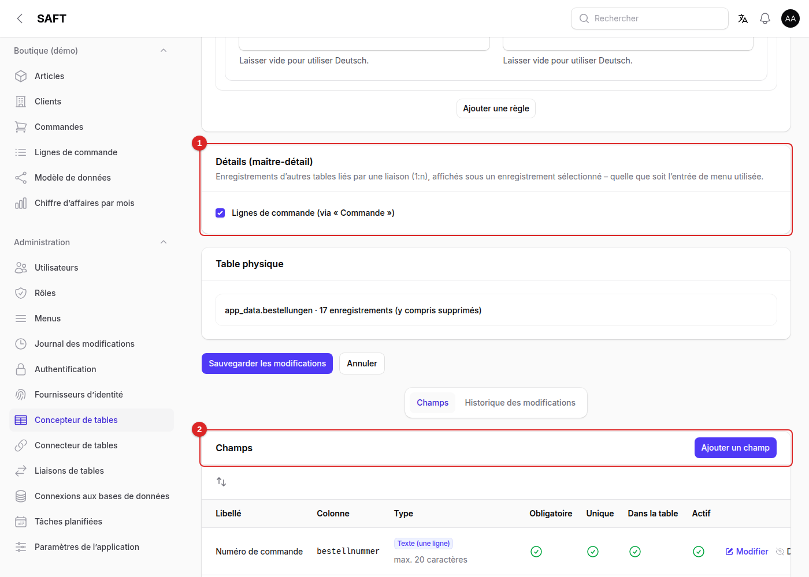
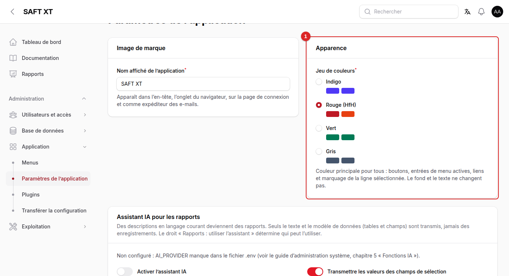
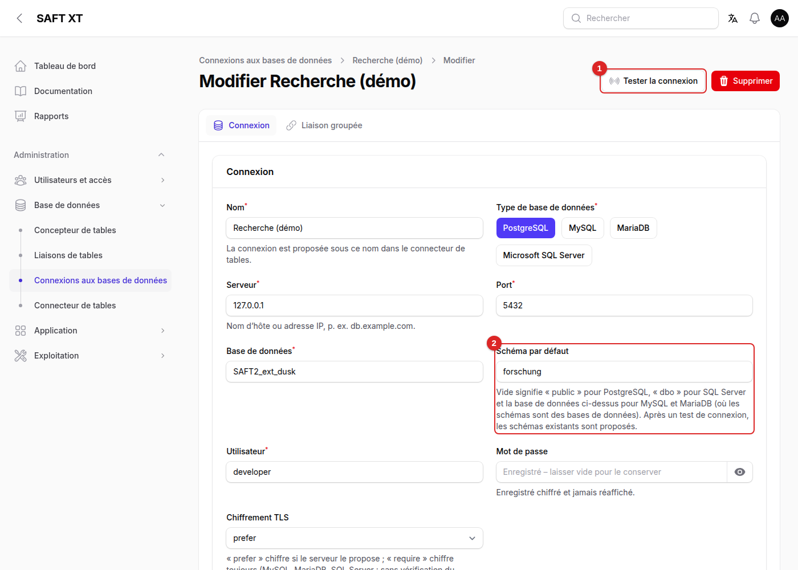
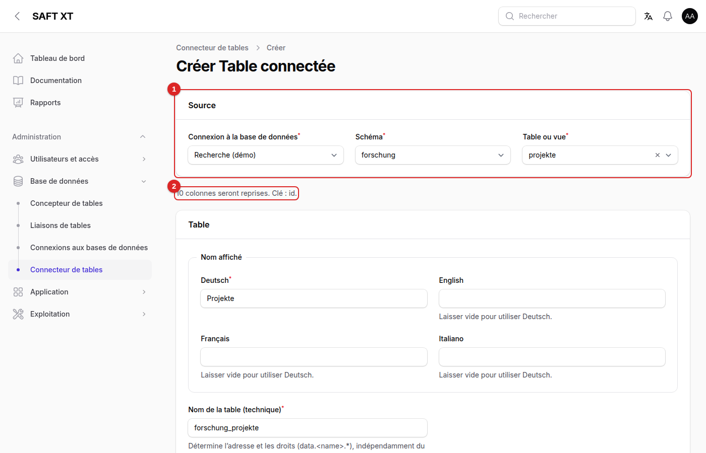
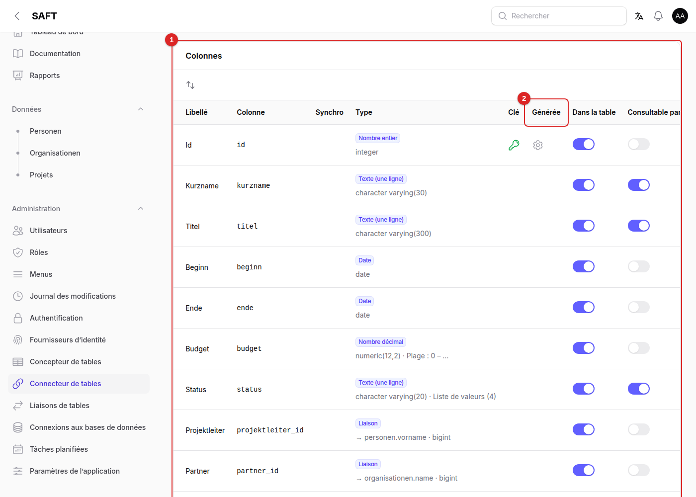

# SAFT XT – Guide d’administration

[Deutsch](ADMIN_GUIDE.de.md) · [English](ADMIN_GUIDE.md) · **Français** · [Italiano](ADMIN_GUIDE.it.md)

**État :** version 0.1 · **Public cible :** administratrices et administrateurs dans SAFT

**Autres guides :** [Guide utilisateur](USER_GUIDE.fr.md) · [Questions fréquentes](FAQ.fr.md) · [Administration système](SYSADMIN_GUIDE.md)

> **À propos des illustrations :** les images sont des captures d’écran de l’application avec les données de
> démonstration. Les chiffres rouges dans les images renvoient aux explications du texte.

---

## Sommaire

- [1. Utilisateurs](#1-utilisateurs)
- [2. Rôles et droits](#2-rôles-et-droits)
- [3. Menus](#3-menus)
- [4. Concepteur de tables](#4-concepteur-de-tables)
- [5. Authentification](#5-authentification)
- [6. Fournisseurs d’identité (authentification unique)](#6-fournisseurs-didentité-authentification-unique)
- [7. Paramètres de l’application](#7-paramètres-de-lapplication)
- [8. Journal des modifications](#8-journal-des-modifications)
- [9. Connexions aux bases de données](#9-connexions-aux-bases-de-données)
- [10. Connecteur de tables](#10-connecteur-de-tables)
- [11. Liaisons de tables](#11-liaisons-de-tables)
- [12. Tâches planifiées](#12-tâches-planifiées)
- [13. Fonctions IA](#13-fonctions-ia)
- [14. Plugins](#14-plugins)
- [15. Transférer la configuration](#15-transférer-la-configuration)
- [Annexe A – Aperçu des droits](#annexe-a--aperçu-des-droits)

---

Les fonctions suivantes se trouvent dans le menu sous **Administration**. Elles ne sont visibles qu’avec les droits
correspondants. Ici aussi, les listes et les tableaux ne sont aussi larges que leurs colonnes (voir [Guide utilisateur 4.1](USER_GUIDE.fr.md#41-la-vue-tableau)).

## 1. Utilisateurs

**Administration → Utilisateurs**

- **Liste** avec nom, e-mail, rôles, actif, dernière connexion. Filtres : actif, rôle, **sans rôle**,
  **liaison SSO**, utilisateurs supprimés.
- **Créer / modifier :** nom, e-mail, mot de passe (obligatoire à la création, sauf en mode SSO pur), actif, rôles.
  Le **rôle par défaut** (voir [chapitre 5](#5-authentification)) est présélectionné à la création.
- **Les utilisateurs inactifs** ne peuvent pas se connecter – ni par mot de passe ni par SSO.
- **Liaisons SSO :** dans la fiche de l’utilisateur, vous voyez à quels comptes d’authentification unique il est lié
  et pouvez supprimer une liaison.
- **Historique des modifications :** chaque modification de l’utilisateur est traçable en bas de la page.
- **Langue :** chaque utilisateur choisit lui-même sa langue via l’icône de langue ; elle est enregistrée dans son
  compte et vaut aussi pour les e-mails qui lui sont adressés, p. ex. pour réinitialiser le mot de passe.
- **Les utilisateurs supprimés** peuvent être affichés via le filtre, restaurés ou supprimés définitivement. Leurs
  entrées dans le journal des modifications sont conservées (voir [chapitre 8](#8-journal-des-modifications)).
- **Inactif, supprimé ou supprimé définitivement ?**

  | | Inactif | Supprimé (corbeille) | Supprimé définitivement |
  |---|---|---|---|
  | Connexion | bloquée | bloquée | – |
  | Dans la liste | visible | uniquement via le filtre « Enregistrements supprimés » | n’existe plus |
  | Annuler | interrupteur « Actif » | « Restaurer » | impossible |
  | Nom dans le journal | oui | oui, marqué « supprimé » | non, seulement le numéro d’utilisateur |
  | Nouvelle connexion SSO | refusée | refusée (« Votre compte utilisateur a été supprimé ») | peut créer un **nouveau** compte |

  « Inactif » convient aux blocages temporaires. Un compte supprimé reste volontairement bloqué : sinon, une
  personne qui existe toujours chez le fournisseur d’identité obtiendrait immédiatement un nouveau compte à la
  prochaine connexion grâce au provisionnement automatique. **Supprimer définitivement** (action de ligne pour les
  comptes supprimés, aussi en action groupée) est prévu pour les suppressions exigées par la protection des données –
  ou lorsqu’une personne doit volontairement recevoir un nouveau compte via SSO.

Règles de protection : personne ne peut se supprimer ni se désactiver soi-même. Les comptes super-admin ne peuvent
être modifiés que par des super-admins, et le rôle `super-admin` n’est même pas proposé aux autres utilisateurs.

## 2. Rôles et droits

**Administration → Rôles**

Un rôle regroupe des droits. Les utilisateurs reçoivent leurs droits exclusivement par des rôles.

- **Autorisations** – droits sur les fonctions de l’application, p. ex. « Utilisateurs : modifier »,
  « Concepteur de tables : afficher » ou les **widgets du tableau de bord**.
- **Droits sur les données** – une matrice avec toutes les tables du Concepteur de tables et les colonnes
  **Afficher, Créer, Modifier, Supprimer, Exporter, Importer**. Les nouvelles tables y apparaissent automatiquement.
  **Importer** n’agit qu’avec **Créer** et si l’import est autorisé pour la table.
  **Exporter** n’a d’effet que si l’export est autorisé pour la table (voir [chapitre 4](#4-concepteur-de-tables)) et
  que le rôle peut aussi afficher la table. Les tables externes liées (voir [chapitre 10](#10-connecteur-de-tables))
  ne proposent **Créer, Modifier** et **Supprimer** que si cela est activé pour la table ; sinon, « – » s’affiche.
  La matrice comporte les onglets **Tables propres** (structurées par groupe de menu, nom technique discrètement à
  côté) et **Tables liées** (par connexion à une base de données). **Tous** sur une ligne attribue tous les droits de
  la table, la case au-dessus d’une colonne (« colonne entière ») attribue le droit pour toutes les tables visibles.
  Le **champ de recherche** filtre les lignes par libellé ou nom technique.

- **Entrées de menu** – toutes les entrées de menu de type « Table de données », p. ex. « Données › Clients ». Sans
  coche, le rôle ne voit pas l’entrée dans le menu. Les nouvelles entrées et les nouveaux rôles sont cochés, donc
  visibles. Il ne s’agit que d’affichage : les droits sur les données déterminent si la table peut être affichée. Une
  entrée masquée reste accessible via des liens, la vue maître-détail et l’aperçu. Avec plusieurs rôles, il suffit
  d’un rôle disposant du droit de lecture qui affiche l’entrée ; `super-admin` voit toujours toutes les entrées.

Les domaines sont enregistrés indépendamment – une modification dans l’un ne change rien dans l’autre.

Les droits modifiés s’appliquent immédiatement, y compris aux utilisateurs déjà connectés. Qui a perdu un droit
reçoit « Accès refusé » au prochain clic ; le menu est à jour après le rechargement de la page.

**Rôles particuliers :**

| Rôle | Signification |
|---|---|
| `super-admin` | A **tous** les droits, y compris pour les fonctions futures. Ne peut être ni supprimé ni renommé et n’est jamais attribué automatiquement via SSO. |
| `benutzer` | Rôle par défaut des nouveaux utilisateurs, sans droits d’administration ; voit le tableau de bord avec les widgets personnels. Tant qu’il est défini comme rôle par défaut, il ne peut pas être supprimé. |

**Afficher en tant que rôle (vérifier les droits) :** les super-admins choisissent dans le menu utilisateur en haut à
droite **« Afficher en tant que rôle … »** et un ou plusieurs rôles – tels qu’une personne les possède (le rôle par
défaut est présélectionné, en général un rôle métier s’y ajoute). Ils voient alors SAFT exclusivement avec ces
droits – menu, pages, droits sur les données, rapports et widgets –, comme une autre personne ayant exactement ces
rôles : leurs propres rapports ne comptent alors pas comme les leurs. Une bande jaune en haut indique le rôle ;
**Terminer** dans la bande rétablit vos propres droits (la déconnexion met aussi fin à la vue). La base de données
reste inchangée, le début et la fin figurent dans le journal des modifications. Attention : ce que le rôle peut faire
est réellement enregistré pendant la vue – avec vous comme auteur.

## 3. Menus

**Administration → Menus**

Le menu de gauche est géré ici. Chaque entrée a un **type** :

| Type | Utilisation |
|---|---|
| **Groupe** | titre pour des entrées subordonnées (p. ex. « Données ») |
| **Page interne** | une page de l’application (p. ex. tableau de bord, utilisateurs) |
| **URL externe** | un lien vers l’extérieur ; s’ouvre dans un nouvel onglet |
| **Table de données** | une table du Concepteur de tables avec son propre choix de colonnes |
| **Modèle de données** | vue graphique des tables de données de ce groupe et de leurs liaisons (voir ci-dessous) |
| **Rapport** | un rapport partagé (voir [Guide utilisateur 4.9](USER_GUIDE.fr.md#49-rapports)) ; n’apparaît que pour les personnes qui peuvent l’exécuter avec leurs droits sur les données |

**Entrée de menu de type « Table de données »** (1) :

- Choisissez la **table de données** – seules les tables actives du Concepteur de tables sont proposées.
- Choisissez les **autres colonnes affichées** (2). Les **champs obligatoires** sont toujours affichés et ne sont
  donc pas proposés.
- Le droit de lecture nécessaire est défini automatiquement : l’entrée n’est visible que pour les utilisateurs qui
  peuvent afficher la table.
- Pour la même table, **plusieurs entrées** avec des colonnes différentes peuvent être créées.
- Si vous changez de type plus tard, le droit de lecture défini automatiquement est supprimé.
- Pour certains rôles, l’entrée peut être masquée sans retirer le droit de lecture (Rôles → Entrées de menu, voir
  [chapitre 2](#2-rôles-et-droits)).

**Entrée de menu de type « Modèle de données » :** la page montre les tables de données du groupe dans lequel se
trouve l’entrée – y compris tous les sous-groupes – sous forme de diagramme avec leurs liaisons. Si l’entrée se trouve
au niveau supérieur, toutes les tables de données apparaissent. La page est générique : le même type peut être placé
dans plusieurs groupes, et si une entrée est déplacée, elle montre automatiquement le nouveau groupe. Règles :

- Sont affichées les tables qui ont une entrée de menu de type « Table de données » dans le groupe, et seulement
  celles que l’utilisateur peut voir (droit de lecture, non masquées pour ses rôles, actives). Les tables sans entrée
  de menu manquent.
- Si un utilisateur ne voit **aucune table** dans le groupe, l’entrée « Modèle de données » n’apparaît pas dans son
  menu. Si le groupe devient vide de ce fait, il est également masqué.
- Les tables liées **hors du groupe** apparaissent comme nœuds périphériques avec un cadre en pointillés,
  uniquement avec leur nom. Les liaisons vers des tables sans droit de lecture disparaissent entièrement.
- **Lignes :** continues si la liaison est configurée comme table de détail dans le Concepteur de tables, sinon en
  pointillés. Les extrémités montrent la cardinalité : plusieurs enregistrements renvoient à exactement un (champ
  obligatoire) ou à aucun ou un enregistrement principal.
- **« Afficher les champs »** bascule sans rechargement entre la vue d’ensemble avec les noms de tables et la vue avec
  tous les champs actifs (type, nom technique, PK/FK/UK, libellé, `*` = champ obligatoire). Le navigateur retient le
  choix.
- Les tables liées du Connecteur de tables ont un cadre orange et indiquent leur connexion.
- Comme toute entrée, celle-ci peut être restreinte par un **droit**. Le diagramme s’adapte au thème de couleurs
  (clair/sombre) ; les diagrammes larges peuvent être déplacés latéralement.

**Libellé par langue :** chaque entrée a un champ pour **Deutsch** (obligatoire) et un pour **English**,
**Français** et **Italiano**. Si un champ reste vide, le libellé allemand s’affiche dans cette langue. Les entrées
fournies sont déjà nommées dans les quatre langues. Les entrées que le Concepteur de tables crée pour une table
reprennent son nom affiché dans toutes les langues et le suivent à chaque modification.

**Icônes :** le bouton à droite du champ **Icône** ouvre une boîte de dialogue avec toutes les icônes disponibles,
réparties par style dans les onglets **Contour**, **Plein**, **Mini** et **Micro**. Le champ de recherche filtre
immédiatement (p. ex. « user »), le nombre sur l’onglet indique les résultats par style ; un clic reprend le nom dans
le champ. L’icône actuelle est mise en évidence et apparaît à gauche du champ en aperçu. Vous pouvez aussi saisir le
nom à la main, p. ex. `heroicon-o-users` ; le formulaire n’accepte que des icônes connues. La même boîte de dialogue
existe pour l’icône de table dans le Concepteur de tables. Une entrée avec des sous-entrées sans icône valide reçoit
un symbole de dossier.

**Autres règles :** un menu a au plus trois niveaux ; les entrées se trient par glisser-déposer. La suppression d’une
entrée supprime aussi ses sous-entrées.

> Les **détails** (maître-détail) ne se configurent pas dans le menu, mais dans le Concepteur de tables.

## 4. Concepteur de tables

**Administration → Concepteur de tables**

Vous créez ici vos propres tables – sans programmation.

**Multilingue :** le nom affiché et la description d’une table, le libellé de chaque champ et l’affichage des valeurs
de sélection ont un champ par langue. L’allemand est obligatoire pour le nom affiché et le libellé, les autres langues
sont facultatives ; sans elles, le texte allemand s’affiche. Le nom technique et les valeurs de sélection enregistrées
valent pour toutes les langues.

**Créer une table :**

1. **Nouvelle table** → saisir le nom affiché. Le nom technique est proposé (p. ex. « Größe in m² » →
   `groesse_in_m2`) et **ne peut plus être modifié ensuite**. Les noms techniques sont uniques pour toutes les
   tables – propres, importées et liées. Si le nom est déjà pris, SAFT le signale dès la sortie du champ et nomme la
   table, p. ex. « Le nom « personen » est déjà utilisé : table liée « Personen » (connexion Forschung). » Si une
   autre table porte le même **libellé**, seul un avertissement apparaît – c’est permis, mais difficile à distinguer
   dans les menus et les listes. Il en va de même pour l’import et le Connecteur de tables.
2. Facultatif : créer des **champs initiaux** et choisir sous **« Entrée de menu sous »** le groupe du menu.
   « Données » est présélectionné ; tous les groupes sont proposés, les sous-groupes en retrait avec leur chemin
   (p. ex. « Données › Recherche »). « Pas d’entrée de menu » n’en crée aucune.
3. Sauvegarder – la table est immédiatement utilisable. Les **droits sur les données**
   (afficher/créer/modifier/supprimer) sont créés automatiquement dans la gestion des rôles.

**Autoriser l’export :** cet interrupteur dans les données de base de la table autorise l’export (voir
[Guide utilisateur 4.7](USER_GUIDE.fr.md#47-exporter-des-données)). Il est d’abord désactivé. Même les super-admins ne
voient « Exporter » que lorsqu’il est activé ; toutes les autres personnes ont besoin en plus du droit **Exporter**
dans leur rôle.

**Autoriser l’import :** cet interrupteur autorise l’import de données – de nouveaux enregistrements à partir d’un
fichier Excel ou CSV, p. ex. d’un modèle téléchargé (voir [Guide utilisateur 4.8](USER_GUIDE.fr.md#48-importer-des-données)).
Il est d’abord désactivé. « Importer » apparaît alors dans la liste pour les rôles ayant les droits **Créer** et
**Importer**. L’import ne modifie jamais les enregistrements existants ; il contrôle comme lors d’une saisie manuelle,
et c’est tout ou rien. Au plus 10 000 lignes par fichier (`APP_DATA_IMPORT_MAX_RECORD_ROWS`). Les tables liées du
Connecteur de tables ne peuvent pas être importées.

**Modifier les champs** (zone *Champs*, (2)) : pour chaque champ, vous définissez :

| Réglage | Signification |
|---|---|
| Libellé / nom de colonne | affichage ou nom technique. **Renommer conserve les données.** |
| Type | voir [Guide utilisateur, annexe A](USER_GUIDE.fr.md#annexe-a--types-de-champs) |
| Réglages du type | longueur (texte), chiffres (nombre décimal), valeurs (liste de sélection), table cible, champs affichés et séparateur (liaison) |
| Validation | longueur min./max., minimum/maximum, e-mail, URL ; **Contrôles supplémentaires** issus de plugins, p. ex. numéro AVS ou IBAN (affiché seulement si un plugin propose des règles pour le type de champ ; ils s’appliquent à la saisie, à l’importation et via l’interface, les valeurs vides ne sont pas contrôlées). Si le plugin manque ensuite ou est en veille, le contrôle est ignoré et indiqué « non disponible » sur le champ |
| Valeur proposée à la création (nombre entier) | **Proposer le numéro suivant (valeur maximale + 1) :** dans la boîte « Nouvel enregistrement » figure la plus grande valeur existante + 1, qui reste modifiable ; si le champ reste vide, SAFT définit la valeur à l’enregistrement. Avec **Compter par** (une liaison, p. ex. *Commande*), le comptage se fait par enregistrement maître : sous une commande avec deux lignes, 3 est proposé ; dans la liste, la proposition apparaît dès que la commande est choisie. Les enregistrements supprimés ne comptent pas. |
| Valeur proposée à la création (date, date et heure) | **Préremplir avec la date du jour** ou **Préremplir avec la date et l’heure actuelles :** dans la boîte de dialogue « Nouvel enregistrement », le champ affiche à l’ouverture la date (ou la date et l’heure à la minute) actuelle et reste modifiable. Lors de la modification, de l’import et via l’interface, SAFT ne remplit rien. Pas en même temps que « Reprendre de ». |
| Reprendre de | reprendre une valeur de l’enregistrement maître, p. ex. *Prix unitaire* depuis **Article → Prix** : dès qu’un article est choisi dans le formulaire (ou immédiatement sous un article comme table de détail), son prix figure dans le champ et reste modifiable. Si l’article change, la valeur suit tant qu’elle n’a pas été modifiée à la main ; SAFT remplit les champs enregistrés vides. Il s’agit d’une copie : les modifications ultérieures de l’article ne changent pas les lignes existantes. Seuls les champs compatibles sont proposés (nombre ← nombre, date ← date, texte ← texte/sélection, oui/non ← oui/non). Un champ source ne peut pas être supprimé tant qu’un champ en reprend la valeur ; un renommage est suivi. |
| Champ obligatoire | doit être rempli ; toujours affiché dans les listes |
| Unique | ne peut apparaître qu’une fois (les enregistrements supprimés ne comptent pas) |
| Consultable par la recherche | pris en compte par la recherche |
| Créer un index | accélère le tri et le filtrage des grandes tables |
| Afficher dans la table / dans le formulaire | présélection pour les listes et les formulaires |

**Champs affichés d’une liaison :** au lieu du numéro enregistré, une liaison affiche des champs de l’enregistrement
lié – un ou plusieurs, dans l’ordre choisi et reliés par un **séparateur** (espace, virgule, tiret, point ou barre
oblique), p. ex. prénom et nom en « Anna Keller » ou nom et lieu en « ETH Zürich, Zürich ». Les champs vides sont
ignorés. Cela vaut dans les listes, les détails, l’aperçu, les filtres, l’export et dans la liste de sélection lors
de la modification ; la saisie y cherche dans tous les champs affichés. Le tri se fait selon le premier champ
affiché. Si vous renommez un champ affiché, la liaison suit ; tant qu’un champ sert quelque part de champ affiché, il
ne peut pas être supprimé définitivement.

**Règles** (illustration ci-dessous, 1) : contrôles portant sur plusieurs champs lors de l’enregistrement d’un
enregistrement, p. ex. « date de livraison ≥ date de commande » ou « quantité > 0 ». Pour chaque règle, choisissez le
**champ**, la **comparaison** et si la comparaison se fait avec un **autre champ** ou une **valeur fixe** :

- Les nombres et les dates permettent toutes les comparaisons (=, ≠, <, ≤, >, ≥) – un nombre uniquement avec un
  nombre, une date uniquement avec une date. Le texte, les listes de sélection et oui/non ne peuvent être contrôlés
  que sur l’égalité (= et ≠). Les liaisons et le texte long ne sont pas possibles.
- **Ne vérifier que si les deux côtés sont remplis** (par défaut) : un champ vide n’est pas contrôlé. Désactivé, un
  champ vide compte comme une violation.
- **Message propre** (facultatif, par langue). Sinon, le texte standard apparaît au champ, p. ex. « ne doit pas
  être antérieur à « date de commande » ».
- La règle vaut dans tous les formulaires de la table (liste, tables de détail, Détails → Modifier). Les
  enregistrements existants restent inchangés ; si certains violent déjà une nouvelle règle, un avertissement indique
  combien – ils sont contrôlés à la prochaine modification.
- Si un champ est renommé, ses règles suivent. Un champ utilisé par une règle ne peut pas être supprimé, et son type
  ne peut être changé que vers un type qui reste compatible avec la règle.

### Champs calculés

Un champ de type **Calculé** n’est pas saisi, mais calculé à l’enregistrement à partir d’autres champs du même
enregistrement ou des enregistrements enfants associés, p. ex. *Montant* à partir de la quantité et du prix unitaire
ou *Prix total* comme somme des montants de toutes les lignes d’une commande. La valeur est enregistrée et peut donc
être triée, filtrée, exportée et utilisée dans des règles.

- **Résultat :** nombre entier ou décimal (avec chiffres et décimales) ; le résultat est arrondi en conséquence.
- **Formule :** champs numériques de la table (par nom de colonne), nombres, `+ - * /` et parenthèses ainsi que les
  fonctions `round(x, décimales)`, `min(a, b, …)`, `max(a, b, …)`, `abs(x)` et `coalesce(a, remplacement)`.
  Exemple : `round(menge * einzelpreis, 2)`. Les noms de fonctions sont identiques dans toutes les langues. Des plugins
  peuvent apporter d’autres fonctions, p. ex. `rappen(montant)` (arrondi à 5 centimes) ; elles figurent dans l’aide à
  la saisie sous **Fonctions issues de plugins**, la description s’affiche au survol du bouton. Elles ne sont pas
  disponibles dans les expressions des analyses. Si le plugin manque ensuite, le résultat reste vide.
- **Sur les enregistrements enfants** (tables qui pointent vers cette table par une liaison) : `sum(table.champ)`,
  `avg(table.champ)`, `min(table.champ)`, `max(table.champ)` et `count(table)`, p. ex. prix total =
  `sum(bestellpositionen.betrag)`, TVA = `round(gesamtpreis * 0.081, 2)`. Les enregistrements enfants supprimés ne
  comptent pas ; sans enregistrements enfants, la somme et le nombre valent 0. Si une table enfant pointe vers cette
  table par plusieurs liaisons, la liaison voulue est indiquée en deuxième valeur :
  `sum(bestellpositionen.betrag, bestellung_id)`.
- **Expression par enregistrement enfant :** au lieu d’un champ, `sum`, `avg`, `min` et `max` acceptent aussi un
  calcul avec des champs de la table enfant ; il est calculé pour chaque enregistrement enfant puis résumé, p. ex.
  `sum(bestellpositionen.einzelpreis * bestellpositionen.menge)` ou
  `sum(round(bestellpositionen.menge * bestellpositionen.einzelpreis * 0.95, 2))`. L’expression ne contient que des
  champs de cette seule table enfant (pas de champs de l’enregistrement maître, pas de résumés imbriqués). Si le
  résultat est vide pour un enregistrement enfant, il ne compte pas – `coalesce(…, 0)` permet de le gérer.
- **Aide à la saisie :** sous le champ de formule, les champs numériques de la table apparaissent sous forme de
  boutons, p. ex. « Menge (menge) » ; un clic insère le nom technique au curseur. Chaque table enfant a sa propre
  ligne avec `count(table)` et ses champs numériques (`table.champ`), plus des boutons pour les opérateurs, les
  fonctions et `sum`, `avg`, `count`. Lors de la création d’une nouvelle table, seuls les champs placés plus haut dans
  le formulaire apparaissent.
- **Contrôle :** dès la saisie, SAFT signale les erreurs avec leur position (p. ex. « Caractère 9 : champ inconnu
  « preis » ») ou confirme de quoi dépend le résultat. Les références circulaires sont refusées ; le message indique
  les formules des champs concernés, p. ex. « Référence circulaire : mwst → einkaufspreis → mwst. Les formules : mwst
  = … ; einkaufspreis = … ».
- **Valeurs vides :** si un champ utilisé est vide, le résultat est vide – sauf avec `coalesce(champ, 0)`. Une
  division par 0 donne également un résultat vide. Le calcul est exact (pas d’erreurs d’arrondi sur les montants).
- **Quand le calcul a lieu :** à l’ajout d’un champ calculé, pour tous les enregistrements existants ; à la création
  (aussi par import) et à la modification d’un enregistrement (les nouvelles valeurs figurent
  dans le journal des modifications) ; à la création, la modification, la suppression ou la restauration d’un
  enregistrement enfant pour son enregistrement maître – lors d’un changement de commande pour l’ancienne et la
  nouvelle – et ainsi de suite vers le haut (p. ex. chiffre d’affaires d’un client comme somme de ses commandes) ;
  après la modification d’une formule pour tous les enregistrements de la table et des tables supérieures ; et avec
  `php artisan computed:recompute` si des données ont été modifiées en dehors de SAFT.
- Dans le formulaire, un champ calculé est seulement affiché (« calculé à l’enregistrement »). Les règles qui
  contrôlent un champ calculé ne s’appliquent donc qu’à la modification suivante.
- Si un champ utilisé est renommé (y compris dans une table enfant), la formule suit ; la suppression et le passage à
  un type non numérique sont bloqués tant qu’une formule utilise le champ. Une table enfant sur laquelle une somme est
  calculée ne peut pas être supprimée.
- Les données de démonstration contiennent *Betrag* (lignes de commande) ainsi que *Gesamtpreis* et *MWST 8,1 %*
  (commandes).

**Détails (maître-détail)** (1) : vous choisissez ici quelles tables liées apparaissent sous un enregistrement
sélectionné (voir [Guide utilisateur 4.3](USER_GUIDE.fr.md#43-tables-liées--la-vue-maître-détail)). Sont proposés tous les
champs de liaison d’autres tables qui pointent vers cette table. S’il existe plusieurs liaisons provenant de la même
table (p. ex. « Client » et « Facturer à »), elles peuvent être choisies séparément.

**Autres boutons :** *Ouvrir les données* (vers la vue des données) et *Créer une entrée de menu*. Celui-ci demande
le groupe et crée aussi une entrée supplémentaire si la table doit apparaître à un deuxième endroit du menu.

**Ce qui est possible – et ce qui ne l’est pas :**

| Modification | Règle |
|---|---|
| Renommer un champ | à tout moment, les données sont conservées |
| Changer le type | sans perte à tout moment (p. ex. nombre entier → nombre décimal, texte → texte sur plusieurs lignes, date → date et heure) ; sinon uniquement si la colonne est vide |
| Longueur du texte | augmenter à tout moment, réduire uniquement si la colonne est vide |
| Activer « Unique » | uniquement si les données existantes ne contiennent pas de doublons |
| Retirer une valeur d’une liste de sélection | à tout moment ; si la valeur est utilisée, un avertissement indique le nombre d’enregistrements. Ils conservent leur valeur, mais une valeur valide doit être choisie à la prochaine modification. |
| Supprimer un champ | d’abord **désactiver**, puis « Supprimer définitivement » en saisissant le nom de la colonne |
| Supprimer une table | d’abord **désactiver**, puis « Supprimer définitivement » en saisissant le nom de la table ; impossible tant que d’autres tables y font référence |
| Liaison | uniquement vers d’autres tables du Concepteur de tables, jamais vers des tables système |

> **Désactiver plutôt que supprimer :** un champ ou une table désactivé est invisible pour les utilisateurs, mais les
> données sont entièrement conservées. Vous récupérez un champ avec « Activer », sans confirmation. La suppression
> définitive ne peut pas être annulée.

Sous **Table physique**, vous voyez l’emplacement de stockage, le nombre d’enregistrements et d’éventuels écarts
entre les réglages et la base de données.

### Utilisée dans

L’onglet **Utilisée dans** (à côté de *Champs* et du *Journal des modifications*) montre où la table apparaît ; le
nombre sur l’onglet indique combien de fois. Il sert uniquement d’information, p. ex. avant de renommer ou de
supprimer :

| Domaine | Ce qui apparaît |
|---|---|
| Plugin | plugins qui ont besoin de la table, contrôlent ses modifications ou affichent des boutons dans sa vue des données |
| Analyse | analyses avec la table comme table de base ou via une liaison |
| Lien (analyse) | liens entre analyses avec la table comme source ou cible |
| Menu | entrées de menu qui ouvrent la vue des données (avec le chemin dans le menu) |
| Liaison | champs d’autres tables qui font référence à cette table |
| Formule | champs calculés d’autres tables qui agrègent sur cette table, p. ex. `sum(bestellungen.betrag)` |
| Reprise | champs d’autres tables qui reprennent une valeur de cette table |
| Rôle | rôles ayant des droits sur les données de la table, avec ces droits |
| Tâche planifiée | tâches « Actualiser l’état des données » pour la table |

Le nom est un lien si vous pouvez ouvrir la page correspondante ; le filtre **Domaine** restreint la liste.

### Supprimer définitivement une table ou un champ

La suppression définitive retire la colonne ou la table **avec ses données** de la base de données. Pour que cela
n’arrive pas par erreur, elle se fait en deux étapes ; le bouton **« Supprimer définitivement »** est visible
jusque-là, mais bloqué (l’explication apparaît au survol) :

| | Table | Champ |
|---|---|---|
| 1. Désactiver | modifier la table, interrupteur **« Actif »** désactivé, **Sauvegarder** | dans la liste des champs **« Désactiver »** |
| 2. Supprimer | en haut **« Supprimer définitivement »** | sur la ligne, l’**icône de corbeille** (« Supprimer définitivement ») |
| 3. Confirmer | saisir le nom technique de la table | saisir le nom de la colonne |

Lors de la suppression d’une table, SAFT supprime aussi ses droits sur les données et ses entrées de menu ; le
journal des modifications est conservé. Le droit **Concepteur de tables : supprimer** est nécessaire. Si une autre
table fait référence à la table par un champ de liaison, le message nomme ce champ – il doit d’abord être retiré. Si
la table est utilisée ailleurs (analyses, menus, rôles …), la boîte de dialogue affiche un avertissement avec le nombre
par domaine ; la suppression reste possible, les détails figurent dans l’onglet **Utilisée dans**.

### Importer une table depuis un fichier

**Concepteur de tables → Importer** crée une nouvelle table à partir d’un fichier CSV ou Excel et reprend les
données. Le droit **Concepteur de tables : importer** est nécessaire. L’assistant comporte quatre étapes :

1. **Fichier :** CSV (`.csv`, `.txt`, `.tsv`) ou Excel (`.xlsx`), au plus 20 Mo ou 50 000 lignes de données. Pour
   les fichiers Excel à plusieurs feuilles, choisissez la feuille. SAFT contrôle le fichier ; s’il contient des
   erreurs, l’assistant s’arrête ici et affiche **tous** les problèmes trouvés avec ligne et colonne.
2. **Contrôle :** résumé (lignes, colonnes, pour le CSV séparateur et jeu de caractères) et remarques, p. ex. sur une
   ligne de total supposée.
3. **Colonnes :** pour chaque colonne « Reprendre », nom du champ, libellé et type. Seuls les types compatibles avec
   les données sont proposés (le texte est toujours possible).
4. **Table et menu :** libellé, nom technique de la table et groupe de menu pour l’entrée de la table.

**Une liste importable** a les titres de colonnes en ligne 1 et en dessous uniquement des lignes de données :

| Permis | Entraîne l’abandon |
|---|---|
| titres avec espaces et caractères spéciaux (« N° client », « Rue ») | colonne sans titre, titres en double |
| cellules vides | titre ou ligne vide au-dessus de la liste, lignes vides au milieu de la liste |
| lignes vides à la fin | valeurs dans des colonnes sans titre, lignes CSV avec un nombre de colonnes différent |
| formules (le résultat enregistré compte) | cellules fusionnées, cellules d’erreur comme `#DIV/0!` |

**Les noms de champs** sont dérivés des titres : « Straße & Nr. » → `strasse_nr`, « 2024 » → `f_2024`. Le titre
lui-même devient le libellé. Les noms système et les mots réservés (« ID », « Order ») reçoivent la terminaison
`_import`. Si deux titres donnent le même nom (« Kunden Nr » et « Kunden-Nr. »), le contrôle nomme les deux colonnes.

**Les types** ne sont reconnus par SAFT que si **toutes** les valeurs d’une colonne correspondent :

| Valeurs | Type |
|---|---|
| nombres entiers | nombre entier |
| nombres avec décimales (`1.234,50` ou `1,234.50`) | nombre décimal |
| `JJ.MM.AAAA` ou `AAAA-MM-JJ`, avec heure en option | date ou date et heure |
| ja/nein, true/false, wahr/falsch | oui/non |
| nombres avec zéro initial (NPA `01067`) | texte – le zéro est conservé |
| tout le reste | texte ; au-delà de 255 caractères ou sur plusieurs lignes : texte long |

Pour le CSV, le séparateur décide si `1.234` est lu comme 1234 ou 1,234 (point-virgule : format allemand, virgule :
format anglais) ; l’aperçu des colonnes indique le format retenu. SAFT ne devine pas les clés : chaque table reçoit
comme toujours son propre numéro d’enregistrement ; une colonne « ID » du fichier est reprise comme champ normal
`id_import`.

L’import se fait entièrement ou pas du tout : si une valeur ne convient pas, rien n’est créé, et le message nomme la
cellule. Le **journal des modifications** contient une entrée « importé » avec le fichier, le nombre de lignes et de
colonnes, et non une entrée par enregistrement. Au plus dix colonnes sont créées triables ; vous activez les autres
dans le Concepteur de tables.

**Mauvais import ?** Ouvrez la table dans le Concepteur de tables, désactivez « Actif » et sauvegardez, puis
confirmez « Supprimer définitivement » avec le nom de la table (voir [Supprimer définitivement une table ou un
champ](#supprimer-définitivement-une-table-ou-un-champ)). Le fichier peut ensuite être réimporté.

## 5. Authentification

**Administration → Authentification**

| Réglage | Signification |
|---|---|
| **Mode de connexion** | **Local** (mot de passe seul), **Authentification unique (SSO)** (fournisseur d’identité seul) ou **Hybride** (les deux) |
| **Connexion d’urgence pour les super-administrateurs** | Permet aux super-admins, en mode SSO, de se connecter par mot de passe via `…/admin/login?local=1` – au cas où le fournisseur d’identité serait en panne |
| **Proposer « Mot de passe oublié »** | e-mail pour réinitialiser le mot de passe (uniquement en mode Local ou Hybride ; nécessite un envoi d’e-mails configuré) |
| **Rôle par défaut des nouveaux utilisateurs** | présélectionné à la création et attribué aux utilisateurs SSO créés automatiquement |

Protection contre le verrouillage : le mode **Authentification unique** ne peut être enregistré que si au moins un
fournisseur d’identité actif a un **test de connexion réussi**. Pour d’autres issues de secours en exploitation, voir
[Administration système, chapitre 1](SYSADMIN_GUIDE.md#1-operations).

## 6. Fournisseurs d’identité (authentification unique)

**Administration → Fournisseurs d’identité**

**Microsoft Entra ID** et **SAML 2.0** (p. ex. ADFS, Keycloak) sont pris en charge. Plusieurs fournisseurs sont
possibles ; chacun apparaît comme bouton distinct sur la page de connexion. Un guide pas à pas pour Entra ID avec
l’enregistrement de l’application chez Microsoft et la recherche d’erreurs se trouve dans l’administration système,
[annexe D](SSO_ENTRA.md). Les adresses d’un fournisseur SAML doivent commencer par `https://` ; un fournisseur
accessible uniquement en http ne peut pas être intégré.

**Configuration – déroulement :**

1. Créer le fournisseur, choisir le type, attribuer un nom affiché et un identifiant.
2. Saisir chez le fournisseur les **valeurs pour le fournisseur d’identité** affichées (2) – p. ex. URI de
   redirection ou URL ACS et URL des métadonnées SP. Un clic sur une valeur copie l’adresse.
3. Saisir les données du fournisseur :
   - **Entra ID :** ID d’annuaire (tenant), ID d’application (client), secret client. Seul votre propre locataire
     est autorisé (pas `common`/`organizations`).
   - **SAML :** URL des métadonnées IdP *ou* Entity ID, URL SSO et certificat. Pour les requêtes signées, générer
     un certificat SP d’un clic.
4. Sauvegarder et **« Tester la connexion »** (1). Les secrets sont enregistrés chiffrés et ne sont plus jamais
   affichés.
5. Sous *Authentification*, choisir le mode **Hybride** ou **Authentification unique**.

**Attribution des utilisateurs :**

| Réglage | Effet |
|---|---|
| Associer les utilisateurs existants par e-mail | un utilisateur connu est associé à sa première connexion SSO via l’e-mail |
| Créer automatiquement les utilisateurs inconnus | les nouvelles personnes reçoivent un compte (avec le rôle par défaut) |
| Rôle par défaut des nouveaux utilisateurs | attribué uniquement lors de la création automatique et conservé ensuite. Vide = rôle par défaut global du [chapitre 5](#5-authentification) (le champ l’affiche) ; les rôles attribués par correspondance s’y ajoutent |
| Domaines e-mail autorisés | seuls ces domaines peuvent se connecter (vide = tous) |

**Correspondance des rôles :** les rôles peuvent être repris du fournisseur d’identité – pour Entra depuis les
**rôles d’application** (recommandé) ou les **groupes**, pour SAML depuis un attribut. Les correspondances ont la
forme « valeur externe → rôle ». À chaque connexion, les rôles correspondants sont attribués ou retirés ; les autres
rôles restent inchangés. `super-admin` ne peut jamais être attribué ainsi. En option : « N’autoriser la connexion
qu’avec une correspondance applicable ».

**Déconnexion (single logout) :** sur demande, la déconnexion de SAFT déconnecte aussi chez le fournisseur. Pour
Entra, cela concerne tous les services Microsoft du navigateur (Outlook, Teams …) – c’est pourquoi l’option est
désactivée par défaut.

## 7. Paramètres de l’application

**Administration → Paramètres de l’application**

| Réglage | Signification |
|---|---|
| **Nom affiché de l’application** | 60 caractères au plus. Apparaît dans l’en-tête, dans l’onglet du navigateur, sur la page de connexion et comme expéditeur des e-mails |
| **Jeu de couleurs** | couleur principale pour tous : **Indigo** (par défaut), **Rouge (HfH)**, **Vert** ou **Gris**. Colore les boutons, les entrées de menu actives, les liens et le marquage de la ligne sélectionnée ; le fond, la police et la mise en page restent. S’applique dès l’enregistrement |

Dans la section **Apparence** (1), chaque jeu montre deux exemples : les boutons et le marquage de la ligne
sélectionnée. Tous les jeux de couleurs atteignent WCAG AA (4,5:1) en mode clair et sombre. **Rouge (HfH)** suit la
charte web de la HfH : boutons en #BE1925, ligne sélectionnée marquée dans la couleur de base #E74011 (inadaptée comme
fond de bouton, le texte blanc n’y atteint que 4,1:1). Le contraste élevé est un réglage personnel (voir
[Guide utilisateur, chapitre 3](USER_GUIDE.fr.md#3-interface-et-tableau-de-bord)).

La section **Assistant IA pour les rapports** configure le fournisseur, le modèle et la clé des fonctions IA (voir
[chapitre 13](#13-fonctions-ia)).

## 8. Journal des modifications

**Administration → Journal des modifications**

Chaque modification dans l’application est consignée : qui, quand, quoi, avec **avant/après**. Cela comprend les
enregistrements, les utilisateurs, les rôles et les droits, les menus, les structures de tables, les paramètres ainsi
que les connexions, les déconnexions et les tentatives de connexion échouées. Les secrets (mots de passe, clés) ne
sont jamais consignés.

- **Filtres :** utilisateur, événement, type d’objet, période. Les événements sont : créé, modifié, supprimé,
  restauré, connexion, échec de connexion, déconnexion et exporté.
- **Exports :** sont consignés la table, le format, le nombre de lignes, le filtre et la recherche, jamais les
  données exportées.
- **Utilisateurs :** « Système » n’apparaît que là où aucun utilisateur n’était réellement impliqué. Les utilisateurs
  supprimés apparaissent avec leur nom et « (supprimé) », ceux supprimés définitivement comme « Utilisateur supprimé
  #12 ».
- **Vue détaillée :** à la largeur d’un formulaire ; pour les modifications, un tableau avec tous les champs modifiés
  (avant → après), pour la création et la suppression les champs de façon compacte en blocs (champ et valeur côte à
  côte). Les valeurs longues passent à la ligne. Les libellés en plusieurs langues apparaissent avec toutes les
  langues, p. ex. `{"de":"Kunden","en":"Customers"}`.
- **Les heures** apparaissent dans le fuseau horaire de l’application (voir [Administration système, chapitre 1](SYSADMIN_GUIDE.md#1-operations)).
- Dans le widget **« Mes dernières modifications »**, un clic sur une entrée mène directement à l’enregistrement
  modifié – pour les tables du Concepteur de tables dans la vue des données avec l’enregistrement sélectionné.
- Le journal ne peut être ni modifié ni supprimé – pas même par les super-admins.

## 9. Connexions aux bases de données

**Administration → Connexions aux bases de données**

Vous configurez ici des connexions à des bases de données externes, p. ex. à un ERP ou à un système de recherche. Le
**Connecteur de tables** (voir [chapitre 10](#10-connecteur-de-tables)) lie des tables de ces bases de données de
sorte qu’elles puissent être lues comme les tables du Concepteur de tables. Sont pris en charge **PostgreSQL**,
**MySQL** (à partir de 8.0.16), **MariaDB** (à partir de 10.11) et **Microsoft SQL Server** (à partir de 2019, y
compris Express), indépendamment de la base de données qu’utilise SAFT. Pour SQL Server, le serveur de SAFT a besoin
de l’extension PHP `pdo_sqlsrv` et du Microsoft ODBC Driver 18 ; s’ils manquent, le type est bloqué dans la sélection.

| Réglage | Signification |
|---|---|
| **Nom** | La connexion est ensuite proposée sous ce nom dans le Connecteur de tables. |
| **Type de base de données, serveur, port, base de données** | Où se trouve la base de données, p. ex. `db.example.com`, port 5432. |
| **Schéma par défaut** (2) | Le schéma contenant les tables souhaitées ; vide signifie `public` pour PostgreSQL, `dbo` pour SQL Server, et pour MySQL et MariaDB la base de données de la connexion (les schémas s’y appellent bases de données). Après un test réussi, les schémas existants sont proposés. |
| **Utilisateur, mot de passe** | Connexion à la base de données. Le mot de passe est enregistré chiffré et n’est plus jamais affiché ; un champ vide le conserve. |
| **Chiffrement TLS** | `prefer` chiffre si le serveur le propose ; `verify-full` vérifie en plus le certificat et le nom d’hôte. MySQL, MariaDB et SQL Server : `require` (par défaut) chiffre sans vérification du certificat (p. ex. pour un certificat auto-signé), `verify-full` vérifie le certificat, `disable` se connecte sans chiffrement. |
| **Délais** | Pour l’établissement de la connexion (5 secondes par défaut) et par requête (30 secondes par défaut). Ainsi, une base lente ou injoignable ne bloque aucune page. |
| **Lecture seule** | Par défaut pour les nouvelles connexions. La base de données refuse alors elle-même toute modification via cette connexion. Désactiver pour modifier des données. SQL Server ne peut pas l’imposer par connexion ; SAFT y bloque toute écriture – un utilisateur en lecture seule est en outre recommandé (rôle `db_datareader`). |
| **Actif** | Les connexions inactives ne sont pas proposées dans le Connecteur de tables. |

**Configurer :**

1. Choisir **Créer** et saisir les données. Après l’enregistrement, la modification s’ouvre.
2. **« Tester la connexion »** (1) enregistre les données affichées et les vérifie. En cas de succès, le message
   indique la version du serveur, le nombre de tables et de vues dans le schéma par défaut et tous les schémas
   existants.
3. Si le test échoue, le message en donne la raison, p. ex. « Connexion refusée », « Le serveur … n’est pas
   joignable » ou « Le schéma … n’existe pas dans cette base de données ».

Si vous modifiez ensuite le serveur, la base de données, l’utilisateur, le mot de passe, le schéma ou le TLS, la
connexion est de nouveau considérée comme « Pas encore testé ». Chaque modification figure dans l’historique ; pour le
mot de passe, seulement le fait qu’il a été modifié.

> **Sécurité :** créez pour SAFT un utilisateur de base de données propre, qui ne peut voir – et si nécessaire
> modifier – que les schémas et tables nécessaires. Personne ne reçoit automatiquement les droits « Connexions aux
> bases de données : afficher/créer/modifier/supprimer » ; qui peut créer des connexions peut s’adresser à n’importe
> quel serveur.

**Supprimer :** si aucune table n’est liée via la connexion, la confirmation habituelle suffit. Sinon, la boîte de
dialogue **« Supprimer la connexion et les tables liées »** affiche toutes les tables concernées (nom dans SAFT,
libellé, table externe, type). Après saisie du nom de la connexion pour confirmer, la connexion et les tables liées
sont supprimées en une étape – comme avec « Supprimer la connexion » dans le Connecteur de tables : réglages, droits,
entrées de menu et liaisons d’autres tables vers elles. La base de données externe reste inchangée. Le droit
« Connecteur de tables : supprimer » est en plus nécessaire ; sans lui, la boîte de dialogue n’affiche que la liste.

**Liaison groupée :** lors de la modification d’une connexion, il y a deux onglets : **Connexion** avec les réglages
habituels et **Liaison groupée** pour lier de nombreuses tables en une fois. Le deuxième onglet n’affiche sa table
qu’après un test de connexion réussi ; avant, un avertissement y figure.

1. Choisir le schéma (filtre « Schéma », présélectionné avec le schéma par défaut). La liste montre toutes les tables
   et vues avec leur type, leur clé, le nom proposé dans SAFT et – si elles sont déjà liées – le nom existant. Les
   tables déjà liées ne peuvent pas être choisies une seconde fois.
2. Cocher les tables souhaitées (ou « Tout sélectionner ») et cliquer sur **« Lier la sélection … »**.
3. Dans la boîte de dialogue, les réglages valent pour toutes les tables choisies : **préfixe** pour les noms
   techniques (p. ex. `erp_`), **Actif**, **Autoriser l’export**, **Autoriser création/modification/suppression**,
   **Entrée de menu sous** un groupe (ou pas d’entrée de menu) et en option des **rôles** qui reçoivent le droit
   d’affichage et les droits activés (visible uniquement avec le droit de modifier les rôles). **« Configurer
   maître-détail à partir des clés étrangères »** (activé par défaut) inscrit pour chaque table nouvellement liée les
   tables de la même connexion qui y font référence comme détails – p. ex. sous un emplacement ses stocks et ses
   mouvements (voir [Guide utilisateur 4.3](USER_GUIDE.fr.md#43-tables-liées--la-vue-maître-détail)). Au plus 5 par
   table : si davantage de tables y font référence (typique des tables de référence comme « Pays »), rien n’y est
   configuré et le résultat les nomme. Les tables ayant déjà des détails choisis restent inchangées.
4. Une barre de progression montre l’avancement ; les tables sont liées par portions. Ensuite, le **résultat**
   indique pour chaque table : liée, lecture seule (avec la raison), ignorée (p. ex. nom déjà utilisé) ou erreur.

Pour chaque table, il en va comme pour la liaison d’une table individuelle : clé, types de colonnes, règles de la base
de données et listes de valeurs sont repris. Les **liaisons** via des clés étrangères sont déterminées une seule fois
à la fin pour toutes les tables de la connexion, donc aussi entre les tables nouvellement liées. Le **nom dans SAFT**
est dérivé du nom de la table : préfixe, minuscules, CamelCase et caractères spéciaux deviennent `_` (`tblOrder` →
`tbl_order`) ; le libellé peut ensuite être modifié dans le Connecteur de tables. L’écriture ne vaut que là où elle est
possible : les vues, les tables sans clé unique et les connexions en « Lecture seule » restent en lecture seule. Les
très grandes bases de données se lient avec la commande `php artisan table-connector:connect` (voir
[Administration système, chapitre 1](SYSADMIN_GUIDE.md#1-operations)) ; elle y configure aussi les détails, sauf avec
`--no-details`.

## 10. Connecteur de tables

**Administration → Connecteur de tables**

Le Connecteur de tables lie des tables et des vues d’une connexion à une base de données. Elles apparaissent ensuite
comme les tables du Concepteur de tables sous **Données** : avec entrée de menu, droits, liste, recherche, filtres,
tri, « Détails » et export. Les tables liées sont d’abord en **lecture seule** ; la création, la modification et la
suppression peuvent être activées par table (voir *Écriture* ci-dessous). Le Connecteur de tables ne modifie jamais
la structure de la base de données externe.

**Connecter une table :**

1. Choisir **« Connecter une table »**, puis la **connexion à une base de données**, le **schéma** et la **table ou
   vue** (1). Les vues et les tables sans clé sont signalées dans la liste.
2. En dessous figure ce qui est repris (2) : nombre de colonnes, la clé et les colonnes que SAFT ne peut pas afficher
   (p. ex. données binaires).
3. Le **nom affiché** et la **description** sont présélectionnés (description tirée du commentaire de la table, s’il
   existe) et modifiables par langue.
4. Le **nom technique** (proposition p. ex. `forschung_projekte`) détermine l’adresse et les droits. Il est
   indépendant du nom dans la base de données externe et ne peut plus être modifié ensuite.
5. Sous **« Entrée de menu sous »**, choisir le groupe du menu (« Données » présélectionné, sous-groupes en retrait)
   ou « Pas d’entrée de menu ». Plus tard, le bouton **« Créer une entrée de menu »** ajoute d’autres entrées.
6. Sauvegarder. La table est immédiatement utilisable dans le menu ; les droits **Afficher** et **Exporter**
   apparaissent dans les rôles.

**Colonnes** (1) : le type et le type d’origine proviennent de la base de données et sont fixes. Pour chaque colonne,
on choisit le **libellé** (par langue), **Dans la table** (liste), **Consultable par la recherche** et **Visible** (les
colonnes masquées n’apparaissent nulle part, ni dans les détails ni dans l’export) ; l’ordre peut être modifié. Sont
signalées la **clé** et les colonnes **générées** (2), que la base de données remplit elle-même (séquence, identity,
colonne calculée).

| Type de colonne dans la base de données | Représentation dans SAFT |
|---|---|
| texte (`varchar`, `char`, `text`, pour SQL Server aussi `nvarchar`, `nchar`, `ntext`) | texte |
| nombre entier, `numeric(p,s)` (pour SQL Server aussi `money`) | nombre ou nombre décimal |
| `boolean` (SQL Server `bit`), `date`, `timestamp` (SQL Server `datetime2`) | oui/non, date, date et heure |
| `uuid`, `json`, `time`, `interval` et similaires (SQL Server `datetimeoffset`, `float`, `xml` ; MariaDB `inet4`/`inet6`) | uniquement comme texte ; d’abord absent de la liste, mais affichable |
| données binaires, tableaux, géométrie (pour SQL Server aussi `rowversion`, `hierarchyid`) | non proposés |

**Clé :** grâce à la clé, SAFT trouve un enregistrement précis. Elle est reprise de la clé primaire et peut se
composer de plusieurs colonnes, p. ex. `publikation_id` et `person_id` dans une table d’association pour des relations
n:m. Avec une clé, les détails et la modification sont disponibles ; avec une seule colonne de clé, aussi la sélection
d’une ligne (maître-détail) et les liaisons vers la table. Sous **Clé**, vous pouvez choisir vous-même une ou
plusieurs colonnes, p. ex. pour les vues. Sans clé, il n’y a que la liste et l’export.

**Liaisons :** une colonne comme `projektleiter_id` peut pointer vers une autre table liée **de la même connexion à
une base de données**. Au lieu du nombre, un champ de l’enregistrement lié apparaît alors dans les listes et les
détails, p. ex. le nom ; un clic dessus ouvre l’aperçu (voir [Guide utilisateur 4.5](USER_GUIDE.fr.md#45-jeter-un-coup-dœil-à-un-enregistrement-lié-aperçu)).

- **Automatiquement :** les clés étrangères de la base de données sont reprises comme liaisons dès que les deux
  tables sont liées – dans n’importe quel ordre. Un champ descriptif est proposé comme champ affiché (nom, titre,
  désignation …).
- **À la main :** dans les colonnes, via *Modifier*, dans la zone **Liaison**, choisir la table cible, un ou
  plusieurs **champs affichés** et, s’il y en a plusieurs, le **séparateur** (comme dans le Concepteur de tables,
  voir [chapitre 4](#4-concepteur-de-tables)), ou « Aucune liaison ». Une liaison retirée à la main n’est pas
  redéfinie automatiquement. Possible pour les colonnes de type nombre entier ou texte, y compris UUID.
- Si la liaison d’une table cible est supprimée, les colonnes qui y faisaient référence affichent de nouveau leur
  valeur.

**Détails (maître-détail) :** comme dans le Concepteur de tables, vous choisissez dans la modification de la table
liée quelles tables liées apparaissent sous un enregistrement sélectionné (voir
[Guide utilisateur 4.3](USER_GUIDE.fr.md#43-tables-liées--la-vue-maître-détail)), p. ex. sous un projet ses
publications et en dessous leurs attributions d’auteurs. Cela fonctionne aussi avec des clés UUID ; les tables sans
clé unique (p. ex. tables d’association) apparaissent comme table de détail avec Détails et Modifier, mais leurs
lignes ne sont pas sélectionnables plus loin. Il n’existe pas de liaisons entre tables du Concepteur et tables liées.

**Si la base de données externe est injoignable** ou la connexion inactive, la vue des données affiche « Données non
disponibles » au lieu de la liste.

**Écriture :** dans la section **Écriture** (1) de la table liée, vous activez **Créer, Modifier** et **Supprimer**
séparément. C’est possible uniquement si la connexion n’est pas en « Lecture seule », si la table est une vraie table
(pas une vue) et si la base de données garantit l’unicité de sa clé (clé primaire ou index unique exactement sur ces
colonnes). Une clé choisie à la main sans cette garantie suffit pour la lecture, pas pour l’écriture. Le rôle a en
outre besoin des droits sur les données.

- **Tables d’association (n:m) :** sous une publication, « Nouvel enregistrement » crée une attribution ; la
  publication est présélectionnée, vous choisissez la personne. Les colonnes de clé que la base de données ne remplit
  pas elle-même sont toujours saisissables à la création, même si elles sont en « Lecture seule ». Les colonnes de
  clé sont ensuite fixes : pour une autre personne, supprimer l’attribution et la recréer. La modification ne change
  que les autres colonnes (p. ex. l’ordre). Les colonnes de liaison en UUID sont modifiables via la sélection.
- **Formulaire :** il contient les colonnes modifiables. Les colonnes que la base de données remplit (séquence,
  identity, calculée), les affichages purement textuels (uuid, json … ; sauf les liaisons) et les colonnes en
  **« Lecture seule »** manquent ; vous définissez « Lecture seule » par colonne, p. ex. lorsqu’un trigger écrit la
  valeur, de même que **« Afficher dans le formulaire »**.
- **Clé :** si la base de données attribue elle-même la clé, SAFT la relit après l’enregistrement. Une clé naturelle
  (p. ex. un code pays) se saisit à la création ; elle est ensuite fixe.
- **Les contrôles** proviennent du schéma de la base de données : obligatoire (`NOT NULL` sans valeur par défaut),
  longueur, chiffres, valeurs uniques et liaisons valides. Si une colonne avec valeur par défaut reste vide, la base de
  données applique sa valeur par défaut. Les règles comme les conditions CHECK, les triggers et les clés étrangères
  sont contrôlées par la base de données ; les violations apparaissent sous forme de message, p. ex. « Une valeur
  enfreint une règle de la base de données. »
- **La suppression est définitive** – il n’y a pas de restauration ; la confirmation le dit expressément. Si des
  tables liées font encore référence à l’enregistrement, SAFT bloque la suppression en donnant la raison.
- **Le journal des modifications et l’historique** consignent chaque modification faite via SAFT. SAFT ne voit pas
  les modifications d’autres programmes dans la base de données externe.
- Si deux personnes modifient le même enregistrement en même temps, la dernière modification enregistrée l’emporte.

**Si la table externe change** (p. ex. une colonne ajoutée, supprimée ou modifiée), SAFT le remarque : la liste des
tables liées indique sous **« Synchro »** le nombre d’écarts (« à jour » s’il n’y en a pas), la table liée l’avertissement
**« La table externe a changé »** avec la liste des écarts. **« Relire »** affiche de nouveau les écarts et les
reprend après **« Reprendre »** :

- **Les nouvelles colonnes** sont créées visibles et marquées **« nouvelle »** dans la liste des colonnes ; la marque
  disparaît dès que vous modifiez la colonne.
- **Les colonnes manquantes** sont masquées et marquées **« manquante »**, mais pas supprimées : si la colonne revient,
  le libellé et les réglages sont conservés. **« Supprimer définitivement »** ne supprime que le réglage dans SAFT.
  Les liaisons qui utilisent une colonne manquante comme champ affiché sont adaptées.
- **Les colonnes modifiées** (type, longueur, obligatoire, valeur par défaut, unique, générée) sont mises à jour ; une
  liaison qui ne convient plus au nouveau type est supprimée. Si la clé primaire change, elle est reprise ; si la base
  de données ne garantit plus l’unicité de la clé, l’écriture est bloquée. Les nouvelles clés étrangères deviennent des
  liaisons comme lors de la connexion.
- Une **colonne renommée** apparaît comme manquante et nouvelle ; veuillez redéfinir le libellé de la nouvelle colonne.
- **Si la table elle-même manque**, rien n’est modifié.

Jusqu’à la reprise, la vue des données affiche pour les colonnes manquantes « La table externe … a changé. Veuillez la
relire dans le Connecteur de tables. » au lieu d’une erreur de base de données. `php artisan table-connector:verify`
contrôle toutes les tables liées (code de sortie 1 en cas d’écarts, p. ex. pour la surveillance) ; avec `--apply`, il
reprend les écarts comme « Relire ».

**Règles de la base de données (règles CHECK) :** SAFT lit les règles CHECK de la table externe lors de la connexion et
de la relecture. La section **Règles de la base de données** de la table liée les liste, chacune avec **contrôlée dans
SAFT** ou **base seulement** :

| Règle dans la base de données | Dans SAFT | Exemple |
|---|---|---|
| colonne limitée à une liste de valeurs (`IN (…)`) | sélection au lieu de texte libre, aussi comme filtre de la liste ; la liste des colonnes affiche « Liste de valeurs (n) », les valeurs en info-bulle | statut : planifié, en cours … |
| colonne comparée à un nombre fixe (`>=`, `<=`, `BETWEEN`) | min./max. du champ | année 1900–2100, budget ≥ 0 |
| deux colonnes comparées, aussi avec « est vide ou » | contrôle au champ, p. ex. « ne doit pas être antérieur à « Début » » | fin ≥ début |
| tout le reste (motifs, fonctions, conditions imbriquées) | seule la base de données contrôle à l’enregistrement | le site web doit commencer par http(s):// |

Comme dans la base de données, les valeurs vides ne sont pas contrôlées. Si une règle que seule la base de données
contrôle est violée, le message nomme le champ et la règle, p. ex. « Une valeur dans « Site web » enfreint la règle de
la base de données « organisationen_webseite_check » ». Les règles modifiées ou supprimées apparaissent sous
« Synchro » comme écarts et sont reprises avec « Relire ». Les tables liées avant cette version affichent une fois
leurs règles comme écart ; « Relire » ou `php artisan table-connector:verify --apply` les reprend. Les règles sont
traduites pour PostgreSQL, MySQL, MariaDB et SQL Server. Pour MySQL et MariaDB, les valeurs d’une colonne `enum`
s’ajoutent comme liste de valeurs ; elles apparaissent comme règle « <colonne> (enum) ». Les colonnes JSON de MariaDB
(en interne du texte avec la règle `json_valid`) apparaissent comme JSON ; cette règle n’est pas listée à part.
SQL Server compare les textes généralement sans distinguer majuscules et minuscules (comme MySQL) ; cela vaut alors
aussi pour les valeurs uniques.

### États des données pour les rapports

L’onglet **États des données** d’une table liée gère les copies (instantanés) avec lesquelles calculent les
[rapports](USER_GUIDE.fr.md#49-rapports) :

- **Actualiser maintenant** lit entièrement la table externe et crée un nouvel état. En cas d’échec (connexion
  perdue, table trop grande – limite `REPORTS_SNAPSHOT_MAX_ROWS`, 200 000 lignes par défaut), l’état précédent reste
  valable ; l’échec figure avec son message dans la liste jusqu’à ce que l’état suivant réussisse.
- **Conservation :** combien d’états sont conservés (5 par défaut) et facultativement pendant combien de jours au
  plus. L’état le plus récent est toujours conservé. Le délai en jours est en outre appliqué par la tâche système
  quotidienne « Nettoyer les états des données ».
- **Planning :** au-dessus de l’onglet figure quelles [tâches planifiées](#12-tâches-planifiées) actualisent la
  table – pour elle seule ou pour toute sa connexion –, avec la prochaine échéance et un lien. **Planifier** crée une
  tâche présélectionnée (droit « Tâches planifiées : créer »). Les états créés automatiquement affichent sous
  « Déclenché par » **automatique**. Avec un planning, l’éditeur de rapports ne demande confirmation que lorsqu’un état
  a plus de deux intervalles.
- **Supprimer** retire un état, **Supprimer tous les états** tous ; les rapports qui s’en servent ne fonctionnent alors
  de nouveau qu’après la prochaine actualisation.

Un état ne change jamais : les modifications et suppressions dans la source ne s’appliquent qu’avec l’état suivant.
Les nouvelles colonnes s’ajoutent à l’état suivant (après une « Relire »). L’actualisation et la suppression figurent
dans le journal des modifications de la table. L’onglet est utilisable par les rôles ayant « Connecteur de tables :
modifier ». Toute personne ayant le droit de lecture sur la table peut en outre créer un état en la choisissant dans
l’éditeur de rapports ; la suppression et la conservation restent réservées au Connecteur de tables.

**« Supprimer la connexion »** retire la table de SAFT – réglages, droits, entrées de menu et états des données. Les
données de la base de données externe restent inchangées.

> **Droits :** seuls les rôles ayant « Connecteur de tables : afficher/créer/modifier/supprimer » utilisent le
> Connecteur de tables, indépendamment du Concepteur de tables. Les droits sur les données de chaque table déterminent
> qui peut voir les données.

## 11. Liaisons de tables

**Administration › Liaisons de tables** relie des tables **sans clé étrangère** – aussi là où il ne peut pas y avoir
de champ de liaison : une table SAFT avec une table liée, deux tables liées de connexions différentes ou deux tables
SAFT dont la relation ne réside que dans un numéro (p. ex. après un import). Utilisables dans les **rapports** et
comme **détails dans la vue maître-détail**. Rien n’est créé dans les bases de données sources : les rapports
calculent dans la base de données de SAFT, les tables liées via leur [état des données](#états-des-données-pour-les-rapports) ;
la vue maître-détail lit en direct.

Une liaison pointe, comme un champ de liaison, de **plusieurs vers un** :

| Donnée | Signification |
|---|---|
| Libellé | apparaît dans l’arborescence des champs de l’éditeur de rapports et dans le titre des détails, p. ex. « Personne (Recherche) » (par langue) |
| Source : table, champ | le champ contenant la valeur recherchée – nombre entier, texte ou sélection |
| Cible : table, champ unique | table SAFT : `id` ou un champ « unique » ; table liée : sa clé. C’est la seule façon d’éviter qu’une ligne ne se multiplie. Seuls les champs compatibles avec le champ source sont proposés (nombre entier avec nombre entier, texte avec texte). |
| Correspondances | indique à la création combien de lignes de la source ayant une valeur trouvent une cible, p. ex. « 1 840 sur 1 900 (97 %) » – une valeur basse indique un champ mal choisi. Pour les tables liées, c’est l’état des données qui compte. |

Dans l’éditeur de rapports, les champs de la table cible apparaissent sous le libellé de la liaison, jusqu’à trois
niveaux et mêlés aux liaisons ordinaires (p. ex. « Contacts › Personne (Recherche) › Employeur › Pays »). Le choix de
la table compte la liaison comme connexion ; lors du choix, les états des données manquants sont créés comme
d’habitude. Les valeurs sans correspondance donnent des champs cibles vides. Pour le rapport, la personne a besoin
comme toujours du droit de lecture sur chaque table concernée. Si une liaison est supprimée, chaque rapport qui
l’utilise nomme la liaison manquante ; si la table ou le champ source ou cible est supprimé, la liaison disparaît
avec. Les modifications figurent dans le journal des modifications.

**Comme détails (maître-détail) :** sous « Détails (maître-détail) » de la **table cible** (Concepteur de tables ou
Connecteur de tables), les liaisons de tables sont proposées, p. ex. « Contacts (via la liaison de tables « Personne
(Recherche) ») ». Si l’on choisit alors un enregistrement de la table cible, toutes les lignes de la table source ayant
la même valeur apparaissent en dessous – en direct, aussi entre une table SAFT et une table liée ou entre deux
connexions. **Nouvel enregistrement** dans cette table de détail présélectionne le champ source avec la valeur.
Contrairement aux champs de liaison, une liaison de tables ne protège **pas** l’enregistrement cible **contre la
suppression** (il n’y a pas de clé étrangère). Pour les grandes tables liées, le champ source devrait avoir un index
dans la base de données source. Dans le [modèle de données](#3-menus), les liaisons de tables apparaissent avec « ⇄ »
devant le libellé.

> **Droits :** « Liaisons de tables : afficher/créer/modifier/supprimer ».

## 12. Tâches planifiées

**Administration › Tâches planifiées** liste ce que SAFT exécute lui-même selon un planning. Chaque tâche a un
**type**, ses **paramètres** et un **planning** :

| Type | Paramètres | Effet |
|---|---|---|
| Actualiser l’état des données | table liée | nouvel [état des données](#états-des-données-pour-les-rapports) de cette table |
| Actualiser les états d’une connexion | connexion à une base de données ; « Uniquement les tables qui ont déjà un état » (activé par défaut) | nouveaux états de toutes les tables liées de la connexion (ou de celles déjà utilisées), l’une après l’autre. Si une table échoue, les autres continuent ; l’exécution est alors considérée comme échouée et nomme les tables |
| Nettoyer les états des données (système) | – | applique la conservation de tous les états des données, même sans nouvelle actualisation, et nettoie les exécutions interrompues ; par défaut tous les jours à 03:15 |
| Nettoyer le journal des exécutions (système) | conserver les exécutions (jours, 90 par défaut) | supprime les entrées plus anciennes du journal des exécutions ; par défaut tous les jours à 03:30 |

Les plugins peuvent apporter d’autres types ; ils apparaissent sous **Nouveau** dans « Type ». Le plugin d’exemple
*Tableau des stocks* apporte **Entrepôt : rappel d’inventaire** (signale dans le journal les stocks non comptés depuis
un nombre de jours réglable) et **Entrepôt : signaler le stock minimum** (notification dans la cloche à toutes les
personnes ayant le droit *Tableau des stocks : Afficher la matrice des stocks* lorsque des articles sont sous le stock
minimum). Les tâches d’un plugin désactivé ou en veille sont ignorées.

Plusieurs tâches sont possibles pour la même table ou connexion, p. ex. les jours ouvrables à 06:00 et en plus le
dimanche. Les **tâches système** peuvent être adaptées et désactivées, mais pas supprimées ; si elles manquent,
`php artisan db:seed` les recrée.

**Planning :** toutes les heures (à la minute …), toutes les N heures (2, 3, 4, 6, 8 ou 12, à partir d’une heure –
p. ex. à partir de 06:00 toutes les 4 heures : 06, 10, 14, 18, 22, 02 h), tous les jours, les jours ouvrables (lu–ve)
ou chaque semaine (jour et heure), dans le fuseau horaire de l’application. Lors du changement d’heure, c’est l’heure
de l’horloge qui compte ; une heure qui n’existe pas (02:30 en mars) s’exécute une heure plus tard. Si le serveur était
arrêté, une échéance manquée est rattrapée **une fois**. « Actif » désactivé : la tâche ne s’exécute plus selon le
planning.

**Exécuter maintenant** (liste ou modification) lance immédiatement une tâche, le planning reste. L’onglet
**Exécutions** montre chaque exécution avec l’heure, le déclencheur (planning, à la main, console), le statut, la
durée et le message. Une tâche ne s’exécute jamais deux fois en même temps : si elle tourne encore, la nouvelle
exécution est « ignorée » ; de même lorsque la même table est en cours d’actualisation manuelle.

**Notification :** si une tâche échoue, **tous les super-admins** reçoivent une notification (cloche, dans leur
langue) – au premier échec et de nouveau lorsqu’elle réussit ensuite pour la première fois ; la colonne « Échecs
consécutifs » compte les échecs répétés entre-temps. Le widget **Tâches planifiées** montre un feu tricolore (tout va
bien, tâches échouées, le planificateur ne tourne pas) et les dernières exécutions.

**Prérequis :** les tâches sont exécutées par le planificateur (scheduler) via une entrée cron sur le serveur (voir
[Administration système](SYSADMIN_GUIDE.md#4-scheduled-tasks-and-cron)). Si elle manque, « Les tâches planifiées ne
sont actuellement pas exécutées » figure au-dessus de la liste.

> **Droits :** « Tâches planifiées : afficher/créer/modifier/supprimer » ; « Exécuter maintenant » avec
> « modifier ». Pour le widget, en plus « Widget du tableau de bord : Tâches planifiées (état) ». Les modifications des
> tâches figurent dans le journal des modifications.

---

## 13. Fonctions IA

SAFT a deux assistants qui transforment des descriptions formulées avec vos propres mots. Tous deux ne font que
proposer : le résultat arrive dans l’éditeur ou le formulaire, y est contrôlé et ne prend effet qu’avec
**Sauvegarder** ou **Créer**.

| Assistant | Où | Droit | Peut |
|---|---|---|---|
| **Rapports** | éditeur de rapports, champ « Décrire le rapport » | Rapports : utiliser l’assistant | choisir la table de base, les lignes, colonnes, valeurs, filtres, le tri, le nombre de lignes et l’affichage ; créer des valeurs et colonnes calculées ainsi que des indicateurs à partir des valeurs avec des formules ; poser des questions ; modifier une proposition sur demande |
| **Tables** | Concepteur de tables : « Décrire la table » à la création, **Adapter avec l’IA** pour les tables existantes | Concepteur de tables : utiliser l’assistant | nouvelle table avec champs, types, options de sélection, liaisons vers des tables existantes et libellés dans les quatre langues ; pour les tables existantes nouveaux champs, libellés, obligatoire/unique/recherchable/triable, options de sélection supplémentaires et champs affichés des liaisons (aperçu en mots, puis **Reprendre**). Changer de type, renommer et supprimer restent manuels |
| **Aide** | bouton **?** dans l’en-tête ; **Documentation** › onglet **Assistant IA** | Aide : utiliser l’assistant | répond aux questions sur l’utilisation à partir des manuels que la personne peut voir, avec renvois aux sections ; ne propose rien et ne modifie rien |

### Configuration

1. **Préparer le fournisseur :** pour Anthropic, créer une clé API dans la Claude Console (*API Keys*) ; un
   abonnement Claude (Pro/Max) seul ne suffit pas, l’API est facturée séparément selon la consommation. Sinon Amazon
   Bedrock ou Google Vertex AI (configuration voir [Administration système](SYSADMIN_GUIDE.md#5-ai-functions)).
2. **Administration → Paramètres de l’application → Assistant IA pour les rapports :**

   | Réglage | Signification |
   |---|---|
   | **Activer l’assistant IA** | interrupteur principal pour les assistants de rapports et de tables |
   | **Fournisseur, modèle** | Anthropic, Amazon Bedrock ou Google Vertex AI ; ID du modèle, p. ex. `claude-opus-5-5` (pour Bedrock avec le préfixe `anthropic.`). Sans saisie, le fichier `.env` s’applique |
   | **Profondeur de réflexion** | faible, moyenne (par défaut), élevée – plus élevée est plus approfondie, mais plus lente et plus chère |
   | **Clé API** | enregistrée chiffrée et plus jamais affichée ; la laisser vide la conserve, « Supprimer la clé enregistrée » la retire. Elle apparaît masquée dans le journal des modifications |
   | **Région de traitement** | facultatif (Anthropic), p. ex. `us` ; vide = valeur par défaut de l’espace de travail |
   | **Demandes par personne et par jour** | valeur standard pour tous (50 par défaut) |
   | **Transmettre les valeurs des champs de sélection** | améliore des filtres comme « seulement les clients réguliers », mais transmet les entrées des listes de sélection au fournisseur |
   | **Activer l’assistant d’aide** | interrupteur propre à l’assistant d’aide, indépendant de l’interrupteur principal ci-dessus |
   | **L’assistant d’aide connaît le modèle de données** | transmet en plus les tables et champs que la personne peut voir (pour des questions comme « Où saisir les fournisseurs ? ») ; désactivé par défaut |

3. **Tester la connexion** vérifie la clé et le modèle via la requête gratuite des modèles du fournisseur, sans
   enregistrer.
4. **Attribuer les droits :** *Rapports : utiliser l’assistant* ou *Concepteur de tables : utiliser l’assistant* aux
   rôles souhaités.
   Pour l’assistant d’aide : *Aide : utiliser l’assistant*.
5. **Limite par personne** (facultatif) : sous **Utilisateurs**, dans le champ **Demandes IA par jour** – vide =
   valeur standard, 0 = bloqué. La limite vaut pour tous les assistants ensemble.

### Ce qui est transmis – protection des données

- **Sont transmis** le texte saisi, les derniers échanges de la conversation (pour des précisions comme
  « seulement 2026 ») et le **modèle de données** : pour l’assistant des rapports, les tables et champs que la personne
  peut analyser (libellés, noms techniques, types, liaisons ; valeurs des champs de sélection uniquement avec le
  réglage ci-dessus), pour l’assistant des tables, la structure des tables du Concepteur de tables.
- **Assistant d’aide :** la question, les six derniers messages de la conversation, le titre et l’adresse de la page
  où se trouve la personne et les manuels qu’elle voit dans l’aide en ligne (guide utilisateur, questions fréquentes,
  avec un droit d’administration le guide d’administration), ses **propres rôles et droits** (pour que l’assistant puisse
  dire quel droit manque – dans la simulation de rôle ceux du rôle simulé) ; avec l’interrupteur ci-dessus, en plus le
  modèle de données comme pour l’assistant de rapports.
- **Ne sont jamais transmis** les enregistrements, les résultats des rapports, les données des utilisateurs ni les
  données d’accès.
- Au-dessus du champ de saisie, les personnes voient à quel fournisseur leur description est envoyée.
- Le contrat avec le fournisseur (sous-traitance, lieu de stockage) relève de l’organisation ; la **région de
  traitement** ou le choix de Bedrock ou Vertex dans une région donnée y contribuent.

### Comment naît une proposition

L’assistant envoie trois choses au modèle :

1. **Des instructions fixes** (instruction système, définie dans le code source). Elles expliquent la structure d’un
   rapport ou d’une table, la notation des références de champs, les filtres, formules et affichages autorisés ainsi
   que des règles comme « n’utiliser que des tables et des champs du modèle de données », « en cas de doute, poser une
   brève question » ou « préférer les champs enregistrés comme *Einkaufswert* à une formule ».
2. **Le modèle de données** (voir ci-dessus). Le fournisseur le met en cache quelques minutes ; les demandes
   suivantes sont ainsi plus rapides et moins chères.
3. **La demande** avec la date, la langue et l’état actuel de l’éditeur – ainsi, « en lignes » modifie la
   proposition existante au lieu de recommencer.

Le modèle répond selon un **schéma JSON fixe** (pas de réponse libre). SAFT contrôle la proposition comme toute saisie
manuelle : les tables et champs existent-ils, la personne peut-elle les utiliser, les filtres, formules et l’affichage
conviennent-ils ? Les erreurs sont renvoyées **une fois** au modèle pour correction ; si la proposition reste ensuite
invalide, SAFT signale « Aucune proposition valide » et ne change rien. Le modèle ne peut donc rien créer que la
personne ne pourrait pas aussi créer à la main.

**De bonnes descriptions** disent ce qui est compté ou additionné, selon quoi regrouper et filtrer et à quoi le
résultat doit ressembler : « volume d’achat par fournisseur pour 2026, décroissant, en barres ». L’assistant répond
aux termes ambigus (« chiffre d’affaires » dans un entrepôt) par une question. Il ne peut pas inventer ce qui manque
dans le modèle de données – un champ (calculé) supplémentaire dans le Concepteur de tables aide alors, p. ex.
*Einkaufswert* = `round(menge * einkaufspreis, 2)`.

### Assistant d’aide

L’assistant d’aide répond aux questions sur l’utilisation, p. ex. « Comment exporter une table vers Excel ? ». Il
répond uniquement à partir des manuels que la personne voit dans l’aide en ligne, dans la langue de l’interface, et
renvoie aux sections ; un clic ouvre la section dans la documentation. SAFT supprime les renvois vers des sections qui
n’existent pas. Si quelque chose ne figure pas dans les manuels, il le dit et renvoie à l’administration.

- **Les conversations** sont enregistrées et peuvent être rouvertes, poursuivies et supprimées ; chaque personne ne voit
  que les siennes. Seuls les six derniers messages sont envoyés au modèle, les manuels sont mis en cache.
- **Droits :** les droits de la personne s’appliquent – aussi dans la **simulation de rôle** : si le rôle simulé n’a pas
  le droit *Aide : utiliser l’assistant*, le bouton manque ; sinon l’assistant voit les manuels et les tables de ce
  rôle. Les conversations et la limite journalière appartiennent à la personne réelle.
- **Plugins :** l’assistant ne connaît les règles de validation et champs des plugins, via le modèle de données, que
  par leur nom, pas leur règle exacte.

### Journal et coûts

- Chaque demande figure dans le **journal des modifications** (événement **Assistant IA**) avec la personne, le texte
  de la demande, le résultat (proposition, question, erreur), le modèle et les **tokens** consommés (entrée, sortie,
  depuis le cache).
- **Les coûts** sont facturés par le fournisseur selon les tokens ; les prix actuels figurent sur son site web. La
  plus grande partie de l’entrée est le modèle de données, qui devient moins cher pour les demandes suivantes grâce au
  cache. Les coûts se pilotent par le modèle, la profondeur de réflexion et la limite quotidienne ; une limite de
  dépenses dans le compte du fournisseur les plafonne en plus.

> **Perspective :** des termes propres à l’organisation (p. ex. « chez nous, le chiffre d’affaires désigne la valeur
> d’achat des entrées ») pourraient à l’avenir être enregistrés comme **indications pour l’assistant IA** dans les
> paramètres de l’application et envoyés avec les instructions fixes. En attendant, des libellés et descriptions
> parlants des tables et des champs aident.

## 14. Plugins

Les plugins étendent SAFT avec leurs propres pages et fonctions, p. ex. un masque de saisie spécialisé. Ils sont
installés par l’administration système (voir [Administration système, chapitre 7](SYSADMIN_GUIDE.md#7-plugins)) ; la
façon d’écrire un plugin est décrite dans le [guide du développeur](DEVELOPER_GUIDE.md). Les plugins sont du code avec
tous les droits – ne faites installer que des plugins de source fiable.

La page **Administration › Plugins** (droit *Plugins : afficher*) liste les plugins installés :

| Colonne | Signification |
|---|---|
| **Nom**, **Identifiant** | nom et identifiant unique ; en dessous la description, l’emplacement d’installation (fichier de la classe du plugin, p. ex. `plugins/lager-umbuchung/src/LagerUmbuchungPlugin.php`) et le paquet Composer. Les droits du plugin commencent par l’identifiant |
| **Version** | version installée |
| **Statut** | *actif* ; *en veille* s’il manque au plugin quelque chose dont il a besoin (voir **Dépendances**) ; *désactivé* si l’administration l’a désactivé (voir ci-dessous) |
| **Compatible** | *Oui* si le plugin correspond à l’interface des plugins (API) de cette installation (ou à la version de SAFT, s’il en exige une) ; en dessous son exigence, p. ex. « API ^1.0 » ; *Non* avec indication de ce qu’il exige et de ce qui est fourni ; *non indiqué* si le plugin ne précise rien. La version de l’API fournie figure aussi sous **Documentation › À propos de SAFT XT** |
| **Droits** | droits apportés par le plugin |
| **Extensions** | tables dont le plugin contrôle les modifications, où il affiche des boutons dans les vues de données, ainsi que ses tuiles du tableau de bord, fonctions de formule et règles de validation |
| **Dépendances** | si les tables et champs du concepteur de tables nécessaires au plugin sont présents (p. ex. « 4 tables présentes »), sinon ce qui manque ; le bouton à côté ouvre la liste complète avec libellés et état (présent, manquant, désactivé). Si le plugin nécessite un autre plugin (p. ex. « Nécessite le plugin : Transfert de stock »), celui-ci figure aussi ici – s’il est désactivé ou en veille, celui-ci passe aussi en veille |
| **Entrées de menu** | combien des entrées proposées figurent déjà dans le menu |

**Mettre en service un nouveau plugin** (droit *Plugins : gérer*) :

1. **Créer les entrées de menu** reprend les propositions du plugin dans le menu, au besoin avec un nouveau groupe.
   Ce sont ensuite des entrées de menu ordinaires, que vous pouvez déplacer et renommer sous **Menus**.
2. Attribuer les droits du plugin sous **Rôles** ; ils figurent parmi les droits généraux sous la forme
   « <nom du plugin> : <droit> ». Si le plugin travaille avec des tables du concepteur de tables, le rôle a aussi
   besoin des droits sur les données correspondants – la description du plugin indique lesquels.

**Dépendances et protection dans le concepteur de tables :** les tables et champs nécessaires à un plugin installé ne
peuvent être ni supprimés, ni désactivés, ni renommés dans le concepteur de tables ; pour les champs, le type est
également fixe. La liste des champs les signale par une icône de puzzle, *Désactiver* et *Supprimer* sont grisés, et
l’indication nomme le plugin. Libellés, obligation, affichage et règles restent modifiables. S’il manque quelque chose
à un plugin – par exemple parce qu’il a été installé avant la démo entrepôt –, la page signale **Plugins en veille** :
les boutons et contrôles du plugin ne s’appliquent pas, et ses pages indiquent ce qui manque.

**Manuels des plugins :** un plugin peut fournir son propre guide utilisateur. Il apparaît sous **Documentation** comme
onglet supplémentaire – pour les personnes ayant l’un des droits que le plugin indique – et sert de connaissance à
l’assistant d’aide. Si le plugin est en veille ou désactivé, le manuel disparaît. Les plugins d’exemple *Transfert de
stock* et *Tableau des stocks* en fournissent chacun un en quatre langues. Les règles de validation des plugins
indiquent en plus, dans le concepteur de tables sous **Contrôles supplémentaires**, ce qu’elles exigent.

**Désactiver des plugins** (droit *Plugins : gérer*) : **Désactiver** dans la ligne du plugin le met à l’arrêt sans
le supprimer – par exemple pour des tests ou lorsque deux plugins se recoupent. La boîte de dialogue indique d’abord ce
qui disparaît. Tant qu’un plugin est désactivé,

- ses pages ne sont pas accessibles (pas même par une adresse enregistrée), ses tuiles disparaissent du tableau de bord
  et ses entrées de menu sont masquées ;
- ses contrôles des modifications, ses boutons dans les vues de données, ses règles de validation et ses fonctions de
  formule ne s’appliquent pas, et les tâches planifiées de ses types sont ignorées ;
- les plugins qui en ont besoin passent en veille (la boîte de dialogue les nomme) ;
- les droits, les entrées de menu et les données sont conservés.

**Activer** rétablit tout immédiatement. Prudence avec les plugins qui contrôlent ou complètent des modifications
(colonne **Extensions**, « Contrôle les modifications ») : ce qui est saisi entre-temps n’est pas non plus contrôlé ou
complété plus tard – avec l’exemple *Transfert de stock*, les mouvements de stock ne mettent pas à jour le stock
pendant ce temps. Chaque désactivation et activation figure dans le journal des modifications. L’administration système
peut aussi activer ou désactiver des plugins en console
([Administration système, chapitre 7](SYSADMIN_GUIDE.md#7-plugins)).

**Ce que les plugins font dans les vues de données :** un plugin peut afficher des boutons supplémentaires au-dessus
d’une table ou dans ses lignes et contrôler les modifications. S’il refuse une modification, « Action impossible »
apparaît avec la raison donnée par le plugin, et rien n’est enregistré – dans la vue de données comme lors d’un
import. Ces contrôles ne s’appliquent pas au chargement des données de démonstration.

**Télécharger le contexte développeur** (droit *Plugins : gérer*) : un fichier ZIP pour les développeurs externes ou
les agents IA qui écrivent un plugin pour cette installation – règles, description de l’interface des plugins et schéma
des tables choisies (champs, types, valeurs de liste, liaisons, formules, règles), en anglais. Les enregistrements, les
utilisateurs et les identifiants n’y figurent jamais, les tables connectées seulement avec leurs champs. Les noms de
tables et de champs peuvent toutefois révéler des secrets d’affaires – ne transmettez le fichier qu’aux personnes
autorisées. Chaque téléchargement est consigné dans le journal des modifications.

**Après la suppression d’un plugin**, ses entrées de menu (masquées) et ses droits subsistent. La page les signale
alors comme **Restes de plugins supprimés** ; **Nettoyer** supprime les éléments sélectionnés. Les entrées de menu sont
présélectionnées, les droits non : les rôles perdent définitivement les droits supprimés, même si le plugin est
réinstallé plus tard.

> **Exemple :** le plugin *Transfert de stock* (dans les installations de développement et de démonstration) étend la
> démo entrepôt : les mouvements de stock mettent à jour le stock de l’emplacement (sortie toujours négative, entrée
> positive ; un inventaire enregistre le dernier comptage), les stocks ne se modifient plus que par des mouvements, le
> masque *Transfert* et le bouton « Transférer » dans *Stocks* déplacent des marchandises entre emplacements, et si le
> stock total d’un article passe sous son stock minimum, une notification apparaît dans la cloche. La tuile
> *Entrepôt : stock minimum* du tableau de bord affiche les articles concernés. Le plugin *Tableau des stocks* nécessite *Transfert de stock* et affiche la *Matrice des stocks* (stock par article et emplacement), le *Tableau des stocks* (transférer le stock en le faisant glisser) et la tuile *Entrepôt : stock par emplacement* ainsi que deux types de tâches planifiées (voir [chapitre 12](#12-tâches-planifiées)). Le plugin *Contrôles suisses* apporte
> les règles de validation numéro AVS, IBAN, IDE et numéro postal ainsi que la fonction de formule `rappen()`.

## 15. Transférer la configuration

**Administration › Transférer la configuration** transfère des tables, analyses, entrées de menu et rôles d’une
installation à une autre – typiquement de l’installation de test vers la production. Au lieu de tout reconstruire à la
main, vous exportez un **paquet** (un fichier JSON) et l’importez dans l’autre installation.

**Ce que contient le paquet** et ce qu’il ne contient pas :

| Dans le paquet | Pas dans le paquet |
|---|---|
| tables du concepteur de tables avec champs, contrôles, formules, règles de table et tables de détail | enregistrements |
| liens pour les analyses | utilisateurs et disposition de leur tableau de bord |
| analyses – partagées et les vôtres | analyses privées d’autres personnes |
| entrées de menu (avec leurs groupes parents) | connexions aux bases de données et identifiants |
| rôles avec leurs droits et entrées de menu masquées | paramètres de l’application, tâches planifiées |

Toutes les références figurent sous forme de **noms**, pas de numéros internes – tables et champs par leur nom
technique, entrées de menu par leur chemin (p. ex. « Entrepôt (démo) › Stocks »), analyses par leur nom. Le paquet
convient ainsi à toute installation.

**Exporter** (droits *Configuration : afficher* et *exporter*), onglet *Exporter* :

1. Choisir des tables, analyses, entrées de menu et rôles dans les onglets du même nom ; le nombre sur l’onglet indique
   les entrées choisies. Tables et analyses sont regroupées par groupe de menu (les
   analyses selon le groupe de leur table de base), les entrées de menu selon l’entrée parente ; sous chaque analyse
   figurent les tables dont elle a besoin, sous chaque entrée de menu sa cible.
2. **Inclure les dépendances** (par défaut) : une analyse apporte ses tables, une entrée de menu sa table ou son analyse
   et les groupes parents, une table les tables de ses liaisons et formules. Si l’option est désactivée, les analyses sont grisées tant que
   toutes leurs tables ne sont pas choisies, et les entrées de menu tant que leur table ou analyse manque (en dessous figurent
   la cible et ce qui manque) ; une remarque nomme les entrées déjà cochées – elles ne vont pas dans le paquet.
3. Indiquer un nom (p. ex. « Ventes version 3 ») puis **Télécharger le paquet**. L’export est consigné dans le journal
   des modifications.

**Importer** (droits *Configuration : afficher* et *importer*), onglet *Importer* :

1. Téléverser le fichier du paquet. L’**aperçu** montre chaque entrée avec son état :

   | État | Signification |
   |---|---|
   | **nouveau** | sera créé |
   | **identique** | existe déjà exactement ainsi – rien à faire |
   | **différent – ignoré** | existe déjà, mais autrement ; reste inchangé |
   | **prérequis manquant** | p. ex. une table, une entrée de menu parente ou la page d’un plugin manque ; la colonne *Remarques* précise quoi |

   Les plugins et connexions manquants figurent en haut sous **Prérequis manquants**. Les droits qui n’existent pas dans
   l’installation (p. ex. d’un plugin manquant) sont ignorés pour les rôles et signalés en remarque.
2. **Créer les nouvelles entrées** crée toutes les entrées à l’état *nouveau* – tables, liens, analyses, menus et rôles
   dans cet ordre. Les analyses importées vous appartiennent ; leur partage provient du paquet.
3. Ensuite, l’aperçu affiche les entrées créées comme *identiques*. L’import est consigné dans le journal des
   modifications.

Les entrées existantes ne sont **jamais modifiées** – même si elles diffèrent. Pour modifier une table dans
l’installation cible, adaptez-la là-bas dans le concepteur de tables. Les tables connectées (connecteur de tables)
doivent déjà exister dans l’installation cible ; le paquet les indique comme prérequis.

> **Conseil :** importez d’abord un paquet dans une installation de test et vérifiez l’aperçu. Pour des transferts
> réguliers, il existe les commandes `saft:config-export` et `saft:config-import`.

## Annexe A – Aperçu des droits

| Domaine | Droits |
|---|---|
| Utilisateurs, rôles, menus, fournisseurs d’identité, Concepteur de tables, Connecteur de tables, connexions aux bases de données | afficher, créer, modifier, supprimer ; Concepteur de tables en plus importer et utiliser l’assistant (IA) |
| Journal des modifications | afficher |
| Paramètres d’authentification, paramètres de l’application | afficher, modifier |
| Widgets du tableau de bord | par widget |
| Rapports | afficher, créer (ses propres), modifier et supprimer (aussi ceux d’autrui), utiliser l’assistant (IA) |
| Liaisons de tables | afficher, créer, modifier, supprimer |
| Tâches planifiées | afficher, créer, modifier (aussi « Exécuter maintenant »), supprimer |
| Plugins | afficher ; gérer (créer les entrées de menu, nettoyer) ; les droits propres aux plugins figurent sous leur nom |
| Configuration | afficher (page et entrée de menu) ; exporter ; importer |
| Aide | utiliser l’assistant (assistant d’aide) |
| Données par table (matrice des droits sur les données) | afficher, créer, modifier, supprimer, exporter, importer ; pour les tables externes liées, droits d’écriture uniquement s’ils sont activés |
