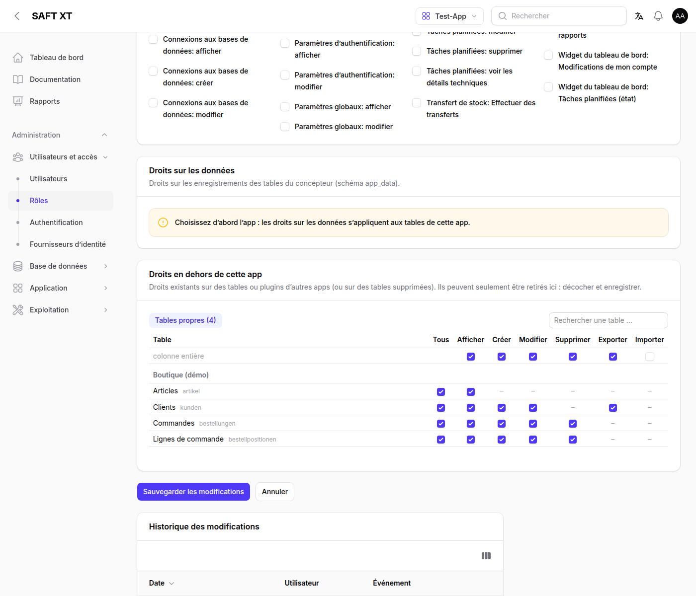
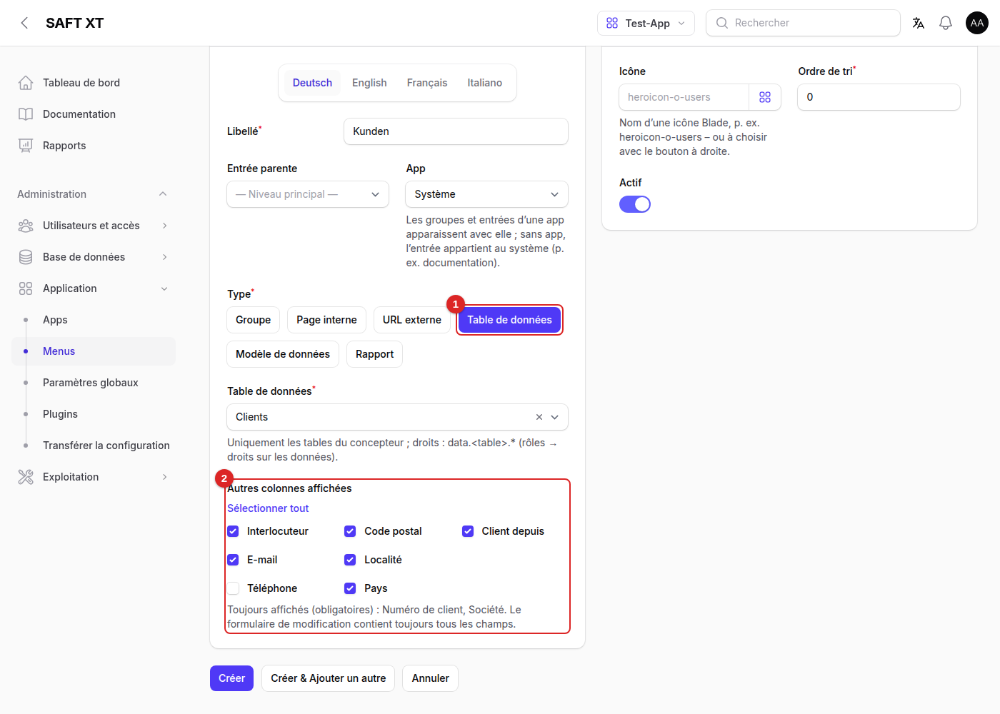
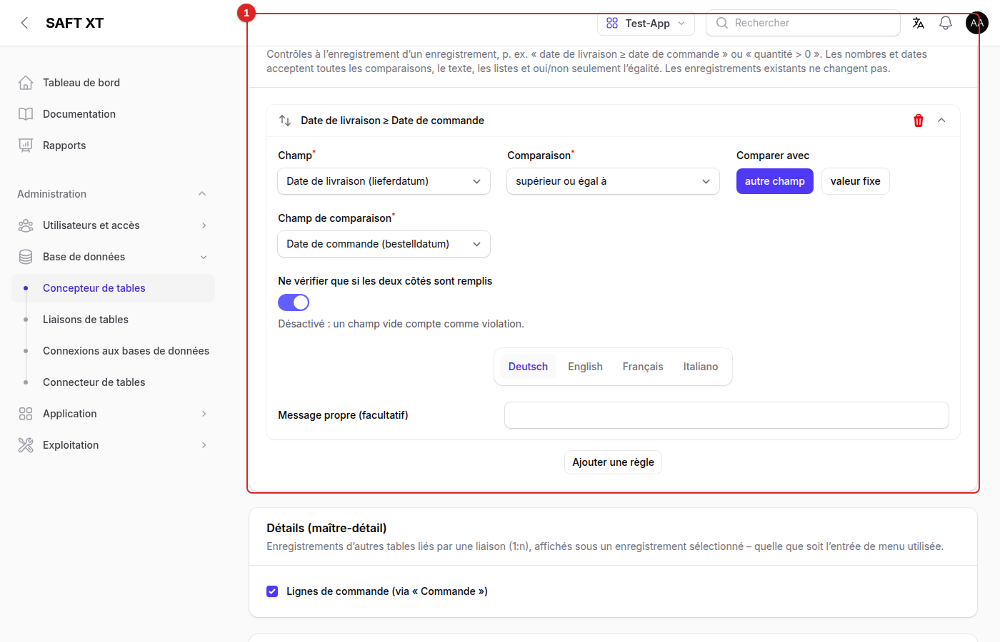
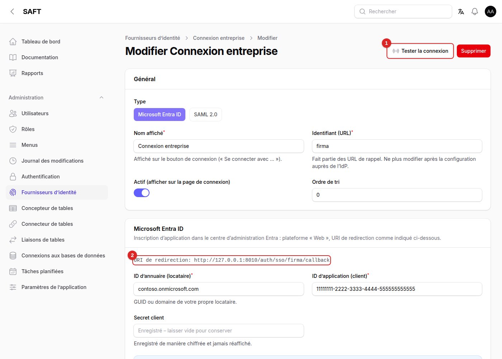
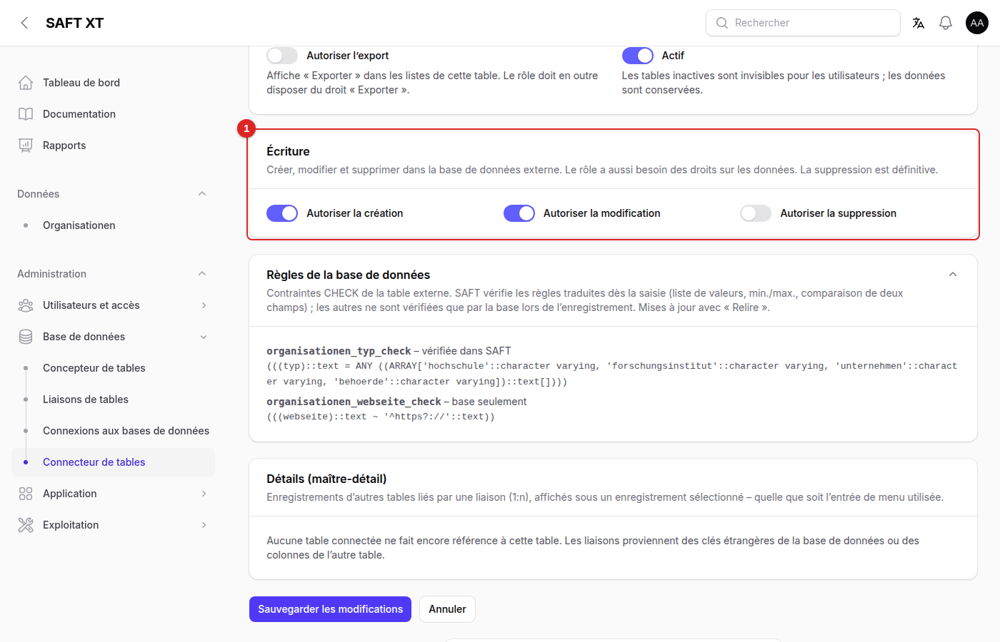

# SAFT XT – Guide d’administration

[Deutsch](ADMIN_GUIDE.de.md) · [English](ADMIN_GUIDE.md) · **Français** · [Italiano](ADMIN_GUIDE.it.md)

**État :** version 0.1 · **Public cible :** administratrices et administrateurs dans SAFT

**Autres guides :** [Guide utilisateur](USER_GUIDE.fr.md) · [Questions fréquentes](FAQ.fr.md) · [Administration système](SYSADMIN_GUIDE.md)

> **À propos des illustrations :** les images sont des captures d’écran de l’application avec les données de
> démonstration. Les chiffres rouges dans les images renvoient aux explications du texte.

---

## Sommaire

- [1. Utilisateurs](#1-utilisateurs)
- [2. Rôles et droits](#2-rôles-et-droits)
- [3. Menus](#3-menus)
- [4. Concepteur de tables](#4-concepteur-de-tables)
- [5. Authentification](#5-authentification)
- [6. Fournisseurs d’identité (authentification unique)](#6-fournisseurs-didentité-authentification-unique)
- [7. Paramètres globaux](#7-paramètres-globaux)
- [8. Journal des modifications](#8-journal-des-modifications)
- [9. Connexions aux bases de données](#9-connexions-aux-bases-de-données)
- [10. Connecteur de tables](#10-connecteur-de-tables)
- [11. Liaisons de tables](#11-liaisons-de-tables)
- [12. Tâches planifiées](#12-tâches-planifiées)
- [13. Fonctions IA](#13-fonctions-ia)
- [14. Plugins](#14-plugins)
- [15. Apps (applications métier)](#15-apps-applications-métier)
- [16. Documents](#16-documents)
- [Annexe A – Aperçu des droits](#annexe-a--aperçu-des-droits)

---

Les fonctions suivantes se trouvent dans le menu sous **Administration**. Elles ne sont visibles qu’avec les droits
correspondants. Ici aussi, les listes et les tableaux ne sont aussi larges que leurs colonnes (voir [Guide utilisateur 4.1](USER_GUIDE.fr.md#41-la-vue-tableau)).

## 1. Utilisateurs

**Administration → Utilisateurs et accès → Utilisateurs**

- **Liste** avec nom, e-mail, rôles, actif, dernière connexion. Filtres : actif, rôle, **sans rôle**,
  **liaison SSO**, utilisateurs supprimés.
- **Créer / modifier :** nom, e-mail, mot de passe (obligatoire à la création, sauf en mode SSO pur), actif, rôles.
  Le **rôle par défaut** (voir [chapitre 5](#5-authentification)) est présélectionné à la création.
- **Règle des mots de passe :** les nouveaux mots de passe comptent au moins 12 caractères. SAFT refuse les mots de
  passe issus de fuites de données connues (vérification sans transmettre le mot de passe). Les mots de passe existants
  restent valables jusqu’à leur modification.
- **Réinitialiser les deux facteurs :** si quelqu’un a perdu son téléphone et ses codes de récupération, cette action
  en haut du formulaire supprime l’application d’authentification configurée. La personne se connecte ensuite avec son
  mot de passe et configure à nouveau le second facteur. Configuration, désactivation et réinitialisation figurent
  dans le journal des modifications.
- **Les utilisateurs inactifs** ne peuvent pas se connecter – ni par mot de passe ni par SSO.
- **Liaisons SSO :** dans la fiche de l’utilisateur, vous voyez à quels comptes d’authentification unique il est lié
  et pouvez supprimer une liaison.
- **Historique des modifications :** chaque modification de l’utilisateur est traçable en bas de la page.
- **Langue :** chaque utilisateur choisit lui-même sa langue via l’icône de langue ; elle est enregistrée dans son
  compte et vaut aussi pour les e-mails qui lui sont adressés, p. ex. pour réinitialiser le mot de passe.
- **Les utilisateurs supprimés** peuvent être affichés via le filtre, restaurés ou supprimés définitivement. Leurs
  entrées dans le journal des modifications sont conservées (voir [chapitre 8](#8-journal-des-modifications)).
- **Inactif, supprimé ou supprimé définitivement ?**

  | | Inactif | Supprimé (corbeille) | Supprimé définitivement |
  |---|---|---|---|
  | Connexion | bloquée | bloquée | – |
  | Dans la liste | visible | uniquement via le filtre « Enregistrements supprimés » | n’existe plus |
  | Annuler | interrupteur « Actif » | « Restaurer » | impossible |
  | Nom dans le journal | oui | oui, marqué « supprimé » | non, seulement le numéro d’utilisateur |
  | Nouvelle connexion SSO | refusée | refusée (« Votre compte utilisateur a été supprimé ») | peut créer un **nouveau** compte |

  « Inactif » convient aux blocages temporaires. Un compte supprimé reste volontairement bloqué : sinon, une
  personne qui existe toujours chez le fournisseur d’identité obtiendrait immédiatement un nouveau compte à la
  prochaine connexion grâce au provisionnement automatique. **Supprimer définitivement** (action de ligne pour les
  comptes supprimés, aussi en action groupée) est prévu pour les suppressions exigées par la protection des données –
  ou lorsqu’une personne doit volontairement recevoir un nouveau compte via SSO.

Règles de protection : personne ne peut se supprimer ni se désactiver soi-même. Les comptes super-admin ne peuvent
être modifiés que par des super-admins, et le rôle `super-admin` n’est même pas proposé aux autres utilisateurs.

## 2. Rôles et droits

**Administration → Utilisateurs et accès → Rôles**



Un rôle regroupe des droits. Les utilisateurs reçoivent leurs droits exclusivement par des rôles.

- **Autorisations** – droits sur les fonctions de l’application, p. ex. « Utilisateurs : modifier »,
  « Concepteur de tables : afficher » ou les **widgets du tableau de bord**.
- **Droits sur les données** – une matrice avec toutes les tables du Concepteur de tables et les colonnes
  **Afficher, Créer, Modifier, Supprimer, Exporter, Importer**. Les nouvelles tables y apparaissent automatiquement.
  **Importer** n’agit qu’avec **Créer** et si l’import est autorisé pour la table.
  **Exporter** n’a d’effet que si l’export est autorisé pour la table (voir [chapitre 4](#4-concepteur-de-tables)) et
  que le rôle peut aussi afficher la table. Les tables externes liées (voir [chapitre 10](#10-connecteur-de-tables))
  ne proposent **Créer, Modifier** et **Supprimer** que si cela est activé pour la table ; sinon, « – » s’affiche.
  La matrice comporte les onglets **Tables propres** (structurées par groupe de menu, nom technique discrètement à
  côté) et **Tables liées** (par connexion à une base de données). **Tous** sur une ligne attribue tous les droits de
  la table, la case au-dessus d’une colonne (« colonne entière ») attribue le droit pour toutes les tables visibles.
  Le **champ de recherche** filtre les lignes par libellé ou nom technique.

- **Entrées de menu** – toutes les entrées de menu de l’app ayant leur propre cible, p. ex. « Données › Clients », un
  modèle de données ou un rapport, aussi au niveau supérieur. Sans
  coche, le rôle ne voit pas l’entrée dans le menu. Les nouvelles entrées et les nouveaux rôles sont cochés, donc
  visibles. Il ne s’agit que d’affichage : les droits sur les données déterminent si la table peut être affichée. Une
  entrée masquée reste accessible via des liens, la vue maître-détail et l’aperçu. Avec plusieurs rôles, il suffit, pour les tables de données, d’un rôle disposant du droit de lecture qui affiche l’entrée, pour les autres
  entrées d’un rôle de l’app ; `super-admin` voit toujours toutes les entrées.

Les domaines sont enregistrés indépendamment – une modification dans l’un ne change rien dans l’autre.

Les droits modifiés s’appliquent immédiatement, y compris aux utilisateurs déjà connectés. Qui a perdu un droit
reçoit « Accès refusé » au prochain clic ; le menu est à jour après le rechargement de la page.

**Rôles particuliers :**

| Rôle | Signification |
|---|---|
| `super-admin` | A **tous** les droits, y compris pour les fonctions futures. Ne peut être ni supprimé ni renommé et n’est jamais attribué automatiquement via SSO. |
| `benutzer` | Rôle par défaut des nouveaux utilisateurs, sans droits d’administration ; voit le tableau de bord avec les widgets personnels. Tant qu’il est défini comme rôle par défaut, il ne peut pas être supprimé. |

**Afficher en tant que rôle (vérifier les droits) :** les super-admins choisissent dans le menu utilisateur en haut à
droite **« Afficher en tant que rôle … »** et un ou plusieurs rôles – tels qu’une personne les possède (le rôle par
défaut est présélectionné, en général un rôle métier s’y ajoute). Ils voient alors SAFT exclusivement avec ces
droits – menu, pages, droits sur les données, rapports et widgets –, comme une autre personne ayant exactement ces
rôles : leurs propres rapports ne comptent alors pas comme les leurs. Une bande jaune en haut indique le rôle ;
**Terminer** dans la bande rétablit vos propres droits (la déconnexion met aussi fin à la vue). La base de données
reste inchangée, le début et la fin figurent dans le journal des modifications. Attention : ce que le rôle peut faire
est réellement enregistré pendant la vue – avec vous comme auteur.

**App et copie** (B-107) : chaque rôle appartient à une [app](#15-apps-applications-métier) ; le formulaire n’affiche
les droits sur les données, les entrées de menu et les droits des plugins que pour cette app (les droits généraux de
SAFT toujours). Sans app choisie, une indication invite à choisir d’abord l’app à la place des droits sur les données.
Si le rôle a encore des droits **en dehors** de son app – sur des tables ou plugins d’autres apps, p. ex. après un
changement d’app ou d’avant les apps, ou sur des tables supprimées –, ils figurent en bas dans la section **« Droits en
dehors de cette app »** : les tables sous forme de matrice regroupée par app, uniquement avec les droits existants
(cochés), les droits de plugins et les tables supprimées sous forme de liste. On peut seulement les y retirer (décocher,
enregistrer), pas en ajouter. Si vous changez l’app d’un rôle, tous les droits sont conservés jusqu’à ce que vous les y
décochiez. Les droits de lecture sur les **tables partagées d’autres apps**
(interfaces, [chapitre 15](#15-apps-applications-métier)) s’attribuent dans la section « Tables partagées d’autres apps » –
seulement *Afficher*, pour ouvrir la table étrangère ; tous voient les champs partagés dans les liaisons même sans ce
droit. Les rôles système *super-admin* et
*benutzer* n’appartiennent à aucune app et ne contiennent que des droits communs (p. ex. tableau de bord, aide) ;
attribuez les droits sur les données via les rôles des apps. **Copier** (dans la liste et en modification) crée un
nouveau rôle avec un nom et une app cible – avec les mêmes droits (droits sur les données seulement pour les tables de
l’app cible) et les entrées de menu masquées, sans membres.

## 3. Menus

**Administration → Application → Menus**

Le menu de gauche est géré ici. Chaque entrée a un **type** :

| Type | Utilisation |
|---|---|
| **Groupe** | titre pour des entrées subordonnées (p. ex. « Données ») |
| **Page interne** | une page de l’application (p. ex. tableau de bord, utilisateurs) |
| **URL externe** | un lien vers l’extérieur ; s’ouvre dans un nouvel onglet |
| **Table de données** | une table du Concepteur de tables avec son propre choix de colonnes |
| **Modèle de données** | vue graphique des tables de données de ce groupe et de leurs liaisons (voir ci-dessous) |
| **Rapport** | un rapport partagé (voir [Guide utilisateur 4.9](USER_GUIDE.fr.md#49-rapports)) ; n’apparaît que pour les personnes qui peuvent l’exécuter avec leurs droits sur les données |



**Entrée de menu de type « Table de données »** (1) :

- Choisissez la **table de données** – seules les tables actives du Concepteur de tables sont proposées.
- Choisissez les **autres colonnes affichées** (2). Les **champs obligatoires** sont toujours affichés et ne sont
  donc pas proposés.
- Le droit de lecture nécessaire est défini automatiquement : l’entrée n’est visible que pour les utilisateurs qui
  peuvent afficher la table.
- Pour la même table, **plusieurs entrées** avec des colonnes différentes peuvent être créées.
- Si vous changez de type plus tard, le droit de lecture défini automatiquement est supprimé.
- Pour certains rôles, l’entrée peut être masquée sans retirer le droit de lecture (Rôles → Entrées de menu, voir
  [chapitre 2](#2-rôles-et-droits)).

**Entrée de menu de type « Modèle de données » :** la page montre les tables de données du groupe dans lequel se
trouve l’entrée – y compris tous les sous-groupes – sous forme de diagramme avec leurs liaisons. Si l’entrée se trouve au niveau supérieur, toutes les tables de données de son app apparaissent (sans app : toutes). La page est générique : le même type peut être placé
dans plusieurs groupes, et si une entrée est déplacée, elle montre automatiquement le nouveau groupe. Règles :

- Sont affichées les tables qui ont une entrée de menu de type « Table de données » dans le groupe, et seulement
  celles que l’utilisateur peut voir (droit de lecture, non masquées pour ses rôles, actives). Les tables sans entrée
  de menu manquent.
- Si un utilisateur ne voit **aucune table** dans le groupe, l’entrée « Modèle de données » n’apparaît pas dans son
  menu. Si le groupe devient vide de ce fait, il est également masqué.
- Les tables liées **hors du groupe** apparaissent comme nœuds périphériques avec un cadre en pointillés,
  uniquement avec leur nom. Les liaisons vers des tables sans droit de lecture disparaissent entièrement.
- **Lignes :** continues si la liaison est configurée comme table de détail dans le Concepteur de tables, sinon en
  pointillés. Les extrémités montrent la cardinalité : plusieurs enregistrements renvoient à exactement un (champ
  obligatoire) ou à aucun ou un enregistrement principal.
- **« Afficher les champs »** bascule sans rechargement entre la vue d’ensemble avec les noms de tables et la vue avec
  tous les champs actifs (type, nom technique, PK/FK/UK, libellé, `*` = champ obligatoire). Le navigateur retient le
  choix.
- Les tables liées du Connecteur de tables ont un cadre orange et indiquent leur connexion.
- Comme toute entrée, celle-ci peut être restreinte par un **droit**. Le diagramme s’adapte au thème de couleurs
  (clair/sombre) ; les diagrammes larges peuvent être déplacés latéralement.

**Libellé par langue :** le libellé a un onglet par langue : **Deutsch** (obligatoire), **English**, **Français** et
**Italiano**. Si un champ reste vide, le libellé allemand s’affiche dans cette langue ; un texte gris dans le champ vide
le rappelle (« Laisser vide pour utiliser Deutsch. »). Les entrées
fournies sont déjà nommées dans les quatre langues. Les entrées que le Concepteur de tables crée pour une table
reprennent son nom affiché dans toutes les langues et le suivent à chaque modification.

**Icônes :** le bouton à droite du champ **Icône** ouvre une boîte de dialogue avec toutes les icônes disponibles,
réparties par style dans les onglets **Contour**, **Plein**, **Mini** et **Micro**. Le champ de recherche filtre
immédiatement (p. ex. « user »), le nombre sur l’onglet indique les résultats par style ; un clic reprend le nom dans
le champ. L’icône actuelle est mise en évidence et apparaît à gauche du champ en aperçu. Vous pouvez aussi saisir le
nom à la main, p. ex. `heroicon-o-users` ; le formulaire n’accepte que des icônes connues. La même boîte de dialogue
existe pour l’icône de table dans le Concepteur de tables. Une entrée avec des sous-entrées sans icône valide reçoit
un symbole de dossier.

**Autres règles :** un menu a au plus trois niveaux : groupe (titre), entrée et sous-entrée. Une entrée avec des
sous-entrées est un **sous-menu** et apparaît avec une flèche **›** ; un clic ouvre sa première page et le déplie.
Ainsi sont structurées l’administration (*Utilisateurs et accès*, *Base de données*, *Application*, *Exploitation*) et
la démo entrepôt (*Gestion de l’entrepôt*, *Données de base*, *Rapports*) ; les entrées se trient par glisser-déposer. La suppression d’une
entrée supprime aussi ses sous-entrées.

> Les **détails** (maître-détail) ne se configurent pas dans le menu, mais dans le Concepteur de tables.

**App :** les entrées et groupes de premier niveau appartiennent à une [app](#15-apps-applications-métier) ou –
sans app – au système ; les entrées d’un groupe reprennent son app. Pour les entrées de données, le formulaire ne
propose que les tables de cette app.

## 4. Concepteur de tables

**Administration → Base de données → Concepteur de tables**

Vous créez ici vos propres tables – sans programmation.


**Multilingue :** le nom affiché et la description d’une table, le libellé de chaque champ et l’affichage des valeurs
de sélection ont un onglet par langue (Deutsch, English, Français, Italiano) ; nom affiché et description figurent
l’un sous l’autre sous les mêmes onglets. Il en va de même pour tous les autres textes traduisibles de
l’administration (entrées de menu, apps, liaisons de tables, messages de règles, Connecteur de tables). L’allemand est
obligatoire pour le nom affiché et le libellé, les autres langues sont facultatives ; sans elles, le texte allemand
s’affiche – le texte gris dans le champ vide le rappelle. Le nom technique et les valeurs de sélection enregistrées
valent pour toutes les langues.

**Créer une table :**

1. **Nouvelle table** → saisir le nom affiché. Le nom technique est proposé (p. ex. « Größe in m² » →
   `groesse_in_m2`) et **ne peut plus être modifié ensuite**. Les noms techniques sont uniques pour toutes les
   tables – propres, importées et liées. Si le nom est déjà pris, SAFT le signale dès la sortie du champ et nomme la
   table, p. ex. « Le nom « personen » est déjà utilisé : table liée « Personen » (connexion Forschung). » Si une
   autre table porte le même **libellé**, seul un avertissement apparaît – c’est permis, mais difficile à distinguer
   dans les menus et les listes. Il en va de même pour l’import et le Connecteur de tables.
2. Facultatif : créer des **champs initiaux** et choisir sous **« Entrée de menu sous »** le groupe du menu.
   « Données » est présélectionné ; tous les groupes sont proposés, les sous-groupes en retrait avec leur chemin
   (p. ex. « Données › Recherche »). « Pas d’entrée de menu » n’en crée aucune.
3. Sauvegarder – la table est immédiatement utilisable. Les **droits sur les données**
   (afficher/créer/modifier/supprimer) sont créés automatiquement dans la gestion des rôles.

**Autoriser l’export :** cet interrupteur dans les données de base de la table autorise l’export (voir
[Guide utilisateur 4.7](USER_GUIDE.fr.md#47-exporter-des-données)). Il est d’abord désactivé. Même les super-admins ne
voient « Exporter » que lorsqu’il est activé ; toutes les autres personnes ont besoin en plus du droit **Exporter**
dans leur rôle.

**Autoriser l’import :** cet interrupteur autorise l’import de données – de nouveaux enregistrements à partir d’un
fichier Excel ou CSV, p. ex. d’un modèle téléchargé (voir [Guide utilisateur 4.8](USER_GUIDE.fr.md#48-importer-des-données)).
Il est d’abord désactivé. « Importer » apparaît alors dans la liste pour les rôles ayant les droits **Créer** et
**Importer**. L’import ne modifie jamais les enregistrements existants ; il contrôle comme lors d’une saisie manuelle,
et c’est tout ou rien. Au plus 10 000 lignes par fichier (`APP_DATA_IMPORT_MAX_RECORD_ROWS`). Les tables liées du
Connecteur de tables ne peuvent pas être importées.

**Modifier les champs** (zone *Champs*, (2)) : pour chaque champ, vous définissez :

| Réglage | Signification |
|---|---|
| Libellé / nom de colonne | affichage ou nom technique. **Renommer conserve les données.** |
| Type | voir [Guide utilisateur, annexe A](USER_GUIDE.fr.md#annexe-a--types-de-champs) |
| Réglages du type | longueur (texte), chiffres (nombre décimal), valeurs (liste de sélection), table cible, champs affichés et séparateur (liaison), types de fichiers, taille maximale et nombre (fichier, voir ci-dessous) |
| Validation | longueur min./max., minimum/maximum, e-mail, URL ; **Contrôles supplémentaires** issus de plugins, p. ex. numéro AVS ou IBAN (affiché seulement si un plugin propose des règles pour le type de champ ; ils s’appliquent à la saisie, à l’importation et via l’interface, les valeurs vides ne sont pas contrôlées). Si le plugin manque ensuite ou est en veille, le contrôle est ignoré et indiqué « non disponible » sur le champ |
| Valeur proposée à la création (nombre entier) | **Proposer le numéro suivant (valeur maximale + 1) :** dans la boîte « Nouvel enregistrement » figure la plus grande valeur existante + 1, qui reste modifiable ; si le champ reste vide, SAFT définit la valeur à l’enregistrement. Avec **Compter par** (une liaison, p. ex. *Commande*), le comptage se fait par enregistrement maître : sous une commande avec deux lignes, 3 est proposé ; dans la liste, la proposition apparaît dès que la commande est choisie. Les enregistrements supprimés ne comptent pas. |
| Valeur proposée à la création (date, date et heure) | **Préremplir avec la date du jour** ou **Préremplir avec la date et l’heure actuelles :** dans la boîte de dialogue « Nouvel enregistrement », le champ affiche à l’ouverture la date (ou la date et l’heure à la minute) actuelle et reste modifiable. Lors de la modification, de l’import et via l’interface, SAFT ne remplit rien. Pas en même temps que « Reprendre de ». |
| Reprendre de | reprendre une valeur de l’enregistrement maître, p. ex. *Prix unitaire* depuis **Article → Prix** : dès qu’un article est choisi dans le formulaire (ou immédiatement sous un article comme table de détail), son prix figure dans le champ et reste modifiable. Si l’article change, la valeur suit tant qu’elle n’a pas été modifiée à la main ; SAFT remplit les champs enregistrés vides. Il s’agit d’une copie : les modifications ultérieures de l’article ne changent pas les lignes existantes. Seuls les champs compatibles sont proposés (nombre ← nombre, date ← date, texte ← texte/sélection, oui/non ← oui/non). Un champ source ne peut pas être supprimé tant qu’un champ en reprend la valeur ; un renommage est suivi. |
| Champ obligatoire | doit être rempli ; toujours affiché dans les listes |
| Unique | ne peut apparaître qu’une fois (les enregistrements supprimés ne comptent pas) |
| Consultable par la recherche | pris en compte par la recherche |
| Créer un index | accélère le tri et le filtrage des grandes tables |
| Afficher dans la table / dans le formulaire | présélection pour les listes et les formulaires |

**Champs affichés d’une liaison :** au lieu du numéro enregistré, une liaison affiche des champs de l’enregistrement
lié – un ou plusieurs, dans l’ordre choisi et reliés par un **séparateur** (espace, virgule, tiret, point ou barre
oblique), p. ex. prénom et nom en « Anna Keller » ou nom et lieu en « ETH Zürich, Zürich ». Les champs vides sont
ignorés. Cela vaut dans les listes, les détails, l’aperçu, les filtres, l’export et dans la liste de sélection lors
de la modification ; la saisie y cherche dans tous les champs affichés. Le tri se fait selon le premier champ
affiché. Si vous renommez un champ affiché, la liaison suit ; tant qu’un champ sert quelque part de champ affiché, il
ne peut pas être supprimé définitivement.

**Copier les enregistrements enfants :** avec l’interrupteur **« Copier aussi lors de la copie de l’enregistrement
parent »** d’un champ de liaison, vous définissez quels enregistrements appartiennent au parent, p. ex. pour
`lignes_commande.commande_id` : qui copie une commande peut copier ses lignes avec – dans le dialogue de copie sous forme
de case « Copier avec » cochée d’avance, décochable. Si les lignes ont elles-mêmes de tels enfants, ils sont copiés
aussi. La liaison pointe ensuite vers la copie, les autres liaisons restent ; les fichiers sont copiés, les champs
uniques vidés, les champs calculés recalculés. Les liaisons vers la même table (hiérarchie) et vers des tables d’autres
apps n’ont pas cet interrupteur. Si un champ d’une table copiée avec est unique et obligatoire, la copie s’arrête avec un
message ; plus de 1000 enregistrements par copie ne sont pas possibles (`APP_DATA_COPY_MAX_RECORDS`).

**Champs de fichiers :** un champ de type **Fichier** accepte des pièces jointes. Réglages :

- **Fichiers autorisés :** images (JPEG, PNG, GIF, WebP), PDF, documents Office (Word, Excel, PowerPoint,
  OpenDocument), texte et CSV, ou **Fichiers quelconques**. C’est le contenu réel qui est contrôlé, pas seulement l’extension.
  Cocher un type précis retire « Fichiers quelconques » et inversement. Les images SVG ne sont pas prévues (elles peuvent
  contenir des scripts).
- **Taille maximale par fichier** en Mo (10 par défaut, 200 au plus). Si la limite du serveur (PHP) est plus basse,
  le champ l’indique ; la plus petite valeur s’applique.
- **Nombre de fichiers** (1 par défaut, 50 au plus).

Les fichiers ne sont pas stockés dans la base de données, mais dans l’espace de fichiers du serveur (ou dans S3, voir
[Administration système](SYSADMIN_GUIDE.md#1-operations), en anglais) ; l’enregistrement ne contient que leur
identifiant et leur nom. Les fichiers remplacés ou retirés sont supprimés à l’enregistrement, de même lors de la
suppression définitive d’un enregistrement, du champ ou de la table. Les enregistrements supprimés dans la corbeille
gardent leurs fichiers (visibles seulement avec le droit de suppression). Les champs de fichiers ne sont ni uniques ni
triables et n’ont pas d’index ; ils ne sont disponibles ni dans l’import de données, ni dans les rapports, ni comme
source de « Reprendre de ». L’export contient les noms de fichiers ; l’historique montre quels fichiers ont été
ajoutés ou retirés.

**Règles** (illustration ci-dessous, 1) : contrôles portant sur plusieurs champs lors de l’enregistrement d’un
enregistrement, p. ex. « date de livraison ≥ date de commande » ou « quantité > 0 ». Pour chaque règle, choisissez le
**champ**, la **comparaison** et si la comparaison se fait avec un **autre champ** ou une **valeur fixe** :



- Les nombres et les dates permettent toutes les comparaisons (=, ≠, <, ≤, >, ≥) – un nombre uniquement avec un
  nombre, une date uniquement avec une date. Le texte, les listes de sélection et oui/non ne peuvent être contrôlés
  que sur l’égalité (= et ≠). Les liaisons et le texte long ne sont pas possibles.
- **Ne vérifier que si les deux côtés sont remplis** (par défaut) : un champ vide n’est pas contrôlé. Désactivé, un
  champ vide compte comme une violation.
- **Message propre** (facultatif, par langue). Sinon, le texte standard apparaît au champ, p. ex. « ne doit pas
  être antérieur à « date de commande » ».
- La règle vaut dans tous les formulaires de la table (liste, tables de détail, Détails → Modifier). Les
  enregistrements existants restent inchangés ; si certains violent déjà une nouvelle règle, un avertissement indique
  combien – ils sont contrôlés à la prochaine modification.
- Si un champ est renommé, ses règles suivent. Un champ utilisé par une règle ne peut pas être supprimé, et son type
  ne peut être changé que vers un type qui reste compatible avec la règle.

**App et préfixe :** lors de la création, vous choisissez l’[app](#15-apps-applications-métier) de la table
(obligatoire s’il y a plusieurs apps). Si l’app a un préfixe, il précède le nom technique proposé ; changer d’app le
remplace. Les liaisons sont possibles avec des tables de la même app et avec des tables partagées d’autres apps
([interfaces](#15-apps-applications-métier)).

### Champs calculés

Un champ de type **Calculé** n’est pas saisi, mais calculé à l’enregistrement à partir d’autres champs du même
enregistrement ou des enregistrements enfants associés, p. ex. *Montant* à partir de la quantité et du prix unitaire
ou *Prix total* comme somme des montants de toutes les lignes d’une commande. La valeur est enregistrée et peut donc
être triée, filtrée, exportée et utilisée dans des règles.

- **Résultat :** nombre entier ou décimal (avec chiffres et décimales) ; le résultat est arrondi en conséquence.
- **Formule :** champs numériques de la table (par nom de colonne), nombres, `+ - * /` et parenthèses ainsi que les
  fonctions `round(x, décimales)`, `min(a, b, …)`, `max(a, b, …)`, `abs(x)` et `coalesce(a, remplacement)`.
  Exemple : `round(menge * einzelpreis, 2)`. Les noms de fonctions sont identiques dans toutes les langues. Des plugins
  peuvent apporter d’autres fonctions, p. ex. `rappen(montant)` (arrondi à 5 centimes) ; elles figurent dans l’aide à
  la saisie sous **Fonctions issues de plugins**, la description s’affiche au survol du bouton. Elles ne sont pas
  disponibles dans les expressions des analyses. Si le plugin manque ensuite, le résultat reste vide.
- **Sur les enregistrements enfants** (tables qui pointent vers cette table par une liaison) : `sum(table.champ)`,
  `avg(table.champ)`, `min(table.champ)`, `max(table.champ)` et `count(table)`, p. ex. prix total =
  `sum(bestellpositionen.betrag)`, TVA = `round(gesamtpreis * 0.081, 2)`. Les enregistrements enfants supprimés ne
  comptent pas ; sans enregistrements enfants, la somme et le nombre valent 0. Si une table enfant pointe vers cette
  table par plusieurs liaisons, la liaison voulue est indiquée en deuxième valeur :
  `sum(bestellpositionen.betrag, bestellung_id)`.
- **Expression par enregistrement enfant :** au lieu d’un champ, `sum`, `avg`, `min` et `max` acceptent aussi un
  calcul avec des champs de la table enfant ; il est calculé pour chaque enregistrement enfant puis résumé, p. ex.
  `sum(bestellpositionen.einzelpreis * bestellpositionen.menge)` ou
  `sum(round(bestellpositionen.menge * bestellpositionen.einzelpreis * 0.95, 2))`. L’expression ne contient que des
  champs de cette seule table enfant (pas de champs de l’enregistrement maître, pas de résumés imbriqués). Si le
  résultat est vide pour un enregistrement enfant, il ne compte pas – `coalesce(…, 0)` permet de le gérer.
- **Conditions :** `if(condition, alors, sinon)` calcule l’une ou l’autre valeur selon la condition ; sans `sinon`, le
  résultat est vide si la condition n’est pas remplie. Les conditions comparent avec `=`, `<>`, `<`, `<=`, `>`, `>=` et
  se combinent avec `and` et `or`. Dans les comparaisons, les champs texte, liste de choix, date et oui/non sont aussi
  admis ; le texte s’écrit entre apostrophes (une apostrophe dans le texte est doublée). Les listes de choix comparent
  la valeur enregistrée, pas le libellé traduit ; une date s’écrit `'2026-12-31'`. Les champs oui/non valent 1 ou 0 et servent donc aussi directement de condition : `if(paye, montant, 0)`. Exemples : montant signé =
  `if(type = 'Dépense', -montant, montant)`, frais de douane d’un justificatif =
  `sum(if(lignes.genre = 'Douane', lignes.montant, 0))`, nombre de lignes au-delà de 10 pièces =
  `sum(lignes.quantite > 10)` (une comparaison donne 1 ou 0). Si un côté d’une comparaison est vide, elle n’est pas
  remplie – même avec `<>`. **Comparer du texte de façon approximative :** `contains(champ, 'partie')`,
  `startswith(champ, 'début')` et `endswith(champ, 'fin')` vérifient, sans tenir compte de la casse, si le texte contient
  la partie ou commence ou finit par elle, et donnent aussi 1 ou 0, p. ex. `sum(contains(lignes.designation, 'guitare'))`.
  Les valeurs d’une fonction peuvent aussi être séparées par `;` ; SAFT les écrit avec une
  virgule. Les expressions des rapports ne connaissent pas (encore) `if()`.
- **Aide à la saisie :** sous le champ de formule, les champs de la table apparaissent sous forme de
  boutons, p. ex. « Menge (menge) » ; un clic insère le nom technique au curseur. Les champs numériques servent au calcul, les champs
  texte, liste de choix, date et oui/non aux comparaisons ; l’infobulle indique le type de données et, pour les listes de
  choix, les valeurs enregistrées. Chaque table enfant a sa propre ligne avec `count(table)` et ses champs
  (`table.champ`), plus des boutons pour les opérateurs, les
  fonctions et `sum`, `avg`, `count` ; chacun de ces boutons explique dans l’infobulle la syntaxe avec un exemple,
  le texte d’aide s’ouvre avec « Aide sur les formules » ; les fonctions
  des plugins se trouvent tout en bas. Résultat, chiffres et
  décimales figurent en haut sur une ligne. Lors de la création d’une nouvelle table, seuls les champs placés plus haut dans
  le formulaire apparaissent.
- **Contrôle :** dès la saisie, SAFT signale les erreurs avec leur position (p. ex. « Caractère 9 : champ inconnu
  « preis » ») ou confirme de quoi dépend le résultat. Les références circulaires sont refusées ; le message indique
  les formules des champs concernés, p. ex. « Référence circulaire : mwst → einkaufspreis → mwst. Les formules : mwst
  = … ; einkaufspreis = … ».
- **Valeurs vides :** si un champ utilisé est vide, le résultat est vide – sauf avec `coalesce(champ, 0)`. Une
  division par 0 donne également un résultat vide. Le calcul est exact (pas d’erreurs d’arrondi sur les montants).
- **Quand le calcul a lieu :** à l’ajout d’un champ calculé, pour tous les enregistrements existants ; à la création
  (aussi par import) et à la modification d’un enregistrement (les nouvelles valeurs figurent
  dans le journal des modifications) ; à la création, la modification, la suppression ou la restauration d’un
  enregistrement enfant pour son enregistrement maître – lors d’un changement de commande pour l’ancienne et la
  nouvelle – et ainsi de suite vers le haut (p. ex. chiffre d’affaires d’un client comme somme de ses commandes) ;
  après la modification d’une formule pour tous les enregistrements de la table et des tables supérieures ; et avec
  `php artisan computed:recompute` si des données ont été modifiées en dehors de SAFT.
- Dans le formulaire, un champ calculé est seulement affiché (« calculé à l’enregistrement »). Les règles qui
  contrôlent un champ calculé ne s’appliquent donc qu’à la modification suivante.
- Si un champ utilisé est renommé (y compris dans une table enfant), la formule suit ; la suppression et le passage à
  un type non numérique sont bloqués tant qu’une formule utilise le champ. Une table enfant sur laquelle une somme est
  calculée ne peut pas être supprimée.
- Les données de démonstration contiennent *Betrag* (lignes de commande) ainsi que *Gesamtpreis* et *MWST 8,1 %*
  (commandes).

**Détails (maître-détail)** (1) : vous choisissez ici quelles tables liées apparaissent sous un enregistrement
sélectionné (voir [Guide utilisateur 4.3](USER_GUIDE.fr.md#43-tables-liées--la-vue-maître-détail)). Sont proposés tous les
champs de liaison d’autres tables qui pointent vers cette table. S’il existe plusieurs liaisons provenant de la même
table (p. ex. « Client » et « Facturer à »), elles peuvent être choisies séparément.

**Autres boutons :** *Ouvrir les données* (vers la vue des données) et *Créer une entrée de menu*. Celui-ci demande
le groupe et crée aussi une entrée supplémentaire si la table doit apparaître à un deuxième endroit du menu.

**Ce qui est possible – et ce qui ne l’est pas :**

| Modification | Règle |
|---|---|
| Renommer un champ | à tout moment, les données sont conservées |
| Changer le type | sans perte à tout moment (p. ex. nombre entier → nombre décimal, texte → texte sur plusieurs lignes, date → date et heure) ; texte sur plusieurs lignes → sur une ligne si toutes les valeurs tiennent dans la longueur ; sinon uniquement si la colonne est vide |
| Longueur du texte | augmenter à tout moment, réduire uniquement si toutes les valeurs existantes tiennent dans la nouvelle longueur (sinon le message indique combien sont trop longues) |
| Activer « Unique » | uniquement si les données existantes ne contiennent pas de doublons |
| Retirer une valeur d’une liste de sélection | à tout moment ; si la valeur est utilisée, un avertissement indique le nombre d’enregistrements. Ils conservent leur valeur, mais une valeur valide doit être choisie à la prochaine modification. |
| Supprimer un champ | d’abord **désactiver**, puis « Supprimer définitivement » en saisissant le nom de la colonne |
| Supprimer une table | d’abord **désactiver**, puis « Supprimer définitivement » en saisissant le nom de la table ; impossible tant que d’autres tables y font référence |
| Liaison | uniquement vers d’autres tables du Concepteur de tables, jamais vers des tables système |

> **Désactiver plutôt que supprimer :** un champ ou une table désactivé est invisible pour les utilisateurs, mais les
> données sont entièrement conservées. Vous récupérez un champ avec « Activer », sans confirmation. La suppression définitive ne peut pas être annulée.
>
> **Liste des champs :** les actions sont des icônes avec infobulle sur la ligne – modifier, **historique** (horloge :
> qui a modifié quoi et quand sur le champ), afficher/masquer et supprimer. L’œil montre l’état : ouvert pour un champ
> actif, barré pour un champ désactivé. Si un plugin a besoin du champ ou qu’une autre app l’utilise via l’interface,
> l’icône est verrouillée (pâle) ; l’infobulle en donne la raison. Comme ici, toutes les listes de l’administration
> affichent leurs actions de ligne sous forme d’icônes avec infobulle ; **Afficher** est la loupe.

Sous **Table physique**, vous voyez l’emplacement de stockage, le nombre d’enregistrements et d’éventuels écarts
entre les réglages et la base de données.

### Utilisée dans

L’onglet **Utilisée dans** (à côté de *Champs* et du *Journal des modifications*) montre où la table apparaît ; le
nombre sur l’onglet indique combien de fois. Il sert uniquement d’information, p. ex. avant de renommer ou de
supprimer :

| Domaine | Ce qui apparaît |
|---|---|
| Plugin | plugins qui ont besoin de la table, contrôlent ses modifications ou affichent des boutons dans sa vue des données |
| Analyse | analyses avec la table comme table de base ou via une liaison |
| Lien (analyse) | liens entre analyses avec la table comme source ou cible |
| Menu | entrées de menu qui ouvrent la vue des données (avec le chemin dans le menu) |
| Liaison | champs d’autres tables qui font référence à cette table |
| Formule | champs calculés d’autres tables qui agrègent sur cette table, p. ex. `sum(bestellungen.betrag)` |
| Reprise | champs d’autres tables qui reprennent une valeur de cette table |
| Rôle | rôles ayant des droits sur les données de la table, avec ces droits |
| Tâche planifiée | tâches « Actualiser l’état des données » pour la table |

Le nom est un lien si vous pouvez ouvrir la page correspondante ; le filtre **Domaine** restreint la liste.

### Supprimer définitivement une table ou un champ

La suppression définitive retire la colonne ou la table **avec ses données** de la base de données. Pour que cela
n’arrive pas par erreur, elle se fait en deux étapes ; le bouton **« Supprimer définitivement »** est visible
jusque-là, mais bloqué (l’explication apparaît au survol) :

| | Table | Champ |
|---|---|---|
| 1. Désactiver | modifier la table, interrupteur **« Actif »** désactivé, **Sauvegarder** | dans la liste des champs **« Désactiver »** |
| 2. Supprimer | en haut **« Supprimer définitivement »** | sur la ligne, l’**icône de corbeille** (« Supprimer définitivement ») |
| 3. Confirmer | saisir le nom technique de la table | saisir le nom de la colonne |

Lors de la suppression d’une table, SAFT supprime aussi ses droits sur les données et ses entrées de menu ; le
journal des modifications est conservé. Le droit **Concepteur de tables : supprimer** est nécessaire. Si une autre
table fait référence à la table par un champ de liaison, le message nomme ce champ – il doit d’abord être retiré. Si
la table est utilisée ailleurs (analyses, menus, rôles …), la boîte de dialogue affiche un avertissement avec le nombre
par domaine ; la suppression reste possible, les détails figurent dans l’onglet **Utilisée dans**.
Si la table ou le champ contient des fichiers (type *Fichier*), la boîte de dialogue indique leur nombre et leur
taille ; ils sont également supprimés, y compris ceux des enregistrements dans la corbeille.

### Importer une table depuis un fichier

**Concepteur de tables → Importer** crée une nouvelle table à partir d’un fichier CSV ou Excel et reprend les
données. Le droit **Concepteur de tables : importer** est nécessaire. L’assistant comporte quatre étapes :

1. **Fichier :** CSV (`.csv`, `.txt`, `.tsv`) ou Excel (`.xlsx`), au plus 20 Mo ou 50 000 lignes de données. Pour
   les fichiers Excel à plusieurs feuilles, choisissez la feuille. SAFT contrôle le fichier ; s’il contient des
   erreurs, l’assistant s’arrête ici et affiche **tous** les problèmes trouvés avec ligne et colonne.
2. **Contrôle :** résumé (lignes, colonnes, pour le CSV séparateur et jeu de caractères) et remarques, p. ex. sur une
   ligne de total supposée.
3. **Colonnes :** pour chaque colonne « Reprendre », nom du champ, libellé et type. Seuls les types compatibles avec
   les données sont proposés (le texte est toujours possible).
4. **Table et menu :** libellé, nom technique de la table et groupe de menu pour l’entrée de la table.

**Une liste importable** a les titres de colonnes en ligne 1 et en dessous uniquement des lignes de données :

| Permis | Entraîne l’abandon |
|---|---|
| titres avec espaces et caractères spéciaux (« N° client », « Rue ») | colonne sans titre, titres en double |
| cellules vides | titre ou ligne vide au-dessus de la liste, lignes vides au milieu de la liste |
| lignes vides à la fin | valeurs dans des colonnes sans titre, lignes CSV avec un nombre de colonnes différent |
| formules (le résultat enregistré compte) | cellules fusionnées, cellules d’erreur comme `#DIV/0!` |

**Les noms de champs** sont dérivés des titres : « Straße & Nr. » → `strasse_nr`, « 2024 » → `f_2024`. Le titre
lui-même devient le libellé. Les noms système et les mots réservés (« ID », « Order ») reçoivent la terminaison
`_import`. Si deux titres donnent le même nom (« Kunden Nr » et « Kunden-Nr. »), le contrôle nomme les deux colonnes.

**Les types** ne sont reconnus par SAFT que si **toutes** les valeurs d’une colonne correspondent :

| Valeurs | Type |
|---|---|
| nombres entiers | nombre entier |
| nombres avec décimales (`1.234,50` ou `1,234.50`) | nombre décimal |
| `JJ.MM.AAAA` ou `AAAA-MM-JJ`, avec heure en option | date ou date et heure |
| ja/nein, true/false, wahr/falsch | oui/non |
| nombres avec zéro initial (NPA `01067`) | texte – le zéro est conservé |
| tout le reste | texte ; au-delà de 255 caractères ou sur plusieurs lignes : texte long |

Pour le CSV, le séparateur décide si `1.234` est lu comme 1234 ou 1,234 (point-virgule : format allemand, virgule :
format anglais) ; l’aperçu des colonnes indique le format retenu. SAFT ne devine pas les clés : chaque table reçoit
comme toujours son propre numéro d’enregistrement ; une colonne « ID » du fichier est reprise comme champ normal
`id_import`.

L’import se fait entièrement ou pas du tout : si une valeur ne convient pas, rien n’est créé, et le message nomme la
cellule. Le **journal des modifications** contient une entrée « importé » avec le fichier, le nombre de lignes et de
colonnes, et non une entrée par enregistrement. Au plus dix colonnes sont créées triables ; vous activez les autres
dans le Concepteur de tables.

**Mauvais import ?** Ouvrez la table dans le Concepteur de tables, désactivez « Actif » et sauvegardez, puis
confirmez « Supprimer définitivement » avec le nom de la table (voir [Supprimer définitivement une table ou un
champ](#supprimer-définitivement-une-table-ou-un-champ)). Le fichier peut ensuite être réimporté.

## 5. Authentification

**Administration → Utilisateurs et accès → Authentification**

| Réglage | Signification |
|---|---|
| **Mode de connexion** | **Local** (mot de passe seul), **Authentification unique (SSO)** (fournisseur d’identité seul) ou **Hybride** (les deux) |
| **Connexion d’urgence pour les super-administrateurs** | Permet aux super-admins, en mode SSO, de se connecter par mot de passe via `…/admin/login?local=1` – au cas où le fournisseur d’identité serait en panne |
| **Proposer « Mot de passe oublié »** | e-mail pour réinitialiser le mot de passe (uniquement en mode Local ou Hybride ; nécessite un envoi d’e-mails configuré) |
| **Rôle par défaut des nouveaux utilisateurs** | présélectionné à la création et attribué aux utilisateurs SSO créés automatiquement |
| **Authentification à deux facteurs** | **Facultative**, **Obligatoire pour l’administration** (par défaut) ou **Obligatoire pour tous**. Est considéré comme administration : super-admin ou tout droit sur les utilisateurs, rôles, menus, fournisseurs d’identité, paramètres, concepteur de tables, connexions aux bases de données, connecteur de tables, liaisons de tables, tâches planifiées, plugins ou apps. Les personnes concernées sont conduites à la configuration après la connexion. Sont exemptées les connexions par SSO et les comptes sans mot de passe (second facteur chez le fournisseur d’identité) ainsi que *Vue en tant que rôle*. |

Protection contre le verrouillage : le mode **Authentification unique** ne peut être enregistré que si au moins un
fournisseur d’identité actif a un **test de connexion réussi**. Pour d’autres issues de secours en exploitation, voir
[Administration système, chapitre 1](SYSADMIN_GUIDE.md#1-operations).

## 6. Fournisseurs d’identité (authentification unique)

**Administration → Utilisateurs et accès → Fournisseurs d’identité**



**Microsoft Entra ID** et **SAML 2.0** (p. ex. ADFS, Keycloak) sont pris en charge. Plusieurs fournisseurs sont
possibles ; chacun apparaît comme bouton distinct sur la page de connexion. Un guide pas à pas pour Entra ID avec
l’enregistrement de l’application chez Microsoft et la recherche d’erreurs se trouve dans l’administration système,
[annexe D](SSO_ENTRA.md). Les adresses d’un fournisseur SAML doivent commencer par `https://` ; un fournisseur
accessible uniquement en http ne peut pas être intégré.

**Configuration – déroulement :**

1. Créer le fournisseur, choisir le type, attribuer un nom affiché et un identifiant.
2. Saisir chez le fournisseur les **valeurs pour le fournisseur d’identité** affichées (2) – p. ex. URI de
   redirection ou URL ACS et URL des métadonnées SP. Un clic sur une valeur copie l’adresse.
3. Saisir les données du fournisseur :
   - **Entra ID :** ID d’annuaire (tenant), ID d’application (client), secret client. Seul votre propre locataire
     est autorisé (pas `common`/`organizations`).
   - **SAML :** URL des métadonnées IdP *ou* Entity ID, URL SSO et certificat. Pour les requêtes signées, générer
     un certificat SP d’un clic.
4. Sauvegarder et **« Tester la connexion »** (1). Les secrets sont enregistrés chiffrés et ne sont plus jamais
   affichés.
5. Sous *Authentification*, choisir le mode **Hybride** ou **Authentification unique**.

**Attribution des utilisateurs :**

| Réglage | Effet |
|---|---|
| Associer les utilisateurs existants par e-mail | un utilisateur connu est associé à sa première connexion SSO via l’e-mail |
| Créer automatiquement les utilisateurs inconnus | les nouvelles personnes reçoivent un compte (avec le rôle par défaut) |
| Rôle par défaut des nouveaux utilisateurs | attribué uniquement lors de la création automatique et conservé ensuite. Vide = rôle par défaut global du [chapitre 5](#5-authentification) (le champ l’affiche) ; les rôles attribués par correspondance s’y ajoutent |
| Domaines e-mail autorisés | seuls ces domaines peuvent se connecter (vide = tous) |

**Correspondance des rôles :** les rôles peuvent être repris du fournisseur d’identité – pour Entra depuis les
**rôles d’application** (recommandé) ou les **groupes**, pour SAML depuis un attribut. Les correspondances ont la
forme « valeur externe → rôle ». À chaque connexion, les rôles correspondants sont attribués ou retirés ; les autres
rôles restent inchangés. `super-admin` ne peut jamais être attribué ainsi. En option : « N’autoriser la connexion
qu’avec une correspondance applicable ».

**Déconnexion (single logout) :** sur demande, la déconnexion de SAFT déconnecte aussi chez le fournisseur. Pour
Entra, cela concerne tous les services Microsoft du navigateur (Outlook, Teams …) – c’est pourquoi l’option est
désactivée par défaut.

## 7. Paramètres globaux

**Administration → Application → Paramètres globaux**

| Réglage | Signification |
|---|---|
| **Nom affiché de l’application** | 60 caractères au plus. Apparaît dans l’en-tête, dans l’onglet du navigateur, sur la page de connexion et comme expéditeur des e-mails |
| **Logo** | Affiché à côté du nom dans l’en-tête et sur la page de connexion. PNG, JPG ou WebP, 1 Mo au plus, idéalement carré ; SVG n’est pas admis (peut contenir des scripts). Sans logo propre, SAFT affiche la goutte de jus. Le supprimer rétablit la goutte de jus. La page « À propos de SAFT XT » montre toujours le logo SAFT |
| **Utiliser aussi le logo comme icône dans l’onglet du navigateur** | Désactivé par défaut : l’onglet garde la goutte de jus |
| **Jeu de couleurs** | couleur principale pour tous : **Indigo** (par défaut), **Rouge (HfH)**, **Vert** ou **Gris**. Colore les boutons, les entrées de menu actives, les liens et le marquage de la ligne sélectionnée ; le fond, la police et la mise en page restent. S’applique dès l’enregistrement |


Dans la section **Apparence** (1), chaque jeu montre deux exemples : les boutons et le marquage de la ligne
sélectionnée. Tous les jeux de couleurs atteignent WCAG AA (4,5:1) en mode clair et sombre. **Rouge (HfH)** suit la
charte web de la HfH : boutons en #BE1925, ligne sélectionnée marquée dans la couleur de base #E74011 (inadaptée comme
fond de bouton, le texte blanc n’y atteint que 4,1:1). Le contraste élevé est un réglage personnel (voir
[Guide utilisateur, chapitre 3](USER_GUIDE.fr.md#3-interface-et-tableau-de-bord)).

La section **Assistant IA pour les rapports** configure le fournisseur, le modèle et la clé des fonctions IA (voir
[chapitre 13](#13-fonctions-ia)).

**Envoi d’e-mails :** serveur de messagerie pour tous les e-mails de SAFT – « réinitialiser le mot de passe » et
documents par e-mail ([chapitre 16](#16-documents)). Une ligne en haut indique ce qui s’applique (p. ex. « Actif : SMTP
mail.example.ch, port 587 · expéditeur facture@example.ch · défini ici »). Les champs vides reprennent les valeurs du
`.env` ; dès qu’un **serveur SMTP** est saisi ici, il s’applique à la place de `MAIL_MAILER` du `.env`.

| Paramètre | Signification |
|---|---|
| **Serveur SMTP**, **port** | voir chez l’hébergeur ou le fournisseur de messagerie ; port en général 587 (STARTTLS) ou 465 (SSL/TLS) |
| **Chiffrement** | Automatique (STARTTLS si proposé), STARTTLS (obligatoire), SSL/TLS ou aucun |
| **Utilisateur**, **mot de passe** | connexion au serveur. Le mot de passe est enregistré chiffré et jamais réaffiché ; laisser vide pour le conserver, « Supprimer le mot de passe enregistré » le retire. Le journal des modifications le montre masqué |
| **Adresse d’expéditeur** | doit convenir au serveur : de nombreux fournisseurs (p. ex. GMX, Gmail, Microsoft 365) n’autorisent que l’adresse du compte ou les alias qui y sont configurés ; avec un domaine propre, SPF/DKIM doivent être corrects, sinon les e-mails finissent en spam |
| **Nom d’expéditeur** | vide : nom d’affichage de l’application. Les documents portent le nom de l’entreprise du papier à lettres |

**Vérifier la connexion** se connecte avec les valeurs du formulaire (même non enregistrées), vérifie chiffrement,
connexion et adresse d’expéditeur puis interrompt – rien n’est envoyé. Le message indique la cause : serveur
injoignable, chiffrement échoué, connexion refusée ou adresse d’expéditeur refusée, avec la réponse du serveur.

## 8. Journal des modifications

**Administration → Exploitation → Journal des modifications**

Chaque modification dans l’application est consignée : qui, quand, quoi, avec **avant/après**. Cela comprend les
enregistrements, les utilisateurs, les rôles et les droits, les menus, les structures de tables, les paramètres ainsi
que les connexions, les déconnexions et les tentatives de connexion échouées. Les secrets (mots de passe, clés) ne
sont jamais consignés.

- **Filtres :** utilisateur, événement, type d’objet, période. Les événements sont : créé, modifié, supprimé,
  restauré, connexion, échec de connexion, déconnexion, exporté, document généré (avec modèle, nom de fichier et
  valeur de contrôle SHA-256) et document envoyé (en plus avec destinataire, objet et copie).
- **Exports :** sont consignés la table, le format, le nombre de lignes, le filtre et la recherche, jamais les
  données exportées.
- **Utilisateurs :** « Système » n’apparaît que là où aucun utilisateur n’était réellement impliqué. Les utilisateurs
  supprimés apparaissent avec leur nom et « (supprimé) », ceux supprimés définitivement comme « Utilisateur supprimé
  #12 ».
- **Vue détaillée :** à la largeur d’un formulaire ; pour les modifications, un tableau avec tous les champs modifiés
  (avant → après), pour la création et la suppression les champs de façon compacte en blocs (champ et valeur côte à
  côte). Les valeurs longues passent à la ligne. Les libellés en plusieurs langues apparaissent avec toutes les
  langues, p. ex. `{"de":"Kunden","en":"Customers"}`.
- **Les heures** apparaissent dans le fuseau horaire de l’application (voir [Administration système, chapitre 1](SYSADMIN_GUIDE.md#1-operations)).
- Dans le widget **« Mes dernières modifications »**, un clic sur une entrée mène directement à l’enregistrement
  modifié – pour les tables du Concepteur de tables dans la vue des données avec l’enregistrement sélectionné.
- Le journal ne peut être ni modifié ni supprimé – pas même par les super-admins.

## 9. Connexions aux bases de données

**Administration → Base de données → Connexions aux bases de données**

Vous configurez ici des connexions à des bases de données externes, p. ex. à un ERP ou à un système de recherche. Le
**Connecteur de tables** (voir [chapitre 10](#10-connecteur-de-tables)) lie des tables de ces bases de données de
sorte qu’elles puissent être lues comme les tables du Concepteur de tables. Sont pris en charge **PostgreSQL**,
**MySQL** (à partir de 8.0.16), **MariaDB** (à partir de 10.11) et **Microsoft SQL Server** (à partir de 2019, y
compris Express), indépendamment de la base de données qu’utilise SAFT. Pour SQL Server, le serveur de SAFT a besoin
de l’extension PHP `pdo_sqlsrv` et du Microsoft ODBC Driver 18 ; s’ils manquent, le type est bloqué dans la sélection.


| Réglage | Signification |
|---|---|
| **Nom** | La connexion est ensuite proposée sous ce nom dans le Connecteur de tables. |
| **Type de base de données, serveur, port, base de données** | Où se trouve la base de données, p. ex. `db.example.com`, port 5432. |
| **Schéma par défaut** (2) | Le schéma contenant les tables souhaitées ; vide signifie `public` pour PostgreSQL, `dbo` pour SQL Server, et pour MySQL et MariaDB la base de données de la connexion (les schémas s’y appellent bases de données). Après un test réussi, les schémas existants sont proposés. |
| **Utilisateur, mot de passe** | Connexion à la base de données. Le mot de passe est enregistré chiffré et n’est plus jamais affiché ; un champ vide le conserve. |
| **Chiffrement TLS** | `prefer` chiffre si le serveur le propose ; `verify-full` vérifie en plus le certificat et le nom d’hôte. MySQL, MariaDB et SQL Server : `require` (par défaut) chiffre sans vérification du certificat (p. ex. pour un certificat auto-signé), `verify-full` vérifie le certificat, `disable` se connecte sans chiffrement. |
| **Délais** | Pour l’établissement de la connexion (5 secondes par défaut) et par requête (30 secondes par défaut). Ainsi, une base lente ou injoignable ne bloque aucune page. |
| **Lecture seule** | Par défaut pour les nouvelles connexions. La base de données refuse alors elle-même toute modification via cette connexion. Désactiver pour modifier des données. SQL Server ne peut pas l’imposer par connexion ; SAFT y bloque toute écriture – un utilisateur en lecture seule est en outre recommandé (rôle `db_datareader`). |
| **Actif** | Les connexions inactives ne sont pas proposées dans le Connecteur de tables. |

**Configurer :**

1. Choisir **Créer** et saisir les données. Après l’enregistrement, la modification s’ouvre.
2. **« Tester la connexion »** (1) enregistre les données affichées et les vérifie. En cas de succès, le message
   indique la version du serveur, le nombre de tables et de vues dans le schéma par défaut et tous les schémas
   existants.
3. Si le test échoue, le message en donne la raison, p. ex. « Connexion refusée », « Le serveur … n’est pas
   joignable » ou « Le schéma … n’existe pas dans cette base de données ».

Si vous modifiez ensuite le serveur, la base de données, l’utilisateur, le mot de passe, le schéma ou le TLS, la
connexion est de nouveau considérée comme « Pas encore testé ». Chaque modification figure dans l’historique ; pour le
mot de passe, seulement le fait qu’il a été modifié.

> **Sécurité :** créez pour SAFT un utilisateur de base de données propre, qui ne peut voir – et si nécessaire
> modifier – que les schémas et tables nécessaires. Personne ne reçoit automatiquement les droits « Connexions aux
> bases de données : afficher/créer/modifier/supprimer » ; qui peut créer des connexions peut s’adresser à n’importe
> quel serveur.

**Supprimer :** si aucune table n’est liée via la connexion, la confirmation habituelle suffit. Sinon, la boîte de
dialogue **« Supprimer la connexion »** affiche toutes les tables concernées (nom dans SAFT, libellé, table externe,
type) et demande ce qu’elles deviennent :

- **Conserver les tables liées (sans connexion, inactives)** – par défaut ; droit « Connecteur de tables : modifier ».
  Tables, colonnes, droits, entrées de menu et liaisons restent ; les tables sont inactives et marquées « Connexion
  manquante » dans le Connecteur de tables. Plus tard, les attribuer à une (nouvelle) connexion avec « Attribuer une
  connexion … ».
- **Supprimer aussi les tables liées** – droit « Connecteur de tables : supprimer », confirmation avec le nom de la
  connexion. Comme avec « Supprimer la connexion » dans le Connecteur de tables : réglages, droits, entrées de menu et
  liaisons d’autres tables vers elles sont retirés.

La base de données externe reste inchangée dans les deux cas.

**Liaison groupée :** lors de la modification d’une connexion, il y a deux onglets : **Connexion** avec les réglages
habituels et **Liaison groupée** pour lier de nombreuses tables en une fois. Le deuxième onglet n’affiche sa table
qu’après un test de connexion réussi ; avant, un avertissement y figure.

1. Choisir le schéma (filtre « Schéma », présélectionné avec le schéma par défaut). La liste montre toutes les tables
   et vues avec leur type, leur clé, le nom proposé dans SAFT et – si elles sont déjà liées – le nom existant. Les
   tables déjà liées ne peuvent pas être choisies une seconde fois.
2. Cocher les tables souhaitées (ou « Tout sélectionner ») et cliquer sur **« Lier la sélection … »**.
3. Dans la boîte de dialogue, les réglages valent pour toutes les tables choisies : **préfixe** pour les noms
   techniques (p. ex. `erp_`), **Actif**, **Autoriser l’export**, **Autoriser création/modification/suppression**,
   **Entrée de menu sous** un groupe (ou pas d’entrée de menu) et en option des **rôles** qui reçoivent le droit
   d’affichage et les droits activés (visible uniquement avec le droit de modifier les rôles). **« Configurer
   maître-détail à partir des clés étrangères »** (activé par défaut) inscrit pour chaque table nouvellement liée les
   tables de la même connexion qui y font référence comme détails – p. ex. sous un emplacement ses stocks et ses
   mouvements (voir [Guide utilisateur 4.3](USER_GUIDE.fr.md#43-tables-liées--la-vue-maître-détail)). Au plus 5 par
   table : si davantage de tables y font référence (typique des tables de référence comme « Pays »), rien n’y est
   configuré et le résultat les nomme. Les tables ayant déjà des détails choisis restent inchangées.
4. Une barre de progression montre l’avancement ; les tables sont liées par portions. Ensuite, le **résultat**
   indique pour chaque table : liée, lecture seule (avec la raison), ignorée (p. ex. nom déjà utilisé) ou erreur.

Pour chaque table, il en va comme pour la liaison d’une table individuelle : clé, types de colonnes, règles de la base
de données et listes de valeurs sont repris. Les **liaisons** via des clés étrangères sont déterminées une seule fois
à la fin pour toutes les tables de la connexion, donc aussi entre les tables nouvellement liées. Le **nom dans SAFT**
est dérivé du nom de la table : préfixe, minuscules, CamelCase et caractères spéciaux deviennent `_` (`tblOrder` →
`tbl_order`) ; le libellé peut ensuite être modifié dans le Connecteur de tables. L’écriture ne vaut que là où elle est
possible : les vues, les tables sans clé unique et les connexions en « Lecture seule » restent en lecture seule. Les
très grandes bases de données se lient avec la commande `php artisan table-connector:connect` (voir
[Administration système, chapitre 1](SYSADMIN_GUIDE.md#1-operations)) ; elle y configure aussi les détails, sauf avec
`--no-details`.

## 10. Connecteur de tables

**Administration → Base de données → Connecteur de tables**

Le Connecteur de tables lie des tables et des vues d’une connexion à une base de données. Elles apparaissent ensuite
comme les tables du Concepteur de tables sous **Données** : avec entrée de menu, droits, liste, recherche, filtres,
tri, « Détails » et export. Les tables liées sont d’abord en **lecture seule** ; la création, la modification et la
suppression peuvent être activées par table (voir *Écriture* ci-dessous). Le Connecteur de tables ne modifie jamais
la structure de la base de données externe.


**Connecter une table :**

1. Choisir **« Connecter une table »**, puis la **connexion à une base de données**, le **schéma** et la **table ou
   vue** (1). Les vues et les tables sans clé sont signalées dans la liste.
2. En dessous figure ce qui est repris (2) : nombre de colonnes, la clé et les colonnes que SAFT ne peut pas afficher
   (p. ex. données binaires).
3. Le **nom affiché** et la **description** sont présélectionnés (description tirée du commentaire de la table, s’il
   existe) et modifiables par langue.
4. Le **nom technique** (proposition p. ex. `forschung_projekte`) détermine l’adresse et les droits. Il est
   indépendant du nom dans la base de données externe et ne peut plus être modifié ensuite.
5. Sous **« Entrée de menu sous »**, choisir le groupe du menu (« Données » présélectionné, sous-groupes en retrait)
   ou « Pas d’entrée de menu ». Plus tard, le bouton **« Créer une entrée de menu »** ajoute d’autres entrées.
6. Sauvegarder. La table est immédiatement utilisable dans le menu ; les droits **Afficher** et **Exporter**
   apparaissent dans les rôles.


**Colonnes** (1) : le type et le type d’origine proviennent de la base de données et sont fixes. Pour chaque colonne,
on choisit le **libellé** (par langue), **Dans la table** (liste), **Consultable par la recherche** et **Visible** (les
colonnes masquées n’apparaissent nulle part, ni dans les détails ni dans l’export) ; l’ordre peut être modifié. Sont
signalées la **clé** et les colonnes **générées** (2), que la base de données remplit elle-même (séquence, identity,
colonne calculée).

| Type de colonne dans la base de données | Représentation dans SAFT |
|---|---|
| texte (`varchar`, `char`, `text`, pour SQL Server aussi `nvarchar`, `nchar`, `ntext`) | texte |
| nombre entier, `numeric(p,s)` (pour SQL Server aussi `money`) | nombre ou nombre décimal |
| `boolean` (SQL Server `bit`), `date`, `timestamp` (SQL Server `datetime2`) | oui/non, date, date et heure |
| `uuid`, `json`, `time`, `interval` et similaires (SQL Server `datetimeoffset`, `float`, `xml` ; MariaDB `inet4`/`inet6`) | uniquement comme texte ; d’abord absent de la liste, mais affichable |
| données binaires, tableaux, géométrie (pour SQL Server aussi `rowversion`, `hierarchyid`) | non proposés |

**Clé :** grâce à la clé, SAFT trouve un enregistrement précis. Elle est reprise de la clé primaire et peut se
composer de plusieurs colonnes, p. ex. `publikation_id` et `person_id` dans une table d’association pour des relations
n:m. Avec une clé, les détails et la modification sont disponibles ; avec une seule colonne de clé, aussi la sélection
d’une ligne (maître-détail) et les liaisons vers la table. Sous **Clé**, vous pouvez choisir vous-même une ou
plusieurs colonnes, p. ex. pour les vues. Sans clé, il n’y a que la liste et l’export.

**Liaisons :** une colonne comme `projektleiter_id` peut pointer vers une autre table liée **de la même connexion à
une base de données**. Au lieu du nombre, un champ de l’enregistrement lié apparaît alors dans les listes et les
détails, p. ex. le nom ; un clic dessus ouvre l’aperçu (voir [Guide utilisateur 4.5](USER_GUIDE.fr.md#45-jeter-un-coup-dœil-à-un-enregistrement-lié-aperçu)).

- **Automatiquement :** les clés étrangères de la base de données sont reprises comme liaisons dès que les deux
  tables sont liées – dans n’importe quel ordre. Un champ descriptif est proposé comme champ affiché (nom, titre,
  désignation …).
- **À la main :** dans les colonnes, via *Modifier*, dans la zone **Liaison**, choisir la table cible, un ou
  plusieurs **champs affichés** et, s’il y en a plusieurs, le **séparateur** (comme dans le Concepteur de tables,
  voir [chapitre 4](#4-concepteur-de-tables)), ou « Aucune liaison ». Une liaison retirée à la main n’est pas
  redéfinie automatiquement. Possible pour les colonnes de type nombre entier ou texte, y compris UUID.
- Si la liaison d’une table cible est supprimée, les colonnes qui y faisaient référence affichent de nouveau leur
  valeur.

**Détails (maître-détail) :** comme dans le Concepteur de tables, vous choisissez dans la modification de la table
liée quelles tables liées apparaissent sous un enregistrement sélectionné (voir
[Guide utilisateur 4.3](USER_GUIDE.fr.md#43-tables-liées--la-vue-maître-détail)), p. ex. sous un projet ses
publications et en dessous leurs attributions d’auteurs. Cela fonctionne aussi avec des clés UUID ; les tables sans
clé unique (p. ex. tables d’association) apparaissent comme table de détail avec Détails et Modifier, mais leurs
lignes ne sont pas sélectionnables plus loin. Il n’existe pas de liaisons entre tables du Concepteur et tables liées.

**Si la base de données externe est injoignable** ou la connexion inactive, la vue des données affiche « Données non
disponibles » au lieu de la liste.



**Écriture :** dans la section **Écriture** (1) de la table liée, vous activez **Créer, Modifier** et **Supprimer**
séparément. C’est possible uniquement si la connexion n’est pas en « Lecture seule », si la table est une vraie table
(pas une vue) et si la base de données garantit l’unicité de sa clé (clé primaire ou index unique exactement sur ces
colonnes). Une clé choisie à la main sans cette garantie suffit pour la lecture, pas pour l’écriture. Le rôle a en
outre besoin des droits sur les données.

- **Tables d’association (n:m) :** sous une publication, « Nouvel enregistrement » crée une attribution ; la
  publication est présélectionnée, vous choisissez la personne. Les colonnes de clé que la base de données ne remplit
  pas elle-même sont toujours saisissables à la création, même si elles sont en « Lecture seule ». Les colonnes de
  clé sont ensuite fixes : pour une autre personne, supprimer l’attribution et la recréer. La modification ne change
  que les autres colonnes (p. ex. l’ordre). Les colonnes de liaison en UUID sont modifiables via la sélection.
- **Formulaire :** il contient les colonnes modifiables. Les colonnes que la base de données remplit (séquence,
  identity, calculée), les affichages purement textuels (uuid, json … ; sauf les liaisons) et les colonnes en
  **« Lecture seule »** manquent ; vous définissez « Lecture seule » par colonne, p. ex. lorsqu’un trigger écrit la
  valeur, de même que **« Afficher dans le formulaire »**.
- **Clé :** si la base de données attribue elle-même la clé, SAFT la relit après l’enregistrement. Une clé naturelle
  (p. ex. un code pays) se saisit à la création ; elle est ensuite fixe.
- **Les contrôles** proviennent du schéma de la base de données : obligatoire (`NOT NULL` sans valeur par défaut),
  longueur, chiffres, valeurs uniques et liaisons valides. Si une colonne avec valeur par défaut reste vide, la base de
  données applique sa valeur par défaut. Les règles comme les conditions CHECK, les triggers et les clés étrangères
  sont contrôlées par la base de données ; les violations apparaissent sous forme de message, p. ex. « Une valeur
  enfreint une règle de la base de données. »
- **La suppression est définitive** – il n’y a pas de restauration ; la confirmation le dit expressément. Si des
  tables liées font encore référence à l’enregistrement, SAFT bloque la suppression en donnant la raison.
- **Le journal des modifications et l’historique** consignent chaque modification faite via SAFT. SAFT ne voit pas
  les modifications d’autres programmes dans la base de données externe.
- Si deux personnes modifient le même enregistrement en même temps, la dernière modification enregistrée l’emporte.

**Si la table externe change** (p. ex. une colonne ajoutée, supprimée ou modifiée), SAFT le remarque : la liste des
tables liées indique sous **« Synchro »** le nombre d’écarts (« à jour » s’il n’y en a pas), la table liée l’avertissement
**« La table externe a changé »** avec la liste des écarts. **« Relire »** affiche de nouveau les écarts et les
reprend après **« Reprendre »** :

- **Les nouvelles colonnes** sont créées visibles et marquées **« nouvelle »** dans la liste des colonnes ; la marque
  disparaît dès que vous modifiez la colonne.
- **Les colonnes manquantes** sont masquées et marquées **« manquante »**, mais pas supprimées : si la colonne revient,
  le libellé et les réglages sont conservés. **« Supprimer définitivement »** ne supprime que le réglage dans SAFT.
  Les liaisons qui utilisent une colonne manquante comme champ affiché sont adaptées.
- **Les colonnes modifiées** (type, longueur, obligatoire, valeur par défaut, unique, générée) sont mises à jour ; une
  liaison qui ne convient plus au nouveau type est supprimée. Si la clé primaire change, elle est reprise ; si la base
  de données ne garantit plus l’unicité de la clé, l’écriture est bloquée. Les nouvelles clés étrangères deviennent des
  liaisons comme lors de la connexion.
- Une **colonne renommée** apparaît comme manquante et nouvelle ; veuillez redéfinir le libellé de la nouvelle colonne.
- **Si la table elle-même manque**, rien n’est modifié.

Jusqu’à la reprise, la vue des données affiche pour les colonnes manquantes « La table externe … a changé. Veuillez la
relire dans le Connecteur de tables. » au lieu d’une erreur de base de données. `php artisan table-connector:verify`
contrôle toutes les tables liées (code de sortie 1 en cas d’écarts, p. ex. pour la surveillance) ; avec `--apply`, il
reprend les écarts comme « Relire ».

**Règles de la base de données (règles CHECK) :** SAFT lit les règles CHECK de la table externe lors de la connexion et
de la relecture. La section **Règles de la base de données** de la table liée les liste, chacune avec **contrôlée dans
SAFT** ou **base seulement** :

| Règle dans la base de données | Dans SAFT | Exemple |
|---|---|---|
| colonne limitée à une liste de valeurs (`IN (…)`) | sélection au lieu de texte libre, aussi comme filtre de la liste ; la liste des colonnes affiche « Liste de valeurs (n) », les valeurs en info-bulle | statut : planifié, en cours … |
| colonne comparée à un nombre fixe (`>=`, `<=`, `BETWEEN`) | min./max. du champ | année 1900–2100, budget ≥ 0 |
| deux colonnes comparées, aussi avec « est vide ou » | contrôle au champ, p. ex. « ne doit pas être antérieur à « Début » » | fin ≥ début |
| tout le reste (motifs, fonctions, conditions imbriquées) | seule la base de données contrôle à l’enregistrement | le site web doit commencer par http(s):// |

Comme dans la base de données, les valeurs vides ne sont pas contrôlées. Si une règle que seule la base de données
contrôle est violée, le message nomme le champ et la règle, p. ex. « Une valeur dans « Site web » enfreint la règle de
la base de données « organisationen_webseite_check » ». Les règles modifiées ou supprimées apparaissent sous
« Synchro » comme écarts et sont reprises avec « Relire ». Les tables liées avant cette version affichent une fois
leurs règles comme écart ; « Relire » ou `php artisan table-connector:verify --apply` les reprend. Les règles sont
traduites pour PostgreSQL, MySQL, MariaDB et SQL Server. Pour MySQL et MariaDB, les valeurs d’une colonne `enum`
s’ajoutent comme liste de valeurs ; elles apparaissent comme règle « <colonne> (enum) ». Les colonnes JSON de MariaDB
(en interne du texte avec la règle `json_valid`) apparaissent comme JSON ; cette règle n’est pas listée à part.
SQL Server compare les textes généralement sans distinguer majuscules et minuscules (comme MySQL) ; cela vaut alors
aussi pour les valeurs uniques.

### États des données pour les rapports

L’onglet **États des données** d’une table liée gère les copies (instantanés) avec lesquelles calculent les
[rapports](USER_GUIDE.fr.md#49-rapports) :

- **Actualiser maintenant** lit entièrement la table externe et crée un nouvel état. En cas d’échec (connexion
  perdue, table trop grande – limite `REPORTS_SNAPSHOT_MAX_ROWS`, 200 000 lignes par défaut), l’état précédent reste
  valable ; l’échec figure avec son message dans la liste jusqu’à ce que l’état suivant réussisse.
- **Conservation :** combien d’états sont conservés (5 par défaut) et facultativement pendant combien de jours au
  plus. L’état le plus récent est toujours conservé. Le délai en jours est en outre appliqué par la tâche système
  quotidienne « Nettoyer les états des données ».
- **Planning :** au-dessus de l’onglet figure quelles [tâches planifiées](#12-tâches-planifiées) actualisent la
  table – pour elle seule ou pour toute sa connexion –, avec la prochaine échéance et un lien. **Planifier** crée une
  tâche présélectionnée (droit « Tâches planifiées : créer »). Les états créés automatiquement affichent sous
  « Déclenché par » **automatique**. Avec un planning, l’éditeur de rapports ne demande confirmation que lorsqu’un état
  a plus de deux intervalles.
- **Supprimer** retire un état, **Supprimer tous les états** tous ; les rapports qui s’en servent ne fonctionnent alors
  de nouveau qu’après la prochaine actualisation.

Un état ne change jamais : les modifications et suppressions dans la source ne s’appliquent qu’avec l’état suivant.
Les nouvelles colonnes s’ajoutent à l’état suivant (après une « Relire »). L’actualisation et la suppression figurent
dans le journal des modifications de la table. L’onglet est utilisable par les rôles ayant « Connecteur de tables :
modifier ». Toute personne ayant le droit de lecture sur la table peut en outre créer un état en la choisissant dans
l’éditeur de rapports ; la suppression et la conservation restent réservées au Connecteur de tables.

**« Supprimer la connexion »** retire la table de SAFT – réglages, droits, entrées de menu et états des données. Les
données de la base de données externe restent inchangées.

**Sans connexion :** une table connectée peut exister sans connexion de base de données – après la suppression de sa
connexion avec « Conserver les tables liées » ou issue d’une app installée dont la connexion n’existe pas ici (voir
[chapitre 15](#15-apps-applications-métier)). La liste affiche alors **« Connexion manquante »** ; la table est
inactive. **« Attribuer une connexion … »** (dans la liste et en modification ; droit « Connecteur de tables :
modifier ») choisit une connexion active et compare les colonnes avec la table externe comme « Relire ». Vérifiez
ensuite les colonnes et activez la table. Si la comparaison échoue (table introuvable, connexion injoignable), elle
reste sans connexion.

> **Droits :** seuls les rôles ayant « Connecteur de tables : afficher/créer/modifier/supprimer » utilisent le
> Connecteur de tables, indépendamment du Concepteur de tables. Les droits sur les données de chaque table déterminent
> qui peut voir les données.

## 11. Liaisons de tables

**Administration › Base de données › Liaisons de tables** relie des tables **sans clé étrangère** – aussi là où il ne peut pas y avoir
de champ de liaison : une table SAFT avec une table liée, deux tables liées de connexions différentes ou deux tables
SAFT dont la relation ne réside que dans un numéro (p. ex. après un import). Utilisables dans les **rapports** et
comme **détails dans la vue maître-détail**. Rien n’est créé dans les bases de données sources : les rapports
calculent dans la base de données de SAFT, les tables liées via leur [état des données](#états-des-données-pour-les-rapports) ;
la vue maître-détail lit en direct.

Une liaison pointe, comme un champ de liaison, de **plusieurs vers un** :

| Donnée | Signification |
|---|---|
| Libellé | apparaît dans l’arborescence des champs de l’éditeur de rapports et dans le titre des détails, p. ex. « Personne (Recherche) » (par langue) |
| Source : table, champ | le champ contenant la valeur recherchée – nombre entier, texte ou sélection |
| Cible : table, champ unique | table SAFT : `id` ou un champ « unique » ; table liée : sa clé. C’est la seule façon d’éviter qu’une ligne ne se multiplie. Seuls les champs compatibles avec le champ source sont proposés (nombre entier avec nombre entier, texte avec texte). |
| Correspondances | indique à la création combien de lignes de la source ayant une valeur trouvent une cible, p. ex. « 1 840 sur 1 900 (97 %) » – une valeur basse indique un champ mal choisi. Pour les tables liées, c’est l’état des données qui compte. |

Dans l’éditeur de rapports, les champs de la table cible apparaissent sous le libellé de la liaison, jusqu’à trois
niveaux et mêlés aux liaisons ordinaires (p. ex. « Contacts › Personne (Recherche) › Employeur › Pays »). Le choix de
la table compte la liaison comme connexion ; lors du choix, les états des données manquants sont créés comme
d’habitude. Les valeurs sans correspondance donnent des champs cibles vides. Pour le rapport, la personne a besoin
comme toujours du droit de lecture sur chaque table concernée. Si une liaison est supprimée, chaque rapport qui
l’utilise nomme la liaison manquante ; si la table ou le champ source ou cible est supprimé, la liaison disparaît
avec. Les modifications figurent dans le journal des modifications.

**Comme détails (maître-détail) :** sous « Détails (maître-détail) » de la **table cible** (Concepteur de tables ou
Connecteur de tables), les liaisons de tables sont proposées, p. ex. « Contacts (via la liaison de tables « Personne
(Recherche) ») ». Si l’on choisit alors un enregistrement de la table cible, toutes les lignes de la table source ayant
la même valeur apparaissent en dessous – en direct, aussi entre une table SAFT et une table liée ou entre deux
connexions. **Nouvel enregistrement** dans cette table de détail présélectionne le champ source avec la valeur.
Contrairement aux champs de liaison, une liaison de tables ne protège **pas** l’enregistrement cible **contre la
suppression** (il n’y a pas de clé étrangère). Pour les grandes tables liées, le champ source devrait avoir un index
dans la base de données source. Dans le [modèle de données](#3-menus), les liaisons de tables apparaissent avec « ⇄ »
devant le libellé.

> **Droits :** « Liaisons de tables : afficher/créer/modifier/supprimer ».

## 12. Tâches planifiées

**Administration › Exploitation › Tâches planifiées** liste ce que SAFT exécute lui-même selon un planning. Chaque tâche a un
**type**, ses **paramètres** et un **planning** :

| Type | Paramètres | Effet |
|---|---|---|
| Actualiser l’état des données | table liée | nouvel [état des données](#états-des-données-pour-les-rapports) de cette table |
| Actualiser les états d’une connexion | connexion à une base de données ; « Uniquement les tables qui ont déjà un état » (activé par défaut) | nouveaux états de toutes les tables liées de la connexion (ou de celles déjà utilisées), l’une après l’autre. Si une table échoue, les autres continuent ; l’exécution est alors considérée comme échouée et nomme les tables |
| Nettoyer les états des données (système) | – | applique la conservation de tous les états des données, même sans nouvelle actualisation, et nettoie les exécutions interrompues ; par défaut tous les jours à 03:15 |
| Nettoyer le journal des exécutions (système) | conserver les exécutions (jours, 90 par défaut) | supprime les entrées plus anciennes du journal des exécutions ; par défaut tous les jours à 03:30 |
| Sauvegarder la base de données (système) | sauvegarder aussi les fichiers des champs de fichiers (activé par défaut) | sauvegarde comme `php artisan db:backup` vers `storage/backups`, les fichiers des champs de fichiers en ZIP à côté (seulement s’ils se trouvent sur le serveur) ; en cas d’échec, l’exécution en indique la raison et la cloche avertit les super-admins ; par défaut tous les jours à 02:30 |
| Nettoyer les sauvegardes (système) | conserver les sauvegardes (jours, 14 par défaut) ; conserver au moins (3 par défaut) | supprime les sauvegardes plus anciennes dans `storage/backups` (une sauvegarde et son ZIP comptent pour une), les plus récentes restent toujours ; par défaut tous les jours à 02:45 |
| Nettoyer les fichiers (système) | – | supprime les fichiers orphelins des champs de fichiers : téléversements de formulaires interrompus, fichiers d’enregistrements qui n’existent plus et fichiers sans entrée – chaque fois seulement après 24 heures ; l’exécution ne fait que signaler les fichiers manquants ; par défaut tous les jours à 03:00 |
| Réinitialiser les données d’app (système) | apps (les apps de démo installées, avec le nom de leur app) ; sauvegarder auparavant (activé par défaut) | supprime les **données** des apps choisies et recharge l’état livré – tables, menus, analyses et droits restent ; les fichiers joints des tables de démo sont supprimés (sauvegardés auparavant). Pour les démos publiques ; livrée désactivée et effective seulement si le serveur l’autorise avec `DEMO_RESET=true` (sinon « ignorée ») ; par défaut tous les jours à 04:00 |

Les plugins peuvent apporter d’autres types ; ils apparaissent sous **Nouveau** dans « Type ». Le plugin d’exemple
*Tableau des stocks* apporte **Entrepôt : rappel d’inventaire** (signale dans le journal les stocks non comptés depuis
un nombre de jours réglable) et **Entrepôt : signaler le stock minimum** (notification dans la cloche à toutes les
personnes ayant le droit *Tableau des stocks : Afficher la matrice des stocks* lorsque des articles sont sous le stock
minimum). Les tâches d’un plugin désactivé ou en veille sont ignorées.

Plusieurs tâches sont possibles pour la même table ou connexion, p. ex. les jours ouvrables à 06:00 et en plus le
dimanche. Les **tâches système** peuvent être adaptées et désactivées, mais pas supprimées ; si elles manquent,
`php artisan db:seed` les recrée.

**Planning :** toutes les heures (à la minute …), toutes les N heures (2, 3, 4, 6, 8 ou 12, à partir d’une heure –
p. ex. à partir de 06:00 toutes les 4 heures : 06, 10, 14, 18, 22, 02 h), tous les jours, les jours ouvrables (lu–ve)
ou chaque semaine (jour et heure), dans le fuseau horaire de l’application. Lors du changement d’heure, c’est l’heure
de l’horloge qui compte ; une heure qui n’existe pas (02:30 en mars) s’exécute une heure plus tard. Si le serveur était
arrêté, une échéance manquée est rattrapée **une fois**. « Actif » désactivé : la tâche ne s’exécute plus selon le
planning.

**Exécuter maintenant** (liste ou modification) lance immédiatement une tâche, le planning reste. L’onglet
**Exécutions** montre chaque exécution avec l’heure, le déclencheur (planning, à la main, console), le statut, la
durée et le message. Une tâche ne s’exécute jamais deux fois en même temps : si elle tourne encore, la nouvelle
exécution est « ignorée » ; de même lorsque la même table est en cours d’actualisation manuelle.

**Analyser un échec :** en cas d’erreur inattendue, le message ne donne qu’une **référence**, p. ex. « La tâche a
échoué (référence K7Q2M9XA) » – les détails techniques peuvent contenir des chemins, des noms de tables et des valeurs.
Qui a le droit *Tâches planifiées : voir les détails techniques* (les super-admins toujours) les ouvre à l’exécution
avec **Détails** : erreur, message, emplacement dans le programme, causes et déroulement. La même erreur est décrite
plus en détail sous la référence dans le fichier journal sur le serveur (`storage/logs/laravel.log`).

**Journal système :** *Administration › Exploitation › Journal système* (droit *Journal système : afficher* ; les super-admins
toujours) affiche les entrées les plus récentes de ce fichier journal, au plus 500 et, pour les gros fichiers, seulement
leur fin : heure, niveau (erreur, avertissement, info …), message et référence. La recherche (aussi d’une référence) et
le filtre par niveau restreignent l’affichage, **Afficher** ouvre une entrée complète, **Télécharger l’extrait**
enregistre la partie lue. Depuis les détails d’une exécution, **Afficher dans le journal système** y mène directement.
Les entrées peuvent contenir des chemins, du SQL avec des valeurs, des adresses e-mail et IP ; chaque consultation
figure dans le journal des modifications.

**Notification :** si une tâche échoue, **tous les super-admins** reçoivent une notification (cloche, dans leur
langue) – au premier échec et de nouveau lorsqu’elle réussit ensuite pour la première fois ; la colonne « Échecs
consécutifs » compte les échecs répétés entre-temps. Le widget **Tâches planifiées** montre un feu tricolore (tout va
bien, tâches échouées, le planificateur ne tourne pas) et les dernières exécutions.

**Prérequis :** les tâches sont exécutées par le planificateur (scheduler) via une entrée cron sur le serveur (voir
[Administration système](SYSADMIN_GUIDE.md#4-scheduled-tasks-and-cron)). Si elle manque, « Les tâches planifiées ne
sont actuellement pas exécutées » figure au-dessus de la liste.

> **Droits :** « Tâches planifiées : afficher/créer/modifier/supprimer » ; « Exécuter maintenant » avec
> « modifier ». Pour le widget, en plus « Widget du tableau de bord : Tâches planifiées (état) ». Les modifications des
> tâches figurent dans le journal des modifications.

**App :** les tâches liées à une table appartiennent à son [app](#15-apps-applications-métier) ; pour les autres
tâches, vous choisissez l’app. Les tâches système n’appartiennent à aucune app.

---

## 13. Fonctions IA

SAFT a des assistants qui transforment des descriptions formulées avec vos propres mots. Ils ne font que
proposer : le résultat arrive dans l’éditeur ou le formulaire, y est contrôlé et ne prend effet qu’avec
**Sauvegarder** ou **Créer**.

| Assistant | Où | Droit | Peut |
|---|---|---|---|
| **Rapports** | éditeur de rapports, champ « Décrire le rapport » | Rapports : utiliser l’assistant | choisir la table de base, les lignes, colonnes, valeurs, filtres, le tri, le nombre de lignes et l’affichage ; créer des valeurs et colonnes calculées ainsi que des indicateurs à partir des valeurs avec des formules ; poser des questions ; modifier une proposition sur demande |
| **Tables** | Concepteur de tables : « Décrire la table » à la création, **Adapter avec l’IA** pour les tables existantes | Concepteur de tables : utiliser l’assistant | nouvelle table avec app (nommée dans le texte, sinon celle choisie ; si les deux manquent, il demande), groupe de menu de cette app, icône, champs, types (y compris champs de fichiers avec types, taille et nombre), options de sélection, liaisons vers des tables existantes, champs calculés avec formule (dans le même enregistrement, p. ex. `round(quantite * prix, 2)`), règles de champ (minimum/maximum, longueur, e-mail, URL) et libellés dans les quatre langues. Pour les tables existantes sous forme de conversation (dialogue avec historique ; questions et remarques y apparaissent, un autre souhait affine la proposition, **Appliquer** l’exécute, **Recommencer** vide l’historique) : nouveaux champs – aussi calculés avec conditions et sommes sur les tables enfants, p. ex. « nombre de lignes au-delà de 2 pièces » = `sum(lignes.quantite > 2)` ; chaque formule est vérifiée comme à la main avant d’être proposée –, une autre icône sur demande, libellés, obligatoire/unique/recherchable/triable, options de sélection supplémentaires, champs affichés des liaisons, définir ou supprimer des règles de champ et nouvelles règles de table (p. ex. « date de livraison pas avant la date de commande »). Une règle sur les deux mêmes champs remplace l’existante ; les règles contradictoires ou jamais remplissables ne sont pas proposées – l’assistant explique pourquoi. Changer de type, renommer, supprimer, modifier ou supprimer des règles existantes et les messages de règles propres restent manuels |
| **Modèles de documents** | Créer ou modifier un modèle de document, champ « Décrire le modèle » | Documents : utiliser l’assistant (droit d’app) | écrit ou, sur demande, modifie destinataire, contenu (HTML avec espaces réservés) et nom de fichier, à la création aussi le nom ; n’utilise que les champs de la table de base, de ses liaisons et tables enfants et ne calcule jamais lui-même (les totaux viennent de champs calculés) ; pose des questions. Jamais le papier à lettres (voir [chapitre 16](#16-documents)) |
| **Aide** | bouton **?** dans l’en-tête ; **Documentation** › onglet **Assistant IA** | Aide : utiliser l’assistant | répond aux questions sur l’utilisation à partir des manuels que la personne peut voir, avec renvois aux sections ; ne propose rien et ne modifie rien |

### Configuration

1. **Préparer le fournisseur :** pour Anthropic, créer une clé API dans la Claude Console (*API Keys*) ; un
   abonnement Claude (Pro/Max) seul ne suffit pas, l’API est facturée séparément selon la consommation. Sinon Amazon
   Bedrock ou Google Vertex AI (configuration voir [Administration système](SYSADMIN_GUIDE.md#5-ai-functions)).
2. **Administration → Application → Paramètres globaux → Assistant IA pour les rapports :**

   | Réglage | Signification |
   |---|---|
   | **Activer l’assistant IA** | interrupteur principal pour les assistants de rapports, de tables et de modèles de documents |
   | **Fournisseur, modèle** | Anthropic, Amazon Bedrock ou Google Vertex AI ; ID du modèle, p. ex. `claude-opus-5-5` (pour Bedrock avec le préfixe `anthropic.`). Sans saisie, le fichier `.env` s’applique |
   | **Profondeur de réflexion** | faible, moyenne (par défaut), élevée – plus élevée est plus approfondie, mais plus lente et plus chère |
   | **Clé API** | enregistrée chiffrée et plus jamais affichée ; la laisser vide la conserve, « Supprimer la clé enregistrée » la retire. Elle apparaît masquée dans le journal des modifications |
   | **Région de traitement** | facultatif (Anthropic), p. ex. `us` ; vide = valeur par défaut de l’espace de travail |
   | **Demandes par personne et par jour** | valeur standard pour tous (50 par défaut) |
   | **Transmettre les valeurs des champs de sélection** | améliore des filtres comme « seulement les clients réguliers », mais transmet les entrées des listes de sélection au fournisseur |
   | **Activer l’assistant d’aide** | interrupteur propre à l’assistant d’aide, indépendant de l’interrupteur principal ci-dessus |
   | **L’assistant d’aide connaît le modèle de données** | transmet en plus les tables et champs que la personne peut voir (pour des questions comme « Où saisir les fournisseurs ? ») ; désactivé par défaut |

3. **Tester la connexion** vérifie la clé et le modèle via la requête gratuite des modèles du fournisseur, sans
   enregistrer.
4. **Attribuer les droits :** *Rapports : utiliser l’assistant*, *Concepteur de tables : utiliser l’assistant* ou
   *Documents : utiliser l’assistant* (par app) aux rôles souhaités.
   Pour l’assistant d’aide : *Aide : utiliser l’assistant*.
5. **Limite par personne** (facultatif) : sous **Utilisateurs**, dans le champ **Demandes IA par jour** – vide =
   valeur standard, 0 = bloqué. La limite vaut pour tous les assistants ensemble.

### Ce qui est transmis – protection des données

- **Sont transmis** le texte saisi, les derniers échanges de la conversation (pour des précisions comme
  « seulement 2026 ») et le **modèle de données** : pour l’assistant des rapports, les tables et champs que la personne
  peut analyser (libellés, noms techniques, types, liaisons ; valeurs des champs de sélection uniquement avec le
  réglage ci-dessus), pour l’assistant des tables, la structure des tables du Concepteur de tables (à la création, de toutes les
  apps, chacune avec son app, plus les apps, leurs groupes de menu et les noms des icônes disponibles ; à l’adaptation,
  seulement l’app de la table).
- **Assistant d’aide :** la question, les six derniers messages de la conversation, le titre et l’adresse de la page
  où se trouve la personne et les manuels qu’elle voit dans l’aide en ligne (guide utilisateur, questions fréquentes,
  avec un droit d’administration le guide d’administration), ses **propres rôles et droits** (pour que l’assistant puisse
  dire quel droit manque – dans la simulation de rôle ceux du rôle simulé) et son **menu** (chemins et adresses des
  entrées qu’elle voit) ; avec l’interrupteur ci-dessus, en plus le
  modèle de données comme pour l’assistant de rapports.
- **Ne sont jamais transmis** les enregistrements, les résultats des rapports, les données des utilisateurs ni les
  données d’accès.
- Au-dessus du champ de saisie, les personnes voient à quel fournisseur leur description est envoyée.
- Le contrat avec le fournisseur (sous-traitance, lieu de stockage) relève de l’organisation ; la **région de
  traitement** ou le choix de Bedrock ou Vertex dans une région donnée y contribuent.

### Comment naît une proposition

L’assistant envoie trois choses au modèle :

1. **Des instructions fixes** (instruction système, définie dans le code source). Elles expliquent la structure d’un
   rapport ou d’une table, la notation des références de champs, les filtres, formules et affichages autorisés ainsi
   que des règles comme « n’utiliser que des tables et des champs du modèle de données », « en cas de doute, poser une
   brève question » ou « préférer les champs enregistrés comme *Einkaufswert* à une formule ».
2. **Le modèle de données** (voir ci-dessus). Le fournisseur le met en cache quelques minutes ; les demandes
   suivantes sont ainsi plus rapides et moins chères.
3. **La demande** avec la date, la langue et l’état actuel de l’éditeur – ainsi, « en lignes » modifie la
   proposition existante au lieu de recommencer.

Le modèle répond selon un **schéma JSON fixe** (pas de réponse libre). SAFT contrôle la proposition comme toute saisie
manuelle : les tables et champs existent-ils, la personne peut-elle les utiliser, les filtres, formules et l’affichage
conviennent-ils ? Les erreurs sont renvoyées **une fois** au modèle pour correction ; si la proposition reste ensuite
invalide, SAFT signale « Aucune proposition valide » et ne change rien. Le modèle ne peut donc rien créer que la
personne ne pourrait pas aussi créer à la main.

**De bonnes descriptions** disent ce qui est compté ou additionné, selon quoi regrouper et filtrer et à quoi le
résultat doit ressembler : « volume d’achat par fournisseur pour 2026, décroissant, en barres ». L’assistant répond
aux termes ambigus (« chiffre d’affaires » dans un entrepôt) par une question. Il ne peut pas inventer ce qui manque
dans le modèle de données – un champ (calculé) supplémentaire dans le Concepteur de tables aide alors, p. ex.
*Einkaufswert* = `round(menge * einkaufspreis, 2)`.

### Assistant d’aide

L’assistant d’aide répond aux questions sur l’utilisation, p. ex. « Comment exporter une table vers Excel ? ». Il
répond uniquement à partir des manuels que la personne voit dans l’aide en ligne, dans la langue de l’interface, et
renvoie aux sections ; un clic ouvre la section dans la documentation. Pour des questions comme « Où puis-je … ? », il
renvoie à la page du menu de la personne. SAFT supprime les renvois vers des sections ou pages inexistantes ou que la
personne ne voit pas, ainsi que les liens externes. Si quelque chose ne figure pas dans les manuels, il le dit et renvoie à l’administration.

- **Les conversations** sont enregistrées et peuvent être rouvertes, poursuivies et supprimées ; chaque personne ne voit
  que les siennes. Seuls les six derniers messages sont envoyés au modèle, les manuels sont mis en cache.
- **Droits :** les droits de la personne s’appliquent – aussi dans la **simulation de rôle** : si le rôle simulé n’a pas
  le droit *Aide : utiliser l’assistant*, le bouton manque ; sinon l’assistant voit les manuels et les tables de ce
  rôle. Les conversations et la limite journalière appartiennent à la personne réelle.
- **Plugins :** l’assistant ne connaît les règles de validation et champs des plugins, via le modèle de données, que
  par leur nom, pas leur règle exacte.

### Journal et coûts

- Chaque demande figure dans le **journal des modifications** (événement **Assistant IA**) avec la personne, le texte
  de la demande, le résultat (proposition, question, erreur), le modèle et les **tokens** consommés (entrée, sortie,
  depuis le cache).
- **Les coûts** sont facturés par le fournisseur selon les tokens ; les prix actuels figurent sur son site web. La
  plus grande partie de l’entrée est le modèle de données, qui devient moins cher pour les demandes suivantes grâce au
  cache. Les coûts se pilotent par le modèle, la profondeur de réflexion et la limite quotidienne ; une limite de
  dépenses dans le compte du fournisseur les plafonne en plus.

> **Perspective :** des termes propres à l’organisation (p. ex. « chez nous, le chiffre d’affaires désigne la valeur
> d’achat des entrées ») pourraient à l’avenir être enregistrés comme **indications pour l’assistant IA** dans les
> paramètres globaux et envoyés avec les instructions fixes. En attendant, des libellés et descriptions
> parlants des tables et des champs aident.

## 14. Plugins

Les plugins étendent SAFT avec leurs propres pages et fonctions, p. ex. un masque de saisie spécialisé. Ils sont
installés par l’administration système (voir [Administration système, chapitre 7](SYSADMIN_GUIDE.md#7-plugins)) ; la
façon d’écrire un plugin est décrite dans le [guide du développeur](DEVELOPER_GUIDE.md). Les plugins sont du code avec
tous les droits – ne faites installer que des plugins de source fiable.

**Reconnaître les éléments issus de plugins :** les pages d’un plugin portent sous le titre l’étiquette **« Plugin :
… »** (avec un symbole de puzzle ; qui peut voir cette page y accède d’un clic), les tuiles du tableau de bord la
portent en dessous. Les boutons des tables de données nomment le plugin dans leur info-bulle, les types de tâches
planifiées portent l’ajout « (plugin …) », les règles sous *Contrôles supplémentaires* affichent symbole et plugin, les
fonctions de l’éditeur de formules nomment le plugin dans leur info-bulle.

La page **Administration › Application › Plugins** (droit *Plugins : afficher*) liste les plugins installés :

| Colonne | Signification |
|---|---|
| **Nom**, **Identifiant** | nom et identifiant unique ; en dessous la description, l’emplacement d’installation (fichier de la classe du plugin, p. ex. `plugins/lager-umbuchung/src/LagerUmbuchungPlugin.php`) et le paquet Composer. Les droits du plugin commencent par l’identifiant |
| **Version** | version installée |
| **Statut** | *actif* ; *en veille* s’il manque au plugin quelque chose dont il a besoin (voir **Dépendances**) ; *désactivé* si l’administration l’a désactivé (voir ci-dessous) |
| **Compatible** | *Oui* si le plugin correspond à l’interface des plugins (API) de cette installation (ou à la version de SAFT, s’il en exige une) ; en dessous son exigence, p. ex. « API ^1.0 » ; *Non* avec indication de ce qu’il exige et de ce qui est fourni ; *non indiqué* si le plugin ne précise rien. La version de l’API fournie figure aussi sous **Documentation › À propos de SAFT XT** |
| **Droits** | droits apportés par le plugin |
| **Extensions** | tables dont le plugin contrôle les modifications, où il affiche des boutons dans les vues de données, ainsi que ses tuiles du tableau de bord, fonctions de formule et règles de validation |
| **Dépendances** | si les tables et champs du concepteur de tables nécessaires au plugin sont présents (p. ex. « 4 tables présentes »), sinon ce qui manque ; le bouton à côté ouvre la liste complète avec libellés et état (présent, manquant, désactivé). Si le plugin nécessite un autre plugin (p. ex. « Nécessite le plugin : Transfert de stock »), celui-ci figure aussi ici – s’il est désactivé ou en veille, celui-ci passe aussi en veille |
| **Entrées de menu** | combien des entrées proposées figurent déjà dans le menu |

**Mettre en service un nouveau plugin** (droit *Plugins : gérer*) :

1. **Créer les entrées de menu** reprend les propositions du plugin dans le menu, au besoin avec un nouveau groupe.
   Ce sont ensuite des entrées de menu ordinaires, que vous pouvez déplacer et renommer sous **Menus**.
2. Attribuer les droits du plugin sous **Rôles** ; ils figurent parmi les droits généraux sous la forme
   « <nom du plugin> : <droit> ». Si le plugin travaille avec des tables du concepteur de tables, le rôle a aussi
   besoin des droits sur les données correspondants – la description du plugin indique lesquels.

**Dépendances et protection dans le concepteur de tables :** les tables et champs nécessaires à un plugin installé ne
peuvent être ni supprimés, ni désactivés, ni renommés dans le concepteur de tables ; pour les champs, le type est
également fixe. La liste des champs les signale par une icône de puzzle, *Désactiver* et *Supprimer* sont grisés, et
l’indication nomme le plugin. Libellés, obligation, affichage et règles restent modifiables. S’il manque quelque chose
à un plugin – par exemple parce qu’il a été installé avant la démo entrepôt –, la page signale **Plugins en veille** :
les boutons et contrôles du plugin ne s’appliquent pas, et ses pages indiquent ce qui manque.

**Manuels des plugins :** un plugin peut fournir son propre guide utilisateur. Il apparaît sous **Documentation** comme
onglet supplémentaire – pour les personnes ayant l’un des droits que le plugin indique – et sert de connaissance à
l’assistant d’aide. Si le plugin est en veille ou désactivé, le manuel disparaît. Les plugins d’exemple *Transfert de
stock*, *Tableau des stocks* et *École de musique : planification* en fournissent chacun un en quatre langues. Les règles de validation des plugins
indiquent en plus, dans le concepteur de tables sous **Contrôles supplémentaires**, ce qu’elles exigent.

**Désactiver des plugins** (droit *Plugins : gérer*) : **Désactiver** dans la ligne du plugin le met à l’arrêt sans
le supprimer – par exemple pour des tests ou lorsque deux plugins se recoupent. Le symbole marche/arrêt indique l’état – vert activé, rouge désactivé –,
son infobulle ce que fait un clic. La boîte de dialogue indique d’abord ce
qui disparaît. Tant qu’un plugin est désactivé,

- ses pages ne sont pas accessibles (pas même par une adresse enregistrée), ses tuiles disparaissent du tableau de bord
  et ses entrées de menu sont masquées ;
- ses contrôles des modifications, ses boutons dans les vues de données, ses règles de validation et ses fonctions de
  formule ne s’appliquent pas, et les tâches planifiées de ses types sont ignorées ;
- les plugins qui en ont besoin passent en veille (la boîte de dialogue les nomme) ;
- les droits, les entrées de menu et les données sont conservés.

**Activer** rétablit tout immédiatement. Prudence avec les plugins qui contrôlent ou complètent des modifications
(colonne **Extensions**, « Contrôle les modifications ») : ce qui est saisi entre-temps n’est pas non plus contrôlé ou
complété plus tard – avec l’exemple *Transfert de stock*, les mouvements de stock ne mettent pas à jour le stock
pendant ce temps. Chaque désactivation et activation figure dans le journal des modifications. L’administration système
peut aussi activer ou désactiver des plugins en console
([Administration système, chapitre 7](SYSADMIN_GUIDE.md#7-plugins)).

**Ce que les plugins font dans les vues de données :** un plugin peut afficher des boutons supplémentaires au-dessus
d’une table ou dans ses lignes et contrôler les modifications. S’il refuse une modification, « Action impossible »
apparaît avec la raison donnée par le plugin, et rien n’est enregistré – dans la vue de données comme lors d’un
import. Ces contrôles ne s’appliquent pas au chargement des données de démonstration.

**Télécharger le contexte développeur** (droit *Plugins : gérer*) : un fichier ZIP pour les développeurs externes ou
les agents IA qui écrivent un plugin pour cette installation – règles, description de l’interface des plugins et schéma
des tables choisies (champs, types, valeurs de liste, liaisons, formules, règles), en anglais. Les enregistrements, les
utilisateurs et les identifiants n’y figurent jamais, les tables connectées seulement avec leurs champs. Les noms de
tables et de champs peuvent toutefois révéler des secrets d’affaires – ne transmettez le fichier qu’aux personnes
autorisées. Chaque téléchargement est consigné dans le journal des modifications.

**Après la suppression d’un plugin**, ses entrées de menu (masquées) et ses droits subsistent. La page les signale
alors comme **Restes de plugins supprimés** ; **Nettoyer** supprime les éléments sélectionnés. Les entrées de menu sont
présélectionnées, les droits non : les rôles perdent définitivement les droits supprimés, même si le plugin est
réinstallé plus tard. La boîte de dialogue indique pour chaque droit les rôles qui le possèdent encore. Si des plugins
ne manquent que temporairement – p. ex. après une mise à jour sans les paquets de développement –, réinstallez-les
d’abord au lieu de nettoyer.

> **Exemple :** le plugin *Transfert de stock* (dans les installations de développement et de démonstration) étend la
> démo entrepôt : les mouvements de stock mettent à jour le stock de l’emplacement (sortie toujours négative, entrée
> positive ; un inventaire enregistre le dernier comptage), les stocks ne se modifient plus que par des mouvements, le
> masque *Transfert* et le bouton « Transférer » dans *Stocks* déplacent des marchandises entre emplacements, et si le
> stock total d’un article passe sous son stock minimum, une notification apparaît dans la cloche. La tuile
> *Entrepôt : stock minimum* du tableau de bord affiche les articles concernés. Le plugin *Tableau des stocks* nécessite *Transfert de stock* et affiche la *Matrice des stocks* (stock par article et emplacement), le *Tableau des stocks* (transférer le stock en le faisant glisser) et la tuile *Entrepôt : stock par emplacement* ainsi que deux types de tâches planifiées (voir [chapitre 12](#12-tâches-planifiées)). Le plugin *Contrôles suisses* apporte
> les règles de validation numéro AVS, IBAN, IDE et numéro postal ainsi que la fonction de formule `rappen()`.

## 15. Apps (applications métier)

Une **app** regroupe ce qui va ensemble sur le plan métier : tables, menus, rapports, liaisons de tables, rôles et
tâches planifiées, p. ex. « Entrepôt » ou « Personnel ». Chacun de ces objets appartient à exactement une app ; les
utilisateurs, la connexion, les paramètres globaux, la connexion IA, les connexions aux bases de données et le reste de
l’administration restent communs à toutes les apps. Contexte et étapes suivantes (basculer entre apps, tableau de bord
propre, déplacement, paquets) : [concept](../concept/APPS.md) (en allemand).

**Administration → Application → Apps** (droits *Apps : afficher* et *gérer*) liste les apps avec le nombre de leurs
tables, menus, rapports, liaisons, rôles et tâches :

| Réglage | Signification |
|---|---|
| Nom, description | dans toutes les langues |
| Préfixe des tables | placé devant le nom technique des nouvelles tables, p. ex. `hr` → `hr_absences`. Proposé à partir du nom lors de la création d’une app ; une modification ultérieure ne vaut que pour les nouvelles tables |
| Version | texte libre, p. ex. « 1.2 » ; figure dans l’export et dans le nom du fichier |
| Icône, tri | affichage dans les listes |

La colonne **Statut** indique *Active*, *Inactive*, *Retrait dès …* ou *Échec du retrait* (le message en info-bulle),
**Installée** l’état de référence d’une app installée et **Remarques** des avertissements durables comme « Plugin
manquant : … » ou des tables connectées sans connexion.
Le menu d’actions (trois points) contient **Modèle de données**, **Interfaces**, **Exporter …**, **Mettre à jour …**, désactiver/activer, retirer et –
uniquement pour les apps vides – **Supprimer** ; les apps avec contenu sont désactivées puis retirées (ci-dessous).

**Où l’app se choisit – et où elle découle :**

| Objet | App |
|---|---|
| Table (concepteur de tables, import depuis un fichier, connecteur de tables) | à choisir lors de la création ; obligatoire s’il y a plusieurs apps. Changer d’app remplace le préfixe dans le nom proposé |
| Entrée de menu ou groupe de premier niveau | à choisir ; sans app, l’entrée appartient au système (p. ex. documentation) |
| Entrée de menu dans un groupe | app du groupe ; les entrées de données l’app de leur table |
| Rapport | app de sa table de base |
| Liaison de tables | app de la table source |
| Rôle | à choisir (voir [Rôles](#2-rôles-et-droits)) ; *super-admin* et *benutzer* sont des rôles système sans app |
| Tâche planifiée | liée à une table : son app ; sinon à choisir ; tâches système sans app |

**Frontière entre apps :** les champs de liaison, les liaisons de tables pour les rapports, « Reprendre de » et les
formules sur les tables enfants existent au sein d’une app – au-delà de la frontière seulement vers des tables
**partagées** (interfaces, ci-dessous). Le Concepteur de tables propose les tables de la même app et les tables partagées
d’autres apps avec leur nom. À la création, l’assistant IA des tables reprend l’app du texte (sinon celle choisie) et
n’utilise que les groupes de menu de cette app ; il crée les liaisons vers des tables de cette app ou vers des tables
partagées d’autres apps (affichage uniquement de champs partagés) ; à l’adaptation, il ne voit que l’app de la table. Les listes de l’administration – Concepteur de tables, Connecteur de tables, liaisons de tables, rôles, menus, modèles de
documents et tâches planifiées – choisissent l’app dans la liste **App** au-dessus de la table, aussi large qu’elle (ordre
comme sur la page « Apps », avec le nombre d’entrées) ; l’app actuelle de la barre de titre est présélectionnée. Rôles, menus et tâches ont en plus
« Système » (entrées sans app), toutes les listes « Toutes » avec la colonne « App ».

**Interfaces :** une app peut **partager** des tables avec toutes les autres apps – en lecture seule. Dans le Concepteur
de tables (modifier la table, section **Interface**), activez « Partager avec d’autres apps » et choisissez les **champs
partagés** (proposés : ceux qui sont recherchables ; l’ID en fait toujours partie). Les autres apps peuvent alors :

- référencer la table par un **champ de liaison** (dans le choix « Article (Gestion de stock) ») ; seuls les champs
  partagés sont disponibles comme champs affichés,
- reprendre une valeur partagée dans leur propre table avec **« Reprendre de »**,
- utiliser les champs partagés dans des **rapports** via un champ de liaison ou une liaison de tables – sans droit de
  lecture sur la table étrangère ; de là, on ne va pas plus loin dans l’autre app, et elle n’est pas proposée comme table
  de base,
- créer des **liaisons de tables** vers la table (champ cible : ID ou un champ unique partagé ; le choix nomme l’app).

Créer, modifier ou supprimer dans la table de l’autre app n’est pas possible via l’interface ; il n’y a pas de sommes
sur les tables enfants d’une autre app, et « Détails » ne propose que les tables de sa propre app. Les champs partagés
sont visibles dans les liaisons pour tous ceux qui voient leur propre enregistrement ; ouvrir la table étrangère
elle-même (liste, aperçu) nécessite son droit de lecture – attribué dans le rôle, section « Tables partagées d’autres
apps ».

Ce qu’une autre app utilise – champs de liaison, liaisons de tables, champs dans ses rapports – est un **contrat** : la table ne peut être ni désactivée, ni supprimée, ni déplacée dans une
autre app, ni retirée du partage ; les champs utilisés ne peuvent être ni supprimés, ni renommés, ni changés de type, ni
désélectionnés (l’interrupteur est alors verrouillé, les champs utilisés figurent comme « Partagés de façon fixe »
au-dessus du choix, la section nomme les utilisateurs) ; une app dont l’interface est utilisée ne peut pas être retirée.
Retirer un champ non utilisé du partage augmente la **version** de l’interface de l’app. Si l’app qui partage est
**désactivée**, les champs qui y renvoient affichent « non disponible » et le choix reste vide, les rapports signalent « actuellement non disponible » (le super-admin voit toujours les
valeurs) ; la confirmation lors de la désactivation le signale. Sur la page **Apps**, la colonne
**Interfaces** indique le nombre de tables partagées et l’action **Interfaces** (menu à points) ce que l’app partage,
qui l’utilise et ce qu’elle utilise elle-même d’autres apps.

**Accès et app actuelle :** a accès à une app la personne qui a un rôle de cette app ou – par n’importe quel rôle ou
directement – des droits sur les données d’une de ses tables ou des droits d’un plugin de cette app ; le super-admin a
toutes les apps. Avec plusieurs apps, le **sélecteur** apparaît en haut (voir [guide utilisateur](USER_GUIDE.fr.md#changer-dapp)).
L’app actuelle détermine :

- **Navigation :** entrées système (tableau de bord, documentation, rapports, administration) et menus de cette app.
- **Tableau de bord :** disposition par app ; tuiles de rapports seulement dans leur app.
- **Rapports :** liste et tables de base de l’éditeur de cette app. Les droits *Rapports : afficher, créer, modifier,
  supprimer, assistant* valent par app – via un rôle de cette app ou un rôle système.
- **Documentation et assistant d’aide :** les manuels généraux, le manuel de cette app et ceux de ses plugins ; avec
  « l’assistant d’aide connaît le modèle de données », seulement les tables de cette app.

**Manuel d’une app :** sur la page **Apps**, **« Manuel »** téléverse un fichier Markdown par langue (remplacer ou
supprimer) ; si une langue manque, l’allemand s’applique. Les titres de niveaux 2 et 3 forment la table des matières. La
démo « Boutique » apporte un manuel.

**Plugins :** un plugin appartient à l’app qui contient toutes les tables dont il a besoin (p. ex. les plugins
d’entrepôt à l’app des tables d’entrepôt) ; les plugins sans tables valent pour toutes les apps. Leurs manuels
n’apparaissent que dans leur app.

**Déplacer vers une autre app :** les tables changent d’app avec leurs entrées de menu, rapports (avec cette table de
base), liaisons de tables et tâches ; données, fichiers et noms techniques restent inchangés. Trois chemins mènent au
même dialogue :

- **Concepteur de tables :** cocher les tables, action groupée **« Déplacer vers une autre app »**.
- **Menus :** sur un groupe de premier niveau **« Déplacer le groupe vers une autre app »** – tout le groupe déménage
  avec toutes ses tables.
- **Apps :** sur une app **« Déplacer des tables … »**, p. ex. pour répartir « Données existantes ».

Dans le dialogue, vous choisissez l’app cible. L’état après le déplacement est contrôlé : les références au sein de la
sélection sont en ordre ; si une liaison, une liaison de tables ou un rapport dépassait la frontière de l’app, le
dialogue le signale et ne déplace rien. **« Ajouter les tables liées »** complète la sélection avec tout ce qui va
ensemble. Les entrées de menu vont dans un groupe de l’app cible (par défaut : nouveau groupe avec le nom de l’actuel) ;
les groupes vides de l’ancienne app sont supprimés. Pour chaque rôle ayant des droits sur les tables, vous choisissez :
**nouveau rôle dans l’app cible** (par défaut, nom avec le préfixe de l’app cible, p. ex. `vertrieb-lager`), transfert
à un rôle existant de l’app cible – les deux avec les membres, pour que personne ne perde l’accès – ou retrait des
droits. Le déplacement figure dans le journal des modifications.

**Modèle de données :** affiche le diagramme de toutes les tables de l’app avec leurs liaisons (comme la page « Modèle
de données » d’un groupe de menu, avec « Afficher les champs ») ; seules les tables que vous pouvez lire apparaissent.

**Concevoir avec l’IA (concepteur d’apps) :** **« Concevoir avec l’IA »** en haut de la page (droit *Apps : concevoir
avec l’IA* ; lors de la mise à jour, les rôles autorisés à installer des apps le reçoivent) ouvre le concepteur d’apps.
Il nécessite un fournisseur d’IA configuré et l’assistant IA activé (voir [chapitre 7](#7-paramètres-globaux)).

- **Décrire :** décrivez l’app avec vos mots – quelles données, comment elles sont liées, ce qui doit être calculé –,
  p. ex. « une comptabilité simple des recettes et dépenses avec TVA, justificatifs en PDF et articles avec jusqu’à 10
  images ». Avec **Concevoir**, l’IA propose une app : nom, préfixe et icône, tables avec champs, types, valeurs de
  sélection, liaisons, champs fichier, champs calculés (aussi conditions et sommes sur les tables enfants), règles de
  table et groupes de menu. Dans la conversation, tous les libellés sont rédigés uniquement dans votre langue
  (réponses plus courtes et plus rapides) ; la traduction se fait une fois à la création.
- **Aperçu :** à droite figurent nom et préfixe, un résumé, des remarques (p. ex. sur les champs fichier), le modèle de
  données en diagramme et, par table, les champs avec type, liaison (`→ table`), formule (`= …`) ou valeurs. **Rien
  n’est créé dans la base de données.**
- **Adapter :** écrivez d’autres souhaits dans la conversation, p. ex. « les fournisseurs dans une table à part », puis
  **Adapter** – aussi souvent que nécessaire. Si l’IA pose une question, elle apparaît dans la conversation.
- **Vérifié :** chaque proposition est entièrement vérifiée avant l’affichage, comme à l’installation – noms (aussi par
  rapport aux tables existantes), liaisons (dans le brouillon ou vers des tables partagées d’autres apps), formules et
  règles. SAFT renvoie les erreurs à l’IA pour correction ; si elle échoue, le message apparaît sous la saisie.
- **Brouillons :** à gauche figurent vos brouillons (seulement les vôtres) ; chaque proposition est enregistrée, vous
  pouvez reprendre plus tard ou supprimer un brouillon. **Nouveau brouillon** recommence.
- **Créer l’app :** **« Créer l’app »** en haut à droite demande nom et préfixe (un autre préfixe renomme les tables) et
  traduit les libellés dans les autres langues (environ une demi-minute à une minute ; en cas d’échec, l’app est tout
  de même créée et une remarque en donne la raison), puis crée l’app : tables, tables de détail (sous chaque table les tables qui la référencent), menu avec modèle de données
  et un **rôle** avec tous les droits sur les nouvelles tables et la consultation des rapports. Contrairement à
  l’installation, l’app est ensuite **active** et vous y passez. Le brouillon reste, marqué « créée ».
- **Rapports :** l’IA propose 2 à 6 rapports pour l’app – d’abord ceux que cite votre description, puis des rapports
  évidents ; l’aperçu les montre sous « Rapports (créés après l’app) », et vous les modifiez dans la conversation. Dans le
  dialogue « Créer l’app », chaque rapport proposé a une case cochée d’avance ; les rapports décochés ne sont pas
  créés. Si au moins un est coché, la page reste affichée après la création et montre la progression : l’assistant de rapports crée les rapports l’un après l’autre sur les nouvelles tables (environ 20 à 40
  secondes chacun) – *en cours de création*, *en attente*, créé (avec lien) ou *impossible* avec la raison et
  **Réessayer**. Les rapports sont partagés et figurent dans l’app sous le sous-menu « Rapports » ; ensuite **« Vers la
  nouvelle app »** y mène. Sans rapport coché, vous passez directement dans l’app.
- **Ensuite**, vous modifiez l’app comme toute autre – à la main dans le concepteur de tables ou par table avec
  **« Adapter avec l’IA »**, les rapports dans le concepteur de rapports. Qui n’est pas super-admin reçoit le rôle de
  l’app lors de la création.
- **Protection des données et coûts :** seuls votre description, le brouillon et la structure des tables partagées
  d’autres apps vont à l’IA – jamais des enregistrements. Une étape dure souvent une à trois minutes (chaque rapport compte comme une demande à part). Une réponse contient environ 25 à 30 tables ; si le brouillon est plus grand, SAFT le signale – commencez alors par les tables les plus importantes et ajoutez les autres après la création (limite : `AI_DESIGNER_MAX_TOKENS`, voir administration système) et compte, comme
  les autres assistants, dans la limite journalière ; elle figure dans le journal des modifications.

**Exporter :** télécharge l’app sous forme de **définition d’app** (fichier `<préfixe>-<version>.saft-app.json`, format
`saft-app/1` ; droit *Apps : exporter*). Toujours inclus : les tables avec champs, règles et détails, les liaisons de
tables et les menus de l’app ; au choix : rapports (partagés et propres), rôles avec droits, tâches planifiées, modèles de
documents et manuel. Jamais inclus : enregistrements, papier à lettres, identifiants des connexions de base de données (tables connectées seulement
comme référence), menus, rôles et tâches système. Chaque objet porte sa clé stable afin qu’une app installée puisse être
mise à jour plus tard. SAFT vérifie la cohérence du fichier avant le téléchargement ; l’export figure dans le journal des modifications.
**Interfaces :** les partages de tables et de champs et la version de l’interface sont inclus. Ce que l’app utilise
d’autres apps figure sous `requires` (app, version, tables, champs utilisés). Les rôles n’emportent des tables d’autres
apps que le droit de lecture sur les tables partagées ; les autres droits hors de l’app n’appartiennent pas à la
définition.

**Installer :** **« Installer une app … »** en haut de la page (droit *Apps : installer*) téléverse un tel fichier et
affiche un **aperçu** : nom, version et préfixe, ce qui sera créé, obstacles (en rouge) – p. ex. si l’app ou une table de
même nom existe déjà –, remarques (en jaune) et le diagramme des tables. L’installation se fait comme :

- **nouvelle app (telle qu’exportée)** – avec les mêmes clés stables afin qu’elle puisse être mise à jour plus tard ;
  une app déjà installée est refusée.
- **copie (nouveau nom et préfixe)** – p. ex. une copie de test sur le même système : les tables reçoivent le nouveau
  préfixe (`lager_artikel` → `lager2_artikel`), de même que toutes les références à elles (liaisons, sommes dans les
  formules, rapports, menus, droits sur les données des rôles, table de base et sections comme `{{#lager_positionen}}`
  dans les modèles de documents) ; toutes les clés sont nouvelles.

L’app est créée **désactivée** – la vérifier, puis l’activer. Si un nom de rôle est déjà pris, le rôle reçoit le préfixe
de l’app (p. ex. `vertrieb-lager2`) ; les rapports appartiennent à la personne qui installe ; les champs de fichiers
arrivent sans fichiers. Des plugins manquants n’empêchent pas l’installation ; la colonne **Remarques** les nomme jusqu’à
leur installation. Les **tables connectées** sont créées inactives : s’il existe une connexion de même nom, elles lui
sont attribuées et comparées avec la base de données, sinon elles restent sans connexion (voir
[Connecteur de tables](#10-connecteur-de-tables), « Sans connexion »). Si la création échoue en cours de route, l’app
reste désactivée et peut être retirée avec « Retirer … ». L’état installé est enregistré comme **état de référence**
(colonne **Installée**, p. ex. « Installée : 1.2 le 20.11.2026 ») – base de la future mise à jour. L’installation figure dans le journal des modifications.

**Interfaces requises :** si l’app utilise des tables d’autres apps, l’aperçu les liste sous « Utilise des interfaces
d’autres apps » (p. ex. « Gestion de stock › lager_artikel (champs : artikelnummer, bezeichnung) »). Si une telle table
manque ou si elle ou un champ utilisé n’est pas partagé, l’installation est empêchée – installer ou partager d’abord
l’autre app. Si l’autre app est désactivée ou si son interface a une autre version (mais les champs sont là), il n’y a
qu’une remarque. Une copie continue de renvoyer à la même table de l’autre app ; elle reprend ses propres partages,
avec la version 1.

**Mettre à jour :** **« Mettre à jour … »** (menu d’actions de l’app, droit *Apps : mettre à jour*) amène une app
installée à l’état d’un fichier plus récent de la même app. Le principe :

```
Développement (source) ──Exporter──▶ fichier 1.0 ──« Installer une app », nouvelle──▶ Production
        │ continuer à développer                                                    ▲
        └──────────────Exporter──▶ fichier 1.1 ────────« Mettre à jour … »────────────┘
```

- SAFT reconnaît **la même app** à sa **clé d’app**, chaque objet (table, champ, rapport, menu, rôle …) à sa propre clé
  – pas à son nom. Un champ renommé reste ainsi le même champ, les données restent.
- Seule une app **issue de la même source** peut donc être mise à jour : installée comme « nouvelle app (telle
  qu’exportée) », avec les mêmes clés. Une **copie** (nouveau nom et préfixe) reçoit de nouvelles clés et devient une
  app indépendante – elle ne se met à jour qu’à partir de ses propres exports, jamais l’original à partir d’une copie ou
  l’inverse. Développer une version de test qui mettra ensuite à jour l’original demande un second système (test) sur
  lequel l’app est installée comme nouvelle app.
- **Ne jamais modifier les clés à la main :** si l’on remplace la clé d’app dans le fichier, toutes les tables du
  fichier apparaissent comme nouvelles et toutes celles de l’app installée comme « supprimées dans le paquet » – la mise à
  jour les désactiverait ou (sur choix) les supprimerait avec leurs données.

**Le plan de modifications** compare trois états : l’**état de référence** (dernière installation ou mise à jour,
colonne « Installée »), l’**état actuel** dans SAFT et le **paquet**. Ce que seul le paquet modifie est repris ; ce qui
n’a été adapté que dans SAFT reste ; si les deux ont modifié la même propriété différemment, c’est un **conflit** – non
présélectionné, sans choix l’état dans SAFT reste. Les tables et champs créés dans SAFT depuis l’état de référence et
absents du paquet figurent sous « Seulement dans SAFT, reste inchangé » et ne sont jamais retirés. Une app sans état de
référence (créée ici) peut aussi être mise à jour ; chaque écart est alors un conflit.

L’**aperçu** indique les versions, les empêchements (p. ex. fichier d’une autre app, interface manquante) et les
remarques (p. ex. pas de version plus récente) et liste les étapes avec leur classement :

| Classement | Signification | Exemples |
|---|---|---|
| sûr (présélectionné) | aucune donnée touchée | nouvelle table ou nouveau champ, libellé, propriétés, nouvelles valeurs de choix, ordre |
| délicat (présélectionné) | données ou processus existants touchés, rien n’est perdu | changement de type avec valeurs, nom technique, obligatoire ou unique avec données existantes, règles du champ enfreintes par des valeurs existantes, formule, valeurs de choix supprimées, règles de table, désactivation ; retirer des droits d’un rôle (avec nombre de personnes), renommer un rôle, menu dans un autre groupe, cible d’une liaison de tables, activer l’écriture sur une table connectée ; retirer un rapport, un menu, une liaison de tables, une tâche ou un rôle sans membres |
| destructif (non présélectionné) | des données ou des accès sont perdus | supprimer un champ ou une table avec données, retirer un rôle avec membres – seulement avec une confirmation supplémentaire |

Si un champ ou une table avec données manque dans le paquet, il est d’abord seulement **désactivé** (les données
restent) ; la suppression est une étape à part. Sans données, il est supprimé directement. **Impossibles** (avec motif)
sont les modifications que le Concepteur de tables refuserait – p. ex. un changement de type qui perdrait des valeurs
(p. ex. « 1 valeur dépasse 30 caractères ») – et les modifications d’interfaces utilisées par d’autres apps. Sont aussi mis à jour les **liaisons de tables, rapports, menus, rôles, tâches, modèles de documents, le manuel et les tables connectées** –
par propriété (p. ex. « Rapport … : nom A → B », « Menu … : groupe A → B », « Rôle … : droits : + …, − … ») :

- **Rôles :** les droits et menus masqués changent par différence ; les droits hors de l’app restent. Un nouveau rôle
  dont le nom est déjà pris reçoit le préfixe de l’app.
- **Rapports :** les nouveaux appartiennent à la personne qui met à jour ; les rapports personnels d’autres restent
  intacts.
- **Menus :** le groupe est reconnu à sa clé – un groupe renommé ne déplace pas ses entrées.
- **Modèles de documents :** contenu, destinataire, nom de fichier, classement et actif, propriété par propriété. Un
  modèle retiré du paquet est supprimé ; les documents déjà générés restent auprès de leurs enregistrements (remarque
  avec le nombre).
- **Impossible :** retirer une liaison de tables qu’utilise un rapport qui reste ou un groupe de menu avec des entrées
  qui restent, de même qu’une tâche de type inconnu (p. ex. d’un plugin manquant) ou sans sa table ou connexion.
- **Tables connectées :** seulement le côté SAFT (libellés, propriétés des colonnes, droits d’écriture, export) ; la
  mise à jour ne modifie pas source, connexion et clé (remarque). Si l’une manque dans le paquet, elle est seulement
  désactivée.

S’il n’y a rien à faire, le bouton s’appelle **« Fermer »** – rien n’est sauvegardé et aucun nouvel état de référence
n’est enregistré.

**Exécution :** une sauvegarde est faite d’abord ; puis les étapes choisies passent par les opérations du Concepteur de
tables avec toutes les règles de protection (tables connectées, nouvelles tables et champs, modifications, partages, liaisons de tables, rapports, menus, rôles,
tâches, modèles de documents, manuel, enfin retrait, désactivation et suppression). Ensuite le paquet est le nouvel état de référence et sa version la version de l’app. Si une étape échoue,
la mise à jour s’arrête et indique combien d’étapes ont déjà été exécutées et où se trouve la sauvegarde ; choisir à
nouveau le même fichier ne montre que le reste. La mise à jour figure dans le journal des modifications.

**Désactiver et activer :** dans le menu d’actions (trois points) d’une app ; droit *Apps : gérer*. Une app désactivée
disparaît pour tous sauf le super-admin : plus dans le sélecteur, ni menus, analyses ou tuiles, aucun accès à ses tables
(ni par des liens, analyses ou exports) ; ses tâches planifiées sont ignorées (avec mention). Données, rôles et droits
restent inchangés – activer rétablit tout. Le super-admin la voit dans le sélecteur avec la mention « (inactive) »,
p. ex. pour construire une nouvelle app avant de la publier.

**Retirer (avec contenu) :** uniquement le **super-admin** – il n’existe pas de droit pour cela, il ne peut donc être
attribué à aucun rôle – et uniquement pour une app **désactivée**. **« Retirer … »** dans le menu d’actions demande deux
fois :

1. **Aperçu :** ce qui est définitivement supprimé (tables avec nombre d’enregistrements et leurs fichiers, connexions
   du Connecteur de tables – la table externe reste –, entrées de menu, analyses, liaisons de tables, tâches, rôles avec
   nombre de personnes, manuel), qui n’aura ensuite plus aucune app et ce qui empêche le retrait (p. ex. des plugins qui
   ont besoin de tables de l’app – ils doivent d’abord être désinstallés). Case « vérifié ».
2. **Confirmer :** saisir le nom de l’app.

Le retrait est alors seulement **planifié** : il s’exécute au plus tôt **10 minutes** plus tard – automatiquement avec un
planificateur, sans cron (p. ex. hébergement web) via **« Retirer maintenant »**, qui apparaît une fois le délai écoulé.
D’ici là, **« Annuler le retrait »** revient en arrière ; l’app ne peut être activée qu’après l’annulation. À
l’exécution, SAFT sauvegarde d’abord la base de données et les fichiers (comme `db:backup`, nom de la sauvegarde dans le
message), puis supprime tâches, analyses, liaisons, menus, rôles, tables avec données et fichiers, le manuel et l’app ;
l’app actuelle et la disposition du tableau de bord des personnes sont nettoyées. Si une étape échoue, la planification
reste avec le message (statut *Échec du retrait*) ; une nouvelle tentative reprend. Planification, annulation et retrait
figurent dans le journal des modifications.

**Après la mise à jour :** les installations existantes reçoivent une app « Données existantes » avec toutes les
tables, menus, rapports, rôles et tâches existants ; les menus, rôles et tâches système restent sans app. Les nouvelles
installations commencent sans app ; les données de démo créent chacune leur propre app (Boutique, Entrepôt, Recherche). « Données existantes » se répartit avec « Déplacer vers une autre
app » (ci-dessus).

## 16. Documents

SAFT génère des documents tels que factures et lettres en PDF. Mise en forme et contenu sont séparés :

- **Papier à lettres** (**Administration → Application → Papier à lettres**) : arrière-plan ou en-tête avec logo,
  police, couleurs, marges et expéditeur – une fois pour l’installation, au besoin avec des écarts par app.
- **Modèles de documents** (**Administration → Application → Modèles de documents**) : ce qui figure sur le papier à
  lettres – destinataire, objet, positions, totaux, textes – avec des espaces réservés pour les champs d’un
  enregistrement.

Les documents se créent dans la ligne d’un enregistrement avec l’icône **« Créer un document »** – par les personnes
ayant le droit *Documents: générer* dans l’app (voir [manuel de l’utilisateur, section 4.10](USER_GUIDE.fr.md#410-créer-des-documents)).
Pour plusieurs enregistrements à la fois, elles cochent les lignes et choisissent **« Créer des documents »** dans
l’en-tête du tableau – un PDF avec tous les documents ou un ZIP, au plus 50 par passage (`DOCUMENTS_BATCH_MAX`).

### Papier à lettres

**Pour qui il s’applique :** En haut, sous **Papier à lettres pour**, choisissez **Toutes les apps (installation)** ou
une app. Le papier à lettres de l’installation s’applique à toutes les apps. Une app ne définit que ses **écarts** :
les champs vides reprennent la valeur de l’installation, affichée en gris – l’école de musique peut ainsi avoir son
propre logo et reprendre tout le reste. **Supprimer les écarts** (seulement pour une app) efface les paramètres et
fichiers de l’app ; le papier à lettres de l’installation s’applique alors de nouveau. Si une app est supprimée, son
papier à lettres l’est aussi.

**Droits :** Le papier à lettres de l’installation est modifié par qui a *Paramètres globaux: modifier* ; celui d’une
app par qui a, dans cette app, le droit *Documents: gérer* (par un rôle de l’app, voir
[chapitre 15](#15-apps-applications-métier)).

| Section | Paramètres |
|---|---|
| **Papier à lettres** | **Papier à lettres première page (PDF)** et **Papier à lettres pages suivantes (PDF)** ; sans PDF, **Logo** et **Hauteur du logo** |
| **Police et couleurs** | Police maison **normale**, **grasse** et **italique** (.ttf) ; **Couleur primaire**, **Couleur secondaire**, **Couleur du texte** |
| **Mise en page** | Marges en mm pour **Première page** et **Pages suivantes** ; **Champ d’adresse** à gauche ou à droite ; **Ligne d’expéditeur** |
| **Expéditeur** | Entreprise, adresse, numéro TVA, IBAN, contact – figurent dans l’en-tête et sont disponibles comme espaces réservés dans les modèles. En dessous, **Pour la QR-facture** : rue, numéro, NPA, localité, pays et QR-IBAN (voir [QR-facture](#qr-facture)) |
| **Archivage** | **PDF/A-3b** (activé par défaut) ; pour une app : *comme l’installation*, *activé* ou *désactivé* |

### Papier à lettres en PDF

Le papier à lettres est le plus fidèle lorsqu’il est fourni déjà mis en page en PDF (p. ex. depuis InDesign, Affinity
ou Word). SAFT le place sous chaque page : la page 1 du fichier sous la première page, la page 2 sous les pages
suivantes. Un fichier propre aux pages suivantes remplace la page 2 ; sans l’un ni l’autre, les pages suivantes restent
vierges. À l’enregistrement, SAFT vérifie le fichier : un PDF illisible (p. ex. chiffré) est refusé ; une remarque
apparaît s’il n’est pas au format A4 ou – avec PDF/A – s’il contient probablement des transparences (ombres, surfaces
semi-transparentes). Exporter un tel papier à lettres sans transparence, p. ex. en PDF/X-1a ou PDF/A.

Les **marges** de la mise en page déterminent où se trouve le texte – les choisir de sorte qu’il ne déborde pas sur le
logo, les lignes ou le pied de page du papier à lettres. SAFT place le pied de page avec **Page x / y** en bas à droite.

### Sans papier à lettres PDF : en-tête avec logo

Sans PDF, SAFT place sur la première page un **en-tête** simple avec logo et expéditeur (entreprise, adresse, contact) –
du côté **opposé au champ d’adresse** : champ d’adresse à droite (Suisse), en-tête à gauche ; champ d’adresse à gauche
(DIN 5008), en-tête à droite. Si l’en-tête descend plus bas que la marge supérieure, le contenu commence en dessous.

- **Logo :** SVG, PNG ou JPEG, 1 Mo au plus. Un SVG est nettoyé à l’enregistrement (sans scripts ni références
  externes) ; convertir son texte en tracés, sinon il apparaît dans la police par défaut. Supprimer d’abord l’espace
  vide autour du dessin, sinon le logo n’est pas aligné sur l’expéditeur. SAFT intègre les grandes images réduites à
  1000 pixels de large.
- **Hauteur du logo :** 5 à 40 mm, 15 mm par défaut. La largeur découle des proportions, au plus 80 mm – un logo plus
  large est réduit en conséquence.
- Les logos PNG et GIF nécessitent l’extension PHP **gd** ; si elle manque sur le serveur, une remarque l’indique à
  l’enregistrement (voir [Appendix C, section 1](INSTALL_PRODUCTION.md#1-what-the-server-must-offer)).

### Police, couleurs et champ d’adresse

- **Police maison :** fichier TrueType (.ttf) ; sa licence doit autoriser l’intégration dans des PDF. SAFT vérifie au
  téléversement si le fichier est utilisable. Gras et italique sont facultatifs – s’ils manquent, la police normale
  apparaît. Sans police maison : DejaVu Sans.
- **Couleurs :** La **couleur primaire** colore les titres et en-têtes de tableau, la **couleur secondaire** la ligne
  d’expéditeur, les lignes, le pied de page et les petits textes, la **couleur du texte** le texte courant.
- **Champ d’adresse :** à un emplacement fixe pour enveloppes à fenêtre – **à gauche** selon DIN 5008 (20 mm du bord
  gauche, 45 mm du bord supérieur), **à droite** selon l’usage suisse (118 mm et 50 mm). Au-dessus figure en petit la
  **ligne d’expéditeur** ; laissée vide, SAFT la compose à partir de l’entreprise et de l’adresse. Le contenu commence
  sous le champ d’adresse.

### PDF/A et page d’essai

**PDF/A-3b** est le format d’archivage à long terme : polices intégrées, profil de couleur inclus, rien depuis
Internet. Il est préréglé pour l’installation et peut être modifié par app.

**Page d’essai** (en haut à droite) télécharge un PDF de l’état **enregistré** – d’abord enregistrer, puis vérifier.
Il montre le champ d’adresse, la police, les couleurs, un tableau de positions sur deux pages (avec en-tête de tableau
répété) et du texte factice, afin que la première page et les pages suivantes soient visibles.

### Modèles de documents

Un modèle se rapporte à une **app** et à une **table de base**, p. ex. « Facture » à *Justificatifs*. La liste affiche
les modèles de l’app choisie dans la liste **App** au-dessus ; **Dupliquer** crée une copie à adapter. Les apps de démonstration apportent chacune un modèle :
**Rechnung** (facture) dans le magasin de guitares et **Semesterrechnung** (facture semestrielle) à l’école de musique. Si une app ou la table de base est supprimée, ses modèles le sont aussi.

| Champ | Signification |
|---|---|
| **Nom** | unique par app |
| **App**, **Table de base** | Le modèle s’applique aux enregistrements de cette table ; ses tables enfants (p. ex. positions) y sont disponibles |
| **Point de départ** | seulement à la création : *Vide*, *Lettre*, *Facture* ou *Fiche (tous les champs)*. SAFT le construit à partir des champs de la table de base dès qu’elle est choisie – *Facture* prend la première table enfant comme positions et les montants calculés comme totaux |
| **Nom de fichier** | sans `.pdf`, avec espaces réservés, p. ex. `Facture-{{belegnummer}}` ; SAFT remplace les caractères interdits par les systèmes de fichiers |
| **Langue depuis le champ** | un champ contenant `de`, `en`, `fr` ou `it` (p. ex. langue de correspondance) ; nombres, dates et valeurs de sélection apparaissent alors dans cette langue. Vide : la langue de la personne. Le texte fixe du modèle reste tel quel |
| **Dépôt dans le champ de fichiers** | un champ de fichiers de la table de base qui autorise le PDF : à la création, « Déposer dans le champ … » est présélectionné et le document s’ajoute à l’enregistrement comme nouveau fichier protégé en écriture (le dépôt requiert en plus le droit de modifier l’enregistrement). Vide : seulement télécharger |
| **Formats** | **PDF** (par défaut), **Word (DOCX)** ou **PDF et Word**. Avec les deux, on choisit le format à la création |
| **E-mail à** | adresse avec espaces réservés, p. ex. `{{kunde_id.email}}` ou `{{#kontaktperson}}{{email}}{{/kontaktperson}}{{^kontaktperson}}{{schueler.email}}{{/kontaktperson}}` ; plusieurs séparées par des virgules. Vide : pas d’envoi |
| **Réponse à** | facultatif : adresse pour les réponses (fixe ou avec espaces réservés), sinon l’adresse d’expéditeur |
| **Objet**, **texte de l’e-mail** | texte simple avec espaces réservés ; le PDF est joint. L’aperçu montre l’e-mail pour l’enregistrement d’exemple |
| **Actif**, **Ordre** | pour le choix lors de la création |
| **Destinataire (champ d’adresse)** | une ligne par ligne d’adresse avec espaces réservés ; les lignes vides sont omises. SAFT la place dans le champ d’adresse du papier à lettres, le contenu commence en dessous. Vide : pas de champ d’adresse |
| **Contenu (HTML)** | le texte du document en HTML avec espaces réservés, dans l’éditeur de code avec coloration |

**Droits :** Les modèles peuvent être modifiés par qui a, dans l’app, le droit *Documents: gérer* ; la liste n’affiche
que ces apps. Les espaces réservés n’affichent que ce que la personne peut lire (voir plus bas).

**Version Word :** Si le modèle autorise Word, un fichier DOCX à retravailler est créé à partir du même contenu : en-tête
avec logo et expéditeur (au lieu d’un papier à lettres PDF, que Word ne reprend pas en arrière-plan), champ d’adresse au
même endroit, tableaux avec les formats des classes (`positionen` avec en-tête répété, `summe`, couleurs), numéros de
page dans le pied de page ; police Arial. Un logo SVG et la QR-facture n’existent que dans le PDF. Les fichiers Word sont
seulement téléchargés – jamais déposés ni envoyés par e-mail : le PDF reste la version qui fait foi. Dans l’action
groupée, ils arrivent dans un ZIP. L’historique indique « Document généré » avec le format DOCX.

**Envoi par e-mail :** Qui a en plus *Documents : envoyer* dans l’app voit à la création l’interrupteur **« Envoyer par
e-mail »** – individuellement avec destinataire, objet et texte modifiables et « Copie à moi », dans l’action groupée
pour chaque enregistrement à l’adresse du modèle. Après l’installation, personne sauf le super-admin n’a ce droit ; il
est attribué délibérément, car les e-mails quittent l’organisation. Les documents envoyés sont déposés si le modèle a un
champ de fichiers et que la personne peut modifier l’enregistrement. Si l’adresse vient d’une liaison
(`kunde_id.email`), la personne doit pouvoir lire la table liée – sinon elle reste vide. Serveur de messagerie :
[chapitre 7](#7-paramètres-globaux).

**Assistant IA :** Avec le droit *Documents : utiliser l’assistant* dans l’app, le champ **« Décrire le modèle »**
apparaît en haut de la section « Modèle », sous l’app – p. ex. « Rappel avec positions ouvertes et paiement à 10
jours », puis « ajouter une colonne rabais ». Une proposition remplace destinataire, contenu et nom de fichier (à la
création aussi le nom), l’aperçu l’affiche aussitôt ; elle n’est enregistrée qu’avec le modèle. **Annuler** rétablit
l’état d’avant, **Recommencer** vide la conversation. Sous le champ, l’IA laisse une courte note, p. ex. quand un
montant demandé manque comme champ calculé dans la table. Seuls la description, le modèle et les champs de la table de
base, de ses liaisons et tables enfants sont transmis au fournisseur (valeurs de choix seulement avec « Transmettre les
valeurs des champs de sélection ») – jamais d’enregistrements. Les erreurs de vérification et les remarques PDF
(p. ex. flexbox) retournent une fois à l’IA pour correction. Configuration, limite journalière et journal comme pour
les autres assistants ([chapitre 13](#13-fonctions-ia)). Les nouveaux modèles commencent dans l’app choisie
dans la liste.

**Mise en forme :** Police, couleurs, en-tête et pied de page viennent du papier à lettres. Le modèle utilise pour
cela des classes : `primaer`, `sekundaer` (couleurs), `klein` (petit), `fett` (gras), `rechts` (à droite) ; un tableau
avec la classe `positionen` reçoit un en-tête coloré répété sur chaque page, une ligne avec la classe `summe` un trait
au-dessus. Colonnes et mises en page se construisent avec des tableaux (largeurs avec `width="40%"`) ; le PDF
n’affiche pas flexbox, grid, `float` ni `position`. Images seulement intégrées (`data:image/…`), rien depuis Internet.

### Espaces réservés

Un espace réservé entre doubles accolades affiche la valeur **comme dans SAFT** : nombre avec séparateur de milliers,
date, libellé de la valeur de sélection, affichage de la liaison – dans la langue du document. Le **choix des
champs** à côté de l’aperçu insère les espaces réservés au curseur d’un clic, dans le destinataire ou dans le contenu.

| Écriture | Signification |
|---|---|
| `{{belegnummer}}` | champ de la table de base |
| `{{kunde_id}}`, `{{kunde_id.ort}}` | affichage de la liaison ou champ de l’enregistrement lié (jusqu’à trois étapes, p. ex. `{{kunde_id.firma_id.ort}}`) |
| `{{#gitarren_buchungen}} … {{/gitarren_buchungen}}` | répéter pour chaque enregistrement enfant (p. ex. une ligne de tableau par position), dans l’ordre de saisie ; à l’intérieur, les champs de la table enfant |
| `{{#bemerkung}} … {{/bemerkung}}` | seulement si le champ a une valeur (oui/non : si oui) |
| `{{^gitarren_zahlungen}} … {{/gitarren_zahlungen}}` | seulement s’il n’y en a pas ou si le champ est vide |
| `{{absender.firma}}`, `{{absender.iban}}` | expéditeur du papier à lettres : `firma`, `adresse`, `mwst`, `iban`, `kontakt` |
| `{{heute}}` | date de génération |

Les **formats** suivent une barre verticale et commencent par une majuscule – ainsi SAFT ne les confond jamais avec un
champ :

| Format | Résultat |
|---|---|
| `{{summe \| CHF}}` | montant à deux décimales : 1 234,50 |
| `{{menge \| Zahl}}`, `{{menge \| Zahl:2}}` | nombre tel qu’enregistré ou avec le nombre de décimales |
| `{{datum \| Datum}}`, `{{datum \| DatumLang}}` | 22/11/2026 ou 22 novembre 2026 |
| `{{bemerkung \| Zeilen}}` | conserver les sauts de ligne (texte sur plusieurs lignes, adresse) |
| `{{status \| Roh}}` | valeur enregistrée au lieu de l’affichage |
| `{{name \| Gross}}` | MAJUSCULES |

Totaux, TVA et autres sont calculés par les **champs calculés** des tables – le modèle ne fait que les afficher. Ainsi
le document et l’écran montrent les mêmes montants. SAFT place lui-même les numéros de page dans le pied de page.

**Droits :** Les champs liés et les enregistrements enfants n’apparaissent que si la personne qui génère le document
peut lire leur table ; sinon ils restent vides. L’affichage d’une liaison (`{{kunde_id}}`) apparaît toujours.

### Vérification et aperçu

L’**aperçu** à droite montre le PDF avec un **enregistrement d’exemple** (par défaut : le plus récent dont les champs du destinataire sont remplis) et se met à
jour environ une seconde et demie après la dernière saisie – avec l’état non enregistré. Les erreurs apparaissent en
rouge à la place de l’aperçu, avec le numéro de ligne. Si le destinataire reste vide pour l’enregistrement choisi (p. ex. un
justificatif sans client), c’est indiqué au-dessus de l’aperçu.

À l’**enregistrement**, SAFT vérifie le modèle :

- **Erreurs** – enregistrement impossible : espaces réservés inconnus (aussi les champs d’une table enfant hors de sa
  section), formats inconnus, sections non ou mal fermées, plus de trois étapes via des liaisons, modèles partiels
  (`{{> …}}`).
- **Remarques** après l’enregistrement : flexbox, grid, `float`, `position` et `@media` sont sans effet dans le PDF ;
  les images externes ne sont pas chargées ; SAFT supprime scripts, cadres et feuilles de style externes.

Les espaces réservés n’exécutent pas de code ; un modèle peut seulement afficher des données, pas les modifier.

### QR-facture

Un modèle peut ajouter en bas la **section paiement avec récépissé** de la QR-facture suisse (section **« QR-facture »**
du modèle, interrupteur **« Joindre une QR-facture »**). SAFT suit les *Swiss Implementation Guidelines QR-facture* de
SIX (version 2.4) : Swiss QR Code de 46 × 46 mm avec croix suisse, police Liberation Sans, lignes de séparation avec
ciseaux.

| Réglage | Signification |
|---|---|
| **Section paiement** | **Sur une dernière page propre** (sans papier à lettres) ou **en bas de la dernière page s’il y a la place** – si le contenu atteint les 105 mm du bas, elle va sur une page propre |
| **Montant** | avec espaces réservés, p. ex. `{{offen \| Roh}}` ; « 1'234.50 » et « 1234,50 » sont lus. Vide : champ à remplir |
| **Monnaie** | CHF ou EUR |
| **Référence** | p. ex. `{{belegnummer}}`. Avec un IBAN ordinaire, SAFT en forme une **référence RF** (ISO 11649, lettres et chiffres), avec un **QR-IBAN** une **référence QR** à partir des chiffres (26 au plus, avec chiffre de contrôle). Vide : sans référence (IBAN ordinaire uniquement) |
| **Communication** | information supplémentaire pour le payeur, 140 caractères au plus |
| **Débiteur** | nom, rue, numéro, NPA, localité, pays – en général via le lien vers le client. Sans nom, NPA ou localité : champ à remplir |

Le **bénéficiaire** est l’expéditeur du papier à lettres : entreprise, IBAN ou **QR-IBAN** et l’adresse sous **« Pour la
QR-facture »** (rue, numéro, NPA, localité, pays ; pays vide = CH). Si rue, NPA et localité y sont vides, SAFT les
reprend du champ **Adresse** si sa dernière ligne est « NPA localité » (p. ex. « 8610 Uster », aussi « CH-8610 Uster »).
Le nom doit correspondre au titulaire du compte auprès de la banque.

**Numéro :** La norme exige la rue et le numéro séparément. Si le champ du numéro est vide, SAFT sépare du nom de rue un
numéro en fin (« Bahnhofstrasse 12a », « Hauptstrasse 3-5 ») ou en début (« 12, rue du Lac ») ; une case postale reste
telle quelle. Si le nom de rue se termine lui-même par un nombre, indiquez le numéro dans son propre champ – pour le
débiteur p. ex. avec un champ à part dans la table des clients.

**IBAN et QR-IBAN :** L’IBAN doit être suisse ou liechtensteinois (CH/LI) ; SAFT vérifie les chiffres de contrôle à
l’enregistrement du papier à lettres. Le **QR-IBAN** (positions 5 à 9 entre 30000 et 31999) vous est fourni par la
banque ; il permet d’attribuer automatiquement les paiements via la référence QR. Il ne vaut **que pour le CHF** – pour
les factures en EUR, SAFT utilise toujours l’IBAN ordinaire avec une référence RF.

Les **erreurs** (p. ex. « Pour la QR-facture, il manque dans le papier à lettres : NPA, Localité », IBAN non valable,
montant qui n’est pas un nombre) s’affichent dans l’aperçu du modèle et dans la boîte de dialogue « Créer un document » ;
le document n’est alors pas créé. Pour vérifier, scannez le PDF à l’écran avec votre app bancaire – rien n’est payé.

### Transmettre avec l’app

Les modèles de documents font partie de la **définition de l’app** (partie « Modèles de documents » à l’export,
présélectionnée ; voir [Apps](#15-apps-applications-métier)) : ils accompagnent l’app sur un autre système et sont
mis à jour lors de la mise à jour. Dans une copie de l’app, la table de base et les sections (`{{#…}}`) reçoivent le
nouveau préfixe. Le **papier à lettres** n’est pas inclus – il appartient au système sur lequel l’app tourne. Si un
modèle ne convient plus après l’installation (p. ex. un champ manque), il est quand même créé ; le message après
l’installation ou la mise à jour nomme les erreurs, et le modèle ne peut être enregistré à nouveau qu’une fois adapté.

## Annexe A – Aperçu des droits

Tous les droits, regroupés par thème, avec le libellé affiché lors de la modification d’un [rôle](#2-rôles-et-droits).
Les utilisateurs reçoivent des droits uniquement par des rôles. Le **super-admin** a toujours tous les droits, y compris
les futurs ; certaines actions lui sont réservées et ne peuvent être attribuées à aucun rôle : **Afficher en tant que rôle**
et **retirer des apps avec contenu**. « Afficher » est chaque fois la condition des autres droits d’un domaine (page et
entrée de menu).

**Utilisateurs et accès**

| Droit | Effet |
|---|---|
| Utilisateurs: afficher | ouvrir la liste des utilisateurs (Administration › Utilisateurs et accès › Utilisateurs) |
| Utilisateurs: créer | créer et inviter de nouveaux utilisateurs |
| Utilisateurs: modifier | nom, e-mail, rôles, activation, réinitialiser le second facteur |
| Utilisateurs: supprimer | supprimer des utilisateurs |
| Rôles: afficher | ouvrir la liste des rôles |
| Rôles: créer | créer de nouveaux rôles et copier des rôles |
| Rôles: modifier | modifier les droits, droits sur les données et entrées de menu d’un rôle |
| Rôles: supprimer | supprimer des rôles (pas *super-admin* ni le rôle par défaut) |
| Fournisseurs d’identité: afficher | voir les fournisseurs pour la connexion par SSO |
| Fournisseurs d’identité: créer / modifier / supprimer | configurer, modifier, retirer des fournisseurs (Entra ID, SAML) |
| Paramètres d’authentification: afficher / modifier | mode de connexion (local, SSO, les deux), obligation à deux facteurs, connexion d’urgence, rôle par défaut des nouveaux utilisateurs, « Mot de passe oublié » |
| Journal des modifications: afficher | voir toutes les modifications enregistrées (Administration › Exploitation) |

**Application et exploitation**

| Droit | Effet |
|---|---|
| Paramètres globaux: afficher / modifier | nom de l’application, logo, palette de couleurs, assistants IA (fournisseur, modèle, interrupteurs) ; papier à lettres de l’installation (Administration › Application › Papier à lettres) |
| Documents: gérer | modifier le papier à lettres et les modèles de documents d’une app (droit d’app, voir [chapitre 16](#16-documents)) |
| Documents: utiliser l’assistant | assistant IA dans les modèles de documents d’une app (droit d’app, voir [chapitre 16](#16-documents)) |
| Documents: envoyer | envoyer par e-mail les documents créés (droit d’app, en plus de *Documents : générer* ; attribué à personne après l’installation) |
| Documents: générer | créer et télécharger des documents à partir de modèles (droit d’app, plus le droit de lecture sur la table ; le dépôt dans un champ de fichiers requiert en plus le droit de modification, le retrait de documents créés le droit de suppression) |
| Menus: afficher / créer / modifier / supprimer | gérer l’arborescence des menus (groupes, entrées, ordre, droits des entrées) |
| Apps: afficher | ouvrir la page « Apps » et le modèle de données par app |
| Apps: gérer | créer, modifier, activer et désactiver des apps, téléverser le manuel, déplacer des tables, supprimer les apps vides |
| Apps: exporter | télécharger une app sous forme de fichier (`saft-app/1`) |
| Apps: installer | installer une app à partir d’un tel fichier, aussi comme copie |
| Apps: mettre à jour | mettre à jour une app installée à partir d’un fichier plus récent de la même app (plan de modifications) |
| Apps: concevoir avec l’IA | concevoir et créer une nouvelle app avec le concepteur d’apps IA |
| Plugins: afficher | page « Plugins » avec version, état et dépendances |
| Plugins: gérer | activer et désactiver des plugins, créer leurs entrées de menu, nettoyer les restes de plugins désinstallés, télécharger le contexte de développement |
| Tâches planifiées: afficher | liste des tâches et de leurs exécutions |
| Tâches planifiées: créer / modifier / supprimer | configurer, modifier (aussi « Exécuter maintenant »), retirer des tâches |
| Tâches planifiées: voir les détails techniques | détails des erreurs des exécutions échouées (trace) |
| Journal système: afficher | lire le fichier journal du serveur (lecture seule) |
| Aide: utiliser l’assistant | utiliser l’assistant d’aide IA (bouton « ? ») |

**Modéliser les données**

| Droit | Effet |
|---|---|
| Concepteur de tables: afficher | liste des tables et leur structure |
| Concepteur de tables: créer | créer de nouvelles tables |
| Concepteur de tables: modifier | modifier les champs, règles, détails, paramètres d’une table |
| Concepteur de tables: supprimer | supprimer définitivement des champs et des tables (après désactivation) |
| Concepteur de tables: importer | créer une nouvelle table avec des données à partir d’un fichier Excel ou CSV |
| Concepteur de tables: utiliser l’assistant | utiliser l’assistant IA des tables (décrire la table, adapter avec l’IA) |
| Connexions aux bases de données: afficher / créer / modifier / supprimer | gérer et tester les connexions aux bases de données externes |
| Connecteur de tables: afficher | voir les tables connectées et leurs instantanés de données |
| Connecteur de tables: créer | connecter des tables externes (aussi liaison en masse) |
| Connecteur de tables: modifier | modifier les tables connectées, relire, attribuer une connexion, gérer les instantanés ; conserver les tables liées lors de la suppression d’une connexion |
| Connecteur de tables: supprimer | retirer des tables liées, aussi avec leur connexion |
| Liaisons de tables: afficher / créer / modifier / supprimer | liaisons pour les rapports entre tables sans champ de liaison |

**Rapports et tableau de bord** (les droits sur les rapports valent par app)

| Droit | Effet |
|---|---|
| Rapports: afficher | ouvrir les rapports partagés et propres |
| Rapports: créer | créer ses propres rapports |
| Rapports: modifier / supprimer | modifier ou supprimer des rapports – aussi ceux d’autres personnes |
| Rapports: utiliser l’assistant | utiliser l’assistant IA des rapports |
| Widget du tableau de bord: Ma dernière connexion | tuile avec sa propre connexion avant l’actuelle et les tentatives échouées depuis |
| Widget du tableau de bord: Mes connexions | tuile avec ses dernières connexions |
| Widget du tableau de bord: Mes dernières modifications | tuile avec ses dernières modifications de données |
| Widget du tableau de bord: Modifications de mon compte | tuile avec les modifications de son propre compte |
| Widget du tableau de bord: Dernières modifications (tout le système) | tuile avec toutes les dernières modifications ; nécessite aussi *Journal des modifications: afficher* |
| Widget du tableau de bord: Mes rapports | rapports épinglés comme tuiles ; nécessite aussi *Rapports: afficher* |
| Widget du tableau de bord: Tâches planifiées (état) | tuile avec l’état des tâches ; nécessite aussi *Tâches planifiées: afficher* |
| Widget du tableau de bord: Aperçu des utilisateurs | tuile avec le nombre d’utilisateurs actifs et inactifs, sans rôle et avec SSO ; nécessite aussi *Utilisateurs: afficher* |
| Widget du tableau de bord: Activité de connexion | tuile avec les connexions de tous les utilisateurs ; nécessite aussi *Utilisateurs: afficher* |
| Widget du tableau de bord: État des fournisseurs d’identité | tuile avec l’état des fournisseurs SSO ; nécessite aussi *Fournisseurs d’identité: afficher* |

**Données par table (matrice des droits sur les données)** – par table du Concepteur de tables et par table connectée,
attribués dans la matrice du rôle :

| Droit | Effet |
|---|---|
| Afficher | lire les enregistrements ; condition de tous les autres droits sur les données |
| Créer | saisir de nouveaux enregistrements |
| Modifier | modifier des enregistrements |
| Supprimer | supprimer des enregistrements (dans la corbeille) |
| Exporter | télécharger la liste en Excel/CSV/PDF – seulement si l’export est autorisé pour la table |
| Importer | lire de nouveaux enregistrements depuis un fichier – seulement avec *Créer* et si l’import est autorisé |

Pour les tables externes connectées, *Créer*, *Modifier* et *Supprimer* n’existent que si l’écriture est activée pour la
table. Les tables d’une app désactivée ne sont utilisables que par le super-admin.

**Les droits des plugins** figurent sous le nom du plugin, p. ex. :

| Droit | Effet |
|---|---|
| Transfert de stock: Effectuer des transferts | transférer du stock entre emplacements |
| Tableau des stocks: Afficher la matrice des stocks | ouvrir le tableau des stocks (stock par article et emplacement) |
| Tableau des stocks: Transférer sur le tableau des stocks | transférer directement sur le tableau des stocks |

La page **Plugins** indique les droits qu’apporte un plugin ; s’il appartient à une app, la gestion des rôles ne propose ses droits qu’aux rôles de cette app. De même, ses tuiles du tableau de bord, règles de
validation, fonctions de formule et types de tâches ne sont proposés que dans cette app ; les règles, formules et tâches
déjà configurées restent valables. Les plugins sans app propre sont disponibles dans toutes les apps.
