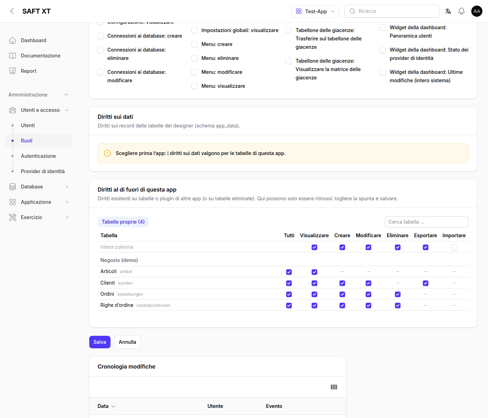
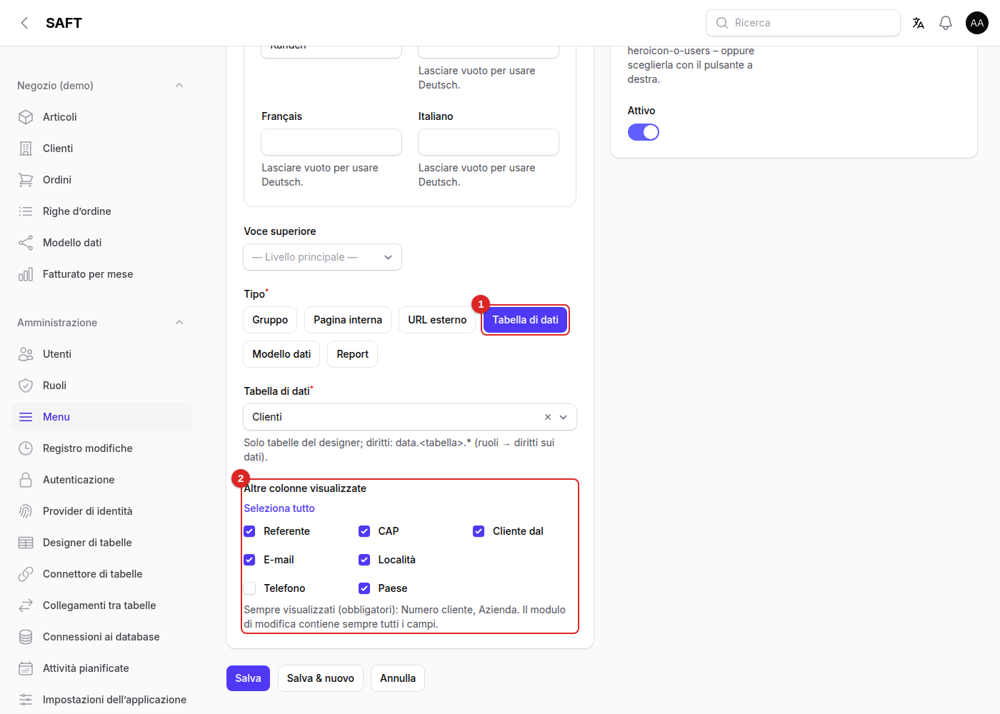
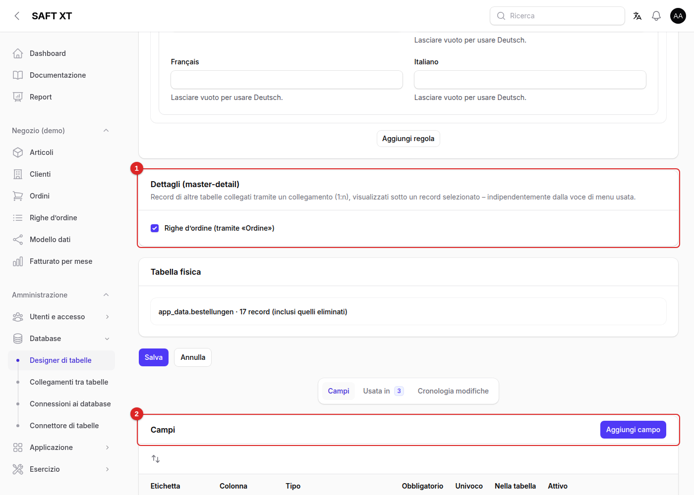
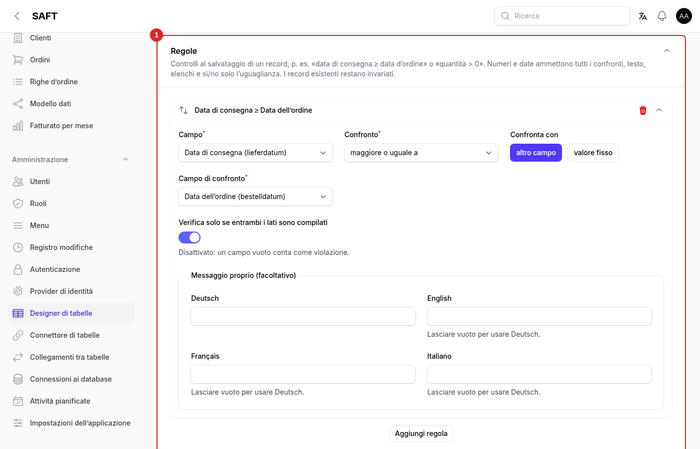
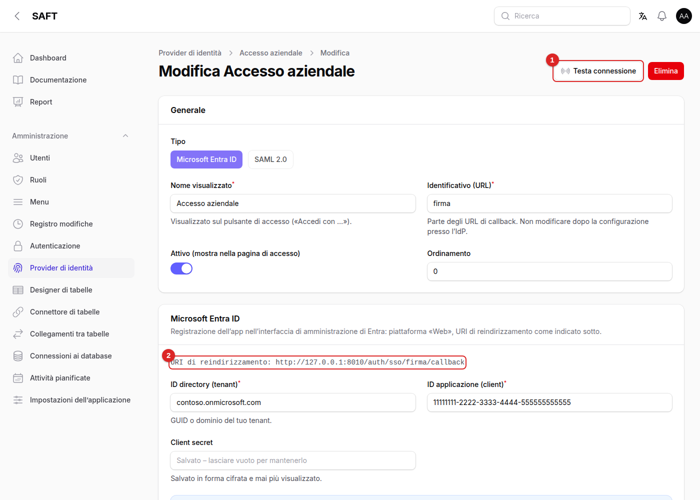
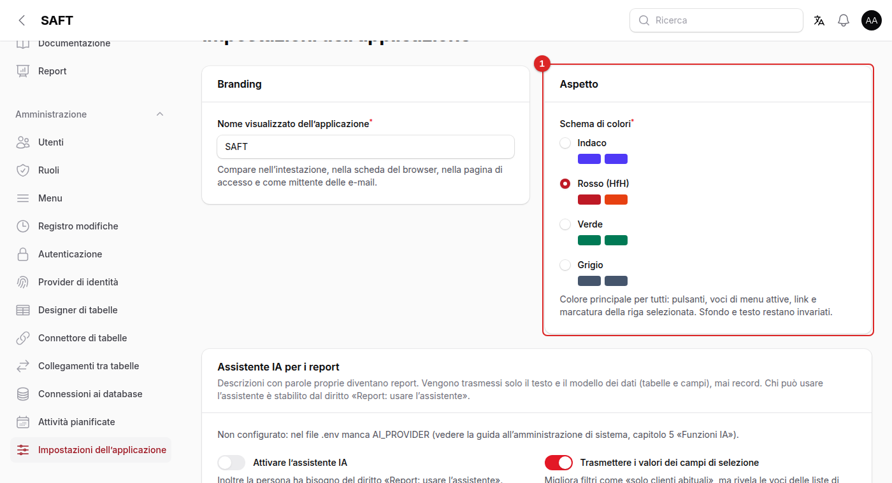
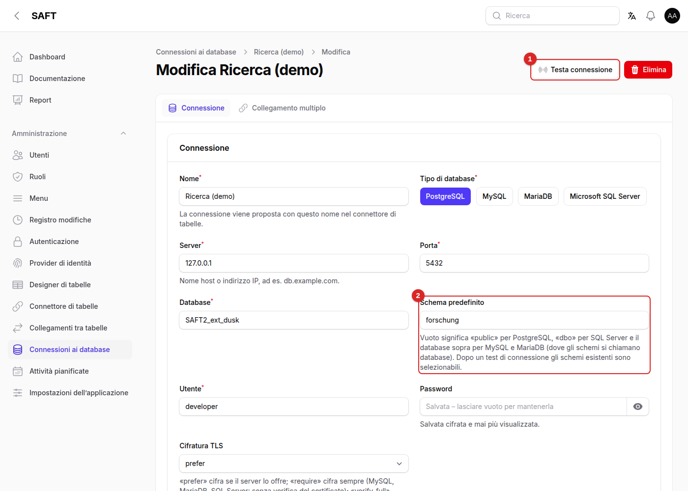
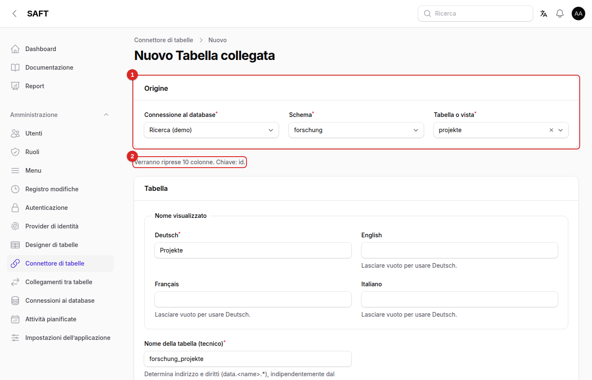
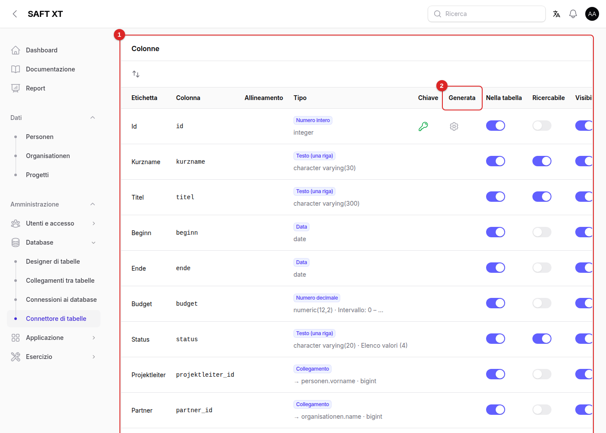
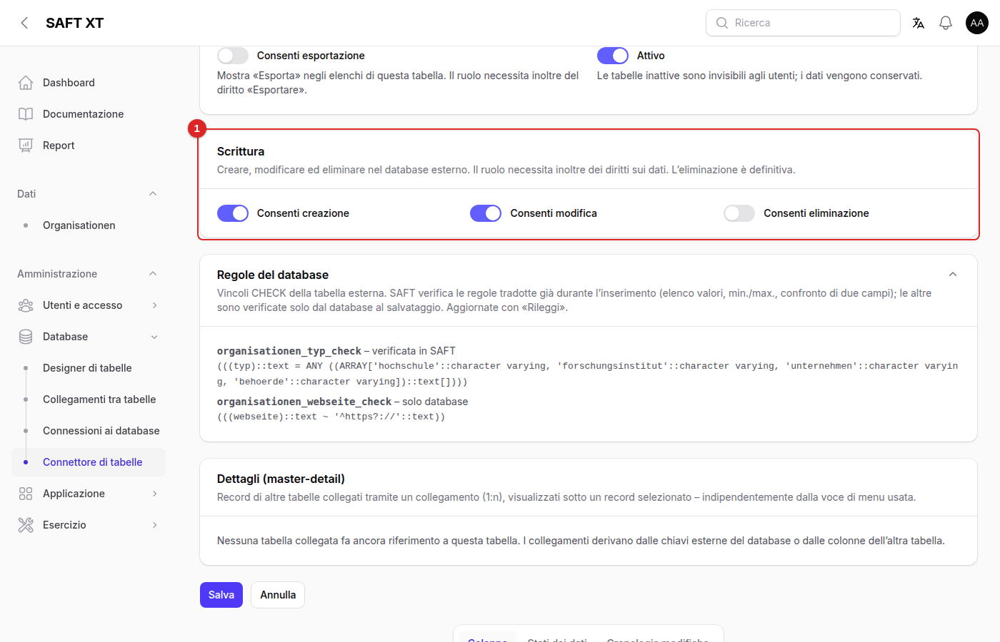

# SAFT XT – Guida all’amministrazione

[Deutsch](ADMIN_GUIDE.de.md) · [English](ADMIN_GUIDE.md) · [Français](ADMIN_GUIDE.fr.md) · **Italiano**

**Stato:** versione 0.1 · **Destinatari:** amministratrici e amministratori in SAFT

**Altre guide:** [Guida utente](USER_GUIDE.it.md) · [Domande frequenti](FAQ.it.md) · [Amministrazione di sistema](SYSADMIN_GUIDE.md)

> **Sulle illustrazioni:** le immagini sono schermate dell’applicazione con i dati dimostrativi.
> I numeri rossi nelle immagini rimandano alle spiegazioni nel testo.

---

## Indice

- [1. Utenti](#1-utenti)
- [2. Ruoli e diritti](#2-ruoli-e-diritti)
- [3. Menu](#3-menu)
- [4. Designer di tabelle](#4-designer-di-tabelle)
- [5. Autenticazione](#5-autenticazione)
- [6. Provider di identità (single sign-on)](#6-provider-di-identità-single-sign-on)
- [7. Impostazioni dell’applicazione](#7-impostazioni-dellapplicazione)
- [8. Registro modifiche](#8-registro-modifiche)
- [9. Connessioni ai database](#9-connessioni-ai-database)
- [10. Connettore di tabelle](#10-connettore-di-tabelle)
- [11. Collegamenti tra tabelle](#11-collegamenti-tra-tabelle)
- [12. Attività pianificate](#12-attività-pianificate)
- [13. Funzioni IA](#13-funzioni-ia)
- [14. Plugin](#14-plugin)
- [15. Trasferire la configurazione](#15-trasferire-la-configurazione)
- [Allegato A – Panoramica dei diritti](#allegato-a--panoramica-dei-diritti)

---

Le funzioni seguenti si trovano nel menu sotto **Amministrazione**. Sono visibili solo con i diritti corrispondenti.
Anche qui elenchi e tabelle sono larghi solo quanto le loro colonne (vedere [Guida utente 4.1](USER_GUIDE.it.md#41-la-vista-tabella)).

## 1. Utenti

**Amministrazione → Utenti**

- **Elenco** con nome, e-mail, ruoli, attivo, ultimo accesso. Filtri: attivo, ruolo, **senza ruolo**,
  **collegamento SSO**, utenti eliminati.
- **Creare / modificare:** nome, e-mail, password (obbligatoria alla creazione, tranne in modalità solo SSO), attivo,
  ruoli. Il **ruolo predefinito** (vedere [capitolo 5](#5-autenticazione)) è preselezionato alla creazione.
- **Gli utenti inattivi** non possono accedere – né con password né con SSO.
- **Collegamenti SSO:** nell’utente vedete a quali account single sign-on è collegato e potete rimuovere un
  collegamento.
- **Cronologia delle modifiche:** ogni modifica all’utente è ricostruibile in fondo alla pagina.
- **Lingua:** ogni utente sceglie da sé la propria lingua con l’icona della lingua; viene salvata nel suo account e
  vale anche per le e-mail a lui inviate, ad esempio per reimpostare la password.
- **Gli utenti eliminati** si possono mostrare tramite il filtro, ripristinare o eliminare definitivamente. Le loro
  voci nel registro modifiche restano conservate (vedere [capitolo 8](#8-registro-modifiche)).
- **Inattivo, eliminato o eliminato definitivamente?**

  | | Inattivo | Eliminato (cestino) | Eliminato definitivamente |
  |---|---|---|---|
  | Accesso | bloccato | bloccato | – |
  | Nell’elenco | visibile | solo tramite il filtro «Record eliminati» | non esiste più |
  | Annullare | interruttore «Attivo» | «Ripristina» | impossibile |
  | Nome nel registro modifiche | sì | sì, contrassegnato come «eliminato» | no, solo il numero utente |
  | Nuovo accesso SSO | respinto | respinto («Il vostro account utente è stato rimosso») | può creare un **nuovo** account |

  «Inattivo» è adatto ai blocchi temporanei. Un account eliminato resta volutamente bloccato: altrimenti una persona
  che esiste ancora presso il provider di identità riceverebbe subito un nuovo account al successivo accesso grazie
  al provisioning automatico. **Elimina definitivamente** (azione di riga per gli account eliminati, anche come azione
  multipla) è pensato per le cancellazioni richieste dalla protezione dei dati – oppure quando una persona deve
  ricevere volutamente un nuovo account tramite SSO.

Regole di protezione: nessuno può eliminare o disattivare sé stesso. Gli account super-admin possono essere modificati
solo da super-admin, e agli altri utenti il ruolo `super-admin` non viene nemmeno proposto.

## 2. Ruoli e diritti

**Amministrazione → Ruoli**

Un ruolo raggruppa diritti. Gli utenti ricevono diritti esclusivamente tramite ruoli.

- **Autorizzazioni** – diritti sulle funzioni dell’applicazione, ad es. «Utenti: modificare», «Designer di tabelle:
  visualizzare» o i **widget della dashboard**.
- **Diritti sui dati** – una matrice con tutte le tabelle del Designer di tabelle e le colonne **Visualizzare,
  Creare, Modificare, Eliminare, Esportare, Importare**. Le nuove tabelle vi compaiono automaticamente.
  **Importare** ha effetto solo insieme a **Creare** e se l’importazione è consentita per la tabella. **Esportare** ha effetto
  solo se l’esportazione è consentita per la tabella (vedere [capitolo 4](#4-designer-di-tabelle)) e il ruolo può
  anche visualizzare la tabella. Le tabelle esterne collegate (vedere [capitolo 10](#10-connettore-di-tabelle))
  offrono **Creare, Modificare** ed **Eliminare** solo se ciò è abilitato per la tabella; altrimenti compare «–».
  La matrice ha le schede **Tabelle proprie** (suddivise per gruppo di menu, nome tecnico discretamente accanto) e
  **Tabelle collegate** (per connessione al database). **Tutti** in una riga assegna tutti i diritti della tabella,
  la casella sopra una colonna («intera colonna») assegna il diritto per tutte le tabelle visibili. Il **campo di
  ricerca** filtra le righe per etichetta o nome tecnico.

- **Voci di menu** – tutte le voci di menu di tipo «Tabella di dati», ad es. «Dati › Clienti». Senza segno di spunta
  il ruolo non vede la voce nel menu. Le nuove voci e i nuovi ruoli sono spuntati, quindi visibili. Si tratta solo di
  visualizzazione: se la tabella può essere mostrata lo decidono i diritti sui dati. Una voce nascosta resta
  raggiungibile tramite link, la vista master-detail e l’anteprima. Con più ruoli basta un ruolo con diritto di lettura
  che mostri la voce; `super-admin` vede sempre tutte le voci.

Le aree vengono salvate indipendentemente – una modifica in una non cambia nulla nell’altra.

I diritti modificati valgono subito, anche per gli utenti già connessi. Chi ha perso un diritto riceve «Accesso
negato» al clic successivo; il menu è aggiornato dopo aver ricaricato la pagina.

**Ruoli particolari:**

| Ruolo | Significato |
|---|---|
| `super-admin` | Ha **tutti** i diritti, anche per le funzioni future. Non può essere né eliminato né rinominato e non viene mai assegnato automaticamente tramite SSO. |
| `benutzer` | Ruolo predefinito per i nuovi utenti, senza diritti di amministrazione; vede la dashboard con i widget personali. Finché è impostato come ruolo predefinito, non può essere eliminato. |

**Visualizza come ruolo (verificare i diritti):** i super-admin scelgono nel menu utente in alto a destra
**«Visualizza come ruolo …»** e uno o più ruoli – così come li ha una persona (è preselezionato il ruolo predefinito,
di solito si aggiunge un ruolo specialistico). Vedono poi SAFT esclusivamente con quei diritti – menu, pagine, diritti
sui dati, report e widget –, come un’altra persona con esattamente quei ruoli: i propri report non contano come
propri. Una banda gialla in alto indica il ruolo; **Termina** nella banda ripristina i propri diritti (anche l’uscita
termina la vista). Il database resta invariato, inizio e fine figurano nel registro modifiche. Attenzione: ciò che il
ruolo può fare viene davvero salvato durante la vista – con voi come autore.

## 3. Menu

**Amministrazione → Menu**

Il menu a sinistra si gestisce qui. Ogni voce ha un **tipo**:

| Tipo | Utilizzo |
|---|---|
| **Gruppo** | titolo per le voci subordinate (ad es. «Dati») |
| **Pagina interna** | una pagina dell’applicazione (ad es. dashboard, utenti) |
| **URL esterno** | un link verso l’esterno; si apre in una nuova scheda |
| **Tabella di dati** | una tabella del Designer di tabelle con una propria scelta di colonne |
| **Modello dati** | vista grafica delle tabelle di dati di questo gruppo e dei loro collegamenti (vedere sotto) |
| **Report** | un report condiviso (vedere [Guida utente 4.9](USER_GUIDE.it.md#49-report)); compare solo per le persone che possono eseguirlo con i loro diritti sui dati |

**Voce di menu di tipo «Tabella di dati»** (1):

- Scegliete la **tabella di dati** – vengono proposte solo le tabelle attive del Designer di tabelle.
- Scegliete le **altre colonne visualizzate** (2). I **campi obbligatori** vengono sempre mostrati e per questo non
  sono selezionabili.
- Il diritto di lettura necessario viene impostato automaticamente: la voce è visibile solo agli utenti che possono
  visualizzare la tabella.
- Per la stessa tabella si possono creare **più voci** con colonne diverse.
- Se in seguito cambiate il tipo, il diritto di lettura impostato automaticamente viene rimosso.
- Per singoli ruoli la voce si può nascondere senza revocare il diritto di lettura (Ruoli → Voci di menu, vedere
  [capitolo 2](#2-ruoli-e-diritti)).

**Voce di menu di tipo «Modello dati»:** la pagina mostra le tabelle di dati del gruppo in cui si trova la voce –
compresi tutti i sottogruppi – come diagramma con i loro collegamenti. Se la voce si trova al livello superiore,
compaiono tutte le tabelle di dati. La pagina è generica: lo stesso tipo si può inserire in più gruppi e, se una voce
viene spostata, mostra automaticamente il nuovo gruppo. Vale quanto segue:

- Vengono mostrate le tabelle con una voce di menu di tipo «Tabella di dati» nel gruppo, e solo quelle che l’utente
  può vedere (diritto di lettura, non nascoste per i suoi ruoli, attive). Le tabelle senza voce di menu mancano.
- Se un utente non vede **nessuna tabella** nel gruppo, la voce «Modello dati» non compare nel suo menu. Se così il
  gruppo restasse vuoto, viene nascosto anche quello.
- Le tabelle collegate **fuori dal gruppo** compaiono come nodi periferici con cornice tratteggiata, solo con il
  nome. I collegamenti a tabelle senza diritto di lettura scompaiono del tutto.
- **Linee:** continue se il collegamento è configurato nel Designer di tabelle come tabella di dettaglio, altrimenti
  tratteggiate. Le estremità mostrano la cardinalità: molti record rimandano a esattamente uno (campo obbligatorio)
  oppure a nessuno o a un record principale.
- **«Mostra campi»** passa senza ricaricare tra la panoramica con i nomi delle tabelle e la vista con tutti i campi
  attivi (tipo, nome tecnico, PK/FK/UK, etichetta, `*` = campo obbligatorio). Il browser ricorda la scelta.
- Le tabelle collegate dal Connettore di tabelle hanno una cornice arancione e indicano la loro connessione.
- Come ogni voce, anche questa si può limitare con un **diritto**. Il diagramma si adatta allo schema di colori
  (chiaro/scuro); i diagrammi larghi si possono spostare lateralmente.

**Etichetta per lingua:** ogni voce ha un campo per **Deutsch** (obbligatorio) e uno ciascuno per **English**,
**Français** e **Italiano**. Se un campo resta vuoto, in quella lingua compare l’etichetta tedesca. Le voci fornite
sono già denominate in tutte e quattro le lingue. Le voci che il Designer di tabelle crea per una tabella riprendono
il suo nome visualizzato in tutte le lingue e lo seguono a ogni modifica.

**Icone:** il pulsante a destra nel campo **Icona** apre una finestra di selezione con tutte le icone disponibili,
suddivise per stile nelle schede **Contorno**, **Pieno**, **Mini** e **Micro**. Il campo di ricerca filtra subito (ad
es. «user»), il numero sulla scheda indica i risultati per stile; un clic riprende il nome nel campo. L’icona attuale
è evidenziata e compare a sinistra nel campo come anteprima. Potete anche inserire il nome a mano, ad es.
`heroicon-o-users`; il modulo accetta solo icone note. La stessa finestra esiste per l’icona della tabella nel
Designer di tabelle. Una voce con sottovoci che non ha un’icona valida riceve il simbolo di una cartella.

**Altre regole:** un menu ha al massimo tre livelli; le voci si ordinano con il trascinamento. Eliminando una voce
vengono eliminate anche le sue sottovoci.

> I **dettagli** (master-detail) non si impostano nel menu, ma nel Designer di tabelle.

## 4. Designer di tabelle

**Amministrazione → Designer di tabelle**

Qui create tabelle proprie – senza programmazione.

**Multilingue:** nome visualizzato e descrizione di una tabella, l’etichetta di ogni campo e la visualizzazione dei
valori di selezione hanno un campo per lingua. Il tedesco è obbligatorio per il nome visualizzato e l’etichetta, le
altre lingue sono facoltative; senza di esse compare il testo tedesco. Il nome tecnico e i valori di selezione
salvati valgono per tutte le lingue.

**Creare una tabella:**

1. **Nuova tabella** → inserire il nome visualizzato. Il nome tecnico viene proposto (ad es. «Größe in m²» →
   `groesse_in_m2`) e **non può più essere modificato in seguito**. I nomi tecnici sono univoci per tutte le tabelle
   – proprie, importate e collegate. Se il nome è già in uso, SAFT lo segnala già all’uscita dal campo e nomina la
   tabella, ad es. «Il nome «personen» è già in uso: tabella collegata «Personen» (connessione Forschung).» Se
   un’altra tabella porta la stessa **etichetta**, compare solo un avviso – è consentito, ma difficile da distinguere
   nei menu e negli elenchi. Lo stesso vale per l’importazione e il Connettore di tabelle.
2. Facoltativo: creare **campi iniziali** e scegliere sotto **«Voce di menu sotto»** il gruppo nel menu. È
   preselezionato «Dati»; vengono proposti tutti i gruppi, i sottogruppi rientrati con il loro percorso (ad es.
   «Dati › Ricerca»). «Nessuna voce di menu» non ne crea alcuna.
3. Salvare – la tabella è subito utilizzabile. Per essa vengono creati automaticamente i **diritti sui dati**
   (visualizzare/creare/modificare/eliminare) nella gestione dei ruoli.

**Consenti esportazione:** questo interruttore nei dati di base della tabella abilita l’esportazione (vedere
[Guida utente 4.7](USER_GUIDE.it.md#47-esportare-i-dati)). All’inizio è disattivato. Anche i super-admin vedono
«Esporta» solo quando è attivo; tutti gli altri hanno bisogno in più del diritto **Esportare** nel loro ruolo.

**Consenti importazione:** questo interruttore abilita l’importazione dei dati – nuovi record da un file Excel o CSV,
ad es. da un modello scaricato (vedere [Guida utente 4.8](USER_GUIDE.it.md#48-importare-i-dati)). All’inizio è
disattivato. «Importa» compare poi nell’elenco per i ruoli con i diritti **Creare** e **Importare**. L’importazione non
modifica mai i record esistenti; controlla come nell’inserimento manuale e vale tutto o niente. Al massimo 10’000
righe per file (`APP_DATA_IMPORT_MAX_RECORD_ROWS`). Per le tabelle collegate del Connettore di tabelle l’importazione
non esiste.

**Modificare i campi** (area *Campi*, (2)): per ogni campo stabilite:

| Impostazione | Significato |
|---|---|
| Etichetta / nome della colonna | visualizzazione o nome tecnico. **Rinominare conserva i dati.** |
| Tipo | vedere [Guida utente, allegato A](USER_GUIDE.it.md#allegato-a--tipi-di-campo) |
| Impostazioni del tipo | lunghezza (testo), cifre (numero decimale), valori (elenco di selezione), tabella di destinazione, campi visualizzati e separatore (collegamento) |
| Validazione | lunghezza min./max., minimo/massimo, e-mail, URL; **Ulteriori verifiche** dei plugin, p. es. numero AVS o IBAN (compare solo se un plugin offre regole per il tipo di campo; valgono nell’inserimento, nell’importazione e tramite l’interfaccia, i valori vuoti non vengono verificati). Se in seguito il plugin manca o è sospeso, la verifica viene ignorata e indicata come «non disponibile» sul campo |
| Valore proposto alla creazione (numero intero) | **Proponi il numero successivo (valore massimo + 1):** nella finestra «Nuovo record» compare il valore più alto esistente + 1, che resta modificabile; se il campo resta vuoto, SAFT imposta il valore al salvataggio. Con **Conta per** (un collegamento, ad es. *Ordine*) si conta per record master: sotto un ordine con due righe viene proposto 3; nell’elenco la proposta compare appena l’ordine è scelto. I record eliminati non contano. |
| Valore proposto alla creazione (data, data e ora) | **Precompilare con la data odierna** o **Precompilare con data e ora attuali:** nella finestra «Nuovo record» il campo mostra all’apertura la data (o data e ora al minuto) attuale e resta modificabile. In modifica, importazione e tramite l’interfaccia SAFT non imposta nulla. Non insieme a «Riprendi da». |
| Riprendi da | riprendere un valore dal record master, ad es. *Prezzo unitario* da **Articolo → Prezzo**: appena nel modulo è scelto un articolo (o subito sotto un articolo come tabella di dettaglio), il suo prezzo compare nel campo e resta modificabile. Cambiando articolo il valore segue, finché non è stato modificato a mano; SAFT riempie i campi salvati vuoti. È una copia: le modifiche successive all’articolo non cambiano le righe esistenti. Vengono proposti solo campi compatibili (numero ← numero, data ← data, testo ← testo/selezione, sì/no ← sì/no). Un campo di origine non si può eliminare finché un campo ne riprende il valore; la ridenominazione viene seguita. |
| Campo obbligatorio | deve essere compilato; sempre mostrato negli elenchi |
| Univoco | può comparire una sola volta (i record eliminati non contano) |
| Ricercabile | viene considerato dalla ricerca |
| Crea indice | accelera ordinamento e filtri nelle tabelle grandi |
| Mostra nella tabella / nel modulo | preimpostazione per elenchi e moduli |

**Campi visualizzati di un collegamento:** invece del numero salvato, un collegamento mostra campi del record
collegato – uno o più, nell’ordine scelto e uniti da un **separatore** (spazio, virgola, trattino, punto o barra), ad
es. nome e cognome in «Anna Keller» oppure nome e località in «ETH Zürich, Zürich». I campi vuoti vengono saltati.
Questo vale negli elenchi, nei dettagli, nell’anteprima, nei filtri, nell’esportazione e nell’elenco di selezione
durante la modifica; lì l’inserimento cerca in tutti i campi visualizzati. L’ordinamento avviene in base al primo
campo visualizzato. Se rinominate un campo visualizzato, il collegamento segue; finché un campo serve da qualche parte
come campo visualizzato, non può essere eliminato definitivamente.

**Regole** (illustrazione sotto, 1): controlli su più campi al salvataggio di un record, ad es. «data di consegna ≥
data d’ordine» o «quantità > 0». Per ogni regola scegliete il **campo**, il **confronto** e se il confronto avviene con
un **altro campo** o con un **valore fisso**:

- Numeri e date consentono tutti i confronti (=, ≠, <, ≤, >, ≥) – un numero solo con un numero, una data solo con una
  data. Testo, elenchi di selezione e sì/no si possono controllare solo sull’uguaglianza (= e ≠). Collegamenti e testo
  lungo non sono possibili.
- **Verifica solo se entrambi i lati sono compilati** (predefinito): un campo vuoto non viene controllato. Se
  disattivato, un campo vuoto vale come violazione.
- **Messaggio proprio** (facoltativo, per lingua). Altrimenti presso il campo compare il testo standard, ad es. «non
  può essere anteriore a «data d’ordine»».
- La regola vale in tutti i moduli della tabella (elenco, tabelle di dettaglio, Dettagli → Modifica). I record
  esistenti restano invariati; se alcuni violano già una nuova regola, un avviso indica quanti – vengono controllati
  alla modifica successiva.
- Se un campo viene rinominato, le sue regole seguono. Un campo usato da una regola non si può eliminare e il suo tipo
  si può cambiare solo in un tipo che resta compatibile con la regola.

### Campi calcolati

Un campo di tipo **Calcolato** non viene inserito, ma calcolato al salvataggio da altri campi dello stesso record o
dai record figli associati, ad es. *Importo* da quantità e prezzo unitario oppure *Prezzo totale* come somma degli
importi di tutte le righe di un ordine. Il valore viene salvato e si può quindi ordinare, filtrare, esportare e usare
nelle regole.

- **Risultato:** numero intero o decimale (con cifre e decimali); il risultato viene arrotondato di conseguenza.
- **Formula:** campi numerici della tabella (per nome di colonna), numeri, `+ - * /` e parentesi, oltre alle
  funzioni `round(x, decimali)`, `min(a, b, …)`, `max(a, b, …)`, `abs(x)` e `coalesce(a, sostituto)`. Esempio:
  `round(menge * einzelpreis, 2)`. I nomi delle funzioni sono uguali in tutte le lingue. I plugin possono aggiungere
  altre funzioni, p. es. `rappen(importo)` (arrotondamento a 5 centesimi); compaiono nell’aiuto all’inserimento sotto
  **Funzioni dei plugin**, la descrizione appare passando sul pulsante. Non sono disponibili nelle espressioni delle
  analisi. Se in seguito il plugin manca, il risultato resta vuoto.
- **Sui record figli** (tabelle che puntano a questa tabella con un collegamento): `sum(tabella.campo)`,
  `avg(tabella.campo)`, `min(tabella.campo)`, `max(tabella.campo)` e `count(tabella)`, ad es. prezzo totale =
  `sum(bestellpositionen.betrag)`, IVA = `round(gesamtpreis * 0.081, 2)`. I record figli eliminati non contano;
  senza record figli somma e numero valgono 0. Se una tabella figlia punta a questa tabella con più collegamenti, quello
  desiderato si indica come secondo valore: `sum(bestellpositionen.betrag, bestellung_id)`.
- **Espressione per record figlio:** invece di un campo, `sum`, `avg`, `min` e `max` accettano anche un calcolo con
  campi della tabella figlia; viene calcolato per ogni record figlio e poi riassunto, ad es.
  `sum(bestellpositionen.einzelpreis * bestellpositionen.menge)` oppure
  `sum(round(bestellpositionen.menge * bestellpositionen.einzelpreis * 0.95, 2))`. L’espressione contiene solo campi
  di quell’unica tabella figlia (nessun campo del record master, nessun riepilogo annidato). Se il risultato per un
  record figlio è vuoto, non viene contato – con `coalesce(…, 0)` lo si può gestire.
- **Aiuto all’inserimento:** sotto il campo della formula i campi numerici della tabella compaiono come pulsanti, ad
  es. «Menge (menge)»; un clic inserisce il nome tecnico alla posizione del cursore. Per ogni tabella figlia segue una
  riga propria con `count(tabella)` e i suoi campi numerici (`tabella.campo`), oltre a pulsanti per gli operatori, le
  funzioni e `sum`, `avg`, `count`. Creando una nuova tabella compaiono solo i campi che si trovano più in alto nel
  modulo.
- **Controllo:** già durante l’inserimento SAFT segnala gli errori con la posizione (ad es. «Carattere 9: campo
  sconosciuto «preis»») oppure conferma da cosa dipende il risultato. I riferimenti circolari vengono rifiutati; il
  messaggio indica le formule dei campi coinvolti, ad es. «Riferimento circolare: mwst → einkaufspreis → mwst. Le
  formule: mwst = …; einkaufspreis = …».
- **Valori vuoti:** se un campo usato è vuoto, il risultato è vuoto – tranne con `coalesce(campo, 0)`. Anche una
  divisione per 0 dà un risultato vuoto. Il calcolo è esatto (nessun errore di arrotondamento sugli importi).
- **Quando avviene il calcolo:** all’aggiunta di un campo calcolato, per tutti i record esistenti; alla creazione (anche
  tramite importazione) e alla modifica di un record (i nuovi valori figurano nel registro
  modifiche); alla creazione, modifica, eliminazione o ripristino di un record figlio per il suo record master – al
  cambio di ordine per il vecchio e il nuovo – e così via verso l’alto (ad es. fatturato di un cliente come somma dei
  suoi ordini); dopo la modifica di una formula per tutti i record della tabella e di quelle superiori; e con
  `php artisan computed:recompute` se i dati sono stati modificati al di fuori di SAFT.
- Nel modulo un campo calcolato viene solo mostrato («calcolato al salvataggio»). Le regole che controllano un campo
  calcolato si applicano quindi solo alla modifica successiva.
- Se un campo usato viene rinominato (anche in una tabella figlia), la formula segue; l’eliminazione e il passaggio a
  un tipo non numerico sono bloccati finché una formula usa il campo. Una tabella figlia su cui si calcola una somma
  non si può eliminare.
- I dati dimostrativi contengono *Betrag* (righe d’ordine) nonché *Gesamtpreis* e *MWST 8,1 %* (ordini).

**Dettagli (master-detail)** (1): qui scegliete quali tabelle collegate compaiono sotto un record selezionato (vedere
[Guida utente 4.3](USER_GUIDE.it.md#43-tabelle-collegate-la-vista-master-detail)). Vengono proposti tutti i campi di
collegamento di altre tabelle che puntano a questa tabella. Se esistono più collegamenti dalla stessa tabella (ad es.
«Cliente» e «Fatturare a»), si possono scegliere singolarmente.

**Altri pulsanti:** *Apri i dati* (verso la vista dei dati) e *Crea voce di menu*. Quest’ultimo chiede il gruppo e
crea anche una voce aggiuntiva se la tabella deve comparire in un secondo punto del menu.

**Cosa si può fare – e cosa no:**

| Modifica | Regola |
|---|---|
| Rinominare un campo | in qualsiasi momento, i dati restano |
| Cambiare il tipo | senza perdita di dati in qualsiasi momento (ad es. numero intero → numero decimale, testo → testo su più righe, data → data e ora); altrimenti solo se la colonna è vuota |
| Lunghezza del testo | aumentare in qualsiasi momento, ridurre solo con la colonna vuota |
| Attivare «Univoco» | solo se i dati esistenti non contengono duplicati |
| Rimuovere un valore da un elenco di selezione | in qualsiasi momento; se il valore è in uso, compare un avviso con il numero di record. Questi mantengono il loro valore, ma alla modifica successiva occorre sceglierne uno valido. |
| Eliminare un campo | prima **disattivare**, poi «Elimina definitivamente» inserendo il nome della colonna |
| Eliminare una tabella | prima **disattivare**, poi «Elimina definitivamente» inserendo il nome della tabella; impossibile finché altre tabelle vi fanno riferimento |
| Collegamento | solo verso altre tabelle del Designer di tabelle, mai verso tabelle di sistema |

> **Disattivare invece di eliminare:** un campo o una tabella disattivati sono invisibili agli utenti, ma i dati
> restano completamente conservati. Un campo si recupera con «Abilita», senza conferma. L’eliminazione definitiva non
> si può annullare.

Sotto **Tabella fisica** vedete il luogo di archiviazione, il numero di record ed eventuali differenze tra le
impostazioni e il database.

### Usata in

La scheda **Usata in** (accanto a *Campi* e al *Registro modifiche*) mostra dove compare la tabella; il numero sulla
scheda indica quante volte. Serve solo da informazione, p. es. prima di rinominare o eliminare:

| Ambito | Cosa compare |
|---|---|
| Plugin | plugin che richiedono la tabella, ne controllano le modifiche o mostrano pulsanti nella sua vista dei dati |
| Analisi | analisi con la tabella come tabella di base o tramite un collegamento |
| Collegamento (analisi) | collegamenti tra analisi con la tabella come origine o destinazione |
| Menu | voci di menu che aprono la vista dei dati (con il percorso nel menu) |
| Collegamento | campi di altre tabelle che fanno riferimento a questa tabella |
| Formula | campi calcolati di altre tabelle che riepilogano su questa tabella, p. es. `sum(bestellungen.betrag)` |
| Ripresa | campi di altre tabelle che riprendono un valore da questa tabella |
| Ruolo | ruoli con diritti sui dati della tabella, con i diritti |
| Attività pianificata | attività «Aggiornare lo stato dei dati» per la tabella |

Il nome è un link se potete aprire la pagina relativa; il filtro **Ambito** restringe l’elenco.

### Eliminare definitivamente una tabella o un campo

L’eliminazione definitiva rimuove la colonna o la tabella **con i dati** dal database. Perché non avvenga per errore,
si svolge in due passaggi; il pulsante **«Elimina definitivamente»** è visibile fino ad allora, ma bloccato (la
spiegazione compare passando con il mouse):

| | Tabella | Campo |
|---|---|---|
| 1. Disattivare | modificare la tabella, interruttore **«Attivo»** disattivato, **Salva** | nell’elenco dei campi **«Disattiva»** |
| 2. Eliminare | in alto **«Elimina definitivamente»** | nella riga l’**icona del cestino** («Elimina definitivamente») |
| 3. Confermare | inserire il nome tecnico della tabella | inserire il nome della colonna |

Eliminando una tabella, SAFT rimuove anche i suoi diritti sui dati e le sue voci di menu; il registro modifiche resta.
Serve il diritto **Designer di tabelle: eliminare**. Se un’altra tabella fa riferimento alla tabella con un campo di
collegamento, il messaggio nomina quel campo – va rimosso prima. Se la tabella è usata altrove (analisi, menu,
ruoli …), la finestra mostra un avviso con il numero per ambito; l’eliminazione resta possibile, i dettagli sono nella
scheda **Usata in**.

### Importare una tabella da un file

**Designer di tabelle → Importa** crea una nuova tabella da un file CSV o Excel e ne riprende i dati. Serve il diritto
**Designer di tabelle: importare**. L’assistente ha quattro passaggi:

1. **File:** CSV (`.csv`, `.txt`, `.tsv`) o Excel (`.xlsx`), al massimo 20 MB o 50’000 righe di dati. Per i file
   Excel con più fogli scegliete il foglio. SAFT controlla il file; se contiene errori, l’assistente si ferma qui e
   mostra **tutti** i problemi trovati con riga e colonna.
2. **Controllo:** riepilogo (righe, colonne, per il CSV separatore e set di caratteri) e avvisi, ad es. su una
   presunta riga dei totali.
3. **Colonne:** per ogni colonna «Riprendi», nome del campo, etichetta e tipo. Sono proposti solo i tipi adatti ai
   dati (il testo è sempre possibile).
4. **Tabella e menu:** etichetta, nome tecnico della tabella e gruppo di menu per la voce della tabella.

**Un elenco importabile** ha i titoli delle colonne nella riga 1 e sotto solo righe di dati:

| Consentito | Causa l’interruzione |
|---|---|
| titoli con spazi e caratteri speciali («N. cliente», «Via») | colonna senza titolo, titoli doppi |
| celle vuote | titolo o riga vuota sopra l’elenco, righe vuote in mezzo all’elenco |
| righe vuote alla fine | valori in colonne senza titolo, righe CSV con un numero di colonne diverso |
| formule (conta il risultato salvato) | celle unite, celle di errore come `#DIV/0!` |

**I nomi dei campi** derivano dai titoli: «Straße & Nr.» → `strasse_nr`, «2024» → `f_2024`. Il titolo stesso diventa
l’etichetta. I nomi di sistema e le parole riservate («ID», «Order») ricevono la desinenza `_import`. Se due titoli
danno lo stesso nome («Kunden Nr» e «Kunden-Nr.»), il controllo nomina entrambe le colonne.

**I tipi** vengono riconosciuti da SAFT solo se **tutti** i valori di una colonna corrispondono:

| Valori | Tipo |
|---|---|
| numeri interi | numero intero |
| numeri con decimali (`1.234,50` o `1,234.50`) | numero decimale |
| `GG.MM.AAAA` o `AAAA-MM-GG`, facoltativamente con l’ora | data o data e ora |
| ja/nein, true/false, wahr/falsch | sì/no |
| numeri con zero iniziale (NPA `01067`) | testo – lo zero viene conservato |
| tutto il resto | testo; oltre 255 caratteri o su più righe: testo lungo |

Nel CSV è il separatore a decidere se `1.234` viene letto come 1234 o come 1,234 (punto e virgola: formato tedesco,
virgola: formato inglese); l’anteprima delle colonne indica il formato scelto. SAFT non indovina le chiavi: ogni
tabella riceve come sempre un proprio numero di record; una colonna «ID» del file viene ripresa come campo normale
`id_import`.

L’importazione avviene per intero o per niente: se un valore non è adatto, non viene creato nulla e il messaggio
nomina la cella. Nel **registro modifiche** figura una voce «importato» con file, numero di righe e di colonne, e non
una voce per ogni record. Al massimo dieci colonne vengono create ordinabili; le altre le abilitate nel Designer di
tabelle.

**Importazione sbagliata?** Aprite la tabella nel Designer di tabelle, disattivate «Attivo» e salvate, poi confermate
«Elimina definitivamente» con il nome della tabella (vedere [Eliminare definitivamente una tabella o un
campo](#eliminare-definitivamente-una-tabella-o-un-campo)). In seguito il file si può importare di nuovo.

## 5. Autenticazione

**Amministrazione → Autenticazione**

| Impostazione | Significato |
|---|---|
| **Modalità di accesso** | **Locale** (solo password), **Single sign-on** (solo provider di identità) o **Ibrido** (entrambi) |
| **Accesso di emergenza per i super amministratori** | consente ai super-admin, in modalità SSO, l’accesso con password tramite `…/admin/login?local=1` – nel caso in cui il provider di identità non funzioni |
| **Offri «Password dimenticata»** | e-mail per reimpostare la password (solo in modalità Locale o Ibrido; richiede l’invio di e-mail configurato) |
| **Ruolo predefinito per i nuovi utenti** | preselezionato alla creazione e assegnato agli utenti SSO creati automaticamente |

Protezione contro il blocco: la modalità **Single sign-on** si può salvare solo se almeno un provider di identità attivo
ha un **test di connessione riuscito**. Per altre vie d’uscita d’emergenza nell’esercizio vedere
[Amministrazione di sistema, capitolo 1](SYSADMIN_GUIDE.md#1-operations).

## 6. Provider di identità (single sign-on)

**Amministrazione → Provider di identità**

Sono supportati **Microsoft Entra ID** e **SAML 2.0** (ad es. ADFS, Keycloak). Sono possibili più provider; ognuno
compare come pulsante proprio nella pagina di accesso. Una guida passo per passo per Entra ID con la registrazione
dell’app presso Microsoft e la ricerca degli errori si trova nell’amministrazione di sistema,
[allegato D](SSO_ENTRA.md). Gli indirizzi di un provider SAML devono iniziare con `https://`; un provider raggiungibile
solo via http non può essere integrato.

**Configurazione – procedura:**

1. Creare il provider, scegliere il tipo, assegnare nome visualizzato e identificativo.
2. Inserire presso il provider i **valori per il provider di identità** mostrati (2) – ad es. URI di reindirizzamento
   o URL ACS e URL dei metadati SP. Un clic su un valore copia l’indirizzo.
3. Inserire i dati del provider:
   - **Entra ID:** ID della directory (tenant), ID dell’applicazione (client), segreto client. È ammesso solo il
     proprio tenant (non `common`/`organizations`).
   - **SAML:** URL dei metadati IdP *oppure* Entity ID, URL SSO e certificato. Per le richieste firmate, generare un
     certificato SP con un clic.
4. Salvare e **«Testa connessione»** (1). I segreti vengono salvati cifrati e non vengono mai più mostrati.
5. In *Autenticazione* scegliere la modalità **Ibrido** o **Single sign-on**.

**Assegnazione degli utenti:**

| Impostazione | Effetto |
|---|---|
| Collega gli utenti esistenti tramite e-mail | un utente noto viene associato al primo accesso SSO in base all’e-mail |
| Crea automaticamente gli utenti sconosciuti | le nuove persone ricevono un account (con il ruolo predefinito) |
| Ruolo predefinito per i nuovi utenti | viene assegnato solo alla creazione automatica e poi resta. Vuoto = ruolo predefinito globale del [capitolo 5](#5-autenticazione) (il campo lo mostra); i ruoli assegnati tramite mappatura si aggiungono |
| Domini e-mail consentiti | solo questi domini possono accedere (vuoto = tutti) |

**Mappatura dei ruoli:** i ruoli si possono riprendere dal provider di identità – per Entra dai **ruoli
dell’applicazione** (consigliato) o dai **gruppi**, per SAML da un attributo. Le mappature hanno la forma «valore
esterno → ruolo». A ogni accesso i ruoli mappati vengono assegnati o revocati; gli altri ruoli restano invariati.
`super-admin` non è mai assegnabile. Facoltativo: «Consenti l’accesso solo con una mappatura corrispondente».

**Uscita (single logout):** su richiesta l’uscita da SAFT disconnette anche presso il provider. Con Entra questo
riguarda tutti i servizi Microsoft nel browser (Outlook, Teams …) – per questo è disattivato per impostazione
predefinita.

## 7. Impostazioni dell’applicazione

**Amministrazione → Impostazioni dell’applicazione**

| Impostazione | Significato |
|---|---|
| **Nome visualizzato dell’applicazione** | Al massimo 60 caratteri. Compare nell’intestazione, nella scheda del browser, nella pagina di accesso e come mittente delle e-mail |
| **Schema di colori** | colore principale per tutti: **Indaco** (predefinito), **Rosso (HfH)**, **Verde** o **Grigio**. Colora pulsanti, voci di menu attive, link e la marcatura della riga selezionata; sfondo, carattere e layout restano. Vale subito dopo il salvataggio |

Nella sezione **Aspetto** (1) ogni schema mostra due esempi: i pulsanti e la marcatura della riga selezionata. Tutti
gli schemi di colori raggiungono WCAG AA (4,5:1) in modalità chiara e scura. **Rosso (HfH)** segue la guida di stile
web della HfH: pulsanti in #BE1925, riga selezionata marcata nel colore di base #E74011 (inadatto come sfondo dei
pulsanti, il testo bianco vi raggiunge solo 4,1:1). Il contrasto elevato è un’impostazione personale (vedere
[Guida utente, capitolo 3](USER_GUIDE.it.md#3-interfaccia-e-dashboard)).

La sezione **Assistente IA per i report** configura provider, modello e chiave delle funzioni IA (vedere
[capitolo 13](#13-funzioni-ia)).

## 8. Registro modifiche

**Amministrazione → Registro modifiche**

Ogni modifica nell’applicazione viene registrata: chi, quando, cosa, con **prima/dopo**. Ne fanno parte record,
utenti, ruoli e diritti, menu, strutture delle tabelle, impostazioni nonché accessi, uscite e tentativi di accesso
falliti. I segreti (password, chiavi) non vengono mai registrati.

- **Filtri:** utente, evento, tipo di oggetto, periodo. Gli eventi sono: creato, modificato, eliminato, ripristinato,
  accesso, accesso fallito, uscita ed esportato.
- **Esportazioni:** vengono registrati tabella, formato, numero di righe, filtro e ricerca, mai i dati esportati.
- **Utenti:** «Sistema» compare solo dove davvero non era coinvolto alcun utente. Gli utenti eliminati compaiono con
  il nome e «(eliminato)», quelli eliminati definitivamente come «Utente eliminato #12».
- **Vista di dettaglio:** larga quanto un modulo; per le modifiche una tabella con tutti i campi modificati (prima →
  dopo), per creazione ed eliminazione i campi in forma compatta in blocchi (campo e valore affiancati). I valori
  lunghi vanno a capo. Le etichette in più lingue compaiono con tutte le lingue, ad es.
  `{"de":"Kunden","en":"Customers"}`.
- **Gli orari** compaiono nel fuso orario dell’applicazione (vedere [Amministrazione di sistema, capitolo 1](SYSADMIN_GUIDE.md#1-operations)).
- Nel widget **«Le mie ultime modifiche»** un clic su una voce porta direttamente al record modificato – per le
  tabelle del Designer di tabelle nella vista dei dati con il record selezionato.
- Il registro non si può modificare né eliminare – nemmeno dai super-admin.

## 9. Connessioni ai database

**Amministrazione → Connessioni ai database**

Qui configurate le connessioni a database esterni, ad esempio a un ERP o a un sistema di ricerca. Il **Connettore di
tabelle** (vedere [capitolo 10](#10-connettore-di-tabelle)) collega tabelle di questi database in modo che si possano
leggere come le tabelle del Designer di tabelle. Sono supportati **PostgreSQL**, **MySQL** (da 8.0.16), **MariaDB**
(da 10.11) e **Microsoft SQL Server** (da 2019, anche Express), indipendentemente dal database che usa SAFT. Per SQL
Server il server di SAFT ha bisogno dell’estensione PHP `pdo_sqlsrv` e del Microsoft ODBC Driver 18; se mancano, il
tipo è bloccato nella selezione.

| Impostazione | Significato |
|---|---|
| **Nome** | Con questo nome la connessione viene poi proposta nel Connettore di tabelle. |
| **Tipo di database, server, porta, database** | Dove si trova il database, ad es. `db.example.com`, porta 5432. |
| **Schema predefinito** (2) | Lo schema con le tabelle desiderate; vuoto significa `public` per PostgreSQL, `dbo` per SQL Server, per MySQL e MariaDB il database della connessione (lì gli schemi si chiamano database). Dopo un test riuscito gli schemi esistenti sono selezionabili. |
| **Utente, password** | Accesso al database. La password viene salvata cifrata e non viene mai più mostrata; un campo vuoto la conserva. |
| **Cifratura TLS** | `prefer` cifra se il server lo offre; `verify-full` verifica inoltre certificato e nome host. MySQL, MariaDB e SQL Server: `require` (predefinito) cifra senza verifica del certificato (ad es. con un certificato autofirmato), `verify-full` verifica il certificato, `disable` si connette senza cifratura. |
| **Limiti di tempo** | Per l’apertura della connessione (predefinito 5 secondi) e per ogni interrogazione (predefinito 30 secondi). Così un database lento o non raggiungibile non blocca alcuna pagina. |
| **Sola lettura** | Predefinito per le nuove connessioni. Il database stesso rifiuta allora ogni modifica tramite questa connessione. Disattivare per modificare i dati. SQL Server non può imporlo per connessione; lì SAFT blocca ogni scrittura – si consiglia inoltre un utente con sola lettura (ruolo `db_datareader`). |
| **Attivo** | Le connessioni inattive non sono selezionabili nel Connettore di tabelle. |

**Configurare:**

1. Scegliere **Crea** e inserire i dati. Dopo il salvataggio si apre la modifica.
2. **«Testa connessione»** (1) salva i dati mostrati e li verifica. In caso di successo il messaggio indica la
   versione del server, il numero di tabelle e viste nello schema predefinito e tutti gli schemi esistenti.
3. Se il test fallisce, il messaggio ne indica il motivo, ad es. «Accesso rifiutato», «Il server … non è
   raggiungibile» o «Lo schema … non esiste in questo database».

Se in seguito modificate server, database, utente, password, schema o TLS, la connessione torna a valere come «Non
ancora testato». Ogni modifica figura nella cronologia; per la password solo il fatto che è stata modificata.

> **Sicurezza:** create per SAFT un utente di database proprio, che possa vedere – e se necessario modificare – solo
> gli schemi e le tabelle necessari. Nessuno riceve automaticamente i diritti «Connessioni ai database:
> visualizzare/creare/modificare/eliminare»; chi può creare connessioni può contattare qualsiasi server.

**Eliminare:** se tramite la connessione non sono collegate tabelle, basta la consueta conferma. Altrimenti la
finestra **«Elimina connessione e tabelle collegate»** mostra tutte le tabelle interessate (nome in SAFT, etichetta,
tabella esterna, tipo). Dopo aver inserito il nome della connessione come conferma, connessione e tabelle collegate
vengono rimosse in un solo passaggio – come con «Rimuovi collegamento» nel Connettore di tabelle: impostazioni,
diritti, voci di menu e collegamenti di altre tabelle verso di esse. Il database esterno resta invariato. Serve in
più il diritto «Connettore di tabelle: eliminare»; senza di esso la finestra mostra solo l’elenco.

**Collegamento multiplo:** modificando una connessione ci sono due schede: **Connessione** con le impostazioni
consuete e **Collegamento multiplo**, per collegare molte tabelle in una volta. La seconda scheda mostra la sua
tabella solo dopo un test di connessione riuscito; prima compare un avviso.

1. Scegliere lo schema (filtro «Schema», preselezionato con lo schema predefinito). L’elenco mostra tutte le tabelle
   e le viste con tipo, chiave, il nome proposto in SAFT e – se già collegate – il nome esistente. Quelle già
   collegate non si possono scegliere una seconda volta.
2. Spuntare le tabelle desiderate (o «Seleziona tutto») e cliccare su **«Collega selezionate …»**.
3. Nella finestra le impostazioni valgono per tutte le tabelle scelte: **prefisso per i nomi tecnici** (ad es.
   `erp_`), **Attivo**, **Consenti esportazione**, **Consenti creazione/modifica/eliminazione**, **Voce di menu sotto**
   un gruppo (o nessuna voce di menu) e facoltativamente **ruoli** che ricevono il diritto di visualizzazione e i
   diritti abilitati (visibile solo con il diritto di modificare i ruoli). **«Configurare master-dettaglio dalle chiavi
   esterne»** (predefinito: attivo) registra per ogni tabella appena collegata come dettagli le tabelle della stessa
   connessione che vi fanno riferimento – ad es. sotto un’ubicazione le sue giacenze e i suoi movimenti (vedere
   [Guida utente 4.3](USER_GUIDE.it.md#43-tabelle-collegate-la-vista-master-detail)). Al massimo 5 per tabella: se più
   tabelle vi fanno riferimento (tipico delle tabelle di consultazione come «Paesi»), lì non viene configurato nulla e
   il risultato le nomina. Le tabelle con dettagli già scelti restano invariate.
4. Una barra di avanzamento mostra lo stato; le tabelle vengono collegate a blocchi. In seguito il **risultato**
   indica per ogni tabella: collegata, sola lettura (con il motivo), saltata (ad es. nome già in uso) o errore.

Per ogni tabella vale lo stesso che per il collegamento di una singola tabella: chiave, tipi di colonna, regole del
database ed elenchi di valori vengono ripresi. I **collegamenti** tramite chiavi esterne vengono determinati una sola
volta alla fine per tutte le tabelle della connessione, quindi anche tra quelle appena collegate. Il **nome in SAFT**
deriva dal nome della tabella: prefisso, minuscole, CamelCase e caratteri speciali diventano `_` (`tblOrder` →
`tbl_order`); l’etichetta si può poi modificare nel Connettore di tabelle. La scrittura vale solo dove è possibile:
viste, tabelle senza chiave univoca e connessioni in «Sola lettura» restano in sola lettura. I database molto grandi
si collegano con il comando `php artisan table-connector:connect` (vedere
[Amministrazione di sistema, capitolo 1](SYSADMIN_GUIDE.md#1-operations)); anche lì configura i dettagli, con
`--no-details` no.

## 10. Connettore di tabelle

**Amministrazione → Connettore di tabelle**

Il Connettore di tabelle collega tabelle e viste di una connessione al database. In seguito compaiono come le tabelle
del Designer di tabelle sotto **Dati**: con voce di menu, diritti, elenco, ricerca, filtri, ordinamento, «Dettagli» ed
esportazione. Le tabelle collegate sono inizialmente in **sola lettura**; creazione, modifica ed eliminazione si
possono abilitare per tabella (vedere *Scrittura* sotto). Il Connettore di tabelle non modifica mai la struttura del
database esterno.

**Collegare una tabella:**

1. Scegliere **«Collega tabella»**, poi la **connessione al database**, lo **schema** e la **tabella o vista** (1).
   Viste e tabelle senza chiave sono contrassegnate nell’elenco.
2. Sotto compare ciò che viene ripreso (2): numero di colonne, la chiave e le colonne che SAFT non può mostrare (ad
   es. dati binari).
3. **Nome visualizzato** e **descrizione** sono preimpostati (descrizione dal commento della tabella, se presente) e
   modificabili per lingua.
4. Il **nome tecnico** (proposta ad es. `forschung_projekte`) determina indirizzo e diritti. È indipendente dal nome
   nel database esterno e non può essere modificato in seguito.
5. Sotto **«Voce di menu sotto»** scegliere il gruppo nel menu («Dati» preselezionato, sottogruppi rientrati) oppure
   «Nessuna voce di menu». In seguito il pulsante **«Crea voce di menu»** aggiunge altre voci.
6. Salvare. La tabella è subito utilizzabile nel menu; i diritti **Visualizzare** ed **Esportare** compaiono nei
   ruoli.

**Colonne** (1): tipo e tipo originale provengono dal database e sono fissi. Per ogni colonna si scelgono
l’**etichetta** (per lingua), **Nella tabella** (elenco), **Ricercabile** e **Visibile** (le colonne nascoste non
compaiono da nessuna parte, nemmeno nei dettagli e nell’esportazione); l’ordine si può spostare. Sono contrassegnate
la **chiave** e le colonne **generate** (2), che il database riempie da sé (sequenza, identity, colonna calcolata).

| Tipo di colonna nel database | Rappresentazione in SAFT |
|---|---|
| testo (`varchar`, `char`, `text`, per SQL Server anche `nvarchar`, `nchar`, `ntext`) | testo |
| numero intero, `numeric(p,s)` (per SQL Server anche `money`) | numero o numero decimale |
| `boolean` (SQL Server `bit`), `date`, `timestamp` (SQL Server `datetime2`) | sì/no, data, data e ora |
| `uuid`, `json`, `time`, `interval` e simili (SQL Server `datetimeoffset`, `float`, `xml`; MariaDB `inet4`/`inet6`) | solo come testo; inizialmente non nell’elenco, ma attivabile |
| dati binari, array, geometria (per SQL Server anche `rowversion`, `hierarchyid`) | non proposti |

**Chiave:** tramite la chiave SAFT trova un singolo record. Viene ripresa dalla chiave primaria e può essere composta
da più colonne, ad es. `publikation_id` e `person_id` in una tabella di associazione per relazioni n:m. Con una chiave
sono disponibili dettagli e modifica, con una singola colonna di chiave anche la selezione di una riga (master-detail)
e i collegamenti verso la tabella. Sotto **Chiave** potete scegliere voi stessi una o più colonne, ad es. per le viste.
Senza chiave ci sono solo elenco ed esportazione.

**Collegamenti:** una colonna come `projektleiter_id` può puntare a un’altra tabella collegata **della stessa
connessione al database**. Negli elenchi e nei dettagli compare allora, invece del numero, un campo del record
collegato, ad es. il nome; un clic su di esso apre l’anteprima (vedere [Guida utente 4.5](USER_GUIDE.it.md#45-dare-unocchiata-a-un-record-collegato-anteprima)).

- **Automaticamente:** le chiavi esterne del database vengono riprese come collegamenti appena entrambe le tabelle
  sono collegate – in qualsiasi ordine. Come campo visualizzato viene proposto un campo descrittivo (nome, titolo,
  denominazione …).
- **A mano:** nelle colonne, con *Modifica*, nell’area **Collegamento** scegliere la tabella di destinazione, uno o più
  **campi visualizzati** e, se sono più d’uno, il **separatore** (come nel Designer di tabelle, vedere
  [capitolo 4](#4-designer-di-tabelle)), oppure «Nessun collegamento». Un collegamento rimosso a mano non viene
  reimpostato automaticamente. Possibile per colonne di tipo numero intero o testo, anche UUID.
- Se il collegamento di una tabella di destinazione viene rimosso, le colonne che vi facevano riferimento tornano a
  mostrare il loro valore.

**Dettagli (master-detail):** come nel Designer di tabelle, nella modifica della tabella collegata scegliete quali
tabelle collegate compaiono sotto un record selezionato (vedere
[Guida utente 4.3](USER_GUIDE.it.md#43-tabelle-collegate-la-vista-master-detail)), ad es. sotto un progetto le sue
pubblicazioni e sotto di esse le attribuzioni degli autori. Funziona anche con chiavi UUID; le tabelle senza chiave
singola (ad es. tabelle di associazione) compaiono come tabella di dettaglio con Dettagli e Modifica, ma le loro righe
non sono ulteriormente selezionabili. Non esistono collegamenti tra tabelle del Designer e tabelle collegate.

**Se il database esterno non è raggiungibile** o la connessione è inattiva, la vista dei dati mostra «Dati non
disponibili» al posto dell’elenco.

**Scrittura:** nella sezione **Scrittura** (1) della tabella collegata abilitate singolarmente **Creare, Modificare**
ed **Eliminare**. È possibile solo se la connessione al database non è in «Sola lettura», se la tabella è una vera
tabella (non una vista) e se il database garantisce l’univocità della sua chiave (chiave primaria o indice univoco
esattamente su quelle colonne). Una chiave scelta a mano senza questa garanzia basta per la lettura, non per la
scrittura. Il ruolo ha inoltre bisogno dei diritti sui dati.

- **Tabelle di associazione (n:m):** sotto una pubblicazione «Nuovo record» crea un’attribuzione; la pubblicazione è
  preimpostata, la persona la scegliete voi. Le colonne di chiave che il database non riempie da sé sono sempre
  inseribili alla creazione, anche se sono in «Sola lettura». Le colonne di chiave sono poi fisse: per un’altra
  persona eliminare l’attribuzione e crearne una nuova. La modifica cambia solo le altre colonne (ad es. l’ordine). Le
  colonne di collegamento con UUID sono scrivibili tramite la selezione.
- **Modulo:** contiene le colonne scrivibili. Mancano le colonne che il database riempie (sequenza, identity,
  calcolata), le visualizzazioni puramente testuali (uuid, json …; tranne i collegamenti) e le colonne in **«Sola
  lettura»**; «Sola lettura» si imposta per colonna, ad es. quando un trigger scrive il valore, così come **«Mostra nel
  modulo»**.
- **Chiave:** se il database assegna da sé la chiave, SAFT la rilegge dopo il salvataggio. Una chiave naturale (ad es.
  un codice paese) si inserisce alla creazione; poi è fissa.
- **I controlli** provengono dallo schema del database: obbligatorietà (`NOT NULL` senza valore predefinito),
  lunghezza, cifre, valori univoci e collegamenti validi. Se una colonna con valore predefinito resta vuota, il
  database imposta il suo valore predefinito. Regole come condizioni CHECK, trigger e chiavi esterne le controlla il
  database; le violazioni compaiono come messaggio, ad es. «Un valore viola una regola del database.»
- **L’eliminazione è definitiva** – non c’è ripristino; la conferma lo dice espressamente. Se tabelle collegate fanno
  ancora riferimento al record, SAFT blocca l’eliminazione indicandone il motivo.
- **Registro modifiche e cronologia** registrano ogni modifica fatta tramite SAFT. SAFT non vede le modifiche di altri
  programmi al database esterno.
- Se due persone modificano lo stesso record contemporaneamente, vale l’ultima modifica salvata.

**Se la tabella esterna cambia** (ad es. una colonna aggiunta, rimossa o modificata), SAFT se ne accorge: l’elenco
delle tabelle collegate mostra sotto **«Allineamento»** il numero di differenze («aggiornata» se non ce ne sono), la
tabella collegata l’avviso **«La tabella esterna è cambiata»** con l’elenco delle differenze. **«Rileggi»** mostra di
nuovo le differenze e le riprende dopo **«Importa»**:

- **Le nuove colonne** vengono create visibili e contrassegnate come **«nuova»** nell’elenco delle colonne; il
  contrassegno scompare appena modificate la colonna.
- **Le colonne mancanti** vengono nascoste e contrassegnate come **«mancante»**, ma non eliminate: se la colonna
  ritorna, etichetta e impostazioni restano. **«Rimuovi definitivamente»** elimina solo l’impostazione in SAFT. I
  collegamenti che usano una colonna mancante come campo visualizzato vengono adattati.
- **Le colonne modificate** (tipo, lunghezza, obbligatorietà, valore predefinito, univocità, generazione) vengono
  aggiornate; un collegamento non più adatto al nuovo tipo viene rimosso. Se la chiave primaria cambia, viene ripresa;
  se il database non garantisce più l’univocità della chiave, la scrittura viene bloccata. Le nuove chiavi esterne
  diventano collegamenti come al momento del collegamento.
- Una **colonna rinominata** compare come mancante e nuova; impostate di nuovo l’etichetta della nuova colonna.
- **Se manca la tabella stessa**, non viene modificato nulla.

Fino alla ripresa, per le colonne mancanti la vista dei dati mostra «La tabella esterna … è cambiata. Rileggerla nel
Connettore di tabelle.» invece di un errore del database. `php artisan table-connector:verify` controlla tutte le
tabelle collegate (codice di uscita 1 in caso di differenze, ad es. per il monitoraggio); con `--apply` riprende le
differenze come «Rileggi».

**Regole del database (regole CHECK):** SAFT legge le regole CHECK della tabella esterna al collegamento e alla
rilettura. La sezione **Regole del database** della tabella collegata le elenca, ognuna con **controllata in SAFT** o
**solo database**:

| Regola nel database | In SAFT | Esempio |
|---|---|---|
| colonna limitata a un elenco di valori (`IN (…)`) | selezione invece di testo libero, anche come filtro dell’elenco; l’elenco delle colonne mostra «Elenco valori (n)», i valori come tooltip | stato: pianificato, in corso … |
| colonna confrontata con un numero fisso (`>=`, `<=`, `BETWEEN`) | min./max. del campo | anno 1900–2100, budget ≥ 0 |
| due colonne confrontate, anche con «è vuoto oppure» | controllo presso il campo, ad es. «non può essere anteriore a «Inizio»» | fine ≥ inizio |
| tutto il resto (modelli, funzioni, condizioni annidate) | solo il database controlla al salvataggio | il sito web deve iniziare con http(s):// |

Come nel database, i valori vuoti non vengono controllati. Se viene violata una regola che controlla solo il
database, il messaggio nomina campo e regola, ad es. «Un valore in «Sito web» viola la regola del database
«organisationen_webseite_check»». Le regole modificate o soppresse compaiono sotto «Allineamento» come differenze e
vengono riprese con «Rileggi». Le tabelle collegate prima di questa versione mostrano una volta le loro regole come
differenza; «Rileggi» o `php artisan table-connector:verify --apply` le riprende. Le regole vengono tradotte per
PostgreSQL, MySQL, MariaDB e SQL Server. Per MySQL e MariaDB i valori di una colonna `enum` si aggiungono come elenco
di valori; compaiono come regola «<colonna> (enum)». Le colonne JSON di MariaDB (internamente testo con la regola
`json_valid`) compaiono come JSON; questa regola non viene elencata a parte.
SQL Server confronta i testi di solito senza distinguere maiuscole e minuscole (come MySQL); questo vale allora anche
per i valori univoci.

### Stati dei dati per i report

La scheda **Stati dei dati** di una tabella collegata gestisce le copie (istantanee) con cui calcolano i
[report](USER_GUIDE.it.md#49-report):

- **Aggiorna ora** legge per intero la tabella esterna e crea un nuovo stato. Se non riesce (connessione persa,
  tabella troppo grande – limite `REPORTS_SNAPSHOT_MAX_ROWS`, predefinito 200’000 righe), lo stato precedente resta
  valido; il tentativo fallito figura con il messaggio nell’elenco finché lo stato successivo riesce.
- **Conservazione:** quanti stati restano (predefinito 5) e facoltativamente per quanti giorni al massimo. Lo stato
  più recente resta sempre. Il termine in giorni viene inoltre applicato dall’attività di sistema giornaliera «Pulire
  gli stati dei dati».
- **Pianificazione:** sopra la scheda compare quali [attività pianificate](#12-attività-pianificate) aggiornano la
  tabella – solo per essa o per tutta la sua connessione –, con la prossima scadenza e un link. **Pianifica** crea
  un’attività preimpostata (diritto «Attività pianificate: creare»). Gli stati creati automaticamente mostrano sotto
  «Avviato da» **automatico**. Con una pianificazione l’editor dei report chiede conferma solo quando uno stato ha più
  di due intervalli.
- **Elimina** rimuove uno stato, **Elimina tutti gli stati** tutti; i report che li usano funzionano di nuovo solo
  dopo il prossimo aggiornamento.

Uno stato non cambia mai: modifiche ed eliminazioni nella fonte valgono solo con lo stato successivo. Le nuove colonne
si aggiungono con lo stato successivo (prima «Rileggi»). Aggiornamento ed eliminazione figurano nel registro modifiche
della tabella. La scheda è utilizzabile dai ruoli con «Connettore di tabelle: modificare». Inoltre ogni persona con
diritto di lettura sulla tabella può creare uno stato scegliendola nell’editor dei report; eliminazione e
conservazione restano riservate al Connettore di tabelle.

**«Rimuovi collegamento»** rimuove la tabella da SAFT – impostazioni, diritti, voci di menu e stati dei dati. I dati
nel database esterno restano invariati.

> **Diritti:** il Connettore di tabelle lo usano solo i ruoli con «Connettore di tabelle:
> visualizzare/creare/modificare/eliminare», indipendentemente dal Designer di tabelle. Chi può vedere i dati lo
> stabiliscono i diritti sui dati della rispettiva tabella.

## 11. Collegamenti tra tabelle

**Amministrazione › Collegamenti tra tabelle** collega tabelle **senza chiave esterna** – anche dove non può esserci
un campo di collegamento: una tabella SAFT con una tabella collegata, due tabelle collegate di connessioni diverse
oppure due tabelle SAFT la cui relazione sta solo in un numero (ad es. dopo un’importazione). Utilizzabili nei
**report** e come **dettagli nella vista master-detail**. Nei database di origine non viene creato nulla: i report
calcolano nel database di SAFT, le tabelle collegate tramite il loro [stato dei dati](#stati-dei-dati-per-i-report);
la vista master-detail legge in tempo reale.

Un collegamento punta, come un campo di collegamento, da **molti a uno**:

| Dato | Significato |
|---|---|
| Etichetta | compare nell’albero dei campi dell’editor dei report e nel titolo dei dettagli, ad es. «Persona (Ricerca)» (per lingua) |
| Origine: tabella, campo | il campo con il valore cercato – numero intero, testo o selezione |
| Destinazione: tabella, campo univoco | tabella SAFT: `id` o un campo «univoco»; tabella collegata: la sua chiave. Solo così nessuna riga può moltiplicarsi. Sono proposti solo i campi adatti al campo di origine (numero intero con numero intero, testo con testo). |
| Corrispondenze | mostra alla creazione quante righe dell’origine con un valore trovano una destinazione, ad es. «1’840 su 1’900 (97 %)» – un valore basso indica un campo scelto male. Per le tabelle collegate conta lo stato dei dati. |

Nell’editor dei report i campi della tabella di destinazione compaiono sotto l’etichetta del collegamento, fino a tre
livelli e mescolati ai collegamenti ordinari (ad es. «Contatti › Persona (Ricerca) › Datore di lavoro › Paese»). La
scelta della tabella conta il collegamento come connessione; alla scelta gli stati dei dati mancanti vengono creati
come di consueto. I valori senza corrispondenza danno campi di destinazione vuoti. Per il report la persona ha bisogno
come sempre del diritto di lettura su ogni tabella coinvolta. Se un collegamento viene eliminato, ogni report che lo
usa nomina il collegamento mancante; se vengono eliminati tabella o campo di origine o di destinazione, il
collegamento scompare con essi. Le modifiche figurano nel registro modifiche.

**Come dettagli (master-detail):** sotto «Dettagli (master-detail)» della **tabella di destinazione** (Designer di
tabelle o Connettore di tabelle) sono selezionabili i collegamenti tra tabelle, ad es. «Contatti (tramite il
collegamento tra tabelle «Persona (Ricerca)»)». Scegliendo poi un record della tabella di destinazione, sotto
compaiono tutte le righe della tabella di origine con lo stesso valore – in tempo reale, anche tra tabella SAFT e
tabella collegata o tra due connessioni. **Nuovo record** in questa tabella di dettaglio preimposta il campo di origine
con il valore. A differenza dei campi di collegamento, un collegamento tra tabelle **non protegge** il record di
destinazione **dall’eliminazione** (non esiste una chiave esterna). Per le tabelle collegate grandi il campo di origine
dovrebbe avere un indice nel database di origine. Nel [modello dati](#3-menu) i collegamenti tra tabelle compaiono con
«⇄» davanti all’etichetta.

> **Diritti:** «Collegamenti tra tabelle: visualizzare/creare/modificare/eliminare».

## 12. Attività pianificate

**Amministrazione › Attività pianificate** elenca ciò che SAFT esegue da sé secondo una pianificazione. Ogni attività
ha un **tipo**, i relativi **parametri** e una **pianificazione**:

| Tipo | Parametri | Effetto |
|---|---|---|
| Aggiornare lo stato dei dati | tabella collegata | nuovo [stato dei dati](#stati-dei-dati-per-i-report) di questa tabella |
| Aggiornare gli stati di una connessione | connessione al database; «Solo tabelle che hanno già uno stato» (predefinito: attivo) | nuovi stati di tutte le tabelle collegate della connessione (o di quelle già usate), una dopo l’altra. Se una tabella fallisce, le altre continuano; l’esecuzione vale allora come fallita e nomina le tabelle |
| Pulire gli stati dei dati (sistema) | – | applica la conservazione di tutti gli stati dei dati, anche senza nuovo aggiornamento, e ripulisce le esecuzioni interrotte; predefinito ogni giorno alle 03:15 |
| Pulire il registro delle esecuzioni (sistema) | conservare le esecuzioni (giorni, predefinito 90) | elimina le voci più vecchie del registro delle esecuzioni; predefinito ogni giorno alle 03:30 |

I plugin possono aggiungere altri tipi; compaiono in **Nuovo** alla voce «Tipo». Il plugin di esempio *Tabellone delle
giacenze* aggiunge **Magazzino: promemoria inventario** (segnala nel registro le giacenze non contate da un numero di
giorni impostabile) e **Magazzino: segnalare la scorta minima** (notifica nella campanella a tutte le persone con il
diritto *Tabellone delle giacenze: Visualizzare la matrice delle giacenze* quando ci sono articoli sotto la scorta
minima). Le attività di un plugin disattivato o inattivo vengono saltate.

Per la stessa tabella o connessione sono possibili più attività, ad es. nei giorni feriali alle 06:00 e in più la
domenica. Le **attività di sistema** si possono adattare e disattivare, ma non eliminare; se mancano,
`php artisan db:seed` le ricrea.

**Pianificazione:** ogni ora (al minuto …), ogni N ore (2, 3, 4, 6, 8 o 12, a partire da un’ora – ad es. dalle 06:00
ogni 4 ore: 06, 10, 14, 18, 22, 02), ogni giorno, nei giorni feriali (lu–ve) o ogni settimana (giorno e ora), nel fuso
orario dell’applicazione. Al cambio dell’ora vale l’ora dell’orologio; un’ora che non esiste (le 02:30 in marzo) viene
eseguita un’ora dopo. Se il server era spento, una scadenza mancata viene recuperata **una volta**. «Attivo»
disattivato: l’attività non viene più eseguita secondo la pianificazione.

**Esegui ora** (elenco o modifica) avvia subito un’attività, la pianificazione resta. La scheda **Esecuzioni** mostra
ogni esecuzione con ora, avvio (pianificazione, a mano, console), stato, durata e messaggio. Un’attività non viene mai
eseguita due volte in contemporanea: se è ancora in corso, la nuova esecuzione viene «saltata»; lo stesso quando la
stessa tabella viene aggiornata in quel momento a mano.

**Notifica:** se un’attività fallisce, **tutti i super-admin** ricevono una notifica (campanella, nella loro lingua) –
al primo errore e di nuovo quando poi riesce per la prima volta; la colonna «Errori consecutivi» conta gli errori
ripetuti nel frattempo. Il widget **Attività pianificate** mostra un semaforo (tutto in ordine, attività fallite, lo
scheduler non è in esecuzione) e le ultime esecuzioni.

**Requisito:** le attività vengono eseguite dallo scheduler tramite una voce cron sul server (vedere
[Amministrazione di sistema](SYSADMIN_GUIDE.md#4-scheduled-tasks-and-cron)). Se manca, sopra l’elenco compare «Le
attività pianificate al momento non vengono eseguite».

> **Diritti:** «Attività pianificate: visualizzare/creare/modificare/eliminare»; «Esegui ora» con «modificare». Per il
> widget in più «Widget della dashboard: Attività pianificate (stato)». Le modifiche alle attività figurano nel
> registro modifiche.

---

## 13. Funzioni IA

SAFT ha due assistenti che trasformano descrizioni formulate con parole proprie. Entrambi si limitano a proporre: il
risultato arriva nell’editor o nel modulo, vi viene controllato e diventa effettivo solo con **Salva** o **Crea**.

| Assistente | Dove | Diritto | Può |
|---|---|---|---|
| **Report** | editor dei report, campo «Descrivere il report» | Report: usare l’assistente | scegliere tabella di base, righe, colonne, valori, filtri, ordinamento, numero di righe e visualizzazione; creare valori e colonne calcolati e indicatori dai valori con formule; porre domande; modificare una proposta su richiesta |
| **Tabelle** | Designer di tabelle: «Descrivere la tabella» alla creazione, **Adattare con l’IA** per le tabelle esistenti | Designer di tabelle: usare l’assistente | nuova tabella con campi, tipi, opzioni di selezione, collegamenti a tabelle esistenti ed etichette in tutte e quattro le lingue; per le tabelle esistenti nuovi campi, etichette, obbligatorio/univoco/ricercabile/ordinabile, altre opzioni di selezione e campi visualizzati dei collegamenti (anteprima a parole, poi **Importa**). Cambiare tipo, rinominare ed eliminare restano lavoro manuale |
| **Aiuto** | pulsante **?** nell’intestazione; **Documentazione** › scheda **Assistente IA** | Aiuto: usare l’assistente | risponde alle domande sull’uso in base ai manuali che la persona può vedere, con rimandi alle sezioni; non propone nulla e non modifica nulla |

### Configurazione

1. **Preparare il provider:** per Anthropic creare una chiave API nella Claude Console (*API Keys*); un abbonamento
   Claude (Pro/Max) da solo non basta, l’API viene fatturata separatamente in base al consumo. In alternativa Amazon
   Bedrock o Google Vertex AI (configurazione vedere [Amministrazione di sistema](SYSADMIN_GUIDE.md#5-ai-functions)).
2. **Amministrazione → Impostazioni dell’applicazione → Assistente IA per i report:**

   | Impostazione | Significato |
   |---|---|
   | **Attivare l’assistente IA** | interruttore principale per gli assistenti dei report e delle tabelle |
   | **Provider, modello** | Anthropic, Amazon Bedrock o Google Vertex AI; ID del modello, ad es. `claude-opus-5-5` (con Bedrock con il prefisso `anthropic.`). Senza inserimento vale il file `.env` |
   | **Profondità di ragionamento** | bassa, media (predefinita), alta – più alta è più accurata, ma più lenta e più cara |
   | **Chiave API** | viene salvata cifrata e non viene mai più mostrata; lasciarla vuota la conserva, «Eliminare la chiave salvata» la rimuove. Nel registro modifiche compare mascherata |
   | **Regione di elaborazione** | facoltativo (Anthropic), ad es. `us`; vuoto = impostazione predefinita del workspace |
   | **Richieste per persona al giorno** | valore standard per tutti (predefinito 50) |
   | **Trasmettere i valori dei campi di selezione** | migliora filtri come «solo clienti abituali», ma trasmette al provider le voci degli elenchi di selezione |
   | **Attivare l’assistente di aiuto** | interruttore proprio dell’assistente di aiuto, indipendente dall’interruttore principale sopra |
   | **L’assistente di aiuto conosce il modello dei dati** | trasmette inoltre le tabelle e i campi che la persona può vedere (per domande come «Dove inserisco i fornitori?»); disattivato per impostazione predefinita |

3. **Testare la connessione** verifica chiave e modello tramite l’interrogazione gratuita dei modelli del provider,
   senza salvare.
4. **Assegnare i diritti:** *Report: usare l’assistente* o *Designer di tabelle: usare l’assistente* ai ruoli
   desiderati.
   Per l’assistente di aiuto: *Aiuto: usare l’assistente*.
5. **Limite per persona** (facoltativo): sotto **Utenti** nel campo **Richieste IA al giorno** – vuoto = valore
   standard, 0 = bloccato. Il limite vale insieme per tutti gli assistenti.

### Cosa viene trasmesso – protezione dei dati

- **Vengono trasmessi** il testo inserito, gli ultimi scambi della conversazione (per precisazioni come «solo 2026») e
  il **modello di dati**: per l’assistente dei report le tabelle e i campi che la persona può analizzare (etichette,
  nomi tecnici, tipi, collegamenti; valori dei campi di selezione solo con l’impostazione sopra), per l’assistente
  delle tabelle la struttura delle tabelle del Designer di tabelle.
- **Assistente di aiuto:** la domanda, gli ultimi sei messaggi della conversazione, titolo e indirizzo della pagina in
  cui si trova la persona e i manuali che vede nell’aiuto in linea (guida utente, domande frequenti, con un diritto di
  amministrazione la guida per amministratori); con l’interruttore sopra, inoltre il modello dei dati come per
  l’assistente dei report.
- **Non vengono mai trasmessi** record, risultati dei report, dati degli utenti o dati di accesso.
- Sopra il campo di inserimento le persone vedono a quale provider va la loro descrizione.
- Il contratto con il provider (trattamento per conto terzi, luogo di archiviazione) è di competenza
  dell’organizzazione; la **regione di elaborazione** o la scelta di Bedrock o Vertex in una determinata regione
  aiutano in questo.

### Come nasce una proposta

L’assistente invia al modello tre cose:

1. **Istruzioni fisse** (istruzione di sistema, definita nel codice sorgente). Spiegano la struttura di un report o di
   una tabella, la notazione dei riferimenti ai campi, i filtri, le formule e le visualizzazioni consentiti, nonché
   regole come «usare solo tabelle e campi del modello di dati», «in caso di dubbio porre una breve domanda» o
   «preferire i campi salvati come *Einkaufswert* a una formula».
2. **Il modello di dati** (vedere sopra). Il provider lo conserva in cache per alcuni minuti; le richieste successive
   sono così più rapide ed economiche.
3. **La richiesta** con data, lingua e stato attuale dell’editor – così «a linee» modifica la proposta esistente
   invece di ricominciare.

Il modello risponde secondo uno **schema JSON fisso** (nessuna risposta libera). SAFT controlla la proposta come ogni
inserimento manuale: tabelle e campi esistono, la persona può usarli, filtri, formule e visualizzazione sono adatti?
Gli errori tornano **una volta** al modello per la correzione; se in seguito la proposta è ancora non valida, SAFT
segnala «Nessuna proposta valida» e non cambia nulla. Il modello non può quindi creare nulla che la persona non
potrebbe creare anche a mano.

**Buone descrizioni** dicono cosa viene contato o sommato, in base a cosa raggruppare e filtrare e come deve apparire
il risultato: «volume d’acquisto per fornitore per il 2026, decrescente, a barre». Ai termini ambigui («fatturato» in
un magazzino) l’assistente risponde con una domanda. Non può inventare ciò che manca nel modello di dati – aiuta
allora un campo (calcolato) aggiuntivo nel Designer di tabelle, ad es. *Einkaufswert* = `round(menge * einkaufspreis, 2)`.

### Assistente di aiuto

L’assistente di aiuto risponde alle domande sull’uso, ad es. «Come esporto una tabella in Excel?». Risponde solo in base
ai manuali che la persona vede nell’aiuto in linea, nella lingua dell’interfaccia, e rimanda alle sezioni; un clic apre
la sezione nella documentazione. SAFT rimuove i rimandi a sezioni che non esistono. Se qualcosa non è nei manuali, lo
dice e rimanda all’amministrazione.

- **Le conversazioni** vengono salvate e possono essere riaperte, proseguite ed eliminate; ogni persona vede solo le
  proprie. Al modello vanno solo gli ultimi sei messaggi, i manuali vengono memorizzati nella cache.
- **Diritti:** valgono i diritti della persona – anche nella **simulazione di ruolo**: se il ruolo simulato non ha il
  diritto *Aiuto: usare l’assistente*, il pulsante manca; altrimenti l’assistente vede i manuali e le tabelle di quel
  ruolo. Le conversazioni e il limite giornaliero appartengono alla persona reale.
- **Plugin:** l’assistente conosce regole di verifica e campi dei plugin, tramite il modello dei dati, solo per nome,
  non la loro regola esatta.

### Registro e costi

- Ogni richiesta figura nel **registro modifiche** (evento **Assistente IA**) con persona, testo della richiesta,
  risultato (proposta, domanda, errore), modello e **token** consumati (input, output, dalla cache).
- **I costi** vengono fatturati dal provider in base ai token; i prezzi attuali sono sul suo sito web. La parte
  maggiore dell’input è il modello di dati, che grazie alla cache diventa più economico per le richieste successive. I
  costi si controllano con il modello, la profondità di ragionamento e il limite giornaliero; un limite di spesa
  nell’account del provider li limita ulteriormente.

> **Prospettiva:** termini specifici dell’organizzazione (ad es. «da noi il fatturato indica il valore d’acquisto
> delle entrate») potrebbero in futuro essere salvati come **indicazioni per l’assistente IA** nelle impostazioni
> dell’applicazione e inviati insieme alle istruzioni fisse. Nel frattempo aiutano etichette e descrizioni chiare
> delle tabelle e dei campi.

## 14. Plugin

I plugin estendono SAFT con pagine e funzioni proprie, ad es. una maschera di inserimento specializzata. Vengono
installati dall’amministrazione di sistema (vedi [Amministrazione di sistema, capitolo 7](SYSADMIN_GUIDE.md#7-plugins));
come si scrive un plugin è descritto nella [guida per sviluppatori](DEVELOPER_GUIDE.md). I plugin sono codice con pieni
diritti – faccia installare solo plugin di fonte affidabile.

La pagina **Amministrazione › Plugin** (diritto *Plugin: visualizzare*) elenca i plugin installati:

| Colonna | Significato |
|---|---|
| **Nome**, **Identificativo** | nome e identificativo univoco; sotto la descrizione, il luogo di installazione (file della classe del plugin, ad es. `plugins/lager-umbuchung/src/LagerUmbuchungPlugin.php`) e il pacchetto Composer. I diritti del plugin iniziano con l’identificativo |
| **Versione** | versione installata |
| **Stato** | *attivo*; *inattivo* se al plugin manca qualcosa di cui ha bisogno (vedi **Dipendenze**); *disattivato* se l’amministrazione lo ha disattivato (vedi sotto) |
| **Compatibile** | *Sì* se il plugin corrisponde all’interfaccia dei plugin (API) di questa installazione (o alla versione di SAFT, se ne richiede una); sotto la sua richiesta, ad es. «API ^1.0»; *No* con indicazione di ciò che richiede e di ciò che è fornito; *non indicato* se il plugin non specifica nulla. La versione dell’API fornita compare anche sotto **Documentazione › Informazioni su SAFT XT** |
| **Diritti** | diritti forniti dal plugin |
| **Estensioni** | su quali tabelle il plugin controlla le modifiche, dove mostra pulsanti nelle viste dei dati, nonché i suoi riquadri per la dashboard, funzioni per formule e regole di verifica |
| **Dipendenze** | se le tabelle e i campi del Designer di tabelle necessari al plugin sono presenti (ad es. «4 tabelle presenti»), altrimenti cosa manca; il pulsante accanto apre l’elenco completo con etichette e stato (presente, mancante, disattivato). Se il plugin richiede un altro plugin (ad es. «Richiede il plugin: Trasferimento di magazzino»), compare anch’esso qui – se quello è disattivato o inattivo, anche questo diventa inattivo |
| **Voci di menu** | quante delle voci proposte sono già nel menu |

**Mettere in funzione un nuovo plugin** (diritto *Plugin: gestire*):

1. **Crea voci di menu** riprende nel menu le proposte del plugin, se necessario con un nuovo gruppo. In seguito sono
   normali voci di menu, che può spostare e rinominare sotto **Menu**.
2. Assegnare i diritti del plugin sotto **Ruoli**; compaiono tra i diritti generali come «<nome del plugin>: <diritto>».
   Se il plugin lavora con tabelle del Designer di tabelle, il ruolo ha bisogno anche dei relativi diritti sui dati –
   quali, lo indica la descrizione del plugin.

**Dipendenze e protezione nel Designer di tabelle:** le tabelle e i campi necessari a un plugin installato non possono
essere eliminati, disattivati né rinominati nel Designer di tabelle; per i campi anche il tipo è fisso. L’elenco dei
campi li segnala con un’icona a forma di puzzle, *Disattiva* ed *Elimina* sono in grigio e l’indicazione nomina il
plugin. Etichette, obbligatorietà, visualizzazione e regole restano modificabili. Se a un plugin manca qualcosa – ad
esempio perché è stato installato prima della demo magazzino –, la pagina segnala **Plugin a riposo**: i pulsanti e i
controlli del plugin non si applicano e le sue pagine mostrano cosa manca.

**Disattivare plugin** (diritto *Plugin: gestire*): **Disattiva** nella riga del plugin lo ferma senza rimuoverlo –
ad esempio per i test o quando due plugin si sovrappongono nelle funzioni. La finestra di dialogo mostra prima cosa
viene meno. Finché un plugin è disattivato,

- le sue pagine non sono raggiungibili (nemmeno tramite un indirizzo salvato), i suoi riquadri spariscono dalla
  dashboard e le sue voci di menu vengono nascoste;
- i suoi controlli delle modifiche, i pulsanti nelle viste dei dati, le regole di verifica e le funzioni per formule non
  si applicano, e le attività pianificate dei suoi tipi vengono saltate;
- i plugin che ne hanno bisogno diventano inattivi (la finestra li indica);
- diritti, voci di menu e dati vengono conservati.

**Attiva** ripristina subito tutto. Attenzione ai plugin che controllano o completano le modifiche (colonna
**Estensioni**, «Controlla le modifiche»): ciò che viene inserito nel frattempo non viene controllato o completato
nemmeno in seguito – con l’esempio *Trasferimento di magazzino*, in questo periodo i movimenti non aggiornano la
giacenza. Ogni disattivazione e attivazione è registrata nel registro delle modifiche. L’amministrazione di sistema può
anche attivare o disattivare i plugin dalla console
([Amministrazione di sistema, capitolo 7](SYSADMIN_GUIDE.md#7-plugins)).

**Cosa fanno i plugin nelle viste dei dati:** un plugin può mostrare pulsanti aggiuntivi sopra una tabella o nelle
sue righe e controllare le modifiche. Se rifiuta una modifica, compare «Azione non possibile» con il motivo indicato dal
plugin e non viene salvato nulla – nella vista dei dati come nell’importazione. Questi controlli non valgono durante il
caricamento dei dati demo.

**Scarica contesto sviluppatore** (diritto *Plugin: gestire*): un file ZIP per sviluppatori esterni o agenti IA che
scrivono un plugin per questa installazione – regole, descrizione dell’interfaccia dei plugin e schema delle tabelle
scelte (campi, tipi, valori di elenco, collegamenti, formule, regole), in inglese. Record, utenti e credenziali non sono
mai inclusi, le tabelle collegate solo con i loro campi. I nomi di tabelle e campi possono comunque rivelare segreti
aziendali – trasmettete il file solo a persone autorizzate. Ogni download viene registrato nel registro modifiche.

**Dopo la rimozione di un plugin** restano le sue voci di menu (nascoste) e i suoi diritti. La pagina li segnala allora
come **Residui di plugin rimossi**; **Pulisci** elimina gli elementi selezionati. Le voci di menu sono preselezionate,
i diritti no: i ruoli perdono definitivamente i diritti eliminati, anche se il plugin viene reinstallato in seguito.

> **Esempio:** il plugin *Trasferimento di magazzino* (nelle installazioni di sviluppo e demo) estende la demo
> magazzino: i movimenti aggiornano la giacenza dell’ubicazione (uscita sempre negativa, entrata positiva; un inventario
> registra l’ultimo conteggio), le giacenze si modificano solo tramite movimenti, la maschera *Trasferimento* e il
> pulsante «Trasferisci» in *Giacenze* spostano merce tra ubicazioni e, se la giacenza totale di un articolo scende
> sotto la scorta minima, compare un avviso nella campanella. Il riquadro *Magazzino: scorta minima* sulla dashboard
> mostra gli articoli interessati. Il plugin *Tabellone delle giacenze* richiede *Trasferimento di magazzino* e mostra la *Matrice delle giacenze* (giacenza per articolo e ubicazione), il *Tabellone delle giacenze* (trasferire la giacenza trascinandola) e il riquadro *Magazzino: giacenza per ubicazione* nonché due tipi di attività pianificate (vedi [capitolo 12](#12-attività-pianificate)). Il plugin *Verifiche svizzere* aggiunge le regole di verifica numero AVS, IBAN, IDI e
> numero postale nonché la funzione per formule `rappen()`.

## 15. Trasferire la configurazione

**Amministrazione › Trasferire la configurazione** porta tabelle, analisi, voci di menu e ruoli da un’installazione a
un’altra – tipicamente dall’installazione di test a quella di produzione. Invece di ricostruire tutto a mano, esportate
un **pacchetto** (un file JSON) e lo importate nell’altra installazione.

**Cosa entra nel pacchetto** e cosa no:

| Nel pacchetto | Non nel pacchetto |
|---|---|
| tabelle del designer di tabelle con campi, verifiche, formule, regole di tabella e tabelle di dettaglio | record |
| collegamenti per le analisi | utenti e disposizione della loro dashboard |
| analisi – condivise e le vostre | analisi private di altre persone |
| voci di menu (con i gruppi superiori) | connessioni ai database e credenziali |
| ruoli con i loro diritti e le voci di menu nascoste | impostazioni dell’applicazione, attività pianificate |

Tutti i riferimenti sono salvati come **nomi**, non come numeri interni – tabelle e campi con il nome tecnico, voci di
menu con il percorso (p. es. «Magazzino (demo) › Giacenze»), analisi con il nome. Così il pacchetto va bene per qualsiasi
installazione.

**Esportare** (diritti *Configurazione: visualizzare* ed *esportare*), scheda *Esporta*:

1. Scegliere tabelle, analisi, voci di menu e ruoli nelle schede omonime; il numero sulla scheda indica le voci scelte.
   Tabelle e analisi sono raggruppate per gruppo di menu (le analisi
   secondo il gruppo della loro tabella di base), le voci di menu secondo la voce superiore; sotto ogni analisi è indicato
   di quali tabelle ha bisogno, sotto ogni voce di menu la sua destinazione.
2. **Includi le dipendenze** (predefinito): un’analisi porta le sue tabelle, una voce di menu la sua tabella o analisi e
   i gruppi superiori, una tabella le tabelle dei suoi collegamenti e formule. Se l’opzione è disattivata, le analisi sono in grigio finché
   non sono scelte tutte le loro tabelle, e le voci di menu finché manca la loro tabella o analisi (sotto è indicata la
   destinazione e cosa manca); una nota nomina le voci già spuntate – non entrano nel pacchetto.
3. Indicare un nome (p. es. «Vendite versione 3») e **Scarica il pacchetto**. L’esportazione viene registrata nel
   registro modifiche.

**Importare** (diritti *Configurazione: visualizzare* e *importare*), scheda *Importa*:

1. Caricare il file del pacchetto. L’**anteprima** mostra ogni voce con il suo stato:

   | Stato | Significato |
   |---|---|
   | **nuovo** | verrà creato |
   | **identico** | esiste già esattamente così – nulla da fare |
   | **diverso – ignorato** | esiste già, ma diversamente; resta invariato |
   | **prerequisito mancante** | p. es. manca una tabella, una voce di menu superiore o la pagina di un plugin; la colonna *Note* dice cosa |

   Plugin e connessioni mancanti compaiono in alto sotto **Prerequisiti mancanti**. I diritti che non esistono
   nell’installazione (p. es. di un plugin mancante) vengono ignorati per i ruoli e segnalati come nota.
2. **Crea le nuove voci** crea tutte le voci con stato *nuovo* – tabelle, collegamenti, analisi, menu e ruoli in
   quest’ordine. Le analisi importate appartengono a voi; la condivisione deriva dal pacchetto.
3. In seguito l’anteprima mostra le voci create come *identiche*. L’importazione viene registrata nel registro modifiche.

Le voci esistenti non vengono **mai modificate** – nemmeno se differiscono. Per modificare una tabella
nell’installazione di destinazione, adattatela lì nel designer di tabelle. Le tabelle collegate (connettore di tabelle)
devono già esistere nell’installazione di destinazione; il pacchetto le indica come prerequisito.

> **Suggerimento:** importate un pacchetto prima in un’installazione di test e controllate l’anteprima. Per
> trasferimenti ricorrenti esistono i comandi `saft:config-export` e `saft:config-import`.

## Allegato A – Panoramica dei diritti

| Area | Diritti |
|---|---|
| Utenti, ruoli, menu, provider di identità, Designer di tabelle, Connettore di tabelle, connessioni ai database | visualizzare, creare, modificare, eliminare; Designer di tabelle in più importare e usare l’assistente (IA) |
| Registro modifiche | visualizzare |
| Impostazioni di autenticazione, impostazioni dell’applicazione | visualizzare, modificare |
| Widget della dashboard | per widget |
| Report | visualizzare, creare (propri), modificare ed eliminare (anche altrui), usare l’assistente (IA) |
| Collegamenti tra tabelle | visualizzare, creare, modificare, eliminare |
| Attività pianificate | visualizzare, creare, modificare (anche «Esegui ora»), eliminare |
| Plugin | visualizzare; gestire (creare voci di menu, pulire); i diritti propri dei plugin compaiono sotto il loro nome |
| Configurazione | visualizzare (pagina e voce di menu); esportare; importare |
| Aiuto | usare l’assistente (assistente di aiuto) |
| Dati per tabella (matrice dei diritti sui dati) | visualizzare, creare, modificare, eliminare, esportare, importare; per le tabelle esterne collegate diritti di scrittura solo se abilitati |
