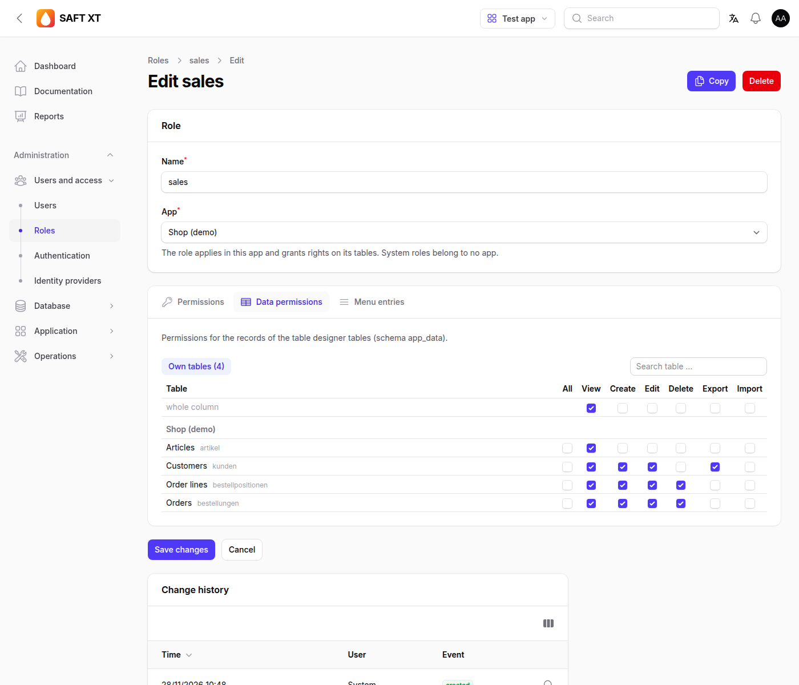
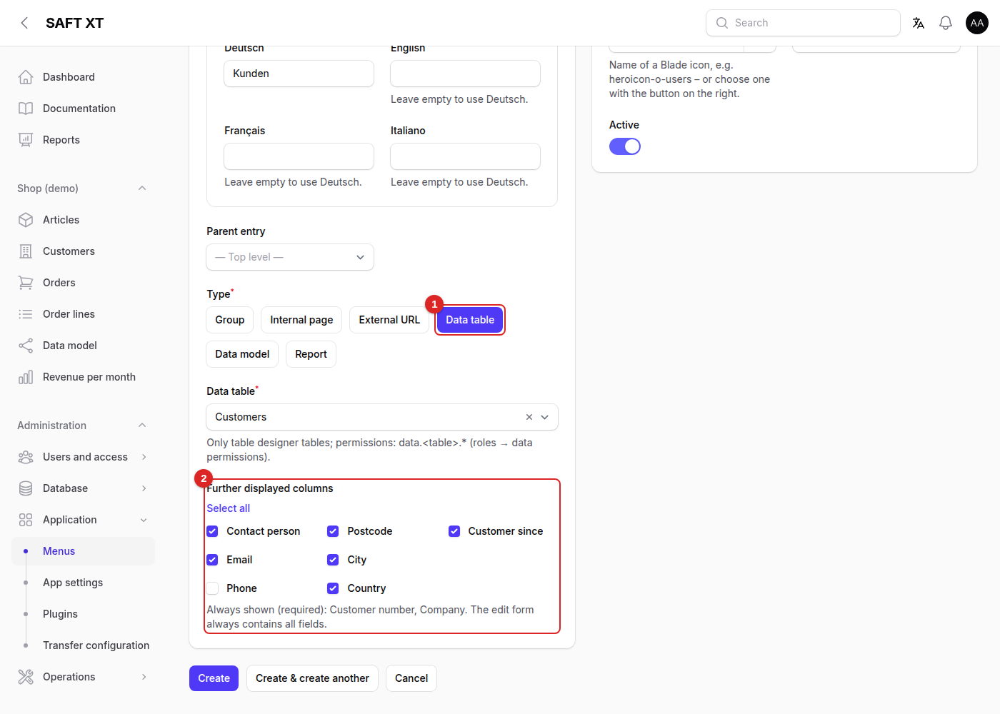
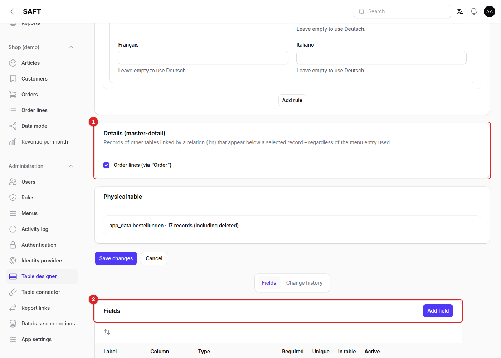
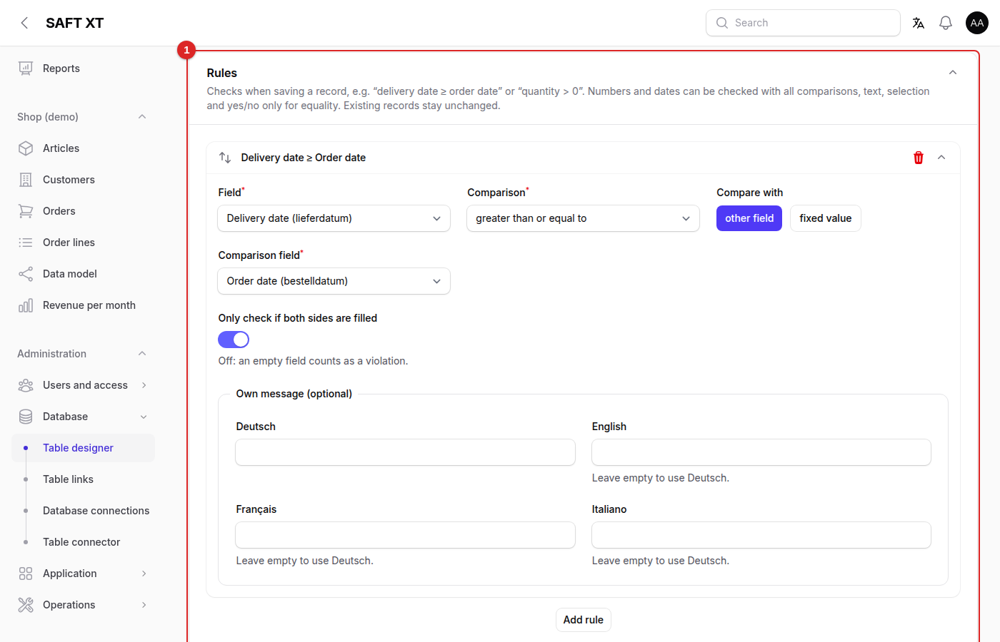
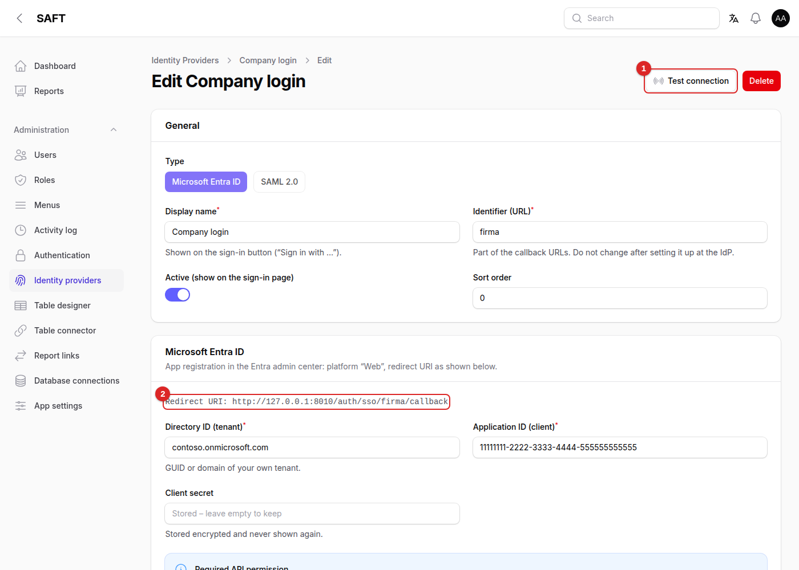
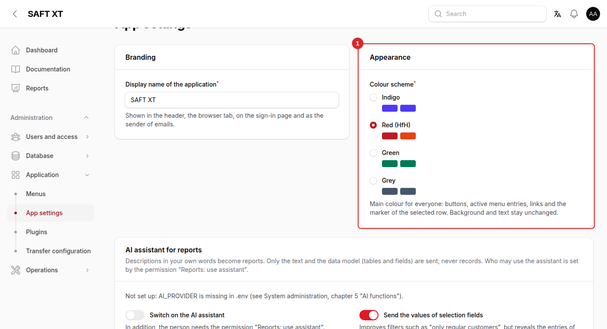
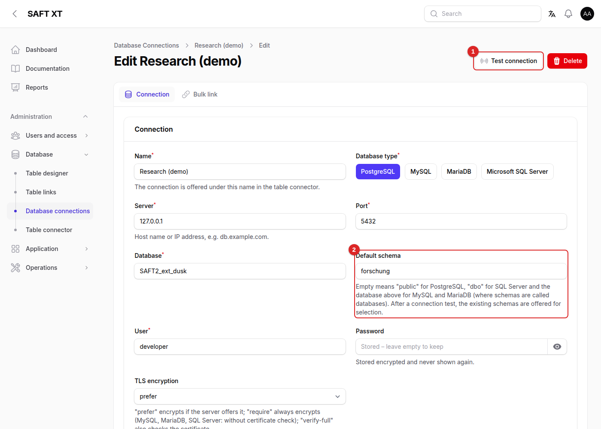
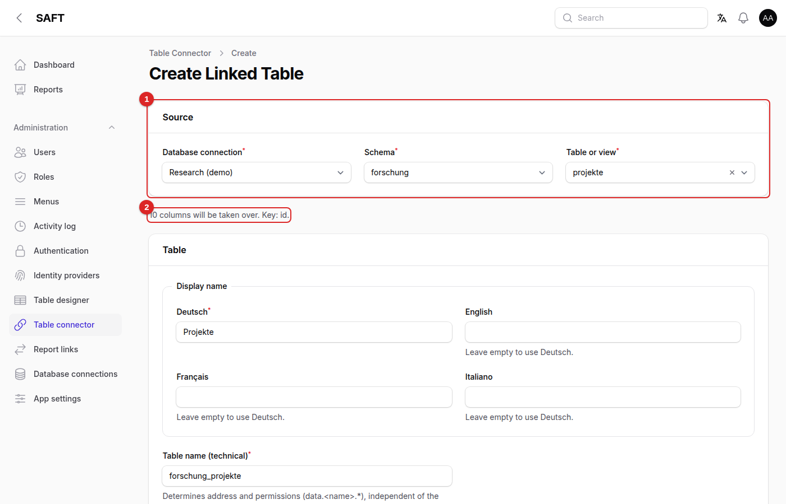
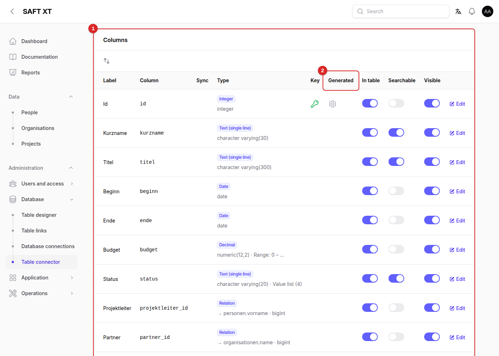
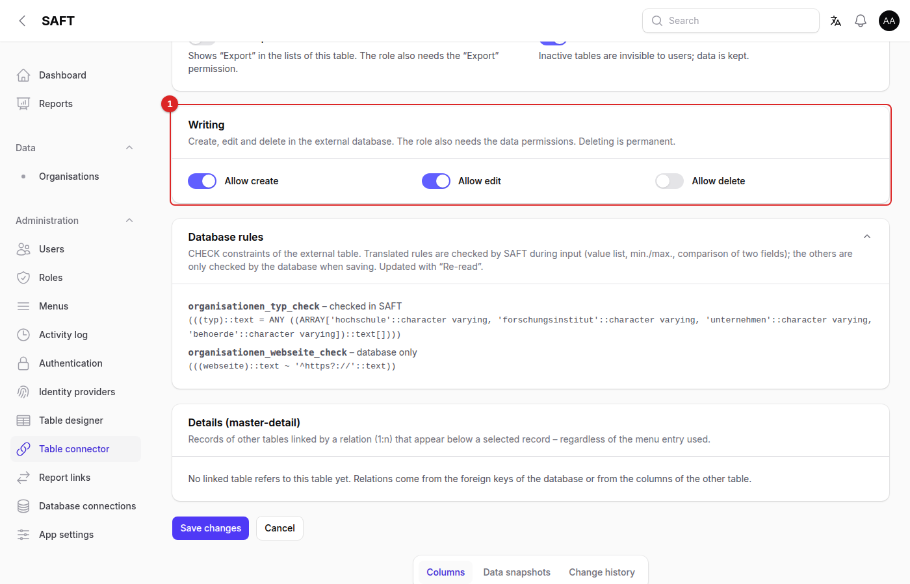

# SAFT XT – Administrator Guide

[Deutsch](ADMIN_GUIDE.de.md) · **English** · [Français](ADMIN_GUIDE.fr.md) · [Italiano](ADMIN_GUIDE.it.md)

**Version:** 0.1 · **Audience:** administrators within SAFT

**Other guides:** [User guide](USER_GUIDE.md) · [Frequently asked questions](FAQ.md) · [System administration](SYSADMIN_GUIDE.md)

> **About the figures:** The figures are screenshots of the application with the demo data. The red numbers in the
> figures refer to the explanations in the text.

---

## Contents

- [1. Users](#1-users)
- [2. Roles and permissions](#2-roles-and-permissions)
- [3. Menus](#3-menus)
- [4. Table designer](#4-table-designer)
- [5. Authentication](#5-authentication)
- [6. Identity providers (single sign-on)](#6-identity-providers-single-sign-on)
- [7. Global settings](#7-global-settings)
- [8. Activity log](#8-activity-log)
- [9. Database connections](#9-database-connections)
- [10. Table connector](#10-table-connector)
- [11. Table links](#11-table-links)
- [12. Scheduled tasks](#12-scheduled-tasks)
- [13. AI functions](#13-ai-functions)
- [14. Plugins](#14-plugins)
- [15. Apps (business applications)](#15-apps-business-applications)
- [16. Documents](#16-documents)
- [Appendix A – Permissions at a glance](#appendix-a--permissions-at-a-glance)

---

You find the following functions in the menu under **Administration**. They are only visible with the corresponding
permissions. Here, too, lists and tables are only as wide as their columns (see [User guide 4.1](USER_GUIDE.md#41-the-table-view)).

## 1. Users

**Administration → Users and access → Users**

- **List** with name, email, roles, active and last sign-in. Filters: active, role, **without role**,
  **SSO link**, deleted users.
- **Create / edit:** name, email, password (required when creating, except in pure SSO mode), active, roles. The
  **default role** (see [chapter 5](#5-authentication)) is preselected when creating.
- **Password rule:** new passwords need at least 12 characters. SAFT rejects passwords from known data leaks (checked
  without sending the password). Existing passwords stay valid until they are changed.
- **Reset two-factor:** if someone has lost their phone and recovery codes, this action at the top of the edit form
  deletes the authenticator app that was set up. The person then signs in with the password and sets up the second
  factor again. Setting up, switching off and resetting appear in the activity log.
- **Inactive users** cannot sign in, neither with a password nor with SSO.
- **SSO links:** in the user you see which single sign-on accounts they are linked to, and you can remove a link.
- **Change history:** every change to the user can be traced at the bottom of the page.
- **Language:** every user chooses their language with the language icon; it is stored with their account and also
  applies to emails sent to them, e.g. for resetting the password.
- **Deleted users** can be shown with the filter, restored or deleted permanently. Their entries in the activity log
  are kept (see [chapter 8](#8-activity-log)).
- **Inactive, deleted or permanently deleted?**

  | | Inactive | Deleted (trash) | Permanently deleted |
  |---|---|---|---|
  | Sign-in | blocked | blocked | – |
  | In the list | visible | only with the filter "Deleted records" | gone |
  | Undo | "Active" switch | "Restore" | not possible |
  | Name in the activity log | yes | yes, marked as deleted | no, only the user number |
  | New SSO sign-in | refused | refused ("Your account has been removed") | may create a **new** account |

  "Inactive" is meant for temporary blocks. A deleted account deliberately stays blocked: otherwise a person who still
  exists at the identity provider would get a new account right away at the next sign-in through auto-provisioning.
  **Delete permanently** (row action for deleted accounts, also as bulk action) is meant for data-protection
  deletions – or when a person should deliberately get a new account via SSO.

Protection rules: nobody can delete or deactivate themselves. Super-admin accounts can only be edited by super
admins, and other users are not even offered the `super-admin` role.

## 2. Roles and permissions

**Administration → Users and access → Roles**



A role bundles permissions. Users receive permissions exclusively through roles.

- **Permissions**: permissions for functions of the application, e.g. "Users: edit", "Table designer: view" or
  **dashboard widgets**.
- **Data permissions**: a matrix with all tables of the table designer and the columns **View, Create, Edit,
  Delete, Export, Import**. New tables appear here automatically. **Import** only works together with **Create** and
  if import is allowed for the table. **Export** only takes effect if export is allowed for the
  table (see [chapter 4](#4-table-designer)) and the role may also view the table. Linked external tables (see [chapter 10](#10-table-connector))
  offer **Create, Edit** and **Delete** only if this is enabled for the table; otherwise "–" is shown.
  The matrix has the tabs **Own tables** (grouped by menu group, technical name shown discreetly next to it) and
  **Connected tables** (grouped by database connection). **All** in a row sets all permissions of the table, the box
  above a column ("whole column") sets the permission for all visible tables. The **search field** filters the rows
  by label or technical name.

- **Menu entries**: all menu entries of the app with a target of their own, e.g. "Data › Customers", a data model or a
  report, also on the top level. Without a tick the role does not
  see the entry in the menu. New entries and new roles are ticked, i.e. visible. This is display only: whether the
  table may be viewed is set by the data permissions. A hidden entry can still be reached through links, the
  master-detail view and the preview. With several roles, for data tables one role with read permission that shows the entry is enough, for other entries
  one role of the app; `super-admin` always sees all entries.

The areas are saved independently; a change in one does not alter anything in the other.

Changed permissions apply immediately, also for users who are already signed in. Anyone who has lost a permission
gets "Forbidden" on the next click; the menu is up to date after reloading the page.

**Special roles:**

| Role | Meaning |
|---|---|
| `super-admin` | Has **all** permissions, also for future functions. Can neither be deleted nor renamed, and is never assigned automatically through SSO. |
| `benutzer` | Default role for new users, without admin permissions; sees the dashboard with the personal widgets. As long as it is set as the default role, it cannot be deleted. |

**View as role (check permissions):** Super admins choose **"View as role …"** in the user menu at the top right and
one or more roles – as a person has them (the default role is preselected, usually a functional role is added).
Afterwards they see SAFT exclusively with their permissions – menu, pages, data permissions, reports and widgets –
like another person with exactly these roles: their own reports do not count as their own. A yellow bar at the top names the role; **End** in the bar restores your own
permissions (signing out also ends the view). The database stays unchanged; start and end are recorded in the
activity log. Note: what the role is allowed to do is really saved during the view – with you as the causer.

**App and copy** (B-107): each role belongs to an [app](#15-apps-business-applications); the form shows data
permissions, menu entries and plugin permissions only for that app (the general SAFT permissions always). Without a
chosen app, a hint to choose the app first appears instead of the data permissions. If the role still has permissions
**outside** its app – on tables or plugins of other apps, e.g. after changing the app or from before apps existed, or on
deleted tables – they are listed at the bottom in the section **“Permissions outside this app”**: tables as a matrix
grouped by app, with only the existing permissions (ticked), plugin permissions and deleted tables as a list. There they
can only be removed (untick, save), not added. If you change the app of a role, all permissions are kept until you
untick them there. Read permissions on **shared tables of other apps** (interfaces,
[chapter 15](#15-apps-business-applications)) are granted in the separate section “Shared tables of other apps” – only
*View*, for opening the other table; everyone sees the shared fields in relations even without this permission. The system roles *super-admin* and *benutzer* belong to no
app and contain only app-wide permissions (e.g. dashboard, help); grant data permissions through the roles of the apps.
**Copy** (in the list and when editing) creates a new role with a name and target app – with the same permissions (data
permissions only for tables of the target app) and hidden menu entries, without members.

## 3. Menus

**Administration → Application → Menus**

This is where the menu on the left is maintained. Every entry has a **type**:

| Type | Use |
|---|---|
| **Group** | Heading for child entries (e.g. "Data") |
| **Internal page** | A page of the application (e.g. Dashboard, Users) |
| **External URL** | A link to an outside address; opens in a new tab |
| **Data table** | A table of the table designer with its own column selection |
| **Data model** | Graphical overview of the data tables of this group and their relations (see below) |
| **Report** | A shared report (see [User guide 4.9](USER_GUIDE.md#49-reports)); appears only for people allowed to run it with their data permissions |



**Menu entry of type "Data table"** (1):

- Choose the **data table**; only active tables of the table designer are offered.
- Choose the **further displayed columns** (2). **Required fields** are always shown and are therefore not
  offered.
- The necessary read permission is set automatically: the entry is only visible to users who may view the table.
- **Several entries** with different columns can be created for the same table.
- If you change the type later, the automatically set read permission is removed again.
- The entry can be hidden for individual roles without removing the read permission (Roles → Menu entries, see
  [chapter 2](#2-roles-and-permissions)).

**Menu entry of type "Data model":** The page shows the data tables of the group the entry is in – including all
subgroups – as a diagram with their relations. If the entry is on the top level, all data tables of its app appear (without an app: all). The page is
generic: the same type can be placed in several groups, and when an entry is moved it automatically shows the new
group. The following applies:

- Shown are tables with a menu entry of type "Data table" in the group, and only those the user may see (read
  permission, not hidden for their roles, active). Tables without a menu entry are missing.
- If a user sees **no table at all** in the group, the "Data model" entry does not appear in their menu. If the group
  would then be empty, it is hidden as well.
- Related tables **outside the group** appear as border nodes with a dashed frame, with their name only. Relations
  to tables without read permission are left out completely.
- **Lines:** solid if the relation is set up as a detail table in the table designer, otherwise dashed. The ends
  show the cardinality: many records refer to exactly one (required field) or to no or one master record.
- **"Show fields"** switches without reloading between the overview with table names and the view with all active
  fields (type, technical name, PK/FK/UK, label, `*` = required field). The browser remembers the choice.
- Linked tables from the table connector have an orange frame and name their connection.
- Like every entry, this one can be restricted by a **permission**. The diagram follows the colour scheme
  (light/dark); wide diagrams can be scrolled sideways.

**Label per language:** The label has one tab per language: **Deutsch** (required), **English**, **Français** and
**Italiano**. If a field stays empty, the German label appears in that language; a grey placeholder in the empty field
points this out (“Leave empty to use Deutsch.”). The entries
supplied with the application are already named in all four languages. Entries that the table designer creates for
a table take over its display name in all languages and follow it whenever it changes.

**Icons:** The button on the right of the **Icon** field opens a dialog with all available icons, sorted by style on
the tabs **Outline**, **Solid**, **Mini** and **Micro**. The search field filters immediately (e.g. "user"), the
number on each tab shows the matches per style; a click takes the name into the field. The current icon is
highlighted and appears as a preview on the left of the field. You can also type the name, e.g. `heroicon-o-users`;
the form only accepts known icons. The same dialog is available for the table icon in the table designer. An entry
with child entries that has no valid icon gets a folder icon.

**Further rules:** A menu has at most three levels: group (heading), entry and sub-entry. An entry with sub-entries is
a **submenu** and appears with an arrow **›**; a click opens its first page and expands it. This is how the
administration is structured (*Users and access*, *Database*, *Application*, *Operations*) and the warehouse demo
(*Warehouse operations*, *Master data*, *Reports*); entries can be sorted by drag and drop. When an entry is deleted,
its child entries are deleted as well.

> The **details** (master-detail) are not set in the menu but in the table designer.

**App:** top-level entries and groups belong to an [app](#15-apps-business-applications) or – without one – to the
system; entries inside a group take its app. For data entries the form only offers tables of that app.

## 4. Table designer

**Administration → Database → Table designer**

This is where you create your own tables, without programming.



**Multilingual:** The display name and description of a table, the label of every field and the display of
selection values have one tab per language (Deutsch, English, Français, Italiano); display name and description are
listed one below the other under the same tabs. This also applies to all other translatable texts of the
administration (menu entries, apps, table links, rule messages, table connector). German is required for the display
name and the label; the other languages are optional, and without them the German text appears – the grey placeholder
in the empty field is a reminder. The technical name and the stored selection
values apply to all languages.

**Creating a table:**

1. **New table** → enter the display name. The technical name is suggested
   (e.g. "Größe in m²" → `groesse_in_m2`) and **cannot be changed later**. Technical names are unique across all
   tables – own, imported and connected. If the name is taken, SAFT says so as soon as you leave the field and names
   the table, e.g. "The name “personen” is already taken: connected table “Personen” (connection Forschung)." If
   another table has the same **label**, only a note appears – allowed, but hard to tell apart in menus and
   selection lists. The same applies to import and the table connector.
2. Optionally create **start fields** and choose the menu group under **"Menu entry under"**. "Data" is preselected;
   all groups are offered, subgroups indented with their path (e.g. "Data › Research"). "No menu entry" creates
   none.
3. Save; the table can be used immediately. Its **data permissions** (View/Create/Edit/Delete) are created
   automatically in role management.

**Allow export:** This switch in the master data of the table allows export (see [User guide 4.7](USER_GUIDE.md#47-exporting-data)). It is
initially off. Even super admins only see "Export" once it is on; everyone else also needs the **Export**
permission in their role.

**Allow import:** This switch allows data import – new records from an Excel or CSV file, e.g. from a downloaded
template (see [User guide 4.8](USER_GUIDE.md#48-importing-data)). It is initially off. Then "Import" appears in the
list for roles with the permissions **Create** and **Import**. The import never changes existing records; it checks as
when entering data by hand, and it is all or nothing. At most 10,000 rows per file
(`APP_DATA_IMPORT_MAX_RECORD_ROWS`). Linked tables of the table connector cannot be imported into.

**Editing fields** (area *Fields*, (2)): for every field you set:

| Setting | Meaning |
|---|---|
| Label / column name | Display name and technical name. **Renaming keeps the data.** |
| Type | see [User guide, Appendix A](USER_GUIDE.md#appendix-a--field-types) |
| Type settings | Length (text), digits (decimal), values (selection list), related table, display fields and separator (relation), file kinds, maximum size and number (file, see below) |
| Validation | Minimum/maximum length, minimum/maximum, email, URL; **Further checks** from plugins, e.g. AHV number or IBAN (only shown when a plugin offers validation rules for the field type; they apply when entering data, when importing and through the interface, empty values are not checked). If the plugin is later missing or resting, the check is skipped and shown as “not available” on the field |
| Required | must be filled in; always shown in lists |
| Unique | may only occur once (deleted records do not count) |
| Default when creating (integer) | **Suggest next number:** in the "New record" dialog the highest existing value + 1 is filled in and can be changed; if the field stays empty, SAFT sets the value when saving. With **Count per** (a relation, e.g. *Order*) it counts per master record: below an order with two lines, 3 is suggested; in the list the suggestion appears as soon as the order is chosen. Deleted records do not count. |
| Default when creating (date, date and time) | **Prefill with today's date** or **Prefill with the current date and time:** in the "New record" dialog the field shows the current date (or date and time to the minute) when it opens and stays editable. When editing, importing and through the API SAFT sets nothing. Not together with "Copy from". |
| Copy from | Take the value from the master record, e.g. *unit price* from **Item → Price**: as soon as an item is chosen in the form (or immediately below an item as detail table), its price is filled in and can be changed. When the item changes, the value follows as long as it was not changed by hand; fields saved empty are filled by SAFT. A copy: later changes to the item do not change existing lines. Only fitting fields are offered (number ← number, date ← date, text ← text/selection, yes/no ← yes/no). A source field cannot be deleted while a field copies from it; renaming is carried over. |
| Searchable | is included in the search |
| Create index | speeds up sorting and filtering in large tables |
| Show in table / Show in form | Default for lists and forms |

**Display fields of a relation:** Instead of the stored number, a relation shows fields of the related record – one
or several, in the chosen order and joined with a **separator** (space, comma, dash, dot or slash), e.g. first and
last name to "Anna Keller" or name and city to "ETH Zürich, Zürich". Empty fields are skipped. This applies in lists,
details, preview, filters, export and in the selection list when editing; there, typing searches all display fields.
Sorting uses the first display field. If you rename a display field, the relation follows; as long as a field serves
as display field anywhere, it cannot be deleted permanently.

**Copying child records along:** With the switch **"Copy along when the parent record is copied"** on a relation
field you define which records belong to the parent, e.g. on `order_lines.order_id`: whoever copies an order can copy its
lines along – in the copy dialog as a preselected tick "Copy along" that can be removed. If the lines have such children
themselves, they come along too. The link then points to the copy, other links stay; files are copied, unique fields
emptied, computed fields recalculated. Relations to the same table (hierarchy) and to tables of other apps do not have
the switch. If a field of a table copied along is unique and required, the copy stops with a message; more than 1000
records per copy are not possible (`APP_DATA_COPY_MAX_RECORDS`).

**File fields:** A field of type **File** takes attachments. Settings:

- **Allowed files:** images (JPEG, PNG, GIF, WebP), PDF, Office documents (Word, Excel, PowerPoint, OpenDocument),
  text and CSV, or **Any files**. The actual content is checked, not just the extension. Ticking a specific kind removes
  "Any files" and vice versa. SVG images are not supported (they can contain scripts).
- **Maximum size per file** in MB (default 10, at most 200). If the server's (PHP) limit is lower, the field shows a
  note; the smaller value applies.
- **Number of files** (default 1, at most 50).

The files are not stored in the database but in the server's file storage (or in S3, see
[System administration](SYSADMIN_GUIDE.md#1-operations)); the record only stores their ID and name. Replaced or
removed files are deleted on saving, as well as when a record is deleted permanently or the field or table is deleted.
Deleted records in the trash keep their files (visible only with delete permission). File fields are not unique, not
sortable and have no index; they are not available in the data import, in reports or as a source for "Copy from".
The export contains the file names; the history shows which files were added or removed.

**Rules** (figure below, 1): Checks across fields when saving a record, e.g. "Delivery date ≥ Order date" or "Quantity > 0".
For every rule you choose the **field**, the **comparison** and whether it is compared with **another field** or a
**fixed value**:



- Numbers and dates allow all comparisons (=, ≠, <, ≤, >, ≥) – a number only with a number, a date only with a date.
  Text, selection lists and yes/no can only be checked for equality (= and ≠). Relations and long text cannot be
  used.
- **Only check if both sides are filled** (default): an empty field is not checked. If switched off, an empty field
  counts as a violation.
- **Own message** (optional, per language). Otherwise the standard text appears at the field, e.g. "must not be
  before “Order date”".
- The rule applies in every form of the table (list, detail tables, details → edit). Existing records stay
  unchanged; if some already violate a new rule, a note shows how many – they are checked the next time they are
  edited.
- Renaming a field updates its rules. A field used in a rule cannot be deleted, and its type can only be changed to
  a type that still fits the rule.

**App and prefix:** when creating a table you choose its [app](#15-apps-business-applications) (required if there
are several apps). If the app has a prefix, it is put in front of the suggested technical name; changing the app
replaces it. Relations are possible to tables of the same app and to shared tables of other apps
([interfaces](#15-apps-business-applications)).

### Computed fields

A field of type **Computed** is not entered but calculated when saving from other fields of the same record or from
its child records, e.g. *amount* from quantity and unit price, or *total* as the sum of the amounts of all lines of an
order. The value is stored and can therefore be sorted, filtered, exported and used in
rules.

- **Result:** integer or decimal (with digits and decimal places); the result is rounded to it.
- **Formula:** number fields of the table (by column name), numbers, `+ - * /` and brackets as well as the functions
  `round(x, digits)`, `min(a, b, …)`, `max(a, b, …)`, `abs(x)` and `coalesce(a, fallback)`. Example:
  `round(quantity * unit_price, 2)`. The function names are the same in all languages. Plugins can bring further
  functions, e.g. `rappen(amount)` (rounding to 5 centimes); they are listed in the input help under **Functions from
  plugins**, and the description appears when pointing at the button. They are not available in report expressions.
  If the plugin is later missing, the result stays empty.
- **Over child records** (tables pointing to this table with a relation): `sum(table.field)`, `avg(table.field)`,
  `min(table.field)`, `max(table.field)` and `count(table)`, e.g. total = `sum(bestellpositionen.betrag)`, VAT =
  `round(gesamtpreis * 0.081, 2)`. Deleted child records do not count; without child records sum and count are 0. If a
  child table points to this table with several relations, name the one you want as second value:
  `sum(bestellpositionen.betrag, bestellung_id)`.
- **Expression per child record:** Instead of a field, `sum`, `avg`, `min` and `max` may also contain a calculation with
  fields of the child table; it is calculated for every child record and then summarised, e.g.
  `sum(bestellpositionen.einzelpreis * bestellpositionen.menge)` or
  `sum(round(bestellpositionen.menge * bestellpositionen.einzelpreis * 0.95, 2))`. The expression only contains fields of
  this one child table (no fields of the master record, no nested summaries). If the result for a child record is
  empty, it does not count – use `coalesce(…, 0)` to control this.
- **Conditions:** `if(condition, then, else)` calculates one value or the other depending on the condition; without
  `else` the result is empty if the condition is not fulfilled. Conditions compare with `=`, `<>`, `<`, `<=`, `>`, `>=`
  and can be combined with `and` and `or`. In comparisons text, select, date and yes/no fields are allowed too; text is
  written in single quotes (a quote inside the text is doubled). Select fields compare the stored value, not the
  translated label; a date is written `'2026-12-31'`. Yes/no fields count as 1 or 0, so they also work directly as a condition: `if(paid, amount, 0)`. Examples: signed amount = `if(type = 'Expense', -amount, amount)`,
  customs costs of a receipt = `sum(if(lines.kind = 'Customs', lines.amount, 0))`, number of lines above 10 pieces =
  `sum(lines.quantity > 10)` (a comparison gives 1 or 0). If one side of a comparison is empty, it is not fulfilled –
  also with `<>`. **Fuzzy text comparisons:** `contains(field, 'part')`, `startswith(field, 'start')` and
  `endswith(field, 'end')` check, ignoring case, whether the text contains the part or starts or ends with it, and also
  give 1 or 0, e.g. `sum(contains(lines.description, 'guitar'))`. Values in functions may also be separated by `;`; SAFT writes them with a comma. The expressions of
  reports do not (yet) have `if()`.
- **Input help:** Below the formula field the fields of the table appear as buttons, e.g. "Quantity
  (quantity)"; a click inserts the technical name at the cursor. Number fields are for calculating, text, select, date and
  yes/no fields for comparisons; the tooltip shows the data type and, for select fields, the stored values. Each child
  table gets its own line with `count(table)` and its fields (`table.field`), plus buttons for operators, functions and `sum`, `avg`,
  `count`; each of these buttons explains its syntax with an example in the tooltip, the help
  text opens with "Help on formulas"; the functions from plugins are at the
  very bottom. Result, digits and decimal places are in one row at the
  top. When creating a new table only the fields further up in the form are listed.
- **Check:** While you type, SAFT reports errors with their position (e.g. "Character 9: Unknown field “price”") or
  confirms what the result depends on. Circular references are rejected; the message names the formulas of the
  fields involved, e.g. "Circular reference: mwst → einkaufspreis → mwst. The formulas: mwst = …; einkaufspreis = …".
- **Empty values:** If a field used is empty, the result is empty – except with `coalesce(field, 0)`. Division by 0 also
  gives an empty result. Calculations are exact (no rounding errors with amounts of money).
- **When it is calculated:** when a computed field is added, for all existing records; when a record is created (also
  by import) or changed (the new values appear in the activity log); when a
  child record is created, changed, deleted or restored for its master record – when the order changes for the old
  and the new one – and further up (e.g. a customer's turnover as the sum of their orders); for all records of the table
  and the ones above after a formula has been changed; and with `php artisan computed:recompute` if data was changed
  outside SAFT.
- In the form a computed field is only shown ("calculated when saving"). Rules that check a computed field therefore
  take effect the next time the record is edited.
- If a field used is renamed (also in a child table), the formula changes along; deleting it and changing it to a
  non-number type are blocked while a formula uses it. A child table that is summed cannot be deleted.
- The demo data contains *amount* (order lines) as well as *total* and *VAT 8.1 %* (orders).

**Details (master-detail)** (1): Here you choose which related tables appear below a selected record (see
[User guide 4.3](USER_GUIDE.md#43-related-tables-the-master-detail-view)). All relation fields of other tables that point to this table are
offered. If there are several relations from the same table (e.g. "Customer" and "Invoice to"), they can be chosen
individually.

**Further buttons:** *Open data* (to the data view) and *Create menu entry*. It asks for the group and also creates a
further entry if the table should appear in a second place in the menu.

**What is possible – and what is not:**

| Change | Rule |
|---|---|
| Rename a field | at any time, data is kept |
| Change the type | at any time if lossless (e.g. integer → decimal, text → multi-line text, date → date and time); multi-line → single-line text if all values fit the length; otherwise only if the column is empty |
| Text length | increase at any time, reduce only if all existing values fit the new length (otherwise the message says how many are too long) |
| Switch on "Unique" | only if the existing data contains no duplicates |
| Remove a value from a selection list | at any time; if the value is in use, a warning shows the number of records. They keep their value, but a valid one must be chosen when they are next edited. |
| Delete a field | first **deactivate**, then "Delete permanently" by entering the column name |
| Delete a table | first **deactivate**, then "Delete permanently" by entering the table name; not possible while other tables refer to it |
| Relation | only to other tables of the table designer, never to system tables |

> **Deactivate instead of delete:** A deactivated field or table is invisible to users, but the data is kept in
> full. You bring a field back with "Activate" without confirmation. Deleting permanently cannot be undone.
>
> **Field list:** the actions are icons with a tooltip in the row – edit, **history** (clock: who changed what on the
> field when), show/hide and delete. The eye shows the state: open for an active field, crossed out for a deactivated
> one. If a plugin needs the field or another app uses it through the interface, the icon is locked (pale); the
> tooltip names the reason. Like here, all lists of the administration show their row actions as icons with a tooltip;
> **View** is the magnifying glass.

Under **Physical table** you see the storage location, the number of records and any mismatch between the settings
and the database.

### Used in

The tab **Used in** (next to *Fields* and *Activity log*) shows where the table appears; the number on the tab gives
the count. It is for information only, e.g. before renaming or deleting:

| Area | What appears |
|---|---|
| Plugin | plugins that require the table, check changes to it or show buttons in its data view |
| Report | reports with the table as base table or through a relation |
| Link (report) | links between reports with the table as source or target |
| Menu | menu entries opening the data view (with the path in the menu) |
| Relation | fields of other tables referring to this table |
| Formula | computed fields of other tables summarising over this table, e.g. `sum(orders.amount)` |
| Copy | fields of other tables copying a value from this table |
| Role | roles with data permissions on the table, with the permissions |
| Scheduled task | "Refresh snapshot" tasks for the table |

The name is a link if you may open its page; the filter **Area** narrows the list.

### Delete a table or field permanently

Deleting permanently removes the column or table **including its data** from the database. To prevent this from
happening by accident, it takes two steps; until then the **"Delete permanently"** button is visible but locked
(the hint appears when you hover over it):

| | Table | Field |
|---|---|---|
| 1. Deactivate | edit the table, switch **"Active"** off, **Save** | in the field list **"Deactivate"** |
| 2. Delete | **"Delete permanently"** at the top | the **trash icon** in the row ("Delete permanently") |
| 3. Confirm | enter the technical table name | enter the column name |

When a table is deleted, SAFT also removes its data permissions and menu entries; the activity log is kept. The
permission **Table designer: delete** is required. If another table refers to it through a relation field, the
message names that field – it must be removed first. If the table is used elsewhere (reports, menus, roles …), the
dialog shows a warning with the count per area; deleting remains possible, details are in the **Used in** tab. If the table or field
contains files (type *File*), the dialog names their number and size; they are deleted too, including those of records
in the trash.

### Import a table from a file

**Table designer → Import** creates a new table from a CSV or Excel file and takes over the data. It requires the
permission **Table designer: import**. The wizard has four steps:

1. **File:** CSV (`.csv`, `.txt`, `.tsv`) or Excel (`.xlsx`), at most 20 MB or 50,000 data rows. For Excel files
   with several sheets you choose the sheet. SAFT checks the file; if it has errors, the wizard stays here and
   lists **all** problems found with row and column.
2. **Check:** summary (rows, columns, for CSV delimiter and character set) and notes, e.g. about a suspected total
   row.
3. **Columns:** per column "Import", field name, label and type. Only types that fit the data are offered (text is
   always possible).
4. **Table and menu:** label, technical table name and the menu group for the table's entry.

**An importable list** has the column titles in row 1 and only data rows below:

| Allowed | Leads to cancellation |
|---|---|
| titles with spaces and special characters ("Customer no.", "Street") | column without title, duplicate titles |
| empty cells | title or blank row above the list, blank rows within the list |
| blank rows at the end | values in columns without title, CSV rows with a different number of columns |
| formulas (the stored result counts) | merged cells, error cells such as `#DIV/0!` |

**Field names** are derived from the titles: "Straße & Nr." → `strasse_nr`, "2024" → `f_2024`. The title itself
becomes the label. System names and reserved words ("ID", "Order") get the suffix `_import`. If two titles result
in the same name ("Customer No" and "Customer-No."), the check names both columns.

**Types** are only detected if **all** values of a column fit:

| Values | Type |
|---|---|
| whole numbers | Integer |
| numbers with decimals (`1,234.50` or `1.234,50`) | Decimal |
| `DD.MM.YYYY` or `YYYY-MM-DD`, optionally with time | Date or date and time |
| yes/no, true/false, ja/nein | Yes/No |
| numbers with a leading zero (postcode `01067`) | Text – the zero is kept |
| everything else | Text; over 255 characters or multi-line: long text |

Whether `1.234` is read as 1234 or as 1.234 is decided for CSV by the delimiter (semicolon: German format, comma:
English); the column preview names the chosen format. SAFT does not guess keys: every table gets its own record number as always; an
"ID" column of the file is imported as a normal field `id_import`.

The import is all or nothing: if a value does not fit, nothing is created and the message names the cell. The
**activity log** contains one entry "imported" with file, row and column count, not one entry per record. At most
ten columns are created as sortable; you enable more in the table designer.

**Imported by mistake?** Open the table in the table designer, switch "Active" off and save, then confirm "Delete
permanently" with the table name (see [Delete a table or field permanently](#delete-a-table-or-field-permanently)).
Afterwards the file can be imported again.

## 5. Authentication

**Administration → Users and access → Authentication**

| Setting | Meaning |
|---|---|
| **Sign-in mode** | **Local** (password only), **Single sign-on** (identity provider only) or **Hybrid** (both) |
| **Emergency sign-in for super admins** | Allows super admins in SSO mode to sign in with a password via `…/admin/login?local=1`, in case the identity provider fails |
| **Offer "Forgot password"** | Email for resetting the password (only in Local or Hybrid mode; requires configured email delivery) |
| **Default role for new users** | Preselected when creating users and assigned to SSO users created automatically |
| **Two-factor authentication** | **Optional**, **Required for administration** (default) or **Required for everyone**. Administration means: super admin or any permission on users, roles, menus, identity providers, settings, table designer, database connections, table connector, table links, scheduled tasks, plugins or apps. Anyone covered is taken to the setup after signing in. Exempt are sign-ins via SSO and accounts without a password (second factor at the identity provider) as well as *View as role*. |

Protection against lock-out: the **Single sign-on** mode can only be saved if at least one active identity provider
has a **successful connection test**. For additional emergency exits in operations see
[System administration, chapter 1](SYSADMIN_GUIDE.md#1-operations).

## 6. Identity providers (single sign-on)

**Administration → Users and access → Identity providers**



**Microsoft Entra ID** and **SAML 2.0** (e.g. ADFS, Keycloak) are supported. Several providers are possible; each
appears as its own button on the sign-in page. A step-by-step guide for Entra ID with the app registration at
Microsoft and troubleshooting is given in System administration, [Appendix D](SSO_ENTRA.md). The addresses of a SAML provider must start with `https://`; a
provider that can only be reached via http cannot be connected.

**Setting up – procedure:**

1. Create the provider, choose the type, assign a display name and an identifier.
2. Enter the displayed **values for the identity provider** (2), e.g. the redirect URI or the ACS URL and the SP
   metadata URL, at the provider. Clicking a value copies the address.
3. Enter the provider's data:
   - **Entra ID:** directory ID (tenant), application ID (client), client secret. Only your own tenant is
     allowed (not `common`/`organizations`).
   - **SAML:** IdP metadata URL *or* entity ID, SSO URL and certificate. For signed requests, generate an SP
     certificate with one click.
4. Save and **"Test connection"** (1). Secrets are stored encrypted and never shown again.
5. Under *Authentication*, choose the **Hybrid** or **Single sign-on** mode.

**User matching:**

| Setting | Effect |
|---|---|
| Link existing users by email | A known user is matched by email at the first SSO sign-in |
| Create unknown users automatically | New people get an account (with the default role) |
| Default role for new users | Granted only when the account is created automatically and kept afterwards. Empty = global default role from [chapter 5](#5-authentication) (the field shows it); mapped roles are granted in addition |
| Allowed email domains | Only these domains may sign in (empty = all) |

**Role mapping:** Roles can be taken from the identity provider: with Entra from **app roles** (recommended) or
**groups**, with SAML from an attribute. Mappings read "external value → role". At every sign-in the mapped roles are
granted or revoked; other roles remain untouched. `super-admin` can never be mapped. Optional: "Only allow sign-in
with a matching mapping".

**Sign-out (single logout):** On request, signing out of SAFT also signs out at the provider. With Entra this
affects all Microsoft services in the browser (Outlook, Teams …), so it is off by default.

## 7. Global settings

**Administration → Application → Global settings**

| Setting | Meaning |
|---|---|
| **Display name of the application** | At most 60 characters. Appears in the header, in the browser tab, on the sign-in page and as the sender of emails |
| **Logo** | Shown next to the name in the header and on the login page. PNG, JPG or WebP, at most 1 MB, ideally square; SVG is not allowed (it can contain scripts). Without an own logo SAFT shows the juice drop. Removing it restores the juice drop. The page “About SAFT XT” always shows the SAFT logo |
| **Also use the logo as the icon in the browser tab** | Off by default: the tab keeps the juice drop |
| **Colour scheme** | Main colour for everyone: **Indigo** (default), **Red (HfH)**, **Green** or **Grey**. It colours buttons, active menu entries, links and the marker of the selected row; background, text and layout stay unchanged. Applies immediately after saving |



In the **Appearance** section (1), each scheme shows two samples: buttons and the marker of the selected row.
All colour schemes meet WCAG AA (4.5:1) in light and dark mode. **Red (HfH)** follows the web style guide of the
HfH: buttons in #BE1925, the selected row marked in the corporate colour #E74011 (it is not used as a button
background because white text on it only reaches 4.1:1). High contrast is a personal setting (see
[User guide, chapter 3](USER_GUIDE.md#3-interface-and-dashboard)).

The section **AI assistant for reports** sets up provider, model and key of the AI functions (see
[chapter 13](#13-ai-functions)).

## 8. Activity log

**Administration → Operations → Activity log**

Every change in the application is logged: who, when, what, with **before/after**. This includes records, users,
roles and permissions, menus, table structures, settings as well as sign-ins, sign-outs and failed sign-in attempts.
Secrets (passwords, keys) are never logged.

- **Filters:** user, event, object type, period. The events are: created, updated, deleted, restored, sign-in,
  sign-in failed, sign-out, exported and document generated (with template, file name and checksum SHA-256).
- **Exports:** table, format, number of rows, filter and search are recorded, never the exported data.
- **User:** "System" only appears where really no user was involved. Deleted users appear with their name and
  "(deleted)", permanently deleted ones as "Deleted user #12".
- **Detail view:** in form width; for changes a table with all changed fields (before → after), for creation and
  deletion the fields compactly in blocks (field and value side by side). Long values wrap. Labels in several
  languages appear with all languages, e.g. `{"de":"Kunden","en":"Customers"}`.
- **Times** are shown in the time zone of the application (see [System administration, chapter 1](SYSADMIN_GUIDE.md#1-operations)).
- In the dashboard widget **"My recent changes"**, clicking an entry leads directly to the changed record; for tables
  of the table designer into the data view with the record selected.
- The log cannot be edited or deleted, not even by super admins.

## 9. Database connections

**Administration → Database → Database connections**

This is where you set up connections to external databases, such as an ERP or research system. The **table
connector** (see [chapter 10](#10-table-connector)) links tables of these databases so that they can be read like the
tables of the table designer. **PostgreSQL**, **MySQL** (8.0.16 or newer), **MariaDB** (10.11 or newer) and **Microsoft
SQL Server** (2019 or newer, Express as well) are supported, regardless of which database SAFT itself uses. For SQL Server the SAFT server needs the
PHP extension `pdo_sqlsrv` and the Microsoft ODBC Driver 18; without them the type is disabled in the selection.



| Setting | Meaning |
|---|---|
| **Name** | The connection is later offered under this name in the table connector. |
| **Database type, server, port, database** | Where the database is located, e.g. `db.example.com`, port 5432. |
| **Default schema** (2) | The schema with the tables you want; empty means `public` for PostgreSQL, `dbo` for SQL Server and the connection's database for MySQL and MariaDB (where schemas are called databases). After a successful test the existing schemas are offered for selection. |
| **User, password** | Sign-in to the database. The password is stored encrypted and never shown again; an empty field keeps it. |
| **TLS encryption** | `prefer` encrypts if the server offers it; `verify-full` also checks the certificate and host name. MySQL, MariaDB and SQL Server: `require` (default) encrypts without checking the certificate (e.g. with a self-signed certificate), `verify-full` checks the certificate, `disable` connects unencrypted. |
| **Timeouts** | For establishing the connection (default 5 seconds) and per query (default 30 seconds). This way a slow or unreachable database does not block pages. |
| **Read only** | Default for new connections. The database itself then rejects every change through this connection. Switch off to edit data. SQL Server cannot enforce this per connection; there SAFT blocks every write – in addition, a user that may only read (role `db_datareader`) is recommended. |
| **Active** | Inactive connections are not offered in the table connector. |

**Setting up:**

1. Choose **Create** and enter the data. After saving, the edit page opens.
2. **"Test connection"** (1) saves the data shown and checks it. If successful, the message names the server
   version, the number of tables and views in the default schema and all existing schemas.
3. If the test fails, the message names the reason, e.g. "Sign-in rejected", "The server … cannot be reached" or
   "The schema … does not exist in this database".

If you later change server, database, user, password, schema or TLS, the connection counts as "not tested yet"
again. Every change is recorded in the change history; for the password only the fact that it was changed.

> **Security:** Create a dedicated database user for SAFT that may only see and, if necessary, change the required
> schemas and tables. Nobody receives the permissions "Database connections: view/create/edit/delete"
> automatically; anyone allowed to create connections can address any server.

**Deleting:** If no tables are linked through the connection, the usual confirmation is enough. Otherwise the dialog
**"Delete connection"** lists all affected tables (name in SAFT, label, external table, kind) and asks what happens to
them:

- **Keep linked tables (without connection, inactive)** – default; permission "Table connector: edit". Tables, columns,
  permissions, menu entries and relations stay; the tables are inactive and marked "Connection missing" in the table
  connector. Later assign them to a (new) connection with "Assign connection …".
- **Delete linked tables too** – permission "Table connector: delete", confirmation with the name of the connection. As
  with "Remove link" in the table connector: settings, permissions, menu entries and relations of other tables to them
  are removed.

The external database stays unchanged in both cases.

**Bulk link:** When editing a connection there are two tabs: **Connection** with the previous settings and **Bulk
link** to link many tables at once. The second tab shows its table only after a successful connection test; before
that, it shows a hint.

1. Choose the schema (filter "Schema", preset with the default schema). The list shows all tables and views with
   type, key, the proposed name in SAFT and – if already linked – the existing name. Tables already linked cannot be
   selected again.
2. Tick the tables you want (or "Select all") and click **"Link selected …"**.
3. In the dialog the settings apply to all selected tables: **prefix** for the technical names (e.g. `erp_`),
   **active**, **allow export**, **allow create/edit/delete**, **menu entry under** a group (or no menu entry) and
   optionally **roles** that receive the view permission and the enabled permissions (only visible with the
   permission to edit roles). **"Set up master-detail from foreign keys"** (default: on) enters, for each newly
   linked table, the tables of the same connection that refer to it as details – e.g. below a storage location its
   stock and movements (see [User guide 4.3](USER_GUIDE.md#43-related-tables-the-master-detail-view)). At most 5 per table: if more tables
   refer to it (typical for lookup tables such as "countries"), nothing is set up there and the result names it.
   Tables with details chosen already stay unchanged.
4. A progress bar shows the state; the tables are linked in portions. Afterwards the **result** lists per table:
   linked, read-only (with reason), skipped (e.g. name already taken) or error.

For each table the same applies as when linking a single table: keys, column types, database rules and value lists
are taken over. **Relations** via foreign keys are determined once at the end for all tables of the connection,
including between the newly linked ones. The **name in SAFT** is derived from the table name: prefix, lower case,
camel case and special characters become `_` (`tblOrder` → `tbl_order`); the label can be changed afterwards in the
table connector. Writing applies only where possible: views, tables without a unique key and connections set to
"read only" stay read-only. Very large databases are linked with the command `php artisan table-connector:connect`
(see [System administration, chapter 1](SYSADMIN_GUIDE.md#1-operations)); it sets up the details as well, with `--no-details` it does not.

## 10. Table connector

**Administration → Database → Table connector**

The table connector links tables and views of a database connection. They then appear under **Data** like the
tables of the table designer: with menu entry, permissions, list, search, filters, sorting, "Details" and export.
Linked tables are initially **read only**; create, edit and delete can be enabled per table (see *Writing* below).
The table connector never changes the structure of the external database.



**Linking a table:**

1. Choose **"Link table"**, then **database connection**, **schema** and **table or view** (1). Views and tables
   without a key are marked in the list.
2. Below, you see what will be taken over (2): number of columns, the key and columns SAFT cannot display (e.g.
   binary data).
3. **Display name** and **description** are prefilled (description from the table comment, if any) and can be
   changed per language.
4. The **technical name** (suggested e.g. `forschung_projekte`) determines address and permissions. It is
   independent of the name in the external database and cannot be changed later.
5. Under **"Menu entry under"** choose the menu group (preselected "Data", subgroups indented) or "No menu entry".
   Later, the **"Create menu entry"** button adds further entries.
6. Save. The table can be used in the menu right away; the permissions **View** and **Export** appear in the
   roles.



**Columns** (1): type and original type come from the database and are fixed. Per column you can choose the
**label** (per language), **In table** (list), **Searchable** and **Visible** (hidden columns appear nowhere, not even
in details and export); the order can be changed. The **key** and **generated** columns (2) that the database fills
itself (sequence, identity, computed column) are marked.

| Column type in the database | Display in SAFT |
|---|---|
| Text (`varchar`, `char`, `text`, SQL Server also `nvarchar`, `nchar`, `ntext`) | Text |
| Integer, `numeric(p,s)` (SQL Server also `money`) | Number or decimal |
| `boolean` (SQL Server `bit`), `date`, `timestamp` (SQL Server `datetime2`) | Yes/No, date, date and time |
| `uuid`, `json`, `time`, `interval` and similar (SQL Server `datetimeoffset`, `float`, `xml`; MariaDB `inet4`/`inet6`) | as text only; initially not in the list, but can be shown |
| Binary data, arrays, geometry (SQL Server also `rowversion`, `hierarchyid`) | not offered |

**Key:** SAFT uses the key to find a single record. It is taken over from the primary key and may consist of several
columns, e.g. `publikation_id` and `person_id` in an assignment table for many-to-many relations. With a key there are
details and editing; with a single key column also selecting a row (master-detail) and relations to the table. Under
**Key** you can choose one or more columns yourself, e.g. for views. Without a key there are only list and export.

**Relations:** A column such as `projektleiter_id` can point to another linked table of the **same database
connection**. Lists and details then show a field of the related record instead of the number, e.g. the name;
clicking it opens the preview (see [User guide 4.5](USER_GUIDE.md#45-taking-a-quick-look-at-a-related-record-preview)).

- **Automatic:** foreign keys of the database are taken over as relations as soon as both tables are linked, in any
  order. A naming field (name, title, label …) is suggested as display field.
- **Manual:** in the columns, via *Edit*, choose related table, one or several **display fields** and, for several,
  the **separator** in the **Relation** area (as in the table designer, see [chapter 4](#4-table-designer)), or "No
  relation". A relation removed by hand is not set again automatically. Possible for integer or text columns,
  including UUID.
- If the link of a related table is removed, columns pointing to it show their value again.

**Details (master-detail):** As in the table designer, choose in the edit page of the linked table which related
tables appear below a selected record (see [User guide 4.3](USER_GUIDE.md#43-related-tables-the-master-detail-view)), e.g. below a project its
publications and below those their author assignments. This also works with UUID keys; tables without a single key
(e.g. assignment tables) appear as detail tables with details and editing, but their rows cannot be selected further. There are no relations between designer tables
and linked tables.

**If the external database cannot be reached** or the connection is inactive, the data view shows "Data not
available" instead of the list.



**Writing:** In the **Writing** section (1) of the linked table you enable **Create, Edit** and **Delete** individually.
This is only possible if the database connection is not set to "Read only", the table is a real table (not a view)
and the database guarantees that its key is unique (primary key or unique index on exactly these columns). A key
chosen by hand without this guarantee is enough for reading, not for writing. The role also needs the data
permissions.

- **Assignment tables (many-to-many):** Below a publication, "New record" creates an assignment; the publication is
  preset and you choose the person. Key columns that the database does not fill itself are always offered when
  creating, even if they are set to "Read only". The key columns are fixed afterwards: to assign another person, delete the
  assignment and create a new one. Editing changes only the remaining columns (e.g. the order). Relation columns with
  a UUID are writable through the selection.

- **Form:** It contains the writable columns. Columns filled by the database (sequence, identity, computed),
  text-only values (uuid, json …; except relations) and columns marked **"Read only"** are left out; you set "Read only" per column,
  e.g. if a trigger writes the value, as well as **"Show in form"**.
- **Key:** If the database assigns the key itself, SAFT reads it back after saving. A natural key (e.g. a country
  code) is entered when creating; afterwards it is fixed.
- **Validation** comes from the database schema: required (`NOT NULL` without default), length, digits, unique values
  and valid relations. If a column with a default stays empty, the database sets its default. Rules such as CHECK
  constraints, triggers and foreign keys are checked by the database; violations appear as a message, e.g. "A value
  violates a database rule."
- **Deleting is permanent** – there is no restore; the confirmation says so explicitly. If linked tables still refer
  to the record, SAFT blocks the deletion and names the reason.
- **Activity log and history** record every change made through SAFT. SAFT does not see changes made to the external
  database by other programs.
- If two people edit the same record at the same time, the last saved change wins.

**When the external table changes** (e.g. a column was added, removed or changed by its owner), SAFT notices it:
the list of linked tables shows the number of differences under **"Sync"** ("up to date" if there are none), and the
linked table shows the note **"The external table has changed"** with the list of differences. **"Re-read"** shows
the differences again and applies them after **"Apply"**:

- **New columns** are added visible and marked **"new"** in the column list; the marker disappears as soon as you edit
  the column.
- **Missing columns** are hidden and marked **"missing"**; they are not deleted, so labels and settings are kept if
  the column comes back. **"Remove permanently"** deletes only the setting in SAFT. Relations that used a missing
  column as display field are adjusted.
- **Changed columns** (type, length, required, default value, unique, generated) are updated; a relation that no
  longer fits the new type is removed. If the primary key changes, it is taken over; if the database no longer
  guarantees that the key is unique, writing is disabled. New foreign keys become relations as when linking.
- A **renamed column** appears as missing plus new; set the label of the new column again.
- If the **table itself is missing**, nothing is changed.

Until the changes are applied, the data view shows "The external table … has changed. Please re-read it in the Table
Connector." instead of a database error if columns are missing. `php artisan table-connector:verify` checks all
linked tables (exit code 1 for differences, e.g. for monitoring); with `--apply` it applies the differences like
"Re-read".

**Database rules (CHECK constraints):** SAFT reads the CHECK constraints of the external table when linking and when
re-reading. The section **Database rules** of the linked table lists them, each marked **checked in SAFT** or
**database only**:

| Rule in the database | In SAFT | Example |
|---|---|---|
| Column limited to a list of values (`IN (…)`) | Selection instead of free text, also as list filter; the column list shows "Value list (n)", the values as tooltip | Status: planned, running … |
| Column compared with a fixed number (`>=`, `<=`, `BETWEEN`) | Min./max. of the field | Year 1900–2100, budget ≥ 0 |
| Two columns compared, also with "is empty or" | Check at the field, e.g. "must not be before “Start”" | End ≥ start |
| Anything else (patterns, functions, nested conditions) | only the database checks when saving | Website must start with http(s):// |

As in the database, empty values are not checked. If a rule that only the database checks is violated, the message
names the field and the rule, e.g. "A value in “Website” violates the database rule “organisationen_webseite_check”".
Changed or removed rules appear under "Sync" as differences and are applied with "Re-read". Tables linked before
this version show their rules as differences once; "Re-read" or `php artisan table-connector:verify --apply` applies
them. Rules are translated for PostgreSQL, MySQL, MariaDB and SQL Server. With MySQL and MariaDB, the values of an
`enum` column are added as a list of values; they appear as the rule "<column> (enum)". JSON columns of MariaDB
(internally text with the rule `json_valid`) appear as JSON; this rule is not listed separately. SQL Server usually compares text without distinguishing
upper and lower case (like MySQL); this then also applies to unique values.

### Data snapshots for reports

The **Data snapshots** tab of a connected table manages the copies that [reports](USER_GUIDE.md#49-reports) work with:

- **Refresh now** reads the whole external table and creates a new snapshot. If that fails (connection lost, table too
  large – limit `REPORTS_SNAPSHOT_MAX_ROWS`, default 200,000 rows), the previous snapshot stays valid; the failed
  attempt is listed with its message until the next snapshot succeeds.
- **Retention:** how many snapshots are kept (default 5) and optionally for at most how many days. The newest snapshot
  is always kept. The limit in days is also enforced by the daily system task "Clean up snapshots".
- **Schedule:** above the tab you see which [scheduled tasks](#12-scheduled-tasks) refresh the table – on its own or
  for its whole connection – with the next date and a link. **Set up schedule** creates a prefilled task (permission
  "Scheduled tasks: create"). Snapshots taken automatically show **automatic** under "Triggered by". With a schedule,
  the report editor only asks once a snapshot is older than two intervals.
- **Delete** removes one snapshot, **Delete all snapshots** all of them; reports on the table only run again after the
  next refresh.

A snapshot never changes: changes and deletions in the source take effect with the next snapshot. New columns are
added with the next snapshot ("Re-read" first). Refreshing and deleting are recorded in the table's change log. Roles
with "Table connector: edit" use this tab. In addition, anyone with read permission on the table can create a
snapshot by choosing it in the report editor; deleting and retention remain with the table connector.

**"Remove link"** removes the table from SAFT – settings, permissions, menu entries and data snapshots. The data in the
external database remains unchanged.

**Without connection:** A connected table can exist without a database connection – after deleting its connection
with "Keep linked tables" or from an installed app whose connection does not exist here (see
[chapter 15](#15-apps-business-applications)). The list then shows **"Connection missing"**; the table is inactive.
**"Assign connection …"** (in the list and when editing; permission "Table connector: edit") chooses an active
connection and compares the columns with the external table like "Re-read". Then check the columns and activate the
table. If the comparison fails (table not found, connection not reachable), it stays without connection.

> **Permissions:** Only roles with "Table connector: view/create/edit/delete" can use the table connector,
> independently of the table designer. Who may see the data is set by the data permissions of the respective table.

## 11. Table links

**Administration › Database › Table links** joins tables **without foreign keys** – also where no relation field is possible: a
SAFT table with a connected table, two connected tables of different connections, or two SAFT tables related only by a
number (e.g. after an import). Usable in **reports** and as **details in the master-detail view**. Nothing is created
in the source databases: reports are computed in SAFT's database, connected tables through their
[data snapshot](#data-snapshots-for-reports); the master-detail view reads live.

Like a relation field, a link points from **many to one**:

| Setting | Meaning |
|---|---|
| Label | shown in the field tree of the report editor and in the heading of the details, e.g. "Person (Research)" (per language) |
| Source: table, field | the field holding the value to look up – integer, text or selection |
| Target: table, unique field | SAFT table: `id` or a field marked "unique"; connected table: its key. This ensures no row is multiplied. Only fields matching the source field are offered (integer to integer, text to text). |
| Matches | shows while creating how many source rows with a value find a target, e.g. "1,840 of 1,900 (97 %)" – a low value hints at a wrongly chosen field. For connected tables the data snapshot counts. |

In the report editor, the target table's fields appear under the link's label, up to three levels deep and mixed with
ordinary relations (e.g. "Contacts › Person (Research) › Employer › Country"). The base table selection counts the
link as a connection; missing snapshots are created on selection as usual. Values without a match give empty target
fields. As always, the report requires read permission on every table involved. If a link is deleted, every report
using it names the missing link; if the source or target table or field is deleted, the link is removed too. Changes
are recorded in the activity log.

**As details (master-detail):** under "Details (master-detail)" of the **target table** (table designer or table
connector) the table links can be chosen, e.g. "Contacts (via table link "Person (Research)")". Selecting a record of
the target table then shows all rows of the source table with the same value below it – live, also between a SAFT
table and a connected table or two connections. **New record** in this detail table prefills the source field with
the value. Unlike relation fields, a table link does **not protect** the target record **from deletion** (there is no
foreign key). For large connected tables the source field should have an index in the source database. In the
[data model](#3-menus) table links appear with "⇄" before their label.

> **Permissions:** "Table links: view/create/edit/delete".

## 12. Scheduled tasks

**Administration › Operations › Scheduled tasks** lists what SAFT runs by itself on a schedule. Each task has a **type**, its
**parameters** and a **schedule**:

| Type | Parameters | Effect |
|---|---|---|
| Refresh snapshot | connected table | new [data snapshot](#data-snapshots-for-reports) of this table |
| Refresh snapshots of a connection | database connection; "Only tables that already have a snapshot" (on by default) | new snapshots of all (or the already used) connected tables of the connection, one after another. If a table fails, the others continue; the run then counts as failed and names the tables |
| Clean up snapshots (system) | – | enforces the retention of all snapshots, also without a new refresh, and cleans up aborted runs; default daily 03:15 |
| Clean up run log (system) | keep runs (days, default 90) | deletes older entries in the run log; default daily 03:30 |
| Back up database (system) | include files from file fields (default on) | backup like `php artisan db:backup` to `storage/backups`, the files from file fields as a ZIP alongside (only if they are stored on the server); if it fails, the run names the reason and the bell notifies the super admins; default daily 02:30 |
| Clean up backups (system) | keep backups (days, default 14); always keep at least (default 3) | deletes older backups in `storage/backups` (a backup and its ZIP count as one), the newest always stay; default daily 02:45 |
| Clean up files (system) | – | deletes orphaned files from file fields: uploads from cancelled forms, files of records that no longer exist and files without entry – each only after 24 hours; the run only names missing files; default daily 03:00 |
| Reset app data (system) | apps (the installed demo apps, with the name of their app); back up first (default on) | deletes the **data** of the chosen apps and reloads the delivered state – tables, menus, reports and permissions stay; attached files of the demo tables are deleted (backed up first). For public demos; delivered switched off and only effective if the server allows it with `DEMO_RESET=true` (otherwise "skipped"); default daily 04:00 |

Plugins can bring further kinds; they appear under **New** in "Type". The example plugin *Stock board* brings
**Warehouse: stocktaking reminder** (reports stock not counted for a configurable number of days in the run log) and
**Warehouse: report minimum stock** (notification in the bell to everyone with the permission *Stock board: View stock
matrix* when items are below minimum stock). Tasks of a switched-off or resting plugin are skipped.

Several tasks for the same table or connection are possible, e.g. weekdays at 06:00 and additionally on Sundays.
**System tasks** can be adjusted and switched off, but not deleted; if they are missing, `php artisan db:seed` creates
them again.

**Schedule:** hourly (at minute …), every N hours (2, 3, 4, 6, 8 or 12, starting at a time – e.g. from 06:00 every
4 hours: 06, 10, 14, 18, 22, 02), daily, weekdays (Mon–Fri) or weekly (day and time), in the application's time zone.
When the clocks change, wall-clock time applies; a time that does not exist (02:30 in March) runs an hour later. If the
server was down, a missed date is caught up **once**. "Active" off: the task no longer runs on schedule.

**Run now** (list or edit page) starts a task immediately; the schedule stays. The **Runs** tab shows every run with
time, trigger (schedule, manually, console), status, duration and message. A task never runs twice: if it is still
running, the new run is "skipped"; the same applies when the same table is being refreshed manually.

**Investigating a failure:** for an unexpected error the message only names a **reference**, e.g. "The task failed
(reference K7Q2M9XA)" – technical details can contain paths, table names and values. Anyone with the permission
*Scheduled tasks: see technical details* (super admins always) opens them at the run with **Details**: error, message,
location in the program, causes and trace. The same error is described in more detail under the reference in the log
file on the server (`storage/logs/laravel.log`).

**System log:** *Administration › Operations › System log* (permission *System log: view*; super admins always) shows the newest
entries of this log file, at most 500 and for large files only its end: time, level (error, warning, info …), message
and reference. Search (also for a reference) and the level filter narrow it down, **Show** opens an entry completely,
**Download extract** saves the part that was read. From the details of a run, **Show in the system log** leads there
directly. The entries may contain paths, SQL with values, email and IP addresses; every visit is recorded in the
activity log.

**Notification:** if a task fails, **all super admins** get a notification (bell, in their language) – on the first
failure and again when it succeeds for the first time afterwards; repeated failures in between are counted in the
column "Failures in a row". The dashboard widget **Scheduled tasks** shows a traffic light (all fine, failed tasks,
scheduler not running) and the latest runs.

**Requirement:** the tasks are run by the scheduler through a cron entry on the server (see
[system administration](SYSADMIN_GUIDE.md#4-scheduled-tasks-and-cron)). Without it, the list says "Scheduled tasks are
currently not running".

> **Permissions:** "Scheduled tasks: view/create/edit/delete"; "Run now" with "edit". For the widget additionally
> "Dashboard widget: Scheduled tasks (status)". Changes to tasks are recorded in the activity log.

**App:** tasks for a table belong to its [app](#15-apps-business-applications); for other tasks you choose the
app. System tasks belong to no app.

---

## 13. AI functions

SAFT has assistants that turn descriptions in your own words into a proposal. They only propose: the result lands
in the editor or form, is checked there and only takes effect with **Save** or **Create**.

| Assistant | Where | Permission | Can |
|---|---|---|---|
| **Reports** | Report editor, field "Describe the report" | Reports: use assistant | Choose base table, rows, columns, values, filters, sorting, number of rows and display; build calculated values and columns as well as figures from values with formulas; ask back; change a proposal on request |
| **Tables** | Table designer: "Describe the table" when creating, **Adjust with AI** for existing tables | Table designer: use assistant | New table with app (named in the text, otherwise the chosen one; if both are open, it asks), menu group of that app, icon, fields, types (including file fields with kinds, size and number), choices, relations to existing tables, computed fields with a formula (within the same record, e.g. `round(quantity * price, 2)`), field rules (minimum/maximum, length, e-mail, URL) and labels in all four languages. For existing tables as a conversation (dialog with history; questions and notes appear there, a further request refines the proposal, **Apply** carries it out, **Start over** clears the history): new fields – also computed ones with conditions and totals across child tables, e.g. "number of lines above 2 pieces" = `sum(lines.quantity > 2)`; every formula is checked like by hand before it is proposed –, a different icon on request, labels, required/unique/searchable/sortable, further choices, display fields of relations, setting or removing field rules and new table rules (e.g. “delivery date not before order date”). A rule on the same two fields replaces the existing one; contradictory or unfulfillable rules are not proposed – the assistant explains why. Changing types, renaming, deleting, changing or removing existing rules and own rule messages stay manual |
| **Document templates** | Create or edit a document template, field “Describe the template” | Documents: use assistant (app permission) | Write or, on request, change recipient, content (HTML with placeholders) and file name, when creating also the name; uses only fields of the base table, its relations and child tables and never calculates itself (totals come from computed fields); asks questions. Never the letterhead (see [chapter 16](#16-documents)) |
| **Help** | **?** button in the header; **Documentation** › tab **AI assistant** | Help: use assistant | Answers questions about using SAFT from the manuals the person may see, with references to the sections; proposes nothing and changes nothing |

### Setup

1. **Prepare the provider:** For Anthropic create an API key in the Claude Console (*API Keys*); a Claude subscription
   (Pro/Max) alone is not enough, the API is billed separately by usage. Alternatively Amazon Bedrock or Google Vertex
   AI (setup see [System administration](SYSADMIN_GUIDE.md#5-ai-functions)).
2. **Administration → Application → Global settings → AI assistant for reports:**

   | Setting | Meaning |
   |---|---|
   | **Switch on the AI assistant** | Main switch for the report, table and document template assistants |
   | **Provider, model** | Anthropic, Amazon Bedrock or Google Vertex AI; model ID, e.g. `claude-opus-5-5` (with Bedrock prefixed `anthropic.`). Empty = value from `.env` |
   | **Thinking depth** | Low, medium (default), high – higher is more thorough but slower and more expensive |
   | **API key** | Stored encrypted and never shown again; leave empty to keep it, "Delete the stored key" removes it. The activity log shows it masked |
   | **Processing region** | Optional (Anthropic), e.g. `us`; empty = workspace default |
   | **Requests per person and day** | Default for everyone (default 50) |
   | **Send the values of selection fields** | Improves filters such as "only regular customers", but passes the entries of selection lists to the provider |
   | **Switch on help assistant** | Separate switch for the help assistant, independent of the main switch above |
   | **Help assistant knows the data model** | Also sends the tables and fields the person may see (for questions like “Where do I enter suppliers?”); default off |

3. **Test connection** checks key and model via the provider's free model query, without saving.
4. **Grant permissions:** *Reports: use assistant*, *Table designer: use assistant* or *Documents: use assistant*
   (per app) to the desired roles.
   For the help assistant: *Help: use assistant*.
5. **Limit per person** (optional): under **Users** in the field **AI requests per day** – empty = default, 0 = blocked.
   The limit is shared by all assistants.

### What is transmitted – privacy

- **Transmitted** are the text entered, the last rounds of the conversation (for follow-ups like "only 2026") and the
  **data model**: for the report assistant the tables and fields the person may evaluate (labels, technical names,
  types, relations; values of selection fields only with the setting above), for the table assistant the structure of
  the table designer's tables (when creating, of all apps, each with its app, plus the apps, their menu groups and the
  names of the available icons; when adjusting, only the app of the table).
- **Help assistant:** the question, the last six messages of the conversation, title and address of the page the
  person is on, and the manuals they see in the online help (user guide, frequently asked questions, with an
  administration permission the administrator guide), their **own roles and permissions** (so the assistant can say
  which permission is missing for something – in role simulation those of the simulated role) and their **menu** (paths
  and addresses of the entries they see); with the switch above
  also the data model as for the report assistant.
- **Never transmitted** are records, report results, user data or credentials.
- Above the input field people see which provider receives their description.
- The contract with the provider (data processing agreement, storage location) is the organisation's responsibility;
  the **processing region** or choosing Bedrock or Vertex in a specific region helps with this.

### How a proposal is made

The assistant sends the model three things:

1. **Fixed instructions** (system instructions, stored in the source code). They explain the structure of a report or
   table, the notation of field references, the allowed filters, formulas and displays, and rules such as "use only
   tables and fields from the data model", "ask one short question when unclear" or "prefer stored fields such as
   *purchase value* over a formula".
2. **The data model** (see above). The provider caches it for a few minutes, which makes follow-up requests faster and
   cheaper.
3. **The request** with date, language and the current state of the editor – so "as a line" changes the existing
   proposal instead of starting over.

The model answers in a **fixed JSON schema** (no free text). SAFT checks the proposal like any manual input: do the
tables and fields exist, may the person use them, do filters, formulas and display fit? Errors go back to the model
**once** for correction; if the proposal is still invalid, SAFT reports "No valid proposal" and changes nothing. So the
model cannot create anything the person could not also create by hand.

**Good descriptions** say what is counted or summed, what to group and filter by and what the result should look like:
"purchase volume per supplier for 2026, descending, as bars". The assistant answers ambiguous terms ("revenue" in a
warehouse) with a question. It cannot invent what is missing in the data model – then an additional (computed) field
in the table designer helps, e.g. *purchase value* = `round(quantity * purchase_price, 2)`.

### Help assistant

The help assistant answers questions about using SAFT, e.g. “How do I export a table to Excel?”. It answers only from
the manuals the person sees in the online help, in the language of the interface, and refers to the sections; a click
opens the section in the documentation. For questions like “where can I …?” it links the page from the person's menu.
SAFT removes references to sections or pages that do not exist or that the person does not see, as well as external
links. If something is not in
the manuals, it says so and refers to the administration.

- **Conversations** are stored and can be reopened, continued and deleted; each person sees only their own. Only the
  last six messages go to the model, the manuals are cached.
- **Permissions:** the person's permissions apply – also in **role simulation**: if the simulated role lacks the
  permission *Help: use assistant*, the button is missing; otherwise the assistant sees the manuals and tables of that
  role. Conversations and the daily limit belong to the real person.
- **Plugins:** the assistant knows validation rules and fields from plugins through the data model only by name, not
  their exact rule.

### Log and costs

- Every request is recorded in the **activity log** (event **AI assistant**) with person, request text, result
  (proposal, question, error), model and the **tokens** used (input, output, from cache).
- **Costs** are charged by the provider per token; current prices are on its website. Most of the input is the data
  model, which becomes cheaper for follow-up requests thanks to the cache. Costs are controlled by model, thinking
  depth and the daily limit; a spending limit in the provider account caps them additionally.

> **Outlook:** Organisation-specific terms (e.g. "for us, revenue means the purchase value of receipts") could in future
> be stored as **notes for the AI assistant** in the global settings and sent along with the fixed instructions. Until
> then, meaningful labels and descriptions of tables and fields help.

## 14. Plugins

Plugins extend SAFT with their own pages and functions, e.g. a specialised entry form. They are installed by the
system administration (see [System administration, chapter 7](SYSADMIN_GUIDE.md#7-plugins)); how to write a plugin is
described in the [developer guide](DEVELOPER_GUIDE.md). Plugins are program code with full rights – only have plugins
from a trusted source installed.

**How to recognise parts from plugins:** pages of a plugin carry the label **"Plugin: …"** below the title (with a
puzzle icon; anyone allowed to see this page gets here with one click), dashboard cards carry it below the card.
Buttons in data tables name the plugin in their tooltip, scheduled task types carry the addition "(plugin …)", field
rules under *Further checks* show icon and plugin, formula functions in the formula editor name the plugin in their
tooltip.

The page **Administration › Application › Plugins** (permission *Plugins: view*) lists the installed plugins:

| Column | Meaning |
|---|---|
| **Name**, **Identifier** | name and unique identifier; below it the description, the installation location (file of the plugin class, e.g. `plugins/lager-umbuchung/src/LagerUmbuchungPlugin.php`) and the Composer package. The plugin's permissions start with the identifier |
| **Version** | installed version |
| **Status** | *active*; *resting* if something the plugin needs is missing (see **Dependencies**); *switched off* if the administration has switched it off (see below) |
| **Compatible** | *Yes* if the plugin fits the plugin interface (API) of this installation (or the SAFT version, if it requires one); below it its requirement, e.g. “API ^1.0”; *No* with a hint to what it requires and what is provided; *not specified* if the plugin states nothing. The provided API version is also shown under **Documentation › About SAFT XT** |
| **Permissions** | permissions the plugin brings |
| **Extensions** | which tables the plugin checks changes on, where it shows buttons in data views, and its dashboard tiles, formula functions and validation rules |
| **Dependencies** | whether the tables and fields of the table designer the plugin needs are present (e.g. “4 tables present”), otherwise what is missing; the button next to it opens the complete list with labels and state (present, missing, deactivated). If the plugin requires another plugin (e.g. “Requires plugin: Stock transfer”), it is shown here as well – if that one is switched off or resting, this one rests too |
| **Menu entries** | how many of the suggested entries are already in the menu |

**Putting a new plugin into operation** (permission *Plugins: manage*):

1. **Create menu entries** adopts the plugin's suggestions into the menu, with a new group if needed. Afterwards they
   are ordinary menu entries that you can move and rename under **Menus**.
2. Grant the plugin's permissions under **Roles**; they are listed among the general permissions as
   “<plugin name>: <permission>”. If the plugin works with table designer tables, the role also needs the matching
   data permissions – which ones is stated in the plugin's description.

**Dependencies and protection in the table designer:** tables and fields an installed plugin needs cannot be deleted,
deactivated or renamed in the table designer; for fields the type is fixed as well. The field list marks them with a
puzzle icon, *Deactivate* and *Delete* are greyed out, and the hint names the plugin. Labels, required, display and
rules remain editable. If a plugin lacks something – for example because it was installed before the warehouse demo –,
the page reports **Plugins are resting**: the plugin's buttons and checks do not apply, and its pages show what is
missing.

**Manuals from plugins:** a plugin can ship its own user guide. It appears under **Documentation** as a further tab –
for people with one of the permissions the plugin names for it – and is knowledge for the help assistant. If the plugin
is resting or switched off, the manual disappears. The example plugins *Stock transfer*, *Stock board* and *Music school: planning* each ship one
in four languages. Validation rules from plugins also show in the table designer under **Further checks** what they
require.

**Switching plugins off** (permission *Plugins: manage*): **Switch off** in the plugin's row shuts it down without
removing it – for example for tests or when two plugins overlap in function. The power icon shows the state – green switched on, red
switched off –, its tooltip what a click does. The dialog shows beforehand what goes
away. While a plugin is switched off,

- its pages cannot be reached (not even through a saved address), its tiles disappear from the dashboard and its menu
  entries are hidden;
- its checks of changes, its buttons in data views, validation rules and formula functions do not apply, and scheduled
  tasks of its kinds are skipped;
- plugins that require it rest (the dialog names them);
- permissions, menu entries and data are kept.

**Switch on** restores everything immediately. Take care with plugins that check or complete changes (column
**Extensions**, “Checks changes”): what is entered in the meantime is not checked or completed by the plugin later
either – with the example *Stock transfer*, stock movements book no stock during that time. Every switching off and on
is recorded in the change log. System administration can also switch plugins on the console
([System administration, chapter 7](SYSADMIN_GUIDE.md#7-plugins)).

**What plugins do in data views:** a plugin can show additional buttons above a table or in its rows and check
changes. If it rejects a change, “Action not possible” appears with the plugin's reason and nothing is saved – in the
data view as well as in imports. These checks do not apply while demo data is being loaded.

**Download developer context** (permission *Plugins: manage*): a ZIP file for external developers or AI agents writing
a plugin for this installation – rules, a description of the plugin interface and the schema of the selected tables
(fields, types, select values, relations, formulas, rules), in English. Records, users and credentials are never
included, connected tables only with their fields. Table and field names can still reveal business secrets – only pass
the file on to authorised people. Every download is recorded in the activity log.

**After a plugin has been removed**, its menu entries (hidden) and permissions remain. The page then reports them as
**Leftovers of removed plugins**; **Clean up** deletes the selected items. Menu entries are preselected, permissions
are not: roles lose deleted permissions for good, even if the plugin is installed again later. The dialog names the
roles that still hold each permission. If plugins are only missing temporarily – e.g. after an update without the
development packages – install them again first instead of cleaning up.

> **Example:** the plugin *Stock transfer* (in development and demo installations) extends the warehouse demo: stock
> movements book the stock at the location (issues always negative, receipts positive; a stocktaking sets the last
> count), stock levels can only be changed through stock movements, the form *Transfer* and the “Transfer” button in
> *Stock levels* move goods between locations, and if an item's total stock falls below its minimum stock, a
> notification appears in the bell. The tile *Warehouse: minimum stock* on the dashboard shows the affected items.
> The plugin *Stock board* requires *Stock transfer* and shows the *Stock matrix* (stock per item and location), the *Stock board* (transfer stock by dragging) and the tile *Warehouse: stock by location* as well as two kinds of scheduled tasks (see [chapter 12](#12-scheduled-tasks)). The plugin *Swiss checks* brings the validation rules AHV number, IBAN, UID and postal code as well as the formula
> function `rappen()`.

## 15. Apps (business applications)

An **app** groups what belongs together: tables, menus, reports, table links, roles and scheduled tasks, e.g.
“Warehouse” or “HR”. Each of these objects belongs to exactly one app; users, sign-in, global settings, AI connection,
database connections and the rest of the administration remain shared by all apps. Background and next steps
(switching between apps, own dashboard, moving, packages): [concept](../concept/APPS.md) (in German).

**Administration → Application → Apps** (permissions *Apps: view* and *manage*) lists the apps with the number of their
tables, menus, reports, links, roles and tasks:

| Setting | Meaning |
|---|---|
| Name, description | in all languages |
| Table prefix | put in front of the technical name of new tables, e.g. `hr` → `hr_absences`. Suggested from the name when an app is created; a later change only applies to new tables |
| Version | free text, e.g. “1.2”; included in the export and the file name |
| Icon, sort order | display in lists |

The **Status** column shows *Active*, *Inactive*, *Removal from …* or *Removal failed* (the message as tooltip),
**Installed** the baseline of an installed app and **Notes** lasting warnings such as “Plugin missing: …” or connected
tables without connection.
The action menu (three dots) contains **Data model**, **Interfaces**, **Export …**, **Update …**, deactivate/activate, remove and – only for empty
apps – **Delete**; apps with content are deactivated and removed (below).

**Where the app is chosen – and where it follows:**

| Object | App |
|---|---|
| Table (table designer, import from file, table connector) | chosen when creating; required if there are several apps. Changing the app replaces the prefix in the suggested name |
| Top-level menu entry or menu group | chosen; without an app the entry belongs to the system (e.g. documentation) |
| Menu entry inside a group | app of the group; data entries the app of their table |
| Report | app of its base table |
| Table link | app of the source table |
| Role | chosen (see [Roles](#2-roles-and-permissions)); *super-admin* and *benutzer* are system roles without an app |
| Scheduled task | for a table: its app; otherwise chosen; system tasks without an app |

**Boundary between apps:** relation fields, table links for reports, “Copy from” and formulas over child tables exist
within one app – across the app boundary only to **shared** tables (interfaces, below). The table designer offers tables
of the same app and shared tables of other apps with their name. When creating, the AI table assistant takes the app
from the text (otherwise the chosen one) and only uses menu groups of that app; it sets relations to tables of that app or to shared tables of other apps (display
only shared fields); when adjusting, it only sees
the app of the table. The administration lists – table designer, table connector, table links, roles, menus and scheduled tasks – choose
the app with **tabs** above the table (order as on the “Apps” page, with the number of entries); the current app of the
title bar is preselected. Roles, menus and tasks also have “System” (entries without an app), all lists “All” with the
column “App”.

**Interfaces:** An app can **share** individual tables with all other apps – read only. In the table designer (edit
table, section **Interface**) switch on “Share with other apps” and choose the **shared fields** (suggested: the
searchable ones; the ID always belongs to them). Other apps can then:

- refer to the table with a **relation field** (in the choice “Item (Warehouse)”); only shared fields are available as
  display fields,
- fetch a shared value into their own table with **“Copy from”**,
- use the shared fields in **reports** through a relation field or a table link – without read permission on the other
  table; from there it does not lead further into the other app, and it is not offered as a base table,
- create **table links** to the table (target field: ID or a shared unique field; the choice names the app).

Creating, changing or deleting in the other app's table is not possible through the interface; there are no totals over
child tables of another app, and “Details” only offers tables of the own app. The shared fields are visible in relations
to everyone who sees the own record; opening the other table itself (list, preview) needs its read permission – granted
in the role in the section “Shared tables of other apps”.

What another app uses – relation fields, table links, fields in its reports – is a **contract**: the table cannot be deactivated, deleted, moved to another app or withdrawn
from sharing, used fields cannot be deleted, renamed, changed in type or deselected (the switch is then locked, used
fields are listed as “Permanently shared” above the choice, the section names the users); an app with a used interface
cannot be removed. Taking an unused field out of the sharing raises the **version** of the app's interface. If the
sharing app is **deactivated**, the referring fields show “not available” and the choice stays empty, reports report “currently not available” (the super admin still sees the values); the confirmation when deactivating points this out. On the **Apps** page the column
**Interfaces** shows the number of shared tables and the action **Interfaces** (dots menu) what the app shares, who uses
it and what it uses from other apps itself.

**Access and current app:** a person has access to an app if they have a role of that app or – through any role or
directly – data permissions on one of its tables or permissions of a plugin of that app; the super admin has all apps.
With several apps the **switcher** appears at the top (see [user guide](USER_GUIDE.md#switching-apps)). The current
app determines:

- **Navigation:** system entries (dashboard, documentation, reports, administration) and the menus of that app.
- **Dashboard:** layout per app; report cards only in their app.
- **Reports:** list and base tables in the editor from that app. The permissions *Reports: view, create, edit, delete,
  assistant* apply per app – through a role of that app or a system role.
- **Documentation and help assistant:** the general manuals, the app's manual and the manuals of its plugins; with
  “Help assistant knows the data model” only the tables of that app.

**Manual of an app:** on the **Apps** page, **“Manual”** uploads one Markdown file per language (replace or remove); if a
language is missing, German is used. Level 2 and 3 headings form the table of contents. The “Shop” demo comes with a
manual.

**Plugins:** a plugin belongs to the app that holds all tables it needs (e.g. the warehouse plugins to the app with the
warehouse tables); plugins without tables apply to all apps. Their manuals appear only in their app.

**Move to another app:** tables change app together with their menu entries, reports (with that base table), table
links and tasks; data, files and technical names stay unchanged. Three ways lead to the same dialog:

- **Table designer:** tick tables, bulk action **“Move to another app”**.
- **Menus:** on a top-level group **“Move group to another app”** – the whole group moves with all tables in it.
- **Apps:** on an app **“Move tables …”**, e.g. to split “Existing data”.

In the dialog you choose the target app. The state after moving is checked: references within the selection are fine;
if a relation, table link or report would reach across the app boundary, the dialog names it and does not move.
**“Add connected tables”** adds everything that belongs together to the selection. Menu entries go into a group of the
target app (default: a new group with the name of the current one); empty groups of the old app are removed. For each
role with permissions on the tables you choose: **new role in the target app** (default, name with the target app's
prefix, e.g. `vertrieb-lager`), transfer to an existing role of the target app – both with the members, so nobody loses
access – or remove the permissions. Moving is recorded in the activity log.

**Data model:** shows the diagram of all tables of the app with their relations (like the “Data model” page of a menu
group, with “Show fields”); only tables you may read appear.

**Design with AI (app designer):** **"Design with AI"** at the top of the page (permission *Apps: design with AI*; on
update, roles that may install apps receive it) opens the app designer. It needs a configured AI provider and the AI
assistant switched on (see [chapter 7](#7-global-settings)).

- **Describe:** Describe the app in your own words – which data, how it is related, what should be calculated – e.g. "a
  simple income and expense accounting with VAT, receipts as PDF and items with up to 10 images". With **Design** the
  AI proposes an app: name, prefix and icon, tables with fields, types, choices, relations, file fields, computed fields
  (also conditions and totals across child tables), table rules and menu groups. In the conversation all labels are
  written only in your language (shorter, faster answers); they are translated once when creating the app.
- **Preview:** On the right you see name and prefix, a summary, notes (e.g. about file fields), the data model as a
  diagram and per table the fields with type, relation (`→ table`), formula (`= …`) or choices. **Nothing is created in
  the database.**
- **Adjust:** Write further wishes into the conversation, e.g. "suppliers as a table of their own", and click **Adjust**
  – as often as you like. If the AI asks back, the question appears in the conversation.
- **Checked:** Every proposal is checked completely before it is shown, as when installing – names (also against
  existing tables), relations (within the draft or to shared tables of other apps), formulas and rules. SAFT returns
  errors to the AI for correction; if that fails, the message appears below the input.
- **Drafts:** On the left are your drafts (only yours); every proposal is saved, you can continue later or delete a
  draft. **New draft** starts over.
- **Create app:** **"Create app"** at the top right asks for name and prefix (a different prefix renames the tables)
  translates the labels into the other languages (about half a minute to a minute; if that fails, the app is created
  anyway and a note gives the reason) and creates the app: tables, detail tables (below each table the tables that point to it), menu with data model and
  a **role** with all permissions on the new tables and viewing reports. Unlike installing, the app is **active**
  afterwards and you switch into it. The draft remains, marked "created".
- **Reports:** The AI proposes 2–6 reports for the app – first those your description names, then obvious ones; the
  preview lists them under "Reports (created after the app)", and you change them in the conversation. In the dialog
  "Create app" each proposed report has a preselected tick; deselected ones are not created. If at least one is
  selected, the page stays after creating and shows the progress: the report
  assistant creates one report after another against the new tables (about 20–40 seconds each) – *being created*,
  *waiting*, created (with link) or *not possible* with the reason and **Try again**. The reports are shared and
  appear in the app in the submenu "Reports"; then **"To the new app"** leads into it. Without a selected report you go
  straight into the app.
- **Afterwards** you change the app like any other – by hand in the table designer or per table with **"Adjust with
  AI"**, reports in the report designer. Whoever is not a super admin receives the role of the app when creating it.
- **Privacy and cost:** Only your description, the draft and the structure of shared tables of other apps go to the AI
  – never records. A round often takes one to three minutes (each report counts as a request of its own). One answer holds about 25–30 tables; if the draft is larger, SAFT says so – then start with the most important tables and add more after creating the app (limit: `AI_DESIGNER_MAX_TOKENS`, see system administration) and counts towards the daily limit like the other
  assistants; it is recorded in the activity log.

**Export:** downloads the app as an **app definition** (file `<prefix>-<version>.saft-app.json`, format `saft-app/1`;
permission *Apps: export*). Always included are the tables with fields, rules and details, the table links and the
menus of the app; optional are reports (shared and own), roles with permissions, scheduled tasks, document templates and the manual. Never
included are records, the letterhead, credentials of database connections (connected tables only as a reference), system menus,
system roles and system tasks. Every object carries its stable key so that an installed app can be updated later.
SAFT checks the file for consistency before downloading; the export is recorded in the change log. **Interfaces:**
shares of tables and fields and the version of the interface are included. What the app uses from other apps is listed
under `requires` (app, version, tables, used fields). Roles only take the read permission on shared tables of other
apps along; other permissions outside the app do not belong to the definition.

**Install:** **“Install app …”** at the top of the page (permission *Apps: install*) uploads such a file and shows a
**preview**: name, version and prefix, what will be created, obstacles (red) – e.g. if the app or a table of the same
name already exists –, notes (yellow) and the diagram of the tables. It is installed as:

- **new app (as exported)** – with the same stable keys so that it can be updated later; an app that is already
  installed is refused.
- **copy (new name and prefix)** – e.g. a test copy on the same system: the tables get the new prefix
  (`lager_artikel` → `lager2_artikel`), as do all references to them (relations, totals in formulas, reports, menus,
  data permissions of roles, base table and sections such as `{{#lager_positionen}}` in document templates); all keys
  are new.

The app is created **deactivated** – check it, then activate. If a role name is already taken, the role gets the prefix
of the app (e.g. `vertrieb-lager2`); reports belong to the installing person; file fields come without files. Missing
plugins do not prevent installing; the **Notes** column names them until they are installed. **Connected tables** are
created inactive: if a database connection of the same name exists, they are assigned to it and compared with the
database, otherwise they stay without connection (see [table connector](#10-table-connector), “Without connection”).
If creating fails halfway, the app stays deactivated and can be taken down with “Remove …”. The installed state is
saved as the **baseline** (column **Installed**, e.g. “Installed: 1.2 on 20.11.2026”) – the basis for updating later.
Installing is recorded in the change log.

**Required interfaces:** if the app uses tables of other apps, the preview lists them under “Uses interfaces of other
apps” (e.g. “Warehouse › lager_artikel (fields: artikelnummer, bezeichnung)”). If such a table is missing or it or a
used field is not shared, installing is prevented – install or share the other app first. If the other app is
deactivated or its interface has a different version (but the fields are there), there is only a note. A copy keeps
referring to the same table of the other app; it takes its own shares along, with version 1.

**Update:** You bring an installed app to the state of a newer file of the same app with **“Update …”** (action menu
of the app, permission *Apps: update*). How it fits together:

```
Development (source) ──Export──▶ file 1.0 ──“Install app”, new app──▶ Production
        │ develop further                                             ▲
        └──────────────Export──▶ file 1.1 ────────“Update …”───────────┘
```

- SAFT recognises **the same app** by the **app key**, every object (table, field, report, menu, role …) by its own
  key – not by its name. A renamed field thus stays the same field, the data is kept.
- Only an app that **comes from the same source** can therefore be updated: installed as “new app (as exported)”, with
  the same keys. A **copy** (new name and prefix) gets new keys and is an independent app afterwards – it can only be
  updated from its own exports, never the original from a copy or vice versa. Developing a test version that later
  updates the original needs a second system (test) on which the app is installed as a new app.
- **Never change keys by hand:** if you replace the app key in the file, all tables of the file appear as new and all
  tables of the installed app as “removed in the package” – updating would deactivate them or (on choice) delete them
  with their data.

**The change plan** compares three states: the **baseline** (state of the last install or update, column “Installed”),
the **current state** in SAFT and the **package**. What only the package changes is taken over; what was only adjusted
in SAFT stays; if both changed the same property differently, it is a **conflict** – not preselected, without a choice
the state in SAFT stays. Tables and fields created in SAFT since the baseline and missing in the package are listed under
“Only in SAFT, stays unchanged” and are never removed. An app without a baseline (created here) can be updated as well;
then every difference is a conflict.

The **preview** names versions, obstacles (e.g. file of another app, missing interface) and notes (e.g. no newer
version) and lists the steps with their rating:

| Rating | Meaning | Examples |
|---|---|---|
| safe (preselected) | no data affected | new table or field, label, properties, new choices, order |
| risky (preselected) | existing data or processes affected, nothing is lost | type change with values, technical name, required or unique with existing data, field rules that existing values violate, formula, dropped choices, table rules, deactivating; revoking permissions of a role (with number of people), renaming a role, menu into another group, target of a table link, switching on writing to a connected table; removing a report, menu, table link, task or role without members |
| destructive (not preselected) | data or access is lost | deleting a field or table with data, removing a role with members – only with an additional confirmation |

If a field or table with data is missing in the package, it is first only **deactivated** (data kept); deleting is a
separate step. Without data it is deleted directly. **Not possible** (with a reason) are changes the table designer
would refuse – e.g. a type change that would lose values (e.g. “1 value is longer than 30 characters”) – and changes to
interfaces other apps use. **Table links, reports, menus, roles, tasks, document templates, manual and connected tables** are updated as well – per property (e.g.
“Report …: name A → B”, “Menu …: group A → B”, “Role …: permissions: + …, − …”):

- **Roles:** permissions and hidden menus change as a difference; permissions outside the app stay. A new role whose
  name is already taken gets the prefix of the app.
- **Reports:** new ones belong to the updating person; personal reports of others stay untouched.
- **Menus:** the group is recognised by its key – a renamed group does not move its entries.
- **Document templates:** content, recipient, file name, storage and active per property. A template removed in the
  package is deleted; documents already generated stay with their records (note with the count).
- **Not possible** is removing a table link a remaining report uses or a menu group with remaining entries, as well as a
  task of an unknown type (e.g. from a missing plugin) or without its table or connection.
- **Connected tables:** only the SAFT side (labels, properties of the columns, write permissions, export); updating does
  not change source, connection and key (note). If one is missing in the package, it is only deactivated.

If there is nothing to do, the button is **“Close”** – nothing is backed up and no new baseline is saved.

**Running:** a backup is made first; then the selected steps run through the operations of the table designer with all
protection rules (connected tables, new tables and fields, changes, sharing, table links, reports, menus, roles, tasks, document templates, manual,
finally removing, deactivating and deleting). Afterwards the package is
the new baseline and its version the version of the app. If a step fails, updating stops and reports how many steps
have already been run and where the backup is; choosing the same file again shows only the rest. Updating is recorded
in the change log.

**Deactivate and activate:** in the action menu (three dots) of an app; permission *Apps: manage*. A deactivated app
disappears for everyone except the super admin: no longer in the switcher, no menus, reports or cards, no access to its
tables (not via links, reports or export either); its scheduled tasks are skipped (with a note). Data, roles and
permissions stay unchanged – activating restores everything. The super admin sees it in the switcher marked
“(inactive)”, e.g. to build a new app before releasing it.

**Remove (with content):** only the **super admin** – there is no permission for it, so it cannot be granted to any
role – and only for a **deactivated** app. **“Remove …”** in the action menu asks twice:

1. **Overview:** what is deleted permanently (tables with number of records and their files, table connector
   connections – the external table stays –, menu entries, reports, table links, tasks, roles with number of people,
   manual), who will no longer have any app, and what prevents the removal (e.g. plugins that need tables of the app –
   they must be uninstalled first). Tick “checked”.
2. **Confirm:** type the name of the app.

The removal is then only **scheduled**: it runs no earlier than **10 minutes** later – automatically with a scheduler,
without cron (e.g. web hosting) via **“Remove now”**, which appears once the time has passed. Until then **“Cancel
removal”** withdraws it; the app can only be activated after cancelling. When running, SAFT first backs up database and
files (like `db:backup`, name of the backup in the message), then deletes tasks, reports, links, menus, roles, tables
with data and files, the manual and the app; the current app and dashboard layout of people are cleaned up. If a step
fails, the scheduled removal stays with the message (status *Removal failed*); a new attempt continues. Scheduling,
cancelling and removing are recorded in the change log.

**After the update:** existing installations get an app “Existing data” with all existing tables, menus, reports,
roles and tasks; system menus, system roles and system tasks stay without an app. New installations start without an
app; the demo data create one app each (Shop, Warehouse, Research). “Existing data” can be split with “Move to another app” (above).

## 16. Documents

SAFT generates documents such as invoices and letters as PDF. Design and content are separate:

- **Letterhead** (**Administration → Application → Letterhead**): background or header with logo, font, colours,
  margins and sender – once for the installation, per app with deviations if needed.
- **Document templates** (**Administration → Application → Document templates**): what is on the letterhead –
  recipient, subject, items, totals, texts – with placeholders for the fields of a record.

Documents are created in a record's row with the icon **“Create document”** – by persons with the permission
*Documents: generate* in the app (see [user guide, section 4.10](USER_GUIDE.md#410-creating-documents)).

### Letterhead

**Who it applies to:** At the top, under **Letterhead for**, choose either **All apps (installation)** or an app. The
installation's letterhead applies to all apps. An app only sets its **deviations**: empty fields take the installation
value shown in grey – for example, the music school can have its own logo and take everything else. **Remove
deviations** (only for an app) deletes the app's settings and files; the installation's letterhead then applies again.
When an app is removed, its letterhead is deleted with it.

**Permissions:** The installation's letterhead can be changed by anyone with *Global settings: edit*; an app's
letterhead by anyone with the permission *Documents: manage* in that app (through a role of the app, see
[chapter 15](#15-apps-business-applications)).

| Section | Settings |
|---|---|
| **Letterhead** | **Letterhead first page (PDF)** and **Letterhead following pages (PDF)**; without a PDF, **Logo** and **Logo height** |
| **Font and colours** | House font **regular**, **bold** and **italic** (.ttf); **Primary colour**, **Secondary colour**, **Text colour** |
| **Page layout** | Margins in mm for **First page** and **Following pages**; **Address field** left or right; **Sender line** |
| **Sender** | Company, address, VAT number, IBAN, contact – appear in the header and are available to templates as placeholders |
| **Archiving** | **PDF/A-3b** (on by default); for an app: *as installation*, *on* or *off* |

### Letterhead as PDF

The letterhead is most accurate when it comes ready-designed as a PDF (e.g. from InDesign, Affinity or Word). SAFT
places it under every page: page 1 of the file under the first page, page 2 under the following pages. A separate
file for the following pages replaces page 2; without either, the following pages stay blank. When saving, SAFT checks
the file: a PDF that cannot be read (e.g. encrypted) is rejected; a note appears if it is not A4 or – with PDF/A –
probably contains transparency (shadows, semi-transparent areas). Export such a letterhead without transparency, e.g.
as PDF/X-1a or PDF/A.

The **margins** in the page layout determine where the text goes – choose them so that it does not run into the logo,
lines or footer of the letterhead. SAFT places the footer with **Page x / y** at the bottom right.

### Without a letterhead PDF: header with logo

Without a PDF, SAFT puts a simple **header** with logo and sender (company, address, contact) on the first page – on
the side **opposite the address field**: address field on the right (Switzerland), header on the left; address field
on the left (DIN 5008), header on the right. If the header reaches lower than the top margin, the content starts below
it.

- **Logo:** SVG, PNG or JPEG, at most 1 MB. An SVG is cleaned when saved (no scripts and no external references);
  convert text in it to paths, otherwise it appears in the default font. Crop empty space around the artwork first,
  otherwise the logo is not aligned with the sender. SAFT embeds large images reduced to 1000 pixels wide.
- **Logo height:** 5 to 40 mm, default 15 mm. The width follows from the aspect ratio, at most 80 mm – a wider logo
  is reduced accordingly.
- PNG and GIF logos need the PHP extension **gd**; if it is missing on the server, a note appears when saving (see
  [Appendix C, section 1](INSTALL_PRODUCTION.md#1-what-the-server-must-offer)).

### Font, colours and address field

- **House font:** TrueType file (.ttf); its licence must allow embedding in PDFs. SAFT checks on upload whether the
  file can be used. Bold and italic are optional – if they are missing, the regular font appears. Without a house
  font: DejaVu Sans.
- **Colours:** The **primary colour** colours titles and table headers, the **secondary colour** the sender line,
  lines, footer and small texts, the **text colour** the body text.
- **Address field:** at a fixed position for window envelopes – **left** according to DIN 5008 (20 mm from the left,
  45 mm from the top edge), **right** according to Swiss practice (118 mm and 50 mm). Above it, the **sender line** is
  shown in small print; if left empty, SAFT forms it from company and address. The content starts below the address
  field.

### PDF/A and sample page

**PDF/A-3b** is the format for long-term archiving: fonts embedded, colour profile included, nothing from the
internet. It is preset for the installation and can be changed per app.

**Sample page** (top right) downloads a PDF from the **saved** state – save first, then check. It shows the address
field, font, colours, a table of items over two pages (with repeated table header) and dummy text, so that the first
page and the following pages can be seen.

### Document templates

A template belongs to an **app** and a **base table**, e.g. “Invoice” to *Receipts*. The list shows a tab per app;
**Replicate** creates a copy to adapt. The demo apps come with one template each: **Rechnung** (invoice) in the guitar
shop and **Semesterrechnung** (semester invoice) in the music school. When an app or the base table is deleted, its templates are deleted with it.

| Field | Meaning |
|---|---|
| **Name** | unique per app |
| **App**, **Base table** | The template applies to records of this table; its child tables (e.g. items) are available in it |
| **Starting point** | only when creating: *Empty*, *Letter*, *Invoice* or *Data sheet (all fields)*. SAFT builds it from the fields of the base table as soon as it is chosen – *Invoice* takes the first child table as items and computed amounts as totals |
| **File name** | without `.pdf`, with placeholders, e.g. `Invoice-{{belegnummer}}`; SAFT replaces characters that file systems do not allow |
| **Language from field** | a field containing `de`, `en`, `fr` or `it` (e.g. correspondence language); numbers, dates and selection values then appear in this language. Empty: the language of the person. The template's fixed text stays as it is |
| **Store in file field** | a file field of the base table that allows PDF: when creating, “Store in field …” is preselected and the document is added to the record as a new, write-protected file (storing also needs the permission to edit the record). Empty: download only |
| **Active**, **Order** | for the choice when creating |
| **Recipient (address field)** | one line per address line with placeholders; empty lines are dropped. SAFT places it in the letterhead's address field; the content starts below it. Empty: no address field |
| **Content (HTML)** | the document's text as HTML with placeholders, in the code editor with highlighting |

**Permissions:** Templates can be edited by anyone with the permission *Documents: manage* in the app; the list only
shows these apps. Placeholders only show what the person may read (see below).

**AI assistant:** With the permission *Documents: use assistant* in the app, the field **“Describe the template”**
appears at the top of the “Template” section, below the app – e.g. “Reminder with open items and payment within 10
days”, then “add a discount column”. A proposal replaces recipient, content and file name (when creating also the
name), and the preview shows it immediately; it is only saved with the template. **Undo** restores the state before,
**Start over** clears the conversation. Below the field the AI leaves a short note, e.g. when a requested amount is
missing as a computed field in the table. Only the description, the template and the fields of the base table, its
relations and child tables are sent to the provider (choice values only with “Send the values of selection fields”) – never
records. Check errors and PDF hints (e.g. flexbox) go back to the AI once for correction. Set-up, daily limit and log
as for the other assistants ([chapter 13](#13-ai-functions)). New templates start in the app of the tab selected in the
list.

**Designing:** Font, colours, header and footer come from the letterhead. The template uses classes for them:
`primaer`, `sekundaer` (colours), `klein` (small), `fett` (bold), `rechts` (right-aligned); a table with the class
`positionen` gets a coloured header that is repeated on every page, a row with the class `summe` a line above it.
Columns and layouts are built with tables (widths with `width="40%"`); the PDF does not render flexbox, grid, `float`
or `position`. Images only embedded (`data:image/…`), nothing from the internet.

### Placeholders

A placeholder in double curly braces shows the value **as in SAFT**: number with thousands separator, date, label of
the selection value, display of the relation – in the language of the document. The **field picker** next to the
preview inserts placeholders at the cursor with a click, in the recipient or in the content.

| Notation | Meaning |
|---|---|
| `{{belegnummer}}` | field of the base table |
| `{{kunde_id}}`, `{{kunde_id.ort}}` | display of the relation or a field of the related record (up to three steps, e.g. `{{kunde_id.firma_id.ort}}`) |
| `{{#gitarren_buchungen}} … {{/gitarren_buchungen}}` | repeat per child record (e.g. one table row per item), in the order of entry; inside, the fields of the child table |
| `{{#bemerkung}} … {{/bemerkung}}` | only if the field has a value (yes/no: if yes) |
| `{{^gitarren_zahlungen}} … {{/gitarren_zahlungen}}` | only if there are none or the field is empty |
| `{{absender.firma}}`, `{{absender.iban}}` | sender from the letterhead: `firma`, `adresse`, `mwst`, `iban`, `kontakt` |
| `{{heute}}` | date of generation |

**Formats** follow a vertical bar and are capitalised – so SAFT never confuses them with a field:

| Format | Result |
|---|---|
| `{{summe \| CHF}}` | amount with two decimals: 1'234.50 |
| `{{menge \| Zahl}}`, `{{menge \| Zahl:2}}` | number as stored or with the number of decimals |
| `{{datum \| Datum}}`, `{{datum \| DatumLang}}` | 22/11/2026 or 22 November 2026 |
| `{{bemerkung \| Zeilen}}` | keep line breaks (multi-line text, address) |
| `{{status \| Roh}}` | stored value instead of display |
| `{{name \| Gross}}` | CAPITALS |

Totals, VAT and the like are calculated by the tables' **computed fields** – the template only shows them. So the
document and the screen show the same amounts. SAFT places page numbers in the footer itself.

**Permissions:** Related fields and child records only appear if the person generating the document may read their
table; otherwise they stay empty. The display of a relation (`{{kunde_id}}`) always appears.

### Check and preview

The **preview** on the right shows the PDF with a **sample record** (default: the newest whose recipient fields are filled) and updates about one and a
half seconds after the last input – with the unsaved state. Errors appear in red instead of the preview, with the line
number. If the recipient stays empty for the chosen record (e.g. a receipt without customer), this is shown above the
preview.

When **saving**, SAFT checks the template:

- **Errors** – saving is not possible: unknown placeholders (also fields of a child table outside its section),
  unknown formats, sections that are not or wrongly closed, more than three steps across relations, partials
  (`{{> …}}`).
- **Notes** after saving: flexbox, grid, `float`, `position` and `@media` have no effect in the PDF; external images
  are not loaded; SAFT removes scripts, frames and external stylesheets.

Placeholders do not run code; a template can only show data, not change it.

### Passing templates on with the app

Document templates are part of the **app definition** (part “Document templates” when exporting, preselected; see
[Apps](#15-apps-business-applications)): they travel with the app to another system and are brought up to date when
updating. In a copy of the app, the base table and sections (`{{#…}}`) get the new prefix. The **letterhead** is not
included – it belongs to the system the app runs on. If a template no longer fits after installing (e.g. a field is
missing), it is created anyway; the message after installing or updating names the errors, and the template can only
be saved again once it has been adjusted.

## Appendix A – Permissions at a glance

All permissions, grouped by topic, with the label shown when editing a [role](#2-roles-and-permissions). Users receive
permissions only through roles. The **super admin** always has all permissions, including future ones; some actions are
reserved for the super admin and cannot be granted to any role: **View as role** and **removing apps with content**.
“View” is in each case the prerequisite for the other permissions of an area (page and menu entry).

**Users and access**

| Permission | Effect |
|---|---|
| Users: view | open the list of users (Administration › Users and access › Users) |
| Users: create | create and invite new users |
| Users: edit | name, e-mail, roles, activation, reset the second factor |
| Users: delete | delete users |
| Roles: view | open the list of roles |
| Roles: create | create new roles and copy roles |
| Roles: edit | change the permissions, data permissions and menu entries of a role |
| Roles: delete | delete roles (not *super-admin* and not the default role) |
| Identity providers: view | see the providers for signing in via SSO |
| Identity providers: create / edit / delete | set up, change, remove providers (Entra ID, SAML) |
| Authentication settings: view / edit | sign-in mode (local, SSO, both), two-factor obligation, emergency sign-in, default role of new users, “Forgot password” |
| Activity log: view | see all recorded changes (Administration › Operations) |

**Application and operations**

| Permission | Effect |
|---|---|
| Global settings: view / edit | name of the application, logo, colour scheme, AI assistants (provider, model, switches); the installation's letterhead (Administration › Application › Letterhead) |
| Documents: manage | edit an app's letterhead and document templates (app permission, see [chapter 16](#16-documents)) |
| Documents: use assistant | AI assistant in the document templates of an app (app permission, see [chapter 16](#16-documents)) |
| Documents: generate | create and download documents from templates (app permission, plus read permission on the table; storing in a file field also needs the edit permission, removing created documents the delete permission) |
| Menus: view / create / edit / delete | maintain the menu tree (groups, entries, order, permissions of entries) |
| Apps: view | open the “Apps” page and the data model per app |
| Apps: manage | create, edit, activate and deactivate apps, upload the manual, move tables, delete empty apps |
| Apps: export | download an app as a file (`saft-app/1`) |
| Apps: install | install an app from such a file, also as a copy |
| Apps: update | update an installed app from a newer file of the same app (change plan) |
| Apps: design with AI | design and create a new app with the AI app designer |
| Plugins: view | “Plugins” page with version, status and dependencies |
| Plugins: manage | switch plugins on and off, create their menu entries, clean up leftovers of uninstalled plugins, download the development context |
| Scheduled tasks: view | list of tasks and their runs |
| Scheduled tasks: create / edit / delete | set up, change (also “Run now”), remove tasks |
| Scheduled tasks: see technical details | error details of failed runs (stack trace) |
| System log: view | read the server's log file (read only) |
| Help: use assistant | use the AI help assistant (“?” button) |

**Data modelling**

| Permission | Effect |
|---|---|
| Table designer: view | list of tables and their structure |
| Table designer: create | create new tables |
| Table designer: edit | change fields, rules, details, settings of a table |
| Table designer: delete | permanently delete fields and tables (after deactivating) |
| Table designer: import | create a new table with data from an Excel or CSV file |
| Table designer: use assistant | use the AI table assistant (describe the table, adjust with AI) |
| Database connections: view / create / edit / delete | maintain and test connections to external databases |
| Table connector: view | see connected tables and their data snapshots |
| Table connector: create | connect external tables (also bulk linking) |
| Table connector: edit | change connected tables, re-read, assign a connection, manage data snapshots; keep the linked tables when deleting a connection |
| Table connector: delete | remove linked tables, also together with their connection |
| Table links: view / create / edit / delete | links for reports between tables without a relation field |

**Reports and dashboard** (the report permissions apply per app)

| Permission | Effect |
|---|---|
| Reports: view | open shared and own reports |
| Reports: create | create own reports |
| Reports: edit / delete | change or delete reports – also those of other people |
| Reports: use assistant | use the AI report assistant |
| Dashboard widget: My last sign-in | card with the own sign-in before the current one and failed attempts since |
| Dashboard widget: My sign-ins | card with the own recent sign-ins |
| Dashboard widget: My recent changes | card with the own recent changes to data |
| Dashboard widget: Changes to my account | card with changes to the own user account |
| Dashboard widget: Recent changes (system-wide) | card with all recent changes; also needs *Activity log: view* |
| Dashboard widget: My reports | pinned reports as cards; also needs *Reports: view* |
| Dashboard widget: Scheduled tasks (status) | card with the state of the tasks; also needs *Scheduled tasks: view* |
| Dashboard widget: User overview | card with the number of active and inactive users, without role and with SSO; also needs *Users: view* |
| Dashboard widget: Sign-in activity | card with the sign-ins of all users; also needs *Users: view* |
| Dashboard widget: Identity provider status | card with the state of the SSO providers; also needs *Identity providers: view* |

**Data per table (data permission matrix)** – per table of the table designer and per connected table, granted in the
matrix of the role:

| Permission | Effect |
|---|---|
| View | read records; prerequisite for all other data permissions |
| Create | enter new records |
| Edit | change records |
| Delete | delete records (to the trash) |
| Export | download the list as Excel/CSV/PDF – only if export is allowed for the table |
| Import | read new records from a file – only together with *Create* and if import is allowed |

For connected external tables, *Create*, *Edit* and *Delete* exist only if writing is enabled for the table. Tables of a
deactivated app can only be used by the super admin.

**Permissions of plugins** are listed under the plugin's name, e.g.:

| Permission | Effect |
|---|---|
| Stock transfer: Perform transfers | transfer stock between storage locations |
| Stock board: View stock matrix | open the stock board (stock per item and location) |
| Stock board: Transfer on the stock board | transfer directly on the stock board |

The **Plugins** page shows which permissions a plugin brings; if it belongs to an app, role management offers its permissions only to roles of that app. Likewise its dashboard
tiles, field rules, formula functions and task types are only offered in that app; rules, formulas and tasks already
set up stay valid. Plugins without an app of their own are available in all apps.
