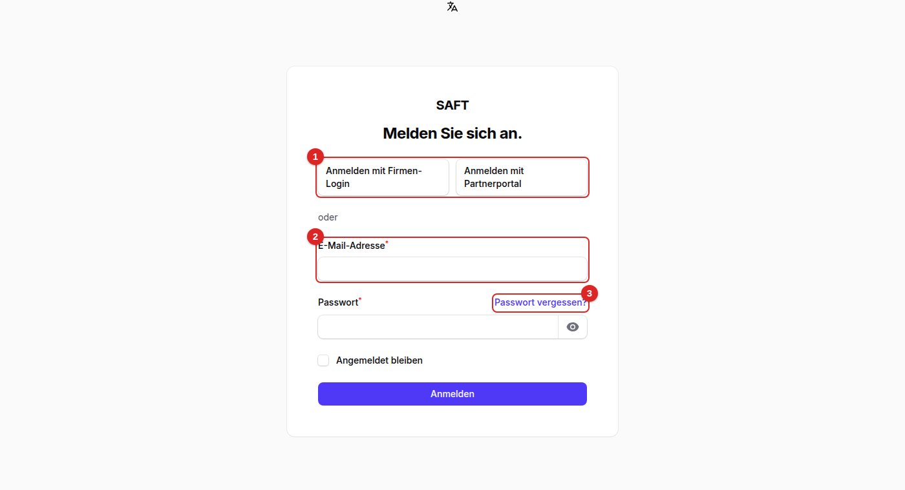
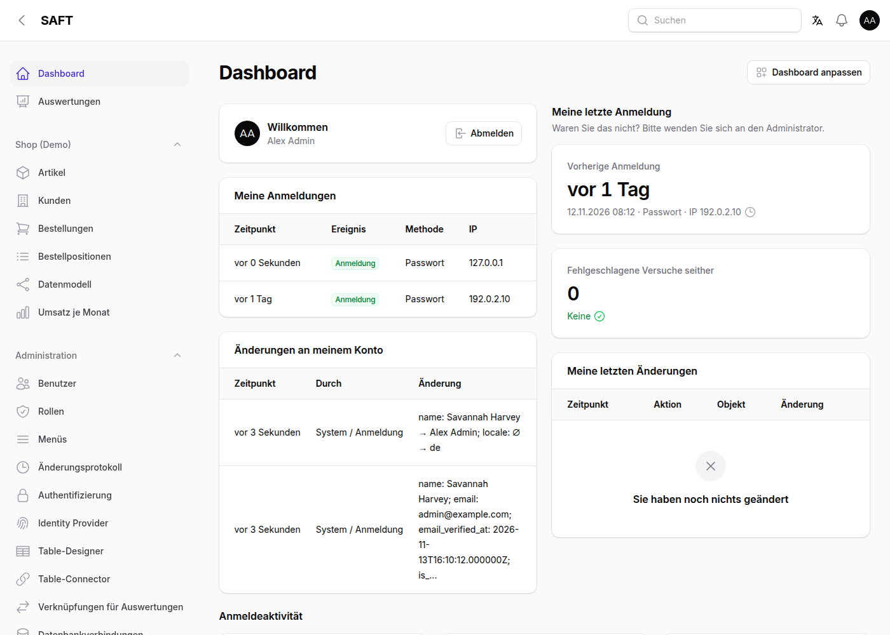
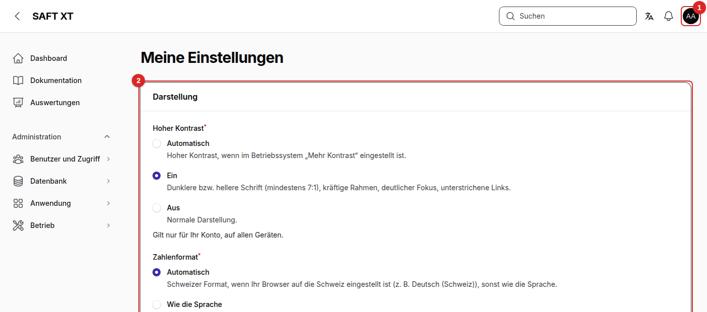
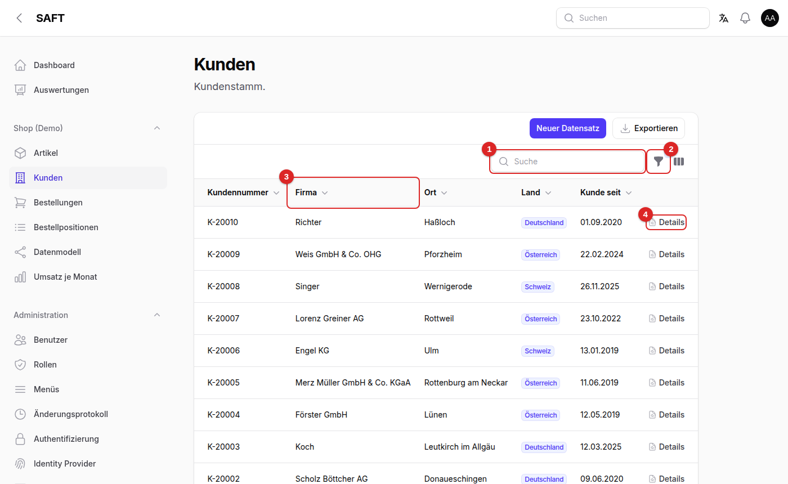
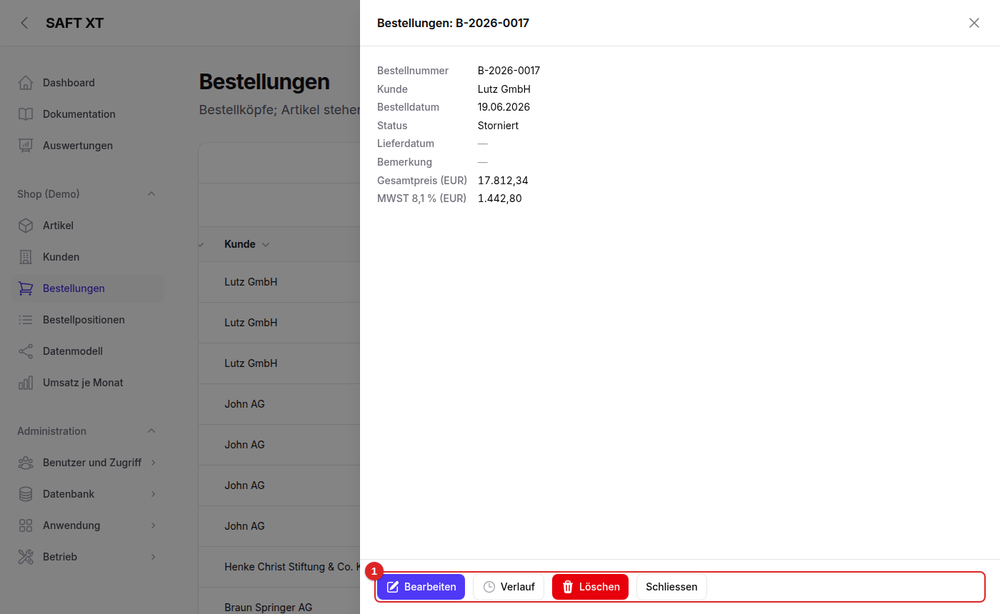
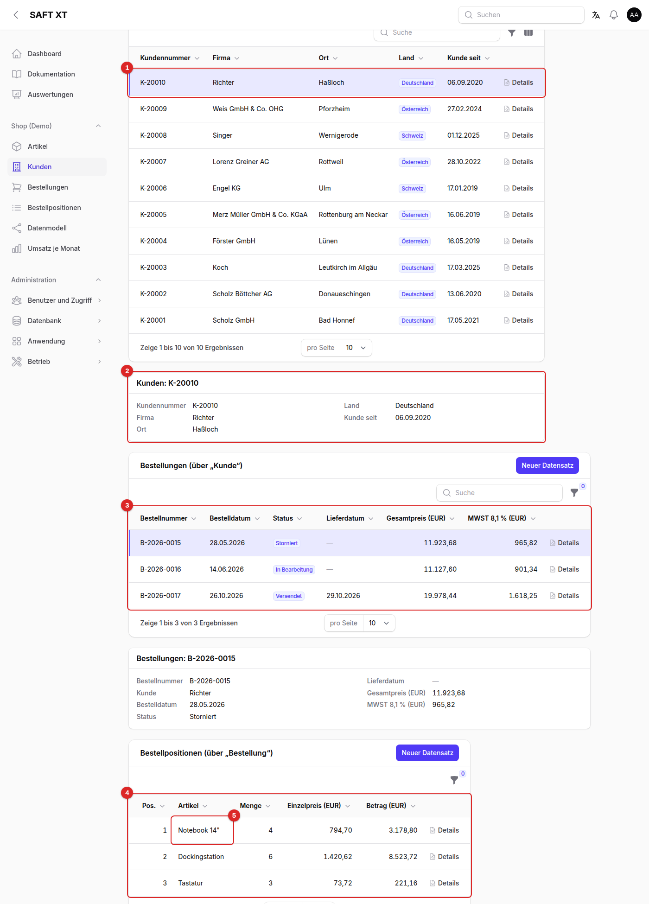
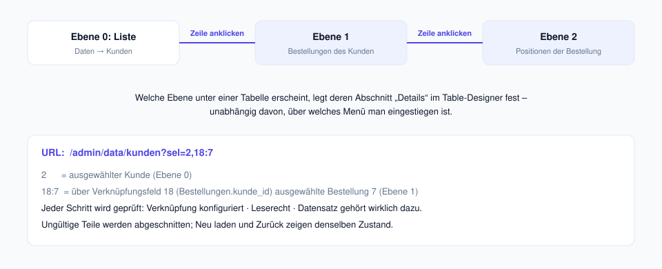
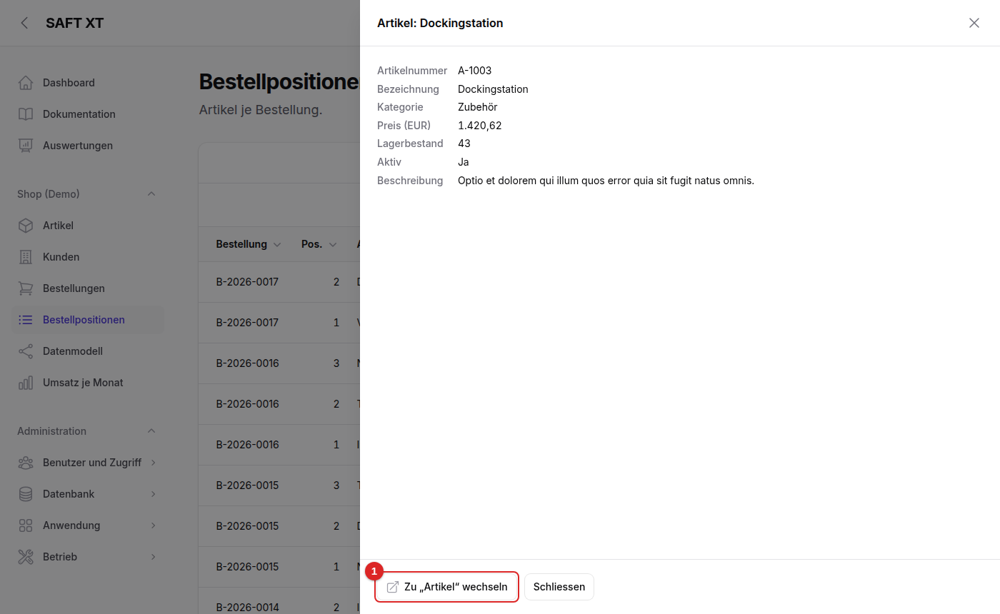

# SAFT XT – Anwenderhandbuch

**Deutsch** · [English](USER_GUIDE.md) · [Français](USER_GUIDE.fr.md) · [Italiano](USER_GUIDE.it.md)

**Stand:** Version 0.1 · **Zielgruppe:** Anwenderinnen und Anwender

**Weitere Handbücher:** [Administratorhandbuch](ADMIN_GUIDE.de.md) · [Häufige Fragen](FAQ.de.md) · [Systemadministration](SYSADMIN_GUIDE.de.md)

> **Zu den Abbildungen:** Die Bilder sind Screenshots der Anwendung mit den Demo-Daten. Die roten Ziffern in den
> Bildern verweisen auf die Erläuterungen im Text.

---

## Inhalt

- [1. Grundbegriffe](#1-grundbegriffe)
- [2. Anmelden und Abmelden](#2-anmelden-und-abmelden)
- [3. Oberfläche und Dashboard](#3-oberfläche-und-dashboard)
- [4. Mit Daten arbeiten](#4-mit-daten-arbeiten)
   - [4.1 Die Tabellenansicht](#41-die-tabellenansicht)
   - [4.2 Datensätze ansehen, anlegen, bearbeiten, löschen](#42-datensätze-ansehen-anlegen-bearbeiten-löschen)
   - [4.3 Verknüpfte Tabellen: die Master-Detail-Ansicht](#43-verknüpfte-tabellen-die-master-detail-ansicht)
   - [4.4 Wie die Master-Detail-Ansicht entscheidet, was sie zeigt](#44-wie-die-master-detail-ansicht-entscheidet-was-sie-zeigt)
   - [4.5 Verknüpften Datensatz kurz ansehen (Vorschau)](#45-verknüpften-datensatz-kurz-ansehen-vorschau)
   - [4.6 Prüfregeln bei der Eingabe](#46-prüfregeln-bei-der-eingabe)
   - [4.7 Daten exportieren](#47-daten-exportieren)
   - [4.8 Daten importieren](#48-daten-importieren)
   - [4.9 Auswertungen](#49-auswertungen)
- [Anhang A – Feldtypen](#anhang-a--feldtypen)
- [Anhang B – Glossar](#anhang-b--glossar)

---
## 1. Grundbegriffe

| Begriff | Bedeutung |
|---|---|
| **Tabelle** | Eine Sammlung gleichartiger Daten, z. B. *Kunden* oder *Artikel*. Tabellen werden von Administratoren im **Table-Designer** angelegt. |
| **Datensatz** | Eine Zeile einer Tabelle, z. B. ein einzelner Kunde. |
| **Feld / Spalte** | Eine Eigenschaft eines Datensatzes, z. B. *Firma* oder *Ort*. |
| **Verknüpfung** | Ein Feld, das auf einen Datensatz einer anderen Tabelle zeigt, z. B. das Feld *Kunde* in einer Bestellung. |
| **Details** | Die Datensätze, die über eine Verknüpfung *zu* einem Datensatz gehören, z. B. alle Bestellungen eines Kunden („1:n“). |
| **Rolle** | Eine Gruppe von Rechten, die Benutzern zugewiesen wird, z. B. *Vertrieb*. |
| **Recht (Permission)** | Die Erlaubnis für eine bestimmte Aktion, z. B. „Daten: Kunden: bearbeiten“. |

---

## 2. Anmelden und Abmelden

Je nach Einstellung der Administration sehen Sie auf der Anmeldeseite:

1. **Anmelde-Schaltflächen für Single Sign-On** – z. B. „Anmelden mit Firmen-Login“. Sie werden zu Ihrem
   Firmenkonto (Microsoft oder ein anderes Anmeldeportal) weitergeleitet und kommen danach angemeldet zurück.
2. **E-Mail und Passwort** – die klassische Anmeldung mit einem Konto dieser Anwendung. Gross- und Kleinschreibung
   der E-Mail-Adresse spielen keine Rolle.
3. **„Passwort vergessen?“** – nur sichtbar, wenn die Administration diese Funktion freigegeben hat. Die Antwort
   lautet aus Sicherheitsgründen immer gleich, auch wenn es zu der Adresse kein Konto gibt. Die Bestätigung
   bedeutet also nicht, dass eine E-Mail verschickt wurde.

Welche Varianten angeboten werden, hängt vom **Anmeldemodus** ab (siehe [Administratorhandbuch, Kapitel 5](ADMIN_GUIDE.de.md#5-authentifizierung)):
nur Passwort, nur Single Sign-On oder beides.

**Sprache:** Über das Sprach-Symbol können Sie schon auf der Anmeldeseite die Sprache wählen. Ohne Wahl richtet
sich die Seite nach der Sprache Ihres Browsers. Nach der Anmeldung gilt die in Ihrem Konto gespeicherte Sprache
(siehe [3](#3-oberfläche-und-dashboard)); nach dem Abmelden merkt sich der Browser die zuletzt gewählte.

**Abmelden:** über das Benutzermenü oben rechts. Je nach Einstellung werden Sie dabei zusätzlich beim
Firmen-Login abgemeldet.

> **Gut zu wissen:** Wird Ihnen die Anmeldung über Single Sign-On verweigert („Für Ihr Konto ist kein Zugang
> eingerichtet“ o. ä.), wenden Sie sich an die Administration – Ihr Konto ist dann noch nicht freigeschaltet
> oder keiner berechtigten Gruppe zugeordnet.

---

## 3. Oberfläche und Dashboard

- **Sprache:** Über das Sprach-Symbol oben rechts neben der Suche wählen Sie **Deutsch**, **English**, **Français** oder **Italiano**, auch schon
  auf der Anmeldeseite. Die Wahl gilt sofort und wird mit Ihrem Konto gespeichert, also auch auf anderen Geräten.
  Alle Texte der Oberfläche, Meldungen, Datumsangaben und Zahlen folgen der Sprache. Menüeinträge, Namen von
  Tabellen und Feldern sowie die Anzeige von Auswahlwerten kann die Administration je Sprache pflegen (siehe
  [Administratorhandbuch, Kapitel 3](ADMIN_GUIDE.de.md#3-menüs) und [Administratorhandbuch, Kapitel 4](ADMIN_GUIDE.de.md#4-table-designer)); fehlt eine Übersetzung, erscheint die deutsche. Datensätze und
  Rollennamen bleiben, wie sie eingegeben wurden.
- **Meine Einstellungen:** Im Benutzermenü (1, Ihre Initialen oben rechts) finden Sie **Meine Einstellungen**. Dort
  schalten Sie **Hoher Kontrast** (2) für Ihr Konto ein oder aus; die Wahl gilt dann auf allen Geräten. **Automatisch**
  (Vorgabe) nutzt hohen Kontrast, wenn im Betriebssystem „Mehr Kontrast“ eingestellt ist. Hoher Kontrast bedeutet
  dunklere Schrift (im dunklen Modus hellere, mindestens 7:1 nach WCAG AAA), kräftige Rahmen, einen deutlich
  sichtbaren Tastaturfokus, unterstrichene Links und eine umrandete ausgewählte Zeile. Hell, dunkel oder System wählen
  Sie im selben Menü; die Wahl wird mit Ihrem Konto gespeichert und gilt auf allen Geräten – wer sich danach im selben
  Browser anmeldet, erhält seine eigene Einstellung. Ebenfalls dort: das **Zahlenformat** – **Automatisch** (Vorgabe:
  Schweizer Format, wenn die bevorzugte Sprache des Browsers auf die Schweiz eingestellt ist, z. B. „Deutsch (Schweiz)“),
  **Wie die Sprache** oder **Schweiz** (1'234.50, auf Französisch 1 234,50). Es gilt für Listen, Details, Auswertungen
  und den CSV-Export; Formeln schreiben Dezimalzahlen immer mit Punkt.

  

- **Passwort ändern:** ebenfalls im Benutzermenü. Geben Sie Ihr aktuelles Passwort und zweimal das neue ein; Sie
  bleiben dabei angemeldet. Der Eintrag fehlt, wenn Ihr Konto per Single Sign-On angebunden ist (das Passwort
  verwaltet dann Ihre Firma) oder die Anmeldung mit Passwort abgeschaltet ist.
  Das neue Passwort braucht mindestens 12 Zeichen; ein Passwort, das schon in einem bekannten Datenleck aufgetaucht
  ist, nimmt SAFT nicht an. Tipp: mehrere Wörter, die nur Sie zusammenbringen, sind lang und gut zu merken.
- **Zwei-Faktor-Anmeldung:** in *Meine Einstellungen* unter **Zwei-Faktor-Anmeldung › Einrichten**. Sie brauchen
  eine Authenticator-App auf dem Handy (z. B. Microsoft Authenticator, Google Authenticator oder 2FAS). Scannen Sie den
  QR-Code, geben Sie zur Bestätigung den 6-stelligen Code aus der App und Ihr Passwort ein. Danach zeigt SAFT einmalig
  **8 Wiederherstellungscodes** – drucken Sie sie aus oder speichern Sie sie an einem sicheren Ort. Ab jetzt fragt
  SAFT nach dem Passwort zusätzlich nach dem aktuellen Code aus der App. Ohne Handy melden Sie sich mit
  **„Stattdessen einen Wiederherstellungscode verwenden“** an; jeder Code gilt nur einmal. Ist die Zwei-Faktor-Anmeldung
  für Ihr Konto vorgeschrieben, führt SAFT Sie nach der Anmeldung direkt zur Einrichtung. Bei der Anmeldung per Single
  Sign-On entfällt sie – dort ist Ihre Firma zuständig. Handy und Codes verloren: Die Administration setzt den zweiten
  Faktor zurück.

- **Links** befindet sich das **Menü**. Es zeigt nur die Bereiche, für die Sie Rechte haben. Unter **Daten**
  finden Sie die Tabellen, unter **Administration** die Verwaltungsfunktionen. Einträge mit einem Pfeil **›** rechts sind
  Untermenüs (z. B. *Administration › Benutzer und Zugriff*): Ein Klick öffnet ihre erste Seite und klappt die übrigen
  darunter auf; der Pfeil zeigt dann nach unten.
  Über den Pfeil **‹** neben dem Namen der Anwendung blenden Sie das Menü ganz aus, um mehr Platz für Tabellen zu
  haben; die Schaltfläche **☰** an derselben Stelle blendet es wieder ein. Ihr Browser merkt sich die Wahl. Das
  Menü ist so breit wie sein längster Eintrag.
- **Dokumentation** (im Menü direkt unter dem Dashboard) zeigt dieses Handbuch und die häufigen Fragen in der
  Anwendung, mit Inhaltsverzeichnis und einem Suchfeld, das beim Tippen über alle Handbücher sucht. Wer ein Recht im
  Bereich Administration hat, sieht zusätzlich das Administratorhandbuch. Bringen Plugins eigene Handbücher mit (z. B.
  *Lager-Umbuchung*), erscheinen sie als weitere Reiter, wenn Sie mit den Funktionen arbeiten dürfen. **Über SAFT XT** nennt die Version, die
  Lizenzbedingungen und die Komponenten von Drittanbietern mit ihren Lizenzen.
- **Hilfe-Assistent:** Ist er eingerichtet und haben Sie das Recht dazu, öffnet der Knopf **?** oben rechts ein
  Fenster, in dem Sie Fragen zur Bedienung stellen, z. B. „Wie exportiere ich diese Tabelle?“. Die Antwort stützt sich
  auf die Handbücher, die Sie sehen dürfen, und verweist auf die passenden Abschnitte; der Assistent weiss, auf welcher
  Seite Sie gerade sind. Dieselben Unterhaltungen finden Sie unter **Dokumentation** im Reiter **KI-Assistent**, wo Sie
  frühere Unterhaltungen wieder öffnen, fortsetzen oder löschen. KI-Antworten können Fehler enthalten – massgeblich
  sind die Handbücher.
- Das **Dashboard** ist die Startseite. Die Kacheln (Widgets) stehen in zwei Spalten, die unabhängig voneinander
  nach unten wachsen; breite Kacheln folgen darunter über die volle Breite. Welche Kacheln Sie sehen, legt die
  Administration über Ihre Rolle fest; dazu können Kacheln aus Plugins kommen, z. B. *Lager: Mindestbestand* – sie tragen darunter das Etikett „Plugin: …“, wie auch Seiten aus Plugins unter ihrem Titel; Kacheln eines Plugins erscheinen nur in der App, zu der das Plugin gehört. **Anordnen** können Sie sie selbst: **„Dashboard anpassen“** (oben rechts)
  zeigt an jeder Kachel einen Griff und **„Ausblenden“**. Am Griff ziehen Sie eine Kachel innerhalb einer Spalte,
  in die andere Spalte oder – nur Auswertungen – in den breiten Bereich unten, wo sie die volle Breite bekommt.
  Ausgeblendete Kacheln stehen oben in einer Liste und lassen sich dort wieder einblenden. Die Anordnung wird sofort
  gespeichert und gilt auch auf anderen Geräten; **„Standard wiederherstellen“** setzt sie zurück, **„Fertig“**
  beendet das Anpassen.

| Widget | Inhalt | Für wen |
|---|---|---|
| Meine letzte Anmeldung | Zeitpunkt, Methode und IP Ihrer **vorherigen** Anmeldung, dazu fehlgeschlagene Anmeldeversuche seither | alle |
| Meine Anmeldungen | Ihre letzten An- und Abmeldungen | alle |
| Meine letzten Änderungen | Was Sie zuletzt geändert haben | alle |
| Änderungen an meinem Konto | Was andere an Ihrem Konto geändert haben, z. B. Ihre Rollen | alle |
| Auswertungen | je angeheftete Auswertung eine eigene Kachel (siehe [4.9](#49-auswertungen)); Diagramme und Kennzahlen zunächst halb breit, Tabellen voll | alle mit Recht „Auswertungen: anzeigen“ |
| Anmeldeaktivität | Anmeldungen der letzten 7 Tage, Fehlversuche, angemeldete Benutzer | Admins |
| Benutzerübersicht | aktive, inaktive Benutzer, Benutzer ohne Rolle, mit SSO | Admins |
| Identity-Provider-Status | Zustand der Single-Sign-On-Anbindungen, ablaufende Zertifikate | Admins |
| Geplante Aufgaben | Ampel (alles in Ordnung, fehlgeschlagene Aufgaben, Scheduler läuft nicht) und die letzten Läufe | Admins |
| Letzte Änderungen (systemweit) | die jüngsten Einträge im Änderungsprotokoll | Admins |

> **Sicherheitstipp:** Zeigt „Meine letzte Anmeldung“ einen Zeitpunkt, an dem Sie sich nicht angemeldet haben,
> oder fehlgeschlagene Versuche, informieren Sie bitte die Administration.

---

### Apps umschalten

Arbeiten Sie mit mehreren **Apps** (Fachanwendungen, z. B. „Shop“ und „Lager“), steht links neben der Suche ein
**Umschalter** mit dem Namen der aktuellen App. Er listet die Apps, zu denen Sie Zugang haben; ein Klick wechselt die
App und öffnet ihr Dashboard. Die Wahl bleibt auch nach dem Abmelden erhalten.

Die aktuelle App bestimmt, was Sie sehen: die Menüs dieser App (dazu Dashboard, Dokumentation, Auswertungen und – je
nach Rechten – die Administration), die Anordnung des Dashboards, die Auswertungen und unter **Dokumentation** das
Handbuch der App, sofern es eines gibt. Öffnen Sie über einen Link oder ein Lesezeichen eine Tabelle oder Auswertung
einer anderen App, wechselt SAFT von selbst dorthin. Mit Zugang zu nur einer App erscheint kein Umschalter. Eine von der Administration deaktivierte App wird nicht angeboten.

## 4. Mit Daten arbeiten

### 4.1 Die Tabellenansicht

Öffnen Sie im Menü unter **Daten** eine Tabelle, z. B. **Kunden**.

1. **Suche** – durchsucht die Felder, die als „durchsuchbar“ eingerichtet sind.
2. **Filter** – für jede Spalte gibt es einen passenden Filter:
   - Text: „enthält …“
   - Zahl und Datum: „von … bis …“
   - Ja/Nein, Auswahllisten und Verknüpfungen: Auswahl aus einer Liste
   - „Gelöschte Datensätze“: nur für Benutzer mit Löschrecht
3. **Sortieren** – Klick auf einen Spaltenkopf sortiert auf- bzw. absteigend. Jede Spalte ist sortierbar.
   Auswahllisten sortieren nach dem gespeicherten Wert, nicht nach der angezeigten Bezeichnung.
4. **Details** – öffnet den Datensatz in einem Fenster (siehe [4.2](#42-datensätze-ansehen-anlegen-bearbeiten-löschen)).

Unten wählen Sie, wie viele Datensätze pro Seite angezeigt werden (10, 25, 50 oder 100), und blättern mit
Seitenzahlen und Pfeilen zwischen den Seiten (auf schmalen Bildschirmen mit „Vorherige“ und „Nächste“). Datumswerte und Zahlen folgen der gewählten Sprache: auf Deutsch z. B. `01.02.2026 14:30` und
`1.234,50`, auf Englisch `01/02/2026 14:30` und `1,234.50`, auf Französisch und Italienisch `01/02/2026 14:30`. Mit
dem Zahlenformat **Schweiz** (siehe [Kapitel 3](#3-oberfläche-und-dashboard)) erscheinen Zahlen als `1'234.50`.

**Breite:** Eine Tabelle ist so breit wie ihre Spalten. Bei wenigen Spalten bleibt rechts daneben Platz frei, und
„Details“ steht direkt neben der letzten Spalte. Passen die Spalten nicht ins Fenster, ist die Tabelle so breit wie
das Fenster und lässt sich waagrecht scrollen. Kurzanzeigen und Detailtabellen der Master-Detail-Ansicht verhalten
sich genauso.

> **Welche Spalten sehe ich?** Die Vorgabe legt der Menüeintrag fest, über den Sie die Tabelle geöffnet haben. Es
> kann daher z. B. „Bestellungen“ und „Bestellungen (kurz)“ mit unterschiedlichen Spalten geben. **Pflichtfelder**
> werden immer angezeigt.
>
> Über das **Spalten-Symbol** rechts neben dem Filter blenden Sie weitere Felder ein oder vorgegebene aus und
> bestätigen mit „Spalten anwenden“. SAFT merkt sich Ihre Auswahl **dauerhaft für Sie persönlich** – je Tabelle und
> Menüeintrag, auch nach dem Abmelden und auf einem anderen Rechner. „Zurücksetzen“ stellt die Vorgabe wieder her.
> Das Spalten-Symbol gibt es auch in den Listen der Administration.

**Filter, Suche, Sortierung und Zeilen pro Seite** merkt sich SAFT in den Datenansichten ebenfalls **dauerhaft für
Sie persönlich** – je Tabelle und Menüeintrag, auch nach dem Abmelden. Öffnen Sie also eine Tabelle wieder, sehen
Sie sie so, wie Sie sie verlassen haben. Weicht die Ansicht von der Vorgabe ab, erscheint über der Tabelle der Knopf
**Ansicht zurücksetzen**: Er stellt Filter, Suche, Sortierung, Zeilen pro Seite und Spaltenauswahl wieder auf die
Vorgabe. In den Listen der Administration gelten Filter, Suche und Sortierung nur bis zum Abmelden. **Zahlen** stehen
in allen Tabellen rechtsbündig.

### 4.2 Datensätze ansehen, anlegen, bearbeiten, löschen

Die Tabellen sind zum **Lesen** gedacht. Ein Klick auf eine Zeile wählt den Datensatz aus (siehe
[4.3](#43-verknüpfte-tabellen-die-master-detail-ansicht)). Zum **Bearbeiten** öffnen Sie den Datensatz über
**„Details“**:

Das Fenster zeigt alle Felder des Datensatzes in einer Liste – je Feld Name und daneben der Wert (ebenso die
Vorschau verknüpfter Datensätze). „Wiederherstellen“ erscheint nur bei gelöschten Datensätzen.
Unten finden Sie (1):

| Schaltfläche | Funktion |
|---|---|
| **Bearbeiten** | Öffnet das Eingabeformular. Änderungen werden nach dem Speichern sofort übernommen. Bei gelöschten Datensätzen nicht verfügbar. |
| **Verlauf** | Zeigt, wer wann was geändert hat (z. B. „status: Neu → Versendet“). |
| **Löschen** | Markiert den Datensatz als gelöscht. Er verschwindet aus der Liste, bleibt aber wiederherstellbar. |
| **Wiederherstellen** | Nur bei gelöschten Datensätzen sichtbar. |
| **Schliessen** | Schliesst das Fenster ohne Änderung. |

**Neuer Datensatz:** Schaltfläche **„Neuer Datensatz“** oben rechts in der jeweiligen Liste.

**Dateien anhängen:** Ein Feld vom Typ *Datei* nimmt Bilder, PDF oder andere Dokumente auf. Ziehen Sie die Dateien
in das Feld oder klicken Sie auf **„auswählen“**; bei mehreren Dateien lässt sich die Reihenfolge durch Ziehen ändern,
das ✕ entfernt eine Datei. Gespeichert wird erst mit **Erstellen** bzw. **Speichern**. Welche Arten und wie grosse
Dateien erlaubt sind, legt die Administration je Feld fest; andere Dateien werden schon beim Hochladen abgewiesen.
In der Liste erscheinen Bilder als kleine Vorschau und andere Dateien mit einer Büroklammer (höchstens drei, dazu
„+2“ usw.), in den Details alle. Ein Klick auf ein Bild oder PDF – oder auf
„+2“ – zeigt die Datei in einem **Vorschaufenster**: Mit den Pfeilen (auch den Pfeiltasten) blättern Sie durch alle
Dateien des Felds, oben stehen **In neuem Tab öffnen**, **Herunterladen** und **Schliessen** (auch Esc). Andere
Dateien werden direkt heruntergeladen. Dateien sieht nur, wer die Tabelle lesen darf. Der Filter **„mit Dateien“ / „ohne Dateien“** findet
Datensätze mit bzw. ohne Anhang.

Welche Schaltflächen Sie sehen, hängt von Ihren Rechten ab: Mit reinem Leserecht fehlen „Neuer Datensatz“,
„Bearbeiten“ und „Löschen“.

> **Löschen nicht möglich?** Ein Datensatz kann nicht gelöscht werden, solange andere Datensätze darauf
> verweisen – z. B. eine Bestellung, zu der noch Bestellpositionen existieren. Die Meldung nennt den Grund,
> z. B. „1 × Bestellpositionen (über „Bestellung“)“. Löschen Sie zuerst die zugeordneten Datensätze.

**Gelöschte Datensätze ansehen:** Mit Löschrecht können Sie über den Filter „Gelöschte Datensätze“ auch
gelöschte Einträge anzeigen und über „Details → Wiederherstellen“ zurückholen. Gibt es inzwischen einen anderen
Datensatz mit demselben Wert in einem eindeutigen Feld, erscheint die Meldung „Datenkonflikt“, und der Datensatz
bleibt gelöscht.

> **Datensatz inzwischen gelöscht?** Hat jemand den Datensatz gelöscht, während Sie ihn bearbeiten, wird das
> Speichern mit einem Hinweis abgelehnt. Die gespeicherten Werte bleiben dann unverändert.

### 4.3 Verknüpfte Tabellen: die Master-Detail-Ansicht

Tabellen sind oft miteinander verknüpft: Ein **Kunde** hat **Bestellungen**, eine Bestellung hat
**Bestellpositionen**. Die Master-Detail-Ansicht zeigt diese Zusammenhänge **auf einer Seite untereinander**:

So funktioniert es:

1. **Zeile anklicken** – In der Liste (hier *Kunden*) klicken Sie auf einen Datensatz. Er wird **farbig
   hervorgehoben**.
2. **Kurzanzeige** – Darunter erscheinen die Angaben des ausgewählten Kunden – die Felder, deren Spalten in der Liste sichtbar sind (auch
   selbst eingeblendete), und die Pflichtfelder –, je Feld der Name und
   daneben der Wert, in bis zu drei Blöcken nebeneinander (Zahlen rechtsbündig, lange Texte umbrochen) …
3. **… und seine Details** – hier die Tabelle seiner **Bestellungen**. Klicken Sie dort auf eine Bestellung,
   wird auch sie hervorgehoben …
4. **… und darunter erscheinen deren Details** – hier die **Bestellpositionen**.
5. **Verknüpfte Werte** (hier die Artikelnamen) sind anklickbar und zeigen den verknüpften Datensatz in einer
   Vorschau (siehe [4.5](#45-verknüpften-datensatz-kurz-ansehen-vorschau)).

Weitere Regeln:

- **Auswahl aufheben:** Klicken Sie erneut auf die hervorgehobene Zeile.
- **Andere Zeile wählen:** Alles unterhalb wird neu aufgebaut.
- **Ausgewählten Datensatz löschen:** Die Auswahl wird aufgehoben, Kurzanzeige und Details darunter verschwinden
  sofort.
- **Bis zu vier Ebenen** werden untereinander angezeigt (Liste + drei Detailebenen).
- **Mehrere Detailtabellen auf einer Ebene** (z. B. ein Kunde hat *Bestellungen* und *Rechnungen*) erscheinen
  als **Reiter**. Die Beschriftung nennt auch die Verknüpfung, z. B. „Bestellungen (über „Kunde“)“. So bleiben auch
  zwei Verknüpfungen aus derselben Tabelle unterscheidbar. Die nächste Ebene erscheint unter dem Reiter, in dem
  Sie ausgewählt haben.
- **Neuer Datensatz in einer Detailtabelle:** Die Verknüpfung ist automatisch gesetzt – eine neue
  Bestellposition gehört immer zur gerade ausgewählten Bestellung. Unter einem gelöschten Datensatz können keine
  neuen Datensätze angelegt werden, die Schaltfläche fehlt dort.
- **Bearbeiten** geschieht auch hier ausschliesslich über **„Details“** in der jeweiligen Zeile.
- **Lesezeichen und Links:** Ihre Auswahl steht in der Adresszeile des Browsers. Neu laden und ein
  weitergegebener Link zeigen genau dieselbe Ansicht. Auch wer die Seite verlässt und mit „Zurück“ zurückkehrt,
  findet seine Auswahl wieder. Durch einzelne Zeilenklicks geht „Zurück“ aber nicht: Die Taste führt zur
  vorherigen Seite.

### 4.4 Wie die Master-Detail-Ansicht entscheidet, was sie zeigt

- **Welche Details** unter einer Tabelle erscheinen, ist eine **Eigenschaft der Tabelle** und wird im
  Table-Designer festgelegt (siehe [Administratorhandbuch, Kapitel 4](ADMIN_GUIDE.de.md#4-table-designer)) – über Verknüpfungsfelder oder über
  [Tabellenverknüpfungen](ADMIN_GUIDE.de.md#11-tabellenverknüpfungen), auch zu Tabellen anderer Datenbanken. Deshalb sehen Sie unter einer Bestellung immer
  dieselben Bestellpositionen – **egal**, ob Sie über „Daten → Bestellungen“ oder über „Daten → Kunden“ und dann
  eine Bestellung gekommen sind.
- **Rechte gelten pro Tabelle:** Eine Detailtabelle erscheint nur, wenn Sie die Tabelle **anzeigen** dürfen.
  Haben Sie kein Leserecht auf Bestellpositionen, sehen Sie die Bestellung, aber keine Positionen darunter.
- **Gelöschte Datensätze** erscheinen in der Kaskade nur für Benutzer mit Löschrecht.
- **Sicherheit:** Die Auswahl in der Adresszeile wird bei jedem Aufruf geprüft. Passt ein Teil nicht
  zusammen (z. B. eine Bestellung, die gar nicht zum ausgewählten Kunden gehört), wird die Auswahl an dieser
  Stelle abgeschnitten – es werden nie fremde Daten angezeigt.

### 4.5 Verknüpften Datensatz kurz ansehen (Vorschau)

Verknüpfte Werte – z. B. der **Artikel** in einer Bestellposition oder der **Kunde** in einer Bestellung – sind
in Tabellen anklickbar. Ein Klick öffnet rechts ein Fenster mit allen Daten des verknüpften Datensatzes, **ohne
die aktuelle Seite zu verlassen**:

- **Schliessen** führt zurück zur unveränderten Ansicht.
- **„Zu „Artikel“ wechseln“** (1) öffnet die Tabelle *Artikel* mit diesem Artikel ausgewählt – samt seinen
  Details darunter.
- Ohne Leserecht auf die verknüpfte Tabelle ist der Wert nicht anklickbar.
- Ist der verknüpfte Datensatz gelöscht, wird das im Fenster deutlich angezeigt.

### 4.6 Prüfregeln bei der Eingabe

Beim Speichern prüft die Anwendung die Eingaben anhand der Einstellungen im Table-Designer. Fehler werden am
jeweiligen Feld angezeigt:

| Prüfung | Beispiel-Meldung |
|---|---|
| Pflichtfeld | „Titel muss ausgefüllt werden.“ |
| Länge / Wertebereich | maximale Zeichenzahl, Minimum, Maximum |
| E-Mail / URL | Format wird geprüft |
| Eindeutig | „… ist bereits vergeben“ (gelöschte Datensätze zählen nicht) |
| Auswahlliste | nur die vorgegebenen Werte |
| Verknüpfung | nur vorhandene, nicht gelöschte Datensätze |
| Datei | nur erlaubte Dateiarten, höchstens die eingestellte Grösse und Anzahl |

### 4.7 Daten exportieren

Über **„Exportieren“** oben in einer Liste speichern Sie die aktuelle Ansicht als Datei auf Ihrem Rechner:
**Excel (.xlsx)** oder **CSV (.csv)**. Die Schaltfläche erscheint, wenn der Export für die Tabelle freigegeben ist
(siehe [Administratorhandbuch, Kapitel 4](ADMIN_GUIDE.de.md#4-table-designer)) und Ihre Rolle das Recht **Exportieren** hat (siehe [Administratorhandbuch, Kapitel 2](ADMIN_GUIDE.de.md#2-rollen-und-rechte)).

Die Datei enthält, was die Liste gerade zeigt:

- **Datensätze:** alle Treffer über alle Seiten, mit aktuellem Filter, aktueller Suche und Sortierung. In einer
  Detailtabelle sind das nur die Datensätze zum ausgewählten Eintrag.
- **Spalten:** die gerade sichtbaren Spalten, also auch Ihre eigene Spaltenauswahl.
- **Werte:** wie angezeigt, also z. B. die Bezeichnung einer Auswahlliste und „Ja“ oder „Nein“. Lange Texte stehen
  dagegen vollständig in der Datei.

| Format | Besonderheiten |
|---|---|
| **Excel** | Zahlen und Datumswerte sind echte Werte, mit denen Sie rechnen können. Eine Excel-Zelle fasst höchstens 32.767 Zeichen, längere Texte werden dort abgeschnitten. Zahlen mit mehr als 15 Stellen stehen als Text in der Zelle, damit keine Stelle verloren geht. |
| **CSV** | In der Schreibweise der gewählten Sprache: auf Deutsch mit Semikolon getrennt (`1234,50`, `01.02.2026`), auf Englisch mit Komma (`1234.50`, `01/02/2026`), auf Französisch und Italienisch mit Semikolon (`1234,50`, `01/02/2026`). So öffnet ein Excel in derselben Sprache die Datei direkt in Spalten. Texte, die mit `=`, `+`, `-` oder `@` beginnen, erhalten zum Schutz vor eingeschleusten Formeln ein vorangestelltes `'`. |

Pro Export sind standardmässig höchstens 50.000 Datensätze möglich. Bei mehr Treffern erscheint ein Hinweis, und es
wird keine Datei erstellt; schränken Sie die Auswahl dann mit Filter oder Suche ein. Grosse Exporte brauchen etwas
Zeit: Bei 50.000 Datensätzen sind es rund eine halbe Minute.

> **Datenschutz:** Jeder Export wird im Änderungsprotokoll festgehalten. Die exportierte Datei selbst unterliegt
> danach aber keiner Rechteprüfung mehr. Gehen Sie entsprechend sorgfältig mit ihr um.

### 4.8 Daten importieren

Über **„Importieren“** oben in einer Liste legen Sie neue Datensätze aus einer Datei an – zum Beispiel eine leere
Vorlage herunterladen, ausserhalb von SAFT befüllen und wieder einlesen. Die Schaltfläche erscheint, wenn der Import für
die Tabelle freigegeben ist (siehe [Administratorhandbuch, Kapitel 4](ADMIN_GUIDE.de.md#4-table-designer)) und Ihre
Rolle die Rechte **Anlegen** und **Importieren** hat.

- **Vorlage herunterladen:** eine leere Excel-Datei mit allen Feldern, die sich befüllen lassen; Pflichtfelder sind mit
  `*` markiert. Auch ein Export der Tabelle eignet sich als Vorlage.
- **Datei importieren …:** Excel (.xlsx) oder CSV, höchstens 20 MB und 10'000 Zeilen. In der ersten Zeile stehen die
  Spaltenüberschriften – die Bezeichnung des Felds in einer der vier Sprachen oder sein technischer Name. Spalten ohne
  passendes Feld, z. B. berechnete Felder aus einem Export, werden übergangen und genannt.
- **Prüfung:** SAFT prüft die ganze Datei wie beim Erfassen von Hand: Pflichtfelder, Länge, Wertebereich, E-Mail/URL,
  eindeutige Werte (auch innerhalb der Datei) und die Regeln der Tabelle. Ist etwas nicht in Ordnung, erscheint eine
  Liste mit Zeile, Spalte und Grund, und es wird **nichts** angelegt. Sonst nennt der zweite Schritt die Zahl der neuen
  Datensätze; erst **Importieren** legt sie an.
- **Werte** dürfen so geschrieben sein, wie der Export sie liefert: Auswahllisten mit Bezeichnung oder gespeichertem
  Wert, Ja/Nein (auch Yes/No, Oui/Non, Sì/No, 1/0), Verknüpfungen mit dem angezeigten Namen (z. B. „ACME AG“) oder der
  Nummer, Datum als 31.12.2026, 31/12/2026 oder 2026-12-31, Zahlen als 1234,50, 1234.50 oder 1'234.50.
- **Dateifelder** stehen nicht in der Vorlage und bleiben beim Import leer, auch wenn sie Pflichtfelder sind; der
  Dialog weist darauf hin.
- **Nur neue Datensätze:** Vorhandene Datensätze werden nie geändert. Ein unverändert wieder eingelesener Export meldet
  deshalb bei eindeutigen Feldern „bereits vergeben“.
- Vorgaben (fortlaufende Nummern, Übernehmen aus) und berechnete Felder werden wie beim Erfassen gesetzt. Im
  Änderungsprotokoll steht ein Eintrag „importiert“ mit Datei und Anzahl.

### 4.9 Auswertungen

**Auswertungen** im Hauptmenü fasst Daten der Tabellen des Table-Designers und angebundener Tabellen (über ihren
[Datenstand](ADMIN_GUIDE.de.md#datenstände-für-auswertungen)) zusammen – als Liste, Tabelle,
Kreuztabelle, Balken-, Linien- oder Kreisdiagramm oder als einzelne Kennzahl. Nötig sind die Rechte
**Auswertungen: anzeigen** (ansehen) bzw. **anlegen** (eigene erstellen).

**Der Editor** (Anlegen bzw. Bearbeiten) funktioniert wie eine Pivot-Tabelle:

| Bereich | Bedeutung |
|---|---|
| Links: Grundtabelle und Felder | Die „feinste“ Tabelle wählen, z. B. Positionen statt Bestellungen. Darunter ihre Felder und die Felder **übergeordneter** Tabellen, gegliedert nach Verknüpfung (z. B. „Bestellung › Kunde“, bis zu drei Stufen); mit Suchfeld. |
| Rechts: Spalten der Liste | Ohne Werte die **Spalten einer Liste** (ein Datensatz je Zeile); mit Werten die Felder, nach denen gruppiert wird. Datumsfelder lassen sich nach Tag, Woche, Monat, Quartal oder Jahr zusammenfassen. |
| Rechts: Spalten der Kreuztabelle | optional ein Feld, dessen Werte zu Spalten werden (**Kreuztabelle**). |
| Rechts: Werte | Berechnungen: Summe, Durchschnitt, Minimum, Maximum (Zahlen), Anzahl, Anzahl verschiedener; „Anzahl Datensätze“ ohne Feld; **＋ Berechneter Wert** mit eigener Formel und **＋ Kennzahl aus Werten** (siehe unten). |
| Rechts: Filter | Bedingung und Wert im Dialog, passend zum Feldtyp; bei Datumsfeldern auch „dieses Jahr“, „letzter Monat“, „letzte N Tage“. |
| Mitte: Vorschau | rechnet nach jeder Änderung neu (höchstens 100 Zeilen). Darüber die Darstellung (Tabelle, Kreuztabelle, Balken, Linie, Kreis, Kennzahl); nicht passende sind gesperrt, der Tooltip nennt den Grund. Ein Klick auf eine Spaltenüberschrift sortiert. |

Felder **zieht** man aus der Liste in einen Bereich oder ordnet sie mit **＋** zu (auch per Tastatur); innerhalb und
zwischen den Bereichen lassen sie sich verschieben, ✎ ändert Bezeichnung bzw. Filter, ✕ entfernt. Über der Vorschau
steht ein **Satz, der die Auswertung beschreibt**, z. B. „Summe Betrag je Monat (Bestelldatum), aufgeteilt nach
Kategorie; nur Status ungleich „storniert““ – er erscheint auch auf der Ergebnisseite und in der Liste. Gelöschte
Datensätze zählen nie mit.

**Berechnete Werte und Spalten:** Wo ein gespeichertes Feld fehlt, rechnet eine **Formel** je Datensatz.

- **＋ Berechneter Wert** (unter „Werte“) fasst eine Formel zusammen – als Summe, Durchschnitt, Minimum oder Maximum,
  z. B. *Einkaufsvolumen* = Summe von `[Menge] × [Artikel › Einkaufspreis]`.
- **＋ Berechnete Spalte** (unter „Spalten der Liste“, nur in Listen ohne Werte) zeigt das Ergebnis je Datensatz, z. B.
  *Marge* = `[Verkaufspreis] − [Einkaufspreis]`. Die Spalte lässt sich sortieren und exportieren.
- **Im Dialog** stehen die erreichbaren Zahlenfelder als Knöpfe – auch Felder übergeordneter Tabellen wie
  „Artikel › Einkaufspreis“; ein Klick fügt `[Bezeichnung]` an der Schreibmarke ein. Dazu Knöpfe für `+ − × ÷ ( ) ;`
  und die Funktionen `round(x; Stellen)`, `abs(x)`, `min(a; b)`, `max(a; b)` und `coalesce(x; Ersatz)`. Statt `×` und
  `÷` darf man `*` und `/` tippen.
- **Prüfung während der Eingabe:** Rechts über dem Formelfeld steht „Formel ist gültig.“ oder der Fehler, z. B. „„Name“
  ist keine Zahl“. Ausserdem wählen Sie Bezeichnung und **Nachkommastellen** (Vorgabe 2).
- **Leere Werte:** Ist ein Feld leer, ist das Ergebnis leer – ausser mit `coalesce([Feld]; 0)`. Eine Division durch 0
  ergibt ebenfalls leer. Gerechnet wird exakt in der Datenbank.
- Im Aufbau erscheinen Formeln mit **ƒ**; ✎ öffnet den Dialog wieder. Fügen Sie zu einer Liste mit berechneter Spalte
  Werte hinzu, wird die Spalte rot markiert: Berechnete Spalten gibt es nur in Listen.
- **Tipp:** Gibt es den Wert schon als gespeichertes (z. B. berechnetes) Feld, ist dieses Feld meist die bessere Wahl,
  etwa *Einkaufswert* der Lagerbewegungen: Es hält den Preis zum Zeitpunkt der Bewegung fest.

Die Lager-Demo zeigt alle Möglichkeiten in **Artikel-Kalkulation** (berechnete Spalten), **Bewegungskennzahlen je
Artikelgruppe** (berechnete Werte) und der Kennzahl **Lagerwert gesamt**.

**Kennzahl aus Werten:** Ein berechneter Wert rechnet je Datensatz, *bevor* zusammengefasst wird. Für Verhältnisse
zusammengefasster Werte – etwa *Budget je Publikation* = Projektbudget ÷ Anzahl Publikationen des Projekts – gibt es
**＋ Kennzahl aus Werten** (unter „Werte“, sobald es einen Wert gibt). Sie rechnet je Zeile des Ergebnisses *nach* dem
Zusammenfassen:

- Die Knöpfe im Dialog fügen die übrigen **Werte** ein (z. B. „Anzahl Datensätze“) und die **gruppierten Zahlenfelder**
  unter „Spalten der Liste“ (z. B. „Projekt › Budget (CHF)“), die je Zeile genau einen Wert haben. Datumsfelder mit
  Stufe und Texte gehen nicht, ebenso wenig eine andere Kennzahl aus Werten.
- Rechenzeichen, Funktionen, Prüfung während der Eingabe, Bezeichnung und Nachkommastellen wie beim berechneten Wert;
  Division durch 0 ergibt leer. Im Aufbau erscheint die Kennzahl mit **Σƒ**; sie lässt sich sortieren und exportieren
  und funktioniert auch in Kreuztabelle und Diagramm.
- **Vorsicht bei Feldern übergeordneter Tabellen:** Mit der Grundtabelle *Publikationen* steht das Projektbudget in
  jeder Publikationszeile. Gruppieren Sie danach (unter „Spalten der Liste“) oder fassen Sie es mit **Durchschnitt**
  bzw. **Maximum** zusammen – mit **Summe** zählte ein Projekt mit fünf Publikationen sein Budget fünfmal.

Beispiel in der Forschungs-Demo: **Budget je Publikation** (Grundtabelle Publikationen, Spalten Projekt und Projekt ›
Budget (CHF), Wert Anzahl Datensätze, Kennzahl `[Budget (CHF)] ÷ [Publikationen]`).

**KI-Assistent:** Ist er eingerichtet und haben Sie das Recht dazu, steht über dem Editor das Feld **Auswertung
beschreiben**. Beschreiben Sie in eigenen Worten, was Sie sehen möchten, z. B. „Einkaufsvolumen je Lieferant 2026
als Balken“; der Vorschlag füllt den Editor und lässt sich wie gewohnt prüfen und ändern. Gespeichert wird erst mit
**Speichern**. Mit einer weiteren Eingabe passen Sie den Vorschlag an („nur Eingänge“, „als Linie“); **Neu beginnen**
startet ein neues Gespräch. Den Namen der Auswertung setzt der Assistent, solange Sie ihn nicht selbst eintragen oder
ändern; **Neu beginnen** leert einen so gesetzten Namen. Der Assistent bildet auch Formeln und Kennzahlen aus Werten. Übermittelt werden Ihre Beschreibung und die Namen der
Tabellen und Felder, die Sie auswerten dürfen – **nie Datensätze**. Die Zahl der Anfragen pro Tag ist begrenzt; der
Assistent zeigt an, wie viele heute noch möglich sind.

**Teilen:** Eine Auswertung ist privat oder **geteilt**. Wer sie sieht und ausführt, entscheiden immer die
**Datenrechte der Person, die sie aufruft**: Sie braucht das Leserecht auf jede beteiligte Tabelle, auch auf
Tabellen, die nur im Filter vorkommen. Geteilte Auswertungen über Tabellen, die Sie nicht lesen dürfen, erscheinen
in Ihrer Liste nicht; ein direkter Aufruf nennt die fehlende Tabelle. Fremde Auswertungen bearbeiten nur Personen
mit **Auswertungen: bearbeiten**; **Duplizieren** legt eine eigene Kopie an.

**Im Menü:** Geteilte Auswertungen lassen sich als Menüeintrag vom Typ **Auswertung** in eine Menügruppe hängen
(siehe [Administratorhandbuch, Kapitel 3](ADMIN_GUIDE.de.md#3-menüs)).

**Exportieren:** Auf der Ergebnisseite unter **Exportieren** als Excel oder CSV – so, wie die Seite die Auswertung
zeigt (Liste, gruppierte Tabelle oder Kreuztabelle), ohne die Grenze der Vorschau. In Excel bleiben Zahlen und Datum
Zahlen und Datum; CSV verwendet Trenn- und Dezimalzeichen der Sprache. Jeder Export steht im Änderungsprotokoll.

**Auf mein Dashboard:** heftet die Auswertung als **eigene Kachel** an Ihr persönliches Dashboard (Diagramme und
Kennzahlen vollständig, Tabellen mit den ersten zehn Zeilen). Diagramme und Kennzahlen stehen zunächst in einer der
beiden Spalten, Tabellen in voller Breite; mit „Dashboard anpassen“ ziehen Sie eine Kachel in den breiten Bereich
oder zurück (siehe [Kapitel 3](#3-oberfläche-und-dashboard)). Derselbe Knopf entfernt sie wieder. Auch dort gelten
Ihre Datenrechte.

**Liste der Auswertungen:** Die Spalte **Darstellung** zeigt Tabelle, Kreuztabelle, Balken, Linie, Kreis oder
Kennzahl mit Symbol. Die Suche findet Namen und Beschreibungen; Filter grenzen nach **Darstellung**, **Grundtabelle**,
**Erstellt von**, **Geteilt** und **Geändert** (von–bis) ein, **Nur meine** zeigt die eigenen.

> **Gut zu wissen:** Ändert sich das Datenmodell (Feld deaktiviert oder gelöscht), zeigt die Auswertung statt
> eines Ergebnisses, welches Feld fehlt. Umbenennen schadet nicht – Auswertungen verweisen auf das Feld selbst,
> nicht auf seinen Namen.

**Angebundene Tabellen** (Table-Connector) werden nicht live abgefragt, sondern über ihren **Datenstand** – eine
Kopie in SAFTs Datenbank (siehe [Administratorhandbuch, Kapitel 10](ADMIN_GUIDE.de.md#datenstände-für-auswertungen)).

Die Auswahl der Grundtabelle hat oben ein **Suchfeld** (Bezeichnung, technischer Name, Verbindung) und zeigt je
Tabelle ein Symbol: Datenbank = SAFT-Tabelle, graue Wolke = angebunden ohne Datenstand, grüne Wolke = angebunden mit
Datenstand (mit Datum). Wählen Sie eine angebundene Tabelle, erzeugt SAFT fehlende Datenstände sofort – für sie und
für die über Verknüpfungen erreichbaren angebundenen Tabellen, die Sie lesen dürfen. Dafür genügt das **Leserecht**
auf die Tabelle. Ist ein Stand älter als einen Tag (`REPORTS_SNAPSHOT_STALE_HOURS`, Vorgabe 24), fragt ein Dialog:
**Neuen Stand erzeugen** oder **Vorhandenen verwenden**.

Ist eine Grundtabelle gewählt, sind nur noch Tabellen wählbar, die mit ihr **über Verknüpfungen verbunden** sind
(in beide Richtungen, über beliebig viele Stufen); die übrigen stehen ausgegraut unter „Nicht verknüpft mit …“. Für
eine nicht verknüpfte Tabelle zuerst **Auswahl aufheben** (oberster Eintrag der Liste). Hat die Auswertung schon
Felder, fragt SAFT vor dem Wechsel bzw. Aufheben, denn Zeilen, Spalten, Werte und Filter werden dabei geleert.

Das Ergebnis nennt unter der Tabelle den verwendeten Stand, z. B. „Datenstand: Personen (Forschung) vom
04.12.2026 09:30“. Es gilt immer der **neueste vollständige** Stand; wird er gelöscht, rechnet die Auswertung
automatisch mit dem vorherigen. Verknüpfungen zwischen angebundenen Tabellen derselben Verbindung lassen sich wie
gewohnt nutzen. **Zwischen Quellen** – SAFT-Tabelle mit angebundener Tabelle oder Tabellen verschiedener Verbindungen –
verbinden [Tabellenverknüpfungen](ADMIN_GUIDE.de.md#11-tabellenverknüpfungen); ihre Felder erscheinen im Feldbaum
unter der Bezeichnung der Verknüpfung, z. B. „Kontakte › Person (Forschung) › Nachname“.

---

## Anhang A – Feldtypen

| Typ | Beispiel | Besonderheiten |
|---|---|---|
| Text (einzeilig) | Firma, Artikelnummer | maximale Länge einstellbar; optional E-Mail- oder URL-Prüfung |
| Text (mehrzeilig) | Bemerkung | |
| Ganzzahl | Lagerbestand, Jahr | Minimum/Maximum; **„Mit Tausendertrennzeichen“** abschalten für Jahre und Nummern („2024“ statt „2.024“) – wirkt in Tabellen, Details, Auswertungen und Export. Beim Import und bei MySQL-Spalten vom Typ `YEAR` für Jahreszahlen automatisch aus |
| Dezimalzahl | Preis | Stellen gesamt und Nachkommastellen; Minimum/Maximum |
| Ja/Nein | Aktiv | |
| Datum | Bestelldatum | |
| Datum und Uhrzeit | Zeitpunkt | |
| Auswahlliste | Status, Land | feste Werte mit Anzeige-Bezeichnung |
| Verknüpfung | Kunde einer Bestellung | Zieltabelle und angezeigtes Feld; Grundlage für Details und Vorschau |
| Datei | Vertrag, Produktfoto | Bilder, PDF, Office-Dokumente, Text/CSV oder beliebige Dateien; Höchstgrösse und Anzahl je Feld; Vorschau in Liste und Details. Nicht im Import, im Export nur die Dateinamen (siehe [4.2](#42-datensätze-ansehen-anlegen-bearbeiten-löschen)) |
| Berechnet | Betrag = Menge × Einzelpreis | Ergebnis als Ganz- oder Dezimalzahl, Formel; wird beim Speichern berechnet, nicht eingegeben (siehe [Berechnete Felder](ADMIN_GUIDE.de.md#berechnete-felder)) |

---

## Anhang B – Glossar

| Begriff | Erklärung |
|---|---|
| **App** | Fachanwendung, z. B. „Shop“ oder „Lager“: Tabellen, Menüs, Auswertungen und Rollen, die zusammengehören; Wechsel über den Umschalter oben |
| **Single Sign-On (SSO)** | Anmeldung über ein zentrales Firmenkonto statt eines eigenen Passworts |
| **Identity Provider (IdP)** | Der Dienst, der beim SSO die Anmeldung durchführt, z. B. Microsoft Entra ID |
| **Entra ID** | Microsofts Identitätsdienst (früher Azure Active Directory) |
| **SAML** | Ein verbreiteter Standard für SSO |
| **Master-Detail** | Darstellung eines Datensatzes (Master) mit den ihm zugeordneten Datensätzen (Details) |
| **Soft Delete** | „Löschen“ als Markierung; der Datensatz bleibt wiederherstellbar |
| **Audit / Änderungsprotokoll** | Lückenlose Aufzeichnung aller Änderungen |
| **Vorgabesprache** | Deutsch; gilt, wenn weder Konto noch Browser eine angebotene Sprache festlegen, und als Ersatz für fehlende Übersetzungen |
| **CSV** | Textdatei mit durch Trennzeichen getrennten Werten; von Excel und anderen Programmen lesbar |
