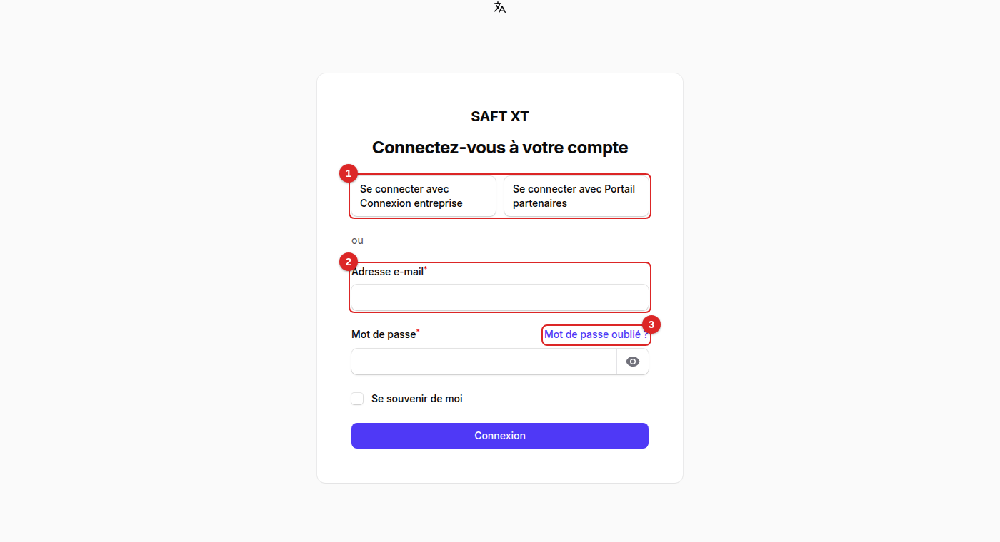
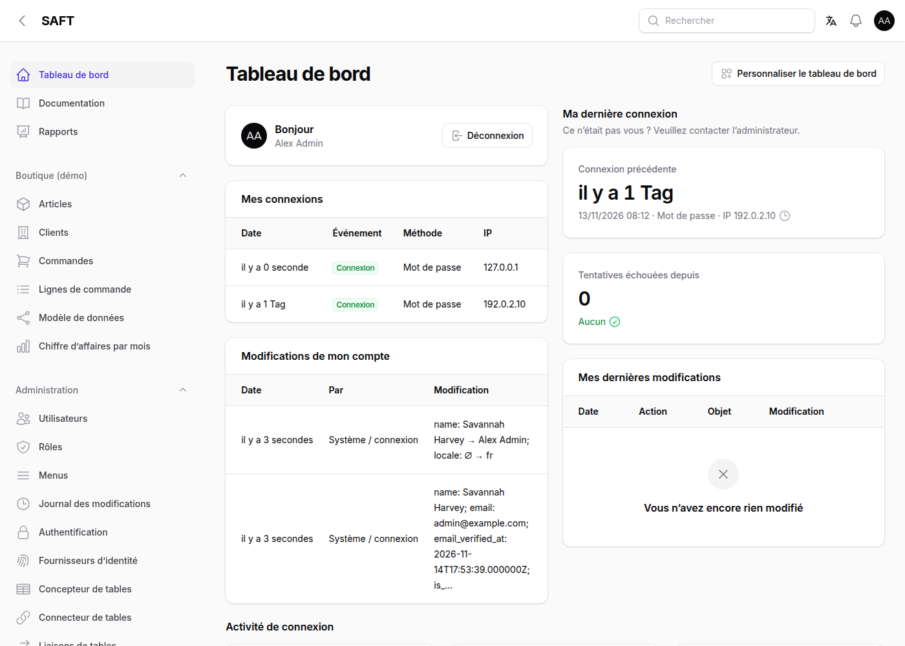
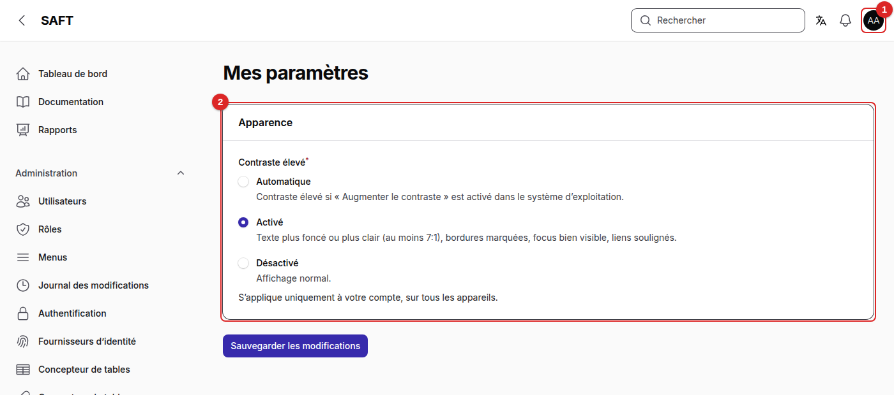
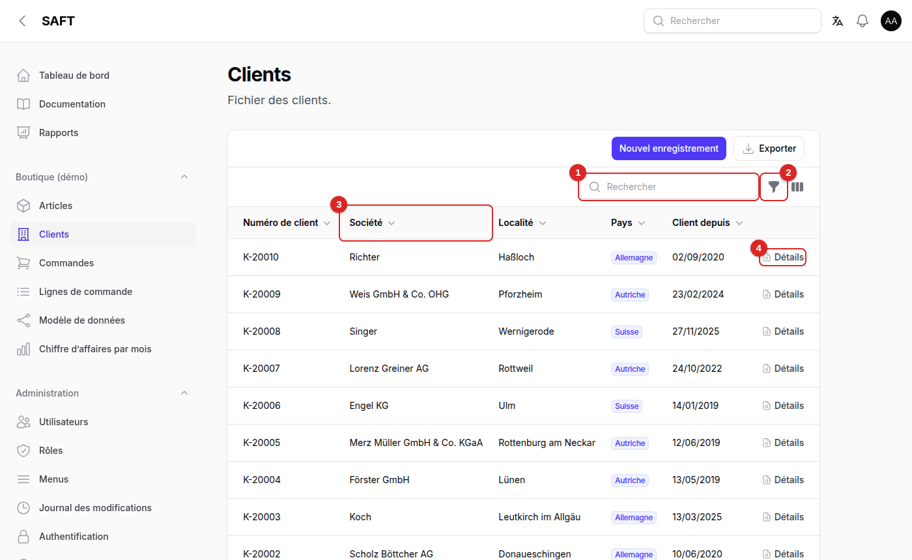
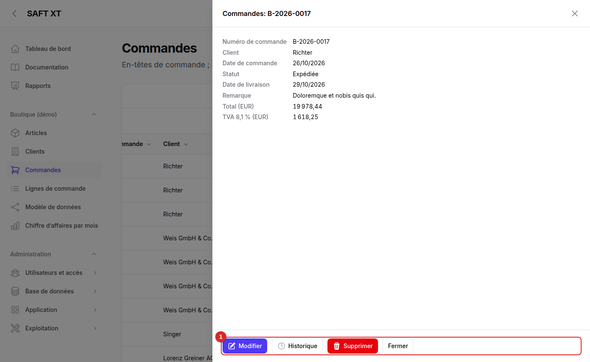
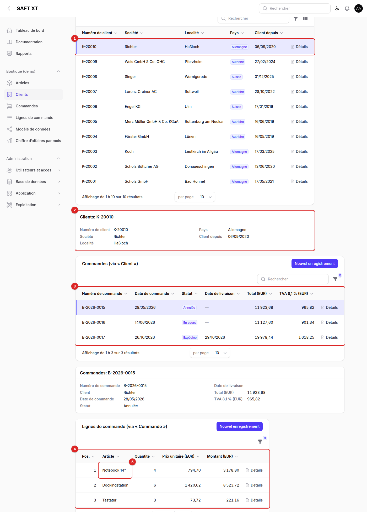
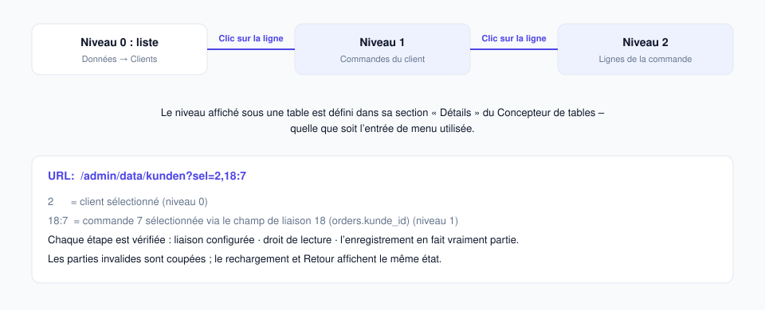
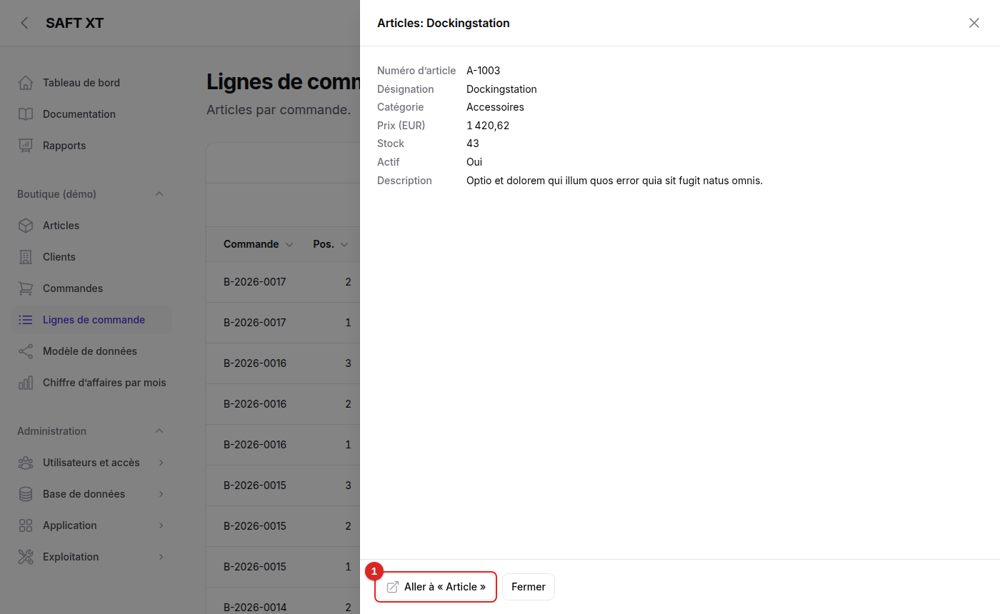

# SAFT XT – Guide utilisateur

[Deutsch](USER_GUIDE.de.md) · [English](USER_GUIDE.md) · **Français** · [Italiano](USER_GUIDE.it.md)

**État :** version 0.1 · **Public cible :** utilisatrices et utilisateurs

**Autres guides :** [Guide d’administration](ADMIN_GUIDE.fr.md) · [Questions fréquentes](FAQ.fr.md) · [Administration système](SYSADMIN_GUIDE.md)

> **À propos des illustrations :** les images sont des captures d’écran de l’application avec les données de
> démonstration. Les chiffres rouges dans les images renvoient aux explications du texte.

---

## Sommaire

- [1. Notions de base](#1-notions-de-base)
- [2. Se connecter et se déconnecter](#2-se-connecter-et-se-déconnecter)
- [3. Interface et tableau de bord](#3-interface-et-tableau-de-bord)
- [4. Travailler avec les données](#4-travailler-avec-les-données)
   - [4.1 La vue tableau](#41-la-vue-tableau)
   - [4.2 Consulter, créer, modifier et supprimer des enregistrements](#42-consulter-créer-modifier-et-supprimer-des-enregistrements)
   - [4.3 Tables liées : la vue maître-détail](#43-tables-liées--la-vue-maître-détail)
   - [4.4 Comment la vue maître-détail décide de ce qu’elle affiche](#44-comment-la-vue-maître-détail-décide-de-ce-quelle-affiche)
   - [4.5 Jeter un coup d’œil à un enregistrement lié (aperçu)](#45-jeter-un-coup-dœil-à-un-enregistrement-lié-aperçu)
   - [4.6 Règles de contrôle à la saisie](#46-règles-de-contrôle-à-la-saisie)
   - [4.7 Exporter des données](#47-exporter-des-données)
   - [4.8 Importer des données](#48-importer-des-données)
   - [4.9 Rapports](#49-rapports)
- [Annexe A – Types de champs](#annexe-a--types-de-champs)
- [Annexe B – Glossaire](#annexe-b--glossaire)

---
## 1. Notions de base

| Notion | Signification |
|---|---|
| **Table** | Un ensemble de données de même nature, p. ex. *Clients* ou *Articles*. Les tables sont créées par les administrateurs dans le **Concepteur de tables**. |
| **Enregistrement** | Une ligne d’une table, p. ex. un client donné. |
| **Champ / colonne** | Une propriété d’un enregistrement, p. ex. *Entreprise* ou *Localité*. |
| **Liaison** | Un champ qui pointe vers un enregistrement d’une autre table, p. ex. le champ *Client* d’une commande. |
| **Détails** | Les enregistrements qui *appartiennent* à un enregistrement via une liaison, p. ex. toutes les commandes d’un client (« 1:n »). |
| **Rôle** | Un groupe de droits attribué aux utilisateurs, p. ex. *Vente*. |
| **Droit (permission)** | L’autorisation d’effectuer une action précise, p. ex. « Données : Clients : modifier ». |

---

## 2. Se connecter et se déconnecter

Selon le paramétrage de l’administration, la page de connexion propose :

1. **Des boutons de connexion pour l’authentification unique (SSO)**, p. ex. « Se connecter avec le compte de
   l’entreprise ». Vous êtes redirigé vers votre compte d’entreprise (Microsoft ou un autre portail de connexion) et
   revenez ensuite connecté.
2. **E-mail et mot de passe** : la connexion classique avec un compte de cette application. Les majuscules et
   minuscules de l’adresse e-mail ne jouent aucun rôle.
3. **« Mot de passe oublié ? »** : visible uniquement si l’administration a activé cette fonction. Pour des raisons
   de sécurité, la réponse est toujours la même, même s’il n’existe aucun compte pour cette adresse. La confirmation
   ne signifie donc pas qu’un e-mail a été envoyé.

Les variantes proposées dépendent du **Mode de connexion** (voir [Guide d’administration, chapitre 5](ADMIN_GUIDE.fr.md#5-authentification)) :
mot de passe seul, authentification unique seule ou les deux.

**Langue :** l’icône de langue permet de choisir la langue dès la page de connexion. Sans choix, la page suit la
langue de votre navigateur. Après la connexion, c’est la langue enregistrée dans votre compte qui s’applique (voir
[3](#3-interface-et-tableau-de-bord)) ; après la déconnexion, le navigateur retient la dernière langue choisie.

**Se déconnecter :** via le menu utilisateur en haut à droite. Selon le paramétrage, vous êtes en même temps
déconnecté du compte de l’entreprise.

> **Bon à savoir :** si la connexion par authentification unique vous est refusée (« Aucun accès n’est configuré
> pour votre compte » ou similaire), adressez-vous à l’administration : votre compte n’est alors pas encore activé ou
> n’appartient à aucun groupe autorisé.

---

## 3. Interface et tableau de bord

- **Langue :** l’icône de langue en haut à droite, à côté de la recherche, permet de choisir **Deutsch**,
  **English**, **Français** ou **Italiano**, dès la page de connexion. Le choix s’applique immédiatement et est
  enregistré avec votre compte, donc aussi sur d’autres appareils. Tous les textes de l’interface, les messages, les
  dates et les nombres suivent la langue. Les entrées de menu, les noms des tables et des champs ainsi que l’affichage
  des valeurs de sélection peuvent être traduits par l’administration pour chaque langue (voir
  [Guide d’administration, chapitre 3](ADMIN_GUIDE.fr.md#3-menus) et [Guide d’administration, chapitre 4](ADMIN_GUIDE.fr.md#4-concepteur-de-tables)) ; si une traduction manque, la désignation allemande
  s’affiche. Les enregistrements et les noms de rôles restent tels qu’ils ont été saisis.
- **Mes paramètres :** le menu utilisateur (1, vos initiales en haut à droite) contient **Mes paramètres**. Vous y
  activez ou désactivez le **Contraste élevé** (2) pour votre compte ; le choix vaut alors sur tous les appareils.
  **Automatique** (par défaut) utilise le contraste élevé lorsque le système d’exploitation est réglé sur « Plus de
  contraste ». Le contraste élevé signifie un texte plus foncé (plus clair en mode sombre, au moins 7:1 selon WCAG
  AAA), des bordures marquées, un focus clavier bien visible, des liens soulignés et une ligne sélectionnée encadrée.
  Le mode clair, sombre ou système se choisit dans le même menu ; le choix est enregistré avec votre compte et vaut
  sur tous les appareils – la personne qui se connecte ensuite dans le même navigateur retrouve son propre réglage.
  Également à cet endroit : le **format des nombres** – **Automatique** (par défaut : format suisse si la langue
  préférée du navigateur est réglée sur la Suisse, p. ex. « français (Suisse) »), **Selon la langue** ou **Suisse**
  (1'234.50, en français 1 234,50). Il s’applique aux listes, aux détails, aux rapports et à l’export CSV ; les formules
  écrivent toujours les décimales avec un point.

  

- **Changer le mot de passe :** également dans le menu utilisateur. Saisissez votre mot de passe actuel et deux fois
  le nouveau ; vous restez connecté. L’entrée manque si votre compte est lié par authentification unique (le mot de
  passe est alors géré par votre entreprise) ou si la connexion par mot de passe est désactivée.
  Le nouveau mot de passe compte au moins 12 caractères ; SAFT refuse un mot de passe déjà apparu dans une fuite de
  données connue. Conseil : plusieurs mots que vous seul associez sont longs et faciles à retenir.
- **Authentification à deux facteurs :** dans *Mes paramètres* sous **Authentification à deux facteurs › Configurer**.
  Il vous faut une application d’authentification sur votre téléphone (p. ex. Microsoft Authenticator, Google
  Authenticator ou 2FAS). Scannez le code QR et confirmez avec le code à 6 chiffres de l’application et votre mot de
  passe. SAFT affiche ensuite une seule fois **8 codes de récupération** – imprimez-les ou conservez-les en lieu sûr.
  Dès lors, SAFT demande après le mot de passe le code actuel de l’application. Sans téléphone, connectez-vous avec
  **« Utiliser un code de récupération à la place »** ; chaque code ne vaut qu’une fois. Si l’authentification à deux
  facteurs est obligatoire pour votre compte, SAFT vous mène directement à la configuration après la connexion. Elle ne
  s’applique pas à la connexion par authentification unique – votre entreprise en est responsable. Téléphone et codes
  perdus : l’administration réinitialise le second facteur.

- **À gauche** se trouve le **menu**. Il n’affiche que les domaines pour lesquels vous avez des droits. Sous
  **Données** se trouvent les tables, sous **Administration** les fonctions de gestion. Les entrées
  avec une flèche **›** à droite sont des sous-menus (p. ex. *Administration › Utilisateurs et accès*) : un clic ouvre
  leur première page et déplie les autres en dessous ; la flèche pointe alors vers le bas. La flèche **‹** à côté du nom
  de l’application masque entièrement le menu pour laisser plus de place aux tables ; le bouton **☰** au même endroit
  le fait réapparaître. Votre navigateur retient ce choix. Le menu est aussi large que son entrée la plus longue.
- **Documentation** (dans le menu, juste sous le tableau de bord) affiche ce guide et les questions fréquentes dans
  l’application, avec un sommaire et un champ de recherche qui cherche dans tous les guides pendant la frappe. Les
  personnes ayant un droit dans le domaine Administration voient en plus le guide d’administration. Si des plugins
  fournissent leurs propres manuels (p. ex. *Transfert de stock*), ils apparaissent comme onglets supplémentaires lorsque
  vous pouvez utiliser ces fonctions. **À propos de
  SAFT** indique la version, les conditions de licence et les composants tiers avec leurs licences.
- **Assistant d’aide :** s’il est configuré et que vous en avez le droit, le bouton **?** en haut à droite ouvre une
  fenêtre où vous posez des questions sur l’utilisation, p. ex. « Comment exporter cette table ? ». La réponse s’appuie
  sur les manuels que vous pouvez voir et renvoie aux sections correspondantes ; l’assistant sait sur quelle page vous
  vous trouvez. Vous retrouvez les mêmes conversations sous **Documentation**, onglet **Assistant IA**, où vous rouvrez,
  poursuivez ou supprimez les conversations précédentes. Les réponses de l’IA peuvent contenir des erreurs – les
  manuels font foi.
- Le **tableau de bord** est la page d’accueil. Les tuiles (widgets) sont disposées sur deux colonnes qui s’allongent
  indépendamment l’une de l’autre ; les tuiles larges suivent en dessous sur toute la largeur. Les tuiles que vous
  voyez sont définies par l’administration via votre rôle ; des tuiles issues de plugins peuvent s’y ajouter, p. ex.
  *Entrepôt : stock minimum* – elles portent en dessous l’étiquette « Plugin : … », comme les pages issues de plugins sous leur titre. Vous pouvez les **disposer** vous-même :
  **« Personnaliser le tableau de bord »** (en haut à droite) affiche sur chaque tuile une poignée et **« Masquer »**.
  Avec la poignée, vous déplacez une tuile dans une colonne, vers l’autre colonne ou – rapports uniquement – dans la
  zone large en bas, où elle occupe toute la largeur. Les tuiles masquées figurent en haut dans une liste, d’où vous
  pouvez les réafficher. La disposition est enregistrée immédiatement et vaut aussi sur d’autres appareils ;
  **« Rétablir par défaut »** la réinitialise, **« Terminé »** met fin à la personnalisation.

| Widget | Contenu | Pour qui |
|---|---|---|
| Ma dernière connexion | Date, méthode et IP de votre connexion **précédente**, ainsi que les tentatives de connexion échouées depuis | tous |
| Mes connexions | Vos dernières connexions et déconnexions | tous |
| Mes dernières modifications | Ce que vous avez modifié récemment | tous |
| Modifications de mon compte | Ce que d’autres ont modifié dans votre compte, p. ex. vos rôles | tous |
| Rapports | une tuile par rapport épinglé (voir [4.9](#49-rapports)) ; graphiques et indicateurs d’abord en demi-largeur, tableaux en pleine largeur | tous ceux qui ont le droit « Rapports : afficher » |
| Activité de connexion | Connexions des 7 derniers jours, échecs, utilisateurs connectés | admins |
| Aperçu des utilisateurs | utilisateurs actifs, inactifs, sans rôle, avec SSO | admins |
| État des fournisseurs d’identité | état des connexions d’authentification unique, certificats arrivant à échéance | admins |
| Tâches planifiées | feu tricolore (tout va bien, tâches échouées, le planificateur ne tourne pas) et les dernières exécutions | admins |
| Dernières modifications (tout le système) | les entrées les plus récentes du journal des modifications | admins |

> **Conseil de sécurité :** si « Ma dernière connexion » indique une date à laquelle vous ne vous êtes pas connecté,
> ou des tentatives échouées, veuillez en informer l’administration.

---

### Changer d’app

Si vous travaillez avec plusieurs **apps** (applications métier, p. ex. « Boutique » et « Entrepôt »), un **sélecteur**
avec le nom de l’app actuelle apparaît à gauche de la recherche. Il liste les apps auxquelles vous avez accès ; un clic
change d’app et ouvre son tableau de bord. Le choix est conservé après la déconnexion.

L’app actuelle détermine ce que vous voyez : les menus de cette app (plus tableau de bord, documentation, rapports et –
selon vos droits – l’administration), la disposition du tableau de bord, les rapports et, sous **Documentation**, le
manuel de l’app s’il en existe un. Si vous ouvrez une table ou un rapport d’une autre app via un lien ou un favori, SAFT
y bascule de lui-même. Avec l’accès à une seule app, aucun sélecteur n’apparaît.

## 4. Travailler avec les données

### 4.1 La vue tableau

Dans le menu, ouvrez une table sous **Données**, p. ex. **Clients**.

1. **Recherche** : parcourt les champs configurés comme « recherchables ».
2. **Filtres** : chaque colonne dispose d’un filtre adapté :
   - texte : « contient … »
   - nombre et date : « de … à … »
   - oui/non, listes de sélection et liaisons : choix dans une liste
   - « Enregistrements supprimés » : uniquement pour les utilisateurs ayant le droit de suppression
3. **Trier** : un clic sur un en-tête de colonne trie par ordre croissant ou décroissant. Toutes les colonnes peuvent
   être triées. Les listes de sélection sont triées selon la valeur enregistrée, non selon le libellé affiché.
4. **Détails** : ouvre l’enregistrement dans une fenêtre (voir [4.2](#42-consulter-créer-modifier-et-supprimer-des-enregistrements)).

En bas, vous choisissez le nombre d’enregistrements par page (10, 25, 50 ou 100) et passez d’une page à l’autre avec
les numéros de page et les flèches (sur les écrans étroits avec « Précédent » et « Suivant »). Les dates et les
nombres suivent la langue choisie : en français p. ex. `01/02/2026 14:30`, en allemand `01.02.2026 14:30` et
`1.234,50`, en anglais `01/02/2026 14:30` et `1,234.50`. Avec le format des nombres **Suisse** (voir
[chapitre 3](#3-interface-et-tableau-de-bord)), les nombres s’affichent sous la forme `1'234.50` (en français
`1 234,50`).

**Largeur :** un tableau est aussi large que ses colonnes. S’il y a peu de colonnes, il reste de la place à droite, et
« Détails » se trouve juste à côté de la dernière colonne. Si les colonnes ne tiennent pas dans la fenêtre, le tableau
prend la largeur de la fenêtre et défile horizontalement. Les aperçus et les tableaux de détails de la vue
maître-détail se comportent de la même manière.

> **Quelles colonnes vois-je ?** La présélection est définie par l’entrée de menu par laquelle vous avez ouvert la
> table. Il peut donc exister p. ex. « Commandes » et « Commandes (court) » avec des colonnes différentes. Les
> **champs obligatoires** sont toujours affichés.
>
> L’**icône des colonnes** à droite du filtre permet d’afficher d’autres champs ou de masquer ceux prévus ; confirmez
> avec « Appliquer les colonnes ». SAFT retient votre choix **durablement et pour vous personnellement** – par table et
> par entrée de menu, même après la déconnexion et sur un autre ordinateur. « Réinitialiser » rétablit la
> présélection. L’icône des colonnes existe aussi dans les listes de l’administration.

SAFT mémorise aussi les **filtres, la recherche, le tri et les lignes par page** des vues de données **durablement
et pour vous personnellement** – par table et entrée de menu, même après la déconnexion. Lorsque vous rouvrez une
table, vous la retrouvez telle que vous l’avez quittée. Si la vue diffère de la valeur par défaut, le bouton
**Réinitialiser la vue** apparaît au-dessus de la table : il rétablit les filtres, la recherche, le tri, les lignes par
page et le choix des colonnes par défaut. Dans les listes de l’administration, filtres, recherche et tri ne valent que
jusqu’à la déconnexion. Les **nombres** sont alignés à droite dans tous les tableaux.

### 4.2 Consulter, créer, modifier et supprimer des enregistrements

Les tableaux servent à la **lecture**. Un clic sur une ligne sélectionne l’enregistrement (voir
[4.3](#43-tables-liées--la-vue-maître-détail)). Pour le **modifier**, ouvrez l’enregistrement via **« Détails »** :

La fenêtre affiche tous les champs de l’enregistrement dans une liste – pour chaque champ, le nom et à côté la valeur
(de même pour l’aperçu des enregistrements liés). « Restaurer » n’apparaît que pour les enregistrements supprimés.
En bas se trouvent (1) :

| Bouton | Fonction |
|---|---|
| **Modifier** | Ouvre le formulaire de saisie. Les modifications sont appliquées dès l’enregistrement. Non disponible pour les enregistrements supprimés. |
| **Historique** | Montre qui a modifié quoi et quand (p. ex. « status : Nouveau → Expédié »). |
| **Supprimer** | Marque l’enregistrement comme supprimé. Il disparaît de la liste, mais reste restaurable. |
| **Restaurer** | Visible uniquement pour les enregistrements supprimés. |
| **Fermer** | Ferme la fenêtre sans modification. |

**Nouvel enregistrement :** bouton **« Nouvel enregistrement »** en haut à droite de la liste concernée.

**Joindre des fichiers :** un champ de type *Fichier* accepte des images, des PDF ou d’autres documents. Glissez les
fichiers dans le champ ou cliquez sur **« parcourir »** ; s’il y a plusieurs fichiers, l’ordre se modifie par
glisser-déposer et le ✕ retire un fichier. Rien n’est enregistré avant **Créer** ou **Enregistrer**. Les types et la
taille autorisés sont définis par l’administration pour chaque champ ; les autres fichiers sont refusés dès le
téléversement. Dans la liste, les images apparaissent en petit aperçu et les autres fichiers avec un trombone (trois
au plus, puis « +2 », etc.) ; les détails les montrent tous. Un clic sur une image ou un PDF – ou sur
« +2 » – affiche le fichier dans une **fenêtre d’aperçu** : les flèches (aussi les touches fléchées) parcourent tous
les fichiers du champ ; en haut se trouvent **Ouvrir dans un nouvel onglet**, **Télécharger** et **Fermer** (aussi
Échap). Les autres fichiers sont téléchargés directement. Seules les personnes autorisées à lire la table voient ses fichiers.
Le filtre **« avec fichiers » / « sans fichiers »** trouve les enregistrements avec ou sans pièce jointe.

Les boutons visibles dépendent de vos droits : avec un simple droit de lecture, « Nouvel enregistrement », « Modifier »
et « Supprimer » manquent.

> **Suppression impossible ?** Un enregistrement ne peut pas être supprimé tant que d’autres enregistrements y font
> référence – p. ex. une commande qui a encore des lignes de commande. Le message indique la raison, p. ex.
> « 1 × Lignes de commande (via « Commande ») ». Supprimez d’abord les enregistrements rattachés.

**Voir les enregistrements supprimés :** avec le droit de suppression, le filtre « Enregistrements supprimés » affiche
aussi les entrées supprimées, que vous pouvez récupérer via « Détails → Restaurer ». Si un autre enregistrement a
entre-temps la même valeur dans un champ unique, le message « Conflit de données » s’affiche et l’enregistrement reste
supprimé.

> **Enregistrement supprimé entre-temps ?** Si quelqu’un a supprimé l’enregistrement pendant que vous le modifiez,
> l’enregistrement des modifications est refusé avec un avertissement. Les valeurs enregistrées restent alors inchangées.

### 4.3 Tables liées : la vue maître-détail

Les tables sont souvent liées entre elles : un **client** a des **commandes**, une commande a des **lignes de
commande**. La vue maître-détail montre ces relations **sur une seule page, les unes sous les autres** :

Fonctionnement :

1. **Cliquer sur une ligne** : dans la liste (ici *Clients*), cliquez sur un enregistrement. Il est **mis en
   évidence en couleur**.
2. **Aperçu** : en dessous apparaissent les principales informations du client sélectionné, pour chaque champ le nom
   et à côté la valeur, dans jusqu’à trois blocs côte à côte (nombres alignés à droite, longs textes sur plusieurs
   lignes) …
3. **… et ses détails** : ici le tableau de ses **commandes**. Si vous y cliquez sur une commande, elle est aussi mise
   en évidence …
4. **… et ses propres détails apparaissent en dessous** : ici les **lignes de commande**.
5. Les **valeurs liées** (ici les noms d’articles) sont cliquables et affichent l’enregistrement lié dans un aperçu
   (voir [4.5](#45-jeter-un-coup-dœil-à-un-enregistrement-lié-aperçu)).

Autres règles :

- **Annuler la sélection :** cliquez à nouveau sur la ligne mise en évidence.
- **Choisir une autre ligne :** tout ce qui se trouve en dessous est reconstruit.
- **Supprimer l’enregistrement sélectionné :** la sélection est annulée, l’aperçu et les détails en dessous
  disparaissent immédiatement.
- **Jusqu’à quatre niveaux** sont affichés les uns sous les autres (liste + trois niveaux de détail).
- **Plusieurs tables de détail au même niveau** (p. ex. un client a des *commandes* et des *factures*) apparaissent
  sous forme d’**onglets**. Le libellé indique aussi la liaison, p. ex. « Commandes (via « Client ») ». Deux liaisons
  provenant de la même table restent ainsi distinctes. Le niveau suivant apparaît sous l’onglet dans lequel vous avez
  fait votre sélection.
- **Nouvel enregistrement dans une table de détail :** la liaison est renseignée automatiquement – une nouvelle ligne
  de commande appartient toujours à la commande sélectionnée. Sous un enregistrement supprimé, on ne peut pas créer de
  nouveaux enregistrements ; le bouton y manque.
- **La modification** se fait ici aussi uniquement via **« Détails »** sur la ligne concernée.
- **Signets et liens :** votre sélection figure dans la barre d’adresse du navigateur. Un rechargement ou un lien
  transmis affichent exactement la même vue. Qui quitte la page et revient avec « Retour » retrouve aussi sa
  sélection. « Retour » ne parcourt toutefois pas les clics sur les lignes un à un : la touche mène à la page
  précédente.

### 4.4 Comment la vue maître-détail décide de ce qu’elle affiche

- **Les détails** qui apparaissent sous une table sont une **propriété de la table** et sont définis dans le
  Concepteur de tables (voir [Guide d’administration, chapitre 4](ADMIN_GUIDE.fr.md#4-concepteur-de-tables)) – via des champs de liaison ou des
  [liaisons de tables](ADMIN_GUIDE.fr.md#11-liaisons-de-tables), y compris vers des tables d’autres bases de données. C’est
  pourquoi vous voyez toujours les mêmes lignes de commande sous une commande – **peu importe** que vous soyez passé
  par « Données → Commandes » ou par « Données → Clients » puis une commande.
- **Les droits s’appliquent par table :** une table de détail n’apparaît que si vous avez le droit d’**afficher**
  cette table. Sans droit de lecture sur les lignes de commande, vous voyez la commande, mais aucune ligne en dessous.
- **Les enregistrements supprimés** n’apparaissent dans la cascade que pour les utilisateurs ayant le droit de
  suppression.
- **Sécurité :** la sélection dans la barre d’adresse est vérifiée à chaque appel. Si une partie ne correspond pas
  (p. ex. une commande qui n’appartient pas au client sélectionné), la sélection est coupée à cet endroit – des
  données étrangères ne sont jamais affichées.

### 4.5 Jeter un coup d’œil à un enregistrement lié (aperçu)

Les valeurs liées – p. ex. l’**article** d’une ligne de commande ou le **client** d’une commande – sont cliquables dans
les tableaux. Un clic ouvre à droite une fenêtre avec toutes les données de l’enregistrement lié, **sans quitter la
page actuelle** :

- **Fermer** ramène à la vue inchangée.
- **« Aller à « Articles » »** (1) ouvre la table *Articles* avec cet article sélectionné – y compris ses détails en
  dessous.
- Sans droit de lecture sur la table liée, la valeur n’est pas cliquable.
- Si l’enregistrement lié est supprimé, la fenêtre l’indique clairement.

### 4.6 Règles de contrôle à la saisie

Lors de l’enregistrement, l’application contrôle les saisies selon les réglages du Concepteur de tables. Les erreurs
sont affichées au champ concerné :

| Contrôle | Exemple de message |
|---|---|
| Champ obligatoire | « Le champ Titre est obligatoire. » |
| Longueur / plage de valeurs | nombre maximal de caractères, minimum, maximum |
| E-mail / URL | le format est contrôlé |
| Unique | « … est déjà utilisé » (les enregistrements supprimés ne comptent pas) |
| Liste de sélection | uniquement les valeurs prédéfinies |
| Liaison | uniquement des enregistrements existants et non supprimés |
| Fichier | uniquement les types de fichiers autorisés, au plus la taille et le nombre définis |

### 4.7 Exporter des données

**« Exporter »** en haut d’une liste enregistre la vue actuelle dans un fichier sur votre ordinateur : **Excel
(.xlsx)** ou **CSV (.csv)**. Le bouton apparaît si l’export est autorisé pour la table (voir
[Guide d’administration, chapitre 4](ADMIN_GUIDE.fr.md#4-concepteur-de-tables)) et si votre rôle a le droit **Exporter** (voir [Guide d’administration, chapitre 2](ADMIN_GUIDE.fr.md#2-rôles-et-droits)).

Le fichier contient ce que la liste affiche à ce moment :

- **Enregistrements :** tous les résultats sur toutes les pages, avec le filtre, la recherche et le tri actuels. Dans
  une table de détail, il s’agit uniquement des enregistrements de l’entrée sélectionnée.
- **Colonnes :** les colonnes actuellement visibles, y compris votre propre choix de colonnes.
- **Valeurs :** telles qu’affichées, p. ex. le libellé d’une liste de sélection et « Oui » ou « Non ». Les textes
  longs figurent en revanche intégralement dans le fichier.

| Format | Particularités |
|---|---|
| **Excel** | Les nombres et les dates sont de vraies valeurs avec lesquelles vous pouvez calculer. Une cellule Excel contient au plus 32 767 caractères ; les textes plus longs y sont tronqués. Les nombres de plus de 15 chiffres sont enregistrés comme texte pour qu’aucun chiffre ne se perde. |
| **CSV** | Dans la notation de la langue choisie : en français et en italien séparé par des points-virgules (`1234,50`, `01/02/2026`), en allemand par des points-virgules (`1234,50`, `01.02.2026`), en anglais par des virgules (`1234.50`, `01/02/2026`). Ainsi, Excel dans la même langue ouvre directement le fichier en colonnes. Les textes commençant par `=`, `+`, `-` ou `@` reçoivent un `'` initial pour se protéger contre l’injection de formules. |

Par défaut, un export comprend au plus 50 000 enregistrements. S’il y a plus de résultats, un avertissement s’affiche
et aucun fichier n’est créé ; restreignez alors la sélection avec un filtre ou la recherche. Les gros exports prennent
un peu de temps : pour 50 000 enregistrements, environ une demi-minute.

> **Protection des données :** chaque export est consigné dans le journal des modifications. Le fichier exporté
> n’est cependant plus soumis à aucun contrôle des droits. Manipulez-le donc avec soin.

### 4.8 Importer des données

**« Importer »** en haut d’une liste crée de nouveaux enregistrements à partir d’un fichier – par exemple : télécharger
un modèle vide, le remplir en dehors de SAFT et le réimporter. Le bouton apparaît si l’import est autorisé pour la table
(voir [Guide d’administration, chapitre 4](ADMIN_GUIDE.fr.md#4-concepteur-de-tables)) et si votre rôle a les droits
**Créer** et **Importer**.

- **Télécharger le modèle :** un fichier Excel vide avec tous les champs que l’on peut remplir ; les champs obligatoires
  sont marqués d’un `*`. Un export de la table convient aussi comme modèle.
- **Importer un fichier … :** Excel (.xlsx) ou CSV, au plus 20 Mo et 10 000 lignes. La première ligne contient les
  en-têtes de colonnes – le libellé du champ dans l’une des quatre langues ou son nom technique. Les colonnes sans champ
  correspondant, p. ex. des champs calculés issus d’un export, sont ignorées et indiquées.
- **Contrôle :** SAFT contrôle tout le fichier comme lors d’une saisie manuelle : champs obligatoires, longueur, plage
  de valeurs, e-mail/URL, valeurs uniques (aussi à l’intérieur du fichier) et règles de la table. Si quelque chose ne va
  pas, une liste avec ligne, colonne et raison s’affiche et **rien** n’est créé. Sinon, la deuxième étape indique le
  nombre de nouveaux enregistrements ; seul **Importer** les crée.
- **Les valeurs** peuvent être écrites comme le fournit l’export : listes de sélection avec libellé ou valeur
  enregistrée, oui/non (aussi Ja/Nein, Yes/No, Sì/No, 1/0), liaisons avec le nom affiché (p. ex. « ACME AG ») ou le
  numéro, dates sous la forme 31.12.2026, 31/12/2026 ou 2026-12-31, nombres sous la forme 1234,50, 1234.50 ou
  1'234.50.
- **Les champs de fichiers** ne figurent pas dans le modèle et restent vides lors de l’import, même s’ils sont
  obligatoires ; la boîte de dialogue le signale.
- **Uniquement de nouveaux enregistrements :** les enregistrements existants ne sont jamais modifiés. Un export
  réimporté sans changement signale donc « déjà utilisé » pour les champs uniques.
- Les valeurs par défaut (numéros successifs, reprise) et les champs calculés sont définis comme lors de la saisie. Le
  journal des modifications contient une entrée « importé » avec le fichier et le nombre.

### 4.9 Rapports

**Rapports** dans le menu principal résume les données des tables du Concepteur de tables et des tables liées (via
leur [instantané](ADMIN_GUIDE.fr.md#états-des-données-pour-les-rapports)) – sous forme de liste, de tableau, de tableau croisé, de
diagramme à barres, linéaire ou circulaire, ou d’indicateur unique. Les droits nécessaires sont **Rapports : afficher**
(consulter) ou **créer** (créer ses propres rapports).

**L’éditeur** (création ou modification) fonctionne comme un tableau croisé dynamique :

| Zone | Signification |
|---|---|
| À gauche : table de base et champs | Choisir la table « la plus fine », p. ex. les lignes plutôt que les commandes. En dessous, ses champs et les champs des tables **parentes**, regroupés par liaison (p. ex. « Commande › Client », jusqu’à trois niveaux) ; avec un champ de recherche. |
| À droite : Colonnes de la liste | Sans valeurs, les **colonnes d’une liste** (un enregistrement par ligne) ; avec des valeurs, les champs selon lesquels on regroupe. Les champs de date peuvent être résumés par jour, semaine, mois, trimestre ou année. |
| À droite : Colonnes du tableau croisé | facultatif : un champ dont les valeurs deviennent des colonnes (**tableau croisé**). |
| À droite : Valeurs | Calculs : somme, moyenne, minimum, maximum (nombres), nombre, nombre distinct ; « Nombre d’enregistrements » sans champ ; **＋ Valeur calculée** avec sa propre formule et **＋ Indicateur à partir des valeurs** (voir ci-dessous). |
| À droite : Filtres | Condition et valeur dans une boîte de dialogue, selon le type de champ ; pour les dates aussi « cette année », « le mois dernier », « les N derniers jours ». |
| Au centre : Aperçu | recalcule après chaque modification (au plus 100 lignes). Au-dessus, l’affichage (tableau, tableau croisé, barres, lignes, secteurs, indicateur) ; ceux qui ne conviennent pas sont bloqués, l’info-bulle en donne la raison. Un clic sur un en-tête de colonne trie. |

On **fait glisser** les champs de la liste vers une zone ou on les attribue avec **＋** (aussi au clavier) ; ils peuvent
être déplacés à l’intérieur d’une zone et entre les zones, ✎ modifie le libellé ou le filtre, ✕ supprime. Au-dessus de
l’aperçu figure une **phrase qui décrit le rapport**, p. ex. « Somme Montant par mois (date de commande), réparti par
catégorie ; seulement statut différent de « annulé » » – elle apparaît aussi sur la page de résultat et dans la liste.
Les enregistrements supprimés ne sont jamais comptés.

**Valeurs et colonnes calculées :** là où un champ enregistré fait défaut, une **formule** calcule par enregistrement.

- **＋ Valeur calculée** (sous « Valeurs ») résume une formule – comme somme, moyenne, minimum ou maximum, p. ex.
  *volume d’achat* = somme de `[Quantité] × [Article › Prix d’achat]`.
- **＋ Colonne calculée** (sous « Colonnes de la liste », uniquement dans les listes sans valeurs) affiche le résultat
  par enregistrement, p. ex. *marge* = `[Prix de vente] − [Prix d’achat]`. La colonne peut être triée et exportée.
- **Dans la boîte de dialogue**, les champs numériques accessibles apparaissent sous forme de boutons – y compris les
  champs des tables parentes comme « Article › Prix d’achat » ; un clic insère `[libellé]` au curseur. S’y ajoutent
  des boutons pour `+ − × ÷ ( ) ;` et les fonctions `round(x; décimales)`, `abs(x)`, `min(a; b)`, `max(a; b)` et
  `coalesce(x; remplacement)`. Au lieu de `×` et `÷`, on peut taper `*` et `/`.
- **Contrôle pendant la saisie :** à droite au-dessus du champ de formule figure « La formule est valide. » ou
  l’erreur, p. ex. « « Nom » n’est pas un nombre ». Vous choisissez aussi le libellé et les **décimales** (2 par
  défaut).
- **Valeurs vides :** si un champ est vide, le résultat est vide – sauf avec `coalesce([champ]; 0)`. Une division par
  0 donne également un résultat vide. Le calcul est exact, dans la base de données.
- Dans la structure, les formules sont marquées par **ƒ** ; ✎ rouvre la boîte de dialogue. Si vous ajoutez des
  valeurs à une liste avec une colonne calculée, la colonne est marquée en rouge : les colonnes calculées n’existent
  que dans les listes.
- **Conseil :** si la valeur existe déjà comme champ enregistré (p. ex. calculé), ce champ est généralement le meilleur
  choix, par exemple *Valeur d’achat* des mouvements de stock : il conserve le prix au moment du mouvement.

La démo Entrepôt montre toutes les possibilités dans **Artikel-Kalkulation** (colonnes calculées),
**Bewegungskennzahlen je Artikelgruppe** (valeurs calculées) et l’indicateur **Lagerwert gesamt**.

**Indicateur à partir des valeurs :** une valeur calculée calcule par enregistrement, *avant* le résumé. Pour les
rapports entre valeurs résumées – p. ex. *budget par publication* = budget du projet ÷ nombre de publications du
projet – il existe **＋ Indicateur à partir des valeurs** (sous « Valeurs », dès qu’il y a une valeur). Il calcule par
ligne du résultat *après* le résumé :

- Les boutons de la boîte de dialogue insèrent les autres **valeurs** (p. ex. « Nombre d’enregistrements ») et les
  **champs numériques regroupés** sous « Colonnes de la liste » (p. ex. « Projet › Budget (CHF) »), qui ont exactement
  une valeur par ligne. Les champs de date avec un niveau et les textes ne sont pas possibles, pas plus qu’un autre
  indicateur à partir des valeurs.
- Opérateurs, fonctions, contrôle pendant la saisie, libellé et décimales comme pour une valeur calculée ; une division
  par 0 donne un résultat vide. Dans la structure, l’indicateur est marqué **Σƒ** ; il peut être trié et exporté et
  fonctionne aussi dans les tableaux croisés et les graphiques.
- **Attention aux champs des tables parentes :** avec la table de base *Publications*, le budget du projet figure sur
  chaque ligne de publication. Regroupez selon ce champ (sous « Colonnes de la liste ») ou résumez-le avec la
  **moyenne** ou le **maximum** – avec la **somme**, un projet avec cinq publications compterait son budget cinq fois.

Exemple dans la démo Recherche : **Budget je Publikation** (table de base Publications, colonnes Projet et Projet ›
Budget (CHF), valeur Nombre d’enregistrements, indicateur `[Budget (CHF)] ÷ [Publikationen]`).

**Assistant IA :** s’il est configuré et que vous en avez le droit, le champ **Décrire le rapport (assistant IA)**
apparaît au-dessus de l’éditeur. Décrivez avec vos propres mots ce que vous voulez voir, p. ex. « Volume d’achat par
fournisseur 2026 en barres » ; la proposition remplit l’éditeur et peut être vérifiée et modifiée comme d’habitude.
Rien n’est enregistré avant **Sauvegarder**. Une saisie supplémentaire adapte la proposition (« seulement les entrées »,
« en lignes ») ; **Recommencer** démarre une nouvelle conversation. L’assistant définit le nom du rapport tant que vous
ne le saisissez ou ne le modifiez pas vous-même ; **Recommencer** efface un nom ainsi défini. L’assistant crée aussi des
formules et des indicateurs à partir des valeurs. Sont transmis
votre description et les noms des tables et champs que vous pouvez analyser – **jamais d’enregistrements**. Le nombre
de demandes par jour est limité ; l’assistant indique combien il en reste aujourd’hui.

**Partager :** un rapport est privé ou **partagé**. Qui le voit et l’exécute dépend toujours des **droits sur les
données de la personne qui l’ouvre** : elle a besoin du droit de lecture sur chaque table concernée, y compris les
tables qui n’apparaissent que dans le filtre. Les rapports partagés portant sur des tables que vous ne pouvez pas lire
n’apparaissent pas dans votre liste ; un appel direct indique la table manquante. Seules les personnes ayant le droit
**Rapports : modifier** peuvent modifier les rapports d’autrui ; **Dupliquer** crée votre propre copie.

**Dans le menu :** les rapports partagés peuvent être placés dans un groupe de menu comme entrée de type **Rapport**
(voir [Guide d’administration, chapitre 3](ADMIN_GUIDE.fr.md#3-menus)).

**Exporter :** sur la page de résultat, sous **Exporter**, en Excel ou CSV – tel que la page affiche le rapport
(liste, tableau groupé ou tableau croisé), sans la limite de l’aperçu. Dans Excel, les nombres et les dates restent des
nombres et des dates ; le CSV utilise les séparateurs et le signe décimal de la langue. Chaque export figure dans le
journal des modifications.

**Sur mon tableau de bord :** épingle le rapport comme **tuile propre** sur votre tableau de bord personnel (graphiques
et indicateurs en entier, tableaux avec les dix premières lignes). Les graphiques et indicateurs se placent d’abord
dans l’une des deux colonnes, les tableaux sur toute la largeur ; avec « Personnaliser le tableau de bord », vous
déplacez une tuile dans la zone large ou en sens inverse (voir [chapitre 3](#3-interface-et-tableau-de-bord)). Le même
bouton la retire. Vos droits sur les données s’appliquent là aussi.

**Liste des rapports :** la colonne **Affichage** montre tableau, tableau croisé, barres, lignes, secteurs ou
indicateur avec une icône. La recherche trouve les noms et les descriptions ; des filtres restreignent par
**Affichage**, **Table de base**, **Créé par**, **Partagé** et **Modifié** (du–au), **Seulement les miens** montre vos
propres rapports.

> **Bon à savoir :** si le modèle de données change (champ désactivé ou supprimé), le rapport indique au lieu d’un
> résultat quel champ manque. Renommer ne pose pas de problème – les rapports font référence au champ lui-même, non à
> son nom.

**Les tables liées** (Connecteur de tables) ne sont pas interrogées en direct, mais via leur **instantané** – une copie
dans la base de données de SAFT (voir [Guide d’administration, chapitre 10](ADMIN_GUIDE.fr.md#états-des-données-pour-les-rapports)).

Le choix de la table de base comporte en haut un **champ de recherche** (libellé, nom technique, connexion) et affiche
une icône par table : base de données = table SAFT, nuage gris = liée sans instantané, nuage vert = liée avec
instantané (avec la date). Si vous choisissez une table liée, SAFT crée immédiatement les instantanés manquants – pour
elle et pour les tables liées accessibles via des liaisons que vous pouvez lire. Le **droit de lecture** sur la table
suffit. Si un instantané a plus d’un jour (`REPORTS_SNAPSHOT_STALE_HOURS`, 24 par défaut), une boîte de dialogue
demande : **Créer un nouvel instantané** ou **Utiliser l’existant**.

Une fois une table de base choisie, seules les tables qui lui sont **reliées par des liaisons** restent sélectionnables
(dans les deux sens, sur un nombre quelconque de niveaux) ; les autres apparaissent grisées sous « Non liée à … ».
Pour une table non liée, choisissez d’abord **Annuler la sélection** (première entrée de la liste). Si le rapport a
déjà des champs, SAFT demande confirmation avant le changement ou l’annulation, car les lignes, colonnes, valeurs et
filtres sont alors vidés.

Le résultat indique sous le tableau l’instantané utilisé, p. ex. « Instantané : Personnes (Recherche) du 04/12/2026
09:30 ». C’est toujours le **plus récent instantané complet** qui s’applique ; s’il est supprimé, le rapport calcule
automatiquement avec le précédent. Les liaisons entre tables liées de la même connexion s’utilisent comme d’habitude.
**Entre sources** – table SAFT et table liée, ou tables de connexions différentes – les
[liaisons de tables](ADMIN_GUIDE.fr.md#11-liaisons-de-tables) font le lien ; leurs champs apparaissent dans l’arborescence des
champs sous le libellé de la liaison, p. ex. « Contacts › Personne (Recherche) › Nom ».

---

## Annexe A – Types de champs

| Type | Exemple | Particularités |
|---|---|---|
| Texte (une ligne) | Entreprise, numéro d’article | longueur maximale réglable ; contrôle facultatif d’e-mail ou d’URL |
| Texte (plusieurs lignes) | Remarque | |
| Nombre entier | Stock, année | minimum/maximum ; désactiver **« Avec séparateur de milliers »** pour les années et les numéros (« 2024 » au lieu de « 2 024 ») – vaut pour les tableaux, les détails, les rapports et l’export. Désactivé automatiquement à l’import et pour les colonnes MySQL de type `YEAR` contenant des années |
| Nombre décimal | Prix | nombre total de chiffres et décimales ; minimum/maximum |
| Oui/Non | Actif | |
| Date | Date de commande | |
| Date et heure | Moment | |
| Liste de sélection | Statut, pays | valeurs fixes avec libellé affiché |
| Liaison | Client d’une commande | table cible et champ affiché ; base des détails et de l’aperçu |
| Fichier | Contrat, photo de produit | images, PDF, documents Office, texte/CSV ou fichiers quelconques ; taille maximale et nombre par champ ; aperçu dans la liste et les détails. Pas dans l’import ; l’export ne contient que les noms de fichiers (voir [4.2](#42-consulter-créer-modifier-et-supprimer-des-enregistrements)) |
| Calculé | Montant = quantité × prix unitaire | résultat en nombre entier ou décimal, formule ; calculé à l’enregistrement, non saisi (voir [Champs calculés](ADMIN_GUIDE.fr.md#champs-calculés)) |

---

## Annexe B – Glossaire

| Notion | Explication |
|---|---|
| **App** | application métier, p. ex. « Boutique » ou « Entrepôt » : tables, menus, rapports et rôles qui vont ensemble ; changement via le sélecteur en haut |
| **Authentification unique (SSO)** | Connexion via un compte d’entreprise central au lieu d’un mot de passe propre |
| **Fournisseur d’identité (IdP)** | Le service qui effectue la connexion lors de l’authentification unique, p. ex. Microsoft Entra ID |
| **Entra ID** | Le service d’identité de Microsoft (anciennement Azure Active Directory) |
| **SAML** | Une norme répandue pour l’authentification unique |
| **Maître-détail** | Présentation d’un enregistrement (maître) avec les enregistrements qui lui sont rattachés (détails) |
| **Suppression logique (soft delete)** | « Supprimer » sous forme de marquage ; l’enregistrement reste restaurable |
| **Audit / journal des modifications** | Enregistrement complet de toutes les modifications |
| **Langue par défaut** | Allemand ; s’applique si ni le compte ni le navigateur ne définissent une langue proposée, et en remplacement des traductions manquantes |
| **CSV** | Fichier texte avec des valeurs séparées par un séparateur ; lisible par Excel et d’autres programmes |
