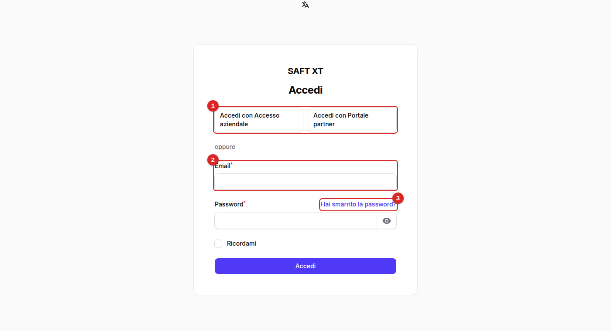
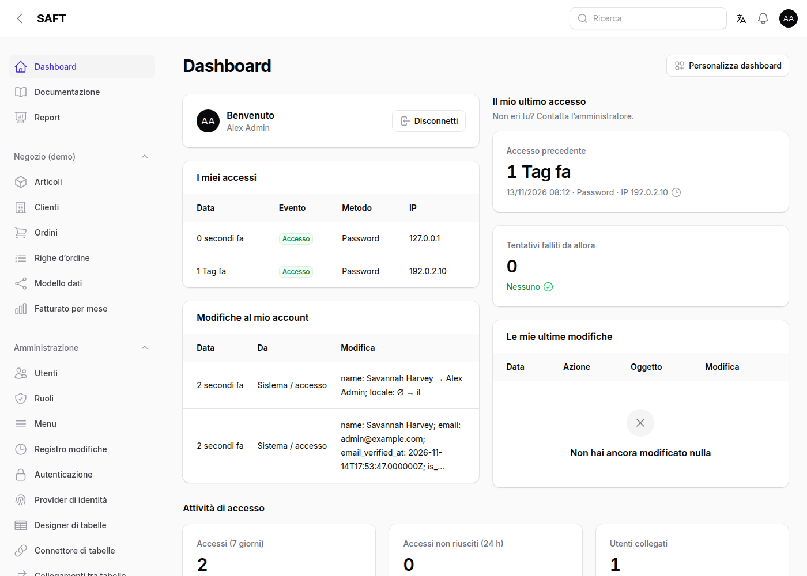
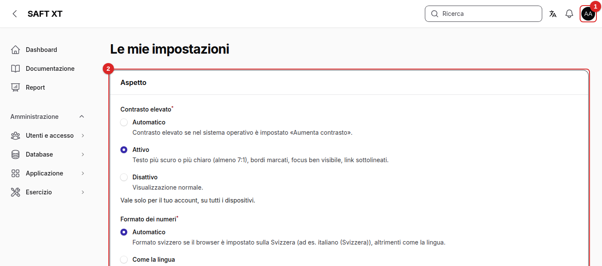
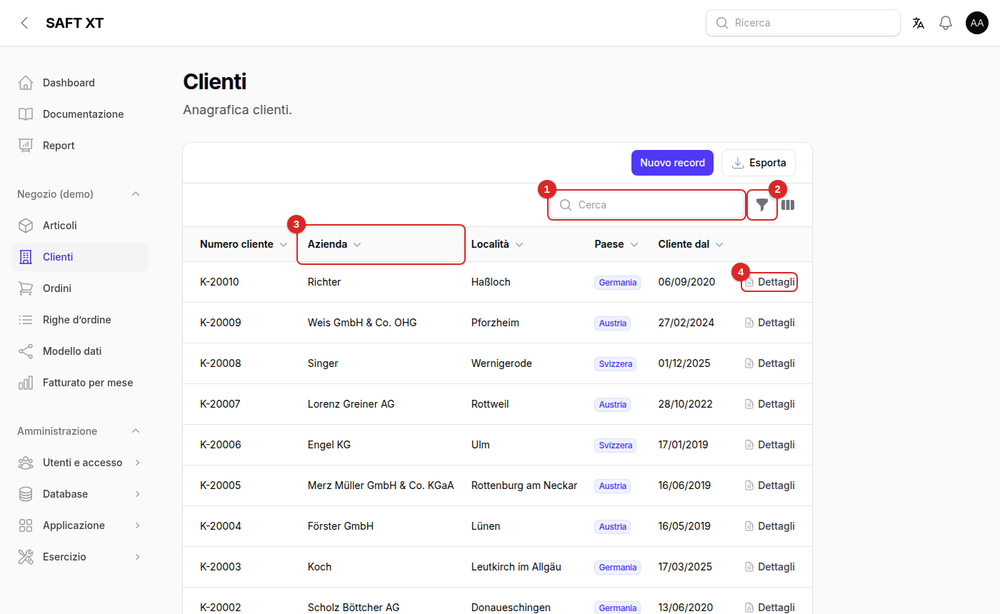
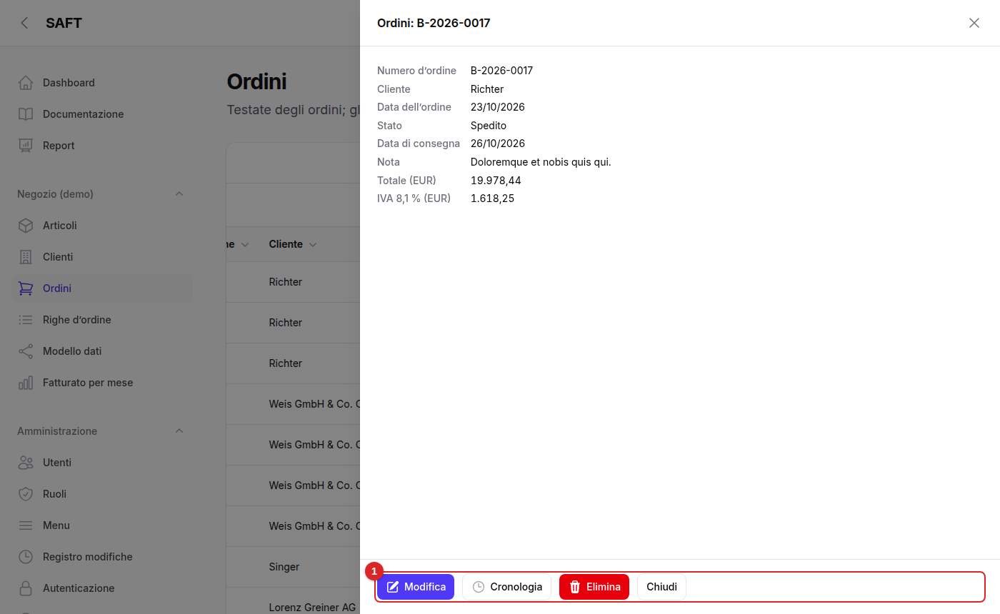

# SAFT XT – Guida utente

[Deutsch](USER_GUIDE.de.md) · [English](USER_GUIDE.md) · [Français](USER_GUIDE.fr.md) · **Italiano**

**Stato:** versione 0.1 · **Destinatari:** utenti

**Altre guide:** [Guida all’amministrazione](ADMIN_GUIDE.it.md) · [Domande frequenti](FAQ.it.md) · [Amministrazione di sistema](SYSADMIN_GUIDE.md)

> **Sulle illustrazioni:** le immagini sono schermate dell’applicazione con i dati dimostrativi.
> I numeri rossi nelle immagini rimandano alle spiegazioni nel testo.

---

## Indice

- [1. Concetti di base](#1-concetti-di-base)
- [2. Accedere e uscire](#2-accedere-e-uscire)
- [3. Interfaccia e dashboard](#3-interfaccia-e-dashboard)
- [4. Lavorare con i dati](#4-lavorare-con-i-dati)
   - [4.1 La vista tabella](#41-la-vista-tabella)
   - [4.2 Visualizzare, creare, modificare ed eliminare record](#42-visualizzare-creare-modificare-ed-eliminare-record)
   - [4.3 Tabelle collegate: la vista master-detail](#43-tabelle-collegate-la-vista-master-detail)
   - [4.4 Come la vista master-detail decide cosa mostrare](#44-come-la-vista-master-detail-decide-cosa-mostrare)
   - [4.5 Dare un’occhiata a un record collegato (anteprima)](#45-dare-unocchiata-a-un-record-collegato-anteprima)
   - [4.6 Regole di controllo all’inserimento](#46-regole-di-controllo-allinserimento)
   - [4.7 Esportare i dati](#47-esportare-i-dati)
   - [4.8 Importare i dati](#48-importare-i-dati)
   - [4.9 Report](#49-report)
- [Allegato A – Tipi di campo](#allegato-a--tipi-di-campo)
- [Allegato B – Glossario](#allegato-b--glossario)

---
## 1. Concetti di base

| Concetto | Significato |
|---|---|
| **Tabella** | Un insieme di dati dello stesso tipo, ad es. *Clienti* o *Articoli*. Le tabelle vengono create dagli amministratori nel **Designer di tabelle**. |
| **Record** | Una riga di una tabella, ad es. un singolo cliente. |
| **Campo / colonna** | Una proprietà di un record, ad es. *Ditta* o *Località*. |
| **Collegamento** | Un campo che punta a un record di un’altra tabella, ad es. il campo *Cliente* in un ordine. |
| **Dettagli** | I record che *appartengono* a un record tramite un collegamento, ad es. tutti gli ordini di un cliente («1:n»). |
| **Ruolo** | Un gruppo di diritti assegnato agli utenti, ad es. *Vendite*. |
| **Diritto (permission)** | Il permesso per un’azione precisa, ad es. «Dati: Clienti: modificare». |

---

## 2. Accedere e uscire

A seconda delle impostazioni dell’amministrazione, nella pagina di accesso trovate:

1. **Pulsanti di accesso per il single sign-on**, ad es. «Accedi con l’account aziendale». Venite reindirizzati al
   vostro account aziendale (Microsoft o un altro portale di accesso) e tornate poi già connessi.
2. **E-mail e password**: l’accesso classico con un account di questa applicazione. Maiuscole e minuscole
   dell’indirizzo e-mail non contano.
3. **«Hai smarrito la password?»**: visibile solo se l’amministrazione ha abilitato questa funzione. Per motivi di
   sicurezza la risposta è sempre la stessa, anche se per l’indirizzo non esiste alcun account. La conferma quindi non
   significa che sia stata inviata un’e-mail.

Le varianti offerte dipendono dalla **Modalità di accesso** (vedere [Guida all’amministrazione, capitolo 5](ADMIN_GUIDE.it.md#5-autenticazione)):
solo password, solo single sign-on oppure entrambi.

**Lingua:** con l’icona della lingua potete scegliere la lingua già nella pagina di accesso. Senza una scelta, la
pagina segue la lingua del browser. Dopo l’accesso vale la lingua salvata nel vostro account (vedere
[3](#3-interfaccia-e-dashboard)); dopo l’uscita il browser ricorda l’ultima scelta.

**Uscire:** dal menu utente in alto a destra. A seconda delle impostazioni, uscite contemporaneamente anche
dall’account aziendale.

> **Buono a sapersi:** se l’accesso tramite single sign-on vi viene negato («Per il vostro account non è configurato
> alcun accesso» o simile), rivolgetevi all’amministrazione: il vostro account non è ancora abilitato o non è
> assegnato a nessun gruppo autorizzato.

---

## 3. Interfaccia e dashboard

- **Lingua:** con l’icona della lingua in alto a destra, accanto alla ricerca, scegliete **Deutsch**, **English**,
  **Français** o **Italiano**, già nella pagina di accesso. La scelta vale subito e viene salvata con il vostro
  account, quindi anche su altri dispositivi. Tutti i testi dell’interfaccia, i messaggi, le date e i numeri seguono la
  lingua. Le voci di menu, i nomi delle tabelle e dei campi e la visualizzazione dei valori di selezione possono essere
  tradotti dall’amministrazione per ogni lingua (vedere [Guida all’amministrazione, capitolo 3](ADMIN_GUIDE.it.md#3-menu)
  e [Guida all’amministrazione, capitolo 4](ADMIN_GUIDE.it.md#4-designer-di-tabelle)); se manca una traduzione, compare quella
  tedesca. I record e i nomi dei ruoli restano come sono stati inseriti.
- **Le mie impostazioni:** nel menu utente (1, le vostre iniziali in alto a destra) trovate **Le mie impostazioni**.
  Lì attivate o disattivate il **Contrasto elevato** (2) per il vostro account; la scelta vale poi su tutti i
  dispositivi. **Automatico** (predefinito) usa il contrasto elevato quando nel sistema operativo è impostato «Aumenta
  contrasto». Contrasto elevato significa testo più scuro (più chiaro in modalità scura, almeno 7:1 secondo WCAG AAA),
  bordi marcati, un focus da tastiera ben visibile, link sottolineati e una riga selezionata incorniciata. Chiaro,
  scuro o sistema si scelgono nello stesso menu; la scelta viene salvata con il vostro account e vale su tutti i
  dispositivi – chi accede poi nello stesso browser ottiene la propria impostazione. Sempre lì: il **formato dei
  numeri** – **Automatico** (predefinito: formato svizzero se la lingua preferita del browser è impostata sulla
  Svizzera, ad es. «italiano (Svizzera)»), **Come la lingua** o **Svizzera** (1'234.50, in francese 1 234,50). Vale per
  elenchi, dettagli, report ed esportazione CSV; le formule scrivono sempre i decimali con il punto.

  

- **Cambia password:** sempre nel menu utente. Inserite la password attuale e due volte quella nuova; restate
  connessi. La voce manca se il vostro account è collegato tramite single sign-on (la password è allora gestita
  dalla vostra azienda) o se l’accesso con password è disattivato.
  La nuova password richiede almeno 12 caratteri; SAFT non accetta una password già comparsa in una fuga di dati
  nota. Consiglio: più parole che solo voi mettereste insieme sono lunghe e facili da ricordare.
- **Autenticazione a due fattori:** in *Le mie impostazioni* sotto **Autenticazione a due fattori › Configurazione**.
  Vi serve un’app di autenticazione sul telefono (ad es. Microsoft Authenticator, Google Authenticator o 2FAS).
  Scansionate il codice QR e confermate con il codice a 6 cifre dell’app e la vostra password. SAFT mostra poi una sola
  volta **8 codici di recupero** – stampateli o conservateli in un luogo sicuro. Da quel momento SAFT chiede dopo la
  password il codice attuale dell’app. Senza telefono accedete con **«Utilizza un codice di recupero»**; ogni codice
  vale una sola volta. Se l’autenticazione a due fattori è obbligatoria per il vostro account, SAFT vi porta
  direttamente alla configurazione dopo l’accesso. Non vale per l’accesso tramite single sign-on – lì è responsabile la
  vostra azienda. Telefono e codici persi: l’amministrazione reimposta il secondo fattore.

- **A sinistra** si trova il **menu**. Mostra solo le aree per le quali avete diritti. Sotto **Dati** trovate le
  tabelle, sotto **Amministrazione** le funzioni di gestione. Le voci con una freccia
  **›** a destra sono sottomenu (ad es. *Amministrazione › Utenti e accesso*): un clic apre la loro prima pagina e
  mostra le altre sotto; la freccia punta allora verso il basso. Con la freccia **‹** accanto al nome dell’applicazione
  nascondete del tutto il menu per avere più spazio per le tabelle; il pulsante **☰** nello stesso punto lo fa
  ricomparire. Il browser ricorda la scelta. Il menu è largo quanto la sua voce più lunga.
- **Documentazione** (nel menu, subito sotto la dashboard) mostra questa guida e le domande frequenti
  nell’applicazione, con indice e un campo di ricerca che cerca in tutte le guide durante la digitazione. Chi ha un
  diritto nell’area Amministrazione vede anche la guida all’amministrazione. Se dei plugin forniscono propri manuali (ad
  es. *Trasferimento di magazzino*), compaiono come schede aggiuntive quando puoi usare quelle funzioni. **Informazioni su SAFT XT** indica la
  versione, le condizioni di licenza e i componenti di terze parti con le relative licenze.
- **Assistente di aiuto:** se è configurato e hai il diritto, il pulsante **?** in alto a destra apre una finestra in
  cui fai domande sull’uso, ad es. «Come esporto questa tabella?». La risposta si basa sui manuali che puoi vedere e
  rimanda alle sezioni corrispondenti; l’assistente sa in quale pagina ti trovi. Le stesse conversazioni si trovano in
  **Documentazione** nella scheda **Assistente IA**, dove riapri, prosegui o elimini le conversazioni precedenti. Le
  risposte dell’IA possono contenere errori – fanno fede i manuali.
- La **dashboard** è la pagina iniziale. I riquadri (widget) sono disposti su due colonne che crescono verso il basso
  in modo indipendente; i riquadri larghi seguono sotto, a tutta larghezza. Quali riquadri vedete lo stabilisce
  l’amministrazione tramite il vostro ruolo; possono aggiungersi riquadri dei plugin, p. es. *Magazzino: scorta minima* – portano sotto l’etichetta «Plugin: …», come le pagine dei plugin sotto il titolo. Potete **disporli** voi stessi: **«Personalizza dashboard»** (in alto a
  destra) mostra su ogni riquadro una maniglia e **«Nascondi»**. Con la maniglia trascinate un riquadro all’interno di
  una colonna, nell’altra colonna o – solo i report – nell’area larga in basso, dove occupa tutta la larghezza. I
  riquadri nascosti compaiono in alto in un elenco, da cui si possono rendere di nuovo visibili. La disposizione viene
  salvata subito e vale anche su altri dispositivi; **«Ripristina predefinito»** la reimposta, **«Fatto»** conclude la
  personalizzazione.

| Widget | Contenuto | Per chi |
|---|---|---|
| Il mio ultimo accesso | Momento, metodo e IP del vostro accesso **precedente**, oltre ai tentativi di accesso falliti da allora | tutti |
| I miei accessi | I vostri ultimi accessi e uscite | tutti |
| Le mie ultime modifiche | Ciò che avete modificato di recente | tutti |
| Modifiche al mio account | Ciò che altri hanno modificato nel vostro account, ad es. i vostri ruoli | tutti |
| Report | un riquadro per ogni report fissato (vedere [4.9](#49-report)); grafici e indicatori inizialmente a mezza larghezza, tabelle a tutta larghezza | tutti con il diritto «Report: visualizzare» |
| Attività di accesso | Accessi degli ultimi 7 giorni, tentativi falliti, utenti connessi | admin |
| Panoramica utenti | utenti attivi, inattivi, senza ruolo, con SSO | admin |
| Stato dei provider di identità | stato delle connessioni single sign-on, certificati in scadenza | admin |
| Attività pianificate | semaforo (tutto in ordine, attività fallite, lo scheduler non è in esecuzione) e le ultime esecuzioni | admin |
| Ultime modifiche (intero sistema) | le voci più recenti del registro modifiche | admin |

> **Consiglio di sicurezza:** se «Il mio ultimo accesso» mostra un momento in cui non avete effettuato l’accesso, o
> tentativi falliti, informate l’amministrazione.

---

### Cambiare app

Se lavorate con più **app** (applicazioni specialistiche, ad es. «Negozio» e «Magazzino»), a sinistra della ricerca
compare un **selettore** con il nome dell’app attuale. Elenca le app a cui avete accesso; un clic cambia app e ne apre
la dashboard. La scelta resta anche dopo la disconnessione.

L’app attuale determina ciò che vedete: i menu di quell’app (più dashboard, documentazione, report e – secondo i
diritti – l’amministrazione), la disposizione della dashboard, i report e, sotto **Documentazione**, il manuale
dell’app se esiste. Se aprite una tabella o un report di un’altra app tramite un link o un segnalibro, SAFT vi passa da
sé. Con accesso a una sola app il selettore non compare.

## 4. Lavorare con i dati

### 4.1 La vista tabella

Nel menu aprite una tabella sotto **Dati**, ad es. **Clienti**.

1. **Ricerca**: cerca nei campi configurati come «ricercabili».
2. **Filtri**: per ogni colonna esiste un filtro adatto:
   - testo: «contiene …»
   - numero e data: «da … a …»
   - sì/no, elenchi di selezione e collegamenti: scelta da un elenco
   - «Record eliminati»: solo per gli utenti con diritto di eliminazione
3. **Ordinare**: un clic sull’intestazione di una colonna ordina in modo crescente o decrescente. Ogni colonna è
   ordinabile. Gli elenchi di selezione vengono ordinati secondo il valore salvato, non secondo l’etichetta mostrata.
4. **Dettagli**: apre il record in una finestra (vedere [4.2](#42-visualizzare-creare-modificare-ed-eliminare-record)).

In basso scegliete quanti record mostrare per pagina (10, 25, 50 o 100) e passate da una pagina all’altra con i
numeri di pagina e le frecce (sugli schermi stretti con «Precedente» e «Successivo»). Date e numeri seguono la lingua
scelta: in italiano ad es. `01/02/2026 14:30`, in tedesco `01.02.2026 14:30` e `1.234,50`, in inglese
`01/02/2026 14:30` e `1,234.50`. Con il formato dei numeri **Svizzera** (vedere [capitolo 3](#3-interfaccia-e-dashboard))
i numeri compaiono come `1'234.50`.

**Larghezza:** una tabella è larga quanto le sue colonne. Con poche colonne resta spazio libero a destra, e
«Dettagli» si trova subito accanto all’ultima colonna. Se le colonne non entrano nella finestra, la tabella è larga
quanto la finestra e si può scorrere orizzontalmente. Le anteprime brevi e le tabelle di dettaglio della vista
master-detail si comportano allo stesso modo.

> **Quali colonne vedo?** La preimpostazione è stabilita dalla voce di menu con cui avete aperto la tabella. Possono
> quindi esistere ad es. «Ordini» e «Ordini (breve)» con colonne diverse. I **campi obbligatori** vengono sempre
> mostrati.
>
> Con l’**icona delle colonne** a destra del filtro mostrate altri campi o nascondete quelli previsti e confermate con
> «Applica colonne». SAFT ricorda la vostra scelta **in modo permanente e personale** – per tabella e voce di menu,
> anche dopo l’uscita e su un altro computer. «Reimposta» ripristina la preimpostazione. L’icona delle colonne esiste
> anche negli elenchi dell’amministrazione.

SAFT memorizza anche **filtri, ricerca, ordinamento e righe per pagina** delle viste dati **in modo permanente e
personale** – per tabella e voce di menu, anche dopo la disconnessione. Riaprendo una tabella la ritrovate come l’avete
lasciata. Se la vista differisce dal predefinito, sopra la tabella compare il pulsante **Reimposta vista**: riporta
filtri, ricerca, ordinamento, righe per pagina e scelta delle colonne ai valori predefiniti. Negli elenchi
dell’amministrazione filtri, ricerca e ordinamento valgono solo fino alla disconnessione. I **numeri** sono allineati a
destra in tutte le tabelle.

### 4.2 Visualizzare, creare, modificare ed eliminare record

Le tabelle servono alla **lettura**. Un clic su una riga seleziona il record (vedere
[4.3](#43-tabelle-collegate-la-vista-master-detail)). Per **modificarlo** aprite il record con **«Dettagli»**:

La finestra mostra tutti i campi del record in un elenco – per ogni campo il nome e accanto il valore (lo stesso vale
per l’anteprima dei record collegati). «Ripristina» compare solo per i record eliminati. In basso trovate (1):

| Pulsante | Funzione |
|---|---|
| **Modifica** | Apre il modulo di inserimento. Le modifiche vengono applicate subito dopo il salvataggio. Non disponibile per i record eliminati. |
| **Cronologia** | Mostra chi ha modificato cosa e quando (ad es. «status: Nuovo → Spedito»). |
| **Elimina** | Contrassegna il record come eliminato. Scompare dall’elenco, ma resta ripristinabile. |
| **Ripristina** | Visibile solo per i record eliminati. |
| **Chiudi** | Chiude la finestra senza modifiche. |

**Nuovo record:** pulsante **«Nuovo record»** in alto a destra nell’elenco.

**Allegare file:** un campo di tipo *File* accetta immagini, PDF o altri documenti. Trascinate i file nel campo o
cliccate su **«sfoglia»**; con più file l’ordine si cambia trascinando, la ✕ rimuove un file. Nulla viene salvato
prima di **Crea** o **Salva**. Quali tipi e quali dimensioni sono ammessi lo stabilisce l’amministrazione per ogni
campo; gli altri file vengono rifiutati già al caricamento. Nell’elenco le immagini appaiono come piccola anteprima e
gli altri file con una graffetta (al massimo tre, poi «+2» ecc.); nei dettagli compaiono tutti. Un clic su un’immagine o un PDF – o su
«+2» – mostra il file in una **finestra di anteprima**: le frecce (anche i tasti freccia) scorrono tutti i file del
campo; in alto si trovano **Apri in una nuova scheda**, **Scarica** e **Chiudi** (anche Esc). Gli altri file vengono
scaricati direttamente. Vede i file solo chi può leggere la tabella. Il filtro
**«con file» / «senza file»** trova i record con o senza allegati.

I pulsanti visibili dipendono dai vostri diritti: con il solo diritto di lettura mancano «Nuovo record», «Modifica» ed
«Elimina».

> **Eliminazione impossibile?** Un record non può essere eliminato finché altri record vi fanno riferimento – ad es.
> un ordine per il quale esistono ancora righe d’ordine. Il messaggio indica il motivo, ad es. «1 × Righe d’ordine
> (tramite «Ordine»)». Eliminate prima i record collegati.

**Vedere i record eliminati:** con il diritto di eliminazione, il filtro «Record eliminati» mostra anche le voci
eliminate, che potete recuperare con «Dettagli → Ripristina». Se nel frattempo un altro record ha lo stesso valore in
un campo univoco, compare il messaggio «Conflitto di dati» e il record resta eliminato.

> **Record eliminato nel frattempo?** Se qualcuno ha eliminato il record mentre lo state modificando, il salvataggio
> viene rifiutato con un avviso. I valori salvati restano allora invariati.

### 4.3 Tabelle collegate: la vista master-detail

Le tabelle sono spesso collegate tra loro: un **cliente** ha **ordini**, un ordine ha **righe d’ordine**. La vista
master-detail mostra queste relazioni **su un’unica pagina, una sotto l’altra**:

Funziona così:

1. **Cliccare su una riga**: nell’elenco (qui *Clienti*) cliccate su un record. Viene **evidenziato a colori**.
2. **Anteprima breve**: sotto compaiono i dati principali del cliente selezionato, per ogni campo il nome e accanto il
   valore, in fino a tre blocchi affiancati (numeri allineati a destra, testi lunghi a capo) …
3. **… e i suoi dettagli**: qui la tabella dei suoi **ordini**. Se lì cliccate su un ordine, viene evidenziato anche
   quello …
4. **… e sotto compaiono i suoi dettagli**: qui le **righe d’ordine**.
5. I **valori collegati** (qui i nomi degli articoli) sono cliccabili e mostrano il record collegato in un’anteprima
   (vedere [4.5](#45-dare-unocchiata-a-un-record-collegato-anteprima)).

Altre regole:

- **Annullare la selezione:** cliccate di nuovo sulla riga evidenziata.
- **Scegliere un’altra riga:** tutto ciò che sta sotto viene ricostruito.
- **Eliminare il record selezionato:** la selezione viene annullata, l’anteprima breve e i dettagli sottostanti
  scompaiono subito.
- **Fino a quattro livelli** vengono mostrati uno sotto l’altro (elenco + tre livelli di dettaglio).
- **Più tabelle di dettaglio sullo stesso livello** (ad es. un cliente ha *Ordini* e *Fatture*) compaiono come
  **schede**. L’etichetta indica anche il collegamento, ad es. «Ordini (tramite «Cliente»)». Così anche due
  collegamenti dalla stessa tabella restano distinguibili. Il livello successivo compare sotto la scheda in cui avete
  fatto la selezione.
- **Nuovo record in una tabella di dettaglio:** il collegamento viene impostato automaticamente – una nuova riga
  d’ordine appartiene sempre all’ordine selezionato. Sotto un record eliminato non si possono creare nuovi record; il
  pulsante lì manca.
- **La modifica** avviene anche qui esclusivamente con **«Dettagli»** nella riga interessata.
- **Segnalibri e link:** la vostra selezione compare nella barra degli indirizzi del browser. Ricaricare la pagina o
  un link inoltrato mostrano esattamente la stessa vista. Anche chi lascia la pagina e torna con «Indietro» ritrova la
  propria selezione. «Indietro» non ripercorre però i singoli clic sulle righe: il tasto porta alla pagina
  precedente.

### 4.4 Come la vista master-detail decide cosa mostrare

- **Quali dettagli** compaiono sotto una tabella è una **proprietà della tabella** e viene stabilito nel Designer di
  tabelle (vedere [Guida all’amministrazione, capitolo 4](ADMIN_GUIDE.it.md#4-designer-di-tabelle)) – tramite campi di
  collegamento o [collegamenti tra tabelle](ADMIN_GUIDE.it.md#11-collegamenti-tra-tabelle), anche verso tabelle di altri database.
  Per questo sotto un ordine vedete sempre le stesse righe d’ordine – **indipendentemente** dal fatto che siate
  arrivati da «Dati → Ordini» o da «Dati → Clienti» e poi da un ordine.
- **I diritti valgono per tabella:** una tabella di dettaglio compare solo se avete il diritto di **visualizzare**
  quella tabella. Senza diritto di lettura sulle righe d’ordine vedete l’ordine, ma nessuna riga sotto.
- **I record eliminati** compaiono nella cascata solo per gli utenti con diritto di eliminazione.
- **Sicurezza:** la selezione nella barra degli indirizzi viene verificata a ogni richiamo. Se una parte non
  corrisponde (ad es. un ordine che non appartiene al cliente selezionato), la selezione viene interrotta in quel
  punto – non vengono mai mostrati dati estranei.

### 4.5 Dare un’occhiata a un record collegato (anteprima)

I valori collegati – ad es. l’**articolo** in una riga d’ordine o il **cliente** in un ordine – sono cliccabili nelle
tabelle. Un clic apre a destra una finestra con tutti i dati del record collegato, **senza lasciare la pagina
attuale**:

- **Chiudi** riporta alla vista invariata.
- **«Vai a «Articoli»»** (1) apre la tabella *Articoli* con questo articolo selezionato – compresi i suoi dettagli
  sottostanti.
- Senza diritto di lettura sulla tabella collegata, il valore non è cliccabile.
- Se il record collegato è eliminato, la finestra lo indica chiaramente.

### 4.6 Regole di controllo all’inserimento

Al salvataggio l’applicazione controlla i dati inseriti in base alle impostazioni del Designer di tabelle. Gli errori
vengono mostrati presso il campo interessato:

| Controllo | Esempio di messaggio |
|---|---|
| Campo obbligatorio | «Il campo Titolo è obbligatorio.» |
| Lunghezza / intervallo di valori | numero massimo di caratteri, minimo, massimo |
| E-mail / URL | il formato viene controllato |
| Univoco | «… è già in uso» (i record eliminati non contano) |
| Elenco di selezione | solo i valori predefiniti |
| Collegamento | solo record esistenti e non eliminati |
| File | solo i tipi di file ammessi, al massimo la dimensione e il numero impostati |

### 4.7 Esportare i dati

Con **«Esporta»** in alto in un elenco salvate la vista attuale in un file sul vostro computer: **Excel (.xlsx)** o
**CSV (.csv)**. Il pulsante compare se l’esportazione è consentita per la tabella (vedere
[Guida all’amministrazione, capitolo 4](ADMIN_GUIDE.it.md#4-designer-di-tabelle)) e il vostro ruolo ha il diritto **Esporta**
(vedere [Guida all’amministrazione, capitolo 2](ADMIN_GUIDE.it.md#2-ruoli-e-diritti)).

Il file contiene ciò che l’elenco mostra in quel momento:

- **Record:** tutti i risultati su tutte le pagine, con filtro, ricerca e ordinamento attuali. In una tabella di
  dettaglio sono solo i record della voce selezionata.
- **Colonne:** le colonne attualmente visibili, quindi anche la vostra scelta personale di colonne.
- **Valori:** come mostrati, ad es. l’etichetta di un elenco di selezione e «Sì» o «No». I testi lunghi compaiono
  invece per intero nel file.

| Formato | Particolarità |
|---|---|
| **Excel** | Numeri e date sono valori veri e propri con cui potete calcolare. Una cella Excel contiene al massimo 32’767 caratteri; i testi più lunghi vengono troncati. I numeri con più di 15 cifre vengono salvati come testo, così nessuna cifra va persa. |
| **CSV** | Nella notazione della lingua scelta: in italiano e francese separati da punto e virgola (`1234,50`, `01/02/2026`), in tedesco da punto e virgola (`1234,50`, `01.02.2026`), in inglese da virgola (`1234.50`, `01/02/2026`). Così Excel nella stessa lingua apre il file direttamente in colonne. I testi che iniziano con `=`, `+`, `-` o `@` ricevono un `'` iniziale come protezione contro formule inserite di nascosto. |

Per ogni esportazione sono possibili di norma al massimo 50’000 record. Con più risultati compare un avviso e non
viene creato alcun file; restringete allora la selezione con filtro o ricerca. Le esportazioni grandi richiedono un
po’ di tempo: con 50’000 record circa mezzo minuto.

> **Protezione dei dati:** ogni esportazione viene registrata nel registro modifiche. Il file esportato però non è
> più soggetto ad alcun controllo dei diritti. Trattatelo quindi con cura.

### 4.8 Importare i dati

Con **«Importa»** in alto in un elenco create nuovi record da un file – ad esempio: scaricare un modello vuoto,
compilarlo al di fuori di SAFT e reimportarlo. Il pulsante compare se l’importazione è consentita per la tabella (vedere
[Guida all’amministrazione, capitolo 4](ADMIN_GUIDE.it.md#4-designer-di-tabelle)) e il vostro ruolo ha i diritti
**Creare** e **Importare**.

- **Scarica modello:** un file Excel vuoto con tutti i campi compilabili; i campi obbligatori sono contrassegnati con
  `*`. Anche un’esportazione della tabella è adatta come modello.
- **Importa file …:** Excel (.xlsx) o CSV, al massimo 20 MB e 10’000 righe. La prima riga contiene le intestazioni delle
  colonne – l’etichetta del campo in una delle quattro lingue o il suo nome tecnico. Le colonne senza campo
  corrispondente, ad es. campi calcolati di un’esportazione, vengono ignorate e indicate.
- **Controllo:** SAFT controlla l’intero file come nell’inserimento manuale: campi obbligatori, lunghezza, intervallo di
  valori, e-mail/URL, valori univoci (anche all’interno del file) e regole della tabella. Se qualcosa non va, compare un
  elenco con riga, colonna e motivo e **non** viene creato nulla. Altrimenti il secondo passaggio indica il numero di
  nuovi record; solo **Importa** li crea.
- **I valori** possono essere scritti come li fornisce l’esportazione: elenchi di selezione con etichetta o valore
  salvato, sì/no (anche Ja/Nein, Yes/No, Oui/Non, 1/0), collegamenti con il nome visualizzato (ad es. «ACME AG») o il
  numero, date come 31.12.2026, 31/12/2026 o 2026-12-31, numeri come 1234,50, 1234.50 o 1'234.50.
- **I campi file** non sono nel modello e restano vuoti all’importazione, anche se obbligatori; la finestra lo
  segnala.
- **Solo nuovi record:** i record esistenti non vengono mai modificati. Un’esportazione reimportata senza modifiche
  segnala quindi «già in uso» per i campi univoci.
- I valori predefiniti (numeri successivi, ripresa) e i campi calcolati vengono impostati come nell’inserimento. Nel
  registro modifiche figura una voce «importato» con file e numero.

### 4.9 Report

**Report** nel menu principale riassume i dati delle tabelle del Designer di tabelle e delle tabelle collegate
(tramite la loro [istantanea](ADMIN_GUIDE.it.md#stati-dei-dati-per-i-report)) – come elenco, tabella, tabella
incrociata, grafico a barre, a linee o a torta, oppure come singolo indicatore. Servono i diritti **Report:
visualizzare** (consultare) o **creare** (crearne di propri).

**L’editor** (creazione o modifica) funziona come una tabella pivot:

| Area | Significato |
|---|---|
| A sinistra: tabella di base e campi | Scegliere la tabella «più fine», ad es. le righe invece degli ordini. Sotto, i suoi campi e quelli delle tabelle **superiori**, raggruppati per collegamento (ad es. «Ordine › Cliente», fino a tre livelli); con campo di ricerca. |
| A destra: Colonne dell’elenco | Senza valori le **colonne di un elenco** (un record per riga); con valori i campi in base ai quali si raggruppa. I campi data si possono riassumere per giorno, settimana, mese, trimestre o anno. |
| A destra: Colonne della tabella pivot | facoltativo: un campo i cui valori diventano colonne (**tabella incrociata**). |
| A destra: Valori | Calcoli: somma, media, minimo, massimo (numeri), numero, numero distinti; «Numero di record» senza campo; **＋ Valore calcolato** con una formula propria e **＋ Indicatore dai valori** (vedere sotto). |
| A destra: Filtri | Condizione e valore in una finestra di dialogo, secondo il tipo di campo; per le date anche «quest’anno», «mese scorso», «ultimi N giorni». |
| Al centro: Anteprima | ricalcola dopo ogni modifica (al massimo 100 righe). Sopra, la visualizzazione (tabella, tabella incrociata, barre, linee, torta, indicatore); quelle non adatte sono bloccate, il tooltip ne indica il motivo. Un clic sull’intestazione di una colonna ordina. |

I campi si **trascinano** dall’elenco in un’area o si assegnano con **＋** (anche da tastiera); si possono spostare
all’interno di un’area e tra le aree, ✎ modifica l’etichetta o il filtro, ✕ rimuove. Sopra l’anteprima compare una
**frase che descrive il report**, ad es. «Somma Importo per mese (data d’ordine), suddivisa per categoria; solo stato
diverso da «annullato»» – compare anche nella pagina dei risultati e nell’elenco. I record eliminati non vengono mai
contati.

**Valori e colonne calcolati:** dove manca un campo salvato, una **formula** calcola per ogni record.

- **＋ Valore calcolato** (sotto «Valori») riassume una formula – come somma, media, minimo o massimo, ad es.
  *volume d’acquisto* = somma di `[Quantità] × [Articolo › Prezzo d’acquisto]`.
- **＋ Colonna calcolata** (sotto «Colonne dell’elenco», solo negli elenchi senza valori) mostra il risultato per ogni
  record, ad es. *margine* = `[Prezzo di vendita] − [Prezzo d’acquisto]`. La colonna si può ordinare ed esportare.
- **Nella finestra di dialogo** i campi numerici raggiungibili compaiono come pulsanti – anche i campi delle tabelle
  superiori come «Articolo › Prezzo d’acquisto»; un clic inserisce `[etichetta]` alla posizione del cursore. Ci sono
  inoltre pulsanti per `+ − × ÷ ( ) ;` e le funzioni `round(x; decimali)`, `abs(x)`, `min(a; b)`, `max(a; b)` e
  `coalesce(x; sostituto)`. Invece di `×` e `÷` si possono digitare `*` e `/`.
- **Controllo durante l’inserimento:** a destra sopra il campo della formula compare «La formula è valida.» oppure
  l’errore, ad es. ««Nome» non è un numero». Scegliete inoltre l’etichetta e i **decimali** (predefinito 2).
- **Valori vuoti:** se un campo è vuoto, il risultato è vuoto – tranne con `coalesce([campo]; 0)`. Anche una
  divisione per 0 dà un risultato vuoto. Il calcolo è esatto, nel database.
- Nella struttura le formule sono contrassegnate da **ƒ**; ✎ riapre la finestra di dialogo. Se aggiungete valori a un
  elenco con una colonna calcolata, la colonna viene segnata in rosso: le colonne calcolate esistono solo negli
  elenchi.
- **Consiglio:** se il valore esiste già come campo salvato (ad es. calcolato), quel campo è di solito la scelta
  migliore, ad esempio *Valore d’acquisto* dei movimenti di magazzino: conserva il prezzo al momento del movimento.

La demo Magazzino mostra tutte le possibilità in **Artikel-Kalkulation** (colonne calcolate),
**Bewegungskennzahlen je Artikelgruppe** (valori calcolati) e nell’indicatore **Lagerwert gesamt**.

**Indicatore dai valori:** un valore calcolato calcola per record, *prima* del riepilogo. Per i rapporti tra valori
riassunti – ad es. *budget per pubblicazione* = budget del progetto ÷ numero di pubblicazioni del progetto – esiste
**＋ Indicatore dai valori** (sotto «Valori», appena c’è un valore). Calcola per riga del risultato *dopo* il
riepilogo:

- I pulsanti della finestra di dialogo inseriscono gli altri **valori** (ad es. «Numero di record») e i **campi numerici
  raggruppati** sotto «Colonne dell’elenco» (ad es. «Progetto › Budget (CHF)»), che hanno esattamente un valore per
  riga. Non sono possibili i campi data con un livello e i testi, né un altro indicatore dai valori.
- Operatori, funzioni, controllo durante l’inserimento, etichetta e decimali come per un valore calcolato; una divisione
  per 0 dà un risultato vuoto. Nella struttura l’indicatore è contrassegnato da **Σƒ**; si può ordinare ed esportare e
  funziona anche in tabelle incrociate e grafici.
- **Attenzione ai campi delle tabelle superiori:** con la tabella di base *Pubblicazioni* il budget del progetto compare
  in ogni riga di pubblicazione. Raggruppate in base a esso (sotto «Colonne dell’elenco») oppure riassumetelo con la
  **media** o il **massimo** – con la **somma** un progetto con cinque pubblicazioni conterebbe il suo budget cinque volte.

Esempio nella demo Ricerca: **Budget je Publikation** (tabella di base Pubblicazioni, colonne Progetto e Progetto ›
Budget (CHF), valore Numero di record, indicatore `[Budget (CHF)] ÷ [Publikationen]`).

**Assistente IA:** se è configurato e ne avete il diritto, sopra l’editor compare il campo **Descrivere il report
(assistente IA)**. Descrivete con parole vostre cosa volete vedere, ad es. «Volume d’acquisto per fornitore 2026 a
barre»; la proposta riempie l’editor e si può verificare e modificare come di consueto. Si salva solo con **Salva**.
Con un ulteriore inserimento adattate la proposta («solo entrate», «a linee»); **Ricominciare** avvia una nuova
conversazione. L’assistente imposta il nome del report finché non lo inserite o modificate voi; **Ricominciare** cancella
un nome impostato così. L’assistente crea anche formule e indicatori dai valori. Vengono trasmessi la vostra descrizione e i nomi delle tabelle e dei
campi che potete analizzare – **mai record**. Il numero di richieste al giorno è limitato; l’assistente indica quante
ne restano oggi.

**Condividere:** un report è privato o **condiviso**. Chi lo vede e lo esegue lo decidono sempre i **diritti sui dati
della persona che lo apre**: le serve il diritto di lettura su ogni tabella coinvolta, anche sulle tabelle che
compaiono solo nel filtro. I report condivisi su tabelle che non potete leggere non compaiono nel vostro elenco; un
richiamo diretto indica la tabella mancante. Solo le persone con il diritto **Report: modificare** possono modificare
i report altrui; **Duplica** crea una vostra copia.

**Nel menu:** i report condivisi si possono inserire in un gruppo di menu come voce di tipo **Report** (vedere
[Guida all’amministrazione, capitolo 3](ADMIN_GUIDE.it.md#3-menu)).

**Esportare:** nella pagina dei risultati, sotto **Esporta**, come Excel o CSV – così come la pagina mostra il report
(elenco, tabella raggruppata o tabella incrociata), senza il limite dell’anteprima. In Excel numeri e date restano
numeri e date; il CSV usa i separatori e il segno decimale della lingua. Ogni esportazione figura nel registro
modifiche.

**Sulla mia dashboard:** fissa il report come **riquadro proprio** sulla vostra dashboard personale (grafici e
indicatori completi, tabelle con le prime dieci righe). Grafici e indicatori compaiono inizialmente in una delle due
colonne, le tabelle a tutta larghezza; con «Personalizza dashboard» trascinate un riquadro nell’area larga o indietro
(vedere [capitolo 3](#3-interfaccia-e-dashboard)). Lo stesso pulsante lo rimuove. Anche lì valgono i vostri diritti
sui dati.

**Elenco dei report:** la colonna **Visualizzazione** mostra tabella, tabella incrociata, barre, linee, torta o
indicatore con un’icona. La ricerca trova nomi e descrizioni; i filtri restringono per **Visualizzazione**, **Tabella
di base**, **Creato da**, **Condiviso** e **Modificato** (dal–al), **Solo i miei** mostra i propri.

> **Buono a sapersi:** se il modello di dati cambia (campo disattivato o eliminato), invece di un risultato il report
> indica quale campo manca. Rinominare non crea problemi – i report fanno riferimento al campo stesso, non al suo nome.

**Le tabelle collegate** (Connettore di tabelle) non vengono interrogate in tempo reale, ma tramite la loro
**istantanea** – una copia nel database di SAFT (vedere [Guida all’amministrazione, capitolo 10](ADMIN_GUIDE.it.md#stati-dei-dati-per-i-report)).

La scelta della tabella di base ha in alto un **campo di ricerca** (etichetta, nome tecnico, connessione) e mostra per
ogni tabella un’icona: database = tabella SAFT, nuvola grigia = collegata senza istantanea, nuvola verde = collegata
con istantanea (con data). Se scegliete una tabella collegata, SAFT crea subito le istantanee mancanti – per essa e per
le tabelle collegate raggiungibili tramite collegamenti che potete leggere. Basta il **diritto di lettura** sulla
tabella. Se un’istantanea ha più di un giorno (`REPORTS_SNAPSHOT_STALE_HOURS`, predefinito 24), una finestra di
dialogo chiede: **Crea nuova istantanea** oppure **Usa quella esistente**.

Una volta scelta una tabella di base, restano selezionabili solo le tabelle **collegate a essa tramite collegamenti**
(in entrambe le direzioni, su un numero qualsiasi di livelli); le altre compaiono in grigio sotto «Non collegata a …».
Per una tabella non collegata scegliete prima **Annulla selezione** (prima voce dell’elenco). Se il report ha già dei
campi, SAFT chiede conferma prima del cambio o dell’annullamento, perché righe, colonne, valori e filtri vengono
svuotati.

Il risultato indica sotto la tabella l’istantanea usata, ad es. «Istantanea: Persone (Ricerca) del 04/12/2026 09:30».
Vale sempre l’**istantanea completa più recente**; se viene eliminata, il report calcola automaticamente con quella
precedente. I collegamenti tra tabelle collegate della stessa connessione si usano come di consueto. **Tra fonti
diverse** – tabella SAFT con tabella collegata, oppure tabelle di connessioni diverse – fanno da ponte i
[collegamenti tra tabelle](ADMIN_GUIDE.it.md#11-collegamenti-tra-tabelle); i loro campi compaiono nell’albero dei campi sotto
l’etichetta del collegamento, ad es. «Contatti › Persona (Ricerca) › Cognome».

---

## Allegato A – Tipi di campo

| Tipo | Esempio | Particolarità |
|---|---|---|
| Testo (una riga) | Ditta, numero d’articolo | lunghezza massima impostabile; controllo facoltativo di e-mail o URL |
| Testo (più righe) | Osservazione | |
| Numero intero | Giacenza, anno | minimo/massimo; disattivare **«Con separatore delle migliaia»** per anni e numeri identificativi («2024» invece di «2’024») – vale per tabelle, dettagli, report ed esportazione. Disattivato automaticamente all’importazione e per le colonne MySQL di tipo `YEAR` con anni |
| Numero decimale | Prezzo | cifre totali e decimali; minimo/massimo |
| Sì/No | Attivo | |
| Data | Data d’ordine | |
| Data e ora | Momento | |
| Elenco di selezione | Stato, paese | valori fissi con etichetta visualizzata |
| Collegamento | Cliente di un ordine | tabella di destinazione e campo visualizzato; base per dettagli e anteprima |
| File | Contratto, foto del prodotto | immagini, PDF, documenti Office, testo/CSV o file qualsiasi; dimensione massima e numero per campo; anteprima nell’elenco e nei dettagli. Non nell’importazione; l’esportazione contiene solo i nomi dei file (vedi [4.2](#42-visualizzare-creare-modificare-ed-eliminare-record)) |
| Calcolato | Importo = quantità × prezzo unitario | risultato come numero intero o decimale, formula; calcolato al salvataggio, non inserito (vedere [Campi calcolati](ADMIN_GUIDE.it.md#campi-calcolati)) |

---

## Allegato B – Glossario

| Concetto | Spiegazione |
|---|---|
| **App** | applicazione specialistica, ad es. «Negozio» o «Magazzino»: tabelle, menu, report e ruoli che vanno insieme; si cambia con il selettore in alto |
| **Single sign-on (SSO)** | Accesso tramite un account aziendale centrale invece di una password propria |
| **Provider di identità (IdP)** | Il servizio che esegue l’accesso con il single sign-on, ad es. Microsoft Entra ID |
| **Entra ID** | Il servizio di identità di Microsoft (in precedenza Azure Active Directory) |
| **SAML** | Uno standard diffuso per il single sign-on |
| **Master-detail** | Presentazione di un record (master) con i record a esso associati (dettagli) |
| **Eliminazione logica (soft delete)** | «Eliminare» come contrassegno; il record resta ripristinabile |
| **Audit / registro modifiche** | Registrazione completa di tutte le modifiche |
| **Lingua predefinita** | Tedesco; vale se né l’account né il browser stabiliscono una lingua offerta, e come sostituto per le traduzioni mancanti |
| **CSV** | File di testo con valori separati da un separatore; leggibile da Excel e da altri programmi |
