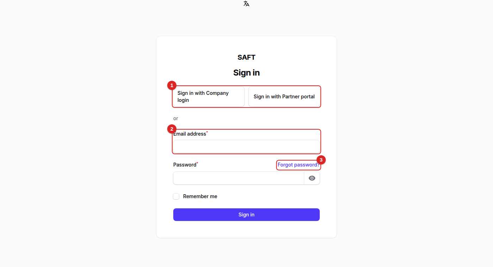
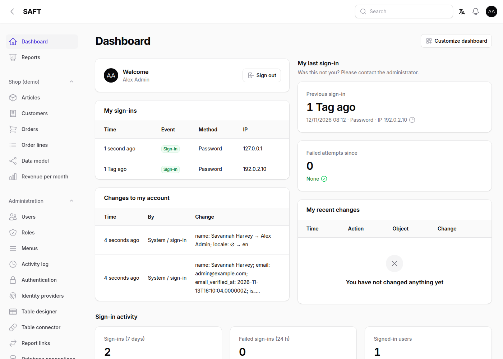
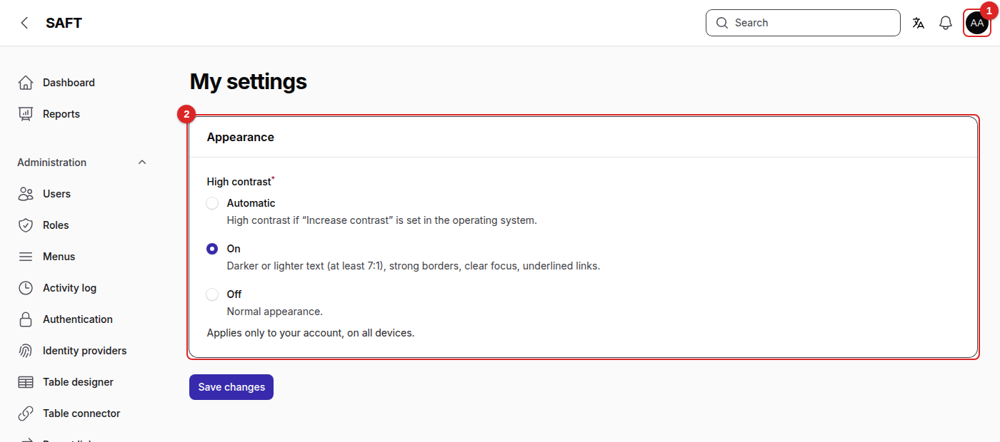
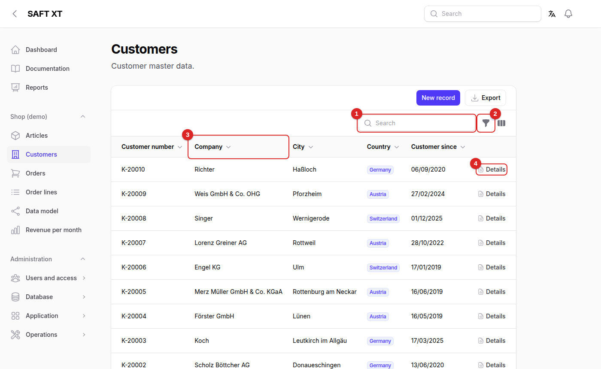
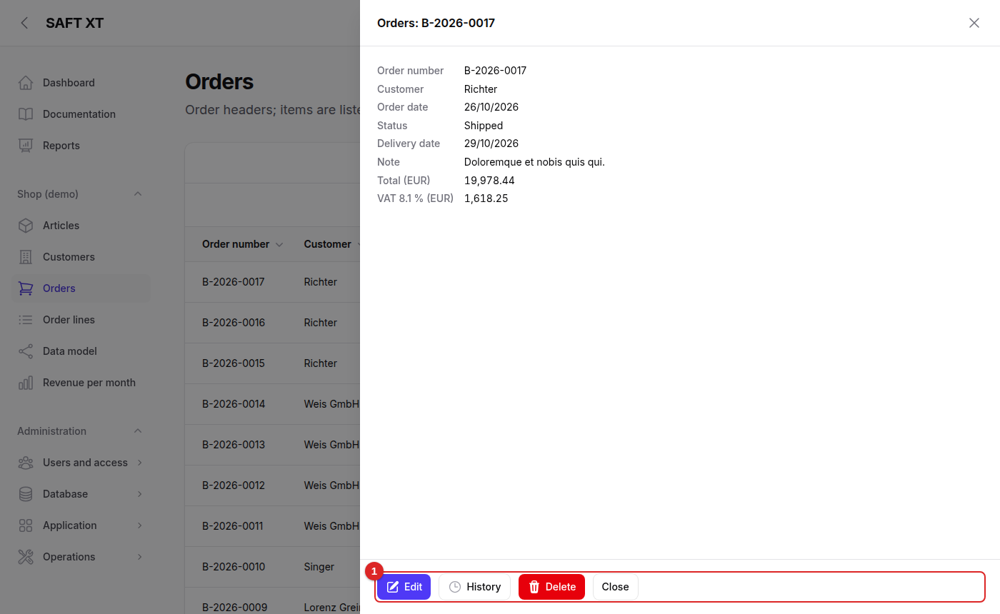
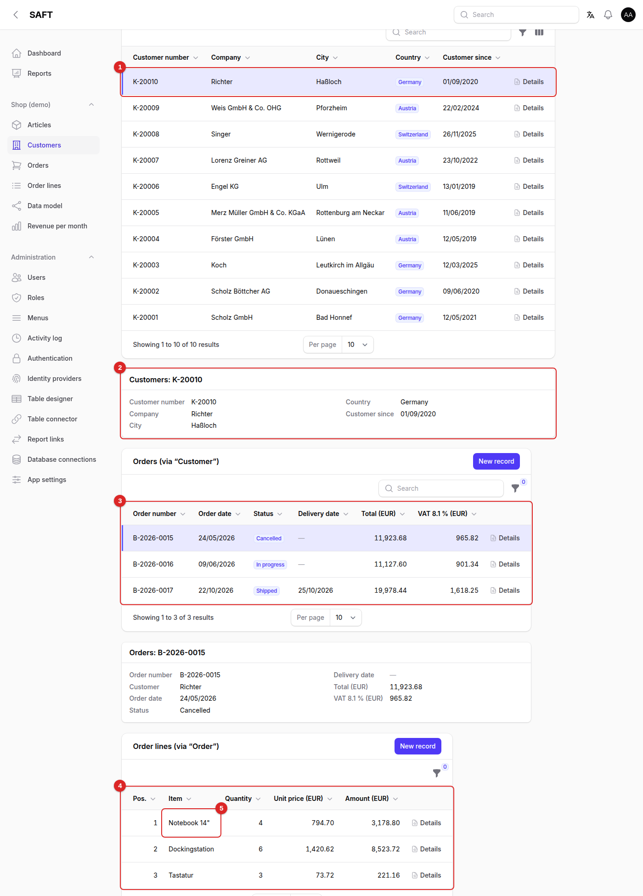
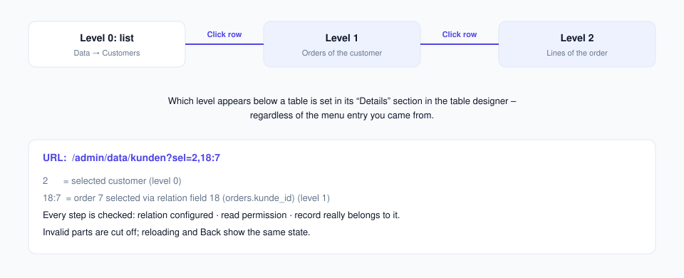
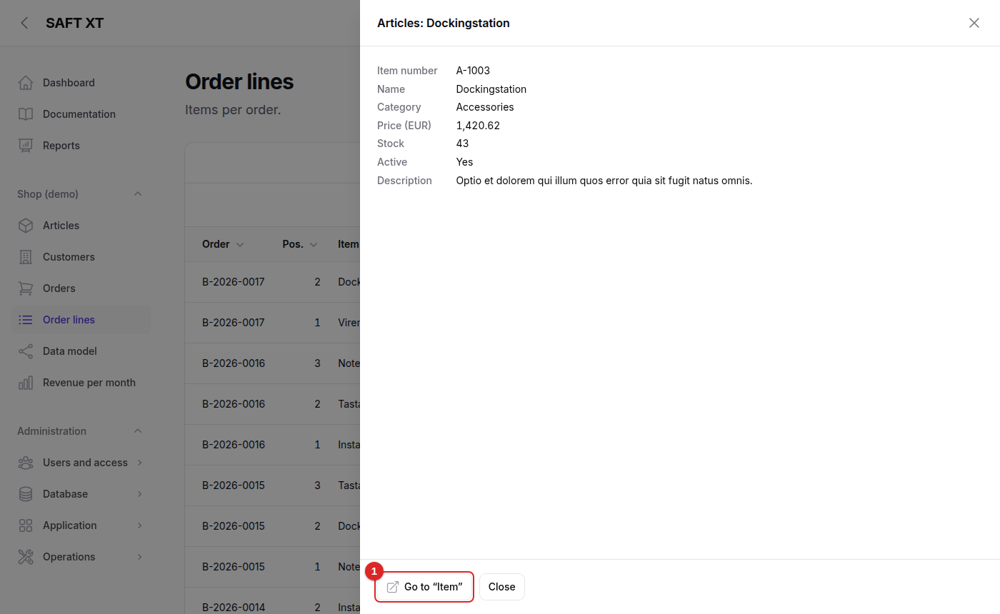

# SAFT XT – User Guide

[Deutsch](USER_GUIDE.de.md) · **English** · [Français](USER_GUIDE.fr.md) · [Italiano](USER_GUIDE.it.md)

**Version:** 0.1 · **Audience:** users

**Other guides:** [Administrator guide](ADMIN_GUIDE.md) · [Frequently asked questions](FAQ.md) · [System administration](SYSADMIN_GUIDE.md)

> **About the figures:** The figures are screenshots of the application with the demo data. The red numbers in the
> figures refer to the explanations in the text.

---

## Contents

- [1. Basic terms](#1-basic-terms)
- [2. Signing in and out](#2-signing-in-and-out)
- [3. Interface and dashboard](#3-interface-and-dashboard)
- [4. Working with data](#4-working-with-data)
   - [4.1 The table view](#41-the-table-view)
   - [4.2 Viewing, creating, editing and deleting records](#42-viewing-creating-editing-and-deleting-records)
   - [4.3 Related tables: the master-detail view](#43-related-tables-the-master-detail-view)
   - [4.4 How the master-detail view decides what to show](#44-how-the-master-detail-view-decides-what-to-show)
   - [4.5 Taking a quick look at a related record (preview)](#45-taking-a-quick-look-at-a-related-record-preview)
   - [4.6 Validation on input](#46-validation-on-input)
   - [4.7 Exporting data](#47-exporting-data)
   - [4.8 Importing data](#48-importing-data)
   - [4.9 Reports](#49-reports)
   - [4.10 Creating documents](#410-creating-documents)
   - [4.11 Changing several records (bulk edit)](#411-changing-several-records-bulk-edit)
- [Appendix A – Field types](#appendix-a--field-types)
- [Appendix B – Glossary](#appendix-b--glossary)

---
## 1. Basic terms

| Term | Meaning |
|---|---|
| **Table** | A collection of data of the same kind, e.g. *Customers* or *Articles*. Administrators create tables in the **table designer**. |
| **Record** | One row of a table, e.g. a single customer. |
| **Field / column** | A property of a record, e.g. *Company* or *City*. |
| **Relation** | A field that points to a record in another table, e.g. the field *Customer* in an order. |
| **Details** | The records that belong *to* a record through a relation, e.g. all orders of a customer ("1:n"). |
| **Role** | A group of permissions assigned to users, e.g. *sales*. |
| **Permission** | Permission for a specific action, e.g. "Data: Customers: edit". |

---

## 2. Signing in and out

Depending on how the administrator has set things up, the sign-in page shows:

1. **Sign-in buttons for single sign-on**, e.g. "Sign in with Company login". You are forwarded to your company
   account (Microsoft or another sign-in portal) and come back signed in.
2. **Email and password**, the classic sign-in with an account of this application. Upper and lower case in the
   email address do not matter.
3. **"Forgot password?"**, only shown if the administrator has enabled this function. For security reasons the
   response is always the same, even if there is no account for the address. The confirmation therefore does not
   mean that an email has been sent.

Which options are offered depends on the **sign-in mode** (see [Administrator guide, chapter 5](ADMIN_GUIDE.md#5-authentication)): password only, single
sign-on only, or both.

**Language:** You can choose the language on the sign-in page with the language icon. Without a choice, the page
follows the language of your browser. After signing in, the language stored in your account applies (see
[3](#3-interface-and-dashboard)); after signing out, the browser remembers the last one chosen.

**Signing out:** via the user menu at the top right. Depending on the settings, you are also signed out of the
company login.

> **Good to know:** If single sign-on is refused ("No access has been set up for your account" or similar), contact
> your administrator. Your account has not been enabled yet or is not assigned to a permitted group.

---

## 3. Interface and dashboard

- **Language:** With the language icon at the top right next to the search, you choose **Deutsch**, **English**,
  **Français** or **Italiano**, also on the sign-in page. The choice applies immediately and is stored with your
  account, so it also applies on other devices. All interface texts, messages, dates and numbers follow the
  language. The administrator can maintain menu entries, names of tables and fields, and the display of selection
  values per language (see [Administrator guide, chapter 3](ADMIN_GUIDE.md#3-menus) and [Administrator guide, chapter 4](ADMIN_GUIDE.md#4-table-designer)); if a translation is missing, the German
  text appears. Records and role names stay as they were entered.
- **My settings:** In the user menu (1, your initials at the top right) you find **My settings**. There you switch
  **High contrast** (2) on or off for your account; it then applies on all devices. **Automatic** (default) uses high
  contrast if "Increase contrast" is set in your operating system. High contrast uses darker text (lighter in dark
  mode, at least 7:1 according to WCAG AAA), strong borders, a clearly visible keyboard focus, underlined links and a
  framed selected row. Light, dark or system mode is chosen in the same menu; the choice is saved with your account
  and applies on every device – another person signing in on the same browser gets their own setting. Also there:
  the **number format** – **Automatic** (default: Swiss format if the preferred language of the browser is set to
  Switzerland, e.g. "German (Switzerland)"), **As the language** or **Switzerland** (1'234.50, in French 1 234,50). It
  applies to lists, details, reports and the CSV export; formulas always write decimals with a point.

  

- **Change password:** also in the user menu. Enter your current password and the new one twice; you stay signed in.
  The entry is missing if your account is linked via single sign-on (your organisation manages the password then) or
  sign-in with a password is switched off.
  The new password needs at least 12 characters; SAFT does not accept a password that has already appeared in a known
  data leak. Tip: several words that only you would put together are long and easy to remember.
- **Two-factor authentication:** in *My settings* under **Two-factor authentication › Set up**. You need an
  authenticator app on your phone (e.g. Microsoft Authenticator, Google Authenticator or 2FAS). Scan the QR code and
  confirm with the 6-digit code from the app and your password. SAFT then shows **8 recovery codes** once – print them
  or keep them in a safe place. From then on, SAFT asks for the current code from the app after the password. Without
  your phone, sign in with **"Use a recovery code instead"**; each code works only once. If two-factor authentication
  is required for your account, SAFT takes you straight to the setup after signing in. It does not apply to sign-in via
  single sign-on – your organisation is responsible there. Lost phone and codes: the administration resets the second
  factor.
- **My jobs:** SAFT does long jobs – export, import, documents for many records, snapshots, the AI app designer – in
  steps. Small amounts are done before you notice: the file comes as a download as usual. If it takes longer, SAFT
  takes you to the job's page. In the user menu, **My jobs** shows what you have started, with status and progress. If
  you open a job, you see a progress bar; as long as the page is open, SAFT keeps working at full speed. You may also
  close the page: the job continues in the background, and the bell tells you when it is done or has failed.
  **Cancel** ends it after the current step. If a job produces a file, download it with **Download result** – it stays
  available for 24 hours, even if you already downloaded it directly.

- The **menu** is on the **left**. It only shows the areas you have permissions for. Under **Data** you find the
  tables, under **Administration** the management functions. Entries with an arrow **›** on the right are submenus
  (e.g. *Administration › Users and access*): a click expands and collapses them like the main groups; open, the arrow points down. Your browser remembers the
  state; the submenu with the current page is open. If such an entry has a page of its own, a click opens it.
  The arrow **‹** next to the application name hides the menu completely to make more room for tables; the **☰**
  button in the same place shows it again. Your browser remembers the choice. The menu is as wide as its longest
  entry.
- **Documentation** (in the menu right below the dashboard) shows this guide and the frequently asked questions in the
  application, with a table of contents and a search field that searches all guides while you type. People with a
  permission in the Administration area also see the administrator guide. If plugins ship their own manuals (e.g.
  *Stock transfer*), they appear as further tabs when you may work with the functions. **About SAFT XT** shows the SAFT logo and the version with its status (e.g.
  *pre-release*), refers to the *Releases* page on GitHub for updates and shows the licence terms (with a link to the
  PolyForm Project website) and the third-party components with their licences.
- **Help assistant:** if it is set up and you have the permission, the **?** button at the top right opens a window
  where you ask questions about using SAFT, e.g. “How do I export this table?”. The answer is based on the manuals you
  may see and refers to the matching sections; the assistant knows which page you are on. When it opens, “Describe the current screen” is already in the field –
  sending is enough, or simply type over it. You find the same
  conversations under **Documentation** in the tab **AI assistant**, where you reopen, continue or delete earlier
  conversations. AI answers may contain mistakes – the manuals are authoritative.
- The **dashboard** is the start page. The tiles (widgets) are arranged in two columns that grow downwards
  independently; wide tiles follow below across the full width. Which tiles you see is set by the administrator
  through your role; tiles from plugins can be added, e.g. *Warehouse: minimum stock* – they carry the label "Plugin: …" below them, as pages from plugins do below their title; tiles of a plugin only appear in the app the plugin belongs to. You **arrange** them yourself: **"Customize dashboard"** (top right) shows a handle and
  **"Hide"** on every tile. Drag a tile by its handle within a column, into the other column or – reports only – into
  the wide area below, where it gets the full width. Hidden tiles are listed at the top and can be shown again there.
  The arrangement is saved immediately and also applies on other devices; **"Restore default"** resets it, **"Done"**
  ends customizing.

| Widget | Content | For |
|---|---|---|
| My last sign-in | Time, method and IP of your **previous** sign-in, plus failed sign-in attempts since then | everyone |
| My sign-ins | Your recent sign-ins and sign-outs | everyone |
| My recent changes | What you changed recently | everyone |
| Changes to my account | What others changed in your account, e.g. your roles | everyone |
| Reports | one tile per pinned report (see [4.9](#49-reports)); charts and key figures half width at first, tables full width | everyone with the permission "Reports: view" |
| Sign-in activity | Sign-ins of the last 7 days, failed attempts, signed-in users | admins |
| User overview | Active and inactive users, users without role, with SSO | admins |
| Identity provider status | State of the single sign-on connections, expiring certificates | admins |
| Scheduled tasks | Traffic light (all fine, failed tasks, scheduler not running, stuck or failed jobs) and the latest runs | admins |
| Recent changes (system-wide) | The latest entries in the activity log | admins |

> **Security tip:** If "My last sign-in" shows a time at which you did not sign in, or failed attempts, please
> inform your administrator.

---

### Switching apps

If you work with several **apps** (business applications, e.g. “Shop” and “Warehouse”), a **switcher** with the name
of the current app appears to the left of the search. It lists the apps you have access to; a click switches the app
and opens its dashboard. The choice is kept after signing out.

The current app determines what you see: the menus of that app (plus dashboard, documentation, reports and – depending
on your permissions – the administration), the dashboard layout, the reports and, under **Documentation**, the app's
manual if there is one. If you open a table or report of another app through a link or bookmark, SAFT switches there by
itself. With access to only one app, no switcher appears. An app deactivated by the administration is not offered.

## 4. Working with data

### 4.1 The table view

In the menu under **Data**, open a table, e.g. **Customers**.

1. **Search** searches the fields that are set up as "searchable".
2. **Filter**: there is a suitable filter for every column:
   - Text: "… contains"
   - Number and date: "… from" and "… until"
   - Yes/No, selection lists and relations: choice from a list
   - "Deleted records": only for users with delete permission
3. **Sort**: clicking a column header sorts in ascending or descending order. Every column can be sorted.
   Selection lists are sorted by the stored value, not by the displayed label.
4. **Edit, Delete, …** at the end of the row (see [4.2](#42-viewing-creating-editing-and-deleting-records)); on the
   smartphone **Details**.

At the bottom you choose how many records are shown per page (10, 25, 50 or 100) and move between pages with the page numbers and arrows (on narrow screens with "Previous" and "Next"). Dates and
numbers follow the chosen language: in English e.g. `01/02/2026 14:30` and `1,234.50`, in German `01.02.2026 14:30`
and `1.234,50`, in French and Italian `01/02/2026 14:30`. With the number format **Switzerland** (see
[chapter 3](#3-interface-and-dashboard)) numbers appear as `1'234.50`.

**Width:** A table is as wide as its columns. With few columns there is free space to the right, and the buttons of the row sit right next to the last column. If the columns do not fit into the window, the table is as wide as the window and can
be scrolled horizontally. Summaries and detail tables in the master-detail view behave the same way.

> **Which columns do I see?** The default is set by the menu entry you used to open the table. There can therefore
> be, e.g., "Orders" and "Orders (short)" with different columns. **Required fields** are always shown.
>
> With the **columns icon** to the right of the filter you show further fields or hide default ones and confirm with
> "Apply columns". SAFT remembers your choice **permanently for you personally** – per table and menu entry, also
> after signing out and on another computer. You change the **order** in the same menu by dragging the handle of a column; it is remembered as well.
> "Reset" restores the default. The columns icon and the order are also available in the detail tables of the
> master-detail view, the columns icon also in the lists of the administration.

SAFT also remembers **filters, search, sorting and rows per page** in the data views **permanently for you
personally** – per table and menu entry, even after signing out. When you open a table again, you see it as you
left it. If the view differs from the default, the button **Reset view** appears above the table: it sets filters,
search, sorting, rows per page and the column selection back to the default. In the administration lists, filters,
search and sorting only last until you sign out. **Numbers** are right-aligned in all tables.

### 4.2 Viewing, creating, editing and deleting records

Clicking a row selects the record (see [4.3](#43-related-tables-the-master-detail-view)). Editing is done with the
buttons at the end of the row – depending on the screen width:

**On the desktop** (from about tablet width) there are icons; the tooltip names the function:

| Icon | Function |
|---|---|
| **View** (magnifying glass) | The form with all fields, locked – computed fields too. |
| **Edit** (pencil) | Opens the input form as a window; **Save** or **Cancel** leads straight back to the table. |
| **Copy** (two sheets) | Opens “New record” with all values of the original; unique fields (e.g. item number) stay empty, computed ones are recalculated. Files and images are created as separate copies when saving. If records belong to it (e.g. the lines of an order), they are listed at the top under **Copy along** with a preselected tick – remove it to leave them out. Needs the permission to create. |
| **History** (clock) | Who changed what when (e.g. “status: New → Shipped”). |
| **Delete** (bin) | Deletes after a confirmation. |
| **Restore** | For deleted records instead of “Edit” and “Delete”. |
| Plugin icons | Functions from plugins, e.g. *Warehouse board*; the tooltip also names the plugin. |

Without edit permission “Edit” and “Delete” are missing.

**On the smartphone** you open the record with **"Details"** in a window sliding in from the right:

The window shows all fields of the record in one list – per field the name with the value next to it (as does the
preview of linked records). "Restore" only appears for deleted records.
At the bottom you find (1):

| Button | Function |
|---|---|
| **Edit** | Opens the input form. Changes take effect as soon as you save. Not available for deleted records. |
| **Copy** | Creates a new record with the values of this record (as in the table). |
| **History** | Shows who changed what and when (e.g. "status: New → Shipped"). |
| **Delete** | Marks the record as deleted. It disappears from the list but can be restored. |
| **Restore** | Only visible for deleted records. |
| **Close** | Closes the window without changes. |

**New record:** the **"New record"** button at the top right of each list.

**Attaching files:** A field of type *File* takes images, PDFs or other documents. Drag the files into the field or
click **"browse"**; with several files you can change the order by dragging, and the ✕ removes a file. Nothing is
stored until you click **Create** or **Save**. Which kinds and sizes of files are allowed is set per field by the
administration; other files are rejected as soon as they are uploaded. In the list, images appear as small previews
and other files with a paperclip (at most three, plus "+2" etc.); the details show all of them. A click on an image or PDF – or on
"+2" – shows the file in a **preview window**: the arrows (also the arrow keys) page through all files of the field,
and at the top you find **Open in new tab**, **Download** and **Close** (also Esc). Other files are downloaded directly. Only people who may read the table can see its files. The
filter **"with files" / "without files"** finds records with or without attachments.

Which buttons you see depends on your permissions: with read permission only, "New record", "Edit" and "Delete" are
missing.

> **Cannot delete?** A record cannot be deleted while other records refer to it, e.g. an order that still has order
> lines. The message names the reason, e.g. "1 × Order lines (via "Order")". Delete the related records first.

**Viewing deleted records:** With delete permission you can also show deleted entries with the "Deleted records"
filter and bring them back with **Restore** in the row (smartphone: "Details → Restore"). If another record now has the same value in a unique field, the
message "Data conflict" appears, and the record stays deleted.

> **Changed or deleted in the meantime?** If someone changes the record while you are editing it, SAFT reports
> "Changed in the meantime" with name and time when you save, and the window stays open with your input. **Reload**
> closes it and shows the current state; **Save anyway** overwrites the other change with your input (noted in the
> history as a deliberate overwrite). If the record has been deleted, saving is rejected. The same applies to the forms
> of the administration (roles, users, menus, tables …).

### 4.3 Related tables: the master-detail view

Tables are often related: a **customer** has **orders**, an order has **order lines**. The master-detail view shows
these relationships **one below the other on one page**:

How it works:

1. **Click a row**: in the list (here *Customers*), click a record. It is **highlighted in colour**.
2. **Summary**: below it, the data of the selected customer appears – the fields whose columns are visible in the list (also ones
   you showed yourself) and the required fields –, per field the name with the
   value next to it, in up to three blocks side by side (numbers right-aligned, long texts wrapped) …
3. **… and its details**: here the table of its **orders**. If you click an order there, it is highlighted as well …
4. **… and its details appear below**: here the **order lines**.
5. **Related values** (here the item names) can be clicked and show the related record in a preview (see
   [4.5](#45-taking-a-quick-look-at-a-related-record-preview)).

Further rules:

- **Clear the selection:** click the highlighted row again.
- **Select another row:** everything below is rebuilt.
- **Delete the selected record:** the selection is cleared, and the summary and details below disappear
  immediately.
- **Up to four levels** are shown one below the other (list + three detail levels).
- **Several detail tables on one level** (e.g. a customer has *Orders* and *Invoices*) appear as **tabs**. The
  label also names the relation, e.g. "Orders (via "Customer")". This keeps two relations from the same table
  distinguishable. The next level appears under the tab in which you made the selection. Another tab loads its table
  only when you open it; a loading indicator appears briefly. This keeps the click on a record fast, even if it has
  many detail tables.
- **New record in a detail table:** the relation is set automatically: a new order line always belongs to the
  currently selected order. No new records can be created below a deleted record; the button is missing there.
- **Editing** is done here, too, with the buttons in the respective row (smartphone: **"Details"**).
- **Bookmarks and links:** your selection is stored in the browser's address bar. Reloading and a shared link show
  exactly the same view. If you leave the page and come back with "Back", you find your selection again. "Back" does
  not step through individual row clicks, however: it goes to the previous page.

### 4.4 How the master-detail view decides what to show

- **Which details** appear below a table is a **property of the table** and is set in the table designer (see
  [Administrator guide, chapter 4](ADMIN_GUIDE.md#4-table-designer)) – via relation fields or via [table links](ADMIN_GUIDE.md#11-table-links), also to tables of other
  databases. That is why you always see the same order lines below an order, **no matter**
  whether you came via "Data → Orders" or via "Data → Customers" and then an order.
- **Permissions apply per table:** a detail table only appears if you are allowed to **view** the table. Without
  read permission for order lines, you see the order but no lines below it.
- **Deleted records** only appear in the cascade for users with delete permission.
- **Security:** the selection in the address bar is checked on every request. If a part does not match (e.g. an
  order that does not belong to the selected customer), the selection is cut off at that point; data you are not
  meant to see is never shown.

### 4.5 Taking a quick look at a related record (preview)

Related values, e.g. the **item** in an order line or the **customer** in an order, can be clicked in tables. A
click opens a window on the right with all data of the related record, **without leaving the current page**:

- **Close** returns to the unchanged view.
- **"Go to "Item""** (1) opens the table *Articles* with this article selected, including its details below.
- Without read permission for the related table, the value cannot be clicked.
- If the related record has been deleted, the window says so clearly.

### 4.6 Validation on input

When saving, the application checks the input against the settings in the table designer. Errors are shown at the
field concerned:

| Check | Example message |
|---|---|
| Required field | "The title field is required." |
| Length / range | maximum number of characters, minimum, maximum |
| Email / URL | the format is checked |
| Unique | "… has already been taken" (deleted records do not count) |
| Selection list | only the predefined values |
| Relation | only existing, non-deleted records |
| File | only allowed file kinds, at most the configured size and number |

### 4.7 Exporting data

With **"Export"** at the top of a list, you save the current view as a file on your computer: **Excel (.xlsx)** or
**CSV (.csv)**. The button appears if export is allowed for the table (see [Administrator guide, chapter 4](ADMIN_GUIDE.md#4-table-designer)) and your role
has the **Export** permission (see [Administrator guide, chapter 2](ADMIN_GUIDE.md#2-roles-and-permissions)).

The file contains what the list currently shows:

- **Records:** all hits across all pages, with the current filter, search and sorting. In a detail table these are
  only the records of the selected entry.
- **Columns:** the columns currently visible, including your own column choice.
- **Values:** as displayed, e.g. the label of a selection list and "Yes" or "No". Long texts, however, are
  included in full.

| Format | Particulars |
|---|---|
| **Excel** | Numbers and dates are real values you can calculate with. An Excel cell holds at most 32,767 characters; longer texts are cut off there. Numbers with more than 15 digits are stored as text so that no digit is lost. |
| **CSV** | In the notation of the chosen language: in English separated by commas (`1234.50`, `01/02/2026`), in German by semicolons (`1234,50`, `01.02.2026`), in French and Italian by semicolons (`1234,50`, `01/02/2026`). This way Excel in the same language opens the file directly in columns. Texts starting with `=`, `+`, `-` or `@` get a leading `'` to protect against injected formulas. |

The export runs as a **job** (see [My jobs](#3-interface-and-dashboard)): small lists come at once as a download, as
usual. If it takes longer than a few seconds, SAFT takes you to the job's page with a progress bar; at the end the file
is ready there under **Download result** and stays available for 24 hours – also under **My jobs** if you left the page
in the meantime. As a guide, SAFT manages a few hundred rows per second. By default at most 500,000 records can be
exported at once (the administration can change or lift the limit); with more hits a notice appears and no file is
created – narrow the selection with filters or search.

> **Data protection:** Every export is recorded in the activity log. The exported file itself, however, is no longer
> subject to any permission check. Handle it with care.

### 4.8 Importing data

**"Import"** at the top of a list creates new records from a file – for example: download an empty template, fill it
in outside SAFT and read it back in. The button appears if import is allowed for the table (see
[Administrator guide, chapter 4](ADMIN_GUIDE.md#4-table-designer)) and your role has the permissions **Create** and
**Import**.

- **Download template:** an empty Excel file with all fields that can be filled in; required fields are marked with `*`.
  An export of the table is also suitable as a template.
- **Import file …:** Excel (.xlsx) or CSV, at most 20 MB and 100,000 rows. The first row contains the column headings –
  the label of the field in one of the four languages or its technical name. Columns without a matching field, e.g.
  computed fields from an export, are skipped and listed.
- **Check:** SAFT checks the file as when entering data by hand: required fields, length, range, email/URL, unique
  values (also within the file) and the rules of the table. Up to 2,000 rows this happens at once in the dialog: if
  something is wrong, a list with row, column and reason appears and **nothing** is created; otherwise the second step
  shows the number of new records. Larger files are checked completely only during the import; the second step says so.
  Only **Import** creates the records.
- **As a job:** The import runs as a [job](#3-interface-and-dashboard) in two phases – first **checking**, then
  **importing** –, and the progress names both. Small files are done at once, and the message gives the number of
  records. For large ones SAFT takes you to the job's page; expect a few minutes per ten thousand rows, because every
  record is created as if entered by hand. If the check finds errors, the job ends as failed with the list of errors,
  and nothing is created. **Cancel** or an error while importing also removes all records created so far – it is always
  all or nothing.
- **Values** may be written as the export delivers them: selection lists with label or stored value, yes/no (also
  Ja/Nein, Oui/Non, Sì/No, 1/0), relations with the displayed name (e.g. "ACME AG") or the number, dates as 31.12.2026,
  31/12/2026 or 2026-12-31, numbers as 1234.50, 1234,50 or 1'234.50.
- **File fields** are not in the template and stay empty on import, even if they are required; the dialog points
  this out.
- **Only new records:** existing records are never changed. An export read back in unchanged therefore reports
  "already taken" for unique fields.
- Defaults (sequential numbers, copy from) and computed fields are set as when entering data. The activity log
  contains one entry "imported" with file and count.

### 4.9 Reports

**Reports** in the main menu summarises data of the table designer tables and of connected tables (via their
[data snapshot](ADMIN_GUIDE.md#data-snapshots-for-reports)) – as a list, table, cross table, bar, line
or pie chart, or as a single key figure. The permissions **Reports: view** (look at) and **create** (create your own)
are required.

**The editor** (create or edit) works like a pivot table:

| Area | Meaning |
|---|---|
| Left: base table and fields | Choose the "finest" table, e.g. items instead of orders. Below it its fields and the fields of **parent** tables, grouped by relation (e.g. "Order › Customer", up to three levels); with a search field. |
| Right: list columns | Without values the **columns of a list** (one record per row); with values the fields to group by. Date fields can be summarised by day, week, month, quarter or year. |
| Right: crosstab columns | Optionally one field whose values become columns (**cross table**). |
| Right: values | Calculations: sum, average, minimum, maximum (numbers), count, count distinct; "number of records" without a field; **＋ Calculated value** with your own formula and **＋ Figure from values** (see below). |
| Right: filters | Condition and value in a dialog matching the field type; for date fields also "this year", "last month", "last N days". |
| Centre: preview | Recalculates after every change (at most 100 rows). Above it the display (table, cross table, bar, line, pie, key figure); unsuitable ones are locked, the tooltip names the reason. Clicking a column header sorts. |

You **drag** fields from the list into an area or assign them with **＋** (also by keyboard); they can be moved within
and between areas, ✎ changes the label or filter, ✕ removes. Above the preview a **sentence describes the report**,
e.g. "Sum of Amount per Month (Order date), split by Category; only Status does not equal “cancelled”" – it also
appears on the result page and in the list. Deleted records never count.

**Calculated values and columns:** Where no stored field exists, a **formula** calculates per record.

- **＋ Calculated value** (under "Values") summarises a formula – as sum, average, minimum or maximum, e.g.
  *purchase volume* = sum of `[Quantity] × [Item › Purchase price]`.
- **＋ Calculated column** (under "List columns", only in lists without values) shows the result per record, e.g.
  *margin* = `[Sales price] − [Purchase price]`. The column can be sorted and exported.
- **In the dialog** the reachable number fields appear as buttons – including fields of parent tables such as
  "Item › Purchase price"; a click inserts `[label]` at the cursor. There are also buttons for `+ − × ÷ ( ) ;` and the
  functions `round(x; digits)`, `abs(x)`, `min(a; b)`, `max(a; b)` and `coalesce(x; fallback)`. Instead of `×` and `÷`
  you may type `*` and `/`.
- **Checked while typing:** Above the formula field on the right it says "Formula is valid." or shows the error, e.g.
  "“Name” is not a number". You also choose a label and the **decimal places** (default 2).
- **Empty values:** If a field is empty, the result is empty – except with `coalesce([field]; 0)`. Division by 0 also
  gives an empty result. Calculation is exact, in the database.
- In the structure, formulas are marked with **ƒ**; ✎ opens the dialog again. If you add values to a list with a
  calculated column, the column is marked red: calculated columns only exist in lists.
- **Tip:** If the value already exists as a stored (e.g. computed) field, that field is usually the better choice, such
  as *purchase value* of the stock movements: it keeps the price at the time of the movement.

The warehouse demo shows all options in **Artikel-Kalkulation** (calculated columns), **Bewegungskennzahlen je
Artikelgruppe** (calculated values) and the key figure **Lagerwert gesamt**.

**Figure from values:** A calculated value computes per record, *before* summarising. For ratios of summarised values –
e.g. *budget per publication* = project budget ÷ number of publications of the project – there is **＋ Figure from
values** (under "Values", as soon as there is a value). It computes per result row *after* summarising:

- The buttons in the dialog insert the other **values** (e.g. "Number of records") and the **grouped number fields**
  under "List columns" (e.g. "Project › Budget (CHF)"), which have exactly one value per row. Date fields with a level
  and texts are not possible, nor is another figure from values.
- Operators, functions, checking while typing, label and decimal places as for a calculated value; division by 0 gives
  an empty result. In the structure the figure is marked **Σƒ**; it can be sorted and exported and also works in cross
  tables and charts.
- **Caution with fields of parent tables:** With the base table *Publications* the project budget appears in every
  publication row. Group by it (under "List columns") or summarise it with **average** or **maximum** – with **sum** a
  project with five publications would count its budget five times.

Example in the research demo: **Budget je Publikation** (base table Publications, columns Project and Project ›
Budget (CHF), value Number of records, figure `[Budget (CHF)] ÷ [Publikationen]`).

**AI assistant:** If it is set up and you have the permission, the field **Describe the report** appears above the editor.
Describe in your own words what you want to see, e.g. "purchase volume per supplier for 2026 as bars"; the proposal
fills the editor and can be checked and changed as usual. Nothing is saved until you click **Save**. A further entry
adjusts the proposal ("only receipts", "as a line"); **Start over** begins a new conversation. The assistant sets the
name of the report as long as you do not enter or change it yourself; **Start over** clears a name set this way. The
assistant also builds formulas and figures from values. Your description and the names of the tables and fields of the current app you may evaluate, plus shared fields of other apps, are
transmitted – **never records**. The number of requests per day is limited; the assistant shows how many are left today.

**Sharing:** A report is private or **shared**. Who sees and runs it is always decided by the **data permissions of
the person calling it**: they need read permission for every table involved, including tables used only in a
filter. Shared reports over tables you may not read do not appear in your list; calling one directly names the
missing table. Only people with **Reports: edit** edit other people's reports; **Duplicate** creates your own copy.

**In the menu:** Shared reports can be placed in a menu group as a menu entry of type **Report** (see
[Administrator guide, chapter 3](ADMIN_GUIDE.md#3-menus)).

**Export:** On the result page under **Export** as Excel or CSV – as the page shows the report (list, grouped table or
cross table), without the preview limit. In Excel numbers and dates stay numbers and dates; CSV uses the separators of
the language. Every export is recorded in the activity log.

**Add to my dashboard:** pins the report as its **own tile** to your personal dashboard (charts and key figures in
full, tables with the first ten rows). Charts and key figures start in one of the two columns, tables in full width;
with "Customize dashboard" you drag a tile into the wide area or back (see [chapter 3](#3-interface-and-dashboard)).
The same button removes it again. Your data permissions apply there too.

**List of reports:** the **Display** column shows table, cross table, bar, line, pie or key figure with an icon. The
search finds names and descriptions; filters narrow by **Display**, **Base table**, **Created by**, **Shared** and
**Changed** (from–until), **Only mine** shows your own.

> **Good to know:** If the data model changes (field deactivated or deleted), the report shows which field is missing
> instead of a result. Renaming does no harm – reports refer to the field itself, not to its name.

**Connected tables** (table connector) are not queried live but through their **data snapshot** – a copy in SAFT's
database (see [Administrator guide, chapter 10](ADMIN_GUIDE.md#data-snapshots-for-reports)).

The base table selection has a **search field** at the top (label, technical name, connection) and shows an icon per
table: database = SAFT table, grey cloud = connected without snapshot, green cloud = connected with snapshot (with
date). When you choose a connected table, SAFT creates missing snapshots right away – for it and for the connected
tables reachable through relations that you may read. **Read permission** on the table is sufficient. If a snapshot is
older than one day (`REPORTS_SNAPSHOT_STALE_HOURS`, default 24), a dialog asks: **Create new snapshot** or **Use
existing**.

Once a base table is chosen, only tables **linked to it through relations** can be chosen (in both directions, over
any number of levels); the others are greyed out under "Not linked to …". For an unlinked table, first use **Clear
selection** (top entry of the list). If the report already has fields, SAFT asks before changing or clearing, since
rows, columns, values and filters are emptied.

Below the table, the result names the snapshot used, e.g. "Data as of: Persons (Research) at 04.12.2026 09:30". The **newest
complete** snapshot always applies; if it is deleted, the report automatically uses the previous one. Relations
between connected tables of the same connection can be used as usual. **Across sources** – a SAFT table with a
connected table, or tables of different connections – are joined by [table links](ADMIN_GUIDE.md#11-table-links); their fields
appear in the field tree under the link's label, e.g. "Contacts › Person (Research) › Last name".

### 4.10 Creating documents

If there is a **document template** for a table (e.g. “Invoice” for receipts), the icon **“Create document”** (arrow
down) appears in a record's row; on a smartphone it is in the details window. It only appears if your role has the
permission *Documents: generate*.

1. Click the icon. If there are several templates, choose the **template**.
2. **“Store in field …”** (preselected) also stores the PDF with the record, e.g. in the receipt files. The switch only
   appears if the template has a storage field and you may edit the record.
3. **Create** downloads the PDF.

The PDF is on your organisation's letterhead, with an address field for window envelopes and page numbers. Numbers,
dates and selection values appear in the language of the template or the record.

**Stored documents** are write-protected: creating again places a **new version** next to it
(`Rechnung-V-2025-001 (2).pdf`); nothing is ever overwritten. Only those who may delete records of the table may remove
such a document from the file field; otherwise a message appears immediately when removing, and the file stays. When
**copying** a record, created documents do not come along. Every created document is shown in the record's **history**
(“document generated”, with template, file name and checksum SHA-256) – also if it was only downloaded.

If the file field is full (maximum number of files), the document is only downloaded; a message points this out.

**Several records at once** (e.g. all invoices of a term):

1. In the list, choose the records with the **checkboxes** at the start of the row. The checkbox in the table header
   selects the whole page; SAFT then offers to select **all** the filter shows – also on the further pages.
2. Click **“Create documents”** in the table header, choose the template and the **output**: **one PDF with all
   documents** (for printing; each starts on a new first page of the letterhead) or **ZIP with one file per document**.
3. **“Store in field … for each record”** (preselected) stores each document with its record, as above.
4. **Create** downloads the file (e.g. `Rechnung-2026-11-22.pdf`). With many records this runs as a
   [job](#3-interface-and-dashboard): SAFT takes you to its page, the progress counts the documents, and at the end the
   file is ready there for 24 hours under **Download result**. **Cancel** ends the run; documents already stored stay
   with their records.

The message afterwards says how many documents were created and stored and, per record, what could not be stored
(e.g. field full) – these documents are in the file anyway. There is a limit only if the administration sets one; with
very many documents, ZIP is the better output, because a single PDF merges all pages at once. Deleted records are skipped
by the bulk action.

**Send by email:** If the template provides an email and your role has the permission *Documents: send*, the dialog
shows the switch **“Send by email”**. **To**, **subject** and **text** are prefilled from the template (e.g. the
customer’s address) and can be changed before sending; separate several addresses with commas. **Copy to me** sends
you a blind copy. The PDF is attached; sent documents are stored with the record where possible. The **history** shows
“document sent” with recipient and subject. In the bulk action, **“Send by email for each record”** sends each record
its email with the template’s subject and text – each as soon as the documents of a step are stored; the message
afterwards says how many emails were sent and which records have no valid address.

**QR bill:** If the template appends a QR bill, the **payment part with receipt** appears at the bottom of the last
page or on a page of its own – with amount, reference and your customer as debtor. Customers pay it with their banking
app (scan the QR code) or at the post office counter. If information is missing (e.g. a valid IBAN in the letterhead) or
the amount is not a number, a message gives the reason and the document is not created – contact your administration.

**As Word:** If the template also allows Word, choose the **Format** **PDF** or **Word** in the dialog. The Word file
(.docx) is meant for editing, e.g. to adjust a letter: it has header, address field and tables like the PDF, but without
letterhead background and without QR bill. It is only downloaded – what is stored and sent by email is always the PDF.
Several records as Word come as a ZIP.

---

### 4.11 Changing several records (bulk edit)

With a bulk edit you change a field for many records at once without opening each one – for example all enrolments
from *waiting list* to *active*, replacing a teacher in all courses of a semester, or raising the fee of all courses of
a subject by 5 %.

1. **Select:** narrow the list with a filter or search and tick the **checkboxes** at the start of the rows. The
   checkbox in the table header selects the rows of the page; the list then offers **“Select all N”** across all pages.
   Only records the filter currently shows are changed.
2. **“Change …”** in the bar above the table opens the dialog. Tick the fields to change and choose how per field:
   **set** (one value for all, with the usual input field), **clear**, **calculate**, **replace** or **formula** (see
   below). All other fields stay as they are.
3. The **preview** below shows up to ten records that change, with *before → after*, counts the unchanged ones and
   gives hints, e.g. about number sequences. If a calculation fails, the reason is shown in red in the example.
4. **“Check only”** checks all selected records without changing anything; the dialog stays open.
   **“Change N records”** checks and changes.

**Calculate, replace, formula:** these kinds compute the new value per record from its previous value.

- **calculate** for numbers: + − × ÷ or “change by %” (also negative, −10 %). Rounding is commercial to the decimal
  places of the field, optionally to fewer places or to a **multiple** (e.g. 0.05). Example: fee of the courses of a
  subject plus 5 %, rounded to 0.05 – 12.34 becomes 12.95. For date fields: ± days or ± months, e.g. due date of open
  invoices + 30 days. At the end of a month the date stays in the month (31 Jan + 1 month = 28 Feb); a time stays as it
  is.
- **replace** for text: search text → replacement within the value, all matches. Optionally **“Match case”**, **“Whole
  word only”** (no letter or digit before and after) and **“Keep the case of the match”** (the replacement is written in
  upper or lower case like the match). Example: “str.” → “strasse” with “Keep the case of the match” turns “Bahnhofstr.
  3” into “Bahnhofstrasse 3” and “Str. des 1. Mai” into “Strasse des 1. Mai”. It is always one search text per field
  and run; there are no wildcards or regular expressions.
- **formula** for numbers and yes/no: a formula as for computed fields, calculated per record. The field's name stands
  for its previous value; other fields, computed fields and sums over detail records are allowed. Example:
  `round(tarif * 1.05 / 0.05, 0) * 0.05`. Below the input it says whether the formula is valid. A division by 0 is an
  error and prevents the bulk edit.

If the previous value is empty, a text has no match or a formula yields nothing, the record stays unchanged; preview
and message count it as “without a value or match”. All kinds see the values before the bulk edit, even when several
fields are changed at once. If a result does not fit the field (too many digits, text too long), that is an error;
nothing is cut off.

SAFT checks every record as when editing by hand – required fields, validation rules, table rules and plugins (e.g. a
conflict check). It is **all or nothing**: if one record fails, none is changed, and the message names the records with
the reason. Deselect or correct them and try again. Records that already have the new value stay unchanged. With many
records the bulk edit continues as a **job**; you see the progress under *My jobs*. If someone changes one of the
records during the bulk edit, it is fully reverted.

Fields whose value SAFT determines or that cannot be set to the same value for all are not offered: number sequences,
computed fields, files and images. Unique fields cannot be set (one value for all) but can be cleared, replaced or
calculated; if a value would then occur twice, the check reports it. Required fields cannot be cleared. In a detail table (e.g.
the enrolments of a course) the link to the main table is fixed. The **history** of a record shows “(bulk edit)” for
such changes. If you change a field that decides when a number is assigned, the records get their numbers in the order
of their keys.

**Deleting and restoring:** **“Delete selected”** deletes the selected records; those referred to by other records stay
and are counted in the message. With the filter “Deleted records”, **“Restore selected”** brings deleted records back.

You see the button “Change …” with the *Edit* permission if the administration allows bulk edits for the table. At most
5,000 records per bulk edit unless the administration sets something else.

---

## Appendix A – Field types

| Type | Example | Particulars |
|---|---|---|
| Text (single line) | Company, item number | maximum length adjustable; optional email or URL check |
| Text (multi-line) | Note | |
| Integer | Stock, year | minimum/maximum; switch off **"With thousands separator"** for years and numbers ("2024" instead of "2,024") – applies to tables, details, reports and export. Automatically off on import and for MySQL columns of type `YEAR` for year values |
| Decimal | Price | total digits and decimal places; minimum/maximum |
| Yes/No | Active | |
| Date | Order date | |
| Date and time | Timestamp | |
| Selection list | Status, country | fixed values with display label |
| Relation | Customer of an order | related table and displayed field; basis for details and preview |
| File | Contract, product photo | images, PDF, Office documents, text/CSV or any files; maximum size and number per field; preview in list and details. Not in the import; the export contains only the file names (see [4.2](#42-viewing-creating-editing-and-deleting-records)) |
| Computed | Amount = quantity × unit price | result as integer or decimal, formula; calculated when saving, not entered (see [Computed fields](ADMIN_GUIDE.md#computed-fields)) |
| Number sequence | Invoice number R-2026-0042 | pattern with year, month and running number, optionally with a counter of its own per document type (e.g. V-2026-001 for income, E-2026-001 for expenses); assigned on create (or only once a condition is true, e.g. status *Sent*; until then the form shows "assigned when …"), unique and not changeable afterwards (see [Number sequences](ADMIN_GUIDE.md#number-sequences)) |

---

## Appendix B – Glossary

| Term | Explanation |
|---|---|
| **App** | business application, e.g. “Shop” or “Warehouse”: tables, menus, reports and roles that belong together; switch with the switcher at the top |
| **Single sign-on (SSO)** | Signing in with a central company account instead of a separate password |
| **Identity provider (IdP)** | The service that performs the sign-in with SSO, e.g. Microsoft Entra ID |
| **Entra ID** | Microsoft's identity service (formerly Azure Active Directory) |
| **SAML** | A widely used standard for SSO |
| **Master-detail** | Display of a record (master) with the records assigned to it (details) |
| **Soft delete** | "Deleting" as a mark; the record can be restored |
| **Audit / activity log** | Complete record of all changes |
| **Default language** | German; applies if neither account nor browser selects an offered language, and as a substitute for missing translations |
| **CSV** | Text file with values separated by a delimiter; readable by Excel and other programs |
